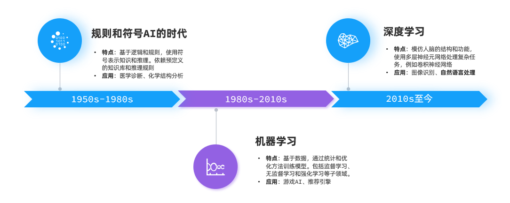
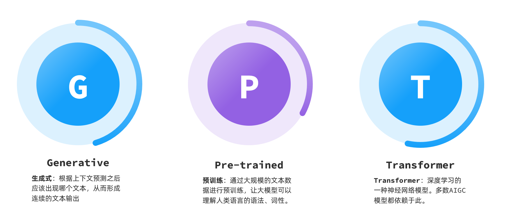
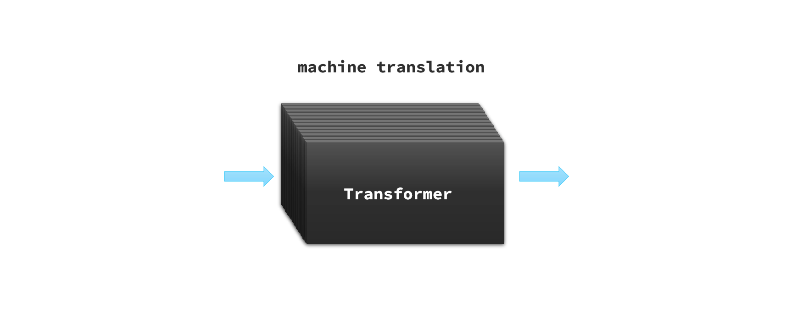
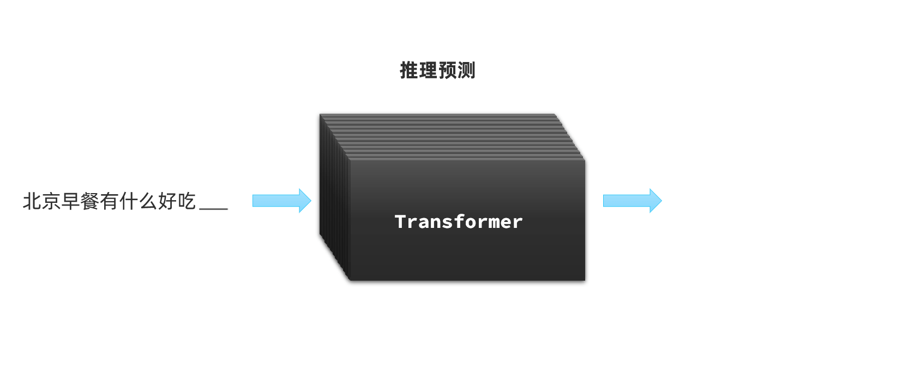

# Chap01. 认识AI

本篇介绍了AI的一些核心概念，有利于你理解大模型开发的一些原理。

## 1.人工智能发展

**AI**，人工智能（**A**rtificial **I**ntelligence），使机器能够像人类一样思考、学习和解决问题的技术。

AI发展至今大概可以分为三个阶段：

其中，深度学习领域的自然语言处理(**N**atural **L**anguage **P**rocessing, NLP)有一个关键技术叫做**Transformer**，这是一种由多层感知机组成的神经网络模型，是现如今AI高速发展的最主要原因。

我们所熟知的**大模型**（**L**arge **L**anguage **M**odels, LLM），例如GPT、DeepSeek底层都是采用Transformer神经网络模型。

以GPT模型为例，其三个字母的缩写分别是Generative、Pre-trained、Transformer：

那么问题来， Transformer神经网络有什么神奇的地方，可以实现如此强大的能力呢？

## 2.大模型原理

其实，最早Transformer是由Google在2017年提出的一种神经网络模型，一开始的作用是把它作为**机器翻译**的核心：

Transformer中提出的**注意力机制**使得神经网络在处理信息时可以根据上下内容调整对数据的理解，变得更加智能化。这不仅仅是说人类的文字，包括图片、音频数据都可以交给Transformer来处理。于是，越来越多的模型开始基于Transformer实现了各种神奇的功能。

例如，有的模型可以根据音频生成文本，或者根据文本生成音频：

还有的模型则可以根据文字生成图片，比如Dall-E、MidJourney：

不过，我们今天要聊的**大语言模型**（**L**arge **L**anguage **M**odels, 以下简称LLM）是对Transformer的另一种用法：**推理预测。**

LLM在训练Transformer时会尝试输入一些文本、音频、图片等信息，然后让Transformer推理接下来跟着的应该是什么内容。推理的结果会以概率分布的形式出现：

可能大家会有疑问：

> 仅仅是推测接下来的内容，怎么能让ChatGPT在对话中**生成大段的有关联的文字内容**呢？

其实LLM采用的就是笨办法，答案就是：持续生成

根据前文推测出接下来的一个词语后，把这个词语加入前文，再次交给大模型处理，推测下一个字，然后不断重复前面的过程，就可以生成大段的内容了：

这就是为什么我们跟AI聊天的时候，它生成的内容总是一个字一个字的输出的原因了。

以上就是LLM的核心技术，Transformer的原理了\~

如果大家想要进一步搞清楚Transformer机制，可以参考以下两个视频：

<bookmark name="90分钟！清华博士带你一口气搞懂人工智能和神经网络_哔哩哔哩_bilibili" href="https://www.bilibili.com/video/BV1atCRYsE7x"></bookmark>

<bookmark name="www.youtube.com" href="https://www.youtube.com/watch?v=wjZofJX0v4M&amp;t=1169s"></bookmark>

---
> 来源：飞书技术知识库（脱敏版） · 06 AI 应用开发 / AI 与大模型基础 / Chap01. 认识AI · [原文](https://ccn8v2zngwsm.feishu.cn/wiki/F70SwQsh5ixlclkdBdVcgWUtn1c)
