# Dify环境搭建

**建议在安装前先把原来的容器和镜像都删了（除mysql和redis外）**

```XML
# 删除容器
docker rm -f 容器名称/容器id

# 删除镜像
docker rmi 镜像名称/镜像id

```

## 升级docker-compose

- 找到资料中的`docker-compose`文件，上传到`/usr/local/bin`目录，替换掉原来的docker-compose
- 授权`sudo chmod +x /usr/local/bin/docker-compose`
- 验证`docker-compose --version`


## 加载镜像

从当天资料中，把dify镜像上传到虚拟机中，最好在虚拟机中提前准备好一个目录（`dify_dev`），单独存储镜像

如下图：

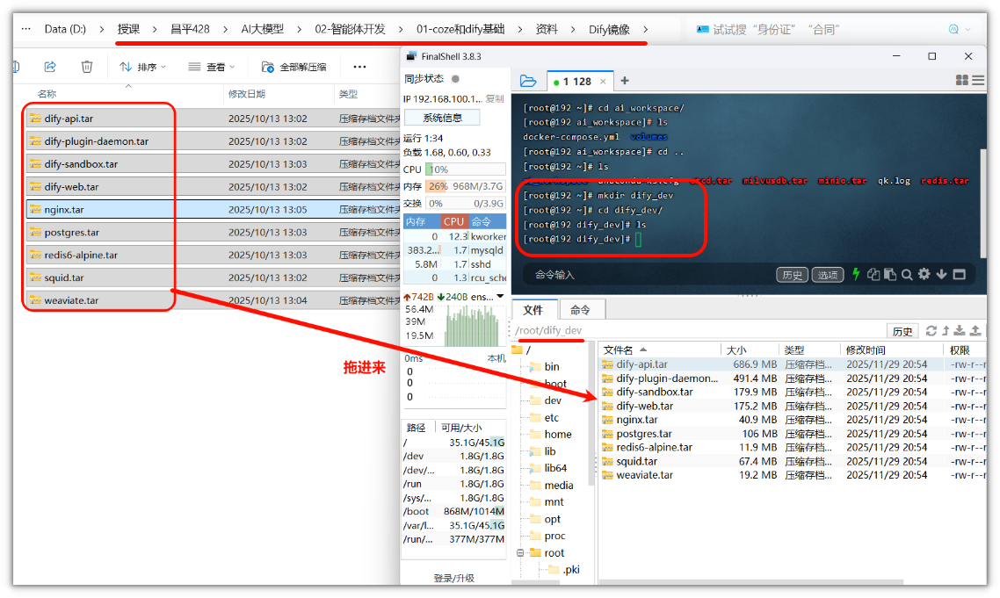

在 `dify_dev` 执行命令，加载镜像到docker中

```Bash
docker load -i dify-api.tar | docker load -i dify-plugin-daemon.tar | docker load -i dify-sandbox.tar | docker load -i dify-web.tar | docker load -i nginx.tar | docker load -i postgres.tar | docker load -i redis6-alpine.tar | docker load -i squid.tar | docker load -i weaviate.tar
```

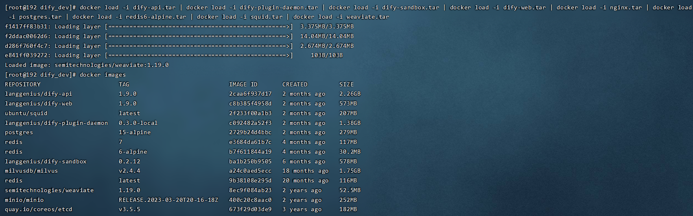

## 安装Dify环境

### 下载Dify项目压缩包

github地址：https://github.com/langgenius/dify/tree/main

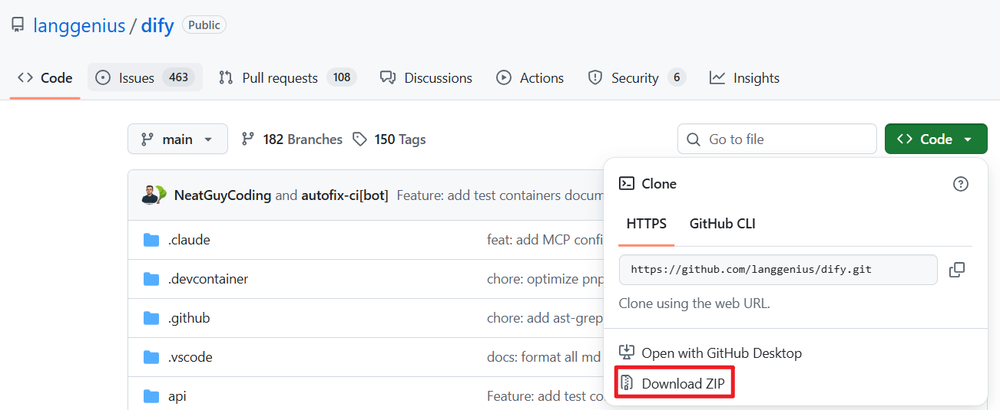

当然，在今天的资料我也已经提前帮大家下载好了对应的源码包

<figure view-type="Card"><source name="dify-main.zip" mime="application/x-zip-compressed" size="24161367" token="MLIJbvKYToLhBgx2LRrcOAJ2nJh"/></figure>


### 解压源码包

把源码上传到服务器中，还可以放到`dify_dev` 中

解压缩zip包

```Bash
# 先安装 unzip 指令
yum install unzip 

# 解压dify-main.zip 文件
unzip dify-main.zip

```

然后进入`dify_dev`目录中找到`docker`目录，然后进入`docker` 目录


### .env文件重命名

在`docker`目录中找到`.env.example`隐藏文件，改名为`.env`


```Bash
# 可以查看目录中所有的文件，包括隐藏文件
ls -a 

# 改名 .env.example  --->  .env
mv .env.example .env
```


### 运行docker环境

在 `/root/dify_dev/dify-main/docker` 执行命令

```Python
# 创建并启动容器
docker-compose up -d

# 停止并移除容器
docker-compose down
```


## 启动Dify

在浏览器中输入 [http://192.168.100.168/install](http://192.168.100.168/install) 

首次登录需要进行注册

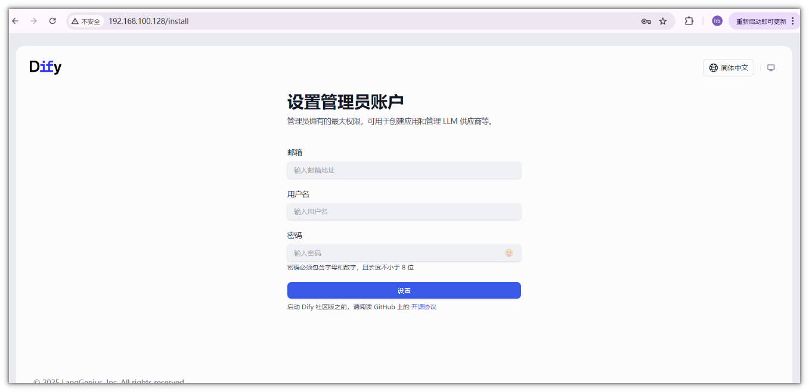


注册之后，可以进入到主页面

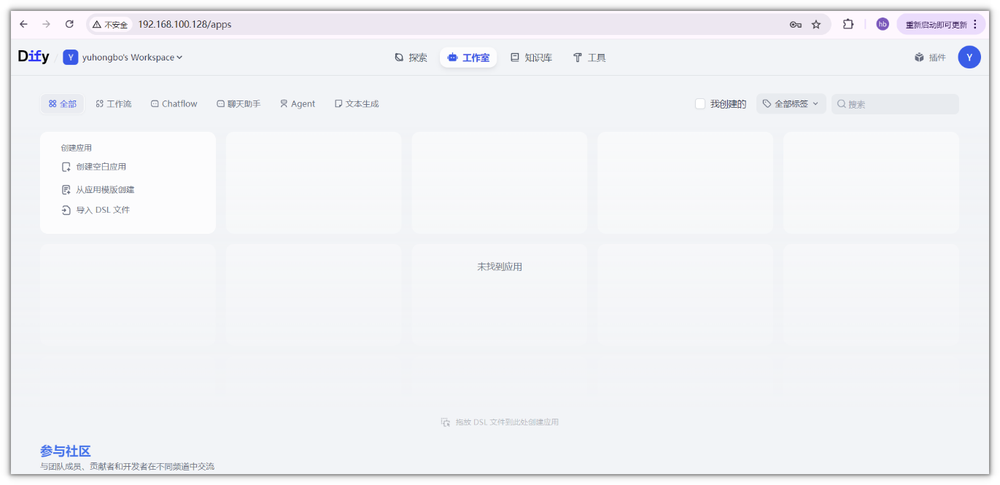

## 接入大模型

接入的大模型可以有：

- Ollama
- 通义千问
- 深度求索
- 智普AI


- 点击用户名，选择设置

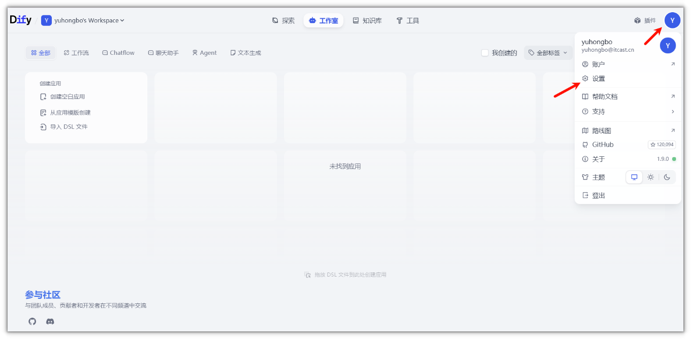


- 接入大模型

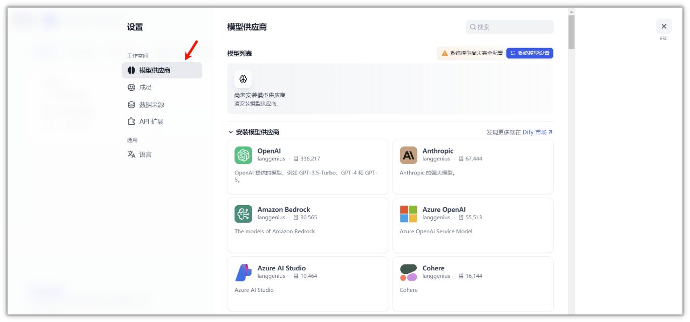


选择模型供应商，然后搜索安装模型供应商

然后点击**通义千问**，进行安装

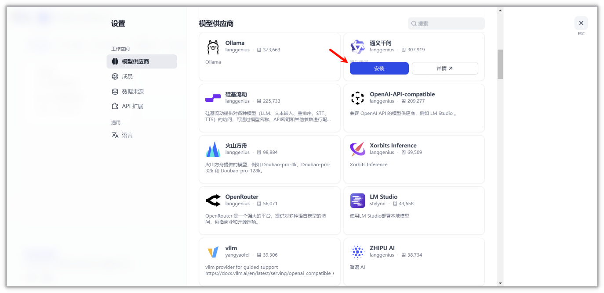

> 如果安装失败，可安装几次，即可安装成功

在市场中可以搜索历史版本进行安装

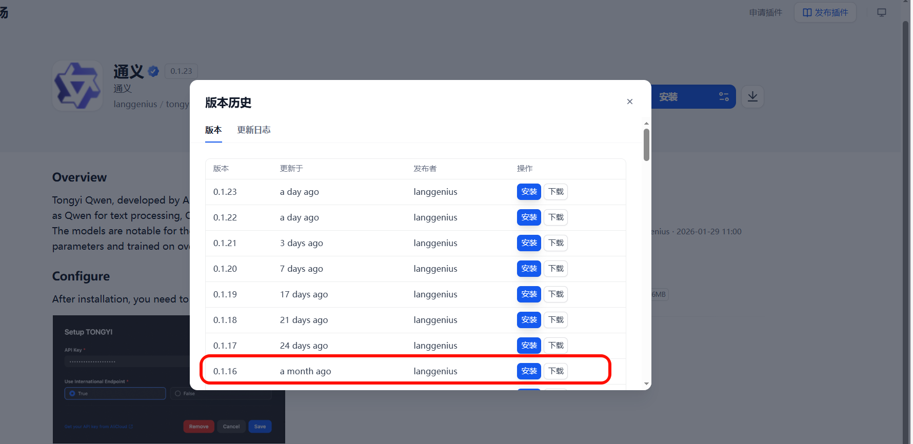


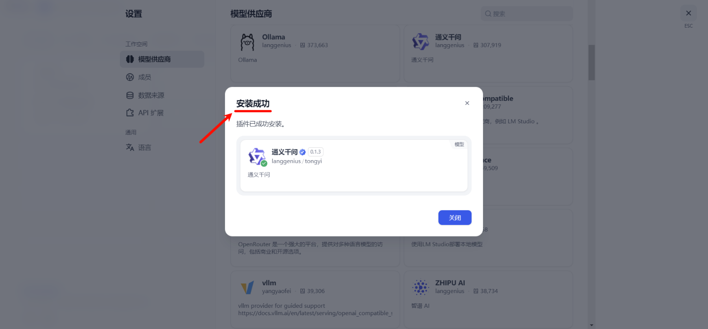


- 安装以后，到待配置区

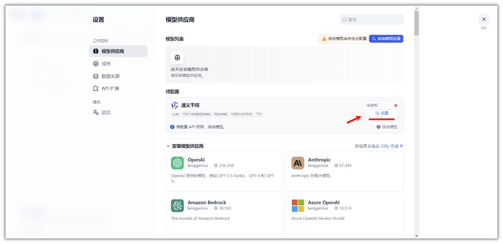

- 点击设置

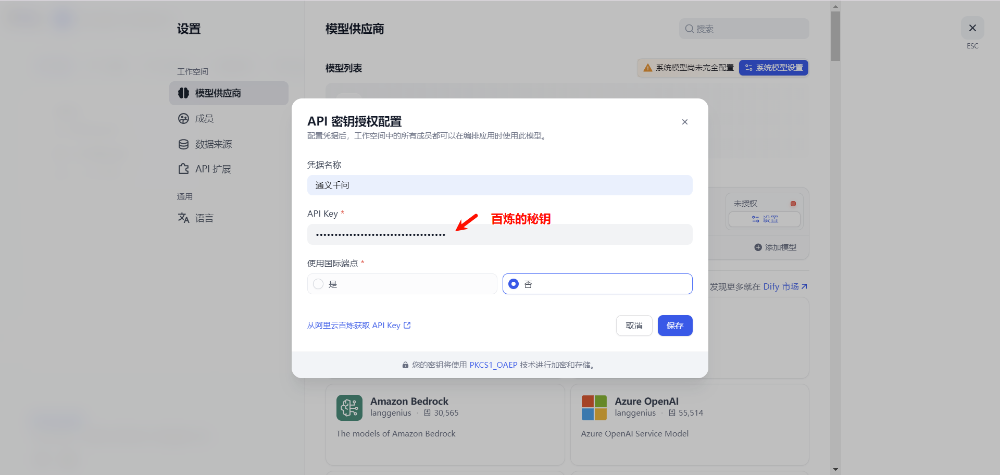

凭据名称和API Key从阿里百炼平台获取

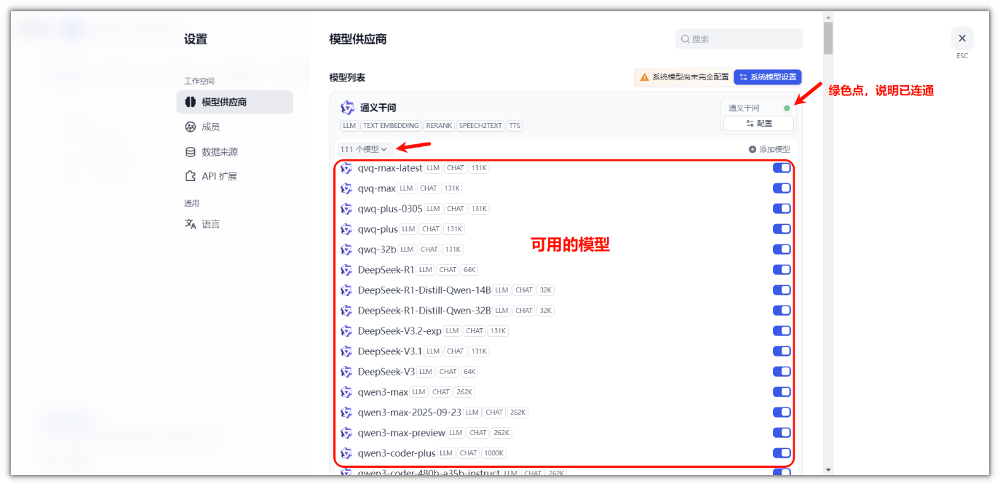

---
> 来源：飞书技术知识库（脱敏版） · 06 AI 应用开发 / 低代码智能体平台（Coze / Dify） / 平台智能体 / 01-Coze+Dify基础 / Dify环境搭建 · [原文](https://ccn8v2zngwsm.feishu.cn/wiki/SebPwNNBxin822kvCncc5L2FnUe)
