# RAGFlow安装

## 镜像准备

上传资料中的RAGFlow的镜像文件到服务器中，加载为镜像

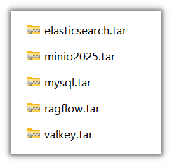

执行命令：

```Bash
docker load -i elasticsearch.tar | docker load -i minio2025.tar | docker load -i mysql.tar | docker load -i ragflow.tar | docker load -i valkey.tar 
```

> 镜像较大，加载时长要耐心等待


注意：由于这几个镜像占用内存较大，建议把虚拟机的内存调大，10g左右即可

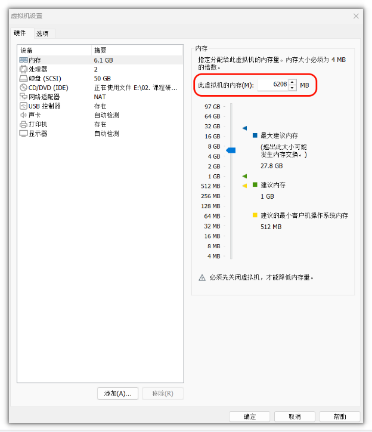


## 下载github项目源码

<bookmark name="GitHub - infiniflow/ragflow: RAGFlow is a leading open-source Retrieval-Augmented Generation (RAG) e" href="https://github.com/infiniflow/ragflow.git"></bookmark>

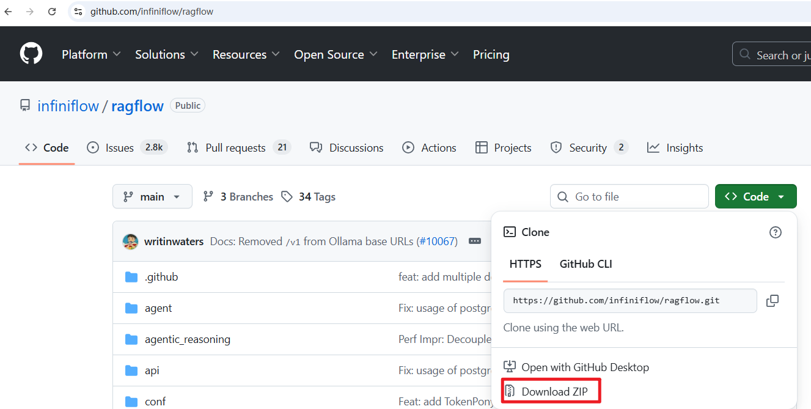


然后解压`ragflow-main.zip` 压缩包（当天资料中已提供，最好创建一个目录）

```Bash
unzip ragflow-main.zip
```

由于前面我们已经安装了Dify项目，这两个项目都依赖了redis，且web端的端口都是默认80端口，因此，为了避免冲突，我们需要修改ragflow-main目录下的相关配置文件。

## 修改配置信息

### 修改web访问默认端口

修改文件位置： `ragflow-main/docker/docker-compose.yml` 文件

**原来的**                                                                                    **修改后的**

<grid>
<column width-ratio="0.500836">
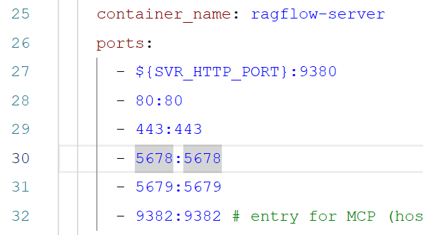
</column>
<column width-ratio="0.499164">
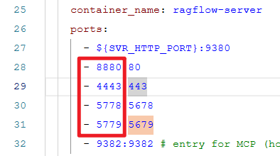
</column>
</grid>

### 修改redis配置

修改 `ragflow-main/docker/.env` 文件

**原来的**                                                                          **修改后的**

<grid>
<column width-ratio="0.466161">
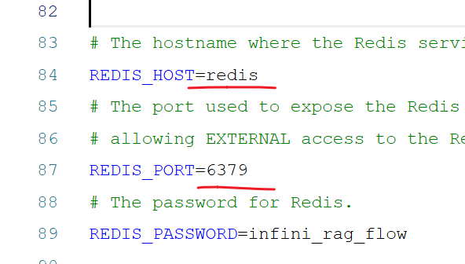
</column>
<column width-ratio="0.533839">
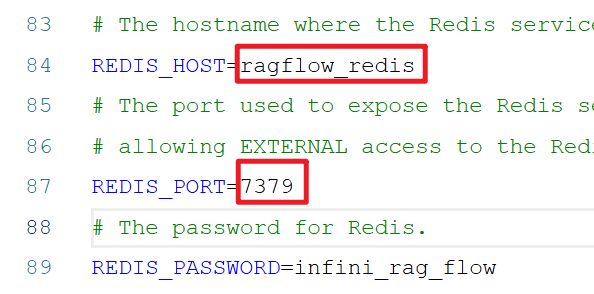
</column>
</grid>

修改 `ragflow-main/docker/docker-compose-base.yml` 文件

**原来的**                                                                                    **修改后的**

<grid>
<column width-ratio="0.516146">
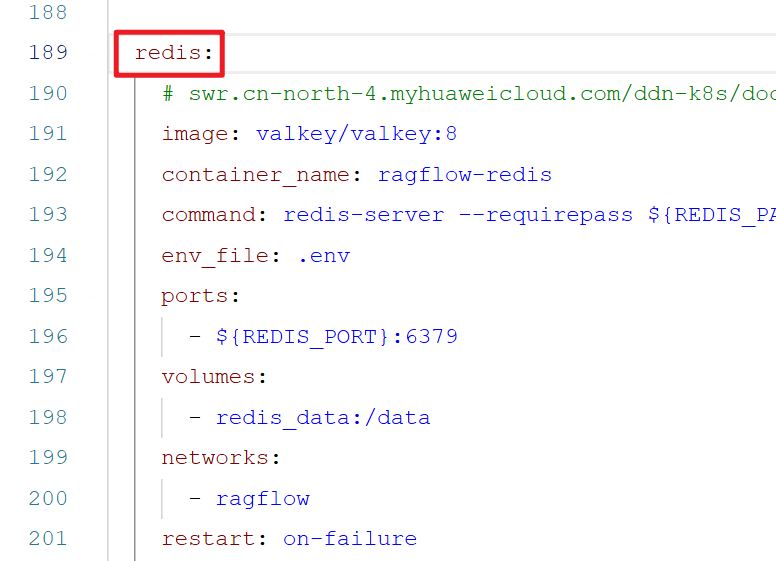
</column>
<column width-ratio="0.483854">
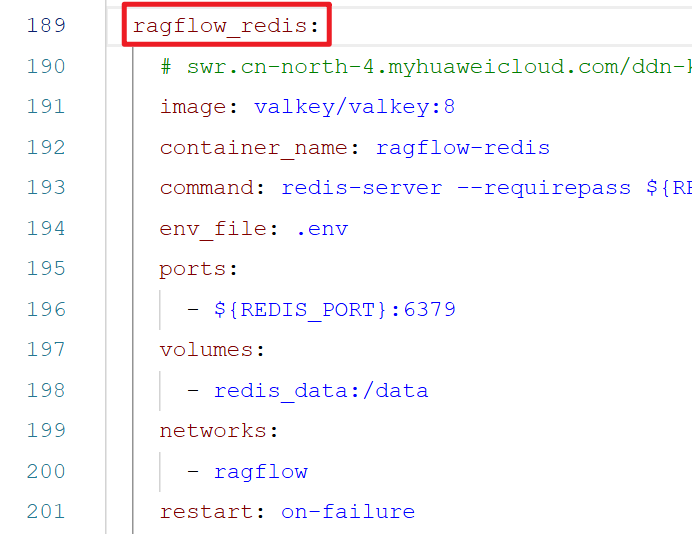
</column>
</grid>

## 启动服务

进入docker目录，执行命令：

```Python
docker-compose up -d
```


时间比较久，需要大家耐心等待。


## 访问RAGFlow

由于前面，我们把web端口设置为了8880端口，docker镜像拉取后，等待容器启动完成，在浏览器输入:`192.168.100.168:8880` 即可访问


至此，ragflow就安装完成了，注册完成后主页面如下：

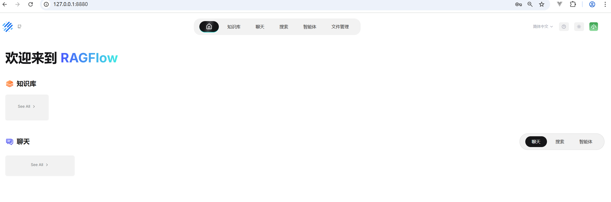

## 接入大模型


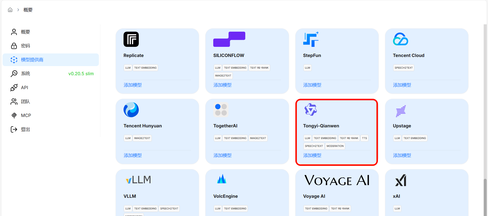


<grid>
<column width-ratio="0.219095">

</column>
<column width-ratio="0.780905">

</column>
</grid>

---
> 来源：飞书技术知识库（脱敏版） · 06 AI 应用开发 / 低代码智能体平台（Coze / Dify） / 平台智能体 / 02-Dify综合案例 / RAGFlow安装 · [原文](https://ccn8v2zngwsm.feishu.cn/wiki/CIVpwEkM4iObtNkugtPcINu3ntb)
