<title>05-EduRAG-环境准备</title>

# 1 项目背景

近年来，随着ChatGPT的广泛应用，基于大规模语言模型（LLM）的技术已成为人工智能领域的研究和应用热点

然而，这些模型主要依赖于过往的训练数据，无法动态获取最新的知识以及各企业特有的私有知识

这种局限性常常导致生成答案时出现**“幻觉”**问题，即模型提供的答案与实际情况不符或不准确

为了有效解决这一问题，企业普遍采用了以下两种主要手段：

1. **基于企业私有知识的垂直领域微调**：通过将企业领域的特定知识融合到大模型中，进行微调，使得模型能够更好地服务于垂直行业的专业需求
2. **基于企业私有知识的RAG问答系统**：通过构建基于检索的问答框架，结合企业私有知识库，实现更为精准且动态更新的知识问答服务，从而减少幻觉问题的发生

接下来我们先基于第二个解决思路来搞定一个教育行业的问答系统，项目流程图示如下：

1. 将现有后台搜集的FQA数据集存储到Mysql数据库中
2. 搭建本地知识库：对本地文档加载读取；进行文档分割；文档向量化；存储向量数据库（Milvus）
3. 基于query实现Mysql数据库检索：将query和现有问题做相似度计算，如果阈值>=0.85，就认为问题比较明确，直接返回对应的答案；否则，进入RAG检索系统
4. 基于query实现Milvus数据库检索：将query进行向量表示，并从Milvus数据库中检索出相似的文本段，将query和文本段拼接，送入大模型，实现预测

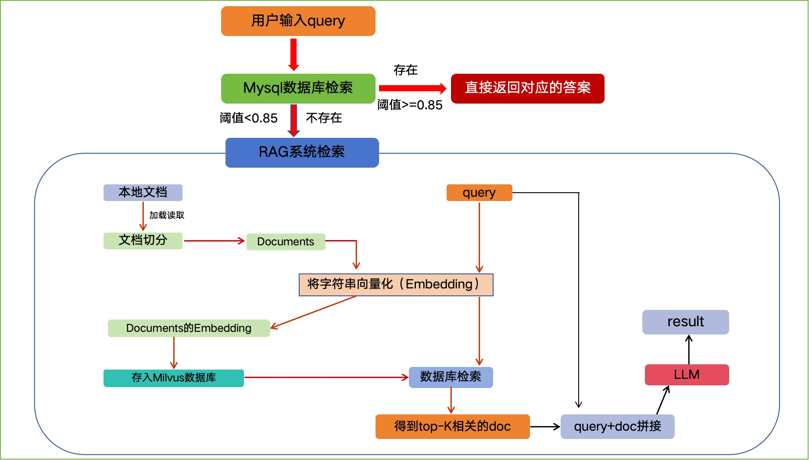


# 2 Milvus

Milvus是一个向量数据库（2019年提出），能够处理**万亿级别**的向量索引

Milvus用于处理从非结构化数据转换而来的嵌入向量，能够通过计算它们的相似距离来分析两个向量之间的相关性

官网：https://milvus.io/zh

优势：

- 在处理大规模数据集的向量搜索时具有高性能
- 开发者优先的社区，提供多语言支持和工具链
- 云扩展性和高可靠性，即使出现故障也不会受到影响
- **通过将标量过滤与向量相似度搜索配对，实现混合搜索**

## 2.1 安装Milvus

### 2.1.1 准备虚拟机

1. 设置虚拟机的网络为192.168.100.x
2. 将资料中提供的Centos镜像导入到虚拟机
3. 启动完毕之后，登录服务器192.168.100.128。 输入用户名：root，密码：1234 

### 2.1.2 安装服务

1. 将资料中提供好的软件镜像包上传到Linux中

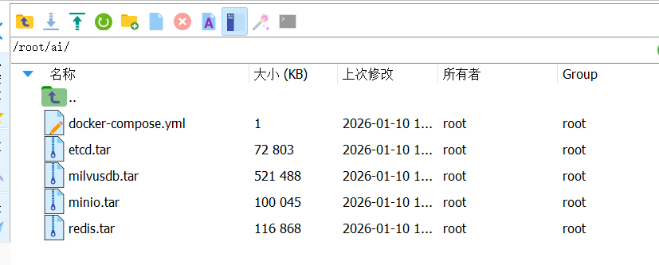

1. 执行下面命令安装镜像

```Shell
docker load -i redis.tar
docker load -i etcd.tar 
docker load -i minio.tar
docker load -i milvusdb.tar
```

1. 创建一个文件夹，用于存放 Milvus 和 Redis 的配置文件和数据

```Bash
mkdir /root/ai/dev/milvus_redis -p
cd /root/ai/dev/milvus_redis
```

1. 在 /root/ai/dev/milvus_redis 目录下创建文件 docker-compose.yml 内容如下：

```YAML
services:
  etcd:
    container_name: milvus-etcd
    image: quay.io/coreos/etcd:v3.5.5
    environment:
      - ETCD_AUTO_COMPACTION_MODE=revision
      - ETCD_AUTO_COMPACTION_RETENTION=1000
      - ETCD_QUOTA_BACKEND_BYTES=4294967296
      - ETCD_ENABLE_V2=true
    volumes:
      - ./volumes/etcd:/etcd/data
    command: etcd -advertise-client-urls=http://127.0.0.1:2379 -listen-client-urls http://0.0.0.0:2379 --data-dir /etcd/data

  minio:
    container_name: milvus-minio
    image: minio/minio:RELEASE.2023-03-20T20-16-18Z
    environment:
      MINIO_ACCESS_KEY: minioadmin
      MINIO_SECRET_KEY: minioadmin
    volumes:
      - ./volumes/minio:/minio/data
    command: minio server /minio/data
    healthcheck:
      test: ["CMD", "curl", "-f", "http://localhost:9000/minio/health/live"]
      interval: 30s
      timeout: 20s
      retries: 3

  standalone:
    container_name: milvus-standalone
    image: milvusdb/milvus:v2.4.4
    command: ["milvus", "run", "standalone"]
    environment:
      - ETCD_ENDPOINTS=etcd:2379
      - MINIO_ADDRESS=minio:9000
    volumes:
      - ./volumes/milvus:/var/lib/milvus
    ports:
      - "19530:19530"
      - "9091:9091"
    depends_on:
      - "etcd"
      - "minio"

  redis:
    container_name: milvus-redis
    image: redis:latest
    restart: always
    ports:
      - "6379:6379"
    volumes:
      - ./volumes/redis:/data
    command: redis-server --requirepass 1234

networks:
  default:
    name: milvus-network
```

Milvus 服务

- `image`: 使用 Milvus 官方镜像 `milvusdb/milvus:v2.4.10`。
- `ports`: 映射 gRPC（19530）和 RESTful API（9091）端口。
- `volumes`: 数据持久化存储到本地 `./volumes/milvus` 目录。
- `environment`: 配置日志级别和 Etcd 参数。
- `command`: 启动 Milvus 单机模式。

Redis 服务

- `image`: 使用 Redis 官方镜像 `redis:7.2`。
- `ports`: 映射默认端口 `6379`。
- `volumes`: 数据持久化存储到本地 `./volumes/redis` 目录。
- `command`: 启用 AOF（Append Only File）持久化模式。
- `volumes`: 定义持久化存储卷。

1. 启动 Milvus 和 Redis，在 /root/ai/dev/milvus_redis 目录下，运行命令：docker compose up -d

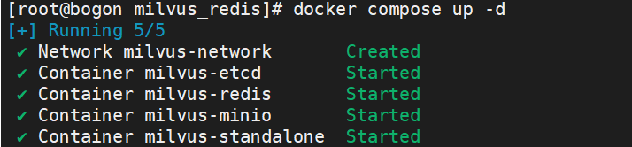

### 2.1.3 连接Milvus

1. 验证milvus是否安装成功，可以使用可视化工具连接即可，在当天的资料中找到对应的软件


1. 安装成功之后，可以直接连接Milvus服务

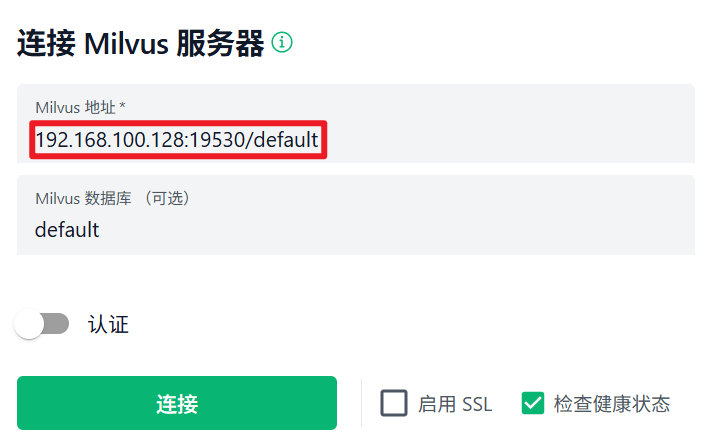

1. 连接成功后，可以看到默认的数据库

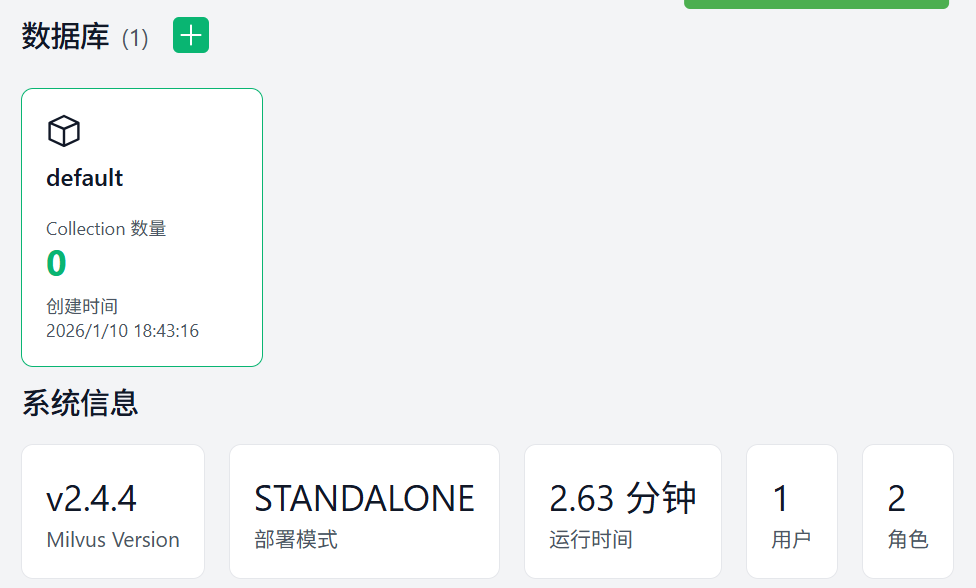


## 2.2 核心概念

Milvus本质上是一个数据库管理系统（软件）， 我们可以在其内部创建一个个的数据库，然后再向数据库中创建Collection（数据表）

### 2.2.1 集合属性

collection schema 是集合的属性

<sheet sheet-id="XrxOEG" token="AUdksW6dehsONMtrizkcvXJenGe"></sheet>

### 2.2.2 字段属性

Field schema 是字段的属性

<sheet sheet-id="TSKPgD" token="AUdksW6dehsONMtrizkcvXJenGe"></sheet>

## 2.3 索引

索引是建立在数据之上的附加结构，它可以加快搜索速度，在搜索或查询插入的实体之前，必须声明索引类型，如果未指定，则Milvus将默认使用暴力搜索

索引是特定于字段的，作为专业的向量数据库，Milvus注重提高向量搜索和标量过滤的性能，因此提供了多种索引类型。

> **推荐补充学习资料:  https://www.bilibili.com/video/BV1JF4m177Wd**

<sheet sheet-id="JtCmiD" token="AUdksW6dehsONMtrizkcvXJenGe"></sheet>

### 1.3.1 FLAT

FLAT：这是最简单的索引方式，进行暴力搜索，可以保证精确度，但效率低，尤其在数据量大时。**适合在小型、百万级数据集上寻求完全精确的搜索结果**

<callout emoji="✏️">
**FLAT（暴力搜索）**
就像一本未分类的电话簿，你要找一个人，就得从头到尾一个一个看。
- 优点：100% 准确。
- 缺点：速度慢，只适合数据量小（百万级以下）的场景。
例子：如果你只有1000张图片，用 FLAT 找最相似的一张没问题。
</callout>

### 1.3.2 IVF_FLAT

IVF_FLAT是一种基于聚类和倒排索引来进行数据存储和检索的方法，广泛用于在**大规模数据集上实现高效的近似最近邻搜索**

1. **聚类**：通过聚类算法将高维空间中的向量划分为多个子空间（簇），每个簇包含一组相似的向量，并且每个簇会有一个代表向量，通常是簇的中心点
2. **倒排索引**：为每个簇创建倒排索引。每个向量会被映射到它所属的簇

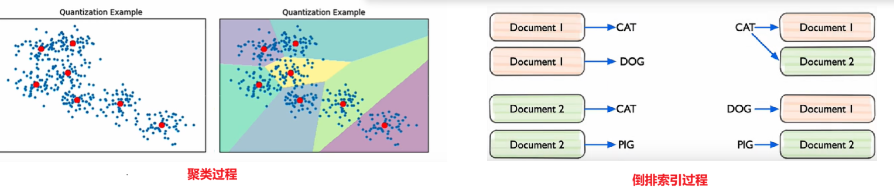

这样在查询时，系统只需关注与查询向量相似的簇，而不需要搜索整个高维空间，从而显著降低搜索的时间复杂度

为了优化查询，IVF_FLAT使用一个参数 nprobe 来控制搜索的簇数

- 增大 nprobe 可以搜索更多簇，返回更多候选向量，提高结果的精确度，但查询时间也会增加
- 减少 nprobe 可以缩小搜索范围，降低计算时间，查询速度更快，但可能会牺牲一些精度

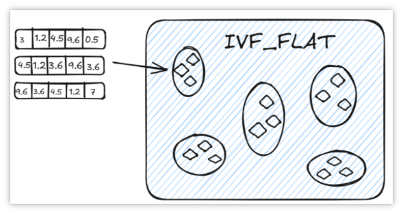

<callout emoji="✏️">
**IVF_FLAT（ 聚类+倒排索引 ）**
就像把图书馆的书先按主题分类，你找书时只需在相关主题区找
- 聚类：把所有向量分成若干组（簇），每组有一个中心点
- 倒排索引：记录每个向量属于哪个组
查询时，先找到离查询向量最近的几个组，再在这些组里细找
参数nprobe：控制搜索几个组，越多越准但越慢，越少越快但可能漏掉一些
</callout>

### 1.2.3 IVF_SQ8

是在 IVF_FLAT 基础上增加了量化步骤的一种索引方法，其核心思想与 IVF_FLAT 类似

IVF_SQ8通过 **标量量化** （Scalar Quantization）将每个维度的 4 字节浮点数表示压缩为 1 字节整数表示

![图片展示了IVF_SQ8索引方法中标量量化过程。左侧是原始向量，如\[0.3, 0.8, 0.4, 0.2, 0.7\]等，右侧是量化后的向量，如(1, 4, 2, 1, 3)等。下方是量化范围，如\[0.0, 0.2) -> 0等。右侧还画有多个椭圆，椭圆内有方块，代表不同簇。该图与上下文紧密相关，直观呈现了IVF_SQ8通过标量量化将浮点数向量压缩为整数向量的过程。](https://feishu.cn/file/MgxEbNzNmoIy4CxEH1Tc7obTnLb)

### 1.2.4 IVF_PQ

IVF_PQ是一种高效的向量索引方式，结合了倒排文件索引和乘积量化（Product Quantization）技术，旨在加速大规模高维数据集的检索

- **倒排索引**：首先将数据集划分为多个簇，每个簇由一个聚类中心表示。查询时，先计算查询向量与这些聚类中心的距离，选择最接近的几个簇进行详细搜索
- **乘积量化**：在每个簇内，向量被进一步量化为多个子向量，这些子向量通过独立的量化过程进行编码。这样可以显著降低存储需求，并加快相似度计算

IVF_PQ通过减少存储空间的占用，同时保持较高的查询速度和准确性，适用于处理大规模高维向量数据

> **推荐补充学习资料:**  https://www.doubao.com/chat/36534212460515586

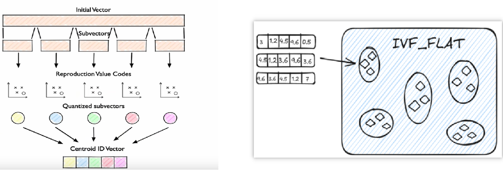

<callout emoji="✏️">
 **IVF_PQ（乘积量化）**
更极致的压缩，不仅压缩数字，还把向量拆成多个子向量分别压缩。
比如：一个向量`[0.1, 0.9, 0.2, 0.8]`可以拆成两个子向量：`[0.1, 0.9]` 和 `[0.2, 0.8]`，分别量化[3 , 7]
- 优点：极大节省存储，适合超大规模数据（十亿级以上）
- 缺点：精度损失比 IVF_SQ8 更大。
</callout>

### 1.2.5 HNSW

HNSW是基于图的索引，最适合对搜索效率有高要求的场景

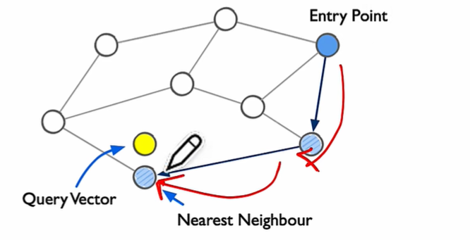

<callout emoji="✏️">
**HNSW（基于图的索引）**
像人际网络：你通过朋友认识朋友的朋友，快速找到目标人物
- 优点：查询速度非常快，适合高并发场景
- 缺点：构建索引慢，占用内存大
</callout>

请参阅[向量索引](https://www.milvus-io.com/reference/index)以了解更多详细信息。

## 2.4 相似度度量

在Milvus中，相似度度量用于衡量向量之间的相似性。也就是两个向量在高维空间中的距离

### 2.4.1 欧几里得距离

欧几里得距离（L2，也称为欧式距离）：就是两点之间的直线距离，值越小越相似

- 公式：√[(x₁−y₁)² + (x₂−y₂)² + ...]
- 例子：两个点 (1,2) 和 (4,6) 的距离是 √[(1-4)² + (2-6)²] = 5

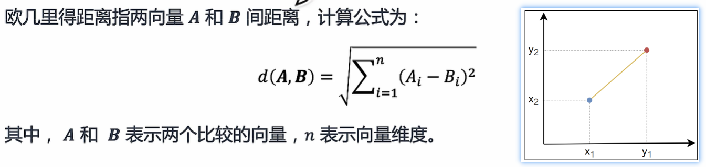

### 2.4.2 余弦相似度

余弦距离 (COSINE)：计算两点之间夹角的余弦值，值越接近1越相似。它只关心向量的“方向”，不关心长度

- 公式：(A·B) / (|A| |B|)
- 例子：两个方向完全相同的向量，余弦相似度为1。


### 2.4.3 内积

内积（IP）：是衡量两个向量的“方向一致性”和“长度”，值越大越相似

- 公式：x₁y₁ + x₂y₂ + ...
- 例子：向量 A = [1, 2]，B = [3, 4]，内积 = 1×3 + 2×4 = 11


## 2.5 Milvus操作

1)  创建新的环境  
conda create -n edu_rag python=3.10

2)  创建一个新项目，指定环境 

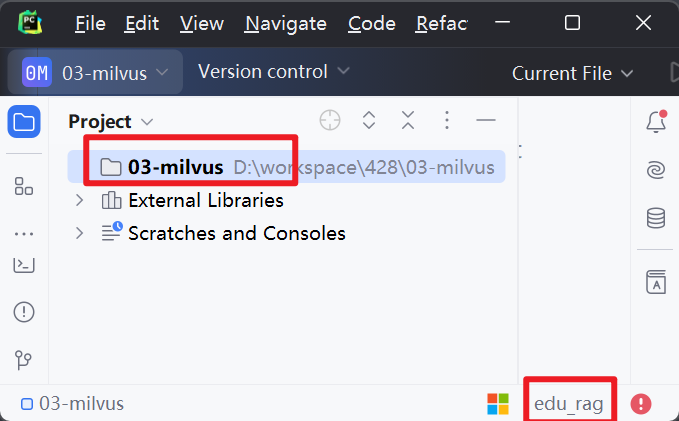

3）安装python的依赖

pip install --upgrade pymilvus==v2.6.3

### 2.5.1 操作数据库

Milvus数据库的操作主要就是创建和使用数据库

```Python
from pymilvus import MilvusClient


# 操作数据库
def operation_db():
    # 初始化客户端(用于连接milvus数据库)
    client = MilvusClient(uri="http://192.168.100.128:19530")

    # 查看数据库
    dbs = client.list_databases()
    print(dbs)

    # 创建数据库
    if "milvus_demos" not in dbs:
        client.create_database("milvus_demos")
        print("创建数据库成功")
    else:
        client.using_database("milvus_demos")
        print("切换数据库成功")

    # 删除数据库
    if (False):
        client.drop_database("milvus_demos")
        print("删除数据库成功")

if __name__ == '__main__':
    operation_db()
```

### 2.5.2 操作集合

在Milvus中，需要使用 Collections来存储向量及其相关元数据，可以把它想象成传统 SQL 数据库中的表格

创建Collections时，可以定义Schema和索引参数来配置向量规格，如维度、索引类型和远距离度量

```Python
from pymilvus import MilvusClient, DataType


# 操作集合
def operation_collection():
    # 初始化客户端,切换数据库
    client = MilvusClient(uri="http://192.168.100.128:19530")
    client.using_database("milvus_demos")

    # 创建Schema
    schema = client.create_schema(
        auto_id=False,  # 设置id非自增
        enable_dynamic_filed=True  # 启用动态字段
    )
    # 设置字段名称、类型、主键
    schema.add_field(field_name="id", datatype=DataType.INT64, is_primary=True, description="主键")
    schema.add_field(field_name="vector", datatype=DataType.FLOAT_VECTOR, dim=5, description="演示向量字段")
    schema.add_field(field_name="scalar", datatype=DataType.VARCHAR, max_length=365, description="演示标量字段")

    # 创建集合
    client.create_collection(collection_name="demo1", schema=schema)  # 设置集合名称和schema

    # 删除集合
    if(False):
        client.drop_collection("demo1")

if __name__ == '__main__':
    operation_collection()
```

### 2.5.3 操作索引

```Python
from pymilvus import MilvusClient, DataType


# 操作索引
def operation_index():
    # 初始化客户端,切换数据库
    client = MilvusClient(uri="http://192.168.100.128:19530")
    client.using_database("milvus_demos")

    # =======================================创建向量索引========================================
    # 创建索引参数对象
    index_params1 = client.prepare_index_params()
    index_params1.add_index(
        field_name="vector",  # 给哪个字段添加索引
        index_type="",  # 要建立的索引类型 (可选择FLAT、IVF_FLAT等等，留空以使用自动索引)
        metric_type="COSINE",  # 度量类型 (用于计算向量间距离的方法。支持的值包括COSINE\IP等)
        index_name="vector_index"  # 索引名称
    )

    # 添加索引到集合
    client.create_index(
        collection_name="demo1",  # 给哪张表
        index_params=index_params1  # 添加哪个索引对象
    )

    # 查看索引
    print(client.list_indexes(collection_name="demo1"))
    print(client.describe_index(collection_name="demo1", index_name="vector_index"))

    # 查看集合状态
    print(client.get_load_state(collection_name="demo1"))
    # 加载集合(不加载集合,无法查看集合状态,也无法对其进行数据操作)
    client.load_collection(collection_name="demo1")
    # 查看集合状态
    print(client.get_load_state(collection_name="demo1"))
    # =======================================创建标量索引========================================
    # 创建索引参数对象
    index_params2 = client.prepare_index_params()
    index_params2.add_index(
        field_name="scalar",  # 给哪个字段添加索引
        index_type="",  # 要建立的索引类型 (对于标量字段，常见的默认索引可能是INVERTED等，留空以使用自动索引)
        index_name="scalar_index"  # 索引名称
    )
    # 添加索引到集合
    client.create_index(
        collection_name="demo1",  # 给哪张表
        index_params=index_params2  # 添加哪个索引对象
    )

    # 释放删除索引
    if (False):
        client.release_collection(collection_name='demo1')
        client.drop_index(collection_name='demo1', index_name='vector_index')
        client.drop_index(collection_name='demo1', index_name='scalar_index')


if __name__ == '__main__':
    operation_index()
```

### 2.5.4 增删改数据

```Python
from pymilvus import MilvusClient, DataType

data1 = [
    {"id": 0, "vector": [0.3580376395471989, -0.6023495712049978, 0.18414012509913835, -0.26286205330961354,
                         0.9029438446296592], "color": "pink_8682"},
    {"id": 1, "vector": [0.19886812562848388, 0.06023560599112088, 0.6976963061752597, 0.2614474506242501,
                         0.838729485096104], "color": "red_7025"},
    {"id": 2, "vector": [0.43742130801983836, -0.5597502546264526, 0.6457887650909682, 0.7894058910881185,
                         0.20785793220625592], "color": "orange_6781"},
    {"id": 3, "vector": [0.3172005263489739, 0.9719044792798428, -0.36981146090600725, -0.4860894583077995,
                         0.95791889146345], "color": "pink_9298"},
    {"id": 4, "vector": [0.4452349528804562, -0.8757026943054742, 0.8220779437047674, 0.46406290649483184,
                         0.30337481143159106], "color": "red_4794"},
    {"id": 5, "vector": [0.985825131989184, -0.8144651566660419, 0.6299267002202009, 0.1206906911183383,
                         -0.1446277761879955], "color": "yellow_4222"},
    {"id": 6, "vector": [0.8371977790571115, -0.015764369584852833, -0.31062937026679327, -0.562666951622192,
                         -0.8984947637863987], "color": "red_9392"},
    {"id": 7, "vector": [-0.33445148015177995, -0.2567135004164067, 0.8987539745369246, 0.9402995886420709,
                         0.5378064918413052], "color": "grey_8510"},
    {"id": 8, "vector": [0.39524717779832685, 0.4000257286739164, -0.5890507376891594, -0.8650502298996872,
                         -0.6140360785406336], "color": "white_9381"},
    {"id": 9, "vector": [0.5718280481994695, 0.24070317428066512, -0.3737913482606834, -0.06726932177492717,
                         -0.6980531615588608], "color": "purple_4976"}
]

data2 = [
    {"id": 10, "vector": [-0.5570353903748935, -0.8997887893201304, -0.7123782431855732, -0.6298990746450119,
                          0.6699215060604258], "color": "red_1202"},
    {"id": 11, "vector": [0.6319019033373907, 0.6821488267878275, 0.8552303045704168, 0.36929791364943054,
                          -0.14152860714878068], "color": "blue_4150"},
    {"id": 12, "vector": [0.9483947484855766, -0.32294203351925344, 0.9759290319978025, 0.8262982148666174,
                          -0.8351194181285713], "color": "orange_4590"},
    {"id": 13, "vector": [-0.5449109892498731, 0.043511240563786524, -0.25105249484790804, -0.012030655265886425,
                          -0.0010987671273892108], "color": "pink_9619"},
    {"id": 14, "vector": [0.6603339372951424, -0.10866551787442225, -0.9435597754324891, 0.8230244263466688,
                          -0.7986720938400362], "color": "orange_4863"},
    {"id": 15, "vector": [-0.8825129181091456, -0.9204557711667729, -0.935350065513425, 0.5484069690287079,
                          0.24448151140671204], "color": "orange_7984"},
    {"id": 16, "vector": [0.6285586391568163, 0.5389064528263487, -0.3163366239905099, 0.22036279378888013,
                          0.15077052220816167], "color": "blue_9010"},
    {"id": 17, "vector": [-0.20151825016059233, -0.905239387635804, 0.6749305353372479, -0.7324272081377843,
                          -0.33007998971889263], "color": "blue_4521"},
    {"id": 18, "vector": [0.2432286610792349, 0.01785636564206139, -0.651356982731391, -0.35848148851027895,
                          -0.7387383128324057], "color": "orange_2529"},
    {"id": 19, "vector": [0.055512329053363674, 0.7100266349039421, 0.4956956543575197, 0.24541352586717702,
                          0.4209030729923515], "color": "red_9437"}
]

# 创建数据表
def create_collection(client: MilvusClient):
    # 创建集合
    schema = client.create_schema(auto_id=False, enable_dynamic_field=True)
    # 1) 表字段
    schema.add_field(field_name="id", datatype=DataType.INT64, is_primary=True)
    schema.add_field(field_name="vector", datatype=DataType.FLOAT_VECTOR, dim=5)
    # 2) 表索引
    index_params = client.prepare_index_params()
    index_params.add_index(field_name="vector", index_type="", metric_type="COSINE", index_name="vector_index")
    # 3) 创建集合
    client.create_collection(collection_name="demo2", schema=schema, index_params=index_params)


# 数据操作
def operate_entity(client: MilvusClient):
    # 保存数据
    res = client.insert(collection_name="demo2", data=data1)
    print(res)

    # 更新数据 upsert可以去重  后面不再使用insert
    res = client.upsert(collection_name="demo2", data=data2)
    print(res)

    # 删除数据
    res = client.delete(collection_name='demo2', filter='id in [12, 5, 6]')
    print(res)


if __name__ == '__main__':
    client = MilvusClient(uri="http://192.168.100.128:19530")
    client.using_database(db_name="milvus_demos")
    create_collection(client)

    operate_entity(client)
```

### 2.5.5 简单查询

```Python
from pymilvus import MilvusClient


def query_operation(client: MilvusClient):
    search_params = {
        "metric_type": "COSINE",
        "params": {
            "radius": 0.8,  # 搜索圆的半径
            "range_filter": 1  # 范围过滤器，用于过滤出不在搜索圆内的向量。
        }
    }

    # 简单条件查询
    result1 = client.search(
        collection_name='demo2',  # 要查询的集合名称
        data=[  # 要查询的向量
            [0.19886812562848388, 0.06023560599112088, 0.6976963061752597, 0.2614474506242501, 0.838729485096104],
            [0.3172005263489739, 0.9719044792798428, -0.36981146090600725, -0.4860894583077995, 0.95791889146345]
        ],
        limit=2,  # 要返回的记录数量
        search_params=search_params,  # 索引类型:要根据自己创建的索引类型进行填写
        output_fields=["id", "vector", "color"],  # 要查询回来的字段
        filter="color like 'red%'",  # 过滤搜索
    )
    for result in result1:
        print(result)


# 主函数
if __name__ == '__main__':
    client = MilvusClient(uri="http://192.168.100.128:19530")
    client.using_database(db_name="milvus_demos")
    query_operation(client)
```

### 2.5.6 **混合**查询

如果在查询的过程中，一个collection中有多个向量字段（假设是两个）参与搜索，如果我们根据这两个条件分别查询

- 稠密向量检索：基于语义相似性。它善于找到在意思上相近的文档，即使它们没有完全相同的关键词。例如，查询如何保养车辆，它能找到关于汽车维护技巧的文档
- 稀疏向量检索：基于词汇匹配。它善于找到包含精确关键词或它们的紧密同义词的文档。例如，查询如何保养车辆，它会优先找到包含保养和车辆这些词的文档

每个都可以查询到2个文档，那就是拿到了4个文档，接下来就要对这四个文档进行重新排序，找到最相关的两个送到大模型

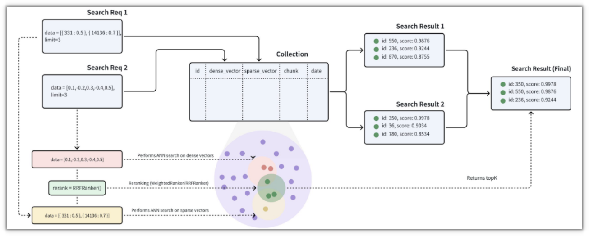

Milvus支持两种重排策略：**加权排名策略（WeightedRanker）**和**重排序策略**（**RRFRanker**）

- **加权排名策略**

在合并来自不同检索渠道的候选结果时，根据每个渠道的重要性，为其赋予一个权重

然后将每个候选在其所属渠道中的原始分数与该渠道的权重相乘，得到一个加权分，最后根据这个加权分进行全局排序

使用WeightedRanker策略时，需要在WeightedRanker(0.8, 0.3) 函数中输入权重值。输入值的范围应为 [0,1]

- **重排序策略**

RRFRanker的核心思想是根据每个结果在其检索列表中的排名位置来计算分数

```Python
import random

from pymilvus import MilvusClient, DataType, AnnSearchRequest, WeightedRanker, RRFRanker


def create_collection_and_data(client):
    # 定义schema
    schema = client.create_schema(enable_dynamic_field=False)
    # 创建字段
    schema.add_field(field_name="id", datatype=DataType.INT64, is_primary=True)
    schema.add_field(field_name="filmVector", datatype=DataType.FLOAT_VECTOR, dim=5)  # 向量字段
    schema.add_field(field_name="posterVector", datatype=DataType.FLOAT_VECTOR, dim=5)  # 向量字段
    # 给向量字段添加索引
    index_params = client.prepare_index_params()
    index_params.add_index(field_name="filmVector", index_type="IVF_FLAT", metric_type="L2", params={"nlist": 128},
                           index_name="film_vector_index")
    index_params.add_index(field_name="posterVector", index_type="", metric_type="COSINE",
                           index_name="poster_vector_index")

    # 创建集合
    client.create_collection(collection_name="demo3", schema=schema, index_params=index_params)

    # 批量插入数据
    entities = []
    for _ in range(1000):
        id = random.randint(0, 10000)
        film_vector = [random.random() for _ in range(5)]
        poster_vector = [random.random() for _ in range(5)]
        entity = {"id": id, "filmVector": film_vector, "posterVector": poster_vector}
        entities.append(entity)

    # 批量插入数据
    client.upsert(collection_name="demo3", data=entities)


def search(client):
    # 查询向量
    dense_search_params = {
        "data": [[0.8896863042430693, 0.370613100114602, 0.23779315077113428, 0.38227915951132996, 0.5997064603128835]],
        "anns_field": "filmVector",  # 根据哪个向量字段进行匹配
        "param": {"metric_type": "L2", "params": {"nprobe": 10}},  # 选择最近的10个簇进行下一步操作
        "limit": 2
    }
    request1 = AnnSearchRequest(**dense_search_params)

    sparse_search_params = {
        "data": [
            [0.02550758562349764, 0.006085637357292062, 0.5325251250159071, 0.7676432650114147, 0.5521074424751443]],
        "anns_field": "posterVector",
        "param": {"metric_type": "COSINE"},
        "limit": 2
    }
    request2 = AnnSearchRequest(**sparse_search_params)

    # 合并查询条件
    requests = [request1, request2]

    # 重排序
    ranker = WeightedRanker(0.8, 0.3)
    ranker = RRFRanker()

    # 执行混合查询
    res = client.hybrid_search(
        collection_name="demo3",
        reqs=requests, # 混合请求
        ranker=ranker, # 排序器
        limit=2, # 最终字段
        output_fields=["id"]
    )

    # 打印
    for hits in res:
        for hit in hits:
            print(hit)


if __name__ == '__main__':
    # 连接本地milvus
    client = MilvusClient(uri="http://192.168.100.128:19530")
    client.using_database(db_name="milvus_demos")
    create_collection_and_data(client)
    search(client)
```


# 3 环境搭建

## 3.1 创建项目并安装依赖库

使用pycharm创建一个新的项目，并在根目录中创建一个文件 `requirements.txt`


- `requirements.txt` 文件的内容如下，可直接下载拷贝到项目的根目录
- 执行命令： pip install -r requirements.txt

<figure view-type="Preview"><source name="requirements.txt" mime="text/plain" size="3409" token="TpnJbUh9doJYv5xYuDSchP4bnNf"/></figure>

## 3.2 代码目录结构

```Plain Text
edu_rag_pro/
├── config.ini                 # 配置文件，包含所有模块的配置
├── base/
│   ├── config.py              # 配置管理，加载 config.ini
│   ├── logger.py              # 日志设置
├── rag_qa/
│   ├── core/
│   │   ├── document_processor.py # 文档处理模块
│   │   ├── prompts.py         # RAG 提示模板
│   │   ├── query_classifier.py # 查询分类器
│   │   ├── strategy_selector.py # 检索策略选择器
│   │   ├── vector_store.py    # 向量存储与检索
│   │   ├── rag_system.py      # RAG 系统核心逻辑
│   ├── main.py                # RAG 系统独立入口，支持存储和查询
├── requirements.txt           # 依赖文件
└── logs/
    └── app.log                # 日志文件
```

系统的代码组织分为以下几个核心模块：

- **`base/`**：基础支持模块，负责配置、日志处理。
- **`core/`**：核心逻辑模块，实现RAG的关键功能。
- **`main.py`**：系统运行入口，支持数据处理和交互查询。


**模块详情**

- **base模块**：

  - `config.py`：管理系统配置，如API密钥、模型选择等。
  - `logger.py`：记录系统运行日志，便于调试和监控。从`config.ini`读取配置信息
- **core模块**：

  - `document_processor.py`：处理输入文档，分块并准备向量存储。
  - `prompts.py`：管理Prompt模板，支持不同任务。
  - `query_classifier.py`：分类用户查询类型。
  - `strategy_selector.py`：选择合适的检索策略。
  - `vector_store.py`：管理向量数据库，进行文档存储和检索。
  - `rag_system.py`：整合RAG流程，生成最终回答。
- **main.py**：命令行交互入口，测试和运行系统。


- 创建好的效果：


**注意**：其中的`config.py`、`logger.py`、`config.ini`从今天资料中拷贝过来即可

---
> 来源：飞书技术知识库（脱敏版） · 06 AI 应用开发 / EduRAG 项目实战 / 05-EduRAG-环境准备 · [原文](https://ccn8v2zngwsm.feishu.cn/wiki/P5kVwget3irWL1ksTTsczHrEnyf)
