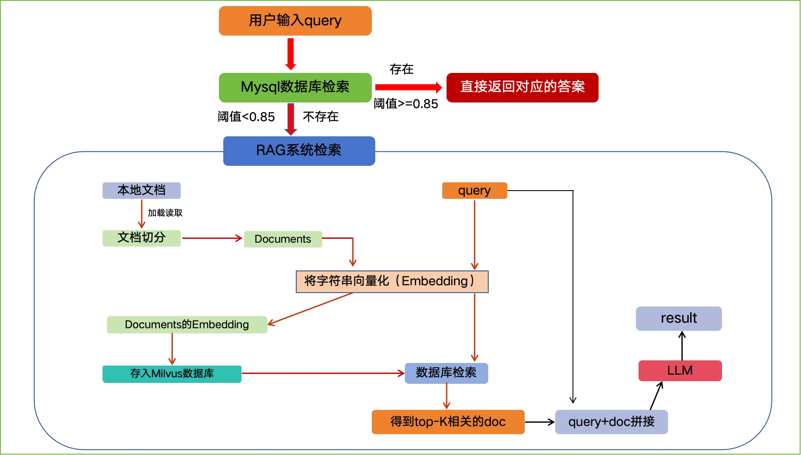
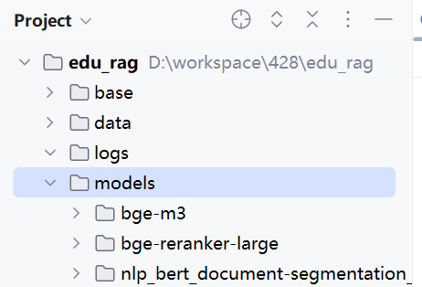
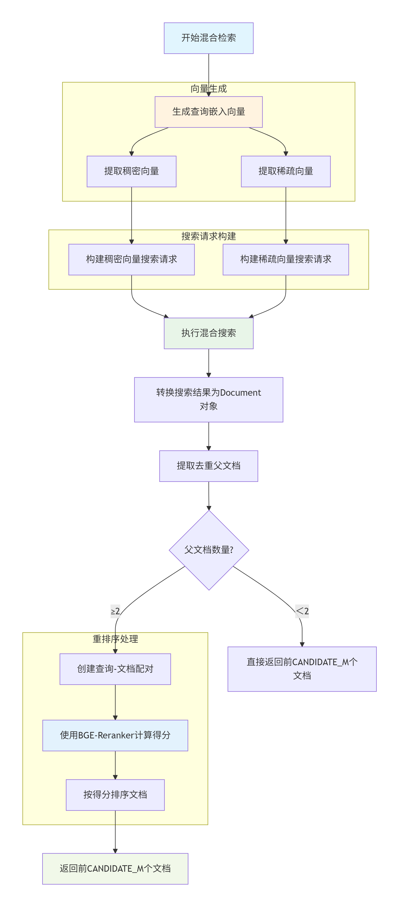

# 06-EduRAG-RAG部分

整个项目的流程图如下，我们先来处理向量数据库中内容存储和检索的部分



## 1 文档存储

### 1.1 思路说明

文档存储就是将读取到的文档拆分为多个块，然后将块向量化之后保存到向量数据库中，核心流程如下

<whiteboard token="DGqfwZA4zhfOMpbWtetcVsQ0nwc"></whiteboard>

我们总结一下文档存储的整体步骤：

1. 文档加载
2. 文档拆分：采用了父子块拆分的方法来提高后续查询的精准度
3. 文档向量化：采用了稀疏向量和稠密向量两种方式来提高后续查询的精准度
4. 向量存储

<callout emoji="✏️">
父子块拆分：就是对于一个大的文档，先进行粗粒度拆分得到父块，然后再对父块进行二次拆分得到子块
比如：一个10页的PDF文件，我们可以先按照每页拆分为10个父块，然后针对每页再按照段落拆分为子块
后续使用子块进行向量化查询，但是要将查询到的内容的父块送入到大模型中进行内容检索
这样做的好处是：
- 提高检索精度：子块可以更精准的匹配到用户的问题
- 提高查询精度：父块保留较大的文本内容，送入大模型可以提供更精准的上下文信息
</callout>

<callout emoji="🪬">
稠密向量：将一段文本整体向量化之后存储到向量库，用于后期基于整段语义进行相似性检索。

它善于找到在意思上相近的文档，即使它们没有完全相同的关键词。例如，查询如何保养车辆，它能找到关于汽车维护技巧的文档
稀疏向量：将一段文本先分词成一个个词条，然后将每个词条单独向量化之后进行存储，用于后期基于问题中关键词的检索

它善于找到包含精确关键词或它们的紧密同义词的文档。例如，查询如何保养车辆，它会优先找到包含保养和车辆这些词的文档
</callout>


### 1.2 工具准备

我们已经提供了加载和拆分文档的工具，具体如下：

- edu_document_loaders 文档加载工具，可以加载不同类型的文档(Word、PPT、image、PDF)
- edu_text_spliter 文本分割工具


### 1.3 加载文档

准备数据


本模块主要负责**加载**多种格式的文档（如`.txt`、`.pdf`等），核心思路如下

<whiteboard token="Rt7rwUeoMhuTOsbCOlHcq7U6n7e"></whiteboard>

代码实现

```Python
# 本模块负责文档的加载和拆分
import os
from datetime import datetime

from langchain_community.document_loaders import TextLoader, UnstructuredMarkdownLoader
from langchain_core.documents import Document

from base.logger import logger
from rag_qa.edu_document_loaders.edu_docloader import OCRDOCLoader
from rag_qa.edu_document_loaders.edu_imgloader import OCRIMGLoader
from rag_qa.edu_document_loaders.edu_pdfloader import OCRPDFLoader
from rag_qa.edu_document_loaders.edu_pptloader import OCRPPTLoader

# 定义不同文档加载需要使用的加载器
document_loaders = {
    # 文本文件使用 TextLoader
    ".txt": TextLoader,
    # PDF 文件使用 OCRPDFLoader
    ".pdf": OCRPDFLoader,
    # Word 文件使用 OCRDOCLoader
    ".docx": OCRDOCLoader,
    # PPT 文件使用 OCRPPTLoader
    ".ppt": OCRPPTLoader,
    # PPTX 文件使用 OCRPPTLoader
    ".pptx": OCRPPTLoader,
    # JPG 文件使用 OCRIMGLoader
    ".jpg": OCRIMGLoader,
    # PNG 文件使用 OCRIMGLoader
    ".png": OCRIMGLoader,
    # Markdown 文件使用 UnstructuredMarkdownLoader
    ".md": UnstructuredMarkdownLoader
}


# 加载指定目录下的所有文档
def load_documents_from_directory(directory_path: str) -> [Document]:
    # 定义list收集文档
    documents = []

    # 从目录中截取到文档所属学科(来源)
    source = os.path.basename(directory_path).split('_')[0]

    # for root , _ ,files in os.walk(directory_path): 递归遍历一个目录(包含子目录)下的所有文件
    # root: 当前正在遍历的目录
    # _: 当前目录下的子目录
    # files: 当前目录下的子文件

    # 遍历一个目录(子目录)下的所有文档
    for root, _, files in os.walk(directory_path):
        for filename in files:
            # 获取文件全路径
            file_path = os.path.join(root, filename)

            # 获取文件类型, 如果是系统不支持的类型, 直接跳过并给出提示
            file_type = os.path.splitext(filename)[1]
            if file_type not in list(document_loaders.keys()):
                logger.info(f"{file_path}文件不支持加载")
                continue

            # 获取当前文件对应的文档加载器, 并完成文档加载
            loader_class = document_loaders[file_type]
            if file_type == ".txt":
                loader = loader_class(file_path, encoding="utf-8")
            else:
                loader = loader_class(file_path)
            docs = loader.load()

            # 跟每个文档添加四个元数据, 方便后期使用
            for doc in docs:
                doc.metadata["source"] = source  # 文档来源
                doc.metadata["file_path"] = file_path  # 文档路径
                doc.metadata["file_type"] = file_type  # 文档类型
                doc.metadata["timestamp"] = datetime.now().isoformat()  # 时间戳

            # 收集文档
            documents.extend(docs)

    # 返回文档
    return documents

if __name__ == '__main__':
    documents = load_documents_from_directory("D:/workspace/bk/edu_rag/data/ai_data")
    for document in documents:
        print(document)
```

### 1.4 拆分文件

文件加载完毕之后要进行拆分，核心逻辑如下

<whiteboard token="OCAmw3jVVhZtCSbGIxqcVogCnVh"></whiteboard>

<whiteboard token="PA9Ww9bCRhmGEDbufXOc6GoBnCf"></whiteboard>

在core/document_processor.py添加文件拆分的方法

```Python
# 本模块负责文档的加载和拆分
import os
from datetime import datetime

from langchain_community.document_loaders import TextLoader, UnstructuredMarkdownLoader
from langchain_core.documents import Document
from langchain_text_splitters import MarkdownTextSplitter

from base.config import Config
from base.logger import logger
from rag_qa.edu_document_loaders.edu_docloader import OCRDOCLoader
from rag_qa.edu_document_loaders.edu_imgloader import OCRIMGLoader
from rag_qa.edu_document_loaders.edu_pdfloader import OCRPDFLoader
from rag_qa.edu_document_loaders.edu_pptloader import OCRPPTLoader
from rag_qa.edu_text_spliter.edu_chinese_recursive_text_splitter import ChineseRecursiveTextSplitter

# 定义不同文档加载需要使用的加载器
document_loaders = {
    # 文本文件使用 TextLoader
    ".txt": TextLoader,
    # PDF 文件使用 OCRPDFLoader
    ".pdf": OCRPDFLoader,
    # Word 文件使用 OCRDOCLoader
    ".docx": OCRDOCLoader,
    # PPT 文件使用 OCRPPTLoader
    ".ppt": OCRPPTLoader,
    # PPTX 文件使用 OCRPPTLoader
    ".pptx": OCRPPTLoader,
    # JPG 文件使用 OCRIMGLoader
    ".jpg": OCRIMGLoader,
    # PNG 文件使用 OCRIMGLoader
    ".png": OCRIMGLoader,
    # Markdown 文件使用 UnstructuredMarkdownLoader
    ".md": UnstructuredMarkdownLoader
}


# 加载指定目录下的所有文档
def load_documents_from_directory(directory_path: str) -> [Document]:
    # 定义list收集文档
    documents = []

    # 从目录中截取到文档所属学科(来源)
    source = os.path.basename(directory_path).split('_')[0]

    # for root , _ ,files in os.walk(directory_path): 递归遍历一个目录(包含子目录)下的所有文件
    # root: 当前正在遍历的目录
    # _: 当前目录下的子目录
    # files: 当前目录下的子文件

    # 遍历一个目录(子目录)下的所有文档
    for root, _, files in os.walk(directory_path):
        for filename in files:
            # 获取文件全路径
            file_path = os.path.join(root, filename)

            # 获取文件类型, 如果是系统不支持的类型, 直接跳过并给出提示
            file_type = os.path.splitext(filename)[1]
            if file_type not in list(document_loaders.keys()):
                logger.info(f"{file_path}文件不支持加载")
                continue

            # 获取当前文件对应的文档加载器, 并完成文档加载
            loader_class = document_loaders[file_type]
            if file_type == ".txt":
                loader = loader_class(file_path, encoding="utf-8")
            else:
                loader = loader_class(file_path)
            docs = loader.load()

            # 跟每个文档添加四个元数据, 方便后期使用
            for doc in docs:
                doc.metadata["source"] = source  # 文档来源
                doc.metadata["file_path"] = file_path  # 文档路径
                doc.metadata["file_type"] = file_type  # 文档类型
                doc.metadata["timestamp"] = datetime.now().isoformat()  # 时间戳

            # 收集文档
            documents.extend(docs)

    # 返回文档
    return documents


# 加载配置类
conf = Config()


# 将文档进行拆分之后返回
def process_documents(documents: [Document]) -> [Document]:
    # 初始化空列表，用于存储所有子块
    chunks = []

    # 初始化文件分割器
    parent_splitter = ChineseRecursiveTextSplitter(chunk_size=conf.PARENT_CHUNK_SIZE, chunk_overlap=conf.CHUNK_OVERLAP)
    child_splitter = ChineseRecursiveTextSplitter(chunk_size=conf.CHILD_CHUNK_SIZE, chunk_overlap=conf.CHUNK_OVERLAP)

    # 初始化markdown文件分割器
    md_parent_splitter = MarkdownTextSplitter(chunk_size=conf.PARENT_CHUNK_SIZE, chunk_overlap=conf.CHUNK_OVERLAP)
    md_child_splitter = MarkdownTextSplitter(chunk_size=conf.CHILD_CHUNK_SIZE, chunk_overlap=conf.CHUNK_OVERLAP)

    for i, doc in enumerate(documents):
        # 1) 根据文档是否为md类型, 使用不同的文档分割器
        is_md = doc.metadata["file_type"] == ".md"
        parent_splitter_to_use = md_parent_splitter if is_md else parent_splitter
        child_splitter_to_use = md_child_splitter if is_md else child_splitter
        logger.info(f"处理文档: {doc.metadata['file_path']}, 使用切分器: {'Markdown' if is_md else 'ChineseRecursive'}")

        # 2) 切割父块
        parent_docs = parent_splitter_to_use.split_documents([doc])
        for j, parent_doc in enumerate(parent_docs):
            # 为父块声明一个id
            parent_doc_id = f"doc_{i}_parent_{j}"

            # 切割子块
            child_docs = child_splitter_to_use.split_documents([parent_doc])
            for k, child_doc in enumerate(child_docs):
                # 为子块添加id和父块id和父块内容
                child_doc.metadata["id"] = f"{parent_doc_id}_child_{k}"
                child_doc.metadata["parent_id"] = parent_doc_id
                child_doc.metadata["parent_content"] = parent_doc.page_content
                chunks.append(child_doc)
    
    # 返回子块列表
    return chunks

if __name__ == '__main__':
    # documents = load_documents_from_directory("D:/workspace/bk/edu_rag/data/ai_data")
    # for document in documents:
    #     print(document)

    documents = load_documents_from_directory("D:/workspace/bk/edu_rag/data/ai_data")
    chunks = process_documents(documents)
    for chunk in chunks:
        print(chunk)
```

### 1.5 存储文档

文本切分成为父子块之后，我们需要将子块做向量化（使用**BGE-M3**模型），然后保存到向量数据库中

#### 1.5.1 向量化模型

在**huggingface**和**魔搭**中开源了很多的优秀的模型，有一些嵌入模型，比三方平台提供的模型还要优秀，我们以魔搭中的**BAAI/bge-m3**模型为例

<bookmark name="bge-m3" href="https://www.modelscope.cn/models/BAAI/bge-m3/summary"></bookmark>

**特点：**

- 支持多种语言嵌入，超过100种语言
- 长文本处理，最高可支持8192个token
- 多功能检索，支持稠密向量嵌入和稀疏检索(词频检索)
- 模型维度，可支持1024维
- 开源免费，可靠实用


1）将下载好的**bge-m3**模型加入到项目的models目录下



2）安装依赖

pip install -U FlagEmbedding

3）测试代码

```Python
# 导入 BGE-M3 嵌入函数，用于生成文档和查询的向量表示
import os

from milvus_model.hybrid import BGEM3EmbeddingFunction
from base.config import Config
from base.logger import logger

conf = Config()


def create_vector_store():
    # 自动检测设备：优先使用 CUDA，否则使用 CPU
    import torch
    if torch.cuda.is_available():
        device = 'cuda'
    elif hasattr(torch.backends, 'mps') and torch.backends.mps.is_available():
        device = 'mps'
    else:
        device = 'cpu'
    logger.info(f"使用设备: {device}")

    # 指定模型位置
    bge_m3_model_path = "D:/workspace/bk/edu_rag/models/bge-m3"

    # 创建本地模型 bge-m3
    embedding_function = BGEM3EmbeddingFunction(model_name_or_path=bge_m3_model_path, use_fp16=True, device=device)
    # print(f"嵌入向量的维度：{embedding_function.dim['dense']}")

    '''
        BGE-M3 是多向量嵌入模型，常见有两种：
        dense（密集向量）：用于语义相似度检索
        sparse（稀疏向量）：用于词汇匹配检索
    '''

    # 测试文本
    texts = ['今天北京天气挺好的', '北京天气是晴天', '上海水上交通堵了']

    # 使用bge-m3嵌入生成文档向量
    embeddings = embedding_function(texts)

    for i, text in enumerate(texts):
        logger.info(f"文档 {i} 的嵌入向量：{embeddings['dense'][i]}")
        logger.info(f"文档 {i} 的稀疏向量：{embeddings['sparse'][[i]]}")


if __name__ == "__main__":
    create_vector_store()
```

#### 1.5.2 向量化数据库

我们将文档向量化之后保存到Milvus中，字段和索引设计如下

**字段说明表**

<sheet sheet-id="0BEKOy" token="MqvFsolm5hGlSUtBjXOc9iTxn0f"></sheet>

**索引说明表**

<sheet sheet-id="90SCv3" token="MqvFsolm5hGlSUtBjXOc9iTxn0f"></sheet>

代码实现

```Python
# 本模块负责向量库的创建和文本向量化入库和问题的向量搜索

from milvus_model.hybrid import BGEM3EmbeddingFunction
from pymilvus import MilvusClient, DataType
from base.config import Config
from base.logger import logger

conf = Config()


# 向量化存储
class VectorStore:

    def __init__(self):
        # 1) 初始化向量模型
        # 自动检测设备：优先使用 CUDA，否则使用 CPU
        import torch
        if torch.cuda.is_available():
            device = 'cuda'
        elif hasattr(torch.backends, 'mps') and torch.backends.mps.is_available():
            device = 'mps'
        else:
            device = 'cpu'

        # 指定模型位置
        bge_m3_model_path = "D:/workspace/bk/edu_rag/models/bge-m3"

        # 创建本地模型 bge-m3
        self.embedding = BGEM3EmbeddingFunction(model_name_or_path=bge_m3_model_path, use_fp16=True, device=device)

        # 2) 初始化Milvus客户端
        self.client = MilvusClient(
            uri=f"http://{conf.MILVUS_HOST}:{conf.MILVUS_PORT}",
            db_name=conf.MILVUS_DATABASE_NAME
        )

        # 3) 创建Milvus数据表
        if not self.client.has_collection(conf.MILVUS_COLLECTION_NAME):
            # 创建集合
            schema = self.client.create_schema(auto_id=False, enable_dynamic_field=True)
            # 添加字段 id，作为主键 VARCHAR类型，最大长度100
            schema.add_field(field_name="id", datatype=DataType.VARCHAR, is_primary=True, max_length=100)
            # 添加文本字段，VARCHAR 类型，最大长度 65535
            schema.add_field(field_name="text", datatype=DataType.VARCHAR, max_length=65535)
            # 添加稠密向量字段，FLOAT_VECTOR 类型，维度由嵌入函数指定
            schema.add_field(field_name="dense_vector", datatype=DataType.FLOAT_VECTOR, dim=self.embedding.dim['dense'])
            # 添加稀疏向量字段，SPARSE_FLOAT_VECTOR 类型
            schema.add_field(field_name="sparse_vector", datatype=DataType.SPARSE_FLOAT_VECTOR)
            # 添加父块 ID 字段，VARCHAR 类型，最大长度 100
            schema.add_field(field_name="parent_id", datatype=DataType.VARCHAR, max_length=100)
            # 添加父块内容字段，VARCHAR 类型，最大长度 65535
            schema.add_field(field_name="parent_content", datatype=DataType.VARCHAR, max_length=65535)
            # 添加学科类别字段，VARCHAR 类型，最大长度 50
            schema.add_field(field_name="source", datatype=DataType.VARCHAR, max_length=50)
            # 添加时间戳字段，VARCHAR 类型，最大长度 50
            schema.add_field(field_name="timestamp", datatype=DataType.VARCHAR, max_length=50)

            # 创建索引参数对象
            index_params = self.client.prepare_index_params()
            # 为稠密向量字段添加 IVF_FLAT 索引，度量类型为内积 (IP)
            index_params.add_index(
                field_name="dense_vector",
                index_name="dense_index",
                index_type="IVF_FLAT",
                metric_type="IP",
                params={"nlist": 128}
            )
            # 为稀疏向量字段添加 SPARSE_INVERTED_INDEX 索引，度量类型为内积 (IP)
            index_params.add_index(
                field_name="sparse_vector",
                index_name="sparse_index",
                index_type="SPARSE_INVERTED_INDEX",
                metric_type="IP",
                params={"drop_ratio_build": 0.2}
            )

            # 创建 Milvus 集合，应用定义的 Schema 和索引参数
            self.client.create_collection(
                collection_name=conf.MILVUS_COLLECTION_NAME,
                schema=schema,
                index_params=index_params
            )
            # 记录创建集合的日志
            logger.info(f"已创建集合 {conf.MILVUS_COLLECTION_NAME}")
        else:
            logger.info(f"集合 {conf.MILVUS_COLLECTION_NAME} 已存在")


if __name__ == '__main__':
    vs = VectorStore()
```

#### 1.5.3 向量化文本

```Python
# 本模块负责向量库的创建和文本向量化入库操作
import hashlib

from milvus_model.hybrid import BGEM3EmbeddingFunction
from pymilvus import MilvusClient, DataType
from base.config import Config
from base.logger import logger

conf = Config()


# 向量化存储
class VectorStore:

    def __init__(self):
        # 1) 初始化向量模型
        # 自动检测设备：优先使用 CUDA，否则使用 CPU
        import torch
        if torch.cuda.is_available():
            device = 'cuda'
        elif hasattr(torch.backends, 'mps') and torch.backends.mps.is_available():
            device = 'mps'
        else:
            device = 'cpu'

        # 指定模型位置
        bge_m3_model_path = "D:/workspace/bk/edu_rag/models/bge-m3"

        # 创建本地模型 bge-m3
        self.embedding = BGEM3EmbeddingFunction(model_name_or_path=bge_m3_model_path, use_fp16=True, device=device)

        # 2) 初始化Milvus客户端
        self.client = MilvusClient(
            uri=f"http://{conf.MILVUS_HOST}:{conf.MILVUS_PORT}",
            db_name=conf.MILVUS_DATABASE_NAME
        )

        # 3) 创建Milvus数据表
        if not self.client.has_collection(conf.MILVUS_COLLECTION_NAME):
            # 创建集合
            schema = self.client.create_schema(auto_id=False, enable_dynamic_field=True)
            # 添加字段 id，作为主键 VARCHAR类型，最大长度100
            schema.add_field(field_name="id", datatype=DataType.VARCHAR, is_primary=True, max_length=100)
            # 添加文本字段，VARCHAR 类型，最大长度 65535
            schema.add_field(field_name="text", datatype=DataType.VARCHAR, max_length=65535)
            # 添加稠密向量字段，FLOAT_VECTOR 类型，维度由嵌入函数指定
            schema.add_field(field_name="dense_vector", datatype=DataType.FLOAT_VECTOR, dim=self.embedding.dim['dense'])
            # 添加稀疏向量字段，SPARSE_FLOAT_VECTOR 类型
            schema.add_field(field_name="sparse_vector", datatype=DataType.SPARSE_FLOAT_VECTOR)
            # 添加父块 ID 字段，VARCHAR 类型，最大长度 100
            schema.add_field(field_name="parent_id", datatype=DataType.VARCHAR, max_length=100)
            # 添加父块内容字段，VARCHAR 类型，最大长度 65535
            schema.add_field(field_name="parent_content", datatype=DataType.VARCHAR, max_length=65535)
            # 添加学科类别字段，VARCHAR 类型，最大长度 50
            schema.add_field(field_name="source", datatype=DataType.VARCHAR, max_length=50)
            # 添加时间戳字段，VARCHAR 类型，最大长度 50
            schema.add_field(field_name="timestamp", datatype=DataType.VARCHAR, max_length=50)

            # 创建索引参数对象
            index_params = self.client.prepare_index_params()
            # 为稠密向量字段添加 IVF_FLAT 索引，度量类型为内积 (IP)
            index_params.add_index(
                field_name="dense_vector",
                index_name="dense_index",
                index_type="IVF_FLAT",
                metric_type="IP",
                params={"nlist": 128}
            )
            # 为稀疏向量字段添加 SPARSE_INVERTED_INDEX 索引，度量类型为内积 (IP)
            index_params.add_index(
                field_name="sparse_vector",
                index_name="sparse_index",
                index_type="SPARSE_INVERTED_INDEX",
                metric_type="IP",
                params={"drop_ratio_build": 0.2}
            )

            # 创建 Milvus 集合，应用定义的 Schema 和索引参数
            self.client.create_collection(
                collection_name=conf.MILVUS_COLLECTION_NAME,
                schema=schema,
                index_params=index_params
            )
            # 记录创建集合的日志
            logger.info(f"已创建集合 {conf.MILVUS_COLLECTION_NAME}")
        else:
            logger.info(f"集合 {conf.MILVUS_COLLECTION_NAME} 已存在")

    # 将文档向量化之后存储到Milvus
    def add_documents(self, documents: [Document]):
        # 获取文档的文本内容
        texts = [doc.page_content for doc in documents]
        # 使用bge-m3嵌入生成文档的嵌入
        embeddings = self.embedding(texts)

        # 初始化空列表，用于存储插入的数据
        data = []
        # 遍历每个文档，带上索引i
        for i, doc in enumerate(documents):
            # 生成文档内容的MD5 哈希值，作为唯一ID
            text_hash = hashlib.md5(doc.page_content.encode("utf-8")).hexdigest()
            # 初始化稀疏向量字典
            sparce_vector = {}
            row = embeddings['sparse'][[i]]  # 稀疏向量
            indices = row.indices  # 获取稀疏向量的非零索引值
            values = row.data  # 获取稀疏向量的非零值
            # 将索引和值配对，填充到稀疏向量字典中
            for index, value in zip(indices, values):
                sparce_vector[index] = value

            # 将文档保存到列表中
            data.append({
                "id": text_hash,
                "text": doc.page_content,
                "dense_vector": embeddings['dense'][i],  # 稠密向量
                "sparse_vector": sparce_vector,  # 稀疏向量
                "parent_id": doc.metadata["parent_id"],
                "parent_content": doc.metadata["parent_content"],
                "source": doc.metadata.get("source", "unknown"),
                "timestamp": doc.metadata.get("timestamp", "unknown"),
            })
        if data:
            # 使用 upsert 操作插入数据，覆盖重复 ID
            self.client.upsert(collection_name=conf.MILVUS_COLLECTION_NAME, data=data)
            logger.info(f"已插入或更新 {len(data)} 个文档")

if __name__ == '__main__':
    vs = VectorStore()

    # 加载拆分文档
    from document_processor import load_documents_from_directory, process_documents

    documents = load_documents_from_directory("D:/workspace/bk/edu_rag/data/ai_data")
    chunks = process_documents(documents)

    # 向量化存储
    vs.add_documents(chunks)
```

## 2 文档检索

文档检索的过程采用混合检索，具体步骤如下：

1. 将用户的问题使用BGE-M3模型分别进行稠密向量化和稀疏向量化，得到两个向量
2. 使用向量化之后的问题分别去Milvus中对应的字段中进行检索，
3. 将两种方式检索到的结果进行去重之后，然后使用bge-reranker-large模型进行重排序，最后取到topK

<whiteboard token="FWTTwSLsNhWSmvbmaDncxGdzneA"></whiteboard>

混合检索的代码实现流程如下:



代码实现如下:

```Python
# 本模块负责向量库的创建和文本向量化入库操作
import hashlib

from langchain_core.documents import Document
from milvus_model.hybrid import BGEM3EmbeddingFunction
from pymilvus import MilvusClient, DataType, AnnSearchRequest, WeightedRanker
from sentence_transformers import CrossEncoder

from base.config import Config
from base.logger import logger

conf = Config()


# 向量化存储
class VectorStore:

    def __init__(self):
        # 1) 初始化向量模型
        # 自动检测设备：优先使用 CUDA，否则使用 CPU
        import torch
        if torch.cuda.is_available():
            device = 'cuda'
        elif hasattr(torch.backends, 'mps') and torch.backends.mps.is_available():
            device = 'mps'
        else:
            device = 'cpu'

        # 指定模型位置
        bge_m3_model_path = "D:/workspace/bk/edu_rag/models/bge-m3"

        # 创建本地模型 bge-m3
        self.embedding = BGEM3EmbeddingFunction(model_name_or_path=bge_m3_model_path, use_fp16=True, device=device)

        # 2) 初始化Milvus客户端
        self.client = MilvusClient(
            uri=f"http://{conf.MILVUS_HOST}:{conf.MILVUS_PORT}",
            db_name=conf.MILVUS_DATABASE_NAME
        )

        # 3) 创建Milvus数据表
        if not self.client.has_collection(conf.MILVUS_COLLECTION_NAME):
            # 创建集合
            schema = self.client.create_schema(auto_id=False, enable_dynamic_field=True)
            # 添加字段 id，作为主键 VARCHAR类型，最大长度100
            schema.add_field(field_name="id", datatype=DataType.VARCHAR, is_primary=True, max_length=100)
            # 添加文本字段，VARCHAR 类型，最大长度 65535
            schema.add_field(field_name="text", datatype=DataType.VARCHAR, max_length=65535)
            # 添加稠密向量字段，FLOAT_VECTOR 类型，维度由嵌入函数指定
            schema.add_field(field_name="dense_vector", datatype=DataType.FLOAT_VECTOR, dim=self.embedding.dim['dense'])
            # 添加稀疏向量字段，SPARSE_FLOAT_VECTOR 类型
            schema.add_field(field_name="sparse_vector", datatype=DataType.SPARSE_FLOAT_VECTOR)
            # 添加父块 ID 字段，VARCHAR 类型，最大长度 100
            schema.add_field(field_name="parent_id", datatype=DataType.VARCHAR, max_length=100)
            # 添加父块内容字段，VARCHAR 类型，最大长度 65535
            schema.add_field(field_name="parent_content", datatype=DataType.VARCHAR, max_length=65535)
            # 添加学科类别字段，VARCHAR 类型，最大长度 50
            schema.add_field(field_name="source", datatype=DataType.VARCHAR, max_length=50)
            # 添加时间戳字段，VARCHAR 类型，最大长度 50
            schema.add_field(field_name="timestamp", datatype=DataType.VARCHAR, max_length=50)

            # 创建索引参数对象
            index_params = self.client.prepare_index_params()
            # 为稠密向量字段添加 IVF_FLAT 索引，度量类型为内积 (IP)
            index_params.add_index(
                field_name="dense_vector",
                index_name="dense_index",
                index_type="IVF_FLAT",
                metric_type="IP",
                params={"nlist": 128}
            )
            # 为稀疏向量字段添加 SPARSE_INVERTED_INDEX 索引，度量类型为内积 (IP)
            index_params.add_index(
                field_name="sparse_vector",
                index_name="sparse_index",
                index_type="SPARSE_INVERTED_INDEX",
                metric_type="IP",
                params={"drop_ratio_build": 0.2}
            )

            # 创建 Milvus 集合，应用定义的 Schema 和索引参数
            self.client.create_collection(
                collection_name=conf.MILVUS_COLLECTION_NAME,
                schema=schema,
                index_params=index_params
            )
            # 记录创建集合的日志
            logger.info(f"已创建集合 {conf.MILVUS_COLLECTION_NAME}")
        else:
            logger.info(f"集合 {conf.MILVUS_COLLECTION_NAME} 已存在")

        # 4) 初始化 BGE-Reranker 模型，用于重排序检索结果
        bge_reranker_large_model_path = "D:/workspace/bk/edu_rag/models/bge-reranker-large"
        self.reranker = CrossEncoder(bge_reranker_large_model_path)

    # 向向量存储中添加文档
    def add_documents(self, documents):
        # 获取文档的文本内容
        texts = [doc.page_content for doc in documents]
        # 使用bge-m3嵌入生成文档的嵌入
        embeddings = self.embedding(texts)

        # 初始化空列表，用于存储插入的数据
        data = []
        # 遍历每个文档，带上索引i
        for i, doc in enumerate(documents):
            # 生成文档内容的MD5 哈希值，作为唯一ID
            text_hash = hashlib.md5(doc.page_content.encode("utf-8")).hexdigest()
            # 初始化稀疏向量字典
            sparce_vector = {}
            row = embeddings['sparse'][[i]]  # 稀疏向量
            indices = row.indices  # 获取稀疏向量的非零索引值
            values = row.data  # 获取稀疏向量的非零值
            # 将索引和值配对，填充到稀疏向量字典中
            for index, value in zip(indices, values):
                sparce_vector[index] = value

            # 将文档保存到列表中
            data.append({
                "id": text_hash,
                "text": doc.page_content,
                "dense_vector": embeddings['dense'][i],  # 稠密向量
                "sparse_vector": sparce_vector,  # 稀疏向量
                "parent_id": doc.metadata["parent_id"],
                "parent_content": doc.metadata["parent_content"],
                "source": doc.metadata.get("source", "unknown"),
                "timestamp": doc.metadata.get("timestamp", "unknown"),
            })
        if data:
            # 使用 upsert 操作插入数据，覆盖重复 ID
            self.client.upsert(collection_name=conf.MILVUS_COLLECTION_NAME, data=data)
            logger.info(f"已插入或更新 {len(data)} 个文档")

    # 查询文档
    def hybrid_search_with_reranker(self, query, k=conf.RETRIEVAL_K, source_filter=None):
        # 1) 获取查询问题的稠密和稀疏向量
        embddings = self.embedding([query])
        dense_query_vector = embddings['dense'][0]  # 获取查询问题的稠密向量
        sparse_query_vector = {}  # 获取查询问题的稀疏向量
        row = embddings["sparse"][[0]]
        index = row.indices
        value = row.data
        for idx, val in zip(index, value):
            sparse_query_vector[idx] = val

        # 2) 使用两种向量化后的问题分别去查询结果
        # 初始化过滤表达式
        filter_expr = f"source == '{source_filter}'" if source_filter else ""

        # 创建稠密向量的搜索对象
        dense_request = AnnSearchRequest(
            data=[dense_query_vector],
            anns_field="dense_vector",
            param={"metric_type": "IP", "params": {"nprobe": 10}},
            limit=k,
            expr=filter_expr
        )
        # 创建稀疏向量的搜索对象
        sparse_request = AnnSearchRequest(
            data=[sparse_query_vector],
            anns_field="sparse_vector",
            param={"metric_type": "IP", "params": {}},
            limit=k,
            expr=filter_expr
        )

        # 创建加权排序器  稀疏向量0.7   稠密向量 1.0
        ranker = WeightedRanker(0.7, 1.0)

        results = self.client.hybrid_search(
            collection_name=conf.MILVUS_COLLECTION_NAME,
            reqs=[sparse_request, dense_request],
            ranker=ranker,
            limit=k,
            output_fields=["text", "parent_id", "parent_content", "source", "timestamp"]
        )[0]

        # 将搜索结果转换为Document对象
        chunks = [self.__doc_from_hit(hit['entity']) for hit in results]

        # 从子块中去重父文档
        parent_docs = self.__get_unique_parent_docs(chunks)

        # 如果只有一个文档，直接返回
        if len(parent_docs) < 2:
            return parent_docs
        else:
            # 创建查询与文档的内容配对列表
            pairs = [[query, doc.page_content] for doc in parent_docs]
            # 使用重排序器模型，重新排序
            scores = self.reranker.predict(pairs)
            # 根据得分从高到低排序文档
            ranked_parent_docs = [doc for _, doc in sorted(zip(scores, parent_docs), reverse=True)]
            # 返回前 m 个重排序后的文档
            return ranked_parent_docs[:conf.CANDIDATE_M]

    # 定义私有方法，从 Milvus 查询结果创建 Document 对象
    def __doc_from_hit(self, hit):
        # 创建并返回 Document 对象，填充内容和元数据
        return Document(
            page_content=hit.get("text"),
            metadata={
                "parent_id": hit.get("parent_id"),
                "parent_content": hit.get("parent_content"),
                "source": hit.get("source"),
                "timestamp": hit.get("timestamp")
            }
        )

    # 定义私有方法，从子块中提取去重的父文档
    def __get_unique_parent_docs(self, chunks):
        # 初始化集合，用于存储已处理的父块内容（去重）
        parent_contents = set()
        # 初始化列表，用于存储唯一父文档
        unique_docs = []
        # 遍历所有子块
        for chunk in chunks:
            # 获取子块的父块内容，默认为子块内容
            parent_content = chunk.metadata.get("parent_content")
            # 检查父块内容是否非空且未重复
            if parent_content and parent_content not in parent_contents:
                # 创建新的 Document 对象，包含父块内容和元数据
                unique_docs.append(Document(page_content=parent_content, metadata=chunk.metadata))
                # 将父块内容添加到去重集合
                parent_contents.add(parent_content)
        # 返回去重后的父文档列表
        return unique_docs


if __name__ == '__main__':
    vs = VectorStore()

    # # 加载拆分文档
    # from document_processor import load_documents_from_directory, process_documents
    #
    # documents = load_documents_from_directory("D:/workspace/bk/edu_rag/data/ai_data")
    # chunks = process_documents(documents)
    #
    # # 向量化存储
    # vs.add_documents(chunks)

    # 查询
    docs = vs.hybrid_search_with_reranker(query="⼤语⾔模型 (LLM) 背景")
    for doc in docs:
        print(doc)
```


```Python
from sentence_transformers import CrossEncoder
model1 = CrossEncoder(model_name="D:/ai_workspace/code/428/edu_rag_project/rag_qa/models/bge-reranker-large")

pairs = [['what is panda?', "what is panda?"],
         ['what is panda?', 'hi'],
         ['what is panda?', 'The giant panda '],
         ]

print(model1.predict(pairs))  # [0.999556  0.003653  0.3362122]
```


---
> 来源：飞书技术知识库（脱敏版） · 06 AI 应用开发 / EduRAG 项目实战 / 06-EduRAG-RAG部分 · [原文](https://ccn8v2zngwsm.feishu.cn/wiki/XgOZwtYcqi3GTek2dXUcMFJcnxf)
