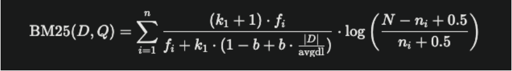
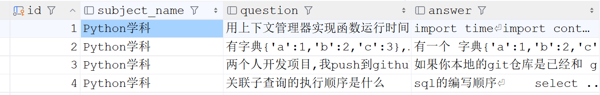

# 07-EduRAG-检索部分

## 1 提示词检索

下面是提示词检索的基本流程：

1. 用户提出一个问题之后，先要经过一个bert模型进行分类，分成通用知识和专业知识
2. 如果是通用知识，直接拼接到提示词中，发送给大模型处理
3. 如果是专业知识，则需要先去milvus中查询相关片段，然后将片段和提示词一起发给大模型

<whiteboard token="SOTNwg5Brh1M1Gbvmwjc0I9Mnbb"></whiteboard>

### 1.1 查询问题分类

接下来，我们使用一个bert_results模型对问题进行分类处理

这个模型不是第三方提供的，而是我们自己训练的，关于模型训练相关的知识，而且再讲

定义脚本`query_classifier.py`加载新模型，来进行意图识别预测

```Python
# 本模块用于对用户提出的问题进行分类,分为通用知识和专业知识

import os
import torch  # 导入PyTorch深度学习框架
from transformers import BertTokenizer, BertForSequenceClassification  # 导入BERT分词器和序列分类模型
from base.logger import logger  # 导入日志记录器


class QueryClassifier:
    def __init__(self, model_dir):
        if not os.path.exists(model_dir):  # 检查模型目录是否存在
            raise FileNotFoundError(f"模型目录不存在: {model_dir}")  # 如果不存在则抛出异常
        self.device = torch.device("cuda" if torch.cuda.is_available() else "cpu")  # 自动选择GPU或CPU设备
        self.tokenizer = BertTokenizer.from_pretrained(model_dir)  # 加载BERT分词器
        self.model = BertForSequenceClassification.from_pretrained(model_dir)  # 加载BERT分类模型
        self.model.to(self.device)  # 将模型移动到指定设备（GPU或CPU）
        self.model.eval()  # 设置模型为评估模式（禁用dropout等训练特性）
        logger.info(f"模型加载成功，使用设备: {self.device}")  # 记录模型加载成功的日志

    def predict_category(self, query):
        if not query or not isinstance(query, str):  # 检查查询是否为空或不是字符串类型
            return "通用知识"  # 返回默认类别
        try:
            encoding = self.tokenizer(query, truncation=True, padding=True,  # 对查询文本进行分词和编码，启用截断和填充
                                      max_length=128, return_tensors="pt")  # 最大长度128，返回PyTorch张量
            encoding = {k: v.to(self.device) for k, v in encoding.items()}  # 将编码结果移动到指定设备
            with torch.no_grad():  # 禁用梯度计算以节省内存和加速推理
                outputs = self.model(**encoding)  # 使用模型进行前向传播预测
                prediction = torch.argmax(outputs.logits, dim=1).item()  # 获取logits最大值对应的类别索引
            return "专业咨询" if prediction == 1 else "通用知识"  # 根据预测结果返回类别名称（1=专业咨询，0=通用知识）
        except Exception as e:  # 捕获所有异常
            logger.error(f"预测失败: {e}")  # 记录错误日志
            return "通用知识"  # 发生错误时返回默认类别


if __name__ == '__main__':
    model_dir = r"D:\workspace\bk\edu_rag\models\bert_results"  # 指定模型目录
    classifier = QueryClassifier(model_dir)  # 创建分类器实例

    querys = ["springboot的原理是什么", "AI学科的学费是多少"]  # 测试查询
    for query in querys:
        category = classifier.predict_category(query)  # 进行预测
        print(f"查询类别: {category}")
```

### 1.2 提示词模板

`prompts.py`定义了`RAGPrompts`类，负责管理系统中使用的所有Prompt模板。这些模板用于指导大语言模型完成任务，统能够确保输入的一致性和输出质量。

```Python
# 本模块用于定义提示词模版
from langchain.prompts import PromptTemplate


# 定义 RAGPrompts 类，用于管理所有 Prompt 模板
class RAGPrompts:
    # 定义 RAG 提示模板
    @staticmethod
    def rag_prompt():
        # 创建并返回 PromptTemplate 对象
        return PromptTemplate(
            template="""  
            你是一个智能助手，帮助用户回答问题。  
            如果提供了上下文，请基于上下文回答；如果没有上下文，请直接根据你的知识回答。  
            如果答案来源于检索到的文档，请在回答中说明。

            上下文: {context}  
            问题: {question}  

            如果无法回答，请回复：“信息不足，无法回答，请联系人工客服，电话：{phone}。”  
            回答:  
            """,
            #   定义输入变量
            input_variables=["context", "question", "phone"],
        )

    # @staticmethod
    # def rag_prompt():
    #     return PromptTemplate(
    #         template="""
    #     你是一个智能助手，负责帮助用户回答问题。请按照以下步骤处理：
    #
    #     1. **分析问题和上下文**：
    #        - 基于提供的上下文（如果有）和你的知识回答问题。
    #        - 如果答案来源于检索到的文档，请在回答中明确说明，例如：“根据提供的文档，……”。
    #
    #     2. **评估对话历史**：
    #        - 检查对话历史是否与当前问题相关（例如，是否涉及相同的话题、实体或问题背景）。
    #        - 如果对话历史与问题相关，请结合历史信息生成更准确的回答。
    #        - 如果对话历史无关（例如，仅包含问候或不相关的内容），忽略历史，仅基于上下文和问题回答。
    #
    #     3. **生成回答**：
    #        - 提供清晰、准确的回答，避免无关信息。
    #        - 如果上下文和历史消息均不足以回答问题，请回复：“信息不足，无法回答，请联系人工客服，电话：{phone}。”
    #
    #     **上下文**: {context}
    #     **对话历史**:
    #     {history}
    #     **问题**: {question}
    #
    #     **回答**:
    #     """,
    #         input_variables=["context", "history", "question", "phone"],
    #     )

    # 使用策略选择提示词模版
    # @staticmethod
    # def strategy_select_prompt():
    #     #   定义私有方法，获取策略选择 Prompt 模板
    #     return PromptTemplate(
    #         template="""
    #         你是一个智能助手，负责分析用户查询 {query}，并从以下三种检索增强策略中选择一个最适合的策略，直接返回策略名称，不需要解释过程。
    #
    #         以下是几种检索增强策略及其适用场景：
    #
    #         1.  **直接检索：**
    #             * 描述：对用户查询直接进行检索，不进行任何增强处理。
    #             * 适用场景：适用于查询意图明确，需要从知识库中检索**特定信息**的问题，例如：
    #             * 示例：
    #                 * 查询：AI 学科学费是多少？
    #                 * 策略：直接检索
    #                 * 查询：JAVA的课程大纲是什么？
    #                 * 策略：直接检索
    #         2.  **假设问题检索：**
    #             * 描述：使用 LLM 生成一个假设的答案，然后基于假设答案进行检索。
    #             * 适用场景：适用于查询较为抽象，直接检索效果不佳的问题，例如：
    #             * 示例：
    #                 * 查询：人工智能在教育领域的应用有哪些？
    #                 * 策略：假设问题检索
    #         3.  **子查询检索：**
    #             * 描述：将复杂的用户查询拆分为多个简单的子查询，分别检索并合并结果。
    #             * 适用场景：适用于查询涉及多个实体或方面，需要分别检索不同信息的问题，例如：
    #             * 示例：
    #                 * 查询：比较 Milvus 和 Zilliz Cloud 的优缺点。
    #                 * 策略：子查询检索
    #
    #         根据用户查询 {query}，直接返回最适合的策略名称，例如 "直接检索"。不要输出任何分析过程或其他内容。
    #         """
    #         ,
    #         input_variables=["query"],
    #     )
    #
    # # 定义假设问题生成的 Prompt 模板
    # @staticmethod
    # def hyde_prompt():
    #     #   创建并返回 PromptTemplate 对象
    #     return PromptTemplate(
    #         template="""
    #         假设你是用户，想了解以下问题，请生成一个简短的假设答案：
    #         问题: {query}
    #         假设答案:
    #         """,
    #         #   定义输入变量
    #         input_variables=["query"],
    #     )
    #
    # # 定义子查询生成的 Prompt 模板
    # @staticmethod
    # def subquery_prompt():
    #     #   创建并返回 PromptTemplate 对象
    #     return PromptTemplate(
    #         template="""
    #         将以下复杂查询分解为多个简单子查询，每行一个子查询：
    #         查询: {query}
    #         子查询:
    #         """,
    #         #   定义输入变量
    #         input_variables=["query"],
    #     )
```

### 1.3 主流程融合

```Python
# 本模块用于实现提示词提问的主流程
from langchain_community.chat_models import ChatOpenAI
from openai import OpenAI

from rag_qa.core.query_classifier import QueryClassifier
from base.logger import logger
from base.config import Config
from rag_qa.core.prompts import RAGPrompts
from rag_qa.core.vector_store import VectorStore

conf = Config()


class RAGSystem:

    def __init__(self):
        # 1)构建知识分类大模型对象
        model_dir = r"D:\workspace\bk\edu_rag\models\bert_results"  # 指定模型目录
        self.classifier = QueryClassifier(model_dir)  # 创建分类器实例

        # 2) 获取vectorStore对象
        self.vector_store = VectorStore()

        # 3) 创建大模型
        self.client = OpenAI(
            api_key=conf.DASHSCOPE_API_KEY,
            base_url=conf.DASHSCOPE_BASE_URL
        )

    # 根据问题生成答案
    def generate_answer(self, query, source_filter=None):
        # 1) 调用大模型将用户的问题分类
        query_category = self.classifier.predict_category(query)
        logger.info(f"问题:{query}的类别: {query_category}")

        # 2) 根据不同分类的问题构建提示词
        if "通用知识" == query_category:
            prompt = RAGPrompts.rag_prompt().format(
                context="通用知识",
                question=query,
                phone=conf.CUSTOMER_SERVICE_PHONE
            )
        else:
            # 从milvus中查询相关片段
            documents = self.vector_store.hybrid_search_with_reranker(query, source_filter=source_filter)
            context = "\n\n".join([doc.metadata["parent_content"] for doc in documents])
            prompt = RAGPrompts.rag_prompt().format(
                context=context,
                question=query,
                phone=conf.CUSTOMER_SERVICE_PHONE
            )
        logger.info(f"发送大模型的提示词:{prompt}")

        # 3) 调用大模型
        try:
            completion = self.client.chat.completions.create(
                model=conf.LLM_MODEL,
                messages=[
                    {'role': 'system', 'content': '你是一个有用的助手'},
                    {'role': 'user', 'content': prompt}
                ],
                temperature=0.5
            )
            answer = completion.choices[0].message.content
        except Exception as e:
            logger.error(e)
            answer = f"抱歉，处理您的通用知识问题时出错。请联系人工客服：{conf.CUSTOMER_SERVICE_PHONE}"

        return answer


if __name__ == '__main__':
    rs = RAGSystem()
    answer = rs.generate_answer(query="AI学科的课程目录是怎样的")
    print(answer)
```

### 1.4 多策略提示词（了解）

为了提高专业知识的搜索准确度，我们对项目提示词进行了优化，那就是先对用户问题进行分类，然后根据不同的问题执行不同的检索策略

- 假设性答案检索：针对于比较抽象的问题（在向量库中不好匹配答案的情况），它会先调用大模型根据用户问题生成一个假设性答案，然后再根据这个答案去向量库检索
- 子查询检索：针对于比较复杂的查询，它会先调用大模将用户的复杂问题分解为几个简单问题，然后再使用简单问题去向量库中查询
- 直接搜索：不属于上面情况的可以直接见多

<whiteboard token="KW2DwzGJyhfkIWbzNflciba8nvh"></whiteboard>

定义一个StrategySelector类来实现提示词的分类检索

```Python
# core/strategy_selector.py 源码
from base.logger import logger  # 导入日志记录器
from openai import OpenAI

from base.config import Config
from rag_qa.core.prompts import RAGPrompts
from rag_qa.core.vector_store import VectorStore

conf = Config()


class StrategySelector:
    def __init__(self):
        # 初始化 OpenAI 客户端
        self.client = OpenAI(
            api_key=Config().DASHSCOPE_API_KEY,
            base_url=Config().DASHSCOPE_BASE_URL
        )

        # 获取vectorStore对象
        self.vector_store = VectorStore()

    # 根据用户问题 选择检索策略 进行检索
    def strategy_select(self, query, source_filter):
        # 调用LLM获取检索策略
        strategy = self.call_dashscope(
            RAGPrompts.strategy_select_prompt().format(query=query)
        ).strip()
        logger.info(f"为查询 '{query}' 选择的检索策略：{strategy}")

        # 根据检索策略选择不同的检索方式
        ranked_sub_chunks = []  # 初始化
        if strategy == "子查询检索":
            ranked_sub_chunks = self._retrieve_with_subqueries(query)
        elif strategy == "假设问题检索":
            ranked_sub_chunks = self._retrieve_with_hyde(query)
        else:  # 默认或“直接检索”
            logger.info(f"使用直接检索策略 (查询: '{query}')")
            ranked_sub_chunks = self.vector_store.hybrid_search_with_reranker(
                query, k=conf.RETRIEVAL_K, source_filter=source_filter
            )

        final_context_docs = ranked_sub_chunks[:conf.CANDIDATE_M]
        logger.info(f"最终选取 {len(final_context_docs)} 个文档作为上下文")
        return final_context_docs

    # 定义私有方法，使用假设文档进行检索
    def _retrieve_with_hyde(self, query):
        logger.info(f"使用 假设文档 策略进行检索 (查询: '{query}')")
        # 获取假设问题生成的 Prompt 模板
        hyde_prompt_template = RAGPrompts.hyde_prompt()  # 使用 template 后缀区分
        try:
            # 调用大语言模型生成假设答案
            hypo_answer = self.call_dashscope(hyde_prompt_template.format(query=query)).strip()
            logger.info(f"生成的假设答案: '{hypo_answer}'")
            # 使用假设答案进行检索，并返回检索结果
            return self.vector_store.hybrid_search_with_reranker(
                hypo_answer, k=conf.RETRIEVAL_K
            )
        except Exception as e:
            logger.error(f"假设性 策略执行失败: {e}")
            return []

    # 定义私有方法，使用子查询进行检索
    def _retrieve_with_subqueries(self, query):
        logger.info(f"使用 子查询  策略进行检索 (查询: '{query}')")
        # 获取子查询生成的 Prompt 模板
        subquery_prompt_template = RAGPrompts.subquery_prompt()
        try:
            # 调用大语言模型生成子查询列表
            subqueries_text = self.call_dashscope(subquery_prompt_template.format(query=query)).strip()
            subqueries = [q.strip() for q in subqueries_text.split("\n") if q.strip()]
            logger.info(f"生成的子查询: {subqueries}")
            if not subqueries:
                logger.warning("未能生成有效的子查询")
                return []

            all_docs = []  # 初始化空列表，用于存储所有子查询的检索结果
            #   遍历每个子查询
            for sub_q in subqueries:
                # 使用子查询进行检索，并将结果添加到列表中
                docs = self.vector_store.hybrid_search_with_reranker(
                    sub_q, k=conf.RETRIEVAL_K
                )
                all_docs.extend(docs)
                logger.info(f"子查询 '{sub_q}' 检索到 {len(docs)} 个文档")

            # 对所有检索结果进行去重
            unique_docs_dict = {doc.page_content: doc for doc in all_docs}
            unique_docs = list(unique_docs_dict.values())

            logger.info(f"所有子查询共检索到 {len(all_docs)} 个文档, 去重后剩 {len(unique_docs)} 个")
            return unique_docs
        except Exception as e:
            logger.error(f"子查询策略执行失败: {e}")
            return []

    # 调用阿里的API接口
    def call_dashscope(self, prompt):
        # 调用 DashScope API
        try:
            # 创建聊天完成请求
            completion = self.client.chat.completions.create(
                model=Config().LLM_MODEL,
                messages=[
                    {"role": "system", "content": "你是一个有用的助手。"},
                    {"role": "user", "content": prompt},
                ],
                temperature=0.1
            )
            # 返回完成结果
            return completion.choices[0].message.content if completion.choices else "直接检索"
        except Exception as e:
            # 记录 API 调用失败
            logger.error(f"DashScope API 调用失败: {e}")
            # 默认返回直接检索
            return "直接检索"


ss = StrategySelector()
```

调整入口文件中查询入口

```Python
# 本模块用于实现提示词提问的主流程
from langchain_community.chat_models import ChatOpenAI
from openai import OpenAI

from rag_qa.core.query_classifier import QueryClassifier
from base.logger import logger
from base.config import Config
from prompts import RAGPrompts
from rag_qa.core.strategy_selector import ss
from rag_qa.core.vector_store import VectorStore

conf = Config()


class RAGSystem:

    def __init__(self):
        # 1)构建知识分类大模型对象
        model_dir = r"D:\workspace\bk\edu_rag\models\bert_results"  # 指定模型目录
        self.classifier = QueryClassifier(model_dir)  # 创建分类器实例

        # 2) 获取vectorStore对象
        self.vector_store = VectorStore()

        # 3) 创建大模型
        self.client = OpenAI(
            api_key=conf.DASHSCOPE_API_KEY,
            base_url=conf.DASHSCOPE_BASE_URL
        )

    # 根据问题生成答案
    def generate_answer(self, query, source_filter=None):
        # 1) 调用大模型将用户的问题分类
        query_category = self.classifier.predict_category(query)
        logger.info(f"问题:{query}的类别: {query_category}")

        # 2) 根据不同分类的问题构建提示词
        if "通用知识" == query_category:
            prompt = RAGPrompts.rag_prompt().format(
                context="通用知识",
                question=query,
                phone=conf.CUSTOMER_SERVICE_PHONE
            )
        else:
            # documents = self.vector_store.hybrid_search_with_reranker(query, source_filter=source_filter)
            # 调用策略选择类从milvus中查询相关片段
            documents = ss.strategy_select(query=query, source_filter=source_filter)
            context = "\n\n".join([doc.metadata["parent_content"] for doc in documents])
            prompt = RAGPrompts.rag_prompt().format(
                context=context,
                question=query,
                phone=conf.CUSTOMER_SERVICE_PHONE
            )
        logger.info(f"发送大模型的提示词:{prompt}")

        # 3) 调用大模型
        try:
            completion = self.client.chat.completions.create(
                model=conf.LLM_MODEL,
                messages=[
                    {'role': 'system', 'content': '你是一个有用的助手'},
                    {'role': 'user', 'content': prompt}
                ],
                temperature=0.5
            )
            answer = completion.choices[0].message.content
        except Exception as e:
            logger.error(e)
            answer = f"抱歉，处理您的通用知识问题时出错。请联系人工客服：{conf.CUSTOMER_SERVICE_PHONE}"

        return answer


if __name__ == '__main__':
    rs = RAGSystem()
    # print(rs.generate_answer(query="AI学科的课程目录是怎样的")) # 直接检索
    # print(rs.generate_answer(query="Java和Python语言的区别是什么")) # 子查询检索
    # print(rs.generate_answer(query="人工智能在教育领域的应用有哪些？")) # 假设问题检索
```

## 2 系统优化

由于用户直接请求RAG系统，效率是比较低的，所以我们要将当前的系统架构进行优化，方案如下：

- 在系统运行一段时间后，我们会收集到一些常见的问题，此时可以将常见问题及答案保存到MySQL数据库和Redis中
- 当用户查询问题的时候，先去Redis中进行查询，如果可以查到答案，直接返回接口
- 如果Redis中没有，再使用BM25算法计算MySQL数据库中存储问题跟当前问题的相关度
- 如果存在相关分数>0.9的，则在这里面获取分数最高的一个作为答案
- 如果没有>0.9的，则认为MySQL中存储的问题都跟用户提问的不相关，此时问题进入RAG系统

<whiteboard token="D2E5wby87ha1vEb98yNcjU9anpg"></whiteboard>


### 2.1 BM25算法

BM25（Best Matching 25）是一种信息检索领域的排名算法，用于计算查询（Query）与文档（Document）之间的相关性得分



```Markdown
fi 是词项 qi在文档 D中的出现次数（TF），
N是文档总数，
ni是包含词项 qi的文档数，
∣D∣是文档 D的长度，
avgdl 是所有文档的平均长度，
k1 和 b是调整参数，通常设置为 k1=1.2和 b=0.75
```

假设我们有以下文档集合：

- 文档1："我喜欢编程"
- 文档2："编程很有趣"

接下来我们要查询   "他喜欢编程"    跟上面两个文档的相似度

**步骤**：

1. 分词：将文档和查询拆分为词。文档1：["我", "喜欢", "编程"]文档2：["编程", "很", "有趣"]查询：["他", "喜欢", "编程"]
2. 计算BM25得分：使用`rank_bm25`库计算每个文档与查询的相关性。

```Python
import jieba
import numpy as np
from rank_bm25 import BM25L

class BM25Search:
    def __init__(self, documents):
        # 初始化文档集合
        self.documents = documents
        # 分词后的文档
        self.tokenized_docs = [jieba.lcut(doc) for doc in documents]
        # 初始化BM25模型
        self.bm25 = BM25L(self.tokenized_docs)

    def search(self, query):
        # 分词
        tokenized_query = jieba.lcut(query)

        # 计算每个文档的BM25得分
        scores = self.bm25.get_scores(tokenized_query)
        # scores = self.__softmax(scores)
        print(f'scores--》{scores}')
        # 获取最高得分的文档索引
        best_idx = scores.argmax()
        best_score = scores[best_idx]
        best_doc = self.documents[best_idx]
        return best_doc, best_score

    # 分数归一化
    def __softmax(self, scores):
        # 计算 Softmax 分数
        exp_scores = np.exp(scores - np.max(scores))
        # 返回归一化分数
        return exp_scores / exp_scores.sum()


if __name__ == '__main__':
    bm25 = BM25Search(["我喜欢编程", "编程很有趣"])
    best_doc, best_score = search = bm25.search("他喜欢编程")  # [1.09433592 0.22790195]
```

> 补充知识
> 
> BM25算法:   https://www.bilibili.com/video/BV1XT421Q7fw
> 
> 归一化:  https://www.bilibili.com/video/BV1sA411Y7Ww


### 2.2 数据初始化

在系统运行之前，我们需要将数据库、BM25做初始化工作

**① 初始化数据库**

导入资料中的mysql_qa目录到项目根目录

执行edu_rag_pro\mysql_qa\db\mysql_client.py 即可创建数据表



**② 初始化BM25模型**

```Python
import jieba
from rank_bm25 import BM25Okapi
from base.logger import logger
from mysql_qa.cache.redis_client import RedisClient
from mysql_qa.db.mysql_client import MySQLClient


class BM25Search:
    def __init__(self):
        # 初始化客户端
        self.redis_client = RedisClient()
        self.mysql_client = MySQLClient()

        # 初始化BM25模型
        # 从 MySQL 获取问题
        self.original_questions = self.mysql_client.fetch_questions()
        if not self.original_questions:
            logger.warning("未加载到问题")
            return

        # 问题分词, 初始化BM25模型
        tokenized_questions = [jieba.lcut(q[0]) for q in self.original_questions]
        self.bm25 = BM25Okapi(tokenized_questions)
        logger.info("BM25 模型初始化完成")


if __name__ == '__main__':
    BM25Search()
```

### 2.3 问题搜索

```Python
import jieba
import numpy as np
from rank_bm25 import BM25Okapi
from base.logger import logger
from mysql_qa.cache.redis_client import RedisClient
from mysql_qa.db.mysql_client import MySQLClient

class BM25Search:
    def __init__(self):
        # 初始化客户端
        self.redis_client = RedisClient()
        self.mysql_client = MySQLClient()

        # 初始化BM25模型
        # 从 MySQL 获取问题
        self.original_questions = self.mysql_client.fetch_questions()
        if not self.original_questions:
            logger.warning("未加载到问题")
            return

        # 问题分词, 初始化BM25模型
        tokenized_questions = [jieba.lcut(q[0]) for q in self.original_questions]
        self.bm25 = BM25Okapi(tokenized_questions)
        logger.info("BM25 模型初始化完成")

    # 问题搜索
    def search(self, query, threshold=0.9):
        # 从redis缓存中查询答案
        cached_answer = self.redis_client.get_answer(query)
        if cached_answer:
            return cached_answer

        # 如果redis中不存在, 开始从数据库中检索
        try:
            # 使用bm25计算MySQL中的问题与query的近似度
            scores = self.bm25.get_scores(jieba.lcut(query))
            # 分数归一化之后,获取最高得分的索引和分数
            softmax_scores = self._softmax(scores)
            best_idx = softmax_scores.argmax()
            best_score = softmax_scores[best_idx]

            # 检查是否超过阈值
            if best_score >= threshold:
                # 获取原始问题, 然后从数据库查询答案
                original_question = self.original_questions[best_idx]
                answer = self.mysql_client.fetch_answer(original_question)
                if answer:
                    # 将答案缓存到redis缓存到redis,并返回
                    self.redis_client.set_data(f"answer:{query}", answer)
                    return answer
            else:
                logger.info(f"未找到可靠答案，最高 Softmax 相似度: {best_score:.3f}")
                return None
        except Exception as e:
            logger.error(f"搜索失败: {e}")
            return None

    # 归一化函数
    def _softmax(self, scores):
        # 计算 Softmax 分数
        exp_scores = np.exp(scores - np.max(scores))
        # 返回归一化分数
        return exp_scores / exp_scores.sum()


if __name__ == '__main__':
    bm25 = BM25Search()
    print(bm25.search("关联子查询的执行顺序是什么", threshold=0.9))
```

### 2.4 主流程测试

```Python
from base.logger import logger
from rag_qa.core.bm25_search import BM25Search
from rag_qa.core.rag_system import RAGSystem

if __name__ == "__main__":
    query = "关联子查询的执行顺序是什么"
    bm25_search = BM25Search()
    answer = bm25_search.search(query)

    if answer:
        logger.info(f"MySQL 答案: {answer}")
    else:
        answer = RAGSystem().generate_answer(query, source_filter=None)
        logger.info(f"RAG 答案: {answer}")
```

---
> 来源：飞书技术知识库（脱敏版） · 06 AI 应用开发 / EduRAG 项目实战 / 07-EduRAG-检索部分 · [原文](https://ccn8v2zngwsm.feishu.cn/wiki/NvO7wPQ0Di8DMskQwS7c877Mngd)
