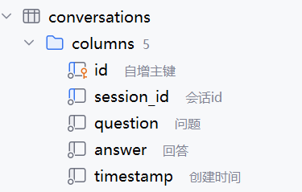
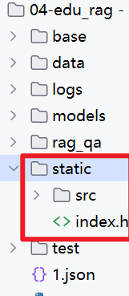

<title>08-EduRAG-系统优化</title>

# 1 流式输出

修改\`rag_system.py\`文件中大模型的调用代码，将调用方式改为流式输出

```Python
# 3) 调用大模型
try:
    completion = self.llm.chat.completions.create(
        model=conf.LLM_MODEL,
        messages=[
            {'role': 'system', 'content': '你是一个有用的助手'},
            {'role': 'user', 'content': prompt}
        ],
        timeout=30,  # 设置 30 秒超时
        stream=True  # 启用流式输出
    )
    collected_content = ""
    # 遍历流式输出的每个 chunk
    for chunk in completion:
        if chunk.choices and chunk.choices[0].delta.content:
            # 获取当前 chunk 的内容
            content = chunk.choices[0].delta.content
            # 累积内容
            collected_content += content
            # 逐 token 返回，供前端实时显示
            yield content
    # 返回完整答案
    return collected_content
except Exception as e:
    logger.error(e)
    return f"抱歉，处理您的通用知识问题时出错。请联系人工客服：{conf.CUSTOMER_SERVICE_PHONE}"
```

在main.py中进行测试

```Python
if __name__ == "__main__":
    query = "Java的基础语法有哪些"
    bm25_search = BM25Search()
    answer = bm25_search.search(query)

    if answer:
        logger.info(f"MySQL 答案: {answer}")
    else:
        answer = RAGSystem().generate_answer(query, source_filter=None)
        # logger.info(f"RAG 答案: {answer}")
        for token in answer:
            print(token)
```

改造main.py中的调用部分，放到一个方法中

```Python
from base.logger import logger
from rag_qa.core.bm25_search import BM25Search
from rag_qa.core.rag_system import RAGSystem


class IntegratedQASystem:
    def __init__(self):
        self.bm25_search = BM25Search()
        self.rag_system = RAGSystem()

    def query(self, query, source_filter=None):
        # 1) 调用数据库查询
        answer = self.bm25_search.search(query, threshold=0.9)
        # 2)根据答案走不同逻辑
        if answer:
            logger.info(f"从MySQL中已经获取到答案")
            # 此处的True代表的是本次回答内容已结束
            yield answer, True
        else:
            logger.info(f"从MySQL中没有获取到答案,转入到RAG系统")
            collected_answer = ""
            answer = self.rag_system.generate_answer(query, source_filter=source_filter)
            for token in answer:
                collected_answer += token
                yield token, False
            yield "", True


if __name__ == "__main__":
    query = "Python的数据类型有哪些"
    answer = IntegratedQASystem().query(query)
    for token in answer:
        print(token)
```


# 2 会话记忆

## 2.1 创建会话记忆表

在资料中提供了对应的建表语句



并且提供了对表的基本操作方法


## 2.2 会话记忆操作

**① 在main.py中添加会话记忆的查询和更新步骤**

```Python
from openai import OpenAI

from base.config import Config
from base.logger import logger
from rag_qa.core.bm25_search import BM25Search
from rag_qa.core.rag_system import RAGSystem
from rag_qa.core.vector_store import VectorStore
from rag_qa.db_util.mysql_client import MySQLClient

conf = Config()


class IntegratedQASystem:
    def __init__(self):
        self.bm25_search = BM25Search()
        self.rag_system = RAGSystem()
        self.mysql_client = MySQLClient()

    # 定义查询方法
    def query(self, query, source_filter=None, session_id=None):
        if session_id is None:
            raise Exception("session_id不能为空")

        # 2) 从数据库中查询内容
        answer = self.bm25_search.search(query, threshold=0.9)
        if answer:
            # 3) 如果数据库有答案, 直接更新历史对话,返回内容
            logger.info(f"MySQL答案: {answer}")
            self.mysql_client.update_session_history(session_id, query, answer)
            yield answer, True  # 此处的True表示此次对话可以结束
        else:
            # 1) 根据session_id查询会话历史
            history = self.mysql_client.fetch_recent_history(session_id)
        
            # 4) 如果没有答案,调用RAG系统流式数据答案
            logger.info("无可靠MySQL答案，转到RAG系统")
            collected_answer = ""
            # 从 RAG 系统获取流式输出
            for token in self.rag_system.generate_answer(query, source_filter=source_filter, history=history):
                collected_answer += token  # 累积答案
                yield token, False  # 逐 token 返回，标记为部分答案
            # 更新对话历史，存储完整答案
            self.mysql_client.update_session_history(session_id, query, collected_answer)
            # 流式输出完毕
            yield "", True


if __name__ == "__main__":
    query = "关联子查询的执行顺序是什么"
    answer = IntegratedQASystem().query(query)
    for token in answer:
        print(token)
```

**② 修改原有的大模型查询方法，添加上会话记忆**

```Python
def generate_answer(self, query, source_filter=None, history=None):
    # 获取历史记录, 拼接为字符串
    if history is None:
        history = []
    else:
        history = history[:5]
    history_context = "\n".join([f"Q:{i['question']}\nA:{i['answer']}" for i in history])

    # 1) 调用bert分类模型对用户提出的问题进行分类
    category = self.classifier_model.predict_category(query)
    logger.info(f"{query}--对应的查询类别: {category}")

    # 2) 根据不同的分类准备不同提示词
    if False:
        prompt = RAGPrompts.rag_prompt().format(
            context="通用知识",
            history=history_context,
            question=query,
            phone=conf.CUSTOMER_SERVICE_PHONE
        )
    else:  # 专业咨询
        # 1) 调用milvus进行问题检索
        # docs = self.vs.hybrid_search_with_reranker(query=query, source_filter=source_filter)

        # 1) 调用策略选择器 执行其中的某一条路径
        docs = ss.strategy_select(query=query, source_filter=source_filter)
        context = "\n\n".join([doc.metadata["parent_content"] for doc in docs])
        # 2) 根据返回内容中的父块 拼接提示词
        prompt = RAGPrompts.rag_prompt().format(
            context=context,
            history=history_context,
            question=query,
            phone=conf.CUSTOMER_SERVICE_PHONE
        )
    logger.info(f"发往大模型的提示是:{prompt}")

    # 3) 调用大模型
    try:
        completion = self.llm.chat.completions.create(
            model=conf.LLM_MODEL,
            messages=[
                {'role': 'system', 'content': '你是一个有用的助手'},
                {'role': 'user', 'content': prompt}
            ],
            timeout=30,  # 设置 30 秒超时
            stream=True  # 启用流式输出
        )
        collected_content = ""
        # 遍历流式输出的每个 chunk
        for chunk in completion:
            if chunk.choices and chunk.choices[0].delta.content:
                # 获取当前 chunk 的内容
                content = chunk.choices[0].delta.content
                # 累积内容
                collected_content += content
                # 逐 token 返回，供前端实时显示
                yield content
        # 返回完整答案
        return collected_content
    except Exception as e:
        logger.error(e)
        return f"抱歉，处理您的通用知识问题时出错。请联系人工客服：{conf.CUSTOMER_SERVICE_PHONE}"
```

**③ 修改提示词，携带历史记忆**

```Python
@staticmethod
def rag_prompt():
    return PromptTemplate(
        template="""
    你是一个智能助手，负责帮助用户回答问题。请按照以下步骤处理：

    1. **分析问题和上下文**：
       - 基于提供的上下文（如果有）和你的知识回答问题。
       - 如果答案来源于检索到的文档，请在回答中明确说明，例如：“根据提供的文档，……”。

    2. **评估对话历史**：
       - 检查对话历史是否与当前问题相关（例如，是否涉及相同的话题、实体或问题背景）。
       - 如果对话历史与问题相关，请结合历史信息生成更准确的回答。
       - 如果对话历史无关（例如，仅包含问候或不相关的内容），忽略历史，仅基于上下文和问题回答。

    3. **生成回答**：
       - 提供清晰、准确的回答，避免无关信息。
       - 如果上下文和历史消息均不足以回答问题，请回复：“信息不足，无法回答，请联系人工客服，电话：{phone}。”

    **对话历史**:
    {history}
    
    **上下文**: 
    {context}
    
    **问题**: 
    {question}
    **回答**:
    """,
        input_variables=["context", "history", "question", "phone"],
    )
```

# 3 对接前端

## 3.1 声明对接接口

```Python
# 导入 FastAPI 相关模块，用于构建 API 和 WebSocket
from fastapi import FastAPI, WebSocket, HTTPException, Query, Depends
# 导入 FastAPI 响应类型，用于流式响应和文件服务
from fastapi.responses import StreamingResponse, FileResponse
# 导入 CORS 中间件，支持跨域请求
from fastapi.middleware.cors import CORSMiddleware
# 导入静态文件服务模块
from fastapi.staticfiles import StaticFiles
# 导入 WebSocket 断开异常
from starlette.websockets import WebSocketDisconnect
# 导入系统操作模块，用于文件目录管理
import os
# 导入 Pydantic 模型，用于请求验证
from pydantic import BaseModel
# 导入异步事件循环模块
import asyncio
# 导入 JSON 处理模块
import json
# 导入 UUID 模块，生成唯一会话 ID
import uuid
# 导入类型注解模块
from typing import Optional, List, Dict, Any
# 导入时间模块，记录处理时间
import time
# 导入正则表达式模块，用于匹配日常问候
import re

from base.config import Config
# 导入优化后的问答系统
from rag_qa.main import IntegratedQASystem
from rag_qa.db_util.mysql_client import MySQLClient

# 创建 FastAPI 应用实例，设置标题和描述
app = FastAPI(title="问答系统API", description="集成MySQL和RAG的智能问答系统")

# 配置 CORS 中间件，允许跨域请求
app.add_middleware(
    CORSMiddleware,
    allow_origins=["*"],  # 允许所有来源（生产环境需限制）
    allow_credentials=True,  # 允许凭证
    allow_methods=["*"],  # 允许所有 HTTP 方法
    allow_headers=["*"],  # 允许所有头部
)

# 创建静态文件目录（如果不存在）
os.makedirs("static", exist_ok=True)

# 创建全局问答系统实例
qa_system = IntegratedQASystem()

# 定义日常问候用语模式和回复
GREETING_PATTERNS = [
    {
        "pattern": r"^(你好|您好|hi|hello)",  # 匹配问候语
        "response": "你好！我是黑马程序员，专注于为学生答疑解惑，很高兴为你服务！"
    },
    {
        "pattern": r"^(你是谁|您是谁|你叫什么|你的名字|who are you)",  # 匹配身份询问
        "response": "我是黑马程序员，你的智能学习助手，致力于提供 IT 教育相关的解答！"
    },
    {
        "pattern": r"^(在吗|在不在|有人吗)",  # 匹配在线确认
        "response": "我在！我是黑马程序员，随时为你解答问题！"
    },
    {
        "pattern": r"^(干嘛呢|你在干嘛|做什么)",  # 匹配状态询问
        "response": "我正在待命，随时为你解答 IT 学习相关的问题！有什么我可以帮你的？"
    }
]


# 定义查询请求模型
class QueryRequest(BaseModel):
    query: str  # 查询内容，必填
    source_filter: Optional[str] = None  # 学科过滤，可选
    session_id: Optional[str] = None  # 会话 ID，可选


# 定义查询响应模型
class QueryResponse(BaseModel):
    answer: str  # 答案内容
    is_streaming: bool  # 是否流式响应
    session_id: str  # 会话 ID
    processing_time: float  # 处理时间


# 挂载静态文件目录，服务前端文件
app.mount("/static", StaticFiles(directory="static"), name="static")


# 根路径重定向到 index.html
@app.get("/")
async def read_root():
    return FileResponse("static/index.html")


# 创建新会话接口
@app.post("/api/create_session")
async def create_session():
    session_id = str(uuid.uuid4())  # 生成唯一会话 ID
    return {"session_id": session_id}  # 返回会话 ID


# 查询历史消息接口
@app.get("/api/history/{session_id}")
async def get_history(session_id: str):
    try:
        # 获取指定会话的历史记录
        history = MySQLClient().fetch_recent_history(session_id)
        # 返回会话 ID 和历史记录
        return {"session_id": session_id, "history": history}
    except Exception as e:
        # 抛出 HTTP 异常，包含错误信息
        raise HTTPException(status_code=500, detail=f"获取历史记录失败: {str(e)}")


# 清除历史消息接口
@app.delete("/api/history/{session_id}")
async def clear_history(session_id: str):
    # 清除指定会话的历史记录
    success = MySQLClient().clear_session_history(session_id)
    if success:
        # 返回成功状态
        return {"status": "success", "message": "历史记录已清除"}
    else:
        # 抛出 HTTP 异常
        raise HTTPException(status_code=500, detail="清除历史记录失败")


# 检查是否为日常问候用语并返回模板回复
def check_greeting(query: str) -> Optional[str]:
    query_text = query.strip()  # 去除首尾空格
    for pattern_info in GREETING_PATTERNS:
        # 使用正则匹配，忽略大小写
        if re.match(pattern_info["pattern"], query_text, re.IGNORECASE):
            return pattern_info["response"]  # 返回匹配的回复
    return None  # 无匹配返回 None


# 非流式查询接口
@app.post("/api/query")
async def query(request: QueryRequest):
    start_time = time.time()  # 记录开始时间
    # 使用请求中的 session_id 或生成新 ID
    session_id = request.session_id or str(uuid.uuid4())
    # 检查是否为日常问候
    greeting_response = check_greeting(request.query)
    if greeting_response:
        # 返回问候回复
        return {
            "answer": greeting_response,
            "is_streaming": False,
            "session_id": session_id,
            "processing_time": time.time() - start_time
        }
    # 执行 BM25 搜索
    answer = qa_system.bm25_search.search(request.query, threshold=0.85)
    if not answer:
        # 需要 RAG，提示使用 WebSocket
        return {
            "answer": "请使用WebSocket接口获取流式响应",
            "is_streaming": True,
            "session_id": session_id,
            "processing_time": time.time() - start_time
        }
    # 返回 MySQL 答案
    return {
        "answer": answer,
        "is_streaming": False,
        "session_id": session_id,
        "processing_time": time.time() - start_time
    }


# 流式查询 WebSocket 接口
@app.websocket("/api/stream")
async def websocket_endpoint(websocket: WebSocket):
    await websocket.accept()  # 接受 WebSocket 连接
    try:
        while True:
            # 接收客户端消息
            data = await websocket.receive_text()
            request_data = json.loads(data)  # 解析 JSON 数据
            # 获取查询参数
            query = request_data.get("query")
            source_filter = request_data.get("source_filter")
            session_id = request_data.get("session_id", str(uuid.uuid4()))
            start_time = time.time()  # 记录开始时间
            # 发送开始标志
            if websocket.client_state == websocket.client_state.CONNECTED:
                await websocket.send_json({
                    "type": "start",
                    "session_id": session_id
                })
            # 检查是否为日常问候
            greeting_response = check_greeting(query)
            if greeting_response:
                if websocket.client_state == websocket.client_state.CONNECTED:
                    # 发送问候回复
                    await websocket.send_json({
                        "type": "token",
                        "token": greeting_response,
                        "session_id": session_id
                    })
                    # 发送结束标志
                    await websocket.send_json({
                        "type": "end",
                        "session_id": session_id,
                        "is_complete": True,
                        "processing_time": time.time() - start_time
                    })
                break
            # 调用问答系统，流式处理查询
            collected_answer = ""
            for token, is_complete in qa_system.query(query, source_filter=source_filter, session_id=session_id):
                collected_answer += token  # 累积答案
                if is_complete and not collected_answer:
                    if websocket.client_state == websocket.client_state.CONNECTED:
                        # 发送结束标志
                        await websocket.send_json({
                            "type": "end",
                            "session_id": session_id,
                            "is_complete": True,
                            "processing_time": time.time() - start_time
                        })
                    break
                if token and websocket.client_state == websocket.client_state.CONNECTED:
                    # 发送 token 数据
                    await websocket.send_json({
                        "type": "token",
                        "token": token,
                        "session_id": session_id
                    })
                if is_complete:
                    if websocket.client_state == websocket.client_state.CONNECTED:
                        # 发送结束标志
                        await websocket.send_json({
                            "type": "end",
                            "session_id": session_id,
                            "is_complete": True,
                            "processing_time": time.time() - start_time
                        })
                    break
                await asyncio.sleep(0.01)  # 控制流式输出的速度
    except WebSocketDisconnect as e:
        # 记录 WebSocket 断开信息
        print(f"WebSocket disconnected: code={e.code}, reason={e.reason}")
    except Exception as e:
        # 记录错误信息
        print(f"WebSocket error: {str(e)}")
        if websocket.client_state == websocket.client_state.CONNECTED:
            # 发送错误消息
            await websocket.send_json({
                "type": "error",
                "error": str(e)
            })
    finally:
        try:
            if websocket.client_state == websocket.client_state.CONNECTED:
                # 关闭 WebSocket 连接
                await websocket.close()
        except Exception as e:
            # 记录关闭连接时的错误
            print(f"Error closing WebSocket: {str(e)}")


# 健康检查接口
@app.get("/health")
async def health_check():
    return {"status": "healthy"}  # 返回健康状态


# 获取有效学科类别接口
@app.get("/api/sources")
async def get_sources():
    return {"sources": Config().VALID_SOURCES}  # 返回学科类别列表


# 主程序入口
if __name__ == "__main__":
    import uvicorn

    # 运行 FastAPI 应用，监听 0.0.0.0:8000
    uvicorn.run("app:app", host="0.0.0.0", port=8000, reload=False)
```

## 3.2 添加测试页面

将资料中提供的页面放入根目录，启动app.py进行测试



# 4 系统评估

## 4.1 评估框架

当我们为某个真实线上系统开发了检索增强生成 (RAG) 应用，那么在此应用正式上线提供服务前，我们需要评估 RAG 的表现到底是怎样的。

如果发现现有的 RAG 效果不够理想，可能需要一些新的 RAG 算法流程来改进。

在这之前，就需要对 RAG 流程进行评估，得到评估指标，然后才能进行自动化对比，观察改进的流程是否真的有效


RAGAS (**R**etrieval **A**ugmented **G**eneration **As**sessment) 检索增强生成的自动评估，是一个大模型评测框架，可以评估RAG的效果

RAGAS的评估主要基于两个方向：**检索部分**和**生成部分**，那么针对不同的部分评估的指标也会有所区分

接下来，我们将分别介绍RAGAS评估框架**所需的数据**，**评估指标**，**实际用例**等

## 4.2 参评数据

RAGAs在评估数据时，是通过底层的大语言模型来进行的。它需要一个带有问题-答案对的评估数据集（QA 对）具体字段：

- question：作为RAG管道输入的用户查询
- contexts：从用于回答question外部知识源中检索的上下文
- answer：从RAG管道生成的最终答案
- ground_truths：question的基本事实答案（这是唯一人工注释的信息）

## 4.3 评估指标

- **评估检索**的指标：上下文相关性（context_precision）和上下文召回率（context_recall），这些可以衡量检索系统的性能，即检索的段落是否相关
- **评估生成**的指标：忠实度（faithfulness），衡量生成的信息是否准确无误；答案相关性（answer_relevancy），衡量答案对问题的切题程度，即模型生成的答案是否恰当

### 4.3.1 上下文相关性 

它用于衡量RAG系统中检索到内容的专注性，也就是评估RAG系统能否精准找到与问题直接相关的信息，避免无关内容的干扰

计算公式：上下文相关性 = 提取的相关句子数量 / 上下文中的总句子数量

```Python
问题："苹果公司成立于哪一年？"

检索到的上下文：
"苹果公司由史蒂夫·乔布斯、史蒂夫·沃兹尼亚克和罗纳德·韦恩于1976年4月1日创立。"
"公司最初主要销售个人电脑，后来扩展到消费电子产品。"
"苹果公司的总部位于加利福尼亚州的库比蒂诺。"

评估过程：
相关句子：只有第一句包含成立年份信息
总句子数：3句
得分：1/3 ≈ 0.33
```

### 4.3.2 上下文召回率 

它用于衡量检索到的上下文与真实答案的匹配程度，也就是评估检索内容是否完整覆盖回答问题所需的所有关键点

计算公式：上下文召回率 = 标准答案中被上下文支持的声明数量 / 标准答案中总声明数量

```Python
问题："介绍2010年世界杯决赛情况"

标准答案：
"2010年世界杯冠军是西班牙"
"西班牙在决赛中以1-0击败荷兰"
"决赛在南非约翰内斯堡举行"

检索到的上下文：
"西班牙在2010年世界杯决赛中击败了荷兰"
"2010年世界杯冠军是西班牙，这是西班牙首次赢得世界杯"


评估过程：
声明1："2010年世界杯冠军是西班牙" → ✅ 支持
声明2："西班牙在决赛中以1-0击败荷兰" → ❌ 未提及具体比分
声明3："决赛在南非约翰内斯堡举行" → ❌ 未提及地点
得分：1/3 ≈ 0.33
```

### 4.3.3 忠实度

它用于衡量生成答案是否严格基于给定上下文 - 检测模型是否"编造"了上下文中不存在的信息（幻觉问题）。

公式：忠实度 = 生成答案中被上下文支持的陈述数量 /  生成答案中总陈述数量

```Python
上下文：
"苹果公司成立于1976年，创始人是乔布斯、沃兹尼亚克和韦恩"

生成答案：
"苹果公司由乔布斯和沃兹尼亚克于1976年创立，总部在库比蒂诺"

评估过程：
陈述1："苹果公司由乔布斯和沃兹尼亚克创立" → ✅ 部分正确（漏了韦恩）
陈述2："成立于1976年" → ✅ 正确
陈述3："总部在库比蒂诺" → ❌ 上下文中未提及
得分：2/3 ≈ 0.67
```

### 4.3.4 答案相关性

它用于衡量生成答案与原始问题的匹配程度 - 评估答案是否真正回答了问题，而不是答非所问。

计算公式：答案相关性 = 根据答案生产的所有问题与原始问题的平均相似度

```Python
原始问题："如何学习Python编程？"

生成答案："建议从基础语法开始，多写代码练习，参考官方文档"

评估过程：
从答案生成的可能问题：
"学习Python的方法有哪些？" → 高相似度
"Python入门建议？" → 高相似度  
"编程学习步骤？" → 中等相似度

计算平均相似度得分
```

### 4.3.5 总结对比

| **指标** | **评估对象** | **核心目标** | **依赖数据** | **问题表现** |
|-|-|-|-|-|
| **上下文相关性** | 检索系统 | 精准无冗余 | 问题+上下文 | 检索信息不聚焦 |
| **上下文召回率** | 检索系统 | 完整覆盖 | 问题+上下文+标准答案 | 遗漏关键信息 |
| **忠实度** | 生成系统 | 基于事实 | 问题+答案+上下文 | 编造虚假信息 |
| **答案相关性** | 生成系统 | 切题回答 | 问题+答案 | 答非所问 |

## 4.4 评估脚本

`ragas_evaluate.py`脚本用于评估RAG系统的性能，具体功能包括：

1. **数据集加载**：从JSON文件加载包含问题、答案、上下文和真实答案的评估数据集
2. **数据格式转换**：将JSON数据转换为RAGAS要求的`Dataset`格式
3. **环境配置**：使用LangChain的OpenAI模型和嵌入模型初始化RAGAS评估环境
4. **评估执行**：计算四个核心指标
5. **结果输出与保存**：打印评估结果并保存为CSV文件，便于后续分析

安装依赖

```Bash
pip install ragas
```

详细代码：

```Python
# 导入pandas库，用于数据处理和保存CSV文件
import pandas as pd
from openai import OpenAI
# 导入ragas库的evaluate函数，用于执行RAG评估
from ragas import evaluate
# 导入ragas的评估指标，包括忠实度、答案相关性、上下文相关性和上下文召回率
from ragas.metrics import (
    faithfulness,
    answer_relevancy,
    context_precision,
    context_recall
)
# 导入datasets库的Dataset类，用于构建RAGAS所需的数据格式
from datasets import Dataset
# 导入langchain_openai的嵌入模型和聊天模型，用于评估时的语义计算和推理
from langchain_openai import OpenAIEmbeddings, ChatOpenAI
# 导入json库，用于加载JSON格式的评估数据集
import json

from base.config import Config

# 1. 加载生成的数据集
# 使用with语句打开JSON文件，确保文件正确关闭，指定编码为utf-8
with open(r"./rag_evaluate_data.json", "r", encoding="utf-8") as f:
    # 将JSON文件内容加载到data变量中，data为包含多个数据条目的列表
    data = json.load(f)

# 2. 转换为RAGAS格式
# 创建字典eval_data，将JSON数据转换为RAGAS要求的字段格式
eval_data = {
    # 提取每个数据条目的question字段，组成问题列表
    "question": [item["question"] for item in data],
    # 提取每个数据条目的answer字段，组成答案列表
    "answer": [item["answer"] for item in data],
    # 提取每个数据条目的context字段，组成上下文列表（每个context为列表）
    "contexts": [item["context"] for item in data],
    # 提取每个数据条目的ground_truth字段，组成真实答案列表
    "ground_truth": [item["ground_truth"] for item in data]
}
# 使用Dataset.from_dict将字典转换为RAGAS所需的Dataset对象
dataset = Dataset.from_dict(eval_data)

# 3. 配置RAGAS评估环境
# 初始化ChatOpenAI模型，指定使用gpt-4模型，并设置OpenAI API密钥
# llm = ChatOpenAI(model="gpt-4", openai_api_key="your_openai_api_key")
# embeddings = OpenAIEmbeddings(openai_api_key="your_openai_api_key")
llm = ChatOpenAI(model="qwen3-max", api_key=Config().DASHSCOPE_API_KEY, base_url=Config().DASHSCOPE_BASE_URL)
embeddings = ChatOpenAI(model="qwen3-max", api_key=Config().DASHSCOPE_API_KEY, base_url=Config().DASHSCOPE_BASE_URL)

# 4. 执行评估
# 调用evaluate函数，传入数据集、评估指标、LLM模型和嵌入模型
result = evaluate(
    # 传入转换好的Dataset对象
    dataset=dataset,
    # 指定使用的评估指标列表
    metrics=[
        faithfulness,  # 忠实度：答案是否基于上下文
        answer_relevancy,  # 答案相关性：答案与问题的匹配度
        context_precision,  # 上下文相关性：上下文是否仅包含相关信息
        context_recall  # 上下文召回率：上下文是否包含所有必要信息
    ],
    # 传入配置好的LLM模型
    llm=llm,
    # 传入配置好的嵌入模型
    embeddings=embeddings
)

# 5. 输出并保存结果
# 打印评估结果标题
print("RAGAS评估结果：")
# 打印评估结果，包含各指标的分数
print(result)
# 将评估结果转换为pandas DataFrame，便于保存
result_df = pd.DataFrame([result])
# 将DataFrame保存为CSV文件，文件名为ragas_evaluation_results.csv，不保存索引
result_df.to_csv("ragas_evaluation_results.csv", index=False)
```

评估结果为字典，包含各指标的分数（0-1，1为最佳），如：

```JSON
{
  'faithfulness': 0.95,
  'answer_relevancy': 0.92,
  'context_relevancy': 0.90,
  'context_recall': 0.93
}
```

---
> 来源：飞书技术知识库（脱敏版） · 06 AI 应用开发 / EduRAG 项目实战 / 08-EduRAG-系统优化 · [原文](https://ccn8v2zngwsm.feishu.cn/wiki/C0CrwIojKikrgQkVSFxcKjv9n17)
