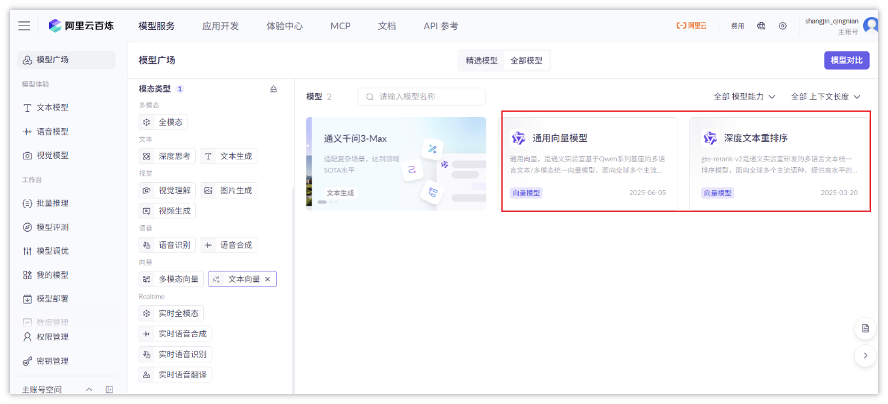
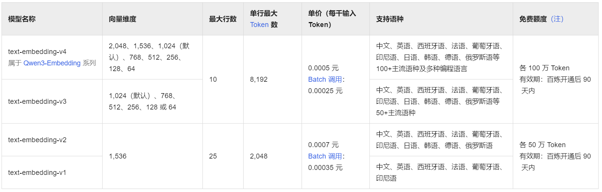
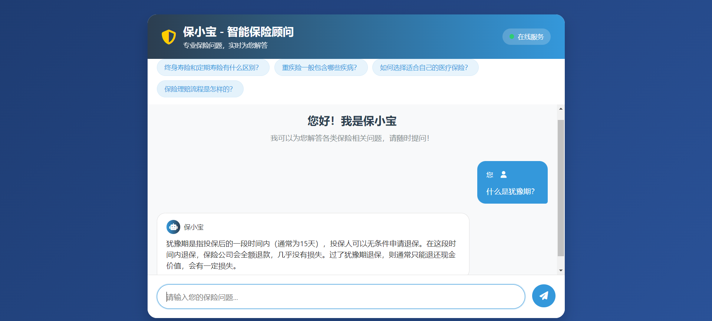

# 04-LangChain

## 1 LangChain概述

LangChain由Harrison Chase创建于2022年10月，它是围绕LLMs（大语言模型）建立的一个框架

从与OpenAI等顶级大模型供应商集成到复杂的对话系统、智能搜索、推荐系统等，LangChain提供了丰富的功能和灵活的接口

LangChain目前有三个语言的实现：**python**、nodejs、Java(LangChain4J)

- LangChain官方网址：https://www.langchain.com/
- LangChain中文官方网址：https://www.langchain.com.cn/
- LangChainAPI文档：https://python.langchain.com/api_reference/


### 1.1 核心功能

- **API集成：**LangChain支持与多种大模型API的集成，包括OpenAI、Azure、Google等，方便用户快速接入并使用这些模型
- **上下文管理：**LangChain通过内置的上下文管理工具，能够在对话中保留上下文信息，使得与用户的互动更加智能、自然
- **多模态支持：**LangChain支持文本、图像、视频等多种模式的数据输入与处理，进一步拓宽了应用场景
- **定制化：**LangChain提供了灵活的定制接口，允许开发者根据具体需求调整模型的行为、输出格式等，打造专属的智能应用

### 1.2 应用场景

- **对话式AI助手：**借助LangChain的上下文管理功能，可以构建更加自然、连贯的对话系统，用于智能客服、虚拟助手等
- **智能搜索与推荐：**通过集成大模型API，LangChain可以为网站或应用添加智能搜索与推荐功能，提升用户体验
- **内容生成与优化：**使用LangChain，开发者可以构建自动生成内容的工具，包括文章写作、代码生成等，大幅提升效率
- **中大型RAG系统：**使用LangChain各个组件配合使用，构建企业级知识库检索系统

### 1.3 架构

LangChain简化了LLM应用程序生命周期的每个阶段：

- 开发：使用LangChain的开源[构建模块](https://www.langchain.com.cn/docs/concepts/#langchain-expression-language-lcel)、[组件](https://www.langchain.com.cn/docs/concepts/)和[第三方集成](https://www.langchain.com.cn/docs/integrations/platforms/)构建应用程序，使用[LangGraph](https://www.langchain.com.cn/docs/concepts/#langgraph)构建具有流式处理和人机协作支持的有状态代理
- 生产化：使用[LangSmith](https://docs.smith.langchain.com/)检查、监控和评估您的链，以便您可以持续优化并自信地部署
- 部署：将您的LangGraph应用程序转变为生产就绪的API和助手，使用[LangGraph Cloud](https://langchain-ai.github.io/langgraph/cloud/)


具体来说，该框架由以下开源库组成：

- **langchain-core**: 聊天模型和其他组件的基本抽象
- **langchain-community**: 由社区维护的第三方集成
- 合作伙伴库（例如 `langchain-openai`、`langchain-anthropic` 等）：一些集成已进一步拆分为自己的轻量级库
- **langchain**: 组成应用程序认知架构的链、代理和检索策略。
- [**LangGraph**](https://langchain-ai.github.io/langgraph): 通过将步骤建模为图中的边和节点，构建强大且有状态的多参与者应用程序
- [**LangServe**](https://www.langchain.com.cn/docs/langserve/): 将LangChain链部署为REST AP。
- [**LangSmith**](https://docs.smith.langchain.com/): 一个开发者平台，让您调试、测试、评估和监控LLM应用程序

### 1.4 常见组件

一个LangChain的应用是需要多个组件共同实现的，常见的组件如下：

- **Models**：模型，各种类型的模型和模型集成，比如GPT-4
- **Prompts**：提示，包括提示管理、提示优化和提示序列化
- **Memory**：记忆，用来保存和模型交互时的上下文状态
- **Indexes**：索引，用来结构化文档，以便和模型交互
- **Chains**：链，一系列对各种组件的调用
- **Agents**：代理，决定模型采取哪些行动，执行并且观察流程，直到完成为止

### 1.5 快速入门

需求：我们使用LangChain来调用本地ollama的qwen2.5:0.5b模型，实现简单对话

**① 安装依赖**

由于要使用langchain，有两个必备的包：langchain和langchain-community，还有就是ollama的包

```Bash
# 安装langchain
pip install langchain==1.0.7

# 社区集成库
pip install langchain-community==0.4.1

# 安装langchain-ollama
pip install langchain-ollama==1.0.0
```

**② 代码实现**

```Python
"""
使用langchain调用ollama中部署的qwen2.5:7b大模型, 让他写一首关于秋天的诗
"""

# 1. 导包
from langchain_ollama import ChatOllama

# 2. 创建大模型
chat = ChatOllama(model="qwen2.5:0.5b")

# 3. 准备提示词
prompt = "你是一位浪漫主义诗人,请帮我写一首关于秋天的诗"

# 4. 调用大模型
result = chat.invoke(prompt)

# 5. 输出结果
print(result)
print(result.content)
```


## 2 Models组件

现在市面上的模型多如牛毛，各种各样的模型不断出现，LangChain模型组件提供了与各种模型的集成，并为所有模型提供了一个精简的统一接口

官方文档：https://python.langchain.com/docs/concepts/chat_models/

LangChain目前支持三种类型的模型：LLMs（大模型）、Chat Models（聊天模型）、Embeddings Models（向量模型）

- **LLMs**: 大语言模型接收文本字符作为输入，返回的也是文本字符
- **聊天模型**: 基于LLMs, 不同的是它接收聊天消息（一种特定格式的数据）作为输入，返回的也是聊天消息
- **向量模型**: 接收文本作为输入, 返回的是浮点数列表

在这里我们主要使用的是**聊天模型**，下面也以它为样例给大家做介绍

### 2.1 消息类型

聊天消息包含下面几种类型，使用时需要按照约定传入合适的值

- **SystemMessage:** 可以用于指定模型具体所处的环境和背景，如角色扮演等
- **HumanMessage**: 人类消息就是用户信息，由人给出的信息发送给LLMs的提示信息
- **AIMessage**: 就是AI输出的消息，可以是针对问题的回答
- **ChatMessage**: Chat消息可以接受任意角色的参数，但是在大多数时间，我们应该使用上面的三种类型

```Python
"""
聊天消息包含下面几种类型，使用时需要按照约定传入合适的值
- SystemMessage: 可以用于指定模型具体所处的环境和背景，如角色扮演等
- HumanMessage: 人类消息就是用户信息，由人给出的信息发送给LLMs的提示信息
- AIMessage: 就是 AI 输出的消息，可以是针对问题的回答
- ChatMessage: Chat消息可以接受任意角色的参数，但是在大多数时间，我们应该使用上面的三种类型
"""

# 导包
from langchain_core.messages import SystemMessage, HumanMessage, AIMessage

#创建message对象
message_list = [
    SystemMessage(content="你是一个诗人,请使用浪漫主义的风格写诗"),
    HumanMessage(content="写一首秋天的诗"),
    AIMessage("秋风虽萧瑟，却也暖人心")
]

print(message_list)
```

### 2.2 调用大模型（Ollama）

接下来使用Chat模型调用Ollama平台，注意：Langchain提供了ChatOllama来完成跟Ollama平台的对接

```Python
"""
接下来使用Chat模型调用Ollama平台，注意：Langchain提供了ChatOllama来完成跟Ollama平台的对接
"""

# 1. 导包
from langchain_core.messages import HumanMessage, AIMessage, SystemMessage
from langchain_ollama import ChatOllama

# 2. 创建大模型
model = ChatOllama(model="qwen2.5:0.5b")

# 3. 准备提示词
messages = [
    SystemMessage(content="你是一个诗人,请使用浪漫主义的风格写诗"),
    HumanMessage(content="写一首秋天的诗")
]

# 4. 调用大模型
result = model.invoke(messages)

# 5. 输出结果
print(result.content)
```

### 2.3 调用大模型（百炼）

接下来使用Chat模型调用百炼平台，注意：Langchain提供了ChatOpenAI来完成跟实现了OpenAI规范的平台对接

```Shell
# 安装langchain-openai
pip install langchain-openai==1.0.3
```

```Python
"""
接下来使用Chat模型调用百炼平台，注意：Langchain提供了ChatOpenAI来完成跟实现了OpenAI规范的平台对接
"""
# 1. 导包
from langchain_openai import ChatOpenAI
from langchain_core.messages import SystemMessage, HumanMessage
import os

# 2. 创建大模型
model = ChatOpenAI(
    model="qwen-max",  # 模型名称
    base_url="https://dashscope.aliyuncs.com/compatible-mode/v1",  # 百炼的通用端点
    api_key=os.getenv("ALIYUN_API_KEY")  # api_key
)

# 3. 准备提示词
messages = [
    SystemMessage("你是一位浪漫主义诗人"),
    HumanMessage("请帮我写一首关于秋天的诗")
]

# 4. 调用大模型
chunks = model.stream(messages)

# 5. 处理返回结果
for chunk in chunks:
    print(chunk.text, end="", flush=True)

# # 4. 调用大模型
# result = model.invoke(messages)
#
# # 5. 处理返回结果
# print(result.content)
```

## 3 Prompts组件

Prompts组件主要用于构建提示词，可以方便提示词的动态书写

官方文档：https://python.langchain.com/docs/concepts/prompt_templates/

### 3.1 字符串提示模板

字符串模版适用于简单提示词中含有一些变量的情况，例如：我的邻居姓**{lastname}，**他生了个儿子，给他儿子起个名字

template = PromptTemplate.from_template("我的邻居姓{lastname}，他生了个儿子，给他儿子起个名字")  
prompt = template.invoke({"lastname": "张"})

```Python
"""
字符串模版适用于简单提示词中含有一些变量的情况，例如：我的邻居姓{lastname}，他生了个儿子，给他儿子起个名字
"""

# 1. 导包
from langchain_openai import ChatOpenAI
from langchain_core.prompts import PromptTemplate
import os

# 2. 创建大模型对象
model = ChatOpenAI(
    model="qwen-max",  # 模型名称
    base_url="https://dashscope.aliyuncs.com/compatible-mode/v1",
    api_key=os.getenv("ALIYUN_API_KEY")
)

# 3. 提示词
# 3-1 构建提示词模版
template = PromptTemplate.from_template("我的邻居姓{lastname}，他生了个儿子，给他儿子起个名字")

# 3-2 创建提示词
prompt = template.invoke({"lastname": "张"})

# 4. 调用大模型
result = model.invoke(prompt)

# 5. 处理结果
print(result.content)
```

### 3.2 ChatPrompt模板

ChatPrompt主要应用在跟大模型聊天对话的场景下。 构造和使用ChatPromptTemplate的常用方法如下：

template = ChatPromptTemplate([

    ("system", "你是一个诗人"),

    ("user", "请写一首关于{topic}的{style}风格的诗"),

])

```Python
"""
ChatPrompt主要应用在跟大模型聊天对话的场景下。 构造和使用 ChatPromptTemplate 的常用方法如下：
prompt_template = ChatPromptTemplate([
    ("system", "你是一个诗人"),
    ("user", "请写一首关于{topic}的{style}风格的诗"),
])
"""

# 1. 导包
from langchain_openai import ChatOpenAI
from langchain_core.prompts import ChatPromptTemplate
import os

# 2. 创建大模型
model = ChatOpenAI(
    model="qwen-max",  # 模型名称
    base_url="https://dashscope.aliyuncs.com/compatible-mode/v1",  # 百炼的通用端点
    api_key=os.getenv("ALIYUN_API_KEY")  # api_key
)

# 3. 准备提示词
# 3-1 创建提示词模版
template = ChatPromptTemplate([
    ("system", "你是一个诗人"),
    ("user", "你要写一首关于{topic}的{style}风格的诗")
])

# 3-2 根据模版创建提示词
prompt = template.invoke({"topic": "秋天", "style": "婉约"})

# 4. 调用大模型
result = model.invoke(prompt)

# 5. 处理返回结果
print(result.content)
```

### 3.3 few-shot模版

在构建提示词的过程中，引入少量示例是一种简单而高效的引导生成方式，能够有效提升模型的表现。

每一个示例通常以字典形式组织，其中键表示输入变量，值则是对应的具体内容。

针对不同类型的模型（例如传统LLM和聊天模型）可以分别选用 FewShotPromptTemplate 或 FewShotChatMessagePromptTemplate 来实现这一方法

**需求说明：**

让大模型通过一个词来获得反义词，比如：**开心**，反义词为**难过**，我们通过少量样本组装到提示词中，让大模型更好的输出反义词的内容

```Python
"""
让大模型通过一个词来获得反义词，比如：开心，反义词为难过，我们通过少量样本组装到提示词中，让大模型更好的输出反义词的内容
"""

# 1. 导包
from langchain_openai import ChatOpenAI
from langchain_core.prompts import PromptTemplate, FewShotPromptTemplate
import os

# 2. 创建大模型对象
model = ChatOpenAI(
    model="qwen-max",  # 模型名称
    base_url="https://dashscope.aliyuncs.com/compatible-mode/v1",
    api_key=os.getenv("ALIYUN_API_KEY")
)

# 3. 提示词
# 3-1 准备样例
examples = [
    {"word": "开心", "antonym": "难过"},
    {"word": "高", "antonym": "矮"}
]

# 3-2  准备样例模版
template = PromptTemplate(template="现在有一个单词是单词:{word},反义词:{antonym}")

# 3-3 准备提示词模版
few_shot_template = FewShotPromptTemplate(
    example_prompt=template,  # 提示词示例模版
    examples=examples,  # 提示词示例数据
    prefix="你是一个汉语言文学专家, 请给出对应单词的反义词",  # 提示词前缀(身份)
    suffix="现在有一个单词是:{w},它的反义词是:"  # 提示词后缀(具体问题)
)

# 3-4 模版中填充值
prompt = few_shot_template.format(w="粗")

# 4. 调用大模型
result = model.invoke(prompt)

# 5. 处理结果
print(result.content)
```

## 4 Chains组件

Chain（链）是构建大模型应用的核心编排机制，其价值在于处理那些需要多步骤协作的复杂任务

它通过标准化的接口将离散的组件（如提示模板、LLM模型、记忆系统、外部工具等）串联成一个可执行、可复用的完整工作流

它并非创造新组件，而是通过精妙的组合，让每个组件的优势得以叠加和互补，从而实现单一模型或工具无法完成的复杂功能

一个典型的链式服务，其构建过程通常涵盖以下四种关键模式：

1. **固化指令流：LLM + 提示模板**

   - **描述**：将静态的提示模板与动态的用户输入结合后，再提交给LLM。这是最基础的链，确保了每次请求的结构化和标准化
   - **场景**：生成特定格式的邮件、代码或报告
2. **知识增强流：LLM + 外部数据**

   - **描述**：在提问前，先从外部知识源（如数据库、搜索引擎、文档）检索相关信息，并将其作为上下文填入提示词中，极大地提升了问答的准确性和专业性
   - **场景**：构建智能客服、企业知识库问答系统
3. **情境对话流：LLM + 长期记忆**

   - **描述**：将对话历史作为“记忆”存储在特定组件中，并在每次新的交互中自动将相关历史记录作为上下文传递给LLM
   - **场景**：开发有长期记忆的个性化聊天机器人、心理咨询助手
4. **决策流水线：LLM + LLM**

   - **描述**：将任务拆解成多个由不同LLM负责的子步骤，前一个LLM的输出结果，经过处理后，作为下一个LLM的输入
   - **场景**：先让一个LLM分析用户需求并生成数据分析大纲，再让另一个擅长代码的LLM根据大纲编写具体的SQL查询语句

### 4.1 提示词 | 大模型

针对上一小节的提示模版例子，字符串提示模板里面，我们可以用链来连接提示模版组件和模型，进而可以实现代码的更改：

```Python
"""
提示词 | 大模型  的意思是将提示词模版交给大模型出来
"""

# 1. 导包
from langchain_openai import ChatOpenAI
from langchain_core.prompts import PromptTemplate
from langchain_core.output_parsers import StrOutputParser
import os

# 2. 创建大模型对象 - 使用正确的API端点
model = ChatOpenAI(
    model="qwen-max",
    base_url="https://dashscope.aliyuncs.com/compatible-mode/v1",  # 百炼的通用端点
    api_key=os.getenv("ALIYUN_API_KEY"),
)

# 3. 构建提示词模板 + 大模型的链（固化指令流）
# 3-1 构建提示词模板
template = PromptTemplate.from_template("我的邻居姓{lastname}，他生了个儿子，给他儿子起个名字")

# 3-2 将提示词模板跟大模型组装一条链（使用LCEL管道操作符）
chain = template | model | StrOutputParser()

# 4. 调用链
result = chain.invoke({"lastname": "孙"})

# 5. 处理结果
print(result)
```

### 4.2 大模型 | 大模型

如果你想将第一个模型输出的结果，直接作为第二个模型的输入，还可以使用LangChain的SimpleSequentialChain, 代码如下：

```Python
"""
大模型 | 大模型  的意思是将多个大模型串起来
"""
# 1.导包
from langchain_openai import ChatOpenAI
from langchain_core.prompts import PromptTemplate
from langchain_core.output_parsers import StrOutputParser
import os

# 2. 创建大模型对象
model = ChatOpenAI(
    model="qwen-max",
    base_url="https://dashscope.aliyuncs.com/compatible-mode/v1",  # 百炼的通用端点
    api_key=os.getenv("ALIYUN_API_KEY")
)

# 3. 提示词构建链
# 3-1 构建第一条生产线：起大名
name_chain = (
        PromptTemplate.from_template("我的邻居姓{lastname}，他生了个儿子，给他儿子起个名字")
        | model
        | StrOutputParser()
)

# 3-2 构建第二条生产线：起小名（接收第一个链的输出）
nickname_chain = (
        PromptTemplate.from_template("邻居儿子的名字叫{child_name}，请给他起一个可爱的小名")
        | model
        | StrOutputParser()
)


# 4. 调用大模型链的方法
# 第一步：执行起大名链
print("1️⃣ 正在生成大名...")
child_name = name_chain.invoke({"lastname": "李"})
print(f"   大名生成: {child_name}")

# 第二步：执行起小名链（使用大名的结果）
print("2️⃣ 正在生成小名...")
nickname = nickname_chain.invoke({"child_name": child_name})
print(f"   小名生成: {nickname}")
```

## 5 Agents组件

LangChain框架中的Agent组件是其最强大且灵活的功能之一，它使语言模型能够动态决定任务执行流程，通过与工具(Tools)的交互完成复杂任务

Agent本质上是**使用LLM作为推理引擎来决定应用程序控制流的系统**，其核心功能包括：

1. **动态决策能力：**不同于固定流程的Chain，Agent能根据实时输入决定后续动作序列，采用ReAct(Reasoning+Acting)模式，交替进行推理和行动
2. **工具集成体系：**可接入langchain预置的大量工具(搜索/计算/数据库等)，当然也支持接入自定义的工具
3. **实现记忆管理：**短期记忆：（保存当前任务上下文）和长期记忆：（跨会话存储关键信息）

LangChain架构示意图：Agent作为中心协调组件，连接各类工具与数据源

<whiteboard token="Kd5ywJdVuhqCcbbBVdFcYJ9PnEe"></whiteboard>

Tools就是一个python函数，这个函数可以是任意的需求（比如查询本地数据库、操作外部数据等等）

<sheet sheet-id="9HhOyR" token="Sg55sCDENh2z3KtGeaAcpRNBn4g"></sheet>

### 5.1 定义工具

使用@tool装饰器来定义声明工具，重要的参数两个：name_or_callable（具体名称） 和  description（描述）

- name_or_callable属性设置工具名称, 如果不写, 默认使用方法名
- description属性设置工具描述, 如果不写, 默认使用方法的注释

```Python
"""
使用@tool装饰器来定义声明工具，重要的参数两个：name_or_callable（具体名称） 和  description（描述）
- name_or_callable属性设置工具名称, 如果不写, 默认使用方法名
- description属性设置工具描述, 如果不写, 默认使用方法的注释
"""
from langchain_core.tools import tool


# 工具定义
# @tool: 装饰器, 标注一个函数上, 作用就是将当前函数转换为LangChain的工具
# name_or_callable: 声明工具名称, 如果省略, 默认采用函数名
# description: 工具功能的描述, 如果省略,会采用当前方法的注释
@tool(name_or_callable="calculator_tool", description="执行数学表达式计算")
def calculator_tool(expression: str) -> str:
    """执行数学表达式计算"""
    try:
        return str(eval(expression))
    except Exception as e:
        return f"计算错误: {e}"


# 可以打印出工具的名称和描述
print(calculator_tool.name, calculator_tool.description)

# 大模型调用工具
print(calculator_tool.invoke("2 * 8"))
```

### 5.2 调用工具

为了测试自定义函数，我们可以模拟一个函数按照城市名称查询天气，代码如下：

```Python
from langchain.tools import tool


# 自定义函数
@tool
def get_weather(city: str) -> str:
    """
    获取指定城市的天气信息, 要求传入城市的名字
    """
    weather_data = {
        "北京": "晴朗，25°C",
        "上海": "多云，23°C",
        "广州": "阵雨，28°C",
        "深圳": "晴转多云，26°C"
    }
    get = weather_data.get(city)
    return get


# 1. 导包
from langchain_openai import ChatOpenAI
from langchain.agents import create_agent
import os

# 2. 创建大模型对象
model = ChatOpenAI(
    model="qwen-max",
    base_url="https://dashscope.aliyuncs.com/compatible-mode/v1",  # 百炼的通用端点
    api_key=os.getenv("ALIYUN_API_KEY"),
)

# 3. 创建智能体对象
agent = create_agent(
    model=model,  # 指定模型
    tools=[get_weather],  # 指定工具
    debug=False,
    system_prompt='你是一名多才多艺的智能助手，可以调用工具帮助用户解决问题。'
)

# 5. 执行智能体对象
result = agent.invoke({"messages": [{"role": "user", "content": "查询北京和上海的天气"}]})
print(result['messages'])
```

### 5.3 调用多个工具

我们定义多个自定义tool工具，让agent自己选择使用哪个工具(什么顺序)进行调用

```Python
import math

from langchain.tools import tool


@tool
def power_calculator(input_str: str) -> str:
    """计算一个数的幂次方。输入格式：底数,指数，例如 '2,3' 表示计算 2 的 3 次方"""
    try:
        base_str, exp_str = input_str.split(',')
        base = float(base_str.strip())
        exponent = float(exp_str.strip())
        result = math.pow(base, exponent)
        return f"{base} 的 {exponent} 次方是 {result}"
    except:
        return "输入格式错误，请使用 '底数,指数' 格式"


@tool
def sqrt_calculator(number: str) -> float:
    """计算一个数的平方根"""
    number = float(number)
    if number < 0:
        raise ValueError("错误：不能计算负数的平方根")
    return math.sqrt(number)


# 1.导包
from langchain_openai import ChatOpenAI
from langchain.agents import create_agent
import os

# 2. 创建大模型对象
model = ChatOpenAI(
    model="qwen3-max",
    base_url="https://dashscope.aliyuncs.com/compatible-mode/v1",
    api_key=os.getenv("ALIYUN_API_KEY"),
)

# 3. 创建智能体对象(模型 工具)
agent = create_agent(
    model=model,
    tools=[power_calculator, sqrt_calculator],
    debug=False,
    system_prompt='你是一名多才多艺的智能助手，可以调用工具帮助用户解决问题。'
)

# 5. 执行代理对象
result = agent.invoke({"messages": [{"role": "user", "content": "计算2的10次方，然后对结果开平方根"}]})
print(result['messages'])
```


## 6 Memory组件

大模型本身不具备上下文的概念，它并不保存上次交互的内容，ChatGPT之所以能够和人正常沟通对话，因为它进行了一层封装，将历史记录回传给了模型。

因此 LangChain 也提供了Memory组件, Memory分为两种类型：**短期记忆**和**长期记忆**。

- 短期记忆：用于维护对话流畅性，避免上下文丢失。
- 长期记忆：存储用户个性化数据和重要历史信息。

### 6.1 短期记忆

#### 6.1.1 基于ConversationChain实现

ConversationChain记录单会话的上下文，实现短期记忆

```Python
# 1. 导包
from langchain_classic.chains.conversation.base import ConversationChain
from langchain_openai import ChatOpenAI
import os


# 2. 创建大模型对象
model = ChatOpenAI(
    model="qwen-max",
    base_url="https://dashscope.aliyuncs.com/compatible-mode/v1",  # 百炼的通用端点
    api_key=os.getenv("ALIYUN_API_KEY"),
)
# 3. 实例化链
chain = ConversationChain(llm=model)

#4. 运行链
res1 = chain.predict(input="小明有1只猫")
print(res1)

print("*" * 40)

res2 = chain.predict(input="小刚有2只狗")
print(res2)

print("*" * 40)


res3 = chain.predict(input="小明和小刚一共有几只宠物")
print(res3)
```

#### 6.1.2 基于Short-term memory组件实现

官方文档：https://docs.langchain.com/oss/python/langchain/short-term-memory

LangChain 供了Short-term memory组件, 短期记忆让您的应用程序记住以前在单个线程或会话中的交互。

```Python
from langchain.agents import create_agent
from langgraph.checkpoint.memory import InMemorySaver  

agent = create_agent(
    "gpt-5",
    [get_user_info],
    checkpointer=InMemorySever(),  
)

agent.invoke(
    {"messages": [{"role": "user", "content": "Hi! My name is Bob."}]},
    {"configurable": {"thread_id": "1"}},  
)
```

### 6.2 长期记忆

官方文档：https://docs.langchain.com/oss/python/langchain/long-term-memory

LangChain代理使用LangGraph持久性来实现长期记忆。这是一个更高级的主题，需要LangGraph的知识才能使用。


## 7 Index组件

大模型处理用户问题是可能存在**幻觉**的，大模型幻觉指的是大型语言模型生成的内容看似流畅、合理，但实际上与输入信息不符、违背事实或纯粹是编造的现象

幻觉产生的根源与大模型的本质及工作原理有关，它并非连接"事实数据库"的搜索引擎，而是基于概率的"模式匹配与文本生成引擎"，主要原因如下：

1. 大模型中的知识是靠学习海量数据统计规律来完成，而非核查事实
2. 训练大模型时数据可能不完美、缺失、陈旧
3. 大模型对物理世界无真实体验理解，只学过相关概念，就可能生成物理上不可能或逻辑荒谬的内容
4. 提示词问题诱导模型产生幻觉

目前业界解决幻觉问题最主流、最有效的技术路径就是**大模型微调**和**RAG(检索增强生成)**

- **微调：**把预训练好的大模型看作一个具备了通用知识的大学生，微调就是让这个大学生去深入学习某一专业领域（如法律、医疗）的知识，从而成为该领域的专家
- **RAG：**在模型生成答案之前，先从外部知识源（如公司内部文档、数据库、最新网页等）检索相关信息，然后将这些信息作为上下文和用户问题一起交给大模型    要求模型根据这些给定的、可信的信息来生成答案

今天我们重点来介绍RAG来解决大模型幻觉问题，工作原理如下图：

<whiteboard token="G2ARwUErihURdCbUbkRcts4Jnlg"></whiteboard>

**上半部分：知识库构建（数据预处理）**

1. **加载文档：**将原始的源文档加载到系统中，转化为可处理的文本格式（从不可读的文件变为纯文本字符串）
2. **拆分文档：**把长文本切分成语义连贯的小片段，因为LLM有上下文长度限制，且长文本直接向量化会丢失细节（长文本 → 多个[片段1, 片段2, ...]）
3. **向量化：**用向量模型将文本片段转化为稠密向量（数值数组，向量的作用是用"数学距离"表示文本语义相似度） 
4. **索引：**将所有文本片段的向量存储到向量数据库，并建立**"向量→原始文本片段"**的映射

**下半部分：用户问答（在线推理）**

1. **用户提问向量化：**用户输入问题后，用同一个向量模型将问题转化为向量
2. **检索：**在向量数据库中，计算问题向量与所有文档向量的相似度，筛选出最相关的Top K个文本片段
3. **重排序与Prompt构建：**对检索到的片段进行**二次排序**，然后将这些片段组织成LLM能理解的提示词
4. **LLM生成答案：**将构建好的提示词输入LLM，让LLM结合"外部知识片段"和"自身能力"生成答案
5. **回答问题：**将LLM生成的答案返回给用户

针对于RAG的整个流程，在LangChain中提供了Indexes组件，它可以完成文档的处理，包括：文档加载、向量化、检索等

并且文档不局限于txt、pdf等文本类内容，还涵盖email、区块链、视频等内容

Indexs组件的主要组成部分有：文档加载器、文本分割器、文本向量化、文本存储和检索器


### 7.1 文档加载器

LangChain中提供了多种文件格式的加载器，常见有：txt、pdf、csv、markdown、json、html等等，常见的加载器API:

- TextLoader  txt格式
- PyPDFLoader  pdf格式
- UnstructuredMarkdownLoader  md格式
- CSVLoader  csv格式

我们今天仅仅介绍上面四种，其他的自行查看官方文档：https://docs.langchain.com/oss/python/integrations/document_loaders

根据官方文档，所有的api使用步骤大同小异，基本就是下面几个步骤：

```Python
# 1）导包
from langchain_community.document_loaders import TextLoader

# 2）定义加载器对象 
text_loader = TextLoader(file_path="abc.txt",encoding="utf-8")

# 3）加载文档
docs = text_loader.load()

# 4) 打印文档
print(docs)
```

docs 为一个list列表，里面装入的是Document对象，其中Document对象有两个属性

- metadata   文档的元数据，包含了文件的来源和文件名
- page_content  文件中的内容  字符串类型

#### 7.1.1 txt格式

```Python
"""
TextLoader: 实现txt文档加载
"""

# 1) 导包
from langchain_community.document_loaders import TextLoader

# 2) 创建加载器对象
loader = TextLoader(file_path="../z-file/life_insurance_terms.txt", encoding="utf-8")

# 3) 加载文档
docs = loader.load()

# 4) 打印文档
for doc in docs:
    print(doc.page_content)
    print(doc.metadata)
    print("=============================")
```

#### 7.1.2 pdf格式

处理pdf需要先安装依赖：pip install pypdf==6.1.0

```Python
"""
PyPDFLoader: 实现pdf文档加载
"""

# 1) 导包
from langchain_community.document_loaders import PyPDFLoader

# 2) 创建加载器对象
loader = PyPDFLoader(file_path="../z-file/product_faq.pdf")

# 3) 加载文档
docs = loader.load()

# 4) 打印文档
for doc in docs:
    print(doc.page_content)
    print(doc.metadata)
    print("=============================")
```

#### 7.1.3 markdown格式

处理pdf需要先安装依赖

- pip install markdown
- pip install unstructured==0.18.15

```Python
"""
UnstructuredMarkdownLoader: 实现Markdown加载
"""

# 1) 导包
from langchain_community.document_loaders import UnstructuredMarkdownLoader

# 2) 创建加载器对象
loader = UnstructuredMarkdownLoader(
    file_path="../z-file/AI面试题.md",
    mode="elements",  # 按照语义拆分为多个小文档
    strategy="fast"
)

# 3) 加载文档
docs = loader.load()

# 4) 打印文档
for doc in docs:
    print(doc.page_content)
    print(doc.metadata)
    print("=============================")
```

UnstructuredMarkdownLoader中的参数说明：

- mode：值为elements的时候，会按照md文档的语义进行拆分(标题、段落、列表、表格等)成多个小文档
- strategy：解析策略

  - fast 解析加载文件速度是比较快（但可能丢失部分结构或元数据）
  - hi_res: (高分辨率解析) 解析精准（速度慢一些）
  - ocr_only 强制使用ocr提取文本，仅仅适用于图像（对md无效）

#### 7.1.4 csv格式

代码执行完成后会自动拆分，每一行生成一个Document对象

```Python
"""
CSVLoader: 实现csv文档加载
"""

# 1) 导包
from langchain_community.document_loaders import CSVLoader

# 2) 创建加载器对象
loader = CSVLoader(file_path="../z-file/insurance_compare.csv", encoding="utf-8")

# 3) 加载文档
docs = loader.load()

# 4) 打印文档
for doc in docs:
    print(doc.page_content)
    print(doc.metadata)
    print("=============================")
```


### 7.2 文档拆分器

文档拆分是构建RAG系统的关键步骤，主要解决以下问题：

- 上下文长度限制：LLM有固定的上下文窗口，需要将长文档拆分成合适的大小
- 信息相关性：确保检索到的文档块包含完整且相关的信息
- 语义完整性：尽量保持文本的语义完整性，避免在关键信息处截断

常用的**拆分策略**包括：

- 固定大小拆分：按固定字符数或token数拆分
- 重叠拆分：在块之间添加重叠部分，保持上下文连贯性
- 语义拆分：基于句子或段落边界进行拆分
- 递归拆分：多层级的分隔符策略

LangChain提供了很多的文档分割器，这里展示一部分：

<sheet sheet-id="rHh8b9" token="Sg55sCDENh2z3KtGeaAcpRNBn4g"></sheet>

更多分割器，请查看官网：https://python.langchain.com/docs/concepts/text_splitters/

#### 7.2.1 字符拆分器

CharacterTextSplitter是最基础的文本拆分器，按照固定的字符数量进行拆分，支持添加重叠部分来保持上下文连贯性

- **chunk_size**：每个文本块的最大字符数
- **chunk_overlap**：块之间的重叠字符数（10-20%）
- **separator**：用于拆分文本的分隔符    

**注意：优先按照分隔符进行拆分**，如果拆分之后太小(小于chunk_size)，也会进行合并

```Python
"""
CharacterTextSplitter是最基础的文本拆分器，按照固定的字符数量进行拆分，支持添加重叠部分来保持上下文连贯性
- chunk_size：每个文本块的最大字符数
- chunk_overlap：块之间的重叠字符数
- separator：用于拆分文本的分隔符    优先按照分隔符进行拆分，如果拆分之后太小(小于chunk_size)，也会进行合并
"""

# 准备示例文本
sample_text = """
LangChain是一个强大的LLM应用开发框架，它提供了一系列工具和组件，帮助开发者构建基于大语言模型的应用程序。
框架的核心思想是通过链式调用将不同的组件组合起来，实现复杂的任务流程。LangChain支持多种功能，包括提示模板、记忆机制、文档加载器、文本分割器和代理等。

在文档处理方面，LangChain提供了多种文本分割策略，可以根据不同的需求选择合适的拆分方法。字符拆分器是最简单直接的方式，适合处理格式统一的文本内容。

对于更复杂的文档结构，建议使用递归拆分器，它能够更好地保持文本的语义完整性，避免在重要的语义边界处截断文本。
"""

# 导包
from langchain_text_splitters import CharacterTextSplitter

# 创建字符拆分对象
splitter = CharacterTextSplitter(
    separator="",  # 拆分字符
    chunk_size=100,  # 每个块最大100字符
    chunk_overlap=10  # 块之间重叠10字符
)

# 文本拆分
chunks = splitter.split_text(sample_text)

# 打印
for chunk in chunks:
    print(len(chunk))
    print(chunk)
    print("*"*60)
```

#### 7.2.2 递归拆分器

RecursiveCharacterTextSplitter是更智能的拆分器，采用递归的方式，按照分隔符优先级逐步拆分文本，直到达到合适的块大小

这种方法能支持自定义分隔符列表，然后按优先级使用不同的分隔符，能更好地保持文本的语义完整性

```Python
# 准备更复杂的示例文本
complex_text = """
第一章：LangChain 基础概念

1.1 框架介绍
LangChain是一个用于开发大语言模型应用的框架。它提供标准化的接口和丰富的组件库，让开发者能够快速构建复杂的AI应用。框架设计遵循模块化原则，每个组件都可以独立使用或组合使用。

1.2 核心组件
LangChain的核心组件包括：模型（Models）、提示（Prompts）、链（Chains）、代理（Agents）和记忆（Memory）。这些组件协同工作，实现了从简单的问答系统到复杂的多步推理应用。

第二章：文本处理技术

2.1 文档加载
LangChain支持从多种数据源加载文档，包括本地文件系统、网络资源、数据库等。常用的文档加载器有TextLoader、PDFLoader、WebBaseLoader等。

2.2 文本分割
文本分割是将长文档拆分成适合LLM处理的小块的过程。递归拆分器通过多级分隔符策略，优先在段落、句子等自然边界处拆分，保持语义完整性。

2.3 向量化存储
拆分后的文本块需要转换为向量表示，并存储到向量数据库中，以便后续的相似性检索。常用的向量数据库有Chroma、Pinecone、Weaviate等。
"""

# 导包
from langchain_text_splitters import RecursiveCharacterTextSplitter

# 创建字符拆分对象
splitter = RecursiveCharacterTextSplitter(
    separators=["\n\n", "\n", "。", "，", " ", ""],  # 分隔符优先级列表
    chunk_size=100,  # 每个块最大100字符
    chunk_overlap=10  # 块之间重叠10字符
)

# 文本拆分
chunks = splitter.split_text(complex_text)

# 打印
for chunk in chunks:
    print(len(chunk))
    print(chunk)
    print("*"*60)
```

### 7.3 文档向量化

文档拆分之后，需要把小的文本块使用嵌入模型（向量化模型）存储到向量数据库中

langchain支持的嵌入模型有很多，我们可以给大家演示两个

#### 7.3.1 阿里/text-embedding-v4

继续采用百炼平台中提供好的嵌入模型(兼容了openai)





参考：[百炼平台中的说明](https://help.aliyun.com/zh/model-studio/use-bailian-in-langchain#e43d66bb40rpq)

需要先安装依赖库：pip install dashscope

```Python
# 准备示例文本
import os

from langchain_text_splitters import CharacterTextSplitter

sample_text = """
LangChain是一个强大的LLM应用开发框架，它提供了一系列工具和组件，帮助开发者构建基于大语言模型的应用程序。
框架的核心思想是通过链式调用将不同的组件组合起来，实现复杂的任务流程。LangChain支持多种功能，包括提示模板、记忆机制、文档加载器、文本分割器和代理等。

在文档处理方面，LangChain提供了多种文本分割策略，可以根据不同的需求选择合适的拆分方法。字符拆分器是最简单直接的方式，适合处理格式统一的文本内容。

对于更复杂的文档结构，建议使用递归拆分器，它能够更好地保持文本的语义完整性，避免在重要的语义边界处截断文本。
"""

# 创建字符拆分器对象
splitter = CharacterTextSplitter(
    separator="\n",  # 使用换行符作为分隔符
    chunk_size=150,  # 每个块最大150字符
    chunk_overlap=20,  # 块之间重叠20字符
)

# 执行文本拆分
chunks = splitter.split_text(sample_text)
print(f"拆分了{len(chunks)}份")

# 开始向量化

# 1） 导包
from langchain_community.embeddings import DashScopeEmbeddings

# 2) 创建对象
# os.environ['DASHSCOPE_BASE_URL'] = 'https://dashscope.aliyuncs.com/compatible-mode/v1'
model = DashScopeEmbeddings(
    model="text-embedding-v4",
    dashscope_api_key=os.getenv('ALIYUN_API_KEY'),  # 设置apiKey
)

# 3) 向量化
embeddings = model.embed_documents(texts=chunks)

# 4) 打印
for embedding in embeddings:
    print(len(embedding),embedding)
```

参考：[百炼平台中的说明](https://help.aliyun.com/zh/model-studio/use-bailian-in-langchain#e43d66bb40rpq)

#### **7.3.2 BAAI/bge-m3**

在模型开放平台中，**huggingface**和**魔搭**中开源了很多的优秀的模型，有一些嵌入模型，比三方平台提供的模型还要优秀，我们以魔搭中的**BAAI/bge-m3**模型为例

<bookmark name="bge-m3" href="https://www.modelscope.cn/models/BAAI/bge-m3/summary"></bookmark>

**特点：**

- 支持多种语言嵌入，超过100种语言
- 长文本处理，最高可支持8192个token
- 多功能检索，支持稠密向量嵌入和稀疏检索(词频检索)
- 模型维度，可支持1024维
- 开源免费，可靠实用


**① 下载大模型到本地O(忽略)**

找一个空目录运行下面命令就可以下载一个大模型了

```Bash
pip install modelscope
modelscope download --model BAAI/bge-m3 --local_dir ./dir
```

无需下载，资料中已提供`EduRAG项目\02-RAG问答系统(核心模块)\资料\models\bge-m3`

**② 调用本地大模型**

安装依赖： pip install -U FlagEmbedding

```Python
# 准备示例文本
from langchain_text_splitters import CharacterTextSplitter

sample_text = """
LangChain是一个强大的LLM应用开发框架，它提供了一系列工具和组件，帮助开发者构建基于大语言模型的应用程序。
框架的核心思想是通过链式调用将不同的组件组合起来，实现复杂的任务流程。LangChain支持多种功能，包括提示模板、记忆机制、文档加载器、文本分割器和代理等。

在文档处理方面，LangChain提供了多种文本分割策略，可以根据不同的需求选择合适的拆分方法。字符拆分器是最简单直接的方式，适合处理格式统一的文本内容。

对于更复杂的文档结构，建议使用递归拆分器，它能够更好地保持文本的语义完整性，避免在重要的语义边界处截断文本。
"""

# 创建字符拆分器对象
splitter = CharacterTextSplitter(
    separator="\n",  # 使用换行符作为分隔符
    chunk_size=150,  # 每个块最大150字符
    chunk_overlap=20,  # 块之间重叠20字符
)

# 执行文本拆分
chunks = splitter.split_text(sample_text)
print(f"拆分了{len(chunks)}份")

# 开始向量化
# 1) 导包
from FlagEmbedding import BGEM3FlagModel

# 2) 创建模型
model = BGEM3FlagModel('D:/dev/model/bge-m3',use_fp16=True)

# 3) 向量化
embeddings_2 = model.encode(chunks)['dense_vecs']
print(embeddings_2)
```

如果报错，可尝试降低transformers的版本

卸载原有版本：pip uninstall transformers -y

安装指定版本：pip install transformers==4.45.0

### 7.4 向量存储和检索

#### 7.4.1 向量存储

VectorStores是一种特殊类型的数据库，它的作用是存储由嵌入创建的向量，提供相似查询等功能

LangChain支持的VectorStore如下：

<sheet></sheet>

官方文档：https://python.langchain.com/docs/integrations/vectorstores/

我们使用其中一个 Chroma 组件作为例子：

1. 下载依赖包

```Python
pip install chromadb==1.1.0
pip install langchain-chroma==0.2.6
```

1. 代码实现

需求：从文档中把内容加载出来，然后存储到向量数据库中，然后进行文档分割并相似查询

```Python
import os

from langchain_community.vectorstores import Chroma
from langchain_core.documents import Document
from langchain_text_splitters import CharacterTextSplitter
from langchain_community.embeddings import DashScopeEmbeddings

# 准备示例文本
sample_text = """
LangChain是一个强大的LLM应用开发框架，它提供了一系列工具和组件，帮助开发者构建基于大语言模型的应用程序。
框架的核心思想是通过链式调用将不同的组件组合起来，实现复杂的任务流程。LangChain支持多种功能，包括提示模板、记忆机制、文档加载器、文本分割器和代理等。

在文档处理方面，LangChain提供了多种文本分割策略，可以根据不同的需求选择合适的拆分方法。字符拆分器是最简单直接的方式，适合处理格式统一的文本内容。

对于更复杂的文档结构，建议使用递归拆分器，它能够更好地保持文本的语义完整性，避免在重要的语义边界处截断文本。
"""

# 创建字符拆分器对象
splitter = CharacterTextSplitter(
    separator="\n",  # 使用换行符作为分隔符
    chunk_size=150,  # 每个块最大150字符
    chunk_overlap=20,  # 块之间重叠20字符
)

# 执行文本拆分
chunks = splitter.split_text(sample_text)

# 创建向量化模型
os.environ['DASHSCOPE_API_KEY'] = os.environ['ALIYUN_API_KEY']
os.environ['DASHSCOPE_BASE_URL'] = 'https://dashscope.aliyuncs.com/compatible-mode/v1'
embeddings_model = DashScopeEmbeddings(model="text-embedding-v3")

# 向量化并存储
documents = [Document(chunk) for chunk in chunks]
Chroma.from_documents(documents, embeddings_model, persist_directory='./chroma_vsdb')
```

#### 7.4.2 检索

当我们把文档存储到向量数据库中，目前是本地文件(实际应该是向量数据库)，现在可以从向量数据库中检索数据

- 从向量数据库加载文档
- 文本检索，并设置top-k（文本带分值检索，并设置top-k）

```Python
import os

from langchain_community.vectorstores import Chroma
from langchain_community.embeddings import DashScopeEmbeddings

# 1） 创建模型对象
os.environ['DASHSCOPE_API_KEY'] = os.environ['ALIYUN_API_KEY']
os.environ['DASHSCOPE_BASE_URL'] = 'https://dashscope.aliyuncs.com/compatible-mode/v1'
embeddings_model = DashScopeEmbeddings(model="text-embedding-v3")

# 2) 连接向量库
db = Chroma(persist_directory="./chroma_vsdb", embedding_function=embeddings_model)

# 3 查询
# docs = db.similarity_search(query="LangChain是什么?",k=1)
# docs = db.similarity_search_with_score(query="LangChain是什么?", k=1)
docs = db.similarity_search_with_relevance_scores(query="LangChain是什么?",k=1)
for doc in docs:
    print(doc)
```

- similarity_search_with_score  分值越小越相关
- similarity_search_with_relevance_scores   分值越接近于1越相关

## 8 综合案例

### 8.1 背景说明

保险行业知识复杂，客户咨询量大，传统客服成本高、响应慢、易出错

需要一个24/7在线、准确、可溯源的智能问答系统，可以从多种格式的文档（TXT/PDF/XLSX/CSV）等中检索数据

<whiteboard token="Kz5CwXtPFhQfImbvIiyc2uNsnic"></whiteboard>

一般的数据来源有：

- 公司内部：产品说明书、理赔手册、FAQ 文档
- 爬虫：爬取保险官网信息

在当天的资料中已提供了4个文档，供大家测试使用

### 8.2 环境说明

**技术栈**

- 大模型：阿里百炼qwen-max
- 框架：LangChain
- 向量库：chromadb（本地向量数据库）
- Python 3.10+

**项目结构**

```Bash
insurance-qa-assistant
├── data/
│   ├── insurance_compare.csv       # 保险产品对比表
│   ├── life_insurance_terms.txt    # 寿险条款
│   ├── medical_claim_process.txt   # 理赔流程
│   ├── product_faq.pdf             # 常见问题
├── app.py                   # 问答系统，知识检索
├── build_vectorstore.py     # 清洗文档，存储到向量库
├── config.py                # 项目中通用配置
├── requirements.txt         # 依赖文件
```

### 8.3 构建向量库

实现思路：

1. 初始化向量模型、递归文档分割器
2. 加载和分隔文档( txt\pdf\csv )
3. 构建向量数据库(*Chroma* )保存到本地  (实际需要单独安装部署在服务器上)

在`build_vectorstore.py`文件中实现如下代码

```Python
# 本文件负责收集文档 拆分文档 向量化之后保存到Chroma
import os

from langchain_community.embeddings import DashScopeEmbeddings
from langchain_community.vectorstores import Chroma
from langchain_text_splitters import RecursiveCharacterTextSplitter

import config
from langchain_community.document_loaders import TextLoader, PyPDFLoader, CSVLoader


class VectorStoreBuilder:

    def __init__(self):
        self.file_path = config.DATA_PATH

        # 创建文档拆分器
        self.splitter = RecursiveCharacterTextSplitter(
            separators=["\n\n", "\n", "。", "，", " ", ""],  # 分隔符优先级列表
            chunk_size=config.CHUNK_SIZE,  # 每个块最大100字符
            chunk_overlap=config.CHUNK_OVERLAP  # 块之间重叠10字符
        )

        # 创建向量化模型
        self.embedding_model = DashScopeEmbeddings(
            model=config.EMBED_MODEL,
            dashscope_api_key=config.OPENAI_API_KEY,  # 设置apiKey
        )

    def build_store(self):
        # 1. 加载文档(从指定目录) 如果指定目录不存在, 直接抛出异常
        if not os.path.exists(self.file_path):
            raise FileNotFoundError(self.file_path)

        # 2. 查询到指定目录下的所有文件
        for file_name in os.listdir(self.file_path):
            # 3. 判断文件是否为当前系统支持的
            file_type = os.path.splitext(file_name)[1]
            if file_type not in config.SUPPORTED_EXTENSIONS:
                continue

            # 4. 准备文件路径
            file_path = os.path.join(self.file_path, file_name)

            # 5. 加载文件
            loader = None
            if file_type == '.txt':
                loader = TextLoader(file_path=file_path, encoding="utf-8")
            if file_type == '.pdf':
                loader = PyPDFLoader(file_path=file_path)
            if file_type == '.csv':
                loader = CSVLoader(file_path=file_path, encoding="utf-8")
            documents = loader.load()

            # 6. 拆分文档
            chunks = self.splitter.split_documents(documents)

            # 7. 将文档传递给Chroma
            Chroma.from_documents(chunks, self.embedding_model, persist_directory=config.VECTORSTORE_PATH)


if __name__ == '__main__':
    # 创建索引库
    vsb = VectorStoreBuilder()
    vsb.build_store()

    # # 1） 创建模型对象
    # os.environ['DASHSCOPE_API_KEY'] = os.environ['OPENAI_API_KEY']
    # os.environ['DASHSCOPE_BASE_URL'] = 'https://dashscope.aliyuncs.com/compatible-mode/v1'
    # embeddings_model = DashScopeEmbeddings(model="text-embedding-v4")
    #
    # # 2) 连接向量库
    # db = Chroma(persist_directory="./chroma_vsdb", embedding_function=embeddings_model)
    #
    # # 3 查询
    # docs = db.similarity_search_with_relevance_scores(query="Q: 如何购买保险？",k=1)
    # for doc in docs:
    #     print(doc)
```

### 8.4 知识检索

- 初始化向量模型、向量数据库、对话模型
- 对话函数，接收用户的问题

  - 构建提示词模板
  - 查询向量数据库的内容块
  - 创建链 组合提示词模板和对话模型
  - 回答问题

`app.py` 的代码实现

```Python
import os

from langchain_openai import ChatOpenAI
import config
from langchain_chroma import Chroma
from langchain_community.embeddings import DashScopeEmbeddings
from langchain_core.prompts import PromptTemplate


class InsuranceQA:
    def __init__(self):
        # 1.初始化向量模型
        os.environ['DASHSCOPE_API_KEY'] = config.OPENAI_API_KEY
        os.environ['DASHSCOPE_BASE_URL'] = config.OPENAI_BASE_URL
        embed_model = DashScopeEmbeddings(model=config.EMBED_MODEL)

        # 2、加载向量数据库
        self.vectorstore = Chroma(persist_directory=config.VECTORSTORE_PATH, embedding_function=embed_model)

        # 3. 创建大模型
        os.environ['OPENAI_API_KEY'] = config.OPENAI_API_KEY
        os.environ['OPENAI_BASE_URL'] = config.OPENAI_BASE_URL
        self.model = ChatOpenAI(model=config.MODEL_NAME)

    def ask_question(self, question):
        # 1. 准备提示词
        prompt_template = """你是一个专业的保险顾问，名字叫保小宝。请根据以下信息回答问题。
                            如果信息不足以回答，请说"抱歉，我无法根据现有信息回答该问题。"
                            尽量用简洁、专业的语言回答。

                            检索到的内容:
                            {context}

                            问题: {question}
                            答案:
                            """
        prompt = PromptTemplate.from_template(prompt_template)

        # 2) 调用向量库查询
        docs = self.vectorstore.similarity_search(query=question, k=config.TOP_K)

        # 3) 组装链
        chain = prompt | self.model

        # 4) 调用大模型
        return chain.invoke({"context": docs, "question": question}).content


if __name__ == '__main__':
    print(InsuranceQA().ask_question("如何购买保险？"))
```

### 8.5 流式输出

由刚刚写完的`app.py`为基础，让deepseek进行改造，改造为支持流式输出，以及使用fastapi对外提供接口

deepseek改造详细过程：https://chat.deepseek.com/share/m0fbahzsfq1vjqbwp0

新建一个`main.py`文件，拷贝内容如下：

```Python
"""
保险智能问答助手核心代码 - FastAPI 版本
"""
import os
import json
import dotenv
from fastapi import FastAPI, HTTPException
from fastapi.responses import StreamingResponse
from pydantic import BaseModel
from typing import Optional, AsyncGenerator
import asyncio

from langchain.prompts import PromptTemplate
from langchain_openai import ChatOpenAI
from langchain.callbacks import AsyncIteratorCallbackHandler
from starlette.middleware.cors import CORSMiddleware

dotenv.load_dotenv()
from langchain_community.embeddings import DashScopeEmbeddings
from langchain_community.vectorstores import Chroma
import config

app = FastAPI(title="保险智能问答助手", version="1.0.0")

# CORS 解决跨域问题
app.add_middleware(
    CORSMiddleware,
    allow_origins=["*"],
    allow_credentials=True,
    allow_methods=["*"],
    allow_headers=["*"],
)


class QuestionRequest(BaseModel):
    question: str
    conversation_id: Optional[str] = None


class InsuranceQA:
    """保险智能问答助手"""

    def __init__(self):
        try:
            # 1.初始化向量模型
            os.environ['DASHSCOPE_API_KEY'] = config.OPENAI_API_KEY
            os.environ['DASHSCOPE_BASE_URL'] = config.OPENAI_BASE_URL
            embed_model = DashScopeEmbeddings(model=config.EMBED_MODEL)

            # 2、加载向量数据库
            self.vectorstore = Chroma(persist_directory=config.VECTORSTORE_PATH, embedding_function=embed_model)

            # 3、定义模型
            os.environ['OPENAI_API_KEY'] = config.OPENAI_API_KEY
            os.environ['OPENAI_BASE_URL'] = config.OPENAI_BASE_URL

            print("加载模型和知识库成功！")
        except Exception as e:
            print(f"初始化模型和知识库失败：{e}")

    async def ask_question_stream(self, question: str) -> AsyncGenerator[str, None]:
        """流式问答"""
        try:
            # 1.提示词模板
            prompt_template = """你是一个专业的保险顾问，名字叫保小宝。请根据以下信息回答问题。
                                如果信息不足以回答，请说"抱歉，我无法根据现有信息回答该问题。"
                                尽量用简洁、专业的语言回答。

                                检索到的内容:
                                {context}

                                问题: {question}
                                答案:
                                """

            # 2. 创建回调处理器用于流式输出
            callback_handler = AsyncIteratorCallbackHandler()

            # 3. 创建带回调的LLM
            streaming_llm = ChatOpenAI(
                model=config.MODEL_NAME,
                streaming=True,
                callbacks=[callback_handler],
                temperature=0,
            )

            # 4. 查询向量数据库
            chunk_docs = self.vectorstore.similarity_search(question, k=config.TOP_K)

            # 5. 创建提示词
            qa_chat_prompt = PromptTemplate.from_template(prompt_template)
            formatted_prompt = qa_chat_prompt.format(context=chunk_docs, question=question)

            # 6. 创建任务来运行LLM
            task = asyncio.create_task(
                streaming_llm.ainvoke(formatted_prompt)
            )

            # 7. 流式返回结果
            async for token in callback_handler.aiter():
                yield f"data: {json.dumps({'content': token}, ensure_ascii=False)}\n\n"

            # 等待任务完成
            await task
            yield "data: [DONE]\n\n"

        except Exception as e:
            error_msg = f"处理问题时发生错误：{str(e)}"
            yield f"data: {json.dumps({'error': error_msg}, ensure_ascii=False)}\n\n"
            yield "data: [DONE]\n\n"


# 全局实例
qa_assistant = InsuranceQA()

@app.post("/chat/stream")
async def chat_stream(request: QuestionRequest):
    """流式聊天接口"""
    if not request.question.strip():
        raise HTTPException(status_code=400, detail="问题不能为空")

    return StreamingResponse(
        qa_assistant.ask_question_stream(request.question),
        media_type="text/plain",
        headers={
            "Content-Type": "text/plain; charset=utf-8",
            "Cache-Control": "no-cache",
            "Connection": "keep-alive",
        }
    )

if __name__ == "__main__":
    import uvicorn
    uvicorn.run(app, host="0.0.0.0", port=8000)
```

在今天资料找到测试的html：


> 前端html也由deepseek提供：https://chat.deepseek.com/share/a1t8erykqfi9gw5oyg

双击打开即可，启动`main.py`  测试如下：



---
> 来源：飞书技术知识库（脱敏版） · 06 AI 应用开发 / LangChain 与 LangGraph / 04-LangChain · [原文](https://ccn8v2zngwsm.feishu.cn/wiki/D3jwwAWkAieEnykqzxYcNXdknbg)
