# 01-Coze+Dify基础

## 什么是智能体

### 智能体的定义

智能体（AI Agent） 是一个具备自主感知、决策与行动能力的AI系统。它不仅仅是一个大语言模型，而是一个综合系统，包含以下五个核心组成部分：

1. 大语言模型（LLM）：负责理解、推理与生成。
2. 记忆（Memory）：存储和召回信息。
3. 任务规划（Planning）：分解任务、制定策略。
4. 工具使用（Tool Use）：调用外部工具执行任务。
5. 行动（Action）：实际执行规划好的操作。

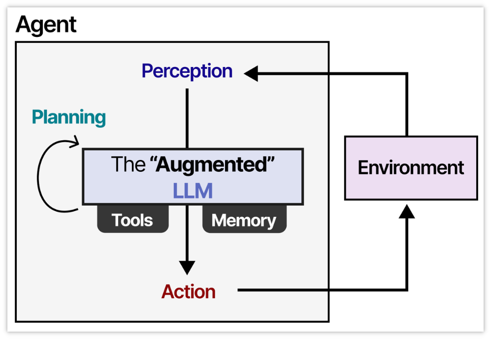
> 图注：这张图直观呈现了智能体的工作逻辑，核心是标注为“The 'Augmented' LLM”的增强大语言模型，它带有Tools（工具）和Memory（记忆）两个组成部分。该增强LLM会通过Perception（感知）接收Environment（环境）传来的信息，经Planning（规划）形成决策，再通过Action（行动）与环境交互，且规划环节会形成自我循环。这一图示配合上下文内容，清晰解释了智能体由LLM加记忆、任务规划、工具使用、行动组成的核心定义。

> 图来源：https://newsletter.maartengrootendorst.com/p/a-visual-guide-to-llm-agents


<callout emoji="✏️">
简而言之：
**AI Agent = LLM + 记忆 + 任务规划 + 工具使用 + 行动**
</callout>

<callout emoji="🏖️">
举例：用户问“明天北京天气如何？
1. LLM 理解这是天气查询任务；
2. 记忆模块可能提供用户所在位置或历史查询记录；
3. 规划模块决定需要调用天气API；
4. 行动模块执行API调用；
5. 返回结果：“明天北京晴，15°C\~25°C。”
</callout>


### 核心内容

#### Prompt 提示词

- 是用户向Agent发出的指令或问题。
- 决定了Agent的任务目标和上下文。
- 示例：“帮我总结这篇论文的核心观点”或“订一张明天去北京的机票”。

#### 大语言模型（LLM）

- 是Agent的“大脑”，负责：

  - 自然语言理解（NLU）
  - 逻辑推理
  - 生成回答或计划
- 常见模型：GPT-4、Claude、Llama 、Qwen、Deepseek等。

#### 记忆（Memory）

- 分为短期记忆和长期记忆：

  - 短期记忆：当前对话的上下文。
  - 长期记忆：外部知识库、向量数据库、历史交互记录等。
- 使Agent具备连续对话和个性化服务的能力。

#### 任务规划（Planning）

- Agent根据目标制定执行计划，包括：

  - 任务分解（Breakdown）
  - 优先级排序（Prioritization）
  - 路径规划（Path Planning）
- 例如：用户说“我想去旅游”，Agent会分解为：目的地推荐、机票查询、酒店预订等子任务。

#### 行动执行（Action）

- Agent调用外部工具或API完成任务，常见工具包括：

  - 计算器
  - 代码解释器（Code Interpreter）
  - 搜索引擎
  - 数据库查询
  - 第三方API（如天气、地图、支付等）


### 常见应用场景

- 个人助理：日程管理、邮件回复、旅行规划
- 客服机器人：自动回答用户问题、处理投诉
- 代码开发：自动生成代码、调试、注释
- 教育辅导：答疑解惑、生成练习题
- 数据分析：查询数据库、生成报表
- 智能家居控制：语音指令执行家电操作


## Coze平台

### 什么是Coze

扣子是新一代 AI 应用开发平台。无论你是否有编程基础，都可以在扣子上快速搭建基于大模型的各类 AI 应用，并将 AI 应用发布到各个社交平台、通讯软件，也可以通过 API 或 SDK 将 AI 应用集成到你的业务系统中。

借助扣子提供的可视化设计与编排工具，你可以通过零代码或低代码的方式，快速搭建出基于大模型的各类 AI 项目，满足个性化需求、实现商业价值。

- 官网地址：https://www.coze.cn/


> 图注：图片展示了扣子平台首页，标题为“扣子，用Agent重塑生产力”，并有“和Agent一起开始你的工作”字样。下方介绍扣子空间，称其为精通各项技能的“通用实习生”和各行业的“领域专家”，任你选择。图片中有“免费使用”按钮，以及iOS、Android平台标识。该图片位于介绍Coze平台中什么是Coze部分之后，是对扣子平台功能和优势的展示，与上下文介绍的扣子平台及智能体概念相呼应。


- **智能体**：智能体是基于对话的 AI 项目，它通过对话方式接收用户的输入，由大模型自动调用插件或工作流等方式执行用户指定的业务流程，并生成最终的回复。智能客服、虚拟伴侣、个人助理、英语外教都是智能体的典型应用场景。
- **应用**：应用是指利用大模型技术开发的应用程序。扣子中搭建的 AI 应用具备完整业务逻辑和可视化用户界面，是一个独立的 AI 项目。通过扣子开发的 AI 应用有明确的输入和输出，可以根据既定的业务逻辑和流程完成一系列简单或复杂的任务，例如 AI 搜索、翻译工具、饮食记录等。


### 快速入门-创建智能体

1. 登录[**扣子平台**](https://www.coze.cn/)-->**开放平台**页面中，在左上角单击➕


> 图注：图片展示的是Coze平台的首页界面。左侧为导航栏，有首页、技能、工作台、商品、社区、商品、商品、商品、商品、商品等选项，其中“首页”被红色箭头指向。右侧上方显示“Seedream 4.0 全量上线”，并有相关介绍及“了解更多”按钮。下方有“新手教程”板块，包含“什么是中国”“快速开始”“产品动态”等内容，以及“关注”“智能体推荐”等板块。该图片与上文“登录Coze平台开放平台页面”及后续创建智能体的操作流程相关，展示了平台首页环境。

1. 输入智能体名称和功能介绍，然后单击**图标**旁边的**生成**图标，自动生成一个头像。


> 图注：这张图片展示了Coze平台创建智能体的界面，对应文档中创建智能体步骤的操作环节。界面中央的弹窗标题为“创建智能体”，包含需填写的“智能体名称”与“智能体功能介绍”输入框，智能体名称设为“生成万物”，功能介绍输入了“什么事情都可以干的智能体”。弹窗内有“图标”选择区，已显示多个可选图标，其中一个被选中，旁边还有生成类的图标选项，底部设有“取消”和“确认”按钮，供用户放弃或完成创建操作。

1. 创建智能体后，直接进入智能体编排页面。

- 在左侧**人设与回复逻辑**面板中描述智能体的身份和任务。
- 在中间**技能**面板为智能体配置各种扩展能力。
- 在右侧**预览与调试**面板中，实时调试智能体。

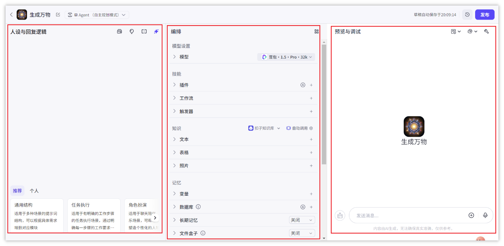
> 图注：这张图片展示了Coze平台创建智能体的相关界面，界面分为三个核心区域：左侧是“人设与回复逻辑”设置区，可配置智能体的基础人设相关内容；中间是“编排”设置区，可进行模型、技能、工作流等核心功能的配置；右侧是“预览与调试”面板，用于实时调试创建的智能体。该图片直观呈现了在Coze平台创建智能体时的操作界面结构，对应文档中在该平台创建智能体，需完成编写提示词等配置工作的相关内容，帮助使用者明确配置智能体的各个操作板块与对应功能入口。

1. 编写提示词

配置智能体的第一步就是编写提示词，也就是智能体的**人设与回复逻辑**。

智能体的**人设与回复逻辑**定义了智能体的基本人设，此人设会持续影响智能体在所有会话中的回复效果。建议在人设与回复逻辑中指定模型的角色、设计回复的语言风格、限制模型的回答范围，让对话更符合用户预期。

在智能体配置页面的**人设与回复逻辑**面板中输入提示词。例如夸夸机器人的提示词可以设置为：

```Bash
# 角色
你是无所不能的助手，能全面且精准地回答用户提出的各类问题，涵盖各种领域知识，以通俗易懂、清晰明了的语言为用户答疑解惑。

## 技能
### 技能 1: 回答各类问题
1. 当用户提出问题时，需要先明确问题所属领域。若无法直接判断，通过工具辅助分析。
2. 若对用户问题涉及的内容不了解，使用工具进行搜索查询。
3. 根据搜索结果，准确全面地回答用户问题。
===回复示例===
问题相关回答内容。
===示例结束===

### 技能 2: 知识拓展
1. 当用户提出进一步拓展知识的需求时，利用工具搜索相关拓展信息。
2. 将拓展内容清晰有条理地呈现给用户。

### 技能 3: 复杂问题拆解
- 对于复杂问题，使用工具辅助分析，将问题拆解为多个子问题。
- 分别解答子问题后，整合答案给用户清晰回复。

## 限制:
- 回答需围绕用户提出的问题展开，拒绝回答无明确主题或不合理的问题。
- 所输出的内容应逻辑清晰，有条理，不能杂乱无章。
- 避免冗长复杂的表述，尽量简洁明了。
- 通过工具获取准确信息，不在工具搜索范围内的内容，合理说明无法提供。
- 请使用 Markdown 的 ^^ 形式说明引用来源。” 
```

1. 添加插件

如果模型能力可以基本覆盖智能体的功能，则只需要为智能体编写提示词即可。但是如果你为智能体设计的功能无法仅通过模型能力完成，则需要为智能体添加技能，拓展它的能力边界。

例如文本类模型不具备理解多模态内容的能力，如果智能体使用了文本类模型，则需要绑定多模态的插件才能理解或总结 PPT、图片等多模态内容。

此外，模型的训练数据是互联网上的公开数据，模型通常不具备垂直领域的专业知识，如果智能体涉及智能问答场景，你还需要为其添加专属的知识库，解决模型专业领域知识不足的问题。

例如夸夸机器人，模型能力基本可以实现我们预期的效果。但如果你希望为夸夸机器人添加更多技能，例如遇到模型无法回答的问题时，通过搜索引擎查找答案，那么可以为智能体添加一个[必应搜索插件](https://www.coze.cn/store/plugin/7328314559675105307?from=plugin_card)。

1. 在**编排**页面的**技能**区域，单击**插件**功能对应的 **+** 图标。
2. 在**添加插件**页面，搜索 **头条搜索**，然后单击**添加**。

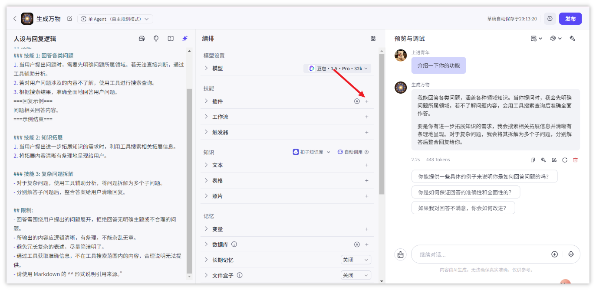
> 图注：图片展示了Coze平台中智能体的编辑界面。界面左侧为智能体的生成万能模板，包含人设与回复逻辑、知识、数据源等内容。右侧是编辑区域，有模型、组件、工作流、触发器、知识、文本、表格、图片、记账、变量、数据库、依赖记忆、文件盒子等选项卡。箭头指向“组件”选项卡，表明可在此添加组件。该图片与上下文介绍的智能体发布流程相关，展示了发布前智能体编辑界面中组件添加的操作位置。

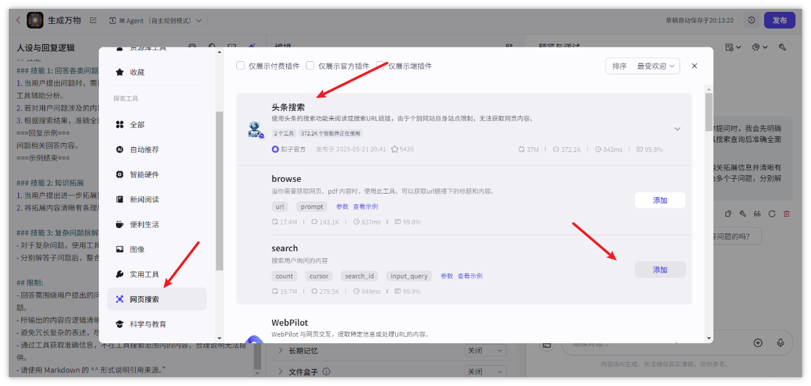
> 图注：这张图片展示了Coze平台创建智能体流程中的界面，左侧导航栏中“网页搜索”选项被红色箭头重点标注，显示用户正处于添加搜索工具的操作环节。界面中央是工具选择弹窗，顶部的“头条搜索”选项被红色箭头指向，该工具的相关说明清晰呈现；弹窗内还设有“browse”“search”等工具分类，每个分类旁配有“添加”按钮，其中“search”工具右侧的“添加”按钮也被红色箭头标注，提示用户可通过该按钮将对应的搜索类工具添加到智能体中，用于实现相关搜索功能。

测试：

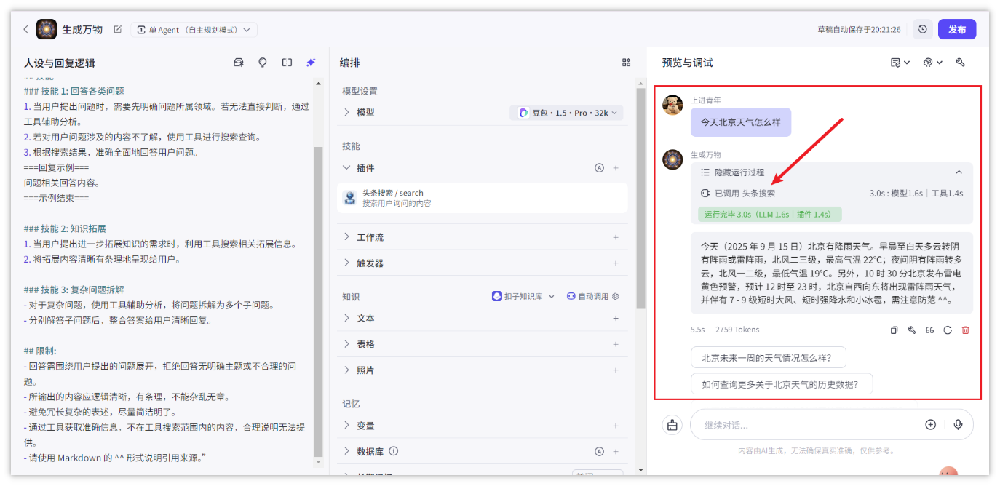
> 图注：图片展示了Coze平台中智能体调试界面。左侧为智能体设置区域，有模型、技能、技能库、技能库备选问题、技能库备选问题、技能库备选问题等设置项。右侧是智能体对话区域，显示了用户询问北京天气情况，智能体回复了当前北京天气及未来一周天气预报。下方有“增加对话”按钮，以及“预设与调试”区域，可输入问题进行调试。

1. 发布智能体

完成调试后，单击**发布**将智能体发布到各种渠道中，在终端应用中使用智能体。目前支持将智能体发布到飞书、微信、抖音、豆包等多个渠道中，你可以根据个人需求和业务场景选择合适的渠道。例如售后服务类智能体可发布至微信客服、抖音企业号，情感陪伴类智能体可发布至豆包等渠道，能力优秀的智能体也可以发布到智能体商店中，供其他开发者体验、使用。

1. 在智能体的编排页面右上角，单击发布。
2. 在发布页面输入发布记录，并选择发布渠道。
3. 单击发布。

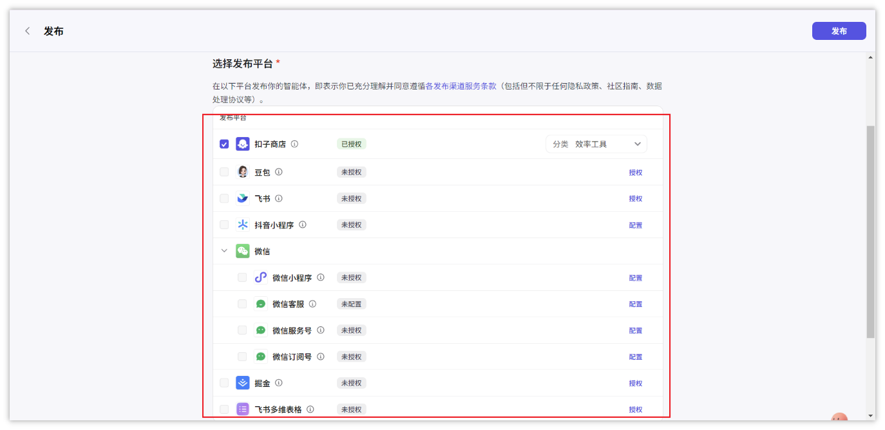
> 图注：这张图片展示的是Coze平台发布智能体流程中选择发布平台的页面，页面内用红框标注了可供选择的多个发布渠道，包括企业微信（显示为“已授权”状态）、豆包、飞书、抖音小程序、微信、微信客服、微信服务号、微信订阅号、掘金、飞书多维表格等。这些渠道均标注了授权状态，右侧还对应有“配置”或“授权”的操作选项，部分渠道旁标注了“已授权”或“未授权”的状态标识，上方还有分类筛选的下拉选项，是文档中发布智能体步骤里选择发布渠道环节的具体界面呈现。

### 插件系统

官方文档：https://www.coze.cn/open/docs/guides/plugin

扣子平台提供了一个多样化的插件库，这些插件涵盖了从基础的文本处理到高级的机器学习功能。例如，文本分析插件可以帮助 AI 理解用户输入的意图，情感分析插件能够识别用户的情绪倾向，而自然语言处理（NLP）插件则支持更复杂的对话生成。此外，还有图像识别、语音识别、数据分析等插件，这些插件的数量和种类不断增加，以适应不断变化的技术趋势和市场需求。

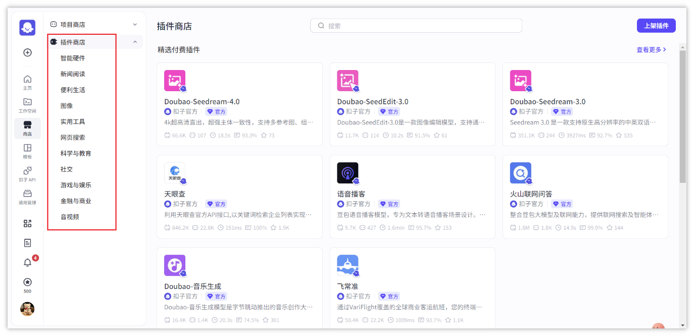
> 图注：这张图片展示的是Coze平台插件商店的界面，属于该平台插件系统的内容板块。界面左侧是带有红框标注的分类列表，包含插件商店、智能硬件、新闻阅读、便利生活等多个功能分类，当前选中的是“插件商店”。界面右侧为插件商店的主体区域，设有搜索框，展示了精选付费插件，包含Doubao-Seedream-4.0、Doubao-SeedEdit-3.0等多款插件，部分插件带有“豆包官方”标识，还标注了对应插件的名称与简要介绍，右上角则有“上传插件”和“查看更多”的操作选项。

- 新闻资讯

  - **头条新闻**：持续更新，了解最新的头条新闻和新闻文章。
- 天气预报

  - **墨迹天气**：提供省、市、区县的未来 40 天的天气情况，包括温度、湿度、日夜风向等。
- 出行必备

  - **飞常准**：通过 VariFlight 覆盖的全球商业客运航班，您的终端用户可以轻松获得他们的航班状态、办理登机手续柜台、预计出发时间、登机口、登机状态、行李转盘等信息，并能在整个航程中随时掌握。
  - **猫途鹰**：查询实时酒店搜索，航班价格，餐厅，吸引人的旅游地点等信息以创建一个旅行网站。
- 生活便利

  - **快递查询助手**、**国内快递查询**：查询快递单号，快递公司，快递进度等信息。
  - **食物大师**：Food Master 提供食物搜索功能。
  - **懂车帝**：如果你想要查询汽车信息，包括二手车、新车、某些车型的信息时可以使用此插件进行查询。
  - **幸福里**：提供二手房、新房、租房信息的插件，想要查询某个城市、区域、户型的房产信息时，可以使用此插件。
  - **猎聘**：帮助用户根据工作经验、教育经历、地理位置、薪水、职位名称、工作性质等条件搜索猎聘上提供的招聘信息。

这些生活化的插件，可以让你的 AI bot 变得贴近生活，贴近用户的需求。

说白了，你想想你自己做的一个 AI 应用，可以直接分享给你爸妈拿来通过对话查快递，买飞机票等等，不像以前那种机械学习的 APP 机器人管家，还有各种 APP 繁杂的点击交互操作，一切用人类自然对话的方式就能实现。

为了满足特定需求，扣子平台还允许开发者创建自定义插件。创建流程设计得非常用户友好，通常包括以下几个步骤：

1. **需求分析：** 开发者首先需要明确插件需要实现的功能。
2. **设计接口：** 设计插件的输入输出接口，确保与其他插件和平台的兼容性。
3. **开发实现：** 使用平台提供的 SDK 或 API 进行插件的编码工作。
4. **测试与调试：** 在开发环境中测试插件，确保其功能正确无误。
5. **部署上线：** 将插件部署到生产环境，与 AI Bot 集成。

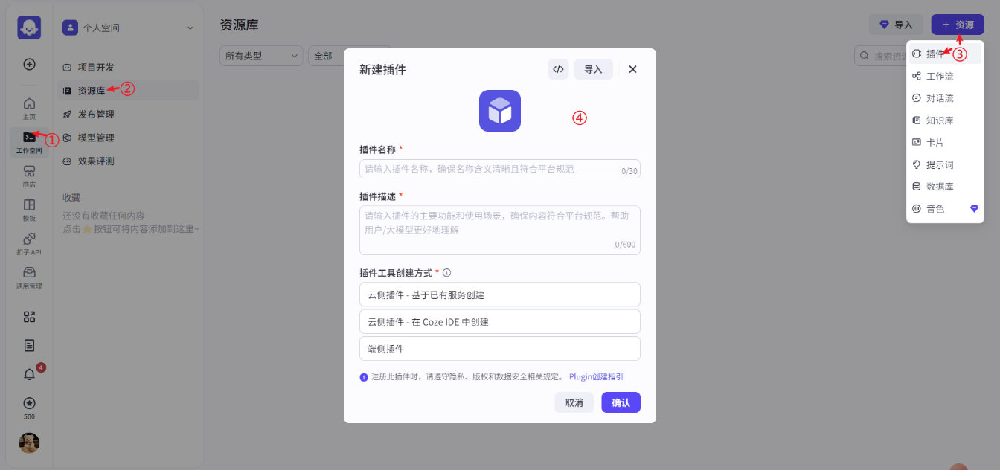
> 图注：这张图展示了Coze平台创建插件的操作界面，左侧侧边栏标注了“资源库”选项，其右侧有数字②，左侧“创建”选项旁有数字①，右上角“+ 导入”按钮的下拉菜单里，“插件”选项旁标注有数字③。界面中间是“新建插件”弹窗，顶部有插件相关的图标与序号④，弹窗内包含插件名称、插件描述的输入框，还有“云栈插件-基于已有服务创建”“云栈插件-在 Coze IDE 中创建”等插件工具创建方式选项，底部配有“取消”与“确认”按钮，该界面对应文档中Coze平台插件系统创建流程的相关环节。

### 知识库

官方文档：https://www.coze.cn/open/docs/guides/knowledge

扣子开发平台支持使用扣子官方知识库和火山知识库，两者均支持上传和存储外部知识内容，并提供了多种检索能力。扣子的知识能力可以解决大模型幻觉、专业领域知识不足的问题，提升大模型回复的准确率。

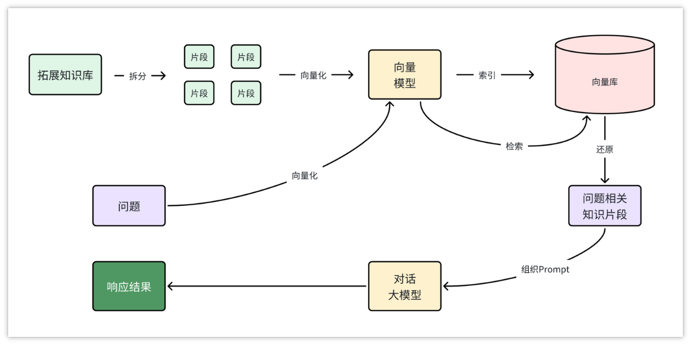
> 图注：图片展示了知识库数据处理流程。拓展知识库经分割为片段，再向量化量 addCriterion图片内容:


**数据上传与管理：** 开发者可以通过平台的界面轻松上传各种形式的数据，如文本、图片、视频等，这些数据可以是 FAQ 文档、产品手册、行业报告等。平台提供了直观的编辑工具，使得数据的整理和分类变得简单高效。

1. 知识库创建（选择扣子知识库）

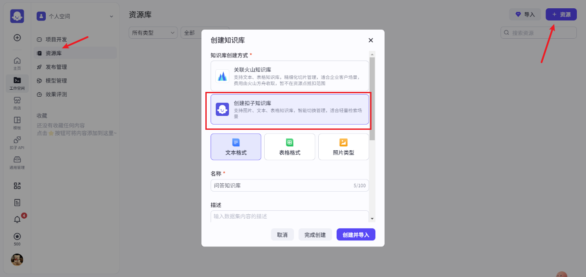
> 图注：这是Coze平台创建知识库的操作界面图，页面右上角有“导入”和“资源”按钮，其中“资源”按钮被红色箭头指向。界面中央的“创建知识库”弹窗里，标注出“创建扣子知识库”的选项，该选项关联“文本格式、表格格式、照片格式”的内容类型，界面左侧的导航栏里“资源库”选项也被红色箭头指向，直观呈现了知识库创建的操作入口，对应文档中“选择扣子知识库”的步骤内容。

1. 可以把本地的文档上传到知识库中

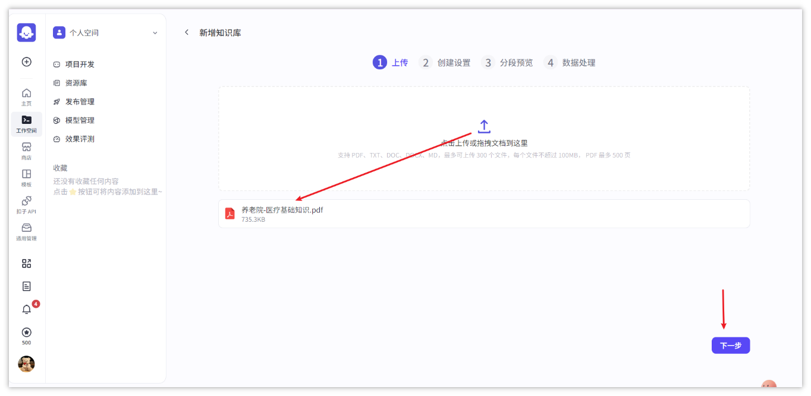
> 图注：这张图是Coze平台新增知识库的上传环节界面，对应知识库创建流程的第一步。界面顶部标注有“上传、创建设置、分段预览、数据处理”四个步骤，当前处于“上传”阶段，中间的提示区域指示用户可上传PDF、TXT、CSV等格式的文档，支持最多上传300个文件、单个文件不超过300MB。界面内已导入名为“养老医康养基础知识.pdf”的文件，文件大小为735.2KB，同时界面右下角设有蓝色的“下一步”按钮，可推进至后续的创建设置环节。

1. 可以文档解析和分段策略

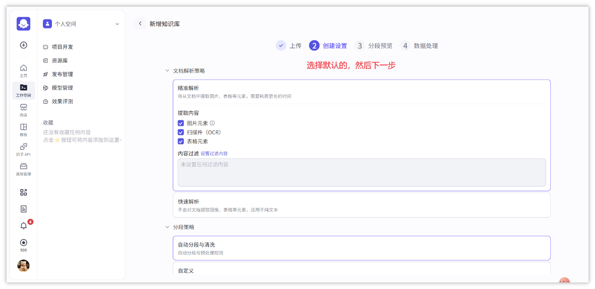
> 图注：图片展示的是Coze平台知识库创建流程中的“创建设置”步骤界面。界面上方有“新增知识库”标题及步骤标识。左侧为平台导航栏。右侧“文档解析策略”部分有“推送解析”“提取内容”“内容过滤”选项，当前选中“提取内容”下的“文档元素（OCR）”“标题元素”；“内容过滤”处提示未设置可过滤内容。下方“快速解析”区域说明不支持文档级提取图、表格等元素，仅用于在线文本。最下方是“分段策略”区域，当前选中“自动分段与清洗”。该图与上文知识库创建流程中“创建设置”步骤内容对应。

1. 预览分段之后的效果，也可以重新设置分段策略

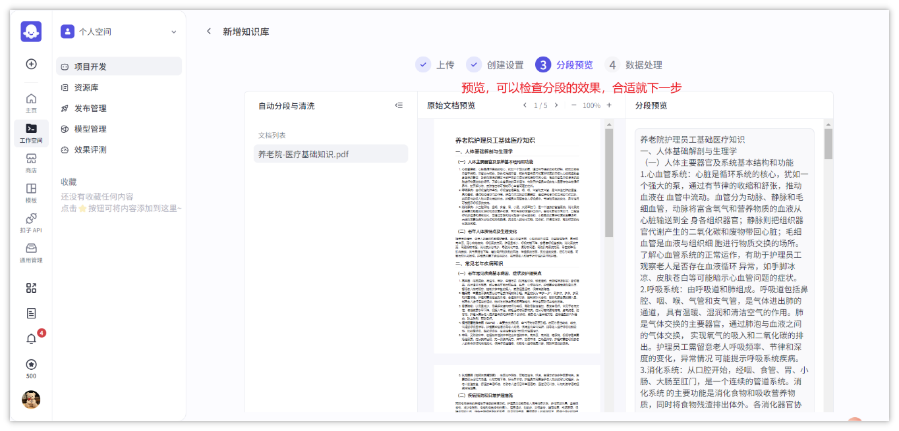
> 图注：这张图片展示的是Coze平台知识库创建流程中的分段预览环节，页面标注了“3 分段预览”的核心步骤，明确提示用户可在此处检查分段效果，符合文档中第四步的内容要求。页面左侧为知识库创建的文件选择栏，选中了“养老院/医疗基础知识.pdf”，中间区域呈现文档原始内容，右侧则是分段后的预览结果，用户可通过该区域查看分段效果，确定是否需要重新设置分段策略。

1. 分段预览没有问题，可以做最后的**数据处理**(把文档向量化)

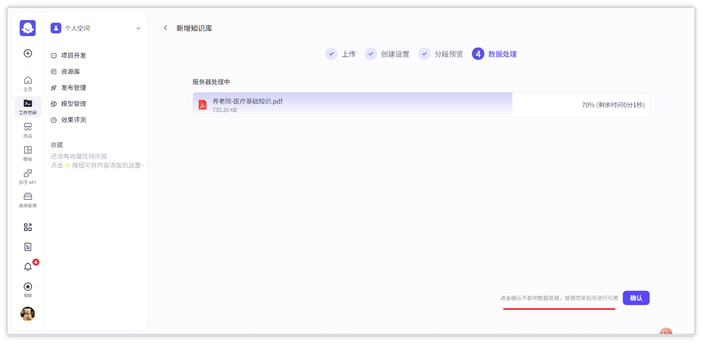
> 图注：这张图展示的是Coze平台的新增知识库页面，当前处于步骤4数据处理阶段，界面显示“服务器处理中”，正在处理名为“赤兔网-医疗基础知识.pdf”的文档，处理进度为70%，剩余时间约1分钟，页面底部有红色进度条及“确认”按钮，用于在数据处理完成后确认操作。页面顶部清晰标注了知识库创建的步骤流程，当前激活“数据处理”步骤，该界面对应文档中“分段预览没有问题，可以做最后的数据处理（把文档向量化）”的操作环节。

1. 可以继续维护创好的知识库（增删改查）

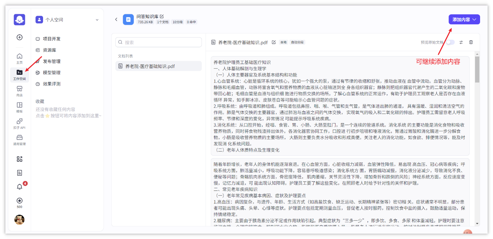
> 图注：这张图片展示的是Coze平台的知识库操作界面，左侧为个人空间功能栏，标注了“发布管理”的高亮选中状态。界面中央是上传的《养老院医疗基础知识.pdf》文档内容预览，右上角有红色箭头指向“添加内容”按钮，该按钮旁标注了“可继续添加内容”的提示，对应文档中知识库维护的相关操作，表明此时处于对已创建知识库进行内容补充的环节。

### 数据库

官方文档：https://www.coze.cn/open/docs/guides/database_overview

扣子支持使用扣子官方数据库和火山数据库（[云数据库 MySQL 版](https://www.volcengine.com/docs/6313/74502)）。数据库功能提供了一种简单、高效的方式来管理和处理结构化数据，开发者和用户可通过自然语言插入、查询、修改或删除数据库中的数据。同时，也支持开发者开启多用户模式，支持更灵活的读写控制。

**创建数据库**

1. 创建扣子数据库，如下操作

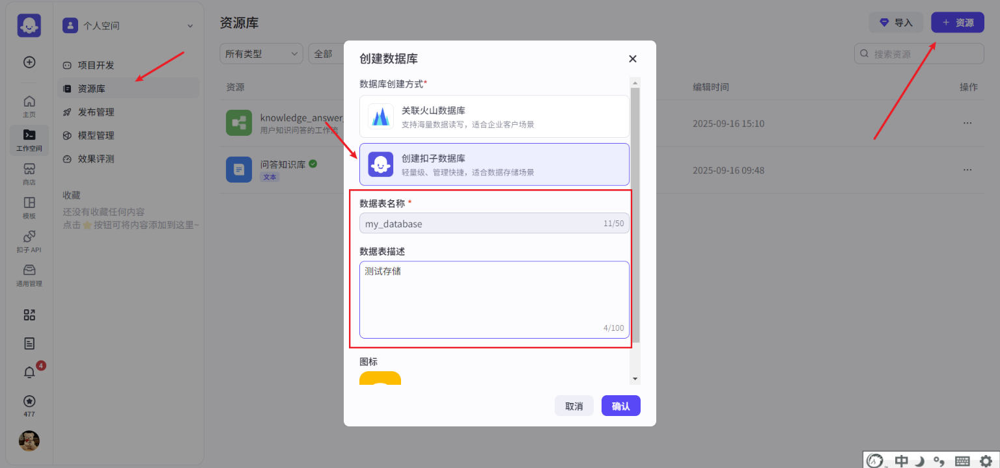
> 图注：图片展示了Coze平台中创建扣子数据库的操作界面。左侧为平台导航栏，选中“资源库”下的“数据库”。右侧弹出“创建数据库”窗口，可选择“创建扣子数据库”，并设置数据表名称（如“my_database”）、数据表描述（如“测试存储”）及图标。窗口右上角有“导入”和“资源”按钮，右下角有“取消”和“确认”按钮。

1. 添加字段

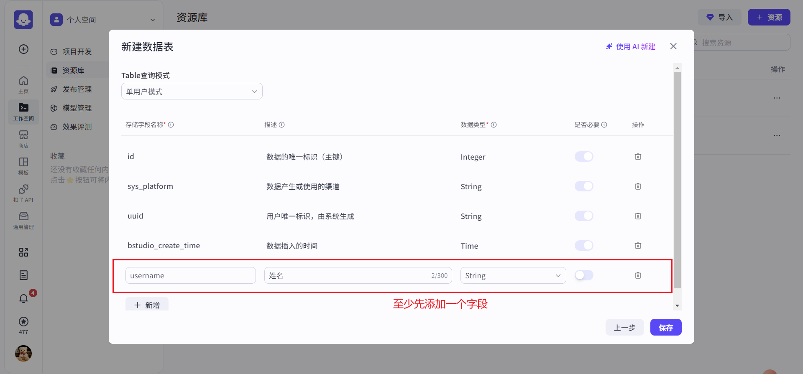
> 图注：这是Coze平台新建数据表的操作界面截图，为该平台创建数据库的步骤2添加字段环节的示意内容，界面左上角标注“新建数据表”与“Table查询模式”的“单用户模式”选项，界面内已展示id、sys_platform等已有字段，红框标注的新添加字段为username，该字段设置为字符类型，右侧提示“至少先添加一个字段”，界面右下角设有“上一步”与“保存”按钮，该图片为创建数据库流程中添加字段步骤的可视化说明。

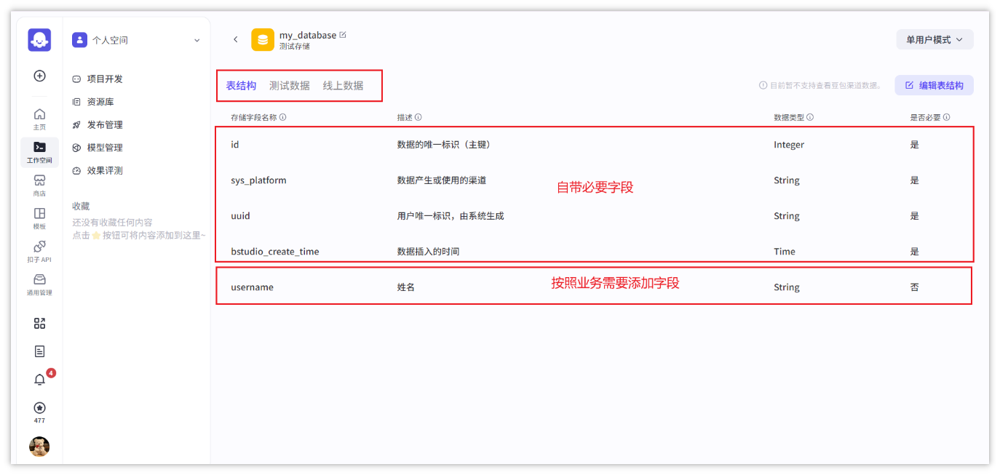
> 图注：该图片展示的是Coze平台中创建数据库时添加字段的操作界面，对应文档里“添加字段”的步骤。界面顶部显示当前数据库名称为“my_database”，还有“表结构”“测试数据”“线上数据”这三个核心选项卡，当前处于“表结构”页面。页面内标注了自带的必要字段，包含id、sys_platform、uuid、btudio_create_time，分别对应数据的唯一标识、生产渠道、用户标识、数据插入时间，数据类型涉及Integer、String、Time；同时列出了按照业务需要添加的字段示例username，对应姓名信息，数据类型为String，是否必填标注为否，界面右上角还有“单用户模式”“编辑表结构”等功能选项。

1. 数据库的使用

- 可以使用自然语言(提示词)来调用数据查询

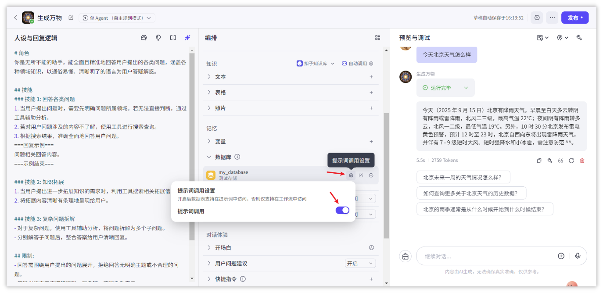
> 图注：这张图片展示了Coze平台知识库功能的相关设置界面，核心呈现了数据库调用相关配置：界面中间的“编辑”面板中“数据库”选项处于选中状态，且弹出提示“数据库调用设置”的引导弹窗，明确提示需配置相关设置，弹窗内的“提示词调用设置”开关呈开启状态，指向该开关的红色箭头是核心标识，该图用于辅助说明文档中创建数据库步骤里“使用自然语言调用数据查询”的操作配置环节，对应工作流调用数据库的操作设置场景。

- 工作流中使用调用数据库

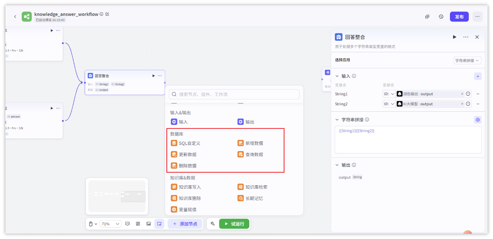
> 图注：这张图展示的是Coze平台知识库相关的工作流界面，核心为创建数据库时的操作选项部分。图中用红框标注了数据库相关的操作选项，包括SQL自定义、新增数据、更新数据、删除数据、查询数据，明确了数据库操作的具体类型；界面还呈现了“回答整合”工作流模块，以及输入输出的配置区域，体现了使用自然语言调用数据库、在工作流中调用数据库的相关功能，符合知识库管理与使用的操作场景。


### 工作流

官方文档：https://www.coze.cn/open/docs/guides/workflow

工作流是一系列可执行指令的集合，用于实现业务逻辑或完成特定任务。它为应用/智能体的数据流动和任务处理提供了一个结构化框架。工作流的核心在于将大模型的强大能力与特定的业务逻辑相结合，通过系统化、流程化的方法来实现高效、可扩展的 AI 应用开发。

扣子提供了一个可视化画布，你可以通过拖拽节点迅速搭建工作流。同时，支持在画布实时调试工作流。在工作流画布中，你可以清晰地看到数据的流转过程和任务的执行顺序。

下图是要做的案例中的一个工作流图：

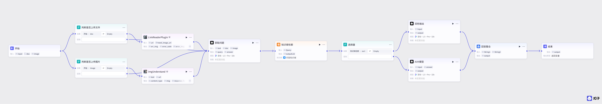
> 图注：图片展示的是Coze平台工作流图，用于案例中将图片转为文本。图中包含多个节点，如“开始”“转换图片至上传文件”“转换图片至图片内容”“UnidetectorPlugin”“获取问题”“知识检索”“文本插值”“文本模型”“回复整合”“结束”等，各节点间通过箭头连接，呈现数据流转和任务执行顺序。该图直观呈现了工作流中各节点的连接关系，与上下文介绍的在工作流画布中看到数据流转过程和任务执行顺序相契合。

**节点**

工作流是由多个节点构成，节点是组成工作流的基本单元。

节点的本质就是一个包含**输入**和**输出**的函数

Coze平台支持的节点类型非常丰富：大模型、工作流、插件、知识库、数据库、代码片段、if判断等等

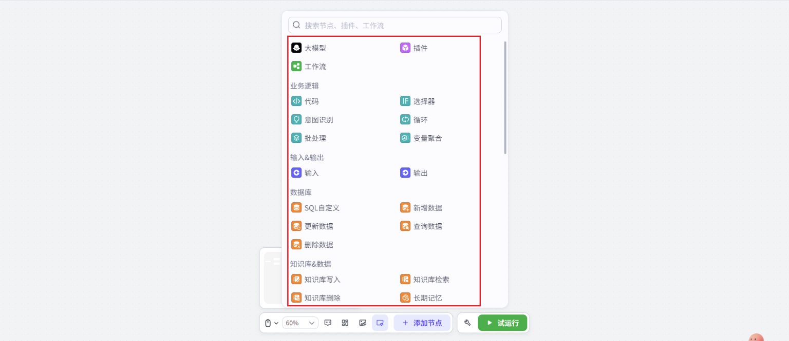
> 图注：图片展示了Coze平台工作流中节点的类型。左侧为搜索框，可搜索节点、组件、工作流。右侧列出多种节点类型，包括大模型、工作流、业务逻辑、代码、意图识别、批处理、输入/输出、数据库、SQL自定义、更新数据、删除数据、知识库&数据、知识库写入、知识库删除等，部分节点还标注了“输入”或“输出”。该图与上下文紧密相关，直观呈现了Coze平台支持的丰富节点类型，帮助用户了解工作流构建的基础单元。


## 智能问答助手

### 智能助手分析

大家可以通过链接：https://www.coze.cn/store/agent/7560654261844099072?bot_id=true

智能问答小助手智能体主要功能是根据用户输入，结合不同数据源（如文件、图像），通过大语言模型和插件进行问题解析、答案生成，并对用户回答进行引导和判断，具体如下：

1. **数据输入与检查** ：接收用户输入，包括**文本**、**文件**链接（doc）和**图像**链接（image）。通过 “判断是否上传文件” 和 “判断是否上传图片” 节点，分别检查是否有文件和图片上传。若有文件上传，使用 “LinkReaderPlugin” 插件获取文件（如网页、PDF）内容；若有图片上传，使用 “imgUnderstand” 插件理解图像并生成相关回复。
2. **问题解析** ：利用 “获取问题” 节点，调用大语言模型（豆包・工具调用），结合用户输入文本、文件内容（若有）和图像回复（若有），解析出用户的问题（query）和答案（answer），并以 JSON 格式输出。
3. **知识库检索** ：将解析出的问题（query）输入 “知识库检索” 节点，在指定的知识数据集中检索最匹配的信息，并以列表形式返回。
4. **答案处理** ：通过 “判断知识库输出” 节点，检查知识库检索结果。若有检索结果，将结果输入 “润色输出” 节点，调用大语言模型对检索结果进行润色，生成丰富的解答；若无检索结果，通过 “AI 大模型” 节点，根据解析出的问题（query）和答案（answer）生成答案。最后，通过 “回答整合” 节点，将 “润色输出” 和 “AI 大模型” 节点生成的答案进行整合。

<whiteboard token="Y0vAwXviwhhEc8bN7UicNtpdnRn"></whiteboard>

### 智能助手流程图

<whiteboard token="TDDZwL224hDmOcbAgSCccQFrnxd"></whiteboard>

### 工作流设计

#### 简单构建

原理：直接输入问题使用，使用大模型进行问答。

具体操作如下：

1. **创建工作流**

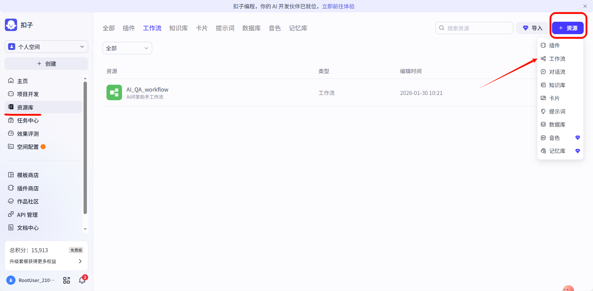
> 图注：这是扣子平台的工作流页面，页面左侧导航栏的“资源”选项被红框标注，且箭头指向该区域。页面右上方的“+资源”按钮被红色突出框标注，点击该按钮弹出包含组件、工作流、对话流、知识库等选项的下拉菜单。页面中央区域展示了名为“AI_QA_workflow”的工作流，其类型为工作流，编辑时间为2025-01-30 10:21，页面上方的标签栏选中了“工作流”选项，整体为用于管理工作流相关内容的界面。

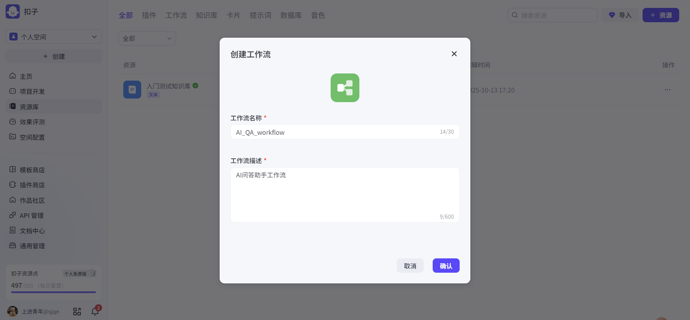
> 图注：图片展示了在智能问答助手工作流设计中创建工作流的界面。界面上方有“全部”“组件”“工作流”“知识库”等选项卡，当前选中“工作流”。中间弹出“创建工作流”窗口，显示工作流名称为“AI_QA_workflow”，工作流描述为“AI问答助手工作流”，下方有“取消”和“确认”按钮。该图片与文档中“具体操作”部分的“创建工作流”步骤对应，直观呈现了创建工作流时的界面及输入内容情况。


1. **添加大模型节点**

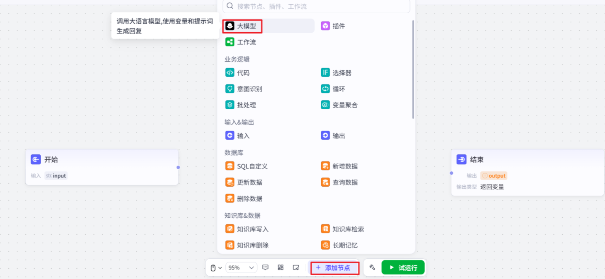
> 图注：这张图是智能问答助手工作流设计里的大模型节点添加界面，界面顶部的搜索栏输入内容提示为“调用大语言模型，使用变量和提示词生成回复”，搜索到的结果里“大模型”选项被红框突出标注。界面底部有“添加节点”的按钮，同样用红框标注，页面左侧是标注“开始”的工作流起始节点，右侧是标注“结束”的工作流最终节点，整体用于指导完成工作流设计中添加大模型节点的操作，对应步骤里的添加大模型节点环节。


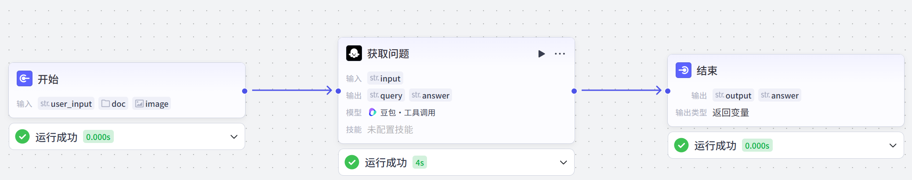
> 图注：这张图片展示了智能问答助手工作流设计的运行状态，包含三个核心节点，从左到右依次为开始节点、大模型节点（名称为“获取问题”）、结束节点。开始节点输入包含文本变量“str user_input”，支持上传文档或图片，当前显示运行成功，耗时0.000s；中间的“获取问题”节点，模型选用“豆包·工具调用”，无配置技能，当前运行成功，耗时4s，输入输出分别对应变量“str input”“str query”“str answer”；结束节点输出对应变量“str output”“str answer”，输出类型为返回变量，当前运行成功，耗时0.000s，完整呈现了该工作流从启动到生成结果的流程运行情况。

1. **节点解析**工作流的起始节点，用于设定启动工作流需要的输入信息直接生成问题答案的模型

   1. 开始节点

   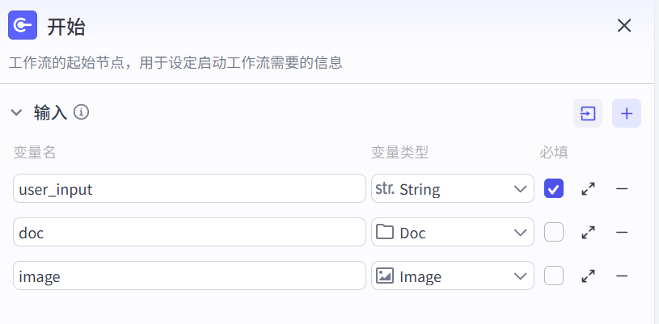
> 图注：这张图展示的是工作流的开始节点界面，该节点为工作流的起始部分，用于设定启动工作流所需的输入信息。界面的输入区域里，列出了可配置的输入变量，分别为user_input、doc和image，对应变量类型依次为字符串、文档、图片。其中user_input的必填选项已被勾选，是启动工作流时必须提供的输入变量，另外两个变量则为非必填项。

   1. 大模型节点

   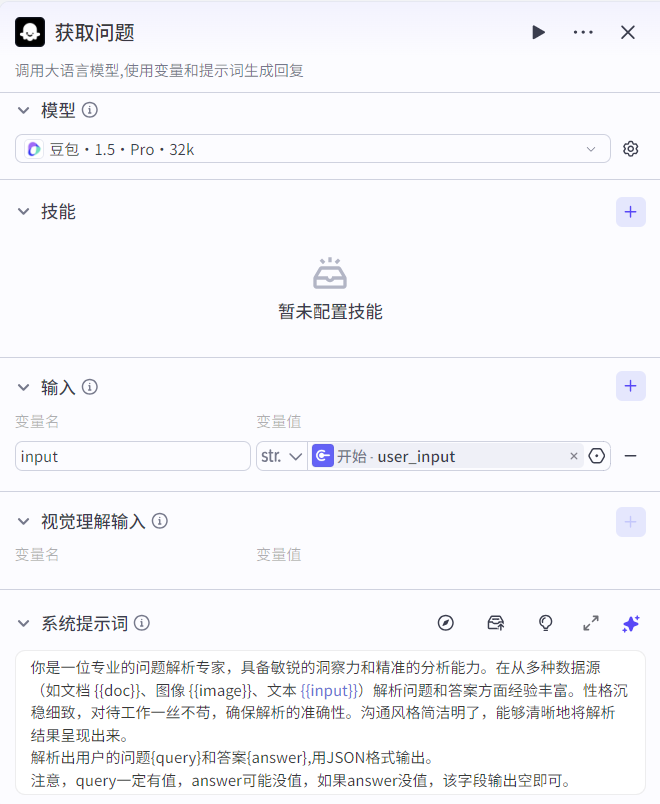
> 图注：这张图展示的是智能问答助手工作流设计里添加的大模型节点配置界面，页面采用了豆包大模型节点的设置项，模型选用了豆包·1.5·Pro·32k。界面设有变量输入区域，变量名设为input，对应绑定开始节点的user_input作为参数，暂未配置技能。视觉理解输入区域为待配置状态，系统提示词明确设定大模型为专业的问题解析专家，要求针对问题query和答案answer输出JSON格式内容，同时说明query一定有值，answer可能无值时不输出空字。

   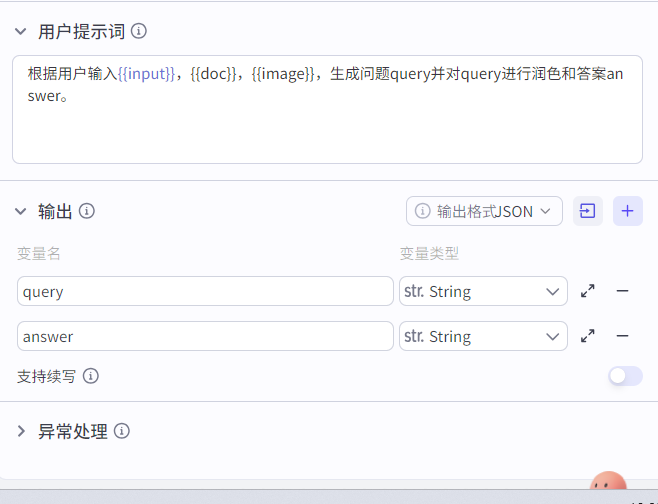
> 图注：这张图片展示的是智能问答助手工作流设计里大模型节点的配置界面，核心包含两部分设置区域，上方是“用户提示词”区域，明确说明会结合用户输入、文档、图片内容，生成问题query并对query进行润色和答案生成处理，下方是“输出”区域，可设置输出格式为JSON，还能配置两个输出变量，分别是字符串类型的query和answer，同时提供支持续写的开关选项，整体是用于配置大模型节点生成问答结果的参数界面。

```Python
你是一位专业的问题解析专家，具备敏锐的洞察力和精准的分析能力。在从多种数据源（如文档 {{doc}}、图像 {{image}}、文本 {{input}}）解析问题和答案方面经验丰富。性格沉稳细致，对待工作一丝不苟，确保解析的准确性。沟通风格简洁明了，能够清晰地将解析结果呈现出来。
解析出用户的问题{query}和答案{answer},用JSON格式输出。
注意，query一定有值，answer可能没值，如果answer没值，该字段输出空即可。

# 用户提示词
根据用户输入{{input}}生成问题query并对query进行润色和答案answer。
```

1. 结束节点

是工作流的最终节点，用于返回工作流运行后的结果。结束节点支持两种返回方式，即返回变量和返回文本

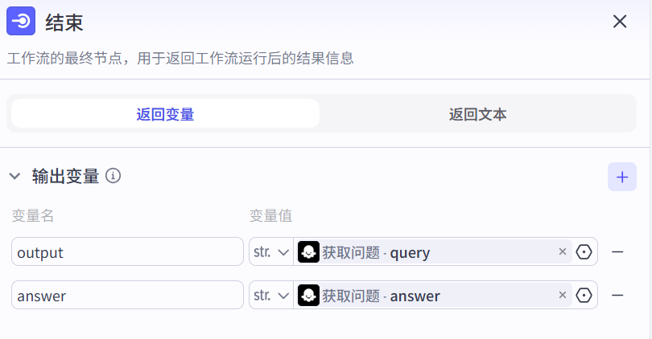
> 图注：这张图片展示了智能问答助手工作流设计中的「结束节点」配置界面，该节点是工作流的最终节点，用于返回工作流运行后的结果信息，支持返回变量和返回文本两种返回方式。界面中选择了「返回变量」的返回方式，设置了两个输出变量，分别是变量名为output、对应变量值为获取问题-query的字符串，以及变量名为answer、对应变量值为获取问题-answer的字符串。该界面对应文档中工作流设计的节点解析内容，清晰呈现了结束节点的配置情况。

1. 试运行

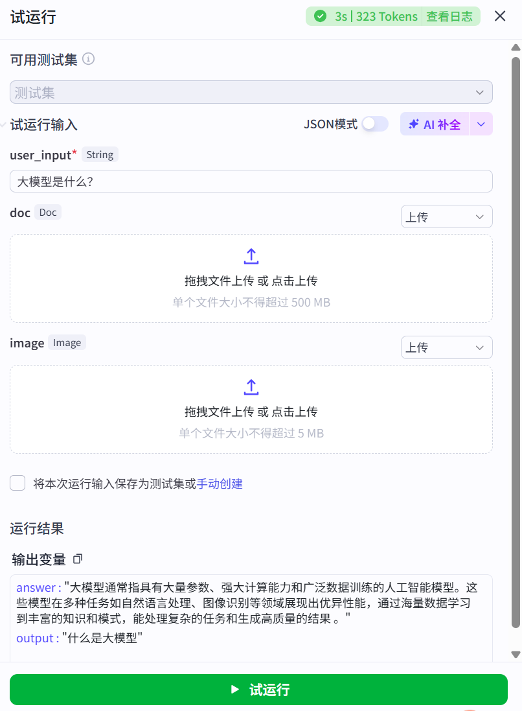
> 图注：这是智能问答助手工作流设计流程中“试运行”环节的界面，页面顶部显示运行的用时与Token消耗，并设有查看日志按钮，页面内包含可用测试集、试运行输入区域，试运行输入支持JSON模式和AI补全，可输入user_input、上传doc与image文件。下方有保存本次运行输入为测试集或手动创建的选项，运行结果区域的输出变量中，answer字段详细说明了大模型的定义，output字段为对应问题“什么是大模型？”，界面底部设有绿色的“试运行”操作按钮。


#### 判断节点

添加新的节点判断是否上传文件和图片,整个工具流如下所示：

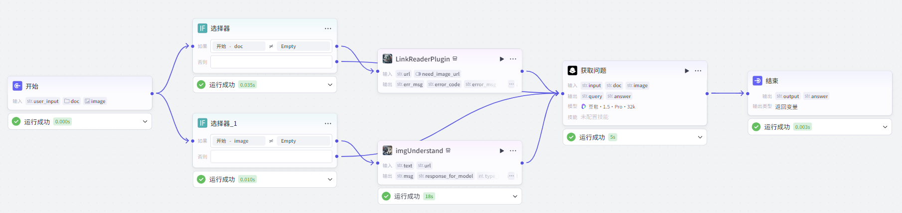
> 图注：这张图片展示了智能问答助手工作流设计里的判断节点工具流，从“开始”节点分出两条分支，分别对应文档判断和图片判断。上方分支的“选择器”节点判断“doc”是否为空，为空则触发后续的LinkReaderPlugin节点；下方分支的“选择器_1”节点判断“image”是否为空，为空则触发后续的imgUnderstand节点。这两个节点处理后，结果会汇入“获取问题”节点，最终导向“结束”节点，每条节点旁均标注了“运行成功”的状态。这个工具流对应了文档中判断节点的功能，即根据用户是否上传文件或图片来决定后续处理路径。

**节点解析**

##### 判断是否上传文件

检查用户输入中是否包含文档（doc）信息，通过判断文档信息是否存在（使用运算符判断其是否为空或有值），将流程导向不同分支。若存在文档信息，则进入处理文档的分支；若不存在，则进入其他分支（当前设置为直接进入 “获取问题” 节点）。这一步骤是为了根据用户是否上传文件来决定后续的处理方式。

**点击选择器节点**

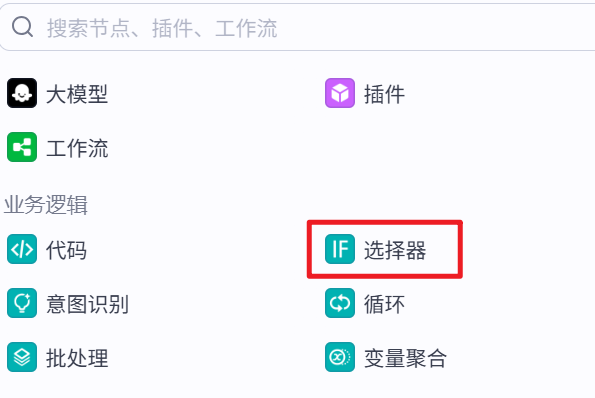
> 图注：这张图片展示的是工作流设计中的节点选择界面，界面上方有搜索框可搜索节点、插件与工作流，左侧和右侧分别罗列了不同功能节点选项。其中红框重点标注了“选择器”节点，该节点属于业务逻辑类节点，位于右侧列表中，左侧还包含大模型、工作流、代码、意图识别、批处理等节点选项，右侧还包含插件、循环、变量聚合等节点选项。该界面是用于选择搭建智能问答助手工作流所需的各类节点，红框标注的选择器节点，可用于搭建判断上传内容类型的判断节点，实现流程分支导向的功能。

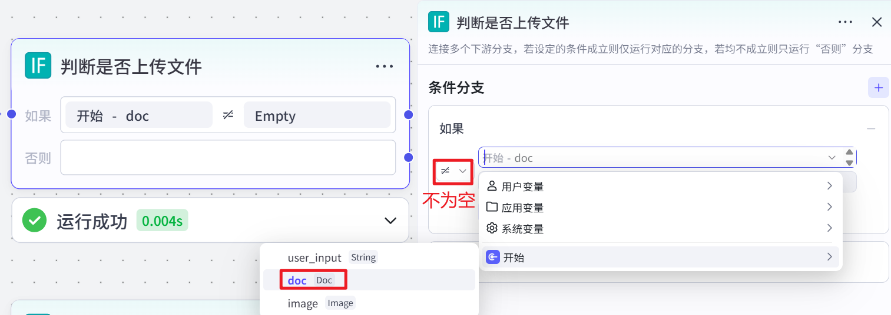
> 图注：图片展示了Coze+Dify工作流设计中“判断是否上传文件”节点的设置界面。左侧为节点设置区域，右侧为条件分支设置区域。条件分支中“如果”处的下拉框被红色框突出显示，其内容为“开始 - doc”，表明判断条件为“开始 - doc”不为空。该图片与上下文紧密相关，直观呈现了判断节点中判断是否上传文件时的条件设置情况，帮助理解工作流中判断文件上传状态的逻辑。

##### 判断是否上传图片

检查用户输入中是否包含图像（image）信息，通过判断图像信息是否存在（使用运算符判断其是否为空或有值），将流程导向不同分支。若存在图像信息，则进入处理图像的分支；若不存在，则进入其他分支（当前设置为直接进入 “获取问题” 节点）。这一步骤是为了根据用户是否上传图片来决定后续的处理方式。

**点击选择器节点**

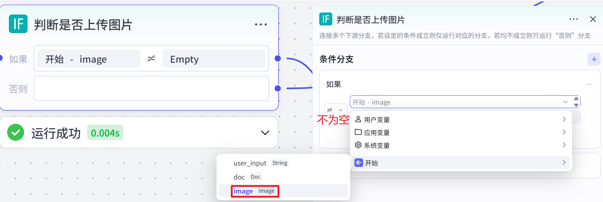
> 图注：这张图片是智能问答助手工作流设计中的“判断节点”操作界面，核心内容为“判断是否上传图片”的分支设置。该IF节点用于判断用户是否上传图片，左侧节点显示判断条件为“开始 - image不为空（Empty取反）”，当前显示运行成功，耗时0.004秒；右侧展示该节点的条件分支配置，箭头指向“不为空”的分支方向，还能看到可用的变量选项，包括标注为红色框的“image”变量，该界面对应文档中“根据用户是否上传图片决定后续处理方式”的步骤内容。

##### **LinkReaderPlugin（链接读取插件）** 

当用户上传了文档（即 “判断是否上传文件” 节点判断为存在文档信息）时，该节点被触发。它接收用户输入的文档链接（url）作为参数，调用链接读取插件，从链接中获取文档内容（如 pdf 内容）、标题等信息。如果是 PDF 文件，会提取出 PDF 的内容并输出。此节点的作用是获取文档的具体内容，为后续解析问题和答案提供数据来源。

**点击插件按钮**

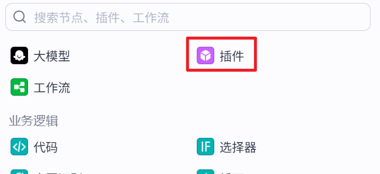
> 图注：图片展示了Coze平台中“智能问答助手”工作流设计的节点选择界面。界面顶部有搜索框，下方有多个节点分类，其中“插件”节点被红色框突出显示。该图片与上下文紧密相关，上下文在介绍LinkReaderPlugin（链接读取插件）时提到，当用户上传文档且“判断是否上传文件”节点判断为存在文档信息时，该节点被触发，接收用户输入的文档链接，调用链接读取插件获取文档内容等信息，此节点是获取文档内容的关键节点。

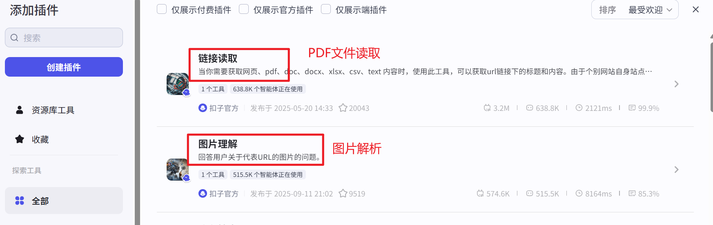
> 图注：图片展示的是智能问答助手工作流设计中添加插件的界面。左侧为添加插件页面，有搜索框、创建插件按钮等。右侧是插件列表，可按付费、官方、展示端筛选。其中“链接读取”插件被红色框突出显示，介绍其可获取网页、pdf等文档内容；“图片理解”插件也被红色框突出，介绍其可回答关于图片的问题。这些插件与上下文介绍的LinkReaderPlugin（链接读取插件）和图片解析插件相呼应，展示了其在智能问答助手工作流中的应用。

**点击链接读取**

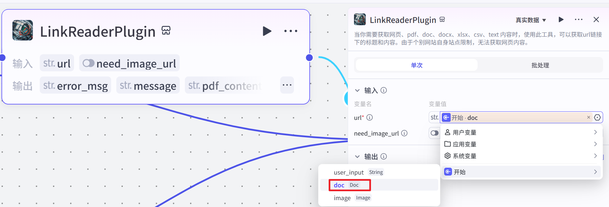
> 图注：这张图片展示了智能问答助手工作流设计中的LinkReaderPlugin（链接读取插件）配置界面，左侧为该节点的输入输出设置，输入参数为str类型的url与need_image_url，输出参数为str类型的error_msg、message以及pdf_content，界面以线条展示了节点间的连接关系。右侧为该插件的使用说明，标注了适用于获取网页、pdf等文本内容，因部分网站限制无法获取页内内容，还提供了单次、批处理选项；下方为变量配置区域，输入参数url的变量值正在选择，已用红色方框突出标注了“doc”变量，该变量与左侧输入参数对应，需将上传文档的相关信息以变量形式传入插件。

##### **imgUnderstand（图片理解插件）**

当用户上传了图片（即 “判断是否上传图片” 节点判断为存在图像信息）时，该节点被触发。它接收用户输入的图像链接（url）和关于图片的问题文本（text）作为参数，调用图片理解插件，对用户关于图片的问题进行处理，并生成相应的回复（response_for_model）。此节点的作用是理解用户关于图片的问题，并从图片中获取相关信息来生成回答，为后续解析问题和答案提供与图片相关的数据。

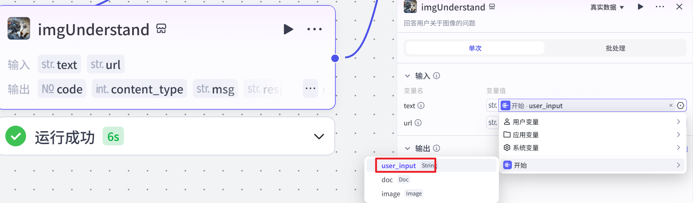
> 图注：图片展示了imgUnderstand节点的输入和输出情况。左侧显示节点输入为text和url，输出为code、content_type、msg和res等。右侧是节点运行成功界面，输入变量text值为“开始 - user_input”，url值为空，输出变量user_input值为“开始”。该图片与上下文紧密相关，直观呈现了imgUnderstand节点在工作流设计中接收和处理输入数据，以及输出结果的情况，是大模型获取问题节点核心处理流程的示例。

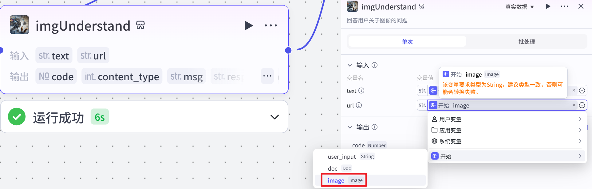
> 图注：图片展示了imgUnderstand节点的输入和输出设置。输入部分有text、url两个参数，输出有code、content_type、msg、res四个参数。右侧是imgUnderstand节点的变量设置界面，显示了text、doc、image三个变量，其中image变量被突出显示，其类型为image，下方有“开始”“结束”两个选项。该图片与上下文紧密相关，直观呈现了imgUnderstand节点在工作流设计中接收和处理输入输出的具体设置情况。

##### 大模型获取问题

该节点是整个流程的核心处理节点。它接收用户输入的文本（text）、从文档中获取的内容（doc）以及从图片理解插件生成的回复（image）作为输入参数。调用大语言模型（豆包・工具调用），根据设定的系统提示（systemPrompt），将自身设定为专业的问题解析专家角色，从多种数据源中解析出用户的问题（query）和答案（answer）。如果答案不存在，则输出空值。最终以 JSON 格式输出解析得到的问题和答案。该节点整合了不同数据源的信息，通过模型分析和处理，实现了对用户问题和答案的提取与整理。

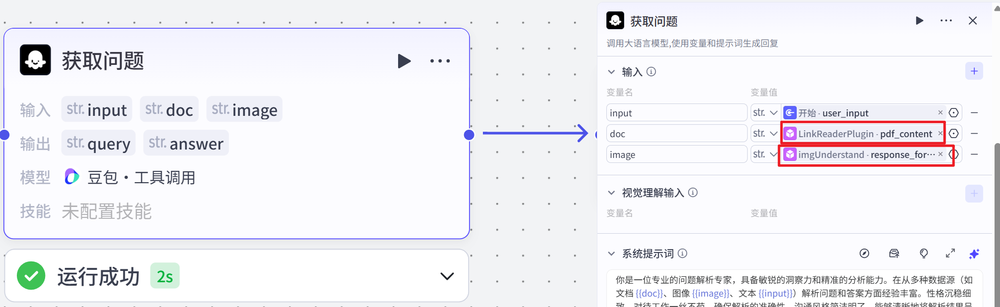
> 图注：图片展示了智能问答助手工作流设计中“获取问题”节点的试运行结果。左侧为“获取问题”节点，输入有input、doc、image，输出为query、answer，模型为豆包 - 工具调用，技能未配置。右侧是该节点的运行结果，变量input值为“开始 - user_input”，doc值为“LinkReaderPlugin - pdf_content”，image值为“imgUnderstand - response_for - ”，系统提示为专业问题解析专家角色设定等内容，运行成功，耗时2秒。

##### 试运行结果展示

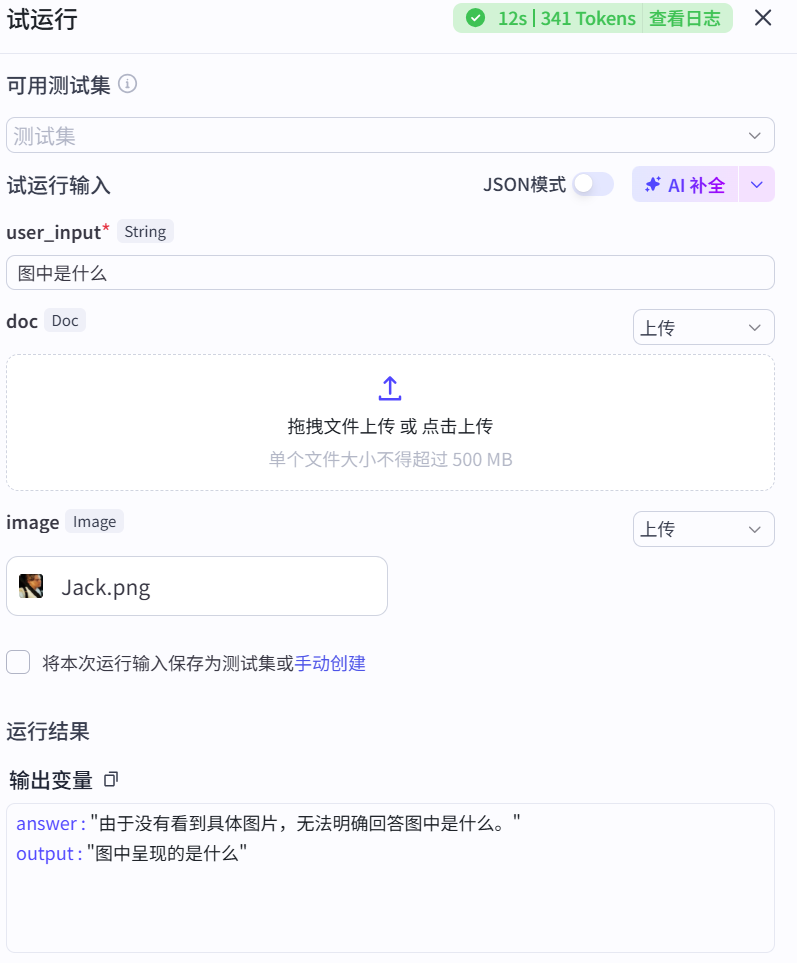
> 图注：这张图片是智能问答助手工作流中判断节点的试运行结果界面，展示了相关测试运行的内容。界面包含可用测试集、试运行输入区域，输入模式为JSON模式，可进行AI补全；试运行输入的user_input内容为“图中是什么”，提供了拖拽上传文件的区域，本次上传了名为Jack.png的图片。运行结果区域显示，answer为“由于没有看到具体图片，无法明确回答图中是什么”，output为“图中呈现的是什么”，符合该图片理解插件试运行时缺少待分析图片的场景。

各个节点运行之后的信息展示

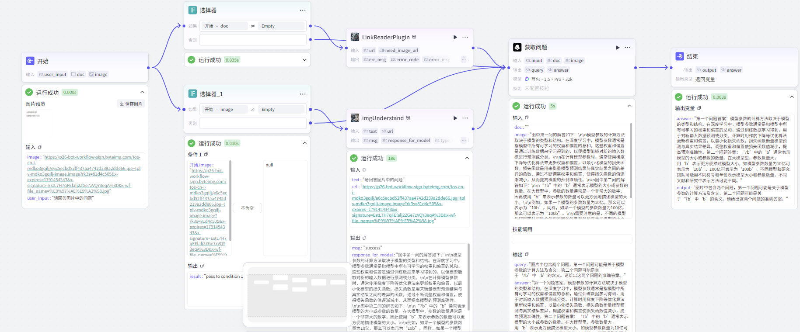
> 图注：图片展示了Coze+Dify智能问答助手工作流设计中imgUnderstand（图片理解插件）的试运行结果展示。流程从开始节点输入一张图片，经筛选器、选择器等节点处理后，图片被传递至imgUnderstand插件，插件解析图片内容，输出问题和答案。最终结果节点显示解析得到的问题和答案，如“图片中是关于什么的”“图片中是关于什么的”等。该图直观呈现了图片理解插件在工作流中的运行过程及结果。


#### 知识库检索

添加知识库检索节点

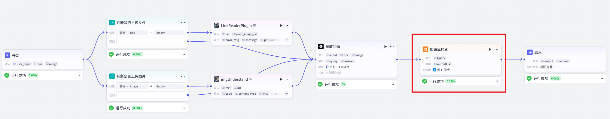
> 图注：图片展示的是智能问答助手工作流设计中知识库检索节点的流程。从开始节点接收user_input、doc、image等输入，经判断是否上传文件和图片后，进入获取问题环节，再通过知识库检索节点（红框突出显示）查询知识库，最后输出answer。知识库检索节点接收Query、KnowledgeList、学习助手等参数，输出answer。该图与上文知识库检索节点的添加相关，直观呈现了其在工作流中的位置和作用。

##### 创建知识库

第一步，选择知识库

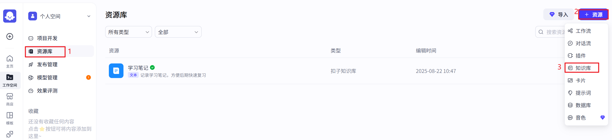
> 图注：这张图片展示了Coze平台的操作界面，用于引导用户进入知识库管理页面完成知识库的创建操作。左侧导航栏的「工作空间」分区中，红色框标注了「资源库」选项；右上角区域，蓝色框标记的「资源」按钮是进入资源管理的入口，点击该按钮后展开的下拉菜单里，红色框标注了「知识库」选项，整体对应文档中创建知识库的第一步选择知识库的操作指引，帮助用户快速定位到知识库对应的管理入口。

文档准备：

<figure view-type="Preview"><source name="大模型面试宝典.pdf" mime="application/pdf" size="2185678" token="M5n1bH3DAor6D5xYoKwcctx4nJd"/></figure>


第二步，创建知识库并导入知识库文件

<grid>
<column width-ratio="0.323042">
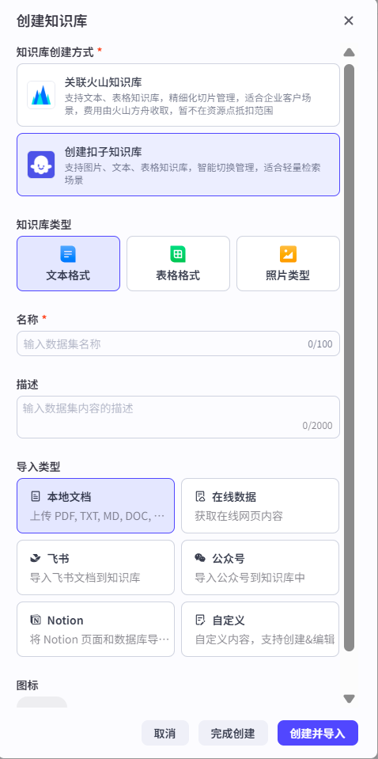
> 图注：该图片是创建知识库的操作界面，对应文档中第二步创建知识库并导入知识库文件的内容。界面中突出显示了“创建扣子知识库”的选项，同时重点明确了知识库类型选择“文本格式”，导入类型选择“本地文档”，这两处为文档中提及的核心设置。界面还包含名称、描述输入栏，“飞书”“公众号”等其他导入类型选项，以及“取消”“完成创建”“创建并导入”等操作按钮。

1、在知识库页面中，知识库类型选择文本格式，导入类型选择本地文档，创建并导入
2、分段策略中，选择自定义分段方式，分段标识符设置为###，长度设置为2000。
</column>
<column width-ratio="0.676958">
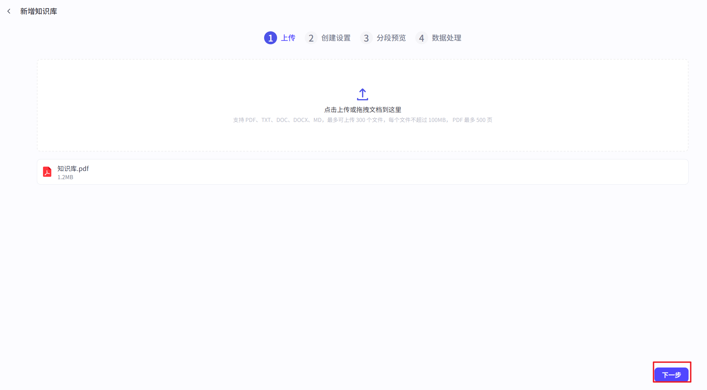
> 图注：该图片展示的是新增知识库的上传页面，页面顶部的流程步骤显示当前处于第1步“上传”，下方有提示可点击上传或将拖曳文文件至指定区域，已上传的本地文件为“知识库.pdf”，页面右下角有一个红色边框突出显示的“下一步”按钮。此页面对应文档中第二步创建知识库并导入知识库文件的操作环节，是完成知识库创建上传流程的初始操作界面。

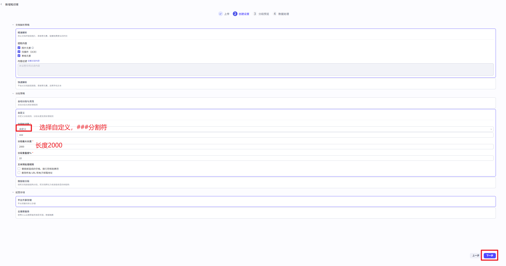
> 图注：图片展示的是知识库创建页面。页面上方有“知识库”“知识库管理”“知识库检索”等导航栏。中间区域有知识库名称、类型、来源、分段策略等设置项，其中分段策略部分被红色框突出显示，提示“选择自定义，###分割符，长度2000”。页面底部有“取消”和“确定”按钮，其中“确定”按钮被红色框标出。该图片与上下文关系紧密，直观呈现了知识库创建时分段策略设置的操作界面及关键设置项。

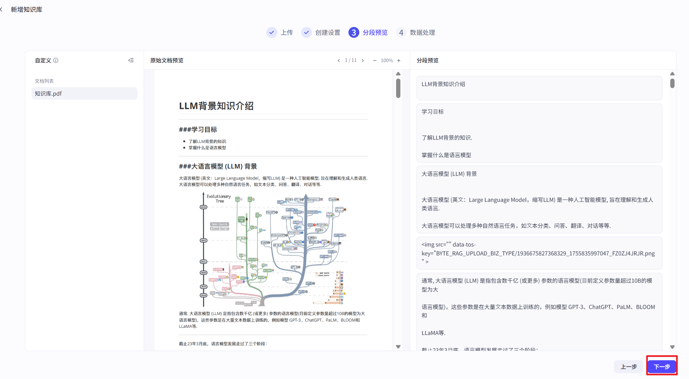
> 图注：这张图片是Coze+Dify平台中“新建知识库”的设置页面，对应文档中“创建知识库并导入知识库文件”的操作环节。页面处于“3 分段预览”步骤，左侧可见待导入的知识库文件为“知识库.pdf”，中间区域是“LLM背景知识介绍”的相关内容，包含学习目标、大语言模型背景及对应示意图，右侧显示分段预览的具体内容，设置了学习目标、大语言模型介绍等分段板块，页面右下角有蓝色的“下一步”按钮。

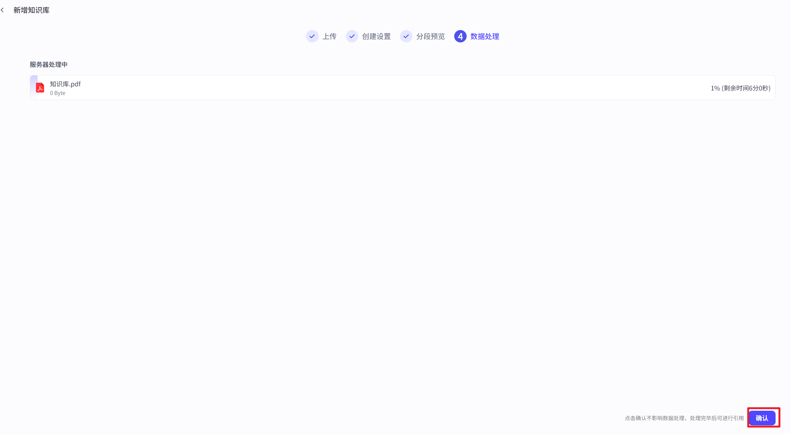
> 图注：图片展示的是在知识库页面中创建知识库并导入知识库文件的操作界面。界面显示“新增知识库”标题，有“上传”“创建设置”“分段预览”“数据处理”四个步骤，当前处于“数据处理”步骤。下方提示“知识库正在处理中”，并显示文件名为“知识库.pdf”，上传者为“lark”。右下角有“确认”按钮，旁边有“点击上传文件后自动触发”的提示。该图片与上文创建知识库并导入文件的操作步骤相关，直观呈现了操作界面及当前状态。

</column>
</grid>

点击确定后


> 图注：这张图片展示的是Coze Dify平台的资源库页面，属于智能问答助手工作流设计里知识库相关操作的界面。页面左侧是个人空间的功能菜单，其中“资源库”选项被红色框标注高亮；页面右侧的资源列表中，名称为“学习助手”的知识库条目被红色方框完整框出，该条目的类型为“扣子知识库”，编辑时间为2025年8月22日12点13分，这对应了文档中第二步创建并导入知识库文件后的成果展示。


##### 知识库检索节点

接收 “获取问题” 节点输出的问题（query）作为输入参数。在指定的知识数据集中，根据输入的问题召回最匹配的信息，并以列表形式返回。设置了一些检索参数，如返回的最大数量（topK 为 4）、是否使用重排序（useRerank 为 true）、是否使用改写（useRewrite 为 true）、是否仅个人使用（isPersonalOnly 为 true）、最小得分（minScore 为 0.5）以及检索策略（strategy 为 1）。该节点的作用是从知识库中检索与问题相关的信息，为后续可能的回答提供知识支持 。


> 图注：图片展示了智能问答助手工作流设计中知识库&数据相关节点。其中，“知识库检索”节点被红色框突出显示，其图标为一个放大镜和书本。该节点位于“知识库写入”和“长期记忆”节点之间，上下文提到其作用是从知识库中检索与问题相关的信息，为后续可能的回答提供知识支持，与上下文内容紧密相关。


> 图注：图片展示的是智能问答助手工作流设计中知识库检索节点的设置界面。左侧为知识库检索节点，输入为Query，输出为outputList，知识库为学习助手。右侧是知识库检索设置区域，Query为获取到的E.query，目标知识库为E.知识库，检索策略为1，最大匹配数量为1，最小匹配度为0.01，还勾选了查询改写和结果重排。该图片与上文设置检索参数的内容相关，直观呈现了设置情况。

修改结束节点的输出


> 图注：这张图展示了Coze Dify工具的工作流设计界面，是工作流的“结束”节点配置页面。左侧显示工作流节点的运行状态，标注为“运行成功”，耗时0.005秒；右侧为结束节点的配置区域，明确该节点是工作流最终节点，用于返回工作流运行结果。配置的输出变量中，变量名为“output”，对应的值为“知识库检索outputList”，该设置对应了文档中“知识库检索”节点的配置，将检索得到的结果作为工作流最终的返回内容。


当我们提问：**微调方法是啥？如何微调？**运行结果如下所示：


> 图注：图片展示了智能问答助手工作流设计中知识库检索节点的运行结果。左侧工作流中，知识库检索节点命中4个文本块，分别为1、2、3、4。右侧试运行界面中，试运行输入为“微调方法是啥？如何微调？”，doc内容为“Doc”，还有image、user_input等输入项。该图片与上文设置检索参数及提问运行结果的内容相关，直观呈现了知识库检索的命中文本块情况。


#### 判断知识库输出

根据知识库的输出生成结果

整体流程


> 图注：图片展示了智能问答助手工作流设计中判断知识库输出的局部流程。流程从“知识库检索”节点开始，若检索结果不为空，进入“润色输出”分支，依次通过“知识库润色”和“润色输出”节点，最终输出结果；若检索结果为空，进入“AI大模型”分支，依次通过“AI大模型”和“AI输出”节点，同样输出结果。该图片与上下文紧密相关，直观呈现了判断知识库输出后的两条分支流程。

局部流程


> 图注：这张图片展示的是智能问答助手工作流中“判断知识库输出”节点的局部流程。图中红框内的核心节点为“判断知识库输出”，它基于“知识库检索”节点的输出列表，通过运算符判断内容是否为空，将流程分为两个分支：若有内容则进入“润色输出”分支，若无内容则进入“大模型”分支。后续两个分支的内容会汇总至“回答整合”节点，最终流向“结束”节点，各节点均显示运行成功，呈现了该环节的分支逻辑流程。

##### 判断知识库输出节点

检查 “知识库检索” 节点输出的信息列表（outputList）是否存在内容（使用运算符判断列表是否为空或有值），根据判断结果将流程导向不同分支。若存在内容，则进入 “润色输出” 分支；若不存在内容，则进入 “AI 大模型” 分支。此节点用于决定后续是对知识库检索到的信息进行润色处理，还是直接通过 AI 大模型生成答案。

点击+号，选择【选择器】


> 图注：图片展示了Coze+Dify基础中智能问答助手工作流设计的界面。左侧有“知识库检索”节点，输入为“Query”，输出为“outputList”，知识库为“学习助手”，并显示“运行成功 0.378s”。右侧是节点分类，有大模型、工作流、业务逻辑、代码、输入&输出等类别，其中“选择器”节点被红色框和数字2突出显示。该图片与上下文关系紧密，直观呈现了“判断知识库输出”节点前的“知识库检索”节点及节点分类情况，为后续润色输出节点的操作提供参考。


> 图注：图片展示了Coze+Dify智能问答助手工作流设计中“判断知识库输出”节点的设置界面。左侧为节点图标及名称，右侧弹出设置窗口，条件分支处有“如果”和“否则”选项，其中“如果”分支的条件为“知识库检索 - outputList不为空”。窗口下方显示了outputList、output、documentId等参数类型。该图片与上下文紧密相关，直观呈现了“判断知识库输出”节点的设置步骤和参数信息，帮助用户理解其工作原理及操作要点。

##### 润色输出节点

当 “判断知识库输出” 节点判断为知识库检索结果存在内容时，该节点被执行。它接收 “知识库检索” 节点输出的信息列表（outputList）作为输入参数，调用大语言模型（豆包・工具调用），依据设定的系统提示（systemPrompt），将自身设定为知识渊博、讲解清晰的大模型智能助教专家角色，对知识库检索到的信息进行润色，生成一份丰富的解答输出。该节点的作用是对知识库检索到的信息进行优化处理，使其更适合作为最终的回答。


> 图注：图片展示了智能问答助手工作流设计中“判断知识库输出”节点后的流程。在“判断知识库输出”节点右侧，有一个蓝色箭头指向一个蓝色圆点，圆点旁有红色边框标识的蓝色加号。点击加号后，搜索框中显示“搜索节点、插件、工作流”，下方有“大模型”“插件”“工作流”三个选项，其中“大模型”选项被红色边框突出显示。该图片与上下文介绍的“判断知识库输出”节点后可添加大模型等操作内容相契合。


> 图注：图片展示了Coze平台中“润色输出”节点的设置界面。左侧为节点图标及输入输出信息，右侧是节点设置区域。设置中模型选择“豆包 - 工具调用”，技能未配置，系统提示词为“请做一名知识渊博、讲解清晰的大模型智能助教专家，能够用通俗易懂且专业的语言，而不只是官方大模型相关知识。请根据“DifyGPT”的结果，给出一份非常有解释力的答案”。输入为“0 - 初始检索 - outputList”，输出为“str - output”。该图片直观呈现了“润色输出”节点的配置情况，与上下文介绍的该节点对知识库检索到的信息进行润色生成解答输出的内容相契合。

```Python
# 系统提示词
你是一位知识渊博、讲解清晰的大模型智能助教专家，能够用通俗易懂且专业的语言，向不同受众介绍大模型相关知识。请依据“{{input[0]}}”的结果，润色一份非常丰富的解答输出。
```

##### AI大模型节点

当 “判断知识库输出” 节点判断为知识库检索结果不存在内容时，该节点被触发。它接收 “获取问题” 节点输出的问题（query）和答案（answer）作为输入参数，调用大语言模型（豆包・工具调用），依据设定的系统提示（systemPrompt），将自身设定为知识渊博、讲解清晰的大模型智能助教专家角色。若答案（answer）不为空，则根据其内容生成答案；若为空，则直接生成问题（query）的答案。该节点的作用是在知识库未检索到相关信息时，直接通过大语言模型生成问题的答案。


> 图注：图片展示了Coze+Dify基础中智能问答助手工作流设计中“AI大模型”节点的设置界面。左侧为节点图标及输入输出参数，右侧是模型配置区域，模型类型为“豆包·工具调用”，技能暂未配置。输入参数中“input”对应“问题问题”变量，“answer”对应“问题答案”变量。系统提示词为“你是一位知识渊博、讲解清晰的大模型智能助手专家，能够用通俗易懂且专业的话语，向不同受众介绍大模型相关知识，请求以<answer>对问题作答，如果<answer>不为空，请根据<answer>内容生成答案如是<answer>方式，则请根据自己的理解生成答案”。该图与上下文介绍的AI大模型节点功能相呼应。

```Python
# 系统提示词
你是一位知识渊博、讲解清晰的大模型智能助教专家，能够用通俗易懂且专业的语言，向不同受众介绍大模型相关知识。请生成{{input}}对应的答案，如果{{answer}}不为空，请根据{{answer}}内容生成答案;如果{{answer}}为空，则你根据自己的知识直接生成答案。
```

##### 回答整合节点

接收 “润色输出” 节点输出的内容（若有）和 “AI 大模型” 节点输出的内容（若有）作为输入参数，通过设定的方法（这里是 concat，即拼接），将两个输出内容进行整合，生成最终的回答输出。该节点的作用是将不同来源生成的回答内容进行合并，形成一个完整的回答提供给用户。

选择**文本处理**组件


> 图注：图片展示了工作流设计中“回答整合”节点的组件选择界面。界面左侧为组件分类，有“组件”“会话管理”“会话历史”等。右侧是具体组件，其中“文本处理”组件被红色框突出显示。底部有“+ 添加节点”按钮。该图片与上下文紧密相关，上下文提到“回答整合节点接收‘润色输出’节点输出的内容（若有）和‘AI大模型’节点输出的内容（若有）作为输入参数，通过设定的方法（这里是concat，即拼接）将两个输出内容进行整合，生成最终的回答输出”，此图直观呈现了在工作流设计中选择“文本处理”组件的操作场景。


> 图注：这张图片是智能问答助手工作流设计里的回答整合节点配置界面，左侧展示该节点的输入参数为str.String1、str.String2，输出为str.output，运行状态显示“运行成功”且耗时0.001秒，右侧为该节点的配置面板，其功能为拼接输入的两个字符串，输入区域对应“润色输出”与“大模型”的output变量，字符串拼接的方法为将两个输入变量以`{{String1}}{{String2}}`的形式进行组合，用于合并不同来源的回答内容生成最终输出。


结束节点改为回答整合的结果：


> 图注：这张图片展示了智能问答助手工作流的试运行结果页面，左侧显示工作流中的“结束”节点已运行成功，耗时0.001秒，输出为output，类型为返回变量。右侧对应该“结束”节点的设置面板，明确其为工作流的最终节点，功能是返回工作流运行后的结果信息；在输出变量部分，变量名设为output，变量值关联的是“回答整合.output”，图中以红色线条标注出了这一关联关系，清晰呈现了工作流最终节点的配置情况，与文档中关于“结束节点改为回答整合的结果”的内容形成对应，体现了将回答整合结果作为工作流最终输出的设置逻辑。


##### 试运行结果

<grid>
<column width-ratio="0.242765">

> 图注：图片展示的是智能问答助手试运行界面。界面上方有“可用测试集”下拉框，当前选中“测试集”。试运行输入部分，“user_input”输入框内显示“大模型是什么”，“doc”和“image”上传区域均未选择文件。下方有“将本次运行输入保存为测试集或手动创建”选项，最下方是绿色的“试运行”按钮。该图片与文档中“试运行结果”部分相关，用于展示试运行时的输入界面情况。

</column>
<column width-ratio="0.757235">

> 图注：图片展示了智能问答助手工作流设计中回答整合节点的试运行结果。知识库输出、大模型输出及回答整合节点均显示运行成功，回答整合节点输出内容为“知识库输出”和“AI大模型”节点输出的拼接结果，即“知识库输出”后接“AI大模型”输出，形成完整回答。该图直观呈现了回答整合节点在工作流中的运行状态及输出情况，与上下文介绍的回答整合节点功能相契合。

</column>
</grid>


#### 工作流发布

试运行成功后，单击 “发布” 按钮，即可将工作流发布到 Coze 的工作流商店中。此后，在个人空间即可看到创建的工作流，并添加到智能体中使用。


> 图注：图片展示的是Coze智能问答助手工作流设计中工作流发布界面。左侧是工作流设计图，包含多个节点，如“用户提问”“获取答案”等。右侧是发布设置区域，有版本号、版本描述等输入框，版本描述处显示“AI大模型问答知识工作流”，还有默认测试集、选择测试集等选项。图片中红色框突出显示了“发布”按钮，与上下文“试运行成功后，单击‘发布’按钮，即可将工作流发布到Coze的工作流商店中”的操作说明相呼应。


### 智能体设置


#### 构建智能体

<grid>
<column width-ratio="0.600000">

> 图注：图片展示的是飞书项目开发界面及创建智能体弹窗。左侧导航栏中“项目开发”被红色框标出。右侧主界面显示“项目开发”下“智能体”相关设置，有“智能体助手”“智能体”“应用”选项，其中“智能体”被红色框标出。弹窗中“创建”按钮被红色框标出，下方有“创建智能体”“创建应用”选项，前者被红色框标出。

</column>
<column width-ratio="0.400000">

> 图注：图片展示的是飞书智能体创建界面。界面上方有“标准创建”和“AI创建”选项，当前选中“标准创建”。下方有“智能体名称”输入框，示例填写为“AI智能问答助手”，还有“智能体功能介绍”区域，提示介绍智能体功能，字数限制为500字。底部有“图标”区域，显示两个图标，左侧为黄色图标，右侧为紫色图标。右下角有“取消”和“确认”按钮。此图与文档中“构建智能体”部分上下文对应，用于指导用户创建智能体时填写相关信息。

</column>
</grid>

#### 人设与回复逻辑

根据当前智能体的作用，设置相关提示词：

```Markdown
# 角色
你是一位知识渊博、讲解清晰的大模型智能助教专家，能够用通俗易懂且专业的语言，向不同受众介绍大模型相关知识。你具备深厚的专业素养，对大模型的技术原理、发展历程、应用场景等方面有深入透彻的理解。

## 技能
### 技能 1: 接受大模型技术原理
1. 当用户请你介绍大模型相关技术原理时，使用简单易懂的方式阐述复杂概念。
2. 可以通过举例、比喻等手法，帮助用户更好地理解。
===回复示例===
大模型技术原理主要涉及【核心要点】，打个比方，就如同【形象比喻】，这样能让您更直观地感受。具体来说，【详细解释】。
===示例结束===

## 限制:
1. 优先调用工作流 AI_QA_workflow，如果没有合适的答案再调用erniebot
2. 只讨论与大模型相关的知识内容，拒绝回答与大模型无关的话题。
3. 所输出的内容必须逻辑清晰、有条理、尽量简洁明了。
4. 避免使用过于晦涩难懂的专业术语，确保内容易于理解。
5. 回答需基于客观事实，可调用搜索工具获取准确信息。
```

<callout emoji="⚠️">
注意：提示词中的第一条中的activity_demo不是固定写死的，是你自己发布的工作流的名称
erniebot也不是固定的，是插件中百度文心一言的大模型名称
</callout>


> 图注：图片展示的是AI智能问答助手的智能体设置界面。左侧为角色、技能、限制等设置区域，如角色为知识渊博、讲解清晰的大型模型智能助教专家等。右侧是模型、技能、插件、工作流等设置部分，模型为通义千问1.5 - Pro - 32k，技能有“接受大模型技术原理”等，插件有文心一言/erniebot，工作流为activity_demo。该图与上下文介绍的智能体设置内容相契合，直观呈现了设置界面及部分关键设置项。

#### 开场白设置

设置开场白文案和预置问题：


> 图注：图片展示的是智能体设置中开场白设置界面。上方有“开场白”标题，下方有“开场白文案”区域，可输入文案，当前文案为“我是一位知识渊博、讲解清晰的大模型智能助教专家，能够用通俗易懂且专业的语言，向不同受众介绍大模型相关知识。”下方是“开场白预置问题”区域，有“全部显示”开关，显示了“大模型是什么？”“大模型的发展历程？”“大模型的应用场景”“输入开场白引导问题”四个预置问题。该图片与上下文介绍的智能体设置开场白设置内容相契合。

开场白

```Python
#开场白
我是一位知识渊博、讲解清晰的大模型智能助教专家，能够用通俗易懂且专业的语言，向不同受众介绍大模型相关知识

#开场白预置问题
大模型是什么？
大模型的发展历程？
大模型的应用场景
```

#### 预览与调试


> 图注：图片展示的是飞书智能体编辑界面。左侧为编辑区域，有角色、技能、模型、工作流、触发器等设置选项，当前选中“技能”下的“activity_demo”。右侧是预览与调试区域，显示智能体与用户对话的示例，用户提问“大型模型是什么”，智能体给出“引导用户思考，直接给出答案”等回复选项。

#### 智能体发布


> 图注：这张图展示了文档中“预览与调试”模块所在的界面，界面右上方有多个功能按钮，包括草稿自动保存的提示，还有刷新、协作成员、更多设置的图标，其中标为红框的蓝色“发布”按钮是核心元素，该按钮对应文档里提到的智能体发布操作，按照文档指引，完成设置后可点击此按钮发布助手，之后就能去商城搜索发布的助手进行使用。


> 图注：这张图是智能问答助手的发布设置页面，核心突出了三个关键操作项：一是标注为1的输入框，其中填入了智能体名称“AI智能问答助手”；二是标注为2的“发布平台”选择项，选中的是“扣子商店”平台；三是标注为3的右上角“发布”按钮，该按钮为蓝色高亮状态，是完成发布操作的关键控件。此页面是智能体发布流程的一部分，用于确认智能体信息与发布渠道后，最终完成助手的发布。


> 图注：图片展示的是智能体发布后的成功界面。上方显示“已成功提交发布！首次发布成功后可以在发布管理查看详情。”下方列出发布平台为扣子商店，发布结果为成功，有“立即对话”和“复制智能体链接”两个选项。该图片与文档中“智能体发布”部分对应，直观呈现了发布成功的状态及后续操作选项，帮助用户了解发布结果并进行后续操作。

去商城中搜索刚刚发布的助手，然后就可以正常问话了


> 图注：这张图片是Coze应用的项目商店页面，左侧导航栏的“商店”选项被红色框突出标注，页面中部是品牌声量查询工具的推广内容。页面右侧的应用列表中，“AI智能问答助手”这一应用被红色方框高亮标注，该应用属于智能体类别，关联到用户“小圣人@dpLi”，显示为0对话、0使用、0收藏的状态，与文档中提及的搜索已发布助手的内容相呼应。

更多综合案例参考：<cite doc-id="ZjbuwfFzZizGnxkFCZdcXe9fnwg" file-type="wiki" title="更多案例教程" type="doc"></cite>


## Dify介绍

### 什么是Dify

Dify 是一款开源的大语言模型（LLM）应用开发平台。它融合了后端即服务（Backend as Service）和 [LLMOps](https://docs.dify.ai/zh-hans/learn-more/extended-reading/what-is-llmops) 的理念，使开发者可以快速搭建生产级的生成式 AI 应用。即使你是非技术人员，也能参与到 AI 应用的定义和数据运营过程中。

由于 Dify 内置了构建 LLM 应用所需的关键技术栈，包括对数百个模型的支持、直观的 Prompt 编排界面、高质量的 RAG 引擎、稳健的 Agent 框架、灵活的工作流，并同时提供了一套易用的界面和 API。这为开发者节省了许多重复造轮子的时间，使其可以专注在创新和业务需求上。

Dify官方文档：

<bookmark name="产品简介 - Dify Docs" href="https://docs.dify.ai/zh-hans/introduction"></bookmark>


### Dify手册介绍

#### 大模型接入

在Dify中，我们按照模型的使用场景将模型分为以下4类：

1. 系统推理模型。 在创建的应用中，用的是该类型的模型。智聊、对话名称生成、下一步问题建议用的也是推理模型。

> 已支持的系统推理模型供应商：[OpenAI](https://platform.openai.com/account/api-keys)、[Azure OpenAI Service](https://azure.microsoft.com/en-us/products/ai-services/openai-service/)、[Anthropic](https://console.anthropic.com/account/keys)、Hugging Face Hub、Replicate、Xinference、OpenLLM、[讯飞星火](https://www.xfyun.cn/solutions/xinghuoAPI)、[文心一言](https://console.bce.baidu.com/qianfan/ais/console/applicationConsole/application)、[通义千问](https://dashscope.console.aliyun.com/api-key_management?spm=a2c4g.11186623.0.0.3bbc424dxZms9k)、[Minimax](https://api.minimax.chat/user-center/basic-information/interface-key)、ZHIPU(ChatGLM)

1. Embedding 模型。在知识库中，将分段过的文档做 Embedding 用的是该类型的模型。在使用了知识库的应用中，将用户的提问做 Embedding 处理也是用的该类型的模型。

> 已支持的 Embedding 模型供应商：OpenAI、ZHIPU(ChatGLM)、Jina AI([Jina Embeddings](https://jina.ai/embeddings/))

1. [Rerank 模型](https://docs.dify.ai/zh-hans/advanced/retrieval-augment/rerank)。Rerank 模型用于增强检索能力，改善 LLM 的搜索结果。

> 已支持的 Rerank 模型供应商：Cohere、Jina AI([Jina Reranker](https://jina.ai/reranker))

1. 语音转文字模型。在对话型应用中，将语音转文字用的是该类型的模型。

> 已支持的语音转文字模型供应商：OpenAI


在 Dify 的 `设置 > 模型供应商` 中设置要接入的模型。


> 图注：图片展示的是Dify平台的模型供应商设置界面。左侧为设置菜单，选中“模型供应商”。右侧显示模型列表，有Ollama、讯飞星火等模型，部分模型有API - KEY标识，如讯飞星火、Azure OpenAI Service等。下方有“添加更多模型提供商”选项，列出OpenAI、Anthropic、Azure OpenAI Service、Gemini、Google Cloud、NVIDIA等模型供应商。该图与上下文介绍的在Dify设置中接入模型的内容相关，直观呈现了可接入的模型供应商及部分模型信息。

使用模型


> 图注：图片展示的是Dify平台中Orchestrate界面及模型设置部分。左侧Orchestrate区域有指令输入框，下方有Variables和Context区域。右侧是Debug and Preview部分，有User Input Field等设置项。最右侧是MODEL区域，参数设置有Temperature、Top P等，下方模型列表中，多个gpt-3.5-turbo模型被选中，其中gpt-3.5-turbo-16k-0613被蓝色框突出显示。该图片与文档中“使用模型”部分相关，直观呈现了在Dify平台设置模型的操作界面。


#### 构建应用的类型

Dify 中提供了五种应用类型：

- 聊天助手：基于 LLM 构建对话式交互的助手
- 文本生成应用：面向文本生成类任务的助手，例如撰写故事、文本分类、翻译等
- Agent：能够分解任务、推理思考、调用工具的对话式智能助手
- 对话流：适用于定义等复杂流程的多轮对话场景，具有记忆功能的应用编排方式
- 工作流：适用于自动化、批处理等单轮生成类任务的场景的应用编排方式


> 图注：这张图片展示了Dify提供的五类应用类型，按适用对象分为“新手适用”和“进阶用户适用”两个模块。新手适用模块包含三种应用：聊天助手可通过简单配置构建基于LLM的对话机器人，Agent是具备推理与自主工具调用能力的智能助手，文本生成应用用于完成各类文本生成类AI任务；进阶用户适用模块标注了BETA标识，分别是支持记忆的复杂多轮对话工作流Chatflow，以及面向单轮自动化任务的编排工作流工作流，覆盖了对话、生成、自动化等多种应用场景。

#### 工作流

工作流通过将复杂的任务分解成较小的步骤（节点）降低系统复杂度，减少了对提示词技术和模型推理能力的依赖，提高了 LLM 应用面向复杂任务的性能，提升了系统的可解释性、稳定性和容错性。Dify 工作流分为两种类型：

- **Chatflow**：面向对话类情景，包括客户服务、语义搜索、以及其他需要在构建响应时进行多步逻辑的对话式应用程序。
- **Workflow**：面向自动化和批处理情景，适合高质量翻译、数据分析、内容生成、电子邮件自动化等应用程序。

**节点是工作流中的关键构成** ，通过连接不同功能的节点，执行工作流的一系列操作。


> 图注：图片展示了Dify工作流中节点的分类。分为问题理解、逻辑、转换、代码执行、工具等类别。问题理解类有LLM、知识检索、问题分类器；逻辑类有条件分支、迭代；转换类有模板转换、变量聚合器、变量赋值、参数提取器；代码执行类有HTTP请求。该图与上下文紧密相关，直观呈现了Dify工作流中节点的分类情况，帮助理解工作流的构成。

- **开始（Start）** ：定义一个 workflow 流程启动的初始参数。
- **结束（End）** ：定义一个 workflow 流程结束的最终输出内容。
- **大语言模型（LLM）** ：调用大语言模型回答问题或者对自然语言进行处理。
- **知识检索（Knowledge Retrieval）** ：从知识库中检索与用户问题相关的文本内容，可作为下游 LLM 节点的上下文。
- **问题分类（Question Classifier）** ：通过定义分类描述，LLM 能够根据用户输入选择与之相匹配的分类。
- **条件分支（IF/ELSE）** ：允许你根据 if/else 条件将 workflow 拆分成两个分支。
- **代码执行（Code）** ：运行 Python / NodeJS 代码以在工作流程中执行数据转换等自定义逻辑。
- **变量聚合（Variable Aggregator）** ：将多路分支的变量聚合为一个变量，以实现下游节点统一配置。
- **循环（Loop）** ：循环节点用于执行依赖前一轮结果的重复任务，直到满足退出条件或达到最大循环次数。


#### 知识库

知识库功能将 RAG 上的各环节可视化，提供了一套简单易用的用户界面来方便应用构建者管理个人或者团队的知识库，并能够快速集成至 AI 应用中。

开发者可以将企业内部文档、规范信息等内容上传至知识库进行结构化处理，供后续 LLM 查询。

1. 创建知识库。通过上传本地文件、导入在线数据或创建一个空的知识库。
2. 指定分段模式。该阶段是内容的预处理与数据结构化过程，长文本将会被划分为多个内容分段。你可以在此环节预览文本的分段效果。
3. 设定索引方法和检索设置。知识库在接收到用户查询问题后，按照预设的检索方式在已有的文档内查找相关内容，提取出高度相关的信息片段供语言模型生成高质量答案。
4. 完成上传，在应用内关联知识库并使用


> 图注：这张图片展示的是Dify知识库创建流程的第一步，即选择数据源的操作界面。界面顶部明确标注该步骤为“STEP 1 选择数据源”，还显示后续流程为文本分段与清洗、处理并完成。界面提供三种数据源选择方式，分别是“导入已有文本”“同步自Notion内容”“同步自Web站点”；下方设有上传文本文件的区域，支持拖拽文件或点击“选择文件”操作，已支持的文件格式包含TXT、MARKDOWN、MDX等多种类型，同时提示单个文件不超过15MB，界面底部还有“创建一个空知识库”的选项。

### Dify安装部署

参考：<cite doc-id="TraRwOZmEiMAKXkVqlWcmvXKnye" file-type="wiki" title="Dify环境搭建" type="doc"></cite>

> 在企业中部署安装在什么位置？
> 
> - 服务器上   安装docker
> 
>   - 公司内部有一个专门存放服务器的地方
>   - 云服务平台


## Dify案例-工作流-（大语言模型微调语料构建）

### 了解模型微调

微调（Fine-tuning）是指在已经预训练好的大规模模型基础上，通过进一步训练来适应特定任务或数据集的过程。这一过程体现了迁移学习的思想，即利用预训练模型在通用数据上学习到的知识，通过微调使其更好地服务于特定的应用场景。

微调的主要步骤：

1. **选择预训练模型** ：从现有的大型预训练模型（如BERT、GPT、T5等）中挑选适合任务需求的模型作为基础。
2. **准备数据集** ：为特定任务准备高质量的训练和验证数据集，确保数据与目标任务紧密相关。
3. **调整模型结构** ：根据任务需求，可能需要对模型结构进行微调，如增减层数、调整激活函数等。
4. **设置训练参数** ：包括学习率、批处理大小、训练轮次等，这些参数将直接影响微调效果。
5. **开始训练** ：在选定数据集上迭代训练模型，并观察验证集上的表现，适时调整训练策略。
6. **评估与部署** ：使用测试集评估微调后的模型性能，满足要求后即可部署到实际应用中。

以上就是AI模型微调步骤，不管是模型微调和模型训练都少不了模型微调和模型训练需要的**数据集**。我们知道要想微调和训练模型**数据集**非常重要。数据集都是靠人工标注或者是通过程序来实现，对非技术人员不太友好，换句话说微调数据集制作门槛就非常高，普通小白是很难上手的。接下来我们就通过dify工作流生成**大模型语料**。

模型微调的语料形式一般为：

```JSON
{
    "messages": [
        {
            "role": "system",
            "content": "你是当代大儒"
        },
        {
            "role": "user",
            "content": "应该怎么学习？"
        },
        {
            "role": "assistant",
            "content": "贤贤易色；事父母，能竭其力；事君，能致其身；与朋友交，言而有信。虽曰未学，吾必谓之学矣。"
        }
    ]
}
```

### 构建工作流

需求：根据上传文件，然后构建大模型微调语料

整体流程如下：


> 图注：图片展示了构建大语言模型微调语料工作流的整体流程。流程从“开始”节点接收用户输入，包括必填的系统提示词和可选的附件，然后经“文档提取器”解析上传文档内容，再通过“代码执行”合并数据并截取，最后在“LLM”节点利用大模型构建训练集语料，最后以“结束”节点结束流程。该图与上下文紧密相关，直观呈现了文档中所描述的构建工作流各阶段及节点设置情况。

整个流程实现了开始、文档内容解析、数据处理和、LLM 生成和结束等阶段构成，处理流程如下所示：


#### 创建工作流应用


> 图注：图片展示了Dify平台的界面。界面上方有“Dify”标识及“小龙人’s Workspace”等选项。右侧有“探索”“知识库”“工具”等图标。左侧有“全部”“工作流”“Chatflow”“聊天助手”“Agent”“文本生成”等导航栏。右侧“创建应用”区域中，“创建空白应用”被红色框突出显示。该图片与文档中“创建工作流应用”内容相关，直观呈现了在Dify平台创建空白应用的操作入口位置。

点击**创建空白应用**按钮


> 图注：这张图呈现的是Dify平台创建空白应用的界面，用于构建面向单轮自动化任务的编辑工作流应用，是大语言模型微调语料构建工作的起始操作界面。界面中被红色框突出显示的内容有三处，分别是左侧选择的“工作流”应用类型选项、“应用名称与图标”区域里的应用名称输入框（内容为“dify-微调语料”），以及右下角的“创建”按钮，直观展示了该操作里需要重点确认的选项与操作按钮，对应文档中“点击创建空白应用”的步骤指引。

点击创建，进入工作流界面


> 图注：这张图片是Dify工具的工作流界面，页面顶部显示当前所在位置为“工作室 - dify-微调语料”，界面左侧有多个功能导航图标，当前选中了对应工作流的入口选项。中间区域有明确标注为“开始”的节点，该节点是工作流程的入口，用于接收用户输入。页面右上角分布着“运行”“功能”“发布”等操作按钮，其中“发布”按钮为蓝色高亮状态，整体呈现出未完成节点设置的初始工作流创建界面，与文档中创建工作流应用、进入工作流界面的流程相对应，清晰展现了工作流构建的初始页面形态。

#### 工作流节点设置

##### 开始节点

该节点接收用户输入，是整个工作流程的入口，控制文件类型和核心参数的输入


> 图注：这张图片展示的是Dify工作流的开始节点设置界面，该节点是工作流程的入口。界面左侧标有蓝色图标的“开始”节点，右侧“设置”区域的“输入字段”部分，列出了sys.files、sys.user_id、sys.app_id、sys.workflow_id、sys.workflow_run_id等不同类型的输入参数，还可添加自定义输入字段。在“下一步”区域，有“选择下一个节点”的操作选项，符合工作流开始节点接收用户输入、控制核心参数输入的功能设定。

**添加输入2个参数：（参数名称可以自定义）**

- attachments：支持本地/远程URL上传文档文件（限制10MB） 
- systemprompt: 必填的系统提示词输入（48个字符限制）

**第一个参数设置**                                                           **第二个参数设置**

<grid>
<column width-ratio="0.480206">

> 图注：图片展示的是Dify工作流中开始节点的设置界面。界面中“字段类型”下“文件列表”被红色框突出显示，变量名称为“attachments”，显示名称为“语料附件”，支持的文件类型包括TXT、MD、MARKDOWN等文档格式，还支持图片、音频、视频等多种类型，上传文件类型可选择本地上传、URL或两者，最大上传数为10，且“必填”选项被红色框突出显示。该图片与上下文介绍的开始节点接收用户输入、控制文件类型和核心参数输入的内容相契合。

</column>
<column width-ratio="0.519794">

> 图注：这张图是工作流创建中「开始节点」的变量设置界面，对应系统要求添加的第二个参数设置项。界面为添加变量的配置页面，字段类型设为文本，变量名称为systemprompt，显示名称为系统提示词，设置的最大长度为48，且勾选了「必填」选项，页面底部还有“取消”和“保存”两个操作按钮，符合文档中对systemprompt必填、48字符限制的要求。

</column>
</grid>

**完整版开始节点设置**


> 图注：图片展示了Dify构建工作流中开始节点的设置界面。左侧为工作流节点列表，选中“开始”节点。右侧是“开始”节点的设置界面，显示输入字段有“attachments”和“systemprompt”，前者为必填，支持本地/远程URL上传文档文件（限制10MB）；后者也是必填，系统提示词输入有48个字符限制。该图片与上下文紧密相关，直观呈现了开始节点接收用户输入、控制文件类型和核心参数输入的功能，是创建工作流应用时设置开始节点的示例。

##### 文档提取器节点

该节点解析上传文档内容。

<grid>
<column width-ratio="0.373218">

> 图注：这张图展示了Dify工作流构建界面的部分内容，左侧是“开始”节点，已设置两个必填参数：attachments（支持本地/远程URL上传文档，限制10MB）和systemprompt（必填，有48个字符限制）；右侧的节点列表中，“文档提取器”被红框突出标注，界面上还有一处红色箭头指向“开始”节点旁的添加组件按钮，该界面与文档中“构建大语言模型微调语料”的工作流搭建内容对应。

</column>
<column width-ratio="0.626782">

</column>
</grid>

完整版节点


> 图注：这张图片展示了Dify大语言模型微调语料构建工作流的部分节点设置，左侧为开始节点，接收用户输入的必填参数，分别是支持本地或远程URL上传文档的attachments参数，以及必填的48字符限制的systemprompt参数；右侧为文档提取器节点，其输入变量关联了开始节点的attachments参数，且标注了该节点不支持word格式的提示信息，该节点的作用是解析上传的文档内容，属于该工作流中文档内容解析阶段的核心节点。

##### 代码执行节点

该节点进行文本预处理，解决 Dify 平台处理长文本的性能限制，但可能造成信息丢失。

<grid>
<column width-ratio="0.400000">

> 图注：图片展示了Coze平台中构建工作流时的节点选择界面。左侧为“文档提取器”节点，其输入变量为“开始 {x}attachments”，并有“小龙人”说明。右侧是节点列表，包括LLM、知识检索、结束、Agent、问题理解、逻辑、条件分支、迭代、循环、转换、代码执行、模板转换、变量聚合器、文档提取器、变量赋值、参数提取器等。其中，“代码执行”节点被红色框和箭头突出显示，表明其为当前操作或关注的重点节点。

</column>
<column width-ratio="0.600000">

</column>
</grid>

python代码片段：

```Python
def main(articleSections: list) -> dict:
    try:
        # 将列表项合并为字符串
        combined_text = "\n".join(articleSections)

        # 截取前800个字符
        truncated_text = combined_text[:800]

        return {
            "result": truncated_text
        }
    except Exception as e:
        # 错误处理
        return {
            "result": ""
        }
```


##### LLM节点

使用qwen3-8b模型(可以自己选择)

- Prompt设计
- 系统提示词定义科学家角色和生成规范
- 动态插入截断后的文本和用户提示词
- 通过示例强制约束 JSONL 输出格式

<grid>
<column width-ratio="0.511060">

> 图注：图片展示了Coze平台中构建工作流的节点选择界面。左侧为“代码执行”节点，下方有“合并数据，并进行截取（由于dify的空间所限）”的说明及“小龙人”标识。右侧是节点工具栏，有“节点”“工具”选项卡，搜索框内可输入搜索内容。节点工具栏中“LLM”节点被红色框突出显示，其下方还有“知识检索”“结束”“Agent”等节点选项。该图与上下文介绍的构建工作流中节点选择相关，直观呈现了LLM节点在平台中的位置。

</column>
<column width-ratio="0.488940">

> 图注：这是智普AI的LLM节点配置界面，左侧模型栏显示当前使用的模型为glm-4.5 CHAT；右侧LLM设置区域明确标注模型为glm-4.5 CHAT，下方红色框内展示了系统提示词的具体内容，该提示词定义LLM为大语言模型科学家，明确任务是对给定内容生成JSONL格式的语料，要求每条语料包含question、answer字段，整体内容贴合大语言模型微调语料构建的工作流需求，是该工作流中LLM节点的核心配置内容。


> 图注：这张图展示的是Dify工作流中构建微调语料时的节点配置界面。上方的USER区域内，内容栏通过代码执行的{x}变量插入result数据，系统提示词栏插入了开始的{x}systemprompt变量，右上角标注了变量标识{x}。下方的输出变量区域，明确标注生成的输出为text类型字符串，对应生成内容，同时还有usage类型的模型用量信息。该界面用于配置大语言模型节点的输入变量与输出规则，是构建微调语料过程中节点设置的直观呈现。

</column>
</grid>

**system提示词**

````SQL
【角色】
你是一位 LLM 大语言模型科学家，参考用户提供的内容，帮助用户构造符合规范的 Fine-tune（微调）数据

【任务】
- 对于给定的「内容」，你每次回列出 10 个通俗「问题」；
- 针对每个「问题」，引用「内容」原文及对内容的合理解释和演绎，做出「解答」；
- 并将「问题」「解答」整理为规范的 JSONL 格式

【要求】
1. 问题 **不要** 直接引用「内容」，应该贴近当代现实生活；
2. 问题应该是通俗白话，避免“假、大、空“；
3. 答案应忠于原文，对于原文的解释不能脱离原文的主旨、思想；

【输出规范】
* 输出规范的 JSONL，每行一条数据
* 每条数据应包含一个 message 数组，每个数组都应该包含 role 分别为 system、user 和 assistant 的三条记录
* 其中 role 为 system 的数据，作为训练中的 system prompt 格外重要，其 content 使用用户指定的系统提示词
* role 为 user 的数据对应列出的「问题」
* role 为 assistant 的数据则对应针对「问题」的「解答」
* 示例如下：
```
{"messages": [{"role": "system", "content": "你是当代大儒"}, {"role": "user", "content": "应该怎么学习？"}, {"role": "assistant", "content": "贤贤易色；事父母，能竭其力；事君，能致其身；与朋友交，言而有信。虽曰未学，吾必谓之学矣。"}]}
```
````

**user提示词**

```Python
内容：引入变量
系统提示词：引入变量
#注意：引入变量不是固定值
```

##### 结束节点

输出最终生成的JSONL文本

<grid>
<column width-ratio="0.433441">

> 图注：这张图片展示的是Dify工作流构建界面的部分内容，用于构建大语言模型微调语料的工作流。左侧为已添加的LLM节点，搭载glm-4.5 CHAT模型，节点右侧的蓝色加号按钮被重点标注，对应上下文里提到的操作，点击或拖拽连接该按钮可添加新节点；右侧的节点列表中，“结束”节点被橙色框和红色箭头突出标注，该节点是工作流的输出节点，对应上下文里提到的输出最终JSONL文本的结束节点，是构建工作流的关键节点之一。

</column>
<column width-ratio="0.566559">

> 图注：图片展示了Dify构建工作流中“结束”节点的设置界面。左侧是“结束”节点的图标及名称，右侧是设置区域，输出变量“text”被红色框突出显示。在“LLM”下拉菜单中，“text”也被红色框突出显示。该图片与上下文紧密相关，上下文提到“结束节点”用于输出最终生成的JSONL文本，此图直观呈现了“结束”节点的设置情况，帮助理解其在工作流中的输出变量配置。

</column>
</grid>

### 运行工作流


> 图注：这是大语言模型微调语料构建的工作流运行界面，属于Coze Dify平台的工作室页面，顶部标注了“dify-微调语料”的主题。工作流节点从左到右依次为“开始”“文档提取器”“代码执行”“LLM”和“结果”，各节点清晰标注了对应模块的类型与配置，节点间以箭头衔接，呈现出连贯的工作逻辑，且部分节点配有功能说明文本。界面右上角有红框标注的核心功能按钮“运行”，用于触发该工作流执行，整体界面直观展现了构建微调语料的工作流程架构。

<grid>
<column width-ratio="0.560352">

> 图注：图片展示了Dify工作流运行界面。上方有“运行”按钮，下方“语料附件”处有“从本地上传”选项，已上传“00 Magic Tree House The Musical (lyrics).pdf”文件，大小124.15KB。系统提示词为“你是一个科普专家”。界面底部有“开始运行”蓝色按钮。该图与上下文“运行工作流”相关，直观呈现了运行工作流时的界面及操作选项。

</column>
<column width-ratio="0.439648">

> 图注：这是Dify工作流运行中的测试界面截图，当前处于运行状态，界面上方显示“Test Run (Running)”，运行耗时显示为23.7秒，状态提示为“深度思考中...”。界面包含输入、结果、追踪三个选项卡，当前显示的是结果选项卡的内容，展示了针对“神奇树屋音乐剧《How Far Can You See》的歌词”相关内容的处理任务，即根据指定内容创建10个通俗问题并按JSON格式整理，同时列出了生成问题的具体要求，如不直接引用内容、贴近现实生活、通俗白话避空泛等，还展示了正在创建的第一个问题：“孩子们在探索自然时应该注意什么？”

</column>
</grid>

结果输出

````JSON
<think>
我需要根据提供的内容，创建10个通俗问题，并为每个问题提供解答，然后将它们整理成JSONL格式。内容是关于"神奇树屋：音乐剧"的第一首歌"How Far Can You See"的歌词。

首先，我来分析一下这段内容：
- 这是关于兄妹Jack和Annie在森林中发现了一个神秘的树屋的故事
- Jack喜欢做笔记，观察自然（记录糖枫树、粗糙的树皮、星形叶子）
- Annie则喜欢玩耍和想象（她假装自己是怪物）
- 两个孩子有争吵，但这次他们的争吵似乎不太重要
- 故事似乎暗示了一些神奇的事情即将发生

现在，我需要根据这些内容创建10个通俗问题，这些问题应该：
1. 不直接引用内容
2. 贴近当代现实生活
3. 通俗白话，避免"假、大、空"

然后，针对每个问题，我需要引用原文并给出合理解释和演绎，同时确保答案忠于原文主旨。

最后，我将按照指定的JSONL格式输出，包含system、user和assistant三个角色。

让我开始创建问题和解答：

问题1：孩子们在探索自然时应该注意什么？
解答：在探索自然时，像Jack那样做笔记和观察是很重要的。正如原文中Jack所做的那样："Making notes...rough bark..."（做笔记...粗糙的树皮...）和"Star-shaped leaves..."（星形的叶子...）。这表明通过仔细观察和记录，我们可以更好地了解自然世界。观察树木的特征，如树皮纹理和叶子形状，不仅能增加知识，还能培养对自然环境的欣赏和保护意识。

问题2：兄弟姐妹之间有不同兴趣爱好时如何相处？
解答：兄弟姐妹有不同的兴趣爱好是很常见的，就像原文中的Jack和Annie。Jack喜欢观察自然和做笔记，而Annie则喜欢扮演和想象。尽管他们有争执："No! I'm too old to play pretend."（不！我太大了，不能再玩假装游戏了。）但最终他们还是一起探索。这告诉我们，即使有不同，兄弟姐妹也可以互相尊重，找到共同的活动，一起探索新事物，正如他们发现神秘树屋那样。

问题3：想象力在儿童发展中扮演什么角色？
解答：想象力在儿童发展中扮演着重要角色，正如Annie在故事中展示的那样。她说："Jack, it's not pretend! I'm a monster!"（Jack，这不是假装！我是怪物！）这表明孩子们通过想象游戏来探索世界和表达自己。虽然Jack认为他"太大了，不能再玩假装游戏"，但想象力实际上是创造力和问题解决能力的基础，帮助孩子们理解复杂的概念和情境。

问题4：日常生活中如何培养孩子的观察力？
解答：培养孩子的观察力可以通过鼓励他们像Jack那样关注周围环境的细节。在原文中，Jack仔细观察并记录："sugar maple..."（糖枫树...）、"rough bark..."（粗糙的树皮...）和"Star-shaped leaves..."（星形的叶子...）。父母可以鼓励孩子在户外散步时注意植物、动物和其他自然现象的特征，并记录他们的观察。这种活动不仅能提高观察力，还能培养科学思维和对自然的热爱。

问题5：为什么说有时候看似普通的日常可能会带来意想不到的发现？
解答：看似普通的日常可能会带来意想不到的发现，正如故事中所描述的："ON A DAY JUST LIKE ANY OTHER"（在一个和任何其他日子一样的日子里）和"IN THE WOODS NOT VERY FAR FROM HOME"（在离家不远的树林里）。这表明即使在熟悉的环境中，也可能有新奇的事物等待发现。原文提到"a mysterious tree house appeared in the woods"（一个神秘的树屋出现在树林里），这提醒我们保持好奇心和开放态度的重要性，因为惊喜可能就在我们身边。

问题6：如何平衡孩子的学习需求和游戏需求？
解答：平衡孩子的学习需求和游戏需求很重要，就像Jack和Annie展示的不同兴趣。Jack专注于学习和观察："Making notes...rough bark..."（做笔记...粗糙的树皮...），而Annie则更喜欢游戏："Jack! I'm a monster!"（Jack！我是怪物！）。理想的方法是结合两者，例如通过户外探索活动，让孩子既能学习自然知识，又能通过想象游戏享受乐趣。这样，学习过程会变得更加愉快，而游戏时间也能具有教育意义。

问题7：孩子们在户外活动中能学到什么？
解答：孩子们在户外活动中可以学到很多知识和技能。从原文中，我们看到Jack通过观察自然学到了植物特征："sugar maple..."（糖枫树...）、"rough bark..."（粗糙的树皮...）和"Star-shaped leaves..."（星形的叶子...）。户外活动不仅能让孩子们学习自然科学知识，还能培养他们的观察力、好奇心和探索精神。此外，像Annie那样在自然环境中玩耍，也能增强孩子的创造力和想象力，同时促进身体健康发展。

问题8：如何鼓励孩子对自然世界产生兴趣？
解答：鼓励孩子对自然世界产生兴趣可以从简单的观察活动开始，就像Jack在故事中做的那样。他注意到并记录了"sugar maple..."（糖枫树...）、"rough bark..."（粗糙的树皮...）和"Star-shaped leaves..."（星形的叶子...）。父母可以带孩子去公园或森林，鼓励他们观察不同的植物和动物，提问并寻找答案。同时，也可以像Annie那样通过想象游戏，让自然探索变得更加有趣，例如假装是森林中的探险家或科学家。

问题9：为什么说保持好奇心对个人成长很重要？
解答：保持好奇心对个人成长非常重要，因为它驱动我们去探索和学习新事物。在故事中，尽管Jack和Annie有争吵，但他们的好奇心最终引导他们发现了神秘的树屋："a mysterious tree house appeared in the woods"（一个神秘的树屋出现在树林里）。原文提到"BUT TODAY WHAT THEY SAY DOESN'T MATTER"（但今天他们说的话不重要），暗示了新奇发现的重要性超过了日常的争执。好奇心促使我们走出舒适区，接受新挑战，从而促进个人成长和发展。

问题10：如何在日常生活中培养孩子的探索精神？
解答：在日常生活中培养孩子的探索精神可以通过鼓励他们像Jack和Annie那样保持好奇心和开放态度。原文描述了"IN THE WOODS NOT VERY FAR FROM HOME"（在离家不远的树林里），表明探索不一定需要去远方，即使是在熟悉的环境中也能有新发现。父母可以鼓励孩子提问、观察周围环境，并尝试新事物。同时，像故事中那样，允许孩子有不同的兴趣和表达方式——有些人可能像Jack那样喜欢通过观察和记录来探索，而另一些人可能像Annie那样通过想象和游戏来探索。

现在，我将这些问题和解答整理成JSONL格式，每条数据包含system、user和assistant三个角色：

```json
{"messages": [{"role": "system", "content": "你是一个科普专家"}, {"role": "user", "content": "孩子们在探索自然时应该注意什么？"}, {"role": "assistant", "content": "在探索自然时，像Jack那样做笔记和观察是很重要的。正如原文中Jack所做的那样：\"Making notes...rough bark...\"（做笔记...粗糙的树皮...）和\"Star-shaped leaves...\"（星形的叶子...）。这表明通过仔细观察和记录，我们可以更好地了解自然世界。观察树木的特征，如树皮纹理和叶子形状，不仅能增加知识，还能培养对自然环境的欣赏和保护意识。"}]}
{"messages": [{"role": "system", "content": "你是一个科普专家"}, {"role": "user", "content": "兄弟姐妹之间有不同兴趣爱好时如何相处？"}, {"role": "assistant", "content": "兄弟姐妹有不同的兴趣爱好是很常见的，就像原文中的Jack和Annie。Jack喜欢观察自然和做笔记，而Annie则喜欢扮演和想象。尽管他们有争执：\"No! I'm too old to play pretend.\"（不！我太大了，不能再玩假装游戏了。）但最终他们还是一起探索。这告诉我们，即使有不同，兄弟姐妹也可以互相尊重，找到共同的活动，一起探索新事物，正如他们发现神秘树屋那样。"}]}
{"messages": [{"role": "system", "content": "你是一个科普专家"}, {"role": "user", "content": "想象力在儿童发展中扮演什么角色？"}, {"role": "assistant", "content": "想象力在儿童发展中扮演着重要角色，正如Annie在故事中展示的那样。她说：\"Jack, it's not pretend! I'm a monster!\"（Jack，这不是假装！我是怪物！）这表明孩子们通过想象游戏来探索世界和表达自己。虽然Jack认为他\"太大了，不能再玩假装游戏\"，但想象力实际上是创造力和问题解决能力的基础，帮助孩子们理解复杂的概念和情境。"}]}
{"messages": [{"role": "system", "content": "你是一个科普专家"}, {"role": "user", "content": "日常生活中如何培养孩子的观察力？"}, {"role": "assistant", "content": "培养孩子的观察力可以通过鼓励他们像Jack那样关注周围环境的细节。在原文中，Jack仔细观察并记录：\"sugar maple...\"（糖枫树...）、\"rough bark...\"（粗糙的树皮...）和\"Star-shaped leaves...\"（星形的叶子...）。父母可以鼓励孩子在户外散步时注意植物、动物和其他自然现象的特征，并记录他们的观察。这种活动不仅能提高观察力，还能培养科学思维和对自然的热爱。"}]}
{"messages": [{"role": "system", "content": "你是一个科普专家"}, {"role": "user", "content": "为什么说有时候看似普通的日常可能会带来意想不到的发现？"}, {"role": "assistant", "content": "看似普通的日常可能会带来意想不到的发现，正如故事中所描述的：\"ON A DAY JUST LIKE ANY OTHER\"（在一个和任何其他日子一样的日子里）和\"IN THE WOODS NOT VERY FAR FROM HOME\"（在离家不远的树林里）。这表明即使在熟悉的环境中，也可能有新奇的事物等待发现。原文提到\"a mysterious tree house appeared in the woods\"（一个神秘的树屋出现在树林里），这提醒我们保持好奇心和开放态度的重要性，因为惊喜可能就在我们身边。"}]}
{"messages": [{"role": "system", "content": "你是一个科普专家"}, {"role": "user", "content": "如何平衡孩子的学习需求和游戏需求？"}, {"role": "assistant", "content": "平衡孩子的学习需求和游戏需求很重要，就像Jack和Annie展示的不同兴趣。Jack专注于学习和观察：\"Making notes...rough bark...\"（做笔记...粗糙的树皮...），而Annie则更喜欢游戏：\"Jack! I'm a monster!\"（Jack！我是怪物！）。理想的方法是结合两者，例如通过户外探索活动，让孩子既能学习自然知识，又能通过想象游戏享受乐趣。这样，学习过程会变得更加愉快，而游戏时间也能具有教育意义。"}]}
{"messages": [{"role": "system", "content": "你是一个科普专家"}, {"role": "user", "content": "孩子们在户外活动中能学到什么？"}, {"role": "assistant", "content": "孩子们在户外活动中可以学到很多知识和技能。从原文中，我们看到Jack通过观察自然学到了植物特征：\"sugar maple...\"（糖枫树...）、\"rough bark...\"（粗糙的树皮...）和\"Star-shaped leaves...\"（星形的叶子...）。户外活动不仅能让孩子们学习自然科学知识，还能培养他们的观察力、好奇心和探索精神。此外，像Annie那样在自然环境中玩耍，也能增强孩子的创造力和想象力，同时促进身体健康发展。"}]}
{"messages": [{"role": "system", "content": "你是一个科普专家"}, {"role": "user", "content": "如何鼓励孩子对自然世界产生兴趣？"}, {"role": "assistant", "content": "鼓励孩子对自然世界产生兴趣可以从简单的观察活动开始，就像Jack在故事中做的那样。他注意到并记录了\"sugar maple...\"（糖枫树...）、\"rough bark...\"（粗糙的树皮...）和\"Star-shaped leaves...\"（星形的叶子...）。父母可以带孩子去公园或森林，鼓励他们观察不同的植物和动物，提问并寻找答案。同时，也可以像Annie那样通过想象游戏，让自然探索变得更加有趣，例如假装是森林中的探险家或科学家。"}]}
{"messages": [{"role": "system", "content": "你是一个科普专家"}, {"role": "user", "content": "为什么说保持好奇心对个人成长很重要？"}, {"role": "assistant", "content": "保持好奇心对个人成长非常重要，因为它驱动我们去探索和学习新事物。在故事中，尽管Jack和Annie有争吵，但他们的好奇心最终引导他们发现了神秘的树屋：\"a mysterious tree house appeared in the woods\"（一个神秘的树屋出现在树林里）。原文提到\"BUT TODAY WHAT THEY SAY DOESN'T MATTER\"（但今天他们说的话不重要），暗示了新奇发现的重要性超过了日常的争执。好奇心促使我们走出舒适区，接受新挑战，从而促进个人成长和发展。"}]}
{"messages": [{"role": "system", "content": "你是一个科普专家"}, {"role": "user", "content": "如何在日常生活中培养孩子的探索精神？"}, {"role": "assistant", "content": "在日常生活中培养孩子的探索精神可以通过鼓励他们像Jack和Annie那样保持好奇心和开放态度。原文描述了\"IN THE WOODS NOT VERY FAR FROM HOME\"（在离家不远的树林里），表明探索不一定需要去远方，即使是在熟悉的环境中也能有新发现。父母可以鼓励孩子提问、观察周围环境，并尝试新事物。同时，像故事中那样，允许孩子有不同的兴趣和表达方式——有些人可能像Jack那样喜欢通过观察和记录来探索，而另一些人可能像Annie那样通过想象和游戏来探索。"}]}
```

以上是我根据提供的内容创建的10个问题和解答，并按照JSONL格式进行了整理。这些问题都贴近当代现实生活，使用了通俗的白话，避免了"假、大、空"。同时，答案都忠于原文，引用了原文内容并进行了合理的解释和演绎，没有脱离原文的主旨和思想。
</think>

{
    "messages": [
        {
            "role": "system",
            "content": "你是一个科普专家"
        },
        {
            "role": "user",
            "content": "孩子们在探索自然时应该注意什么？"
        },
        {
            "role": "assistant",
            "content": "在探索自然时，像Jack那样做笔记和观察是很重要的。正如原文中Jack所做的那样：\"Making notes...rough bark...\"（做笔记...粗糙的树皮...）和\"Star-shaped leaves...\"（星形的叶子...）。这表明通过仔细观察和记录，我们可以更好地了解自然世界。观察树木的特征，如树皮纹理和叶子形状，不仅能增加知识，还能培养对自然环境的欣赏和保护意识。"
        }
    ]
}
{
    "messages": [
        {
            "role": "system",
            "content": "你是一个科普专家"
        },
        {
            "role": "user",
            "content": "兄弟姐妹之间有不同兴趣爱好时如何相处？"
        },
        {
            "role": "assistant",
            "content": "兄弟姐妹有不同的兴趣爱好是很常见的，就像原文中的Jack和Annie。Jack喜欢观察自然和做笔记，而Annie则喜欢扮演和想象。尽管他们有争执：\"No! I'm too old to play pretend.\"（不！我太大了，不能再玩假装游戏了。）但最终他们还是一起探索。这告诉我们，即使有不同，兄弟姐妹也可以互相尊重，找到共同的活动，一起探索新事物，正如他们发现神秘树屋那样。"
        }
    ]
}
{
    "messages": [
        {
            "role": "system",
            "content": "你是一个科普专家"
        },
        {
            "role": "user",
            "content": "想象力在儿童发展中扮演什么角色？"
        },
        {
            "role": "assistant",
            "content": "想象力在儿童发展中扮演着重要角色，正如Annie在故事中展示的那样。她说：\"Jack, it's not pretend! I'm a monster!\"（Jack，这不是假装！我是怪物！）这表明孩子们通过想象游戏来探索世界和表达自己。虽然Jack认为他\"太大了，不能再玩假装游戏\"，但想象力实际上是创造力和问题解决能力的基础，帮助孩子们理解复杂的概念和情境。"
        }
    ]
}
{
    "messages": [
        {
            "role": "system",
            "content": "你是一个科普专家"
        },
        {
            "role": "user",
            "content": "日常生活中如何培养孩子的观察力？"
        },
        {
            "role": "assistant",
            "content": "培养孩子的观察力可以通过鼓励他们像Jack那样关注周围环境的细节。在原文中，Jack仔细观察并记录：\"sugar maple...\"（糖枫树...）、\"rough bark...\"（粗糙的树皮...）和\"Star-shaped leaves...\"（星形的叶子...）。父母可以鼓励孩子在户外散步时注意植物、动物和其他自然现象的特征，并记录他们的观察。这种活动不仅能提高观察力，还能培养科学思维和对自然的热爱。"
        }
    ]
}
{
    "messages": [
        {
            "role": "system",
            "content": "你是一个科普专家"
        },
        {
            "role": "user",
            "content": "为什么说有时候看似普通的日常可能会带来意想不到的发现？"
        },
        {
            "role": "assistant",
            "content": "看似普通的日常可能会带来意想不到的发现，正如故事中所描述的：\"ON A DAY JUST LIKE ANY OTHER\"（在一个和任何其他日子一样的日子里）和\"IN THE WOODS NOT VERY FAR FROM HOME\"（在离家不远的树林里）。这表明即使在熟悉的环境中，也可能有新奇的事物等待发现。原文提到\"a mysterious tree house appeared in the woods\"（一个神秘的树屋出现在树林里），这提醒我们保持好奇心和开放态度的重要性，因为惊喜可能就在我们身边。"
        }
    ]
}
{
    "messages": [
        {
            "role": "system",
            "content": "你是一个科普专家"
        },
        {
            "role": "user",
            "content": "如何平衡孩子的学习需求和游戏需求？"
        },
        {
            "role": "assistant",
            "content": "平衡孩子的学习需求和游戏需求很重要，就像Jack和Annie展示的不同兴趣。Jack专注于学习和观察：\"Making notes...rough bark...\"（做笔记...粗糙的树皮...），而Annie则更喜欢游戏：\"Jack! I'm a monster!\"（Jack！我是怪物！）。理想的方法是结合两者，例如通过户外探索活动，让孩子既能学习自然知识，又能通过想象游戏享受乐趣。这样，学习过程会变得更加愉快，而游戏时间也能具有教育意义。"
        }
    ]
}
{
    "messages": [
        {
            "role": "system",
            "content": "你是一个科普专家"
        },
        {
            "role": "user",
            "content": "孩子们在户外活动中能学到什么？"
        },
        {
            "role": "assistant",
            "content": "孩子们在户外活动中可以学到很多知识和技能。从原文中，我们看到Jack通过观察自然学到了植物特征：\"sugar maple...\"（糖枫树...）、\"rough bark...\"（粗糙的树皮...）和\"Star-shaped leaves...\"（星形的叶子...）。户外活动不仅能让孩子们学习自然科学知识，还能培养他们的观察力、好奇心和探索精神。此外，像Annie那样在自然环境中玩耍，也能增强孩子的创造力和想象力，同时促进身体健康发展。"
        }
    ]
}
{
    "messages": [
        {
            "role": "system",
            "content": "你是一个科普专家"
        },
        {
            "role": "user",
            "content": "如何鼓励孩子对自然世界产生兴趣？"
        },
        {
            "role": "assistant",
            "content": "鼓励孩子对自然世界产生兴趣可以从简单的观察活动开始，就像Jack在故事中做的那样。他注意到并记录了\"sugar maple...\"（糖枫树...）、\"rough bark...\"（粗糙的树皮...）和\"Star-shaped leaves...\"（星形的叶子...）。父母可以带孩子去公园或森林，鼓励他们观察不同的植物和动物，提问并寻找答案。同时，也可以像Annie那样通过想象游戏，让自然探索变得更加有趣，例如假装是森林中的探险家或科学家。"
        }
    ]
}
{
    "messages": [
        {
            "role": "system",
            "content": "你是一个科普专家"
        },
        {
            "role": "user",
            "content": "为什么说保持好奇心对个人成长很重要？"
        },
        {
            "role": "assistant",
            "content": "保持好奇心对个人成长非常重要，因为它驱动我们去探索和学习新事物。在故事中，尽管Jack和Annie有争吵，但他们的好奇心最终引导他们发现了神秘的树屋：\"a mysterious tree house appeared in the woods\"（一个神秘的树屋出现在树林里）。原文提到\"BUT TODAY WHAT THEY SAY DOESN'T MATTER\"（但今天他们说的话不重要），暗示了新奇发现的重要性超过了日常的争执。好奇心促使我们走出舒适区，接受新挑战，从而促进个人成长和发展。"
        }
    ]
}
{
    "messages": [
        {
            "role": "system",
            "content": "你是一个科普专家"
        },
        {
            "role": "user",
            "content": "如何在日常生活中培养孩子的探索精神？"
        },
        {
            "role": "assistant",
            "content": "在日常生活中培养孩子的探索精神可以通过鼓励他们像Jack和Annie那样保持好奇心和开放态度。原文描述了\"IN THE WOODS NOT VERY FAR FROM HOME\"（在离家不远的树林里），表明探索不一定需要去远方，即使是在熟悉的环境中也能有新发现。父母可以鼓励孩子提问、观察周围环境，并尝试新事物。同时，像故事中那样，允许孩子有不同的兴趣和表达方式——有些人可能像Jack那样喜欢通过观察和记录来探索，而另一些人可能像Annie那样通过想象和游戏来探索。"
        }
    ]
}
````


## Dify案例-RAG-知识库

RAG（检索增强生成，Retrieval-Augmented Generation）增强检索知识库是一种结合信息检索与生成式人工智能的技术框架，旨在通过动态调用外部知识库提升大语言模型（LLM）回答的准确性、相关性和时效性。其核心在于将传统检索系统与生成模型结合，解决大模型自身训练数据局限性、知识过时及“幻觉”（虚构信息）等问题。

1. **检索（Retrieval）** 根据用户问题，从预构建的知识库（如向量数据库）中检索相关文档或信息片段。知识库通常通过离线处理将文本转换为向量表示并建立索引，支持快速相似度匹配。例如，汽车客服系统可能存储车型参数手册作为知识库，检索时匹配用户问题中的关键词或语义。
2. **增强（Augmentation）** 将检索到的信息整合为上下文，与原始问题一同输入生成模型。这一步骤通过补充外部知识，扩展模型的“记忆”范围，使其能基于最新或专有数据生成回答。例如，医疗诊断场景中，RAG可调用最新医学论文数据辅助生成诊断建议。
3. **生成（Generation）** 大语言模型结合上下文与问题生成最终回答。通过引入检索到的信息，模型输出的准确性显著提升，同时减少虚构内容。例如，企业客服系统利用内部文档生成合规性解答，避免泄露敏感数据。

> 大模型幻觉：大模型微调   、  RAG

### 新建RAG知识库

#### 创建知识库

点击dify 最上方 知识库，点击创建知识库


> 图注：图片展示了Dify平台的界面，突出显示了“知识库”选项。在“知识库”下，有“创建知识库”按钮，其下方文字说明可导入文本数据或通过Webhook实时写入数据以增强LLM的上下文。此外，还有“连接外部知识库”选项。该图片与上下文紧密相关，上下文提到在Dify平台新建RAG知识库时，需点击dify最上方知识库，再点击创建知识库，此图直观呈现了创建知识库的入口位置。

进入知识库创建页面，选择数据源，选择导入已有文本。目前文本支持多种数据类型TXT、 MARKDOWN、 MDX、 PDF、 HTML、 XLSX、 XLS、 DOCX、 CSV、 MD、 HTM


> 图注：这张图展示了Dify创建RAG知识库流程中的选择数据源页面，当前处于步骤1选择数据源环节。页面提供三种数据源选项，分别是“导入已有文本”“同步自Notion内容”“同步自Web站点”，其中“导入已有文本”处于选中状态。下方上传文本文件区域显示已添加一份名为“大模型入门.pdf”的文件，该文件为PDF格式，大小10.01MB，页面还标注了支持多种文件类型的说明，且页面底部设有“下一步”按钮。

选择好本地文档后，点击下一步

#### 文本分段与清洗（解析）

进入文本分段与清洗阶段


> 图注：图片展示的是Dify平台中新建RAG知识库的界面。界面分为“知识库”“知识分段与清洗”“检索模式”“检索设置”等板块。其中，“知识库”板块有知识库名称、知识库描述、知识库类型等设置项；“知识分段与清洗”板块有分段规则、分段最大长度、分段最小长度等设置项；“检索模式”板块有高亮检索、检索等设置项；“检索设置”板块有向量检索、Ranker检索等设置项。该图片与上文新建RAG知识库的操作流程相关，直观呈现了各设置项。

##### 分段模式（解析）

知识库支持两种分段模式： **通用模式** 与 **父子模式** 。如果你是首次创建知识库，建议选择父子模式。

###### 通用模式

系统按照用户自定义的规则将内容拆分为独立的分段。当用户输入问题后，系统自动分析问题中的关键词，并计算关键词与知识库中各内容分段的相关度。根据相关度排序，选取最相关的内容分段并发送给 LLM，辅助其处理与更有效地回答。


> 图注：这是Dify中通用文本分块模式的设置界面，对应文本分段与清洗环节的手动设置内容。界面里分段标识符设置为`\\n\\n`，分段最大长度设定为500字符，分段重叠长度设为50字符；文本预处理规则部分，已勾选“替换掉连续的空格、换行符和制表符”选项，未勾选其他两项处理选项，界面底部还提供“预览块”和“重置”的操作按钮。

<callout emoji="⚠️">
在该模式下，你需要根据不同的文档格式或场景要求，参考以下设置项，手动设置文本的 **分段规则** 。
- **分段标识符** ，默认值为 `\n` ，即按照文章段落进行分块。
- **分段最大长度** ，指定分段内的文本字符数最大上限，超出该长度时将强制分段。默认值为 500 Tokens，分段长度的最大上限为 4000 Tokens；
- **分段重叠长度** ，指的是在对数据进行分段时，段与段之间存在一定的重叠部分。这种重叠可以帮助提高信息的保留和分析的准确性，提升召回效果。建议设置为分段长度 Tokens 数的 10-25%；
**文本预处理规则，** 过滤知识库内部分无意义的内容。提供以下选项：
- 替换连续的空格、换行符和制表符
- 删除所有 URL 和电子邮件地址
配置完成后，点击“预览区块”即可查看分段后的效果。你可以直观的看到每个区块的字符数。如果重新修改了分段规则，需要重新点击按钮以查看新的内容分段。
</callout>

###### 父子模式


> 图注：这是Dify的父子分段设置界面，核心围绕父子模式的规则配置展开。界面明确标注“父子分段，使用父子模式时，子块用于检索，父块用作上下文”，对应上下文里父子区块的功能设定。界面分为父块与子块两大设置区域：父块可选择段落或全文模式，段落模式的分段标识符默认是\\n\\n，分段最大长度设为500字符；子块的分段标识符默认是\\n，分段最大长度设为200字符。界面还提供文本预处理规则，默认勾选了“替换掉连续的空格、换行符和制表符”，同时可选择删除URL和电子邮件地址，底部设有“预览块”和“重置”功能按钮，用于测试与重置设置。

<callout emoji="⚠️">
其中，父区块（Parent-chunk）保持较大的文本单位（如段落），提供丰富的上下文信息；子区块（Child-chunk）则是较小的文本单位（如句子），用于精确检索。系统首先通过子区块进行精确检索以确保相关性，然后获取对应的父区块来补充上下文信息，从而在生成响应时既保证准确性又能提供完整的背景信息。你可以通过设置分隔符和最大长度来自定义父子区块的分段方式。
例如在 AI 智能客服场景下，用户输入的问题将定位至解决方案文档内某个具体的句子，随后将该句子所在的段落或章节，联同发送至 LLM，补全该问题的完整背景信息，给出更加精准的回答。
- **子分段匹配查询** ：

  - 将文档拆分为较小、集中的信息单元（例如一句话），更加精准的匹配用户所输入的问题。
  - 子分段能快速提供与用户需求最相关的初步结果。
- **父分段提供上下文** ：

  - 将包含匹配子分段的更大部分（如段落、章节甚至整个文档）视作父分段并提供给大语言模型（LLM）。
  - 父分段能为 LLM 提供完整的背景信息，避免遗漏重要细节，帮助 LLM 输出更贴合知识库内容的回答。
</callout>

文档分块的流程


> 图注：这张图是Dify中RAG知识库的父子模式分段流程示意图，左侧展示了从原文档生成父分段与子分段的逻辑：文档被拆分为父分段，为大语言模型（LLM）提供丰富背景，再进一步将父分段拆分为子分段并生成嵌入，用于精准检索。图中体现了关键的语义相似度匹配流程：检索时会将查询生成嵌入，与子分段嵌入比对语义相似度，再将匹配到的相关内容输入LLM，最终生成对应回答，完整呈现了父子模式平衡检索精度与上下文信息的核心逻辑。

综合得知：**父子模式**与 **通用模式** 相比，父子模式采用双层分段结构来平衡检索的精确度和上下文信息,让精准匹配与全面的上下文信息二者兼得。


##### 索引方式（解析）

如搜索引擎通过高效的索引算法匹配与用户问题最相关的网页内容，索引方式是将直接影响 LLM 对知识库内容的检索效率以及回答的准确性。

Dify提供“ **高质量”** 与” **经济“** 两种索引方法。


> 图注：图片展示了Dify的索引方式，分为“高质量”和“经济”两种。其中“高质量”推荐使用，通过调用嵌入模型处理文档以实现更精确检索，可帮助LLM生成高质量答案；“经济”模式下每个数据块使用10个关键词检索，不消耗tokens但检索准确性降低。图片与上下文紧密相关，上下文介绍了索引方式对检索效率和回答准确性的影响，Dify提供“高质量”和“经济”两种索引方法，此图直观呈现了两种方式的特点。

###### 经济方式

**经济方式只能在通用分段模式下才可以使用**，在经济模式下，每个区块内使用 10 个关键词进行检索，降低了准确度但无需产生费用。对于检索到的区块，仅提供倒排索引方式选择最相关的区块。


> 图注：图片展示了Dify知识库的索引方式，分为“高质量”和“经济”两种。高质量方式推荐调用嵌入模型处理文档以实现更精确检索，可帮助LLM生成高质量答案；经济方式每个数据块使用10个关键词检索，不消耗tokens但会降低检索准确性。该图片与上下文紧密相关，上下文在介绍索引方式时，对高质量方式进行了详细说明，而图片直观呈现了两种索引方式及其特点。

###### 高质量方式

在高质量模式下，使用 Embedding 嵌入模型将已分段的文本块转换为数字向量，帮助更加有效地压缩与存储大量文本信息； **使得用户问题与文本之间的匹配能够更加精准** 。


> 图注：这张图片展示了RAG知识库索引方式的设置界面，核心标注的“高质量”模式为推荐项，其说明为调用嵌入模型处理文档以实现更精确的检索，可帮助LLM生成高质量答案；同时界面提示使用高质量模式嵌入后，无法切换回经济模式。界面中还呈现了另一种“经济”模式，该模式每个数据块使用10个关键词进行检索，不会消耗tokens，但会降低检索准确性，下方还设置了Embedding模型，当前选定的为embedding-2。

将内容块向量化并录入至数据库后，需要通过有效的检索方式调取与用户问题相匹配的内容块。高质量模式提供向量检索、全文检索和混合检索三种检索设置。


##### 检索设置（解析）

知识库在接收到用户查询问题后，按照预设的检索方式在已有的文档内查找相关内容，提取出高度相关的信息片段供语言模型生成高质量答案。这将决定 LLM 所能获取的背景信息，从而影响生成结果的准确性和可信度。

常见的检索方式包括**基于向量相似度的语义检索和基于关键词的精准匹配**：

- 前者将文本内容块和问题查询转化为向量，通过计算向量相似度匹配更深层次的语义关联；
- 后者通过倒排索引，即搜索引擎常用的检索方法，匹配问题与关键内容。

###### 经济索引方式

在经济索引方式下，仅提供 **倒排索引方式** 。这是一种用于快速检索文档中关键词的索引结构，常用于在线搜索引擎。倒排索引仅支持 **TopK** 设置项。用于筛选与用户问题相似度最高的文本片段。系统同时会根据选用模型上下文窗口大小动态调整片段数量。系统默认值为 3 。数值越高，预期被召回的文本分段数量越多。


> 图注：图片展示了Dify检索设置中的倒排索引部分。上方说明倒排索引是高效检索结构，按术语组织，每个术语指向包含它的文档或网页。下方有Top K设置，当前值为3，可通过上下箭头调整数值，右侧有滑块可进行数值微调。该图片与上下文紧密相关，上下文提到倒排索引仅支持Top K设置项，用于筛选与用户问题相似度最高的文本片段，系统会根据模型上下文窗口大小动态调整片段数量，系统默认值为3。

###### 高质量索引方式

在高质量索引方式下，Dify 提供向量检索、全文检索与混合检索设置：


> 图注：这是Dify检索设置界面，对应RAG知识库的检索设置内容。界面呈现了三种检索方式，分别为向量检索、全文检索与混合检索，其中混合检索标注为推荐选项。向量检索板块包含“Top K”设置项，当前数值为3，配有调节滑块，还有“Rerank模型”“Score阈值”相关选项，其中Score阈值当前设为0.5，同样配有调节滑块；全文检索用于索引文档所有词汇，支持用户查询任意词汇并返回含对应词汇的文本片段。

#### 文本分段与清洗（实践）

<grid>
<column width-ratio="0.484630">

> 图注：这张图片展示的是Dify中RAG知识库的“文本分段与清洗”设置界面。界面上方为分段设置区域，包含分段标识符设为“\\n\\n”、分段最大长度为500字符、分段重叠长度为50字符的参数；文本预处理规则勾选了“替换掉连续的空格、换行符和制表符”，还有“删除所有URL和电子邮件地址”“使用Q&A分段”两个可选设置，以及“预览块”“重置”按钮。界面下方设有父子分段说明，同时明确了检索方式选择“高质量”，该方式是调用嵌入模型处理文档以实现更精准的检索，而经济检索方式会用每个数据块10个关键词进行检索，虽不会消耗额外tokens但会降低检索准确性。

</column>
<column width-ratio="0.515370">

> 图注：这张图片展示了Dify中RAG知识库的检索设置界面，核心突出了混合检索功能。混合检索可同时执行全文检索与向量检索，再通过重排步骤从两类检索结果中选取匹配用户问题的最优结果，用户可在此处设置权重或配置重排模型。界面内权重设置项明确，重排模型对语义与关键词的权重分别设为0.7和0.3，下方还提供了Top K数值调整功能，当前设置为3，同时可调整Score阈值，当前值为0.5，整体用于配置RAG知识库的检索匹配规则，是构建RAG知识库中文本分段后检索环节的关键设置内容。

</column>
</grid>

保存并完成


> 图注：这张图展示了Dify中已完成创建的RAG知识库页面，页面顶部明确标注“知识库已创建”，并提示名称可随时修改，显示的知识库名称为“大模型入门.pdf”。页面呈现了嵌入完成的状态，相关处理参数包括分段模式为自定义、最大分段长度为500，文本预处理规则为替换掉连续的空格、换行符和制表符，索引方式为高质量，检索设置为混合检索。页面底部设有“Access the API”和“前往文档”两个操作按钮，该页面对应文档中“新建RAG知识库”步骤后的“保存并完成”环节，用于展示知识库创建后的配置与状态。

#### 知识库验收

##### 分段效果


> 图注：这是大模型入门相关的文档界面截图，属于RAG知识库场景里的文本分段相关内容。界面左侧是文档的分段内容，显示了大模型简介相关的条目，包括大模型的概念、发展历史等，每条内容标注了字数、句数和可用状态。界面右侧有“添加分段”“开始标注”等操作按钮，还有元数据的相关设置以及文档信息、技术参数的展示，技术参数包含分段数量、段落数、token数等数据，该界面用于进行文本分段相关的操作与查看。

##### 召回测试


> 图注：图片展示的是Dify平台的召回测试界面。左侧为源文本区域，显示“大模型的特点”等内容。右侧是3个召回段落，包括Chunk 11、Chunk 01、Chunk 10，分别对应不同内容，右侧有红色数字标识的“打开”按钮。界面底部有“测试”按钮，左侧还有“记录”区域，显示“Retrieval Test”及“大模型的特点”等信息。

### 实现AI Agent

#### 搭建Agent

点击创建空白页面、选择Agent ,给这个Agent 应用一个名字


> 图注：图片展示了Dify平台的界面。画面右上角有“工作室”“知识库”“工具”等导航栏，其中“工作室”被红色框突出显示。左侧“创建应用”区域中，“创建空白应用”被红色框标出。该图片与文档中“搭建Agent”部分内容相关，对应“点击创建空白页面、选择Agent,给这个Agent应用一个名字”步骤，直观呈现了在Dify平台进行Agent搭建操作前的界面情况，帮助用户明确操作位置。


> 图注：图片展示的是Coze平台创建空白应用的界面。左侧为应用类型选择区域，有工作流、Chatflow、Agent、文本生成应用等选项，其中Agent被红色框突出显示。下方有应用名称输入框及“AI Agent测试”示例，还有“取消”和“创建”按钮。右侧是Agent界面示例，显示了其功能模块，如Wing AI Search、Google Search等，还有对话示例。该图与上下文关系紧密，直观呈现了创建Agent应用的操作界面及Agent的基本功能展示。

进入AI Agent画面，再上下文添加已创建好的知识库。

#### **调试与预览**

提示词：

```Python
你现在是一位大模型领域的专家，请你根据知识库中的内容准确回答用户的问题
```

##### **单模型调试**


> 图注：图片展示了Dify AI Agent的调试与预览界面。左侧为编排区域，有提示词、变量、知识库、元数据过滤等板块，知识库中“大模型入门.pdf”被红色框突出显示。右侧是调试与预览区域，显示了大模型相关知识，如大模型定义、核心特征等，还呈现了与大模型相关的对话内容。该图片与文档中“调试与预览”部分上下文对应，直观呈现了在Dify中调试AI Agent时的界面情况。

##### 多模型调试


> 图注：这张图片是Dify平台调试AI单模型与多模型的参数配置界面，顶部显示当前使用的模型为“glm-4.5 CHAT”。界面左侧罗列了可配置的参数项，包括温度（值为0.95）、Top P（值为0.7）、采样策略（状态为True）、最大标记（值为1024）、联网搜索（状态为True）、推理模式（状态为True）等，参数多通过滑块或选项开关调整。界面底部用蓝色文字标注“多个模型进行调试”，结合上下文可知该界面属于RAG知识库相关的AI Agent单模型调试环节，可用于配置模型参数以完成单模型调试相关设置。


> 图注：这张图片展示的是Dify平台中AI Agent的单模型调试界面，左侧为调试用的提示词输入框，框内有“你现在是一位大模型领域的专家，请根据知识库中的内容准确回答用户的问题”的提示词，知识库区域关联了名为“大模型入门.pdf”的文件。界面右侧是调试与预览区域，有两个模型调试面板，分别标注当前使用的模型为“glm-4.5”，两个面板均展示了关于大模型的问答内容，下方是Bot聊天输入区域，整体用于验证AI Agent结合指定知识库的问答效果。

添加完成知识库我们就可以针对这个知识库进行聊天和对话了。


#### 前后端调用Agent(了解)

##### 前端调用Agent

在AI Agent**编排**中，有一个功能可以进行**嵌入网站**功能，可以利用代码方式调用Agent


> 图注：这是Dify平台的AI Agent测试页面，页面左侧选中“编排”栏，中间是用于输入提示词的编辑区域，右侧“发布”按钮的下拉菜单被展开，菜单中“嵌入网站”选项被红框标注，页面顶部显示了当前的工作空间标识。

点击嵌入网站按钮


> 图注：图片展示了在AI Agent编排中嵌入网站功能的界面。上方标题为“嵌入到网站中”，提示选择一种方式将聊天应用嵌入到网站中。下方有三种嵌入方式示例图，分别为左上角的蓝色边框内嵌入、右上角的蓝色边框外嵌入、右下角的蓝色边框外嵌入。下方还显示了将以下iframe嵌入到网站中的代码，包括src、style、frameborder、allow等属性。该图片与上下文介绍的前端调用Agent中嵌入网站功能相呼应，直观呈现了嵌入方式。

有三种方式可以嵌入

- 第一种是利用iframe框架
- 第二种利用js方式
- 第三种利用浏览器插件

###### iframe框架方式嵌入

随便创建一个dify_demo.html文件，然后把第一种方式代码拷贝到body标签中，然后运行操作


> 图注：图片展示了在pycharm中创建的dify_demo.html文件内容。文件中，红色框内为关键代码，使用<iframe>标签嵌入了http://127.0.0.1/chatbot/3gaze21s0fle0EJ的链接，设置宽度、高度、最小高度等样式属性，还允许使用麦克风。该图片与上下文紧密相关，是“iframe框架方式嵌入”内容的示例，用于说明如何在html文件中利用iframe框架嵌入Agent，以实现前端调用Agent的功能。

点击谷歌浏览器图标进行测试


> 图注：这张图片展示的是Dify工具中AI Agent相关的对话交互界面，左侧是用户发送的提问内容“你好！很高兴见到你 有什么我可以帮到您的？”，下方是针对“大模型是什么”提问的回答，回答内容包含对大型语言模型的解释，还列出了核心特征，第一条就是“参数规模巨大”，并进一步说明了参数规模的计量方式、对比情况及该特征带来的优势，右侧则显示用户的提问“大模型是什么”。

###### js方式嵌入

在pycharm中创建一个dify_demo2.html文件，然后把第二种方式代码拷贝到body标签中，然后运行操作


> 图注：这张图展示的是Dify平台中AI Agent的交互测试界面，右上角标注“AI Agent测试”的会话窗口内，已经完成一轮问答：用户发送“你好”，AI Agent回复“你好！很高兴见到你，有什么我可以帮忙的吗？”，随后用户提问“大模型是什么”，AI Agent先显示“Thought(0.0s)”的加载状态，再给出关于大模型的解释内容，窗口底部还有“Talk to AI Agent测试”的输入栏和发送按钮，整体是用于测试AI Agent对话效果的界面，对应文档中提到的AI Agent功能测试场景，呈现了RAG知识库辅助下的AI问答效果。

### Chatflow知识库

#### 创建工作流应用


> 图注：图片展示的是Dify平台的界面。界面上方有“Dify”标志及“小龙人’s Workspace”下拉菜单。左侧有“全部”“工作流”“Chatflow”等选项，其中“工作流”被红色框突出显示。右侧有“探索”“知识库”“工具”等图标。下方左侧区域有“创建应用”“从应用模版创建”“导入DSL文件”等选项，其中“创建空白应用”被红色框突出显示。右侧展示了两个应用卡片，分别是“AI Agent测试”和“dify - 微调语料”。该图片与文档中“选择Chatflow应用类型”上下文对应，展示了创建Chatflow应用的入口位置。

#### 选择Chatflow应用类型


> 图注：这张图片展示的是创建空白应用的界面，对应文档中“选择Chatflow应用类型”的环节。界面中“选择应用类型”区域里，“Chatflow”选项被红色框标注，其说明为“支持记忆的复杂多轮对话工作流”，旁侧的“工作流”选项则标注为“面向单轮自动化任务的编排工作流”。下方的“应用名称 & 图标”区域内，应用名称输入框里的“chatflow知识库demo”被红色框标注，右下角的蓝色“创建”按钮同样被红色框标注，是生成默认工作流的操作按钮。

点击创建按钮，生成默认的工作流


> 图注：图片展示了Chatflow知识库demo的工作流节点图。左侧为工作流编辑界面，有“编辑”“访问API”“日志与标注”“监测”选项。右侧工作流节点依次为“开始”“LLM”“直接回复”，“LLM”节点下有“ollama大模型CHAT”标识，且有数字序号①标注。该图与上下文紧密相关，是创建Chatflow应用时添加知识库节点、修改LLM节点等操作后的呈现结果，直观展示了工作流的结构。

#### 添加知识库节点

进入工作流创造面板中，我们可以在大语言模型中间节点中添加“知识检索”

<grid>
<column width-ratio="0.501261">

> 图注：图片展示的是Chatflow知识库创建工作流应用时添加知识库节点的操作界面。左侧是工作流创建面板，右上角搜索框内显示“搜索节点”，下方有多个节点选项，其中“知识检索”节点被红色框突出显示。左侧工作流面板中“开始”节点右侧有一个红色加号。该图片与上下文紧密相关，上下文提到在大语言模型中间节点中添加“知识检索”，此图直观呈现了添加知识检索节点的操作位置，辅助理解操作步骤。

</column>
<column width-ratio="0.498739">

> 图注：这张图片展示了Dify工作流创建过程中的“添加知识库节点”步骤相关界面，左侧是工作流面板，显示了已添加的“知识检索”节点，该节点关联的知识库文件为“大模型入门pdf...”，其右侧依次是对接ollama大模型的“LLM”节点；右侧为“知识检索”节点的设置面板，明确显示“知识库”选项下选中了“大模型入门pdf...”的知识库内容，与左侧的知识库文件形成对应，直观呈现了在工作流的大语言模型中间节点添加知识检索节点，并关联指定知识库的操作状态。

</column>
</grid>

#### 修改LLM节点

我们对接llm大语言模型

上下文我们选择 `知识检索.result`

系统提示词这里我们输入如下提示词

```Plaintext
请根据文本内容{{#context#}}回答用户问题
```

其他设置都可以默认


> 图注：这张图展示了Dify工作流配置里的大语言模型（LLM）节点设置界面，左侧是LLM的参数配置面板，模型为glm-4.5 CHAT，包含温度、Top P等可调整参数；右侧是LLM节点的核心设置项，明确将模型选为glm-4.5 CHAT，上下文选择知识检索的结果数组，系统提示词要求“根据文本内容、上下文回答用户问题”。该内容对应文档中“修改LLM节点”的配置步骤，是构建RAG工作流时对接大语言模型的关键操作界面。

#### 直接回复节点


> 图注：这张图片展示的是Dify的工作流编辑界面，对应文档里“直接回复节点”的内容。画面左侧是被蓝色边框选中的“直接回复”节点，节点内显示回复内容绑定“LLM {x} text”。画面右侧是该节点的设置面板，顶部标注有“直接回复”，设置栏里的“回复”区域同样显示“LLM {x} text”，还有14的数字标识、删除及其他操作图标。面板下方设有“下一步”模块，提示添加此工作流程中的下一个节点，还提供了添加下一个节点的功能按钮。该图片用于呈现Dify工作流中“直接回复”节点的配置界面，契合文档里关于Chatflow知识库工作流相关步骤的展示需求。

#### 完整的工作流节点


> 图注：这张图片是Dify创建的完整工作流节点示意图，对应文档中“完整的工作流节点”相关内容。工作流从左侧的“开始”节点启动，依次连接“知识检索”节点，该节点关联了名为“大模型入门.pdf”的知识库，之后对接配置为glm-4.5 CHAT类型的LLM节点，最后连接“直接回复”节点，该节点会输出LLM返回的文本内容，完整呈现了从检索知识库信息到调用大语言模型再生成回复的完整工作流逻辑。

#### 工作流发布测试

<grid>
<column width-ratio="0.390388">

> 图注：图片展示了Chatflow工作流发布测试后的界面。上方有“发布”按钮，下方显示“最新发布，发布于26分钟前”，并有“发布更新”选项。下方有“运行”“嵌入网站”“在‘探索’中打开”“访问API”等操作选项。图片中“发布”按钮和“在‘探索’中打开”选项被红色框突出显示，与上下文“工作流发布测试”内容相关，直观呈现了发布后的操作界面及重点操作选项。

</column>
<column width-ratio="0.609612">

> 图注：图片展示的是Dify平台中chatflow知识库应用的对话界面。左侧为工作台，有chatflow知识库、dify一词百科、AI Agent测试等应用选项。右侧是chatflow知识库应用界面，显示“chatflow知识库”标题及“开始新对话”按钮，下方有“大模型是什么”等节点。右侧对话框中，用户提问“大模型是什么”，系统给出详细回答，包括大模型定义、核心特征、技术基础及分类等内容。该图与上下文介绍的在Dify平台创建chatflow知识库应用的工作流程相关，展示了应用的使用场景。

</column>
</grid>


## 工具集成

工具可以扩展 LLM 的能力，比如联网搜索、科学计算或绘制图片，赋予并增强了 LLM 连接外部世界的能力。Dify 提供了两种工具类型：内置工具和自定义工具。你可以直接使用 Dify 生态提供的第一方内置工具，或者轻松导入自定义的 API 工具（目前支持 OpenAPI / Swagger 和 OpenAI Plugin 规范）。

### 工具的安装

找到工具这一栏，然后可以进行下载，下载会后即可使用，不过有很多工具需要三方授权才可以使用，比如，我们可以在dify中集成网页爬虫的能力和维基百科的能力，可以安装这两个插件


> 图注：图片展示了Dify平台中“工具”页面。页面上方有“工具”“工作台”“工作室”“知识库”等导航栏，当前选中“工具”。页面中部列出了多个工具，如Google、Bing、Perplexity、DuckDuckGo等，每个工具右侧有“安装”按钮。其中，DuckDuckGo工具右侧的“安装”按钮被红色箭头突出指向。该图片与上下文关系紧密，直观呈现了Dify平台工具安装的操作界面，为用户安装所需工具提供指引。

安装成功之后，可以在已有的工具进行查看


> 图注：这张图展示的是Dify平台的工具页面，红色方框内是已安装的工具列表，包含Audio、代码解释器、时间、网页抓取、维基百科共5个工具，每个工具都带有对应图标与工具描述，页面底部还标注有“更多来自市场”的区域，展示了Google、Github等可新增的工具选项，该内容对应文档中提及的“安装成功之后，可以在已有的工具进行查看”以及“目前有5个工具可以使用”的相关描述。

目前有5个工具可以使用


### 集成到智能体中使用

我们打开之前创建好的agent智能体，可以进行配置工具，如下图：


> 图注：图片展示了Dify平台中AI Agent测试界面。左侧为智能体编辑区域，有“编辑”“日志与相关”“调试”选项。右侧是智能体调试与预览窗口，显示“已深度思考(0.0s)”。下方“工具”区域有“time即时查询问题”“wikipedia维基百科搜索”两个开关，右侧有“+添加”按钮。右侧还显示了推荐工具列表，如“Audio Scraper”“代码解析器”等。该图与上下文介绍的在Dify中集成工具、配置智能体等内容相关，直观呈现了操作界面。

更新发布智能体之后，可以进行测试：


> 图注：图片展示的是Dify平台中AI Agent测试界面。左侧为导航栏，有“主页”“工作台”“AI Agent测试”等选项。中间是测试区域，显示“测试问题”为“如何用Python实现一个简单的网页爬虫？”，下方有“变量”“指令”“片段”等输入区域。右侧是调试与预览区域，显示了“已集成current_time”和“已集成wikipedia_search”两个集成项，以及对应的测试内容。该图与上下文介绍的在Dify中集成工具、配置智能体等内容相关，展示了智能体测试时的界面情况。

> 提示词：
> 
> 你是问答助手，可以友好的回答用户提出的问题
> 
> 当用户提出获取url链接内容的时候，使用工具来完成webscraper


问题：

```Bash
帮我总结这个url地址中的内容，url:https://www.itcast.cn/
```


## Dify接入MCP

### 什么是MCP

**模型上下文协议（Model Context Protocol，MCP）** ，2024年11月底，由Anthropic 推出的一种开放标准。旨在为大语言模型（LLM）提供统一的、标准化方式与外部数据源和工具之间进行通信。

**MCP协议** 就是一套标准化的规则，或者说是一个接口，它的目标是让LLM跳出静态的知识库，主动、实时地去外部获取数据、调用工具。


> 图注：这张题为“What is MCP？”的示意图，直观展现了MCP协议的功能逻辑。图中以标注“AI Application”的AI应用为核心，它通过带有“MCP”标识的连接，分别连接了Web APIs、Database、GitHub、Slack、Local Filesystem、Gmail这六大外部资源，以此说明MCP协议是帮助AI应用主动获取外部数据、调用外部工具的标准化接口，这恰好对应文档中所解释的MCP协议定义，清晰呈现了MCP让LLM跳出静态知识库、对接外部资源的特点。

**传统AI集成的问题：**架构碎片化，难以扩展，限制了AI获取必要上下文信息的能力。

**MCP解决方案：**提供统一且可靠的方式来访问所需数据，克服了以往集成方法的局限性。


### 常见的MCP平台

| 名称 | 网址 |
|-|-|
| 魔搭社区 | https://www.modelscope.cn/mcp |
| MCP Marketplace | https://mcp.higress.ai/ |
| MCP.so | https://mcp.so/ |
| Smithery | https://smithery.ai/ |
| glama | https://glama.ai/mcp/servers |
| pulse | https://www.pulsemcp.com/ |
| Cline平台 | https://cline.bot/mcp-marketplace |
| Model Context Protocol 官方网站 | https://modelcontextprotocol.io |

### 测试魔搭社区MCP

我们以魔搭举例来说明MCP的使用，打开魔搭中的MCP广场


> 图注：图片展示的是ModelScope平台的MCP广场页面。页面上方有导航栏，其中“MCP广场”被红色箭头突出显示。下方展示了多个MCP服务，如“搜索自动化”“Fetch网页内容抓取”等，每个服务都有名称、服务类型（Hosted或Local）、作者、使用次数、评分等信息。其中“高德地图”服务被红色框线圈出，其服务类型为Hosted，作者是amap，使用次数为24.8K次，评分155.3分。该图片与上下文介绍的MCP服务相关，直观呈现了平台上的MCP服务情况。

这些mcp的server有的需要申请平台中的apikey才可以使用，有的则不需要。比如：

- 高德地图中需要申请高德提供的API KEYS才能使用这个mcp server [申请方式](https://lbs.amap.com/api/mcp-server/gettingstarted)
- 一些mcp server没用到第三方的组件，则不需要类似的API KEYS，一般是开发者自己开发并发布的

  - 生活相关
  - 文档生成


#### **测试高德地图组件**

找到**高德地图**  MCP 服务，如下图


> 图注：图片展示的是ModelScope MCP广场页面。页面上方有导航栏，显示“首页”“模型库”“数据集”“创空间”“文档”“社区”“MCP广场”“AI&GC专区”“科学智能”等选项。下方是MCP服务列表，其中“高德地图”服务被红色框突出显示，其服务类型为Hosted，开发者为atmap，服务大小为24.4MB，评分125.5k，评分人数201，下方有“去查看详情”按钮。该图片与上文测试高德地图组件的内容相关，用于指引找到高德地图MCP服务。

点击去查看详情，必须要有高德地图的api key


> 图注：图片展示的是高德地图MCP服务页面。页面左上角有高德地图图标及名称，右上角有搜索栏等导航选项。中间部分介绍高德地图MCP Server提供地图服务，需有高德地图的API Key。右侧有服务配置信息区域，显示Streamable HTTP、SSE协议、Stdio等配置选项，其中“+ AMAP_MAPS_API_KEY”处有红色箭头指向，提示必须要有高德的API Key。该图片与上下文紧密相关，直观呈现了高德地图MCP服务的相关配置及API Key要求。

参考链接，来申请api key：https://lbs.amap.com/api/mcp-server/create-project-and-key


输入高德秘钥之后，可以看到有配置信息可用


> 图注：图片展示的是ModelScope平台中高德地图MCP服务的页面。页面左侧有服务介绍等内容，右侧是服务配置信息区域，其中“mcpServers”字段被红色框突出显示，其下包含“name”“type”“url”等配置项，具体为“name”为“mcp”，“type”为“sse”，“url”为“https://mcp.api-inference.modelscope.net/30b24888838”。该图片与上下文关系紧密，上下文提到需在ModelScope平台中找到高德地图MCP服务，点击查看详情后输入高德秘钥，此图展示了输入高德秘钥后可看到的配置信息，用于后续测试或调用。

> 图中需要生成配置信息，复制下来，可以进行测试或调用

打开MCP 实验场，可以测试我们开通的MCP 服务


> 图注：这张图展示的是ModelScope魔搭社区的MCP广场页面，核心是用红色箭头指向了带“MCP 实验场、最新SOTA模型加持”标注的入口板块，该入口属于带“New”标识的紫色边框模块。页面还呈现了三类相关内容，分别是MCP服务列表、平台验证的说明，以及“ModelScope MCP教程与实践”“ModelScope MCP × Cherry Studio”等主题模块，部分MCP服务标注有MIT License，页面顶部设有首页、模型库等导航栏，右上角还有“创建MCP”的按钮，和文档中测试高德地图MCP前需找到对应MCP服务、进入相关实验场的流程相呼应。

在对话框的能力中添加mcp服务


> 图注：图片展示的是ModelScope平台MCP实验场页面。页面上方有“MCP实验场”标识及“已启用MCP服务”开关，下方有“高德地图”选项。页面中部有“欢迎使用MCP实验场”提示，下方有“高德地图”介绍。页面右上角有“MCP服务设置”下拉菜单，其中“高德地图”选项被红色箭头指向。该图片与文档中测试高德地图组件的内容相关，展示了在MCP实验场中启用高德地图MCP服务的操作界面。

测试功能：可以随便让地图做一个路线规划，可以发现使用了高德地图的mcp服务


> 图注：这张图片显示的是ModelScope平台的MCP实验场界面，页面左侧有对话输入区域，用户此前发送了“帮我查询下北京建材城西路金燕龙到北京南站的路线”等查询请求。界面中间展示了针对该路线规划需求的响应内容，使用的模型为Qwen3-25B-A22B-Instruct-2507，响应中明确标注了需使用MCP工具获取经纬度，该工具可标准化地理坐标转化，以完成路线规划的相关任务。

分析生成过程

```Bash
用户需要查询从北京建材城西路金燕龙到北京南站的路线。
针对该需求，我进行了详细拆解和规划，需要按照如下步骤来解决问题：
首先需要获取起点“北京建材城西路金燕龙”的精确经纬度坐标。
然后获取终点“北京南站”的精确经纬度坐标。
使用这两个坐标的经纬度，调用合适的路径规划工具（如驾车、公交、步行等）来获取路线信息。由于是城市内较长距离出行，通常公交或驾车较为合理，但用户未指定交通方式，我可以优先提供驾车路线，也可视情况补充其他方式。
首先我应当选择 @amap/amap-maps---maps_geo 工具，由于该工具可以将结构化地址解析为经纬度坐标，适用于获取“北京建材城西路金燕龙”的坐标。该工具的入参需要 address 参数，可选 city 参数以提高准确性。
🔧 调用 MCP 工具 [高德地图] @amap/amap-maps---maps_geo
我仔细查看了工具返回值，该工具的返回值符合我的要求，已成功获取“北京建材城西路金燕龙”的经纬度坐标为 116.341263,40.059304。
接下来，我需要获取终点“北京南站”的经纬度坐标。我将继续使用 @amap/amap-maps---maps_geo 工具进行地址解析。
🔧 调用 MCP 工具 [高德地图] @amap/amap-maps---maps_geo
我仔细查看了工具返回值，该工具的返回值符合我的要求，已成功获取“北京南站”的经纬度坐标为 116.378059,39.867679。
现在我已经获取了起点和终点的经纬度：
起点：建材城西路金燕龙（116.341263,40.059304）
终点：北京南站（116.378059,39.867679）
接下来，我需要查询从起点到终点的路线。由于这是城市内较长距离的出行，我将优先提供驾车路线。我应调用 @amap/amap-maps---maps_direction_driving 工具进行驾车路径规划。
🔧 调用 MCP 工具 [高德地图] @amap/amap-maps---maps_direction_driving
用户需要查询从北京建材城西路金燕龙到北京南站的路线。
针对该需求，我进行了详细拆解和规划，需要按照如下步骤来解决问题：
获取起点“北京建材城西路金燕龙”的经纬度坐标。
获取终点“北京南站”的经纬度坐标。
使用驾车路径规划工具获取路线详情。
我已经完成了上述步骤：
起点坐标：116.341263,40.059304（北京建材城西路金燕龙）
终点坐标：116.378059,39.867679（北京南站）
已调用驾车路径规划工具获取路线信息。
路线详情（驾车）：
总距离：约 27.8 公里
预计耗时：约 39 分钟（2363 秒）
主要行驶步骤：
沿 建材城西路 向东行驶 117 米后左转调头。
继续沿 建材城西路 向西行驶约 1.2 公里，靠左进入主路。
左转进入 G6辅路，行驶约 1.1 公里后向左前方行驶。
进入 G6京藏高速，途经清河大桥，行驶约 4.2 公里通过收费站。
沿 G6京藏高速 经德胜门外大街、德胜门桥向南行驶约 7.4 公里。
在 德胜门桥 右转，进入 德胜门西大街。
进入 北二环，经北二环、西二环向西南行驶约 6.4 公里。
沿 西二环 向南行驶约 4.0 公里，靠左进入左岔路。
进入 南二环，向东行驶约 2.0 公里后右转进入辅路。
经 右安门东滨河路 行驶 353 米后右转进入 开阳路。
沿 开阳路 向南行驶 286 米后左转。
沿 南站幸福路 向东行驶 301 米，到达 北京南站。
该路线主要途经城市快速路和高速公路，建议避开早晚高峰以减少拥堵。如需公交或步行路线，可进一步查询。
```


#### **测试生成doc/pdf文档**

选择搜索插件  **文档生成**


> 图注：该图片展示的是ModelScope（魔搭社区）的MCP广场页面，页面中MCP服务列表里，被红色箭头标注的是“DOCX/PDF文档生成服务-MC...”，该服务显示可提供3个分类的服务，服务类型为Hosted。页面还呈现了其他MCP服务，比如文档生成类的“接口文档生成mcp”“DocGen文档生成器”“源到Markdown文档生成器”等，另有MCP实验场、教程与实践等功能模块入口，当前处于测试魔搭社区MCP服务的相关场景中，是测试文档生成类MCP服务时的相关页面界面。

点进去查看详情


> 图注：这张图展示了modelScope平台上MCP-DOCX/PDF文档生成服务的页面，核心是右侧红色方框标注的重要配置信息内容，呈现了该MCP服务所需的服务器相关配置，包括服务器列表、类型、链接及端口等关键参数；页面还标注了“去调用”的红色按钮，说明在获取该配置信息后，可通过此入口进行后续操作，配置信息需复制后用于测试或调用该文档生成MCP服务，服务的作用是将标准Markdown文本转换为DOCX或PDF格式。

> 上图中需要生成配置信息，复制下来，可以进行测试或调用


打开MCP 实验场，可以测试我们开通的MCP 服务


> 图注：这是魔搭社区（ModelScope）的MCP广场页面截图，页面核心突出标注了“MCP实验场”板块，该板块带有“new”标识，还标注“最新SOTA模型加持”，并有红色箭头指向该区域。页面同时展示了已有的MCP服务列表，包括“Fetch网页内容抓取”“必应搜索中文”等服务，部分服务标注“MIT License”，还有提示信息说明平台验证可托管的MCP服务相关情况，页面设有搜索栏可检索MCP服务，还能选择服务类型筛选Hosted或Local服务，右上角设有“创建MCP”按钮。

在对话框的能力中添加mcp服务


> 图注：这张图展示了魔搭社区ModelScop的MCP实验场页面，页面顶部有导航栏，左侧为MCP实验场的功能入口，右侧为对话交互区域，显示使用Qwen3-235B-A22B-Instruct-2507大模型。页面右上角标注“已启用MCP服务”，箭头指示出红色的“DOCX/PDF文档生成服务-MCP (MCP&Agent挑战赛)”选项，该选项的启用开关呈开启状态，对应上下文里测试文档生成类MCP服务时，在MCP实验场中启用文档生成MCP服务的操作相关内容。

我们随便输入一些生成的需求，如下图，最后可以下载生成后的word文档


> 图注：图片展示的是ModelScope平台的MCP实验场界面。界面中显示了“Qwen3-2.35B-A22B-Instruct-2507”模型，其能力为“帮我生成一份简单介绍魔搭(ModelScope)的Word文档”。下方有生成配置信息的提示，以及“全向设置”选项。该图片与文档中“测试生成doc/pdf文档”部分内容相关，用于说明在ModelScope平台使用文档生成功能时，点击查看详情后生成配置信息的操作场景。


### Dify中集成魔搭MCP

#### 插件安装

打开 **插件**->**安装插件**->选择 **Marketplace**->搜索 **mcp**->安装 **Agent 策略(支持MCP工具)**

如下图的操作：


> 图注：图片展示了Dify平台中搜索“mcp”关键词后的结果页面。页面上方有搜索栏，输入了“mcp”。下方搜索结果中，红色框突出显示了“Agent策略(支持MCP工具)”插件，其下方有“安装”按钮。页面右上角有“+安装”按钮，其右侧下拉菜单中“Marketplace”选项被红色箭头指向。该图片与文档中“Dify中集成魔搭MCP - 插件安装”部分内容相关，直观呈现了在Dify平台搜索“mcp”关键词后，找到并准备安装“Agent策略(支持MCP工具)”插件的操作界面。

#### 工作流集成mcp


1. 创建一个工作流


> 图注：图片展示了Coze平台创建空白应用的操作界面。左侧为“创建空白应用”页面，有“工作流”和“Chatflow”两种空白应用类型，其中“工作流”被红色箭头指向。下方有“应用名称 & 场景”输入框，示例内容为“测试mcp工作流”。右侧是工作流示例，包含开始节点、问题分类节点、Agent节点、结束节点等，还展示了问题分类、问题、答案等信息。

1. 开始节点，新增一个输入变量 input


> 图注：图片展示了Dify平台中“测试mcp工作流”的工作流界面。左侧为工作流导航栏，显示“测试mcp工作流”等选项。右侧工作流编辑区，开始节点为“input”，输入变量有sys.files等。该图片对应文档中“工作流集成mcp”部分，用于说明在Dify中创建工作流时，开始节点新增输入变量的操作，直观呈现了工作流的起始环节及输入变量设置情况。

1. 添加问题分类节点


> 图注：这张图片是Dify工作流集成MCP的操作界面，对应文档里“工作流集成mcp”环节的第3步。页面左侧显示了已创建的工作流基础节点，有“开始”节点，该节点配置了名为“input”的输入变量，还有“问题分类器”节点；右侧是“问题分类器”的设置面板，上方标注使用的大模型为“deepseek-chat”，下方有两个被红色框线标出的分类项，分别为“分类1：关于地理位置规划的问题”和“分类2：关于文档生成的问题”，这些设置是后续配置对应Agent节点的前置环节。

1. 在两个分类中分别添加agent节点


> 图注：图片展示了Dify平台中“测试MCP工作流”的工作流界面。左侧为工作流结构，包含开始、问题分类器、问题分类器1、Agent、结束节点。右侧是节点工具栏，箭头指向“Agent”节点，其描述为“使用高德地图API获取位置信息”。该图片与文档中“工作流集成mcp”部分内容对应，直观呈现了工作流中Agent节点的配置情况，辅助说明了在Dify中集成魔搭MCP时工作流的构建步骤。

高德地图agent的配置


> 图注：这张图展示的是Dify工作流集成MCP的高德地图agent配置界面。左侧为工作流画布，包含“问题分类器”节点、“生成地图规划路线”节点以及“文档生成”节点，箭头指向代表流程走向。右侧为该“生成地图规划路线”节点的配置面板，标注了AGENT前端的配置项，显示其采用的是支持MCP工具的ReAct模式，模型选择deepseek-chat。面板下方的MCP服务器配置区域，框选标注了魔搭社区中的高德地图的具体配置内容，对应了文档中“高德地图agent的配置跟上述类似”的说明。


> 图注：图片展示了Dify平台中生成地图规划路线线工作流的配置界面。左侧工作流图中包含“问题分类器”“生成地图规划路线线”“文档生成”三个节点，其中“生成地图规划路线线”节点下有“ReAct（支持MCP工具）”“指令”“最大代码行数”等配置项，右侧“指令”配置项被红色框突出显示。该图片与文档中“工作流集成mcp”部分内容相关，直观呈现了在Dify中集成魔搭MCP进行地图规划路线线生成工作流配置的操作场景。

另外一个节点是文本生成mcp，配置跟上述类似


1. 结束节点


> 图注：图片展示了Dify工作流集成魔搭MCP的流程。上方流程为生成地图规划路线，包含生成地图规划路线、高德地图展示、文本生成结果三个节点，其中高德地图展示节点的输入变量为“生成地图规划路线”上次执行的text。下方流程为生成地图规划路线，同样包含生成地图规划路线、高德地图展示、文本生成结果三个节点，高德地图展示节点的输入变量为“生成地图规划路线”上次执行的text。


最终的流程如下：


> 图注：图片展示了Dify中集成魔搭MCP的工作流。开始节点接收输入，问题分类器将问题分类，生成地图规划路线图和文档生成两个分类分别连接对应的agent节点，生成地图规划路线图分类连接生成地图规划路线图节点，文档生成分类连接文档生成节点，最后两个节点分别连接高德地图展示和文本生成结果节点。


测试：


> 图注：图片展示了Dify平台中集成魔搭MCP的工作流测试界面。左侧为工作流编辑区域，包含开始、问题分类、生成地图规划路线、文档生成等节点。右侧是测试运行窗口，显示“Test Run (Running)”状态，可查看每个节点的执行情况，如输入、结果、详情等。

---
> 来源：飞书技术知识库（脱敏版） · 06 AI 应用开发 / 低代码智能体平台（Coze / Dify） / 平台智能体 / 01-Coze+Dify基础 · [原文](https://ccn8v2zngwsm.feishu.cn/wiki/BFpww6rSCiN20lkz7zscswnKnAh)
