# 02-Dify综合案例

## 项目介绍

### 项目背景

随着社会老龄化趋势加深，智慧养老已成为提升护理质量的重要方向。本项目通过引入 Dify 与 RAGFlow 的 AI 能力，对现有养老护理系统进行智能化升级，旨在帮助养老院员工更高效地处理日常事务，减轻工作负担。

系统主要实现以下目标：

- 整合知识，快速检索：将分散的护理规范、设备指南等资料构建为统一知识库，便于员工随时查找，提升信息获取效率。
- 智能问答，精准支持：AI 助手可即时解答护理相关的各类问题，如用药提醒、应急操作等，降低沟通成本。
- 流程自动化，减少人工：借助 Dify 工作流引擎，自动处理档案更新、服务审批等重复性工作，优化人力分配。

通过引入 AI 技术，我们希望帮助养老院员工更轻松、精准地完成照护任务，提升整体工作效率与服务品质。

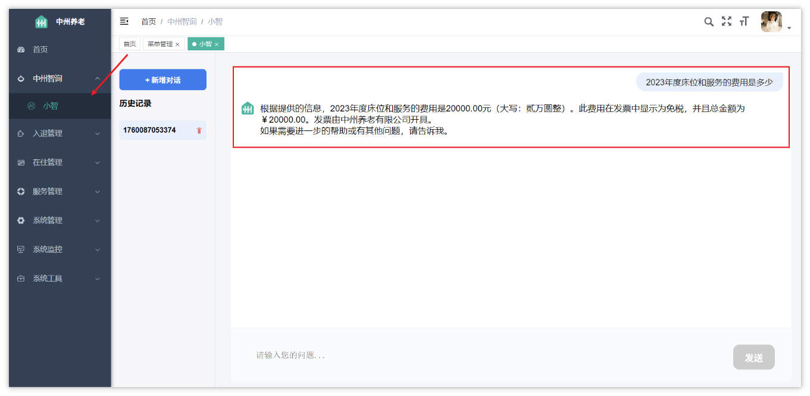
> 图注：这张图片展示的是中州养老系统的操作界面，左侧为功能导航栏，其中“小智”选项处于选中状态，有红色箭头指向该选项；界面中间为对话交互区域，显示有“新增对话”“历史记录”功能按钮，区域内有2023年度床位和服务费用的查询结果，明确说明了该费用的金额、开票主体及开票免税的情况，右上角还标注了对应的问题“2023年度床位和服务的费用是多少”，底部是问题输入框与发送按钮，该界面对应了文档中提到的“智能问答，精准支持”的功能，依托AI助手为用户提供护理相关的信息解答。


### 技术栈选型

本项目采用分层解耦的技术架构设计，确保系统具有良好的可扩展性和维护性。以下是经过充分调研和验证的技术组件选型：

#### 核心AI组件

- Dify (1.9.0)：作为AI应用编排框架，提供可视化工作流设计、多模型支持和完善的API管理体系。选择原因：开源免费、模块化设计便于二次开发、支持丰富的外部拓展工具和任务流编排。
- RAGFlow (v0.20.5 slim)：作为知识库引擎，负责复杂文档的解析和处理。选择原因：拥有强大的文件精细解析能力（DeepDoc技术），在处理PDF、扫描件、表格等复杂文档方面表现出色，支持OCR和多种文档切分模板。
- Elasticsearch(Dify自带)：作为向量数据库，用于存储和检索文档嵌入向量。选择原因：高性能相似度搜索，专门优化用于AI检索场景，完全兼容Dify和RAGFlow的接口标准。

#### 后端技术栈

- Java Spring Boot (2.7+)：作为核心业务后端，提供RESTful API和系统集成点。选择原因：成熟的企业级开发框架，丰富的生态系统，强类型语言保证系统稳定性。
- MySQL 8：作为业务数据库，存储结构化数据。选择原因：关系型数据库成熟稳定，支持事务处理，适合养老系统中的关键数据存储。
- Redis 6.0+：作为缓存和会话管理组件。选择原因：高性能内存数据存储，显著提升系统响应速度，支持分布式会话共享。

#### 前端技术栈

- Vue 3：作为前端主框架，构建用户界面。选择原因：渐进式框架，组件化开发模式，学习曲线平缓，社区活跃。
- Element Plus：作为UI组件库，提供一致的用户体验。选择原因：丰富的前端组件，高质量实现，专门针对企业级应用设计。
- ECharts 5.0：作为数据可视化库，展示健康数据统计。选择原因：强大的图表功能，灵活的配置选项，兼容多种数据格式。

#### 基础设施

- Docker & Docker Compose：作为容器化部署方案。选择原因：环境一致性，简化依赖管理，快速部署和扩展。
- Nginx：作为反向代理和负载均衡。选择原因：高性能HTTP服务器，稳定可靠，易于配置。
- 阿里百炼模型平台(Qwen)：作为大语言模型提供商。选择原因：提供高质量的文本生成和理解能力，支持多种规模模型选择。

### 系统架构设计

#### 架构图

本系统采用前后端分离的微服务架构，通过API网关集成各组件，既能保证系统稳定性，又具备良好的扩展性。整体架构分为数据层、AI能力层、业务层和表现层，具体架构设计如下图所示：

<whiteboard token="PCeIwtv5vhLGIpb3UOTcuhdwngQ"></whiteboard>

#### Dify与RAGFlow集成设计

Dify与RAGFlow采用 "优势互补" 的混合架构模式，充分发挥各自特长：

<whiteboard token="RctgwzZuJhvPyNbodppcPgFLnMd"></whiteboard>


RAGFlow扮演文档处理专家角色，负责处理各种格式的养老护理文档，包括：

- 医疗设备操作手册（PDF格式）
- 健康档案和护理记录（结构化表格）
- 药品说明书和护理规范（扫描文档）
- 应急处理流程和标准操作程序

Dify则充当智能大脑角色，负责：

- 接收用户查询意图识别
- 工作流编排和决策制定
- 多模型协作管理
- 答案生成和格式化输出


## Dify接入外部知识库-RAGFlow

Dify中的RAG一直被诟病，它的知识库设置不够丰富和灵活，对于不同形式的文档上传，尤其是pdf扫描版，上传识别效果不好，知识库根本回答不了PDF内的内容。为了解决这这些Dify提供了外部知识库API，这样就可以连接到 Dify 之外的知识库并从中检索知识。接下来给大家重点介绍Dify连接RAGFlow外部知识库的内容。

### RAGFlow-简介

RAGFlow是一款基于 **深度文档理解** （deepdoc）构建的开源RAG引擎。**深度文档理解**是RAGFlow对文档解析的一个解决方案，它包含两个组成部分：**视觉处理**和**解析器**。

其中视觉处理是通过OCR，布局识别，表结构识别来完成图像，PDF，表格的识别的。

针对PDF、DOCX、EXCEL和PPT四种文档格式，都有相应的解析器。能够从各类复杂格式的非结构化数据中提取信息，文本切片过程可视化，还支持手动调整。支持丰富的文件类型，包括 Word 文档、PPT、excel 表格、txt 文件、图片、PDF、影印件、复印件、结构化数据、网页等。

还集成了各种嵌入模型，rerank模型，提供易用的 API，可以轻松集成到各类企业系统。

安装包镜像完整下载下来，体积非常大，环境要求如下：

- CPU >= 4 核
- 运行内存= 16 GB
- 硬盘 >= 50 GB
- Docker >= 24.0.0 & Docker Compose>= v2.26.1

官网地址如下：

<bookmark name="RAGFlow | RAGFlow" href="https://ragflow.io/"></bookmark>

### RagFlow-安装配置

参考：<cite doc-id="NSYywYqZPiOp6Qk19n3cDBtXnLe" file-type="wiki" title="RAGFlow安装" type="doc"></cite>


### RAGFlow-知识库

#### 创建知识库

<grid>
<column width-ratio="0.739165">
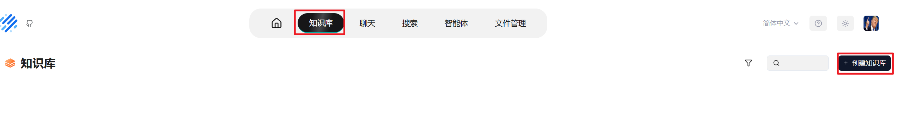
> 图注：图片展示了Dify平台的界面。界面上方有“知识库”“聊天”“搜索”“智能体”“文件管理”等导航栏选项，其中“知识库”选项被红色框线突出显示。右下角有“+创建知识库”按钮，同样被红色框线突出。该图片与上下文“创建知识库”相关，直观呈现了在Dify平台中创建知识库的操作入口位置，帮助用户快速找到创建知识库的功能。

</column>
<column width-ratio="0.260835">
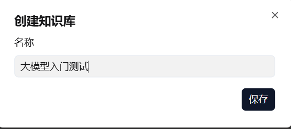
> 图注：这是Dify接入外部知识库（RAGFlow）流程里的创建知识库界面，界面标题为“创建知识库”，设有名称输入框，输入框内已填入内容“大模型入门测试”，界面右下角有一个深色的“保存”按钮，用户可填写知识库名称后点击该按钮完成知识库的创建操作，此界面对应文档中创建知识库的相关步骤。

</column>
</grid>

点击保存

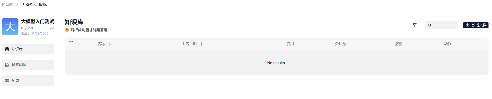
> 图注：图片展示的是Dify平台中知识库的界面。左侧有“大模型入门测试”知识库的相关信息，如创建时间等。右侧是知识库列表，显示名称、上传日期、启用状态、分块数、解析及动作等信息，当前无结果。界面右上角有搜索框和“新增文件”按钮。该图与上下文“创建知识库”相关，直观呈现了知识库创建后的界面状态，帮助用户了解知识库的基本展示情况。

#### 知识库-配置

配置中包含两部分，分别是通用和分片方法

**通用**

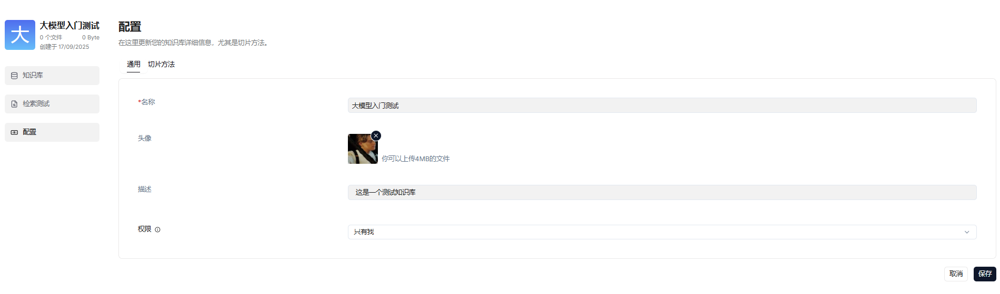
> 图注：图片展示的是Dify接入外部知识库 - RAGFlow中知识库配置的通用界面。界面中“名称”处显示“大模型入门测试”，“描述”处有“这是一个测试仓库”的说明。此外，还有“权限”下拉菜单，当前显示“+有我”。该图片与上下文紧密相关，直观呈现了文档中提到的配置通用部分的内容，帮助用户了解在Dify系统中配置知识库时通用信息的填写情况。

**切片方法**

进入模型设置界面 选择好嵌入模型和解析方法

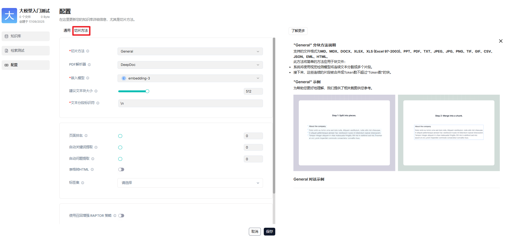
> 图注：这张图片是Dify接入RAGFlow时的知识库配置界面，展示的是**通用**配置标签页的相关设置内容。界面左侧为配置选项，顶部有红框标注的“通用”标签，当前选中状态下，可见“PDF处理引擎”选择为DeepDoc，“嵌入模型”选择为bge-m3，还设有“建议文件块大小”“文本分割符”等配置项；右侧则是“General”分块方法说明示例，包括支持的文件格式、分块规则的文字说明，以及对应“General 分块示例”的内容预览区域，界面整体用于完成知识库的通用参数配置。

**切片方法解析：**

1. **General**

   1. 支持的文件格式为DOCX、EXCEL、PPT、IMAGE、PDF、TXT、MD、JSON、EML、HTML。
   2. 此方法将简单的方法应用于块文件：系统将使用视觉检测模型将连续文本分割成多个片段。
2. **Q&A**

   1. 支持 excel 和 csv/txt 文件格式。
   2. 如果文件是 excel 格式，则应由两个列组成 没有标题：一个提出问题，另一个用于答案， 答案列之前的问题列。多张纸是只要列正确结构，就可以接受。
   3. 如果文件是 csv/txt 格式 以 UTF-8 编码且用 TAB 作分开问题和答案的定界符。
3. **Resume**

   1. 支持的文件格式为DOCX、PDF、TXT。
   2. 简历有多种格式，就像一个人的个性一样，但我们经常必须将它们组织成结构化数据，以便于搜索。
   3. 我们不是将简历分块，而是将简历解析为结构化数据。作为HR，你可以扔掉所有的简历， 您只需与'RAGFlow'交谈即可列出所有符合资格的候选人。
4. **Manual**

   1. 仅支持PDF。
   2. 我们假设手册具有分层部分结构。 我们使用最低的部分标题作为对文档进行切片的枢轴。 因此，同一部分中的图和表不会被分割，并且块大小可能会很大。
5. **Table**

   1. 支持EXCEL和CSV/TXT格式文件。
6. **Paper**

   1. 仅支持PDF文件。
   2. 如果我们的模型运行良好，论文将按其部分进行切片，例如摘要、1.1、1.2等。
   3. 这样做的好处是LLM可以更好的概括论文中相关章节的内容， 产生更全面的答案，帮助读者更好地理解论文。
   4. 缺点是它增加了 LLM 对话的背景并增加了计算成本， 所以在对话过程中，你可以考虑减少‘topN’的设置。
7. **Book**

   1. 支持的文件格式为DOCX、PDF、TXT。
   2. 由于一本书很长，并不是所有部分都有用，如果是 PDF， 请为每本书设置页面范围，以消除负面影响并节省分析计算时间。
8. **Laws**

   1. 支持的文件格式为DOCX、PDF、TXT。
   2. 法律文件有非常严格的书写格式。 我们使用文本特征来检测分割点。
   3. chunk的粒度与'ARTICLE'一致，所有上层文本都会包含在chunk中。


#### 解析文件生成知识库

可以单个文件解析，也可以批量解析，大家可以根据自己的需要选择使用，解析完成后可进行使用

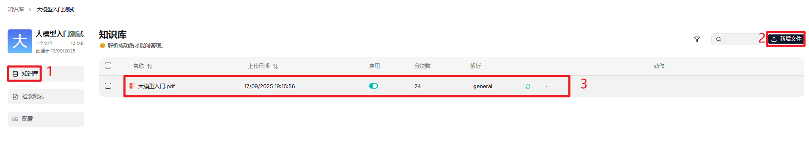
> 图注：图片展示了Dify知识库界面。左侧有“知识库”“检索测试”“配置”选项，当前选中“知识库”。右侧显示“大模型入门测试”知识库，包含1个文件，创建于17/08/2025。中间列表中，“大模型入门.pdf”文件被红框突出显示，其上传日期为17/09/2025 19:15:56，启用状态为绿色开关，分块数为24，解析类型为“general”，右侧有“+”图标。右上角有“新建文件”按钮。

### RAGFlow-聊天

点击聊天菜单

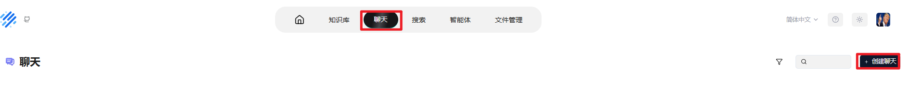
> 图注：图片展示了Dify平台的聊天界面。界面上方有“知识库”“搜索”“智能体”“文件管理”等导航栏，其中“聊天”按钮被红色框突出显示。右下角有“创建聊天”按钮，也被红色框标出。该图片对应文档中“点击聊天菜单”步骤，直观呈现了点击聊天菜单后Dify平台聊天界面的样式，帮助用户明确操作位置，是Dify接入外部知识库 - RAGFlow流程中聊天环节的指引图示。

创建聊天

<grid>
<column width-ratio="0.536829">
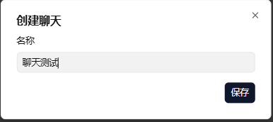
> 图注：图片展示的是Dify系统中创建聊天的界面。界面上方显示“创建聊天”标题，下方有“名称”输入框，内有“聊天测试”字样，输入框右侧有一个“保存”按钮。该图片对应文档中“创建聊天”步骤，是点击聊天菜单后，点击新建聊天操作后的界面展示，用于后续在聊天设置中加入知识库的操作。

</column>
<column width-ratio="0.463171">
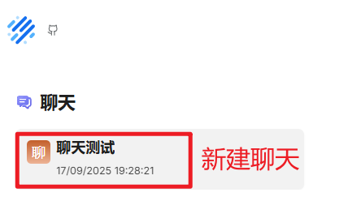
> 图注：这张图展示的是Dify聊天功能界面的局部内容，画面左侧以红框标注了名为“聊天测试”的聊天选项，该选项旁显示了时间“17/09/2025 19:28:21”，画面右侧有标注为“新建聊天”的选项。结合文档上下文，这张图是对应“创建聊天”步骤的界面内容，展示的正是点击新建聊天后生成的“聊天测试”聊天选项，与文档中提及的“点击新建的聊天”这一操作内容相关。

</column>
</grid>

**点击新建的聊天**

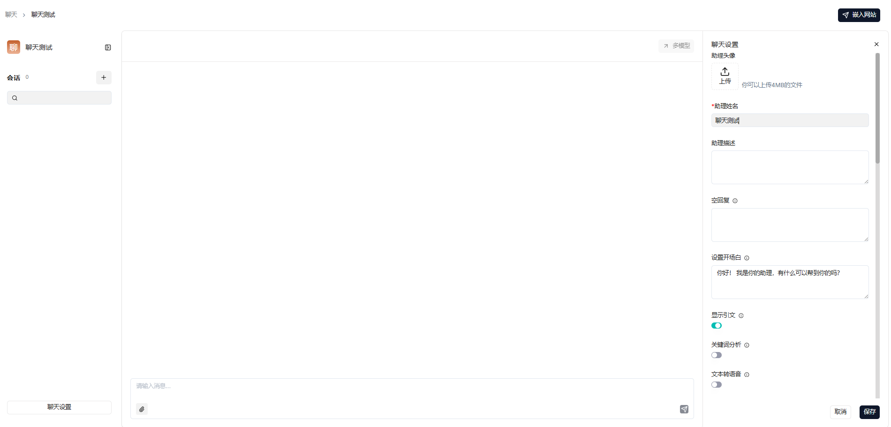
> 图注：图片展示的是Dify工作流管理界面中“聊天测试”知识库的设置界面。界面左侧有“聊天测试”知识库名称及“+”号，右侧是聊天设置区域，包含聊天模式、知识库名称、知识库地址、知识库描述、回复模板、设置聊天AI、设置聊天AI对话、设置聊天AI对话上下文、设置聊天AI对话上下文长度、设置聊天AI对话上下文长度单位、设置聊天AI对话上下文长度单位等选项。该图片与上下文介绍的Dify接入外部知识库 - RAGFlow中Dify配置外部知识库的操作步骤相关，是设置知识库时的界面呈现。

聊天设置中加入刚刚新创建的知识库

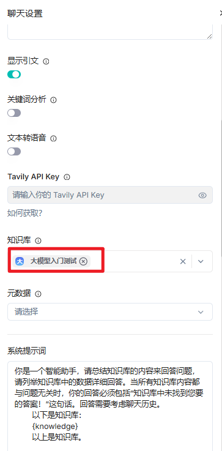
> 图注：图片展示的是Dify聊天设置界面。在聊天设置中，显示引文、关键词分析、文本转语音等功能开关状态。Tavily API Key输入框提示“请输入你的 Tavily API Key”，并有“如何获取？”的链接。知识库部分，有“大模型入门测试”选项被红色框突出显示。该图片与上下文紧密相关，上下文提到在聊天设置中加入新创建的知识库，此图直观呈现了知识库设置界面及关键操作位置。

以上设置完成后就可以进行聊天对话了。

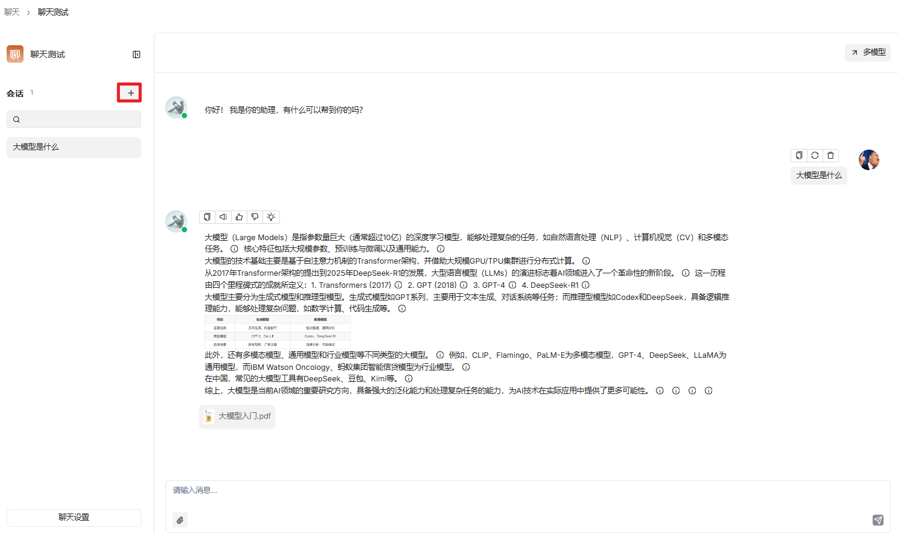
> 图注：这张图是Dify的聊天界面，左侧标注有“聊天测试”的聊天列表，红色方框突出显示新建聊天的按钮；中间区域顶部提示“你好！我是你的助理，有什么可以帮到你的吗？”，右上角为“多模型”标识；对话区域包含“大模型是什么”的提问，以及对应的大模型介绍回复，还附有一份名为“大模型引入.pdf”的附件。该图对应文档中点击新建聊天、后续在聊天设置中加入创建好的知识库的操作环节，用于展示Dify聊天功能的操作界面。

### Dify接入RAGFlow

#### RAGFlow API设置

接下来我们在dify调用这个ragflow，需要设置一下ragflow的api key。

- 点击系统右上角的头像
- 点击API菜单

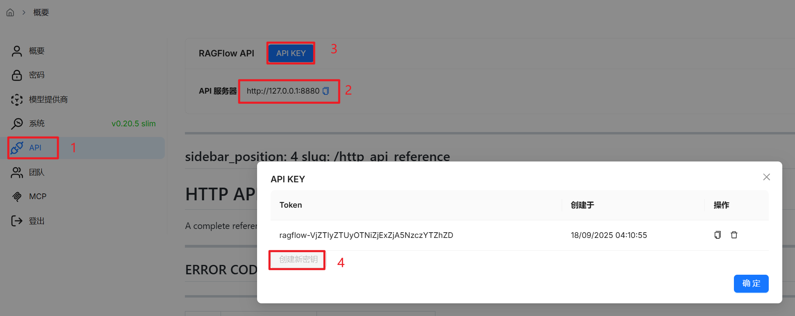
> 图注：图片展示的是RAGFlow API设置界面。左侧导航栏选中“API”选项。右侧API设置区域中，API KEY部分被红色框突出显示，其下方Token处有红色箭头指向。此外，API服务器地址“http://127.0.0.1:8880”也被红色框标注。在API KEY弹窗中，同样有红色框突出显示“复制”按钮。该图片与上下文紧密相关，是设置RAGFlow API时获取API KEY及API服务器地址的展示。

- API接口文档

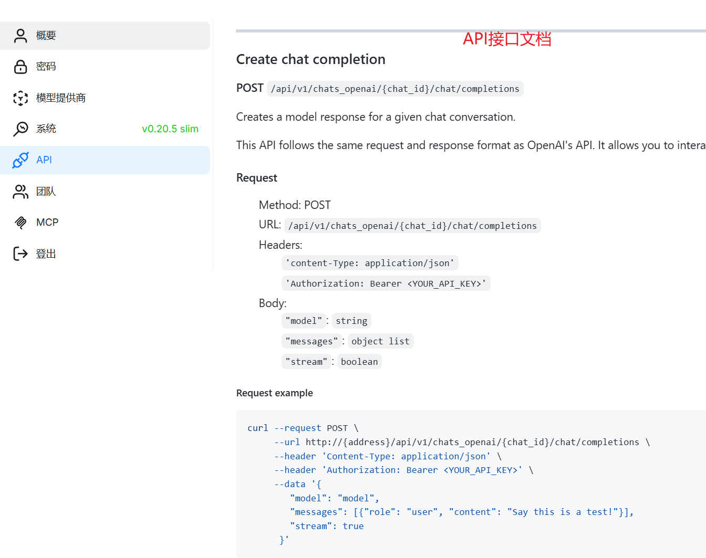
> 图注：图片展示了RAGFlow的API接口文档，标题为“Create chat completion”。文档说明该API用于对给定聊天会话创建模型响应，遵循OpenAI API的请求和响应格式。请求部分详细列出了方法、URL、Headers（包括Content-Type和Authorization）、Body（model、messages、stream）等内容，并给出示例代码。此图与上下文紧密相关，上下文提到在dify调用RAGFlow时需设置RAGFlow的API key，此图即为API接口文档，为设置API key提供参考。

#### Dify配置外部知识库

第一步，dify工作流管理界面，点击上面知识库。点击链接外部知识库。

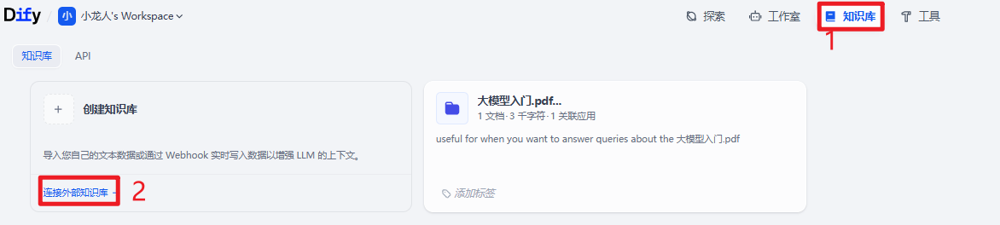
> 图注：图片展示了Dify平台的界面，上方有“知识库”“API”选项卡，其中“知识库”被红色框突出显示。界面左侧有“创建知识库”和“连接外部知识库”按钮，后者被红色数字“2”标识。右侧显示了一个名为“大模型入门.pdf...”的知识库，包含1文档、3千字符、1关联应用等内容。该图片与文档中“第二步，点击‘外部知识库API’，先把外部知识库API配置好”上下文对应，直观呈现了连接外部知识库的操作位置。

第二步，点击 `外部知识库API` , 先把外部知识库API配置好。

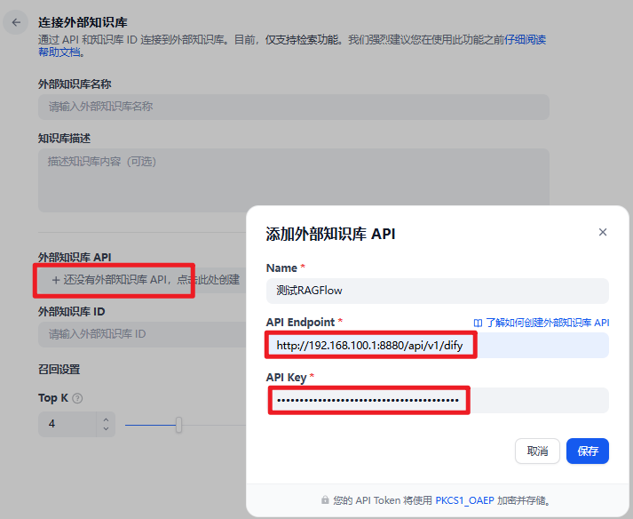
> 图注：这张图片展示了Dify连接RAGFlow外部知识库时的配置界面，核心内容为“添加外部知识库API”的弹窗。弹窗内，Name设置为“测试RAGFlow”，API Endpoint填入了符合要求的192.168开头的IP格式地址，API Key则用圆点掩码显示。界面左侧还标注了“还没有外部API”的待添加提示，下方的Top K数值为4。该界面对应文档中“第三步，连接外部知识库”的操作步骤，呈现了配置API所需填入的关键参数的设置页面。

<callout emoji="⚠️">
API Endpoint 的值
  http://ip:8880/api/v1/dify
ip必须是以192.168开头的，不可以用127.0.0.1或者localhost
Name的值，随便写一个名字
API Key的值，来自于：http://localhost:8880/user-setting/api
</callout>

第三步，连接外部知识库

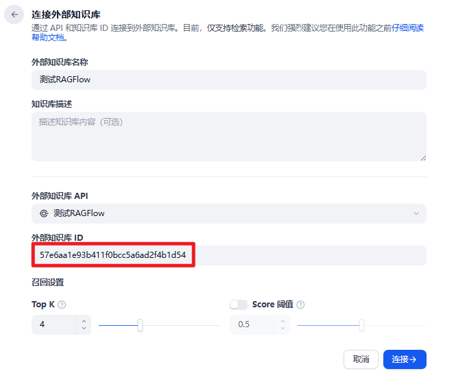
> 图注：图片展示的是RAGFlow平台连接外部知识库的界面。界面中“外部知识库名称”输入框已填入“测试RAGFlow”，“外部知识库ID”输入框显示红色框突出的“57e6aa1e93b411f0bcc5a6ad2f4b1d54”。下方有“Top K”和“Score阈值”设置区域，以及“取消”和“连接”按钮。该图片与上下文紧密相关，是连接RAGFlow和dify时，输入外部知识库ID等信息的展示，帮助用户完成连接操作。

> 关于外部知识库ID的值：  
> 打开RAGFlow平台，找到知识库，点击刚刚创建的知识库，url地址中的最后一段字符串就是对应的知识库ID
> 
> 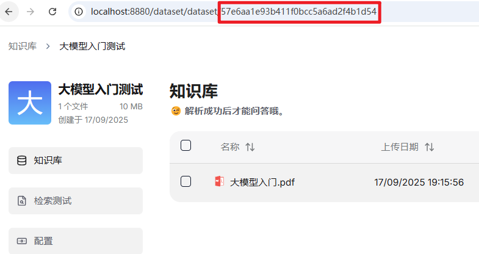
> 图注：图片展示的是Dify平台中知识库页面。页面左上角显示网址为“localhost:8880/dataset/dataset/57e6aa1e93b411f0bcc5a6ad2f4b1d54”。页面中部有“大模型入门测试”知识库的相关信息，包括1个文件、10 MB大小及创建日期。右侧是知识库列表，显示“大模型入门.pdf”文件，上传日期为17/09/2025 19:15:56。该图片与文档中“关于外部知识库ID的值”内容相关，用于说明打开RAGFlow平台找到知识库后，点击创建知识库对应的url地址中最后一段字符串即为知识库ID。

点击连接，完成ragflow和dify的连接。

到这dify和ragflow已经连接好了。

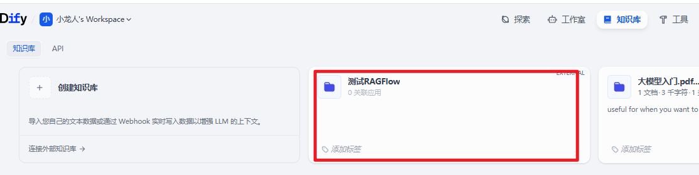
> 图注：这张图展示的是Dify平台的知识库界面，页面顶部清晰显示当前所属工作空间为“小龙人的Workspace”，导航栏中“知识库”选项处于选中状态。界面主要区域呈现已创建的名为“测试RAGFlow”的知识库条目，该知识库当前关联应用数量为0，条目还设置有“添加标签”的交互选项；左侧设有“创建知识库”“连接外部知识库”等功能选项，还标注有导入文本数据、通过Webhook写入数据增强LLM上下文的提示内容。

#### Dify之AI Agent接入外部知识库

第一步，创建AI Agent应用

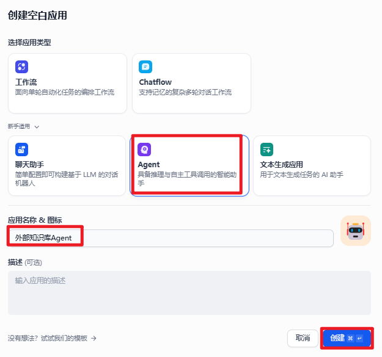
> 图注：图片展示的是Dify平台创建AI Agent应用的界面。界面中列出多种应用类型，包括工作流、Chatflow、Agent、文本生成应用等。其中，Agent应用类型被红色框突出显示，其描述为“具备推理与自主工具调用的智能助手”。下方有“外部知识库Agent”作为应用名称，还有可选的描述区域。右下角有“创建”按钮。该图片与上下文紧密相关，是Dify之AI Agent接入外部知识库流程中创建AI Agent应用步骤的展示。

第二步，进入AI Agent聊天界面中，在上下文添加外部知识库。

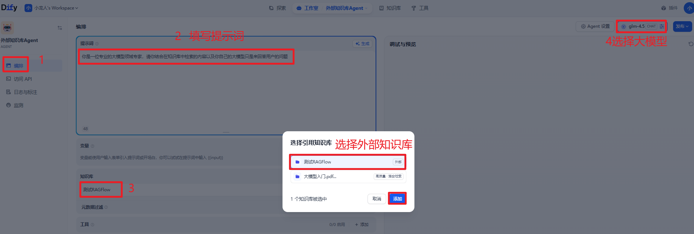
> 图注：图片展示了Dify平台中AI Agent接入外部知识库的调试与预览界面。画面中“选择引用知识库”弹窗突出显示，其中“我的RAGFlow”被选中。画面左下角有“调试与预览”按钮，右上角有“选择大模型”按钮。此外，还有“提示词”和“外部知识库ID”输入框。该图片与上下文紧密相关，是Dify之AI Agent接入外部知识库步骤中调试与预览环节的展示，直观呈现了操作界面及关键设置项。

提示词编写

```Python
你是一位专业的大模型领域专家，请你结合在知识库中检索的内容以及你自己的大模型只是来回答用户的问题
```

第三步，调试与预览

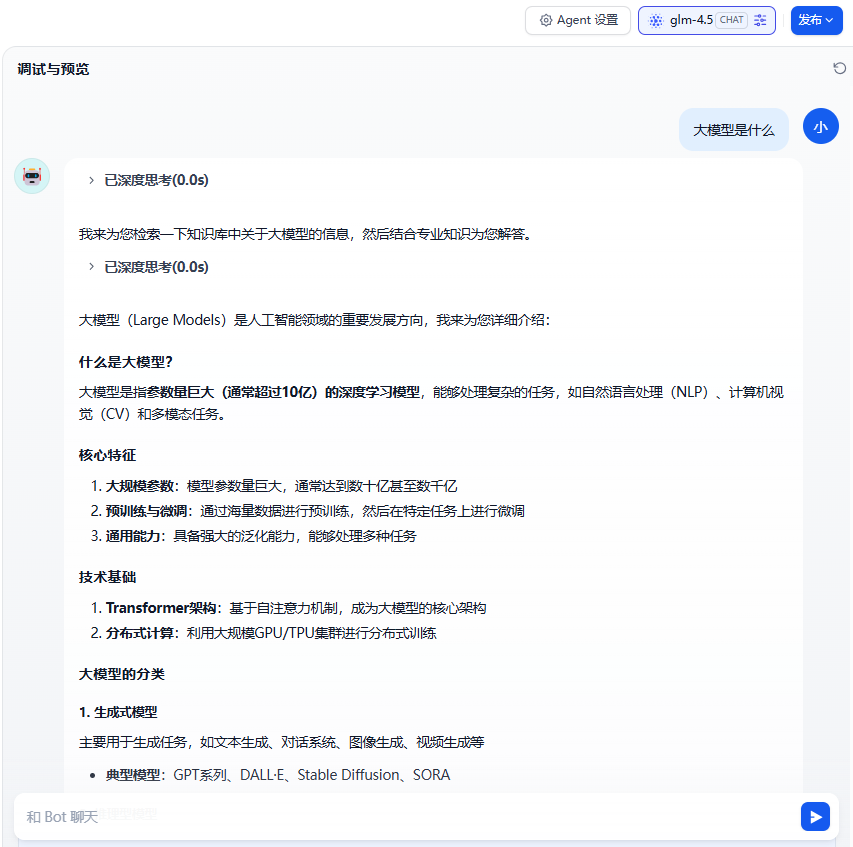
> 图注：图片展示的是Dify之AI Agent接入外部知识库后的调试与预览界面。界面顶部有“Agent设置”“glm-45”“发布”按钮。下方聊天区域显示AI Agent已深度思考，将搜索大模型相关信息并结合专业知识解答。内容涵盖大模型定义、核心特征、技术基础及分类等，如大模型参数量巨大、Transformer架构等。右上角有“大模型是什么”“小”按钮。该图与上下文紧密相关，直观呈现了AI Agent在接入外部知识库后的聊天效果。

到这在dify中调用ragflow中的知识库了。


## 养老项目对接Dify

### 需求分析

#### 需求1-内部知识问答

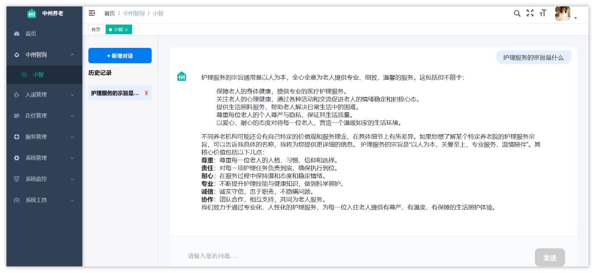
> 图注：图片展示的是中州养老系统中“小智”页面，左侧为功能导航栏。右侧上方显示“中州养老”及“小智”，下方有“历史记录”“新增对话”等选项。右侧中部是对话区域，左侧为“护理服务的宗旨是什么”问题，右侧给出答案，内容涉及护理服务宗旨、责任、专业、耐心、敬业、诚信、协作等方面，强调以人为本、专业服务、温情陪伴。该图片与文档中“需求1 - 内部知识问答”部分对应，展示了系统可回答养老院内部知识问答的能力。

可以回答养老院**内部文档**中的内容，比如：员工手册、操作规范、用药规范、护理手册等等

- 什么文档，什么格式
- 怎么拆分的？拆分策略   父子块
- 怎么向量的
- 怎么检索   混合模式(向量检索+全文检索)
- 图片怎么解析的


#### 需求2-查看养老院的数据(http或mcp)

- 查询预约信息

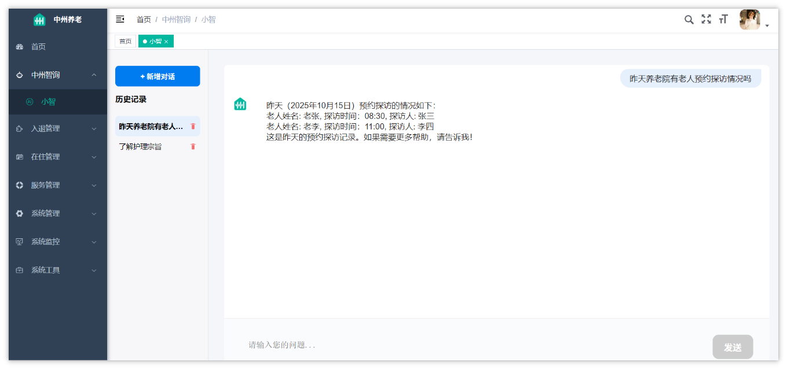
> 图注：图片展示的是中州养老系统中“小智”页面。左侧为系统导航栏，有首页、知识管理等选项。右侧上方显示当前页面为“首页 / 中州颐园 / 小智”。中间区域有“历史记录”和“新建对话”按钮，下方是历史对话记录，显示了昨天探访老人的相关信息。右上角有搜索、分享、设置等图标，右下角有“发送”按钮。该图片与文档中“需求1 - 内部知识问答”部分对应，展示了系统中知识问答的界面情况。

- 查询老人的基本信息

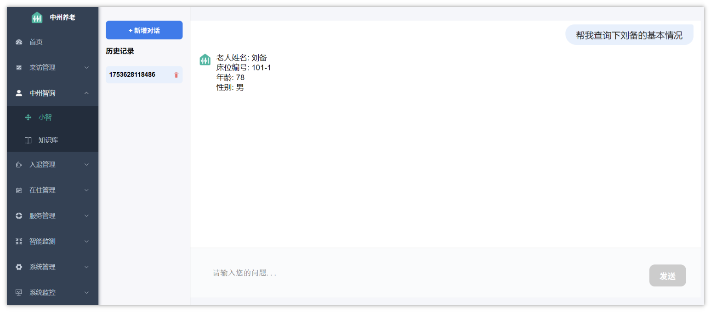
> 图注：图片展示的是养老项目对接Dify需求分析中，查看养老院数据（http或mcp）时查询老人基本信息的界面。左侧为系统导航栏，右侧上方有“帮我查询下刘备的基本情况”输入框，下方显示老人姓名、床位编号、年龄、性别等信息。该图片与上下文对应，直观呈现了在系统中查询老人基本信息的操作结果，辅助说明了需求分析中查询老人基本信息这一功能点。

- 查询老人的健康信息

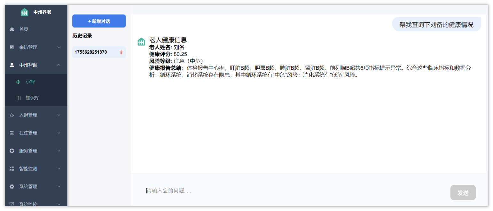
> 图注：图片展示的是中州养老项目对接Dify系统中老人健康信息查询界面。左侧为系统导航栏，右侧上方显示老人姓名为刘畅，健康评分80.25，风险等级为注意。健康报告总览中列出多项指标，如心率、肝前B超等，部分指标提示异常。下方有“帮我查询下刘畅的健康情况”按钮，输入框提示“请输入您的问题...”，右下角有“发送”按钮。

- 其他可查询信息

  - 动态查询可用床位
  - 实时查询老人的健康数据


#### 需求3-定制化护理任务执行表生成

护理员登录系统之后，可以通过ai助手，可以生成指定老人的个性化护理方案(每日)

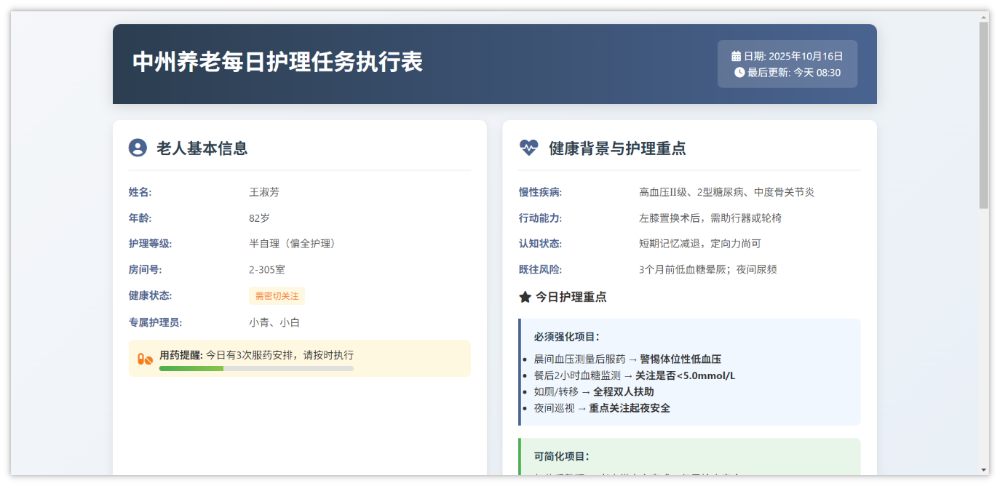
> 图注：图片展示的是中州养老每日护理任务执行表界面。左侧为老人基本信息，包括姓名、年龄、护理等级、房间号等。右侧是健康背景与护理重点，列出慢性疾病、行动能力、认知状态等信息，还标注了今日护理重点，如必须强化项目、可简化项目等内容。该表与文档中“定制化护理任务执行表生成”需求相关，是护理员登录系统后生成的指定老人个性化护理方案示例。

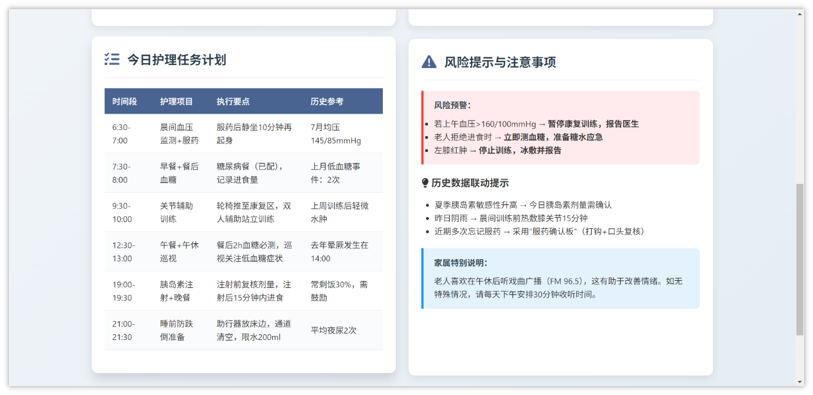
> 图注：图片展示了养老项目对接Dify需求分析中定制化护理任务执行表生成的示例。左侧为今日护理任务计划，包括晨间血压监测、血糖、关节辅助训练等护理项目及时间安排，还列出了历史参考。右侧是风险提示与注意事项，包含风险预警、历史数据联动提示、家属特别说明等内容。该图片与上下文紧密相关，直观呈现了护理任务执行表的格式与信息，辅助说明护理员登录系统后生成指定老人个性化护理方案（每日）的需求。

实现方案：

<whiteboard token="VUL9wp0nThSCcvbHQDMcavV0n8c"></whiteboard>

### Dify智能体构建

#### 创建RagFlow知识库

打开RAGFlow工作台，创建一个知识库，并且上传两个文档，如下图

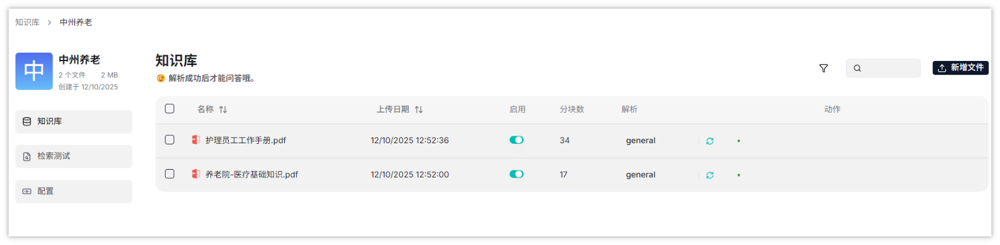
> 图注：这张图片展示的是RAGFlow工作台的中州养老知识库页面，该知识库已成功上传两个文档，分别为《护理员工工作手册.pdf》和《养老院-医疗基础知识.pdf》，两个文档的状态均处于启用状态。页面显示知识库包含2个文件，总大小为2MB，创建时间为2025年10月12日，每个文档标注了分块数，解析状态均为general，当前提示解析成功后才可进行问答，该页面对应文档中创建RagFlow知识库的操作环节。

在切片配置中，使用默认即可，已经可以**深度**文档读取

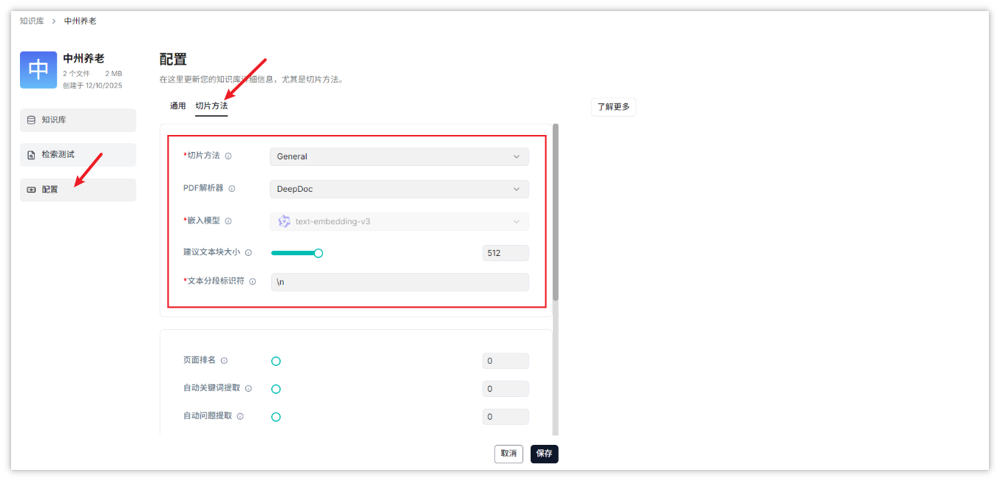
> 图注：这张图片展示了RAGFlow工作台的文档切片配置界面，用于中州养老项目的知识库创建。界面左侧显示导航栏，包含“知识库”“检索测试”“配置”等选项，当前选中“配置”页，页面上方标注当前处于“通用 切片方法”设置区域。红色方框标出核心配置项：切片方法选择为General，PDF解析器为DeepDoc，输入模型为text-embedding-v3，默认文本块大小为512，文本分块切符为0。该界面是创建RagFlow知识库流程中的切片配置环节，按照上下文说明，此处使用默认配置即可满足深度文档读取的需求。

参考之前的案例准备**服务器地址**和**API KEY**

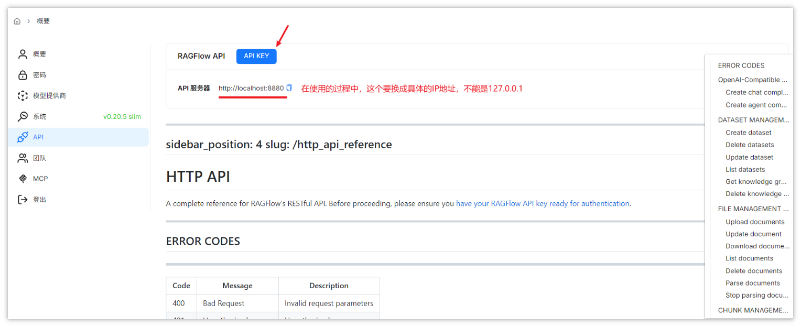
> 图注：图片展示的是RAGFlow工作台的API页面。页面左侧有导航栏，选中“API”。右侧中部显示RAGFlow API相关配置，包括API服务器地址（http://localhost:8880）和API KEY。其中API服务器地址处有红色箭头突出显示，旁边文字提示在使用过程中需换成具体IP地址，不能是127.0.0.1。页面右侧还列出了ERROR CODES、HTTP API等内容。该图片与上下文关系紧密，是创建Dify智能体时设置API KEY和服务器地址的参考页面。

**知识库ID**需要提前记录

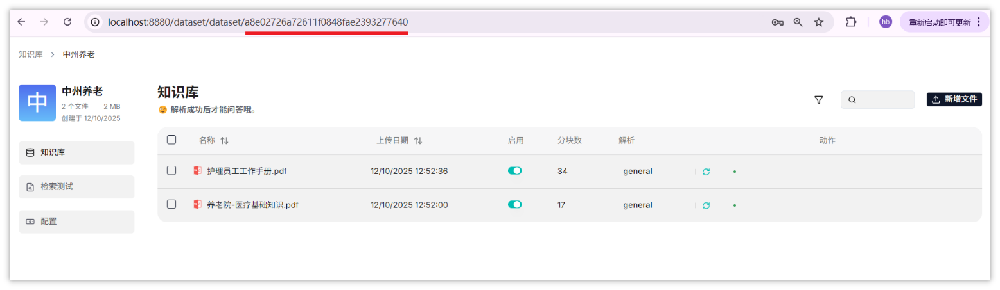
> 图注：这张图片展示了RAGFlow工作台的知识库页面，页面顶部的浏览器地址栏中显示了该知识库对应的ID为a0e02726a72611084b8fae2393227640。页面左侧有“知识库”“检索测试”“配置”三个功能选项，当前处于知识库页面。页面右侧呈现了“中州养老”知识库的相关内容，包含2个文件，分别是“护理员工工作手册.pdf”与“养老院-医疗基础知识.pdf”，文件显示了对应上传日期、启用状态、分段数及解析类型等信息，同时配有操作选项按钮。

> 点击去知识库，可以在浏览器中查看**知识库ID**


#### 创建Dify外部知识库

创建一个外部知识库，如下图：

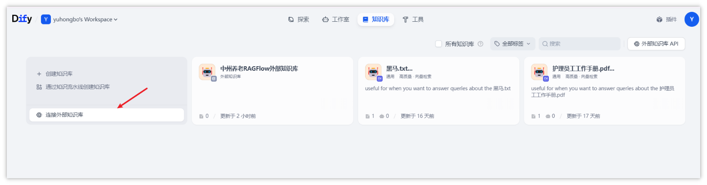
> 图注：图片展示了Dify智能体构建中创建外部知识库的操作界面。画面中显示了“中州养老RAGFlow外部知识库”等知识库信息，其中“连接外部知识库”按钮被红色箭头突出指向。该图片与上下文紧密相关，上下文提到在创建Dify智能体时，需创建一个外部知识库，此图直观呈现了创建外部知识库的界面位置，帮助用户明确操作位置，是智能体构建流程中的关键步骤展示。

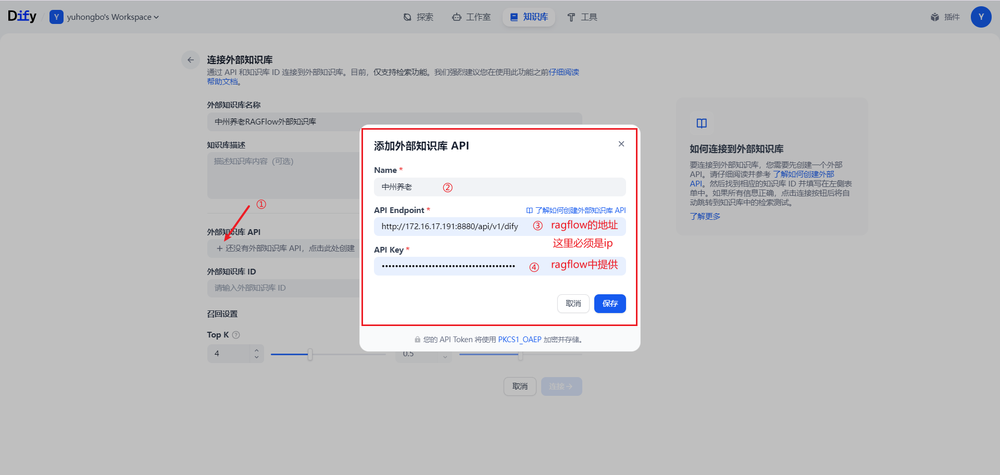
> 图注：该图片展示了Dify中连接外部知识库的配置弹窗，核心为“添加外部知识库API”的设置界面，弹窗内有4个带红色箭头标注的关键区域：一是“Name”输入框，二是“API Endpoint”输入框，标注此处需填写RAGFlow的地址与对应接口路径，三是“API Key”输入框，标注此处需填写RAGFlow的API密钥。弹窗旁的页面区域也显示了“连接外部知识库”相关配置项，可设置知识库ID等信息，该图片对应文档中创建Dify外部知识库的操作步骤，用于展示配置外部知识库API信息的具体操作界面。

设置知识库id

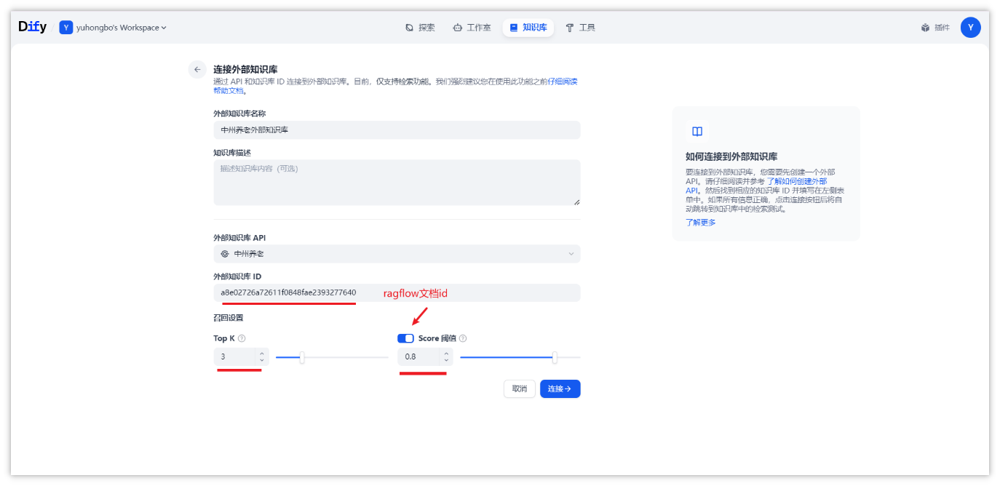
> 图注：图片展示的是Dify智能体创建页面中连接外部知识库的设置界面。界面中“外部知识库ID”处显示为“a3e5e273a47261184846f8ec283277540”，并有红色箭头指向，标注为“ragflow文档id”。此外，还有“Top K”设置为3，“Score”相关度得分设置为0.6。该图片与上下文“创建Dify外部知识库”相关，用于说明在创建外部知识库时，需设置知识库ID等参数。

> - Top K  从知识库中召回几个文档片段  
> - Score 文档相关度得分，最高为1分，0.6 算是相关度较高的分值，精准度更高一些


#### 创建Dify智能体

创建一个智能体，可以关联外部知识库

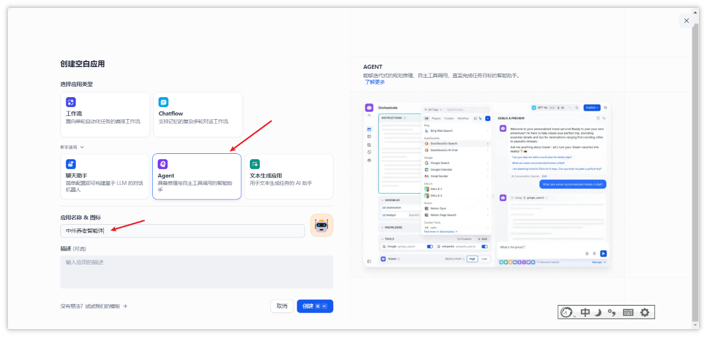
> 图注：图片展示了Dify平台创建空白应用的界面。左侧有“工作台”“ChatFlow”“Agent”“文本生成应用”等应用类型选项，其中“Agent”被红色箭头指向。右侧是Agent应用的介绍，显示其可基于LTM模型，实现知识驱动的AI助手。下方有“应用名称”输入框，提示词为“创建一个AI助手，用于回答用户关于养老院的咨询”。该图片与上下文紧密相关，直观呈现了创建Dify智能体时选择Agent应用的步骤。

创建成功之后，可以关联知识库，并设置提示词

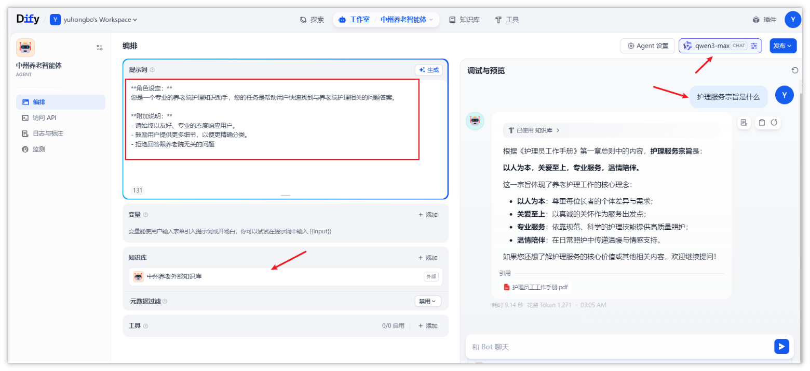
> 图注：这张图展示了Dify平台的智能体构建界面，对应养老项目对接Dify中创建Dify智能体的环节。界面左侧是智能体配置区域，有被红色框标注的提示词设置框，内容为引导AI提供养老服务相关问答的引导语，同时下方可见“中州养老智能知识库”等知识库选项。界面右侧是“调试与预览”区域，红色箭头指向的聊天框内是用户提问“护理服务内容是什么”，下方已生成对应回复，页面右上角可看到Agent设置相关内容，该图直观呈现了养老项目中智能体的配置与问答调试效果。

提示词：

```Bash
**角色设定：**  
您是一个专业的养老院护理知识助手，您的任务是帮助用户快速找到与养老院护理相关的问题答案。

**附加说明：**  
- 请始终以友好、专业的态度响应用户。  
- 鼓励用户提供更多细节，以便更精确分类。  
- 拒绝回答跟养老院无关的问题
```


### 智能体API文档

#### API KEYS生成

智能体调试成功之后，可以设置对外访问的API

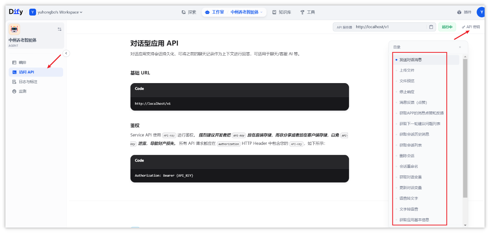
> 图注：这是Dify平台中养老项目对接智能体的“对话型应用API”页面，页面内明确标注了“DF API”选项，基础URL显示为“http://127.0.0.1/v1”，鉴权栏标注了需使用“Bearer (API KEY)”的调用方式。页面右侧红框内列出了该对话接口包含的功能项，包括发送对话消息、上传文件、文件列表等多种与智能体交互的操作选项，该页面是生成智能体对外访问API密钥与基础配置的核心界面，用于后续养老后台对接智能体API的相关操作。

> - API 秘钥：上图中可以给当前智能体生成一个秘钥，方便通过接口的方式进行调用
> - 基础URL：访问接口的基础url
> - 鉴权：鉴权的方式，需要设置API 秘钥


#### 接口说明

在智能体中提供了很多对外访问的接口，常见的接口如下：

- 对话消息  （流式 | 非流式）
- 获取会话历史列表
- 获取会话列表
- 删除会话
- 停止响应


### 养老后台对接智能体API

#### 环境准备

- 克隆代码：https://gitee.com/itheim/dify-zzyl.git
- 环境配置：

  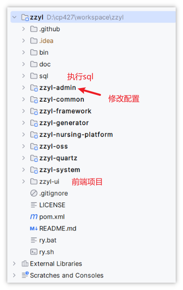
> 图注：图片展示了养老项目对接Dify时环境配置中代码目录结构。目录中包含多个子目录，如zzyl-admin、zzyl-common等，其中zzyl-admin被红色箭头指向，标注“执行sql”；zzyl-admin和zzyl-ui被红色箭头指向，标注“修改配置”；zzyl-ui被红色箭头指向，标注“前端项目”。该图与上下文紧密相关，直观呈现了代码中需执行sql、修改配置及前端项目的位置，辅助理解环境配置步骤。

  - 执行sql目录中的sql文件
  - 修改zzyl-admin中的application-dev.yml文件，改为自己的配置内容
  
    - Mysql
    - Redis
    - OSS
    - deepseek的api-key
  - 使用VS Code 或 Cursor来打开**zzyl-ui**目录
  
    - 安装依赖：`npm install `
    - 启动项目：`npm run dev`


#### 对接Dify

目前提供好的养老代码中已经对接好了Dify的接口，共有4个接口：

- 对话聊天   web flux实现，需要流式对话
- 历史列表   http请求
- 历史对话   http请求
- 删除对话   http请求


代码修改：

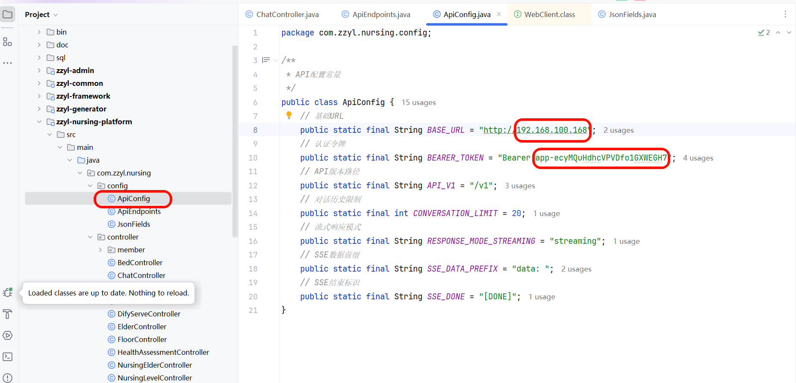
> 图注：这张图展示的是项目代码中的ApiConfig类代码文件，左侧项目目录里红框标注了“zzy - nursing - platform/src/com/zzy/nursing/config”路径下的ApiConfig.java文件。代码中红框分别突出显示了两处关键信息，一处是被标注为BASE_URL的IP地址“192.168.100.18”，另一处是被标注为BEARER_TOKEN的API密钥“app - ecyMQu5dhbCVlPDvUfXEM9XSP”，这些正是养老项目对接Dify智能体时需要修改的核心配置项。

> 上述标识中，必须改为自己在Dify创建Agent中的密钥才行，IP也可以根据自己的实际情况来调整


核心对接代码位置如下图，代码超90%由Deepseek编写

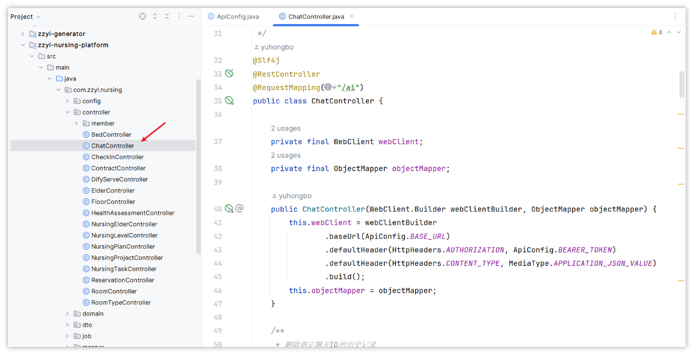
> 图注：这是核心对接代码的相关界面，左侧项目目录中，`ChatController`文件被红色箭头标识，右侧对应打开的`ChatController.java`代码类文件。该类定义了带有`@RequestMapping("/ai")`注解的`ChatController`公共类，包含`WebClient`和`ObjectMapper`两个私有属性；类的构造方法会调用`WebClient.builder`并设置基础URL、请求头的授权令牌与内容类型等配置。该代码是养老后台对接Dify智能体API的核心代码部分，且该代码超90%由Deepseek编写。


启动前后端之后的效果：

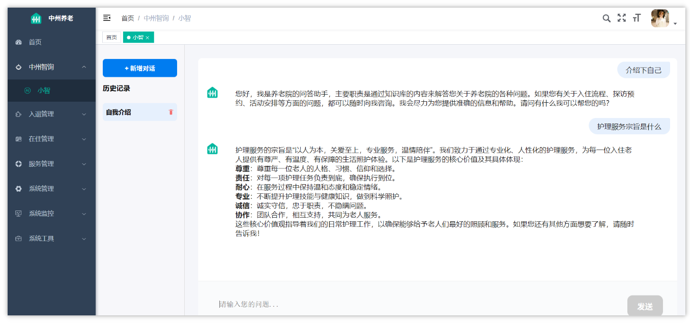
> 图注：这张图片是中州养老系统的智能对话界面，界面左侧是系统功能菜单栏，包含中州智语、知识库、对话管理、知识管理等选项；右侧是智能对话窗口，顶部显示“首页 / 中州智语 / 小智”的导航路径。对话窗内系统以绿色气泡形式回复用户问题，围绕养老服务展开，介绍了护理服务“以人为本、关爱至上”的核心宗旨，以及尊重、责任、专业、诚信等护理理念，界面顶部还有“+ 新增对话”“历史记录”“自我介绍”的功能选项，底部设置了用户输入框与发送按钮。

> 前端对话窗口的实现全部使用Cursor实现


### 查看养老院的数据

我们的需求是，想要通过问答助手的形式，让他回答关于养老院的一些数据信息，如下需求：

- 查询预约信息(以这个为例)
- 老人的基本信息(自行实现)
- 老人的健康信息(自行实现)

#### 实现思路


<whiteboard token="KKzTwR4e7hew1tbGUeGcTXcPnEd"></whiteboard>

deepseek生成校验apikey方案：https://chat.deepseek.com/share/nl7pcc82asmxri57m2


#### 提供对外的接口

查询预约列表信息(已提供)

```Java
@RestController
@RequestMapping("/dify/serve")
public class DifyServeController {

    @Autowired
    private IReservationService reservationService;

    @GetMapping("/getReservationByToday")
    public String getReservationByDay(String datetime){
        System.out.println(datetime);

        // 定义日期时间格式
        DateTimeFormatter formatter = DateTimeFormatter.ofPattern("yyyy-MM-dd");
        // 字符串转 LocalDateTime
        LocalDate dateTime = LocalDate.parse(datetime, formatter);

        return reservationService.getReservationByDay(dateTime);

    }

}
```

所有dify访问的接口，由于需要使用api-key的方式进行校验，在Spring Security中放行

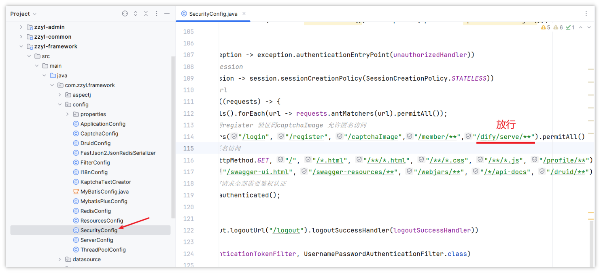
> 图注：该图片展示了IDEA开发工具的代码界面，左侧项目目录中红箭头指向SecurityConfig.java文件，对应右侧打开的SecurityConfig.java代码文件。代码里的安全配置部分，红箭头标注出对路径“/dify/server/**”的放行设置，同时还配置了其他无需认证可放行的路径如“/register”“/captchaImage”等，其余请求则需认证，该配置是为实现Dify接口的免API-key校验访问，也符合文档中“所有dify访问的接口，由于需要使用api-key的方式进行校验，在Spring Security中放行”的内容要求。


#### 工作流http的能力

在dify中创建一个工作流：

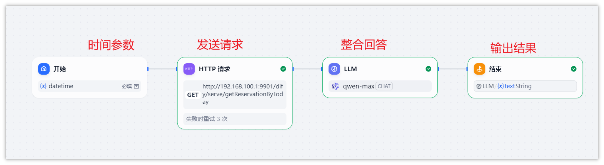
> 图注：图片展示了dify工作流的流程图。开始节点接收时间参数；HTTP请求节点发送GET请求至特定URL，失败时重试3次；LLM节点整合回答；输出结果节点显示LLM的textString。

- 开始节点

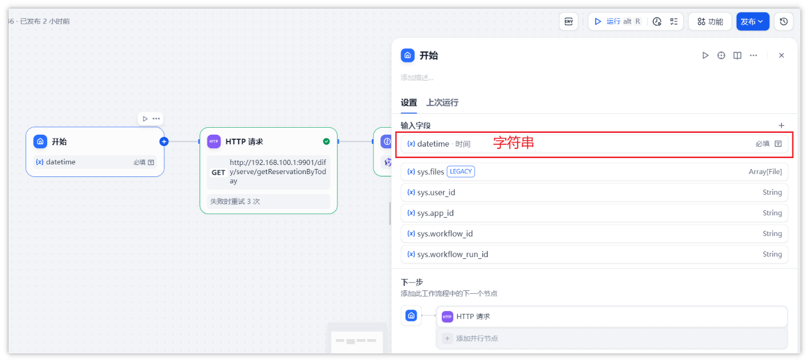
> 图注：图片展示了dify中创建的工作流。开始节点为“开始”，输入字段有“datetime”（时间，必填）。HTTP请求节点URL为http://192.168.100.1:9901/api/serve/getReservationByToday，失败重试3次。LLM节点用于处理数据。

- HTTP请求节点

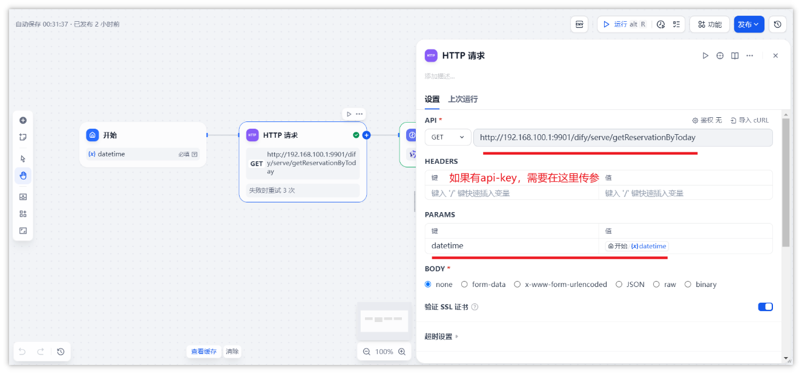
> 图注：图片展示了dify工作流中HTTP请求节点的配置界面。左侧工作流图中，HTTP请求节点位于LLM节点之前。右侧HTTP请求配置中，API为“http://192.168.100.1:9901/dify/server/getReservationByToday”，HEADERS有“datetime”键对应“开始 datetime”值，PARAMS有“datetime”键对应“开始 datetime”值，BODY为“*”。该图片与上下文紧密相关，是实现查询预约列表信息功能中HTTP请求节点配置的示例，是工作流实现思路中HTTP能力应用的具体体现。

- LLM节点

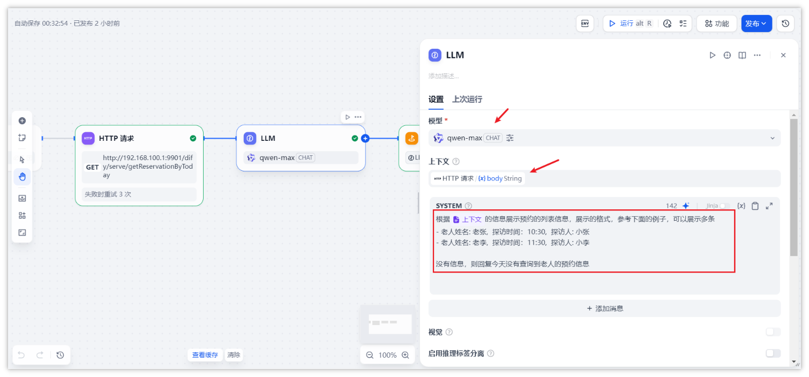
> 图注：图片展示了dify工作流中LLM节点的界面。左侧工作流中，HTTP请求节点与LLM节点相连。右侧LLM节点设置栏显示“qwen - max - CHAT”，并有“HTTP 请求”选项，其内容为“http://192.168.100.1:9901/api/llm/llm”。下方LLM对话框中，SYSTEM显示“今天没有预约信息，回复今天没有看到有咨询老人的预约信息”，下方有“+ 添加消息”按钮。该图与上下文介绍的在dify中创建工作流，包含HTTP请求节点和LLM节点等内容相契合。

提示词：

```JSON
根据{{#context#}}的信息展示预约的列表信息，展示的格式，参考下面的例子，可以展示多条
- 老人姓名: 老张,  探访时间：10:30,  探访人: 小张
- 老人姓名: 老李,  探访时间：11:30,  探访人: 小李

没有信息，则回复今天没有查询到老人的预约信息
```


- 结束节点

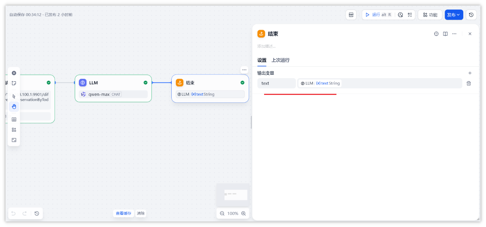
> 图注：图片展示的是dify工作流界面，左侧为工作流流程图，包含开始节点、HTTP请求节点、LLM节点等，其中HTTP请求节点有红色箭头指向。右侧是结束节点，设置输出变量为LLM的get_text_string。该图片与文档中“工作流http的能力”部分相关，用于说明在dify中创建工作流时，HTTP请求节点与LLM节点的连接情况，以及结束节点的设置，是实现查询预约信息等功能的流程示例。


测试之后需要把工作流发布为工具才能让agent来调用

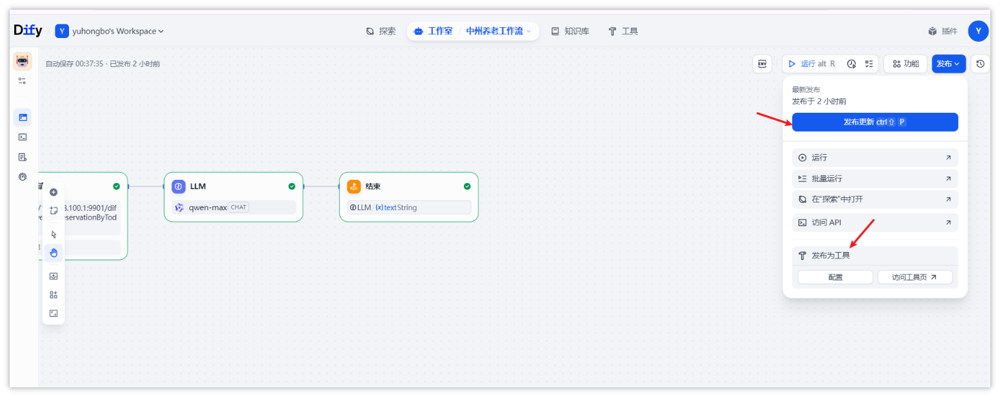
> 图注：这是Dify工作流创建界面，图中展示了已搭建完成的工作流，包含开始节点、LLM节点（模型为qwen-max）、LLM节点（功能为Intent Classifying）。界面右上角的操作菜单中，有红色箭头指向的“发布”按钮，提示需将搭建完成的工作流发布，还有另一红色箭头指向“发布为工具”选项，对应文档中需将工作流发布为工具以便agent调用的要求。

需要给工作流起一个名字，方便后期按照名称调用


> 图注：这张图展示了Dify平台内的操作界面，左侧是创建的工作流，包含开始节点、标注为“llm（openai）”的LLM节点以及标注为“知识库”的节点；右侧是“发布为工具”的配置页，工具调用名称已填入“getReservationTool”，工具入参有“date”（类型为llm，输入格式例为2022-12-12）和“book_id”，页面底部右下角有红色箭头指向确认按钮，整体用于将已搭建的工作流配置为可调用的工具，契合文档中“测试之后需要把工作流发布为工具才能让agent来调用”的需求。


#### 工作流集成到agent中

回到agent中，在工具添加中可以找到已经发布的工作流，同时集成获取时间的工具


> 图注：这张图是养老项目对接Dify过程中，对集成了工作流的Agent相关配置进行操作的界面。界面左侧“提示词”区域的红框内，是用于生成养老院相关数据问答助手的提示词，说明了该助手的功能、格式及需要调用的工具；界面下方“工具”区域有两个工具选项，分别为“查询养老工作流”与“time 获取当前时间”，右侧带有启用开关，红色箭头指向这两个工具，用于标识需启用的工具。该图对应文档中工作流集成到agent的环节，是完成提示词修改后启用工具的相关操作界面。

修改提示词如下：

```Bash
你是一个养老院的问答助手，主要通过知识库的内容回答用户的问题
当用户需要查询养老院的入住老人的预约探访情况的时候，需要调用工作流：getReservationTool，调用该工具需要输入时间，格式为：2022-12-12，获取时间的工具为：current_time
```

修改配置完成之后，agent必须**重新发布**才能生效


可以在养老院后台对话中测试

第一次对话：


> 图注：这张图片是中州养老系统的对话界面，用于测试养老院相关数据的问答功能。界面左侧是功能导航栏，包含首页、中州智园、小智、入住管理等多个选项，当前选中的是“小智”模块。中间区域有“新建对话”按钮和历史记录选项，右侧是对话交互区域，上方用户输入了“今天养老院中是否存在预约探访信息，请列出来”的问题，下方系统回复“今天没有查询到老人的预约信息。如果您想了解特定老人的探访预约情况，或者有其他相关问题，请提供更多信息给我”，底部设置了输入框和发送按钮，是养老项目对接Dify的问答助手测试界面。

检查数据库中是否存在今天的预约信息，如果没有，需要修改为今天的日期(也可以通过小程序添加预约信息)


> 图注：这张图片展示的是一份名为reservation的数据库表界面，用于呈现养老院的预约数据信息。该表内包含id、name、mobile、time、visitor、type、status等字段，其中time字段标注有“当天的日期”，具体的预约时间显示为2025-10-16的08:30:00和11:00:00，这对应了文档中查询预约信息的相关需求。此外，界面还显示有create_time、update_time等附加字段，表内共包含2条有效数据，分别对应张牧与李恒的预约信息，该数据表是养老项目对接Dify时用于查询预约信息的核心数据载体，可用于在对话助手中测试相关预约查询功能。


由于会有历史对话记忆，需要**重新开一个对话窗口**进行对话：


> 图注：图片展示的是中州养老平台的对话界面。左侧为平台导航栏，选中“小智”选项。右侧对话框中显示了今天养老院的预约探访信息，包括老人姓名、探访时间及探访人等，还提示根据这些信息安排好探访时间，如需进一步帮助可告知。该图片与文档中养老项目对接Dify查看养老院数据的内容相关，是对接后在养老院后台对话中测试时的对话示例，用于展示预约探访信息的呈现情况。

---
> 来源：飞书技术知识库（脱敏版） · 06 AI 应用开发 / 低代码智能体平台（Coze / Dify） / 平台智能体 / 02-Dify综合案例 · [原文](https://ccn8v2zngwsm.feishu.cn/wiki/KKvjwYYRJilsqBkA2XdcJggqn3b)
