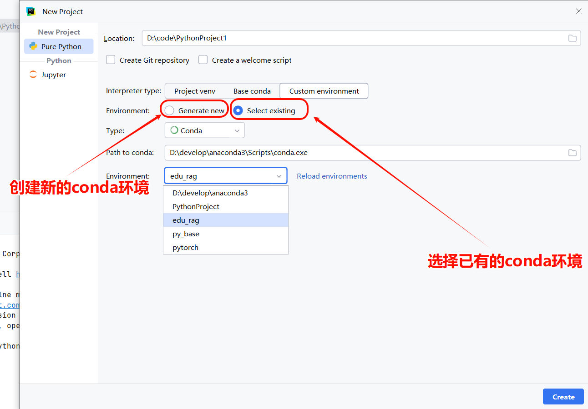
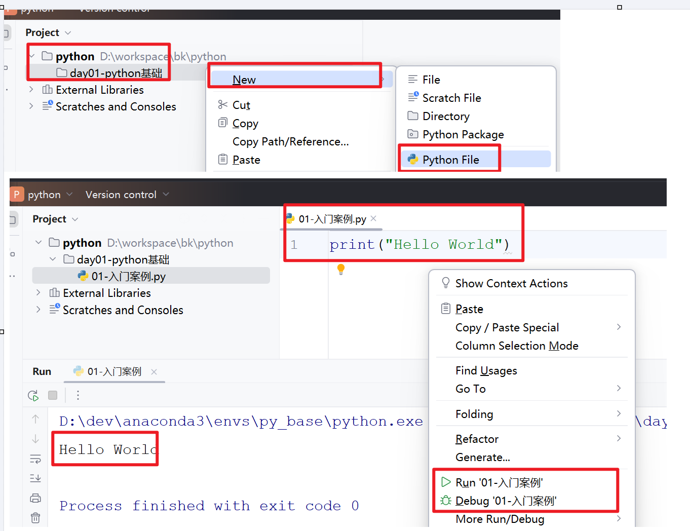
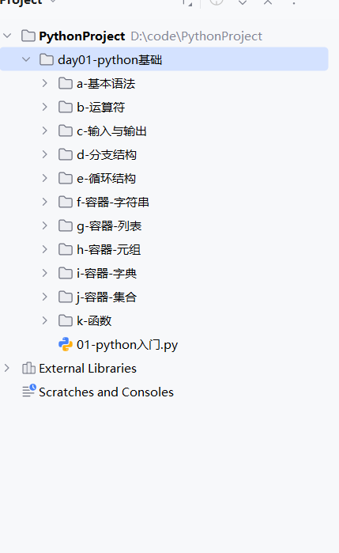
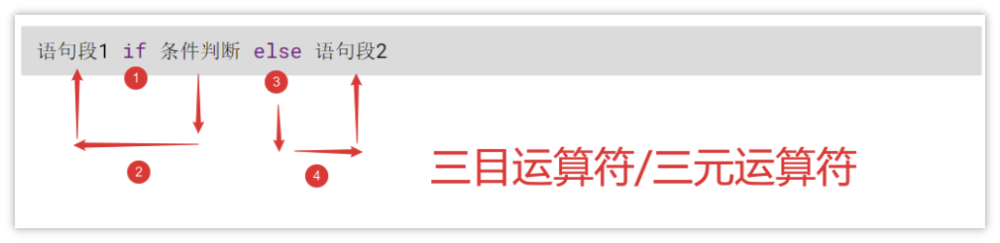

# 01-Python基础

## 1 Python介绍

### 1.1 基本特点

- Python是一门**面向对象**的**解释型**编程语言，1989年吉多·范罗苏姆（龟叔）发明，1991年公开版本发行
- Python3.X 在2008年发布，为了不带来过多的累赘，没有考虑兼容Python2.X
- 应用：科学计算、自然语言处理、图形图像处理、脚本开发、Web 应用；TIOBE排名第一
- 设计哲学：优雅，明确，简单，可读性强，宣言：**人生苦短，我用pyhon**

### 1.2 应用领域

- 数据科学与人工智能（AI）

  - 机器学习/深度学习：这是Python目前最火热的领域。拥有TensorFlow, PyTorch等顶级框架
  - 数据分析与可视化：Pandas（数据处理和分析），NumPy（科学计算），Matplotlib, Seaborn（数据可视化）是事实上的行业标准工具
  - 自然语言处理（NLP）：NLTK, spaCy等库提供了强大的支持
- Web开发

  - 后端开发：Django（“全能型”框架，内置众多功能，适合大型项目）、Flask（轻量级微框架，灵活自由）、FastAPI（现代高性能框架，非常适合构建API）
  - 网络爬虫：Scrapy、Beautiful Soup等库使得爬取网络数据变得非常简单
- 自动化运维与DevOps可以轻松编写自动化脚本（如批量文件处理、部署、监控等），并且是很多运维工具（如Ansible, SaltStack）的实现语言
- 自动化测试

Selenium（Web UI自动化）、Appium（APP自动化）等工具都支持Python，自动化测试工程师的重要工具


## 2 环境搭建

### 2.1 Python解释器

Python是一种解释性语言，也就是一边解释，一边执行，而负责解释工作的就是python解释器，通常有下面几种：

- **CPython：**官方提供的解析器，C语言实现的，也是最常用的Python实现
- JPython：Java语言实现的Python解析器，将Python代码编程成Java字节码执行
- IronPython：运行在微软Net平台上的Python解析器，直接把Python代码编译成Net字节码
- PyPy：使用Python语言实现的Python解析器


### 2.2 安装Anaconda

Anaconda（水蟒）：是一个科学计算软件发行版，内置了CPython，并且还集成了大量常用扩展包

包含了 180 多个科学计算包及其依赖项，并且支持在一台电脑上运行多个pyhon环境

官方地址： https://www.anaconda.com/


### 2.3 安装PyCharm

PyCharm是专用于Python开发的工具，类似于Java的开发工具IDEA

1. 安装PyCharm
2. 从IDEA中导出常用配置，导入到PyCharm中


### 2.4 创建python项目

1. 使用命令行创建一个python的基础**环境**，并切换到新环境

```Shell
# 0) 查看目前安装了的环境
conda env list

# 1） 新建环境  conda create -n 环境名称 python=python版本
conda create -n py_base python=3.10

#2）激活新环境中
conda activate py_base

#） 环境也可以暂时停用和删除
# conda deactivate
# conda env remove -n 环境名称
```

1. 开pyCharm，创建一个新的项目， 注意选择conda环境


> 图注：图片展示了PyCharm中创建Python项目的界面。在“Environment”部分，有“Generate new”和“Select existing”两个选项，其中“Select existing”被红色框突出显示。下方“Path to conda”处，有“edu_rag”等conda环境选项，其中“edu_rag”被红色框突出显示。该图片与文档中“2.4创建python项目”部分内容相关，对应步骤2，即在PyCharm中创建新项目时，需注意选择conda环境，此图直观呈现了选择conda环境的操作界面及关键选项。


## 3 基础语法

### 3.1 入门案例

1. 在项目中创建一个目录
2. 在目录中创建一个入门的python文件
3. 在python文件中编写一个输出\`Hello World\`的程序，并执行


> 图注：这张图片展示了Python入门案例的操作步骤，包含三个核心环节：首先在项目文件目录的右键菜单中，通过“New”选项创建Python File；接着在新建的代码文件中编写`print("Hello World")`代码；最后在运行菜单中选择“Run '01-入门案例'”启动程序。整个流程对应文档中创建目录、编写Python程序并执行的步骤，图片的输出区域显示“Hello World”，下方标注“Process finished with exit code 0”，表明程序成功运行。

### 3.2 基本语法

导入资料中的初始代码`大模型基础\day01-python基础\初始代码`


> 图注：图片展示了Python项目文件夹结构。在“day01-python基础”文件夹下，有多个子文件夹，如a - 基本语法、b - 运算符等，以及一个名为“01 - python入门.py”的Python文件。该图片与文档中“3.1入门案例”部分相关，对应步骤1，即在项目中创建一个目录，此图直观呈现了目录创建后的文件夹及文件情况，辅助理解在目录中创建入门python文件的操作。

#### 3.2.1 注释

- 单行注释：以#开头，#右边的所有文字当作说明
- 多行注释："""内容"""，三个引号 （单引号或者双引号都可以）引起来的内容作为对代码的解释说明，内容可以换行

```Python
# 单行注释
print("这是单行注释")

"""
    多行注释
"""
print("这是多行注释")
```

#### 3.2.2 变量

变量是存储数据的容器，定义格式：变量名 = 变量的值

变量的命名规则：① 必须由字母、数字、下划线组成 ② 不能以数字开头 ③ 严格区分大小写 ④ 不能使用内置关键字 ⑤ 推荐使用_分割单词而不是使用驼峰

```Python
"""
变量是存储数据的容器，定义格式：变量名 = 变量的值
变量的命名规则：
    ① 必须由字母、数字、下划线组成
    ② 不能以数字开头
    ③ 严格区分大小写
    ④ 不能使用内置关键字
    ⑤ 推荐使用_分割单词而不是使用驼峰
"""

# 使用变量定义一个学生的姓名、年龄、性别; 并打印

# 变量名 = 变量的值
name = "张三"
age = 18
gender = "男"

print(name, age, gender) # 张三 18 男
```

#### 3.2.3 基础数据类型

python的基础数据类型有四种，分别是：

- Int   整数类型
- Float  浮点类型
- Boolean   布尔类型
- String   字符串类型

注意：

1. 使用type(变量名) 可以查看变量的数据类型
2. python属于弱类型语言**，**变量的数据类型可以根据上下文自动改变

```Python
"""
python的基础数据类型有四种，分别是：
    - Int   整数类型
    - Float  浮点类型
    - Boolean   布尔类型
    - String   字符串类型
注意：
    1. 使用type(变量名) 可以查看变量的数据类型
    2. python属于弱类型语言，变量的数据类型可以根据上下文自动改变
"""

# 定义四种类型变量
a = 10
b = 10.05
c = True
d = "哈哈"

# 1. 使用type(变量名) 可以查看变量的数据类型
print(a, type(a))  # 10 <class 'int'>
print(b, type(b))  # 10.05 <class 'float'>
print(c, type(c))  # True <class 'bool'>
print(d, type(d))  # 哈哈 <class 'str'>

# 2. python属于弱类型语言，变量的数据类型可以根据上下文自动改变
d = 15
print(d, type(d))  # 15 <class 'int'>
```

### 3.3 运算符

Python支持多种运算操作，主要包括：算术运算、比较运算和赋值运算、逻辑运算符等等

#### 3.3.1 算术运算符

- `+` 加法
- `-` 减法
- `*` 乘法
- `/` 除法，类似于自然计算中的除法, 返回数据类型为float浮点类型  10 / 4 = 2.5
- `//` 整除法，两数相除,保留整数部分  10 / 4 = 2
- `**` 幂指数，如2的3次方，2 \*\* 3
- `%` 取模（求余运算）

案例：

```Python
"""
算数运算符:
    基本符号: + 加法   - 减法    * 乘法   % 取模（求余运算）
    / 除法，返回数据类型为float浮点类型
    // 整除法，返回数据类型为int整数类型
    ** 幂指数，如2的3次方，2 ** 3
"""

# 定义 变量a、b,分别赋值10、4  然后分别测试各个运算符
# a = 10
# b = 4
a, b = 10, 4

print(a + b) # 14
print(a - b) # 6
print(a * b) # 40
print(a % b) # 2
print(a / b) # 2.5
print(a // b) # 2
print(a ** b) # 10000
```

#### 3.3.2 比较运算符

用于比较两个值，返回布尔结果（`True` 或 `False`）：

<sheet sheet-id="e07nUu" token="Yegxskz4WhD9kUtISwocmUwmnte"></sheet>

示例代码：

```Python
"""
比较运算符
    ==  等于  != 不等于
    >   大于  <  小于
    >=  大于等于  <=   小于等于
"""
a, b, c = 1, 2, 1
print(a == c)  # True
print(a != c)  # False
print(a > c)  # False
print(a < c)  # False
print(a >= c)  # True
print(a <= c)  # True
```

#### 3.3.3 赋值运算符

除了基本的 `=`，Python 还支持复合赋值运算符：

<sheet sheet-id="zPBVKQ" token="Yegxskz4WhD9kUtISwocmUwmnte"></sheet>

示例代码：

```Python
"""
赋值运算符
    += :    a = a + b  ---->   a += b
    -= :    a = a - b  ---->   a -= b
    *= :    a = a * b  ---->   a *= b
    /= :    a = a / b  ---->   a /= b
"""

a, b = 2, 1
a += b
print(a)  # 3

a -= b
print(a)  # 2

a *= b
print(a)  # 2

a /= b
print(a)  # 2.0

a //= b
print(a)  # 2.0
```

#### **3.3.4 逻辑运算符**

逻辑运算符用于组合多个比较条件，常用于 `if` 判断等场景。Python 提供了三个逻辑运算符：

<sheet sheet-id="LmObvm" token="Yegxskz4WhD9kUtISwocmUwmnte"></sheet>

```Python
"""
    and 与（且）   A and B    两个条件都为 True，结果才为 True
    or  或  A or B 任意一个为 True，结果就为 True
    not 非（取反）  not A  如果 A 是 True，结果为 False，反之亦然
"""

# and   与（且）   A and B    两个条件都为 True，结果才为 True
print(True and True)  # True
print(True and False)  # False
print(False and False)  # False

print("=" * 40)

# or    或  A or B 任意一个为 True，结果就为 True
print(True or True)  # True
print(True or False)  # True
print(False or False)  # False

print("=" * 40)

# not   非（取反）  not A  如果 A 是 True，结果为 False，反之亦然
print(not True)  # False
print(not False)  # True
```


### 3.4 输入与输出

#### 3.4.1 输入input()

在Python中，可以使用input()函数接受用户的输入信息，如果用户没有输入任何内容，则input()函数处于等待状态，直到用户输入结束

input()函数的返回值就是用户的输入的内容，**输入内容的类型为字符串类型**

```Python
变量名称 = input('提示信息：')
```

```Python
"""
在Python中，可以使用input()方法接受用户的输入信息，如果用户没有输入任何内容，则input()函数处于等待状态，直到用户输入结束。
input()方法的返回值就是用户的输入的内容，输入内容的类型为字符串类型; 如果需要其它类型,需要自行转换
"""

# 从控制台接收名字和年龄 并将输入的值和类型打印在控制台
name = input("请输入您的名字:")
age = input("请输入您的年龄:")
print(name, type(name)) # 张三 <class 'str'>
print(age, type(age)) # 19 <class 'str'>

# 如果需要其它类型,需要自行转换
age = int(age)
print(age, type(age)) # 19 <class 'int'>
```

#### 3.4.2 输出print()

在Python代码中，我们可以使用print()函数实现变量或数据的打印输出

完整写法  print(变量或内容, **sep**='分隔符', **end**='结束符')

- 参数一：可变参数，可以输出1个或多个值
- 参数二：sep 分隔符，默认为空格
- 参数三：end 结束符  默认为 `\n`  换行

在Python中，print()不仅可以实现普通变量的打印输出，还可以使用f形式对其进行格式化输出，基本语法：

```Python
print(f'xxx{变量名称}xxx')
```

```Python
"""
在Python代码中，我们可以使用print()函数实现变量或数据的打印输出
完整写法 print(变量或内容, sep='分隔符', end='结束符')
  - 参数一：可变参数，可以输出1个或多个值
  - 参数二：sep 分隔符，默认为空格
  - 参数三：end 结束符  默认为 \n  换行
在Python中，print()不仅可以实现普通变量的打印输出，还可以使用f形式对其进行格式化输出，基本语法：
    print(f'xxx{变量名称}xxx')
"""

#  print(变量或内容, sep='分隔符', end='结束符')
print("张三", "李四", "王五", sep=",", end="!\n")
print("=" * 40)

# 在Python中，print()不仅可以实现普通变量的打印输出，还可以使用f形式对其进行格式化输出，基本语法：
#     print(f'xxx{变量名称}xxx')
name = "张三"
age = 18
money = 1000.125

print(f"我的名字是{name},我的年龄是{age},我的零花钱有{money:.2f}")
```

### 3.5 分支结构

#### 3.5.1 if条件判断

<grid>
<column width-ratio="0.500000">
if...else
    if 条件:
        满足条件时要做的事情
    else:
        不满足条件时要做的事情
</column>
<column width-ratio="0.500000">
if...elif...else
    if xxx1:
        满足条件时要做的事情
    elif xxx2:
        满足条件时要做的事情
    else:
        其他
</column>
</grid>

```Python
"""
1) 单分支结构
    if 判断条件:
        分支代码
2) 多分支结构
    if 判断条件:
        分支代码
    else:
        分支代码
3) 多分支结构
    if 判断条件:
        分支代码
    elif 判断条件
        分支代码
    else
        分支代码
"""
age = int(input("请输入年龄:"))
# 单分支接口
# if age >= 18:
#     print("可以上网")

# 案例1: 写一个网吧登录的程序, 年满18岁就可以上网,不满18岁就不可以上网
# if age >= 18:
#     print("可以上网")
# else:
#     print("不可以上网")

# 案例2：提示用户输入用户的年龄信息，18岁以下提示童工一枚；18-60周岁提示合法工龄；超过60提示退休年龄
if age < 18:
    print("童工一枚")
elif 18 <= age <= 60: # 等价于 age >= 18 and age <= 60
    print("合法工龄")
else:
    print("退休年龄")
```

#### 3.5.2 三目运算符

在Python中三目运算符也叫三元运算符，其主要作用：**就是用于简化if...else...语句**。


> 图注：图片展示了三目运算符/三元运算符的结构。上方灰色背景标注“语句段1 if 条件判断 else 语句段2”，下方有四个红色数字标识的箭头，分别指向“语句段1”“条件判断”“else”“语句段2”，并标注对应序号。

```Python
"""
三目运算符
   分支1 if 条件 else 分支2
"""

# 案例: 写一个网吧登录的程序, 年满18岁就可以上网,不满18岁就不可以上网
age = int(input("输入年龄:"))
print("可以上网") if age >= 18 else print("不可以上网")
```

#### 3.5.3 match case语句

match-case语句一般用于值的匹配

```Python
match 待匹配的值:
    case a | b | c: # 匹配多个值
        语句1
    case d: # 匹配单个值
        语句2
    case _:   # 默认
        语句3
```

案例代码

```Python
"""
match 待匹配的值:
    case a | b | c: # 匹配多个值
        语句1
    case d: # 匹配单个值
        语句2
    case _:   # 默认
        语句3
"""

# 案例: 根据输入的月份, 判断是什么季节
# 2 3 4 --春
# 5 6 7 --夏
# 8 9 10 --秋
# 11 12 1 --冬
# 其他--输入有误
month = int(input("请输入月份:"))

match month:
    case 2 | 3 | 4:
        print(f"{month}月份是春季")
    case 5 | 6 | 7:
        print(f"{month}月份是夏季")
    case 8 | 9 | 10:
        print(f"{month}月份是秋季")
    case 11 | 12 | 1:
        print(f"{month}月份是冬季")
    case _:
        print("月份输入有误")
```

#### 3.5.4 小案例

需求:

1. 输⼊要出的拳 —— ⽯头（1）／剪⼑（2）／布（3）
2. 电脑 **随机** 出拳 —— 先假定电脑只会出⽯头，完成整体代码功能
3. ⽐较胜负

```Python
"""
规则:
    1. 输⼊要出的拳 —— ⽯头（1）／剪⼑（2）／布（3）
    2. 电脑 随机 出拳 —— ⽯头（1）／剪⼑（2）／布（3）
    3. 比较胜负
提示:
    导包: from random import randint
    使用: randint(开始, 结束) 获取随机数
"""

# 导包
from random import randint

# 1. 获取玩家出拳信息
player = int(input('请输入您的出拳信息（1-石头、2-剪刀、3-布）：'))
# 2. 获取电脑出拳信息
computer = randint(1, 3) # ⽯头（1）／剪⼑（2）／布（3）
# 3. 输赢比较
if (player == 1 and computer == 2) or (player == 2 and computer == 3) or (player == 3 and computer == 1):
    print('玩家获胜')
elif player == computer:
    print('平局')
else:
    print('电脑获胜')
```

### 3.6 循环结构

#### 3.6.1 for循环

for主要作用就是实现对容器的遍历（把里面的元素一个一个打印出来）

所谓的容器就是在一个变量中，可以同时保存多份数据。 => 字符串、列表、元组、字典、集合

> for循环语法

for 临时变量 in 数据容器:  
      循环满足条件时执行的代码

else:

结束循环后执行

> range函数：主要用于生成可迭代对象

- range(stop)：返回 0,stop-1之间的数据序列
- range(start, stop)：返回start，stop-1之间的数据序列
- range(start, stop, step)：返回start，stop-1之间的数据序列，每次前进，step是步长

```Python
"""
for主要作用就是实现对容器的遍历（把里面的元素一个一个打印出来）
所谓的容器就是在一个变量中，可以同时保存多份数据。 => 字符串、列表、元组、字典、集合
循环结构:
    for 临时变量 in 数据容器:
        循环满足条件时执行的代码

range()：主要用于生成可迭代对象
- range(stop)：返回 0,stop-1之间的数据序列
- range(start, stop)：返回start，stop-1之间的数据序列
- range(start, stop, step)：返回start，stop-1之间的数据序列，每次前进，step是步长
"""

# 1) 遍历字符串的每个字符
# for s in "itheima":
#     print(s)

# 2) 打印1-10数值的和
# sum = 0
# for i in range(1, 11):
#     sum += i
# print(sum)


# - range(stop)：返回 0,stop-1之间的数据序列
for i in range(5):
    print(i)

print("*" * 40)
# - range(start, stop)：返回start，stop-1之间的数据序列
for i in range(1, 5):
    print(i)

print("*" * 40)
# - range(start, stop, step)：返回start，stop-1之间的数据序列，每次前进，step是步长
for i in range(1, 10, 2):
    print(i)
```

#### **3.6.2 break与continue**

- break作用：立刻结束break所在的循环
- continue作用：用来结束本次循环，紧接着执行下一次的循环

```Python
"""
- break作用：立刻结束break所在的循环
- continue作用：用来结束本次循环，紧接着执行下一次的循环
"""

# break 关键字
for i in range(1, 11):
    if i == 4:
        break
    print(i)

print("=" * 40)

# continue 关键字
for i in range(1, 11):
    if i == 4:
        continue
    print(i)
```

#### 3.6.3 while循环

```Python
# 格式1: 
while 条件:
    循环体

# 格式2:
while 条件:
    循环体
else:
    当循环条件不成立的时候执行此处代码
    
注意: else一般和 break一起使用，循环通过break终止后，else中的代码不会执行
```

案例

```Python
"""
格式1:
    while 条件:
        循环体

格式2:
    while 条件:
        循环体
    else:
        当循环条件不成立的时候执行此处代码
else一般和 break一起使用，循环通过break终止后，else中的代码不会执行
"""

# 案例1: 打印1-5的数字
# 案例2: 打印1-5的数字, 完成任务后输出:打印结束
i = 1
while i <= 5:
    print(i)
    i += 1
    if i == 3:
        break
else:
    print("打印结束")
```

#### 3.6.4 小案例

猜数字游戏规则：

① 系统随机生成1-10之间的一个数字

② 一共3次猜数字机会

③ 输入不同的数字，然后与系统生成的数字进行判断

有三种情况：猜对了、猜大了、猜小了

```Python
"""
猜数字游戏规则：
    ① 系统随机生成1-10之间的一个数字
    ② 一共3次猜数字机会
    ③ 输入不同的数字，然后与系统生成的数字进行判断
有三种情况：猜对了、猜大了、猜小了
"""
from random import randint

# 1. 系统随机生成1-10之间的一个数字
rand_num = randint(1, 10)

# 2. 一共3次猜数字机会
for i in range(1, 4):
    # 3. 输入不同的数字
    guest_num = int(input("请输入您猜测的数字:"))
    # 4. 然后与系统生成的数字进行判断
    if guest_num == rand_num:
        print("恭喜您,猜对了")
        break  # 跳出循环
    elif guest_num > rand_num:
        print("对不起,您猜测的数过大")
    else:
        print("对不起,您猜测的数过小")
else:
    print("您的三次机会已经用完了")
# print(f"系统生成的数是:{rand_num}")
```


## 4 数据容器

在python中有常见的五种数据容器，分别是：**String(字符串）**、**List(列表)**、**Tuple(元组)**、**Dict(字典)**、Set(集合) 

### 4.1 String（字符串）

字符串是最常见的一种容器，里面可以存储一个个的字符，它的特点如下：

1. 字符串是不可变的、有序的
2. 字符串中每个值都有对应的索引，索引从左到右是从0开始递增，从右向左是从-1开始递减

#### 4.1.1 基本操作

1. 字符串创建：单引号、双引号、三引号
2. 字符串访问：使用索引
3. 字符串拼接： +
4. 字符串定位： in

```Python
"""
1. 字符串创建: 单引号、双引号、三引号
2. 字符串访问：使用索引
3. 字符串拼接： +
4. 字符串定位： in
"""

# 1. 字符串创建: 单引号、双引号、三引号
str1 = 'hello'
str2 = "world"
str3 = """
Hello 
World
"""
print(str1, type(str1))
print(str2, type(str2))
print(str3, type(str3))

# 2. 字符串访问：使用索引
print(str1[0])
print(str1[-1])

# 3. 字符串拼接： +
print(str1 + str2)

# 4. 字符串定位： in
print("h" in str1)  # True
print("he" in str1)  # True
print("heo" in str1)  # False
```

#### 4.1.2 常用函数

<sheet sheet-id="b7P5pw" token="Yegxskz4WhD9kUtISwocmUwmnte"></sheet>

```Python
"""
    str.replace(旧串,新串,替换次数) 字符串替换，可指定最大替换次数
    str.split(分隔符,分隔次数) 字符串分隔，可指定最大分隔次数
    str.upper()[lower()]    将所有字符转为大写[小写]
    len(str)    返回字符串长度
    max(str)    返回字符串中最大值
    min(str)    返回字符串中最小值
    str.find(子串,开始索引,结束索引)  返回字符串指定范围中第一个子串的索引值，不存在则返回-1
    str.count(子串,开始索引,结束索引) 返回字符串指定范围中子串的个数
    str.startswith(子串,开始索引,结束索引)    检查字符串指定范围是否以某个子串开头
    str.endswith(子串,开始索引,结束索引)  检查字符串指定范围是否以某个子串结尾
"""

str1 = "Hello ABC Hello DEF Hello"

# str.replace(旧串,新串,替换次数)   字符串替换，可指定最大替换次数
print(str1.replace("Hello", "你好"))
print(str1.replace("Hello", "你好", 2))

# str.split(分隔符,分隔次数)   字符串分隔，可指定最大分隔次数
print(str1.split(" "))
print(str1.split(" ", 2))

# str.upper()[lower()]  将所有字符转为大写[小写]
print(str1.upper())
print(str1.lower())

# len(str)  返回字符串长度
print(len(str1))

# max(str)  返回字符串中最大值
print(max(str1))

# min(str)  返回字符串中最小值
print(min(str1))

# str.find(子串,开始索引,结束索引)    返回字符串指定范围中第一个子串的索引值，不存在则返回-1
print(str1.find("ABC"))
print(str1.find("Hello", 3, 20))
print(str1.find("Hello", 3, 5))

# str.count(子串,开始索引,结束索引)   返回字符串指定范围中子串的个数
print(str1.count("Hello"))
print(str1.count("Hello", 3, 20))
print(str1.count("Hello", 3, 5))

# str.startswith(子串,开始索引,结束索引)  检查字符串指定范围是否以某个子串开头
print(str1.startswith("Hello"))
print(str1.startswith("Hello",3))

# str.endswith(子串,开始索引,结束索引)    检查字符串指定范围是否以某个子串结尾
print(str1.endswith("Hello"))
```


### 4.2 List (列表)

列表是Python中最通用、最常用的数据容器，它的特点如下：

1. 列表是有序的，可以通过索引进行访问的，并且是可以重复的
2. 列表存储的元素是可变的
3. 列表存储的元素可以是不同的数据类型，甚至可以嵌套其他列表

#### 4.2.1 基本操作

1. 列表创建: []
2. 增删改查：查询（索引、遍历）、增加（append、insert、extend）、修改（索引）、删除（del、remove）、定位（in）
3. 多列表操作：合并（+）、复制（\*）

```Python
"""
列表的创建
    1. 列表创建: []
    2. 增删改查：查询（索引、遍历）、增加（append、insert、extend）、修改（索引）、删除（del）、定位（in）
    3. 多列表操作：合并（+）、复制（*）
"""
# 1. 列表创建: []
list1 = [1, 2, 3]
list2 = ["a", 10.0, True]
print(list1, type(list1))
print(list2, type(list2))

# 2 查询（索引、遍历）
print(list1[0], list1[-1])
for i in list2:
    print(i)

# 3 增加（append、insert、extend）
list1.append(5)
print(list1)  # [1, 2, 3, 5]
list1.insert(2, "哈哈")
print(list1)  # [1, 2,"哈哈", 3, 5]
list1.extend(list2)
print(list1) # [1, 2, '哈哈', 3, 5, 'a', 10.0, True]

# 4 修改（索引）
list1[2] = "嘿嘿"
print(list1) # [1, 2, '嘿嘿', 3, 5, 'a', 10.0, True]

# 5 删除(del)
del list1[2]
print(list1) # [1, 2,  3, 5, 'a', 10.0, True]
list1.remove("a")
print(list1) # [1, 2,  3, 5, 10.0, True]


# 6. 多列表操作：合并（+）、复制（*）、定位（in）
print(list1 + list2)
print(list1)

list3 = list2 * 3
print(list3) #  ['a', 10.0, True, 'a', 10.0, True, 'a', 10.0, True]
print("a" in list3)  # True
print(list2 in list3)  # False
```

#### 4.2.2 列表切片

切片是列表定位的一种快捷手段，它可以根据开始和结束索引快速锁定列表中的元素，其基本语法是：列表名称[起始索引:结束索引:步长]

索引：每个列表中的元素都有两个索引，从左往右从0开始递增，从右往左从-1开始递减

步长：正向步长表示从左往右数；负向步长表示从右往左数

注意：截取的时候，索引是包头不包尾

| 正索引 | 0 | 1 | 2 | 3 |
|-|-|-|-|-|
| 列表值 | a | b | c | d |
| 负索引 | -4 | -3 | -2 | -1 |

```Python
"""
切片是列表定位的一种快捷手段，它可以根据开始和结束索引快速锁定列表中的元素，其基本语法是：列表名称[起始索引:结束索引:步长]
    索引：每个列表中的元素都有两个索引，从左往右从0开始递增，从右往左从-1开始递减
    步长：正向步长表示从左往右数；负向步长表示从右往左数
    注意：截取的时候，索引是包头不包尾
正索引  0  1  2  3
列表值  a  b  c  d
负索引 -4 -3 -2 -1
"""

list1 = ["a", "b", "c", "d", "e", "f", "g"]

# 列表名称[起始索引:结束索引:步长]
print(list1[0:-1:1])  # ['a', 'b', 'c', 'd', 'e', 'f']
print(list1[0:6:1])  # ['a', 'b', 'c', 'd', 'e', 'f']
print(list1[-1:0:1])  # []
print(list1[-1:0:-1])  # ['g', 'f', 'e', 'd', 'c', 'b']
print(list1[-1:0:-2])  # ['g', 'e', 'c']

# 省略步长, 默认为1
print(list1[0:-1:]) # ['a', 'b', 'c', 'd', 'e', 'f']
print(list1[0:-1]) # ['a', 'b', 'c', 'd', 'e', 'f']

# 省略结尾,默认到最后一个元素
print(list1[0::1]) # ['a', 'b', 'c', 'd', 'e', 'f', 'g']
print(list1[-1::-1]) # ['a', 'b', 'c', 'd', 'e', 'f', 'g']

# 省略开头,默认从开始第一个元素开始
print(list1[:-1:1]) # ['a', 'b', 'c', 'd', 'e', 'f']
print(list1[:0:-1]) # ['g', 'f', 'e', 'd', 'c', 'b']

# 省略开头和结尾,默认到从第一个到最后一个元素
print(list1[::1]) # ['a', 'b', 'c', 'd', 'e', 'f', 'g']
print(list1[::]) # ['a', 'b', 'c', 'd', 'e', 'f', 'g']
print(list1[::-1]) # ['g', 'f', 'e', 'd', 'c', 'b', 'a']
```

#### 4.2.3 列表推导式

推导式（又称解析式），是Python中一种简洁创建列表的方式，主要有下面两种写法：

1. 基础推导式：变量名 = [表达式 for 变量 in 容器]
2. 条件推导式：变量名 = [表达式 for 变量 in 列表 if 条件]

```Python
"""
推导式（又称解析式），是Python中一种简洁创建列表的方式，主要有下面两种写法：
1. 基础推导式：变量名 = [表达式 for 变量 in 列表]
2. 条件推导式：变量名 = [表达式 for 变量 in 列表 if 条件]
"""

# 1) 创建一个包含1-10元素的集合
# for循环实现
# for i in range(1,101):
#     list1.append(i)


# 推导式
list1 = [i for i in range(1,10)]
print(list1)

# 2) 创建一个包含1-10中偶数元素的集合
list2 = [i for i in range(1,10) if i % 2 == 0]
print(list2)

# 3) 创建一个从1-5的平方的集合 [1,4,9,16,25]
list3 = [i**2 for i in range(1,6)]
print(list3)
```

####  4.2.4 常用函数

<sheet sheet-id="qGcUDs" token="Yegxskz4WhD9kUtISwocmUwmnte"></sheet>

```Python
"""
len(list)   返回列表元素个数
max(list)   返回列表中最大值
min(list)   返回列表中最小值
sum(list)   返回列表中所有元素和

list.sort(reverse=True) 对列表排序
list.reverse()  反转列表中的元素
list.index(元素,开始索引,结束索引)    返回元素在列表中首次出现的位置，可指定起始和结束范围
list.count(元素)  返回列表中元素的数量
"""

list1 = [1, 2, 4, 3, 5, 6, 7, 8, 9]

print(len(list1), max(list1), min(list1), sum(list1))  # 9 9 1 45

# list.sort(reverse=True)   对列表排序
list1.sort(reverse=True)
print(list1)  # [9, 8, 7, 6, 5, 4, 3, 2, 1]

# list.reverse()    反转列表中的元素
list1.reverse()
print(list1)  # [1, 2, 3, 4, 5, 6, 7, 8, 9]

# list.index(元素,开始索引,结束索引)  返回元素在列表中首次出现的位置，可指定起始和结束范围
print(list1.index(3))  # 2
# print(list1.index(3, 5, 7))  #  查不到会抛异常 ValueError: 3 is not in list

# list.count(元素)    返回列表中元素的数量
print(list1.count(5)) #1
```

### 4.3 Tuple (元组)

元组是一个不可变的、有序的元素集合

1. 创建元组: 元组名称 = (元素1, 元素2, 元素3....)  对于只有一个元素的数组,需要声明为(元素1,)
2. 访问元组元素: 索引 切片 遍历
3. 其他操作: len、max、min、sum

```Python
"""
1. 创建元组: tuple = (元素1, 元素2, 元素3....)  对于只有一个元素的数组,需要声明为(元素1,)
2. 访问元组元素: 索引 切片 遍历
3. 其他操作: len、max、min、sum
"""

# 1. 创建元组: tuple = (元素1, 元素2, 元素3....)  对于只有一个元素的数组,需要声明为(元素1,)
tuple1 = (1,)
tuple2 = (2, 3, 4)
print(tuple1, type(tuple1))  # (1,) <class 'tuple'>
print(tuple2, type(tuple2))  # (2, 3, 4) <class 'tuple'>

# 2. 访问元组元素: 索引 切片 遍历
print(tuple2[1])  # 3
print(tuple2[0:1:])  # (2, )
for i in tuple2:
    print(i)

# 3. 其他操作: len、max、min、sum
print(len(tuple2), max(tuple2), min(tuple2), sum(tuple2)) # 3 4 2 9
```


### 4.4 Dict (字典)

字典是一个无序的键值对集合，键是唯一的，而值可以重复

字典没有索引，可以通过键来获取对应的值

字典的值可以取任何数据类型，但键必须是不可变的，如字符串、数字、元组

下面是字典的常用方法：

1. 创建字典 直接创建: dict = {key1:value1, key2:value2} 推导式创建: dict =  {x: x\*\*3 for x in range(4)}
2. 访问字典: 通过键、遍历
3. 添加、修改元素：dict[key] = value
4. 删除元素:  del 字典[key]      字典.clear()

```Python
"""
1. 创建字典
    直接创建: dict = {key1:value1, key2:value2}
    推导式创建: dict =  {x: x**3 for x in range(4)}
2. 访问字典:
    dict[key]
    遍历
3. 添加、修改元素：dict[key] = value
4. 删除元素: del 字典[key]   字典.clear()
"""

# 1. 直接创建: dict = {key1:value1, key2:value2}
dict1 = {"张三": 18, "李四": 19, "王五": 20}
print(dict1, type(dict1))  # {'张三': 18, '李四': 19, '王五': 20} <class 'dict'>

# 2. 推导式创建: dict =  {x: x**3 for x in range(4)}
dict2 = {x: x ** 3 for x in range(4)}
print(dict2, type(dict2))  # {0: 0, 1: 1, 2: 8, 3: 27} <class 'dict'>

# 3. 直接根据key获取value    dict[key]
print(dict1["李四"])  # 李四

# 4. 遍历
for key, value in dict1.items():
    print(key, value)
print("*" * 40)
for key in dict1.keys():
    print(key, dict1[key])

# 5. 添加、修改元素：dict[key] = value
dict1["赵六"] = 25
print(dict1)
dict1["赵六"] = 35
print(dict1)

# 6. 删除元素: del 字典[key]   字典.clear()
del dict1["王五"]
print(dict1)
dict1.clear()
print(dict1)
```

### 4.5 Set (集合)

集合是一组无序的、不可重复(天然去重)的元素的集合

1. 创建集合  *
*    直接创建: set1 = {元素1,元素2,元素3}  *
*    推导式创建: set1 = {x for x in range(10)}  *
*    创建空集合: set2 = set()    注意不能使用 set2 = {}  它表示的是空字典  *
*2. 基本操作:  *
*    遍历:  *
*    添加(add)  *
*    删除(remove)

```Python
"""
1. 创建集合
    直接创建: set1 = {元素1,元素2,元素3}
    推导式创建: set1 = {x for x in range(10)}
    创建空集合: set2 = set()    注意不能使用 set2 = {}  它表示的是空字典
2. 基本操作:
    遍历:
    添加(add)
    删除(remove)
"""

# 1. 创建集合
set1 = {1, 2, 3, 4, 5, 6, 7, 8, 9}
set2 = {x for x in range(10)}

set1.add(10)
set1.remove(10)

# 2. 遍历:
for item in set1:
    print(item)
```

### 4.6 容器对比

<sheet sheet-id="IignWG" token="Yegxskz4WhD9kUtISwocmUwmnte"></sheet>

### 4.7 组包解包

```Python

# 元组组包
list_packed = 1, 2, 3, 4  # 直接将多个值赋给变量，默认组包为元组，可强转为列表
print(list_packed, type(list_packed))


# list组包 将元组强转为列表
list1 = list(list_packed)
print(list1, type(list1))


# 1.3 字典(dict)组包（通过键值对组包）
dict_packed = {"name": "Alice", "age": 25, "city": "Beijing"}
print("字典组包结果:", dict_packed)  # 输出: {'name': 'Alice', 'age': 25, 'city': 'Beijing'}

# 1.4 集合(set)组包（自动去重，无序）
set_packed = {1, 2, 2, 3, 4}
print("集合组包结果:", set_packed)  # 输出: {1, 2, 3, 4}（无序，去重）


print("*" * 40)

# 元组解包
a,b,c,d = list_packed
print(a,b,c,d)

# 交换变量的值
a = 10
b = 20
a,b = b,a
print(a,b) # 20 10


print("*" * 40)


# 字典解包 - 键
dict_unpack1, dict_unpack2, dict_unpack3 = dict_packed
print(dict_unpack1, dict_unpack2, dict_unpack3)

# 字典解包 - 值
dict_val1, dict_val2, dict_val3 = dict_packed.values()
print(dict_val1, dict_val2, dict_val3)


# 解包进阶 接收不确定数量的参数
nums = [1, 2, 3, 4, 5]
first, *middle, last = nums  # first取第一个，last取最后一个，middle接收中间所有值
print(first) # 1
print(middle, type(middle)) # 列表
print(last) # 5


# 字典**解包（常用于函数参数）
print("*" * 40)

person1 = {"name": "Bob", "age": 30}
person2 = {"city":"郑州", **person1}
print(person2)
```

## 5 函数

函数就是一个被命名的、独立的，完成特定功能的一段代码，并可能给调用它的程序一个返回值

### **5.1 基本语法**

```Python
# 函数的定义
def 函数名称([形参1, 形参2, ...]):
    """
    注释
    """
    函数体
    ...
    [return 返回值]

# 函数的调用
函数名([实参1, 实参2, ...])
```

案例：

```Python
# 1) 定义一个完成两数相加返回和的参数,并调用

# 定义函数
def add(a, b):
    """
    两数相加返回和
    :param a: 被加数
    :param b: 加数
    :return: 和
    """
    res = a + b
    return res


# 调用函数
res = add(1, 2)
print(res)
```

### **5.2 参数传递**

#### 5.2.1 参数类型

在Python中，参数传递主要有下面几种：

1. 位置参数：调用函数时，根据形参的位置顺序进行参数传递,要求形参和实参位置必须对应
2. 关键词参数：调用函数时，根据形参的名字进行参数传递,要求形参和实参名称必须对应
3. 解包传参：当参数的数量固定时，也可以直接使用元组和字典进行传参

注意：如果位置参数和关键词参数两者组合使用, 关键词传递方式必须在后面

```Python
"""
在Python中，参数传递主要有下面两种：
1. 位置参数：调用函数时，根据形参的位置顺序进行参数传递,要求形参和实参位置必须对应
2. 关键词参数：调用函数时，根据形参的名字进行参数传递,要求形参和实参名称必须对应
3. 注意：如果两者组合使用, 关键词传递方式必须在后面
4. 解包传参：当参数的数量固定时，也可以直接使用元组和字典进行传参
"""


# 定义函数
def print_info(name, age, address):
    print(f"姓名:{name},年龄:{age},地址:{address}")


# 1. 位置参数：调用函数时，根据形参的位置顺序进行参数传递,要求形参和实参位置必须对应
print_info('张三', 18, '昌平')

# 2. 关键词参数：调用函数时，根据形参的名字进行参数传递,要求形参和实参名称必须对应
print_info(name="李四", age=18, address="海淀")
print_info(address="海淀", name="李四", age=18)

# 3. 注意：如果两者组合使用, 关键词传递方式必须在后面
print_info("王五", address="海淀", age=18)
# print_info(address="海淀", age=18, "王五")

# 4. 解包传参：当参数的数量固定时，也可以直接使用元组和字典进行传参
tuple1 = ("赵六", 20, "顺义")
print_info(*tuple1)
dict1 = {"name": "钱七", "age": 30, "address": "朝阳"}
print_info(**dict1)
```

#### 5.2.2 默认参数

默认参数，也称缺省参数**，**主要是在定义函数的时候为形参设置默认值

给定了默认值的参数在调用的时候，可以选择不传递实参，此时参数的默认值开始生效

注意：默认参数必须放在参数列表的最右端

```Python
"""
默认参数，也称缺省参数，主要是在定义函数的时候为形参设置默认值
给定了默认值的参数在调用的时候，可以选择不传递实参，此时参数的默认值开始生效
"""


# 定义函数
# 注意：默认参数必须放在参数列表的最右端
def print_info(name, age, address="天津"):
    print(f"姓名:{name},年龄:{age},地址:{address}")


# 给定了默认值的参数在调用的时候，可以选择不传递实参，此时参数的默认值开始生效
print_info("张三", 18)
print_info("张三", 18, "北京")
```

注意：默认值参数一定要在普通参数右端

#### **5.2.3 不定长参数**

不定长参数也叫可变参数，主要在参数个数不确定的时候使用，形式如下：

- def 函数名([普通参数,] \*args，[普通参数]) ：\*会以元组的形式接收参数 
- def 函数名([普通参数,] \*\*kwargs，[普通参数])：\*\*会以字典的形式接收参数 

注意：如果不定长的参数后面还有参数,必须通过关键字参数传参

```Python
"""
不定长参数也叫可变参数，主要在参数个数不确定的时候使用，形式如下：
- def 函数名([普通参数,] *args，[普通参数]) ：*会以元组的形式接收参数
- def 函数名([普通参数,] **kwargs，[普通参数])：**会以字典的形式接收参数
注意：如果不定长的参数后面还有参数,必须通过关键字参数传参
"""


# 1) 定义一个可以实现任意个整数相加的方法
def add(a, *args, b):
    print(a, b)
    s = 0
    for arg in args:
        s += arg
    return s


# 注意：如果不定长的参数后面还有参数,必须通过关键字参数传参
print(add("哈哈", 1, 2, 3, 4, 5, b="嘿嘿嘿"))


# 2) 打印一个学生的信息  {'name': '张三', 'age': 18}
def print_info(**kwargs):
    for key, value in kwargs.items():
        print(key, value)


print_info(name="张三", age=19)
```

### 5.3 返回值

在python的函数中使用return返回结果，注意下面几点：

1. return后面不跟任何内容，表示结束程序，返回None
2. return后面如果跟内容，表示返回对应内容，并结束程序
3. return后面可以返回多个值，多个值会放在一个元组中返回

```Python
"""
在python的函数中使用return返回结果，注意下面几点：
1. return后面不跟任何内容，表示结束程序，返回None
2. return后面如果跟内容，表示返回对应内容，并结束程序
3. return后面可以返回多个值，多个值会放在一个元组中返回
"""


# 1. return后面不跟任何内容，表示结束程序，返回None
# def add(a, b):
#     return
#
# print(add(1, 2))


# 2. return后面如果跟内容，表示返回对应内容，并结束程序
# def add(a, b):
#     return a + b
#
# print(add(1, 2)) # 3

# 3. return后面可以返回多个值，多个值会放在一个元组中返回
def suan(num1, num2):
    jia = num1 + num2
    jian = num1 - num2
    cheng = num1 * num2
    chu = num1 / num2

    return jia, jian, cheng, chu

# res = suan(4, 2)
# print(type(res))
# print(res)

jia, jian, cheng, chu = suan(4, 2)
print(jia, jian, cheng, chu)
```

### **5.4 lambda**

如果**一个函数有一个返回值**，并且**只有一句代码**，可以使用lambda简化

语法：lambda 参数列表 ： 表达式

```Python
"""
如果一个函数有一个返回值，并且只有一句代码，可以使用 lambda简化
语法：lambda 参数列表:表达式
"""

# 原始方法
# def fun1(a, b):
#     return a + b
#
# def fun2(a, b=3):
#     return a + b

# 1. 带普通参数的lambda表达式
fun1 = lambda a, b: a + b

# 2. 带有默认值的参数lambda表达式
fun2 = lambda a, b=3: a + b

print(fun1(1, 2))
print(fun2(1))
```

### 5.5 变量作用域

在函数中，变量作用域指的是变量的作用范围，根据作用域不同，变量主要分为两类：

- 全局变量：定义在函数外，在整个python文件中生效
- 局部变量：定义在函数内，仅仅在指定函数内生效

如果想在函数内修改一个全局变量, 需要先使用global关键字将其声明为全局变量

```Python
"""
在方法中，变量作用域指的是变量的作用范围，根据作用域不同，变量主要分为两类：
- 全局变量：定义在函数外，在整个python文件中生效
- 局部变量：定义在函数内，仅仅在指定函数内生效
如果想在函数内修改一个全局变量, 需要先使用global关键字将其声明为全局变量
"""

# 全局变量：定义在函数外，在整个python文件中生效
num1 = 10


def fun():
    # - 局部变量：定义在函数内，仅仅在指定函数内生效
    num2 = 20
    global num1
    num1 = 20
    print(num1) # 证明: 在函数内是可以访问全局变量, 但是不能直接修改全局变量
    print(num2)


# print(num1)   # 正常
# print(num2)  # 报错


fun()
print(num1)
```

---
> 来源：飞书技术知识库（脱敏版） · 06 AI 应用开发 / Python 基础 / 01-Python基础 · [原文](https://ccn8v2zngwsm.feishu.cn/wiki/QBhiwEylAiPfQQkAURKcEqwqnjc)
