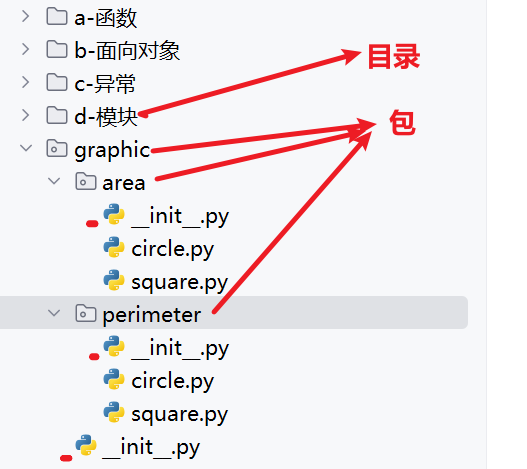
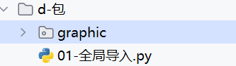
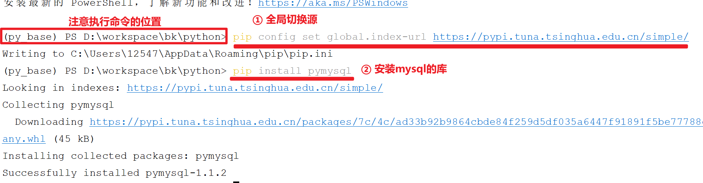

# 02-Python基础

## 1 面向对象

### 1.1 类与对象

Python是面向对象的编程语言，采用类（class）来生产对象

- **类**：对象的模板，定义了对象的属性和方法
- **对象**：类的实例，是具体的个体

#### 1.1.1 基础语法

定义类和创建对象的基础语法如下：

```Python
# 1）创建类
class 类名:
    """类的说明；文档字符串"""
    
    # 构造方法（初始化）
    def __init__(self, 属性形参列表):
        self.实例属性 = 形参  # 实例属性

    # 实例方法
    def 方法名(self):
        print(f"{self.实例属性} 。。。")

# 2）创建对象,调用变量和方法
对象 = 类名(参数列表)
对象.变量
对象.方法名()
```

具体的代码示例：

```Python
"""
#1) 创建类
    class 类名:
        # 构造方法（初始化）
        def __init__(self, 属性形参列表):
            self.实例属性 = 形参  # 实例属性

        # 实例方法
        def 方法名(self):
            print(f"{self.实例属性} 。。。")

#2) 创建对象,调用变量和方法
    对象 = 类名(参数列表)
    对象.变量
    对象.方法名()
"""


# 1) 创建一个猫类, 定义name和age属性, 定义say方法
class Cat:
    """猫类"""

    # 构造方法, 定义类的属性
    def __init__(self, name, age):
        self.name = name
        self.age = age

    # self 代表的就是当前对象, 相当于Java中的this关键字
    def say(self):
        print(f"我是一只猫,我的名字叫:{self.name},我的年龄是:{self.age}")


# 2) 创建对象，调用对象的属性和方法
cat = Cat("花小喵", 1)
# cat.name = "花小喵"
# cat.age = 2
cat.say()
```

#### 1.1.2 属性

在Python中属性有两种：

- 类属性: 定义在类中方法外，会被类的所有实例对象所共享（可通过 类名.属性名 或 实例名.属性名 访问；可通过 类名.属性名 修改）
- 实例属性: 定义在类的方法中，为每个实例对象独享（可以通过 实例名.属性名 访问或修改）

```Python
"""
在Python中属性有两种：
    类属性: 定义在类中方法外，会被类的所有实例对象所共享（可通过 类名.属性名或 实例名.属性名 访问；可通过 类名.属性名 修改）
    实例属性: 定义在类的方法中，为每个实例对象独享（可以通过 实例名.属性名 访问或修改）
"""


class Person:
    # 类属性: 定义在类中方法外
    age = 10

    def __init__(self):
        # 实例属性: 定义在类的方法中
        self.name = None


# 类属性: 定义在类中方法外，会被类的所有实例对象所共享
p1 = Person()
p2 = Person()

# 可通过 类名.属性名或 实例名.属性名 访问
print(Person.age)
print(p1.age)
print(p2.age)

# 可通过 类名.属性名 修改
Person.age = 20
# p1.age = 30

print(Person.age)
print(p1.age)
print(p2.age)

print("*" * 40)

# 实例属性: 定义在类的方法中，为每个实例对象独享（可以通过 实例名.属性名 访问或修改）
print(f"p1.name:{p1.name}")
print(f"p2.name:{p2.name}")

p1.name = "张三"

print(f"p1.name:{p1.name}")
print(f"p2.name:{p2.name}")
```

#### 1.1.3 方法

在Python中方法主要有两种：

- 类方法：在类中通过 @classmethod 定义，第一个参数为cls，代表类本身，可以通过 类名.方法名 或者 实例名.方法名（不推荐）调用
- 实例方法：在类中定义，第一个参数为self，代表实例本身，只能通过 实例名.方法名 调用

注意：实例方法中可以访问类方法、属性以及实例方法、属性；但是类方法只能访问类方法、属性 (类只能访问类; 实例可以访问一切)

```Python
"""
在Python中方法主要有两种：
    类方法：在类中通过 @classmethod 定义，第一个参数为cls，代表类本身，可以通过类名.方法名 或者 实例名.方法名 （不推荐）调用
    实例方法：在类中定义，第一个参数为self，代表实例本身，只能通过 实例名.方法名 调用
注意：实例方法中可以访问类方法、属性以及实例方法、属性；但是类方法只能访问类方法、属性
"""


class Person:
    # 类属性
    age = 10

    def __init__(self):
        self.name = "张三"

    # 类方法：在类中通过 @classmethod 定义，第一个参数为cls，代表类本身
    @classmethod
    def m1(cls):
        print(f"m1方法{cls.age}")

    # 实例方法：在类中定义，第一个参数为self，代表实例本身
    def m2(self):
        print(f"m2方法:{self.name}")


# 类方法：可以通过类名.方法名 或者 实例名.方法名 （不推荐）调用
# Person.m1() # 类名.方法名
# Person().m1() # 实例名.方法名 （不推荐）


# 实例方法：只能通过 实例名.方法名 调用
Person().m2()
```

#### 1.1.4 魔术方法

Python提供了许多以 \_\_ 开头和结尾的**魔术方法** （也称为  双下方法），他们会在对象生命周期的某个位置自动调用。常用的有：

- \_\_init\_\_()：对象在初始化时自动调用的方法
- \_\_str\_\_()：在打印对象时自动调用的方法  类似于Java的toString()
- \_\_eq\_\_()：在比较两个对象是否相等时自动调用的方法 类似于Java的equals()

```Python
"""
Python提供了许多以 __ 开头和结尾的魔术方法 （也称为  双下方法），他们会在对象生命周期的某个位置自动调用。常用的有：
    __init__()：对象在初始化时自动调用的方法
    __str__()：在打印对象时自动调用的方法
    __eq__()：在比较两个对象是否相等时自动调用的方法
"""


class Book:

    # __init__()：对象在初始化时自动调用的方法
    def __init__(self, name, price):
        self.name = name
        self.price = price

    # __str__()：在打印对象时自动调用的方法
    def __str__(self):
        return f"Book:name-{self.name}, price-{self.price}"

    # __eq__()：在比较两个对象是否相等时自动调用的方法
    def __eq__(self, other):
        return self.name == other.name


b1 = Book("西游记", 10)
b2 = Book("西游记", 100)

print(b1)
print(b2)

print(f"b1==b2:{b1 == b2}")
```

### 1.2 封装

#### 1.2.1 私有化

如果我们想类中的某些属性和方法只能在类内访问，外部无法访问，可以将其私有化，具体实现方式是：

- \_\_属性名：使用双下划线修饰一个属性的名字
- \_\_方法名：使用双下划线修饰一个方法的名字

注意：

1. 使用一个下划线修饰的属性或者方法名被视为非公开访问内容，不建议外部访问，但是只是建议，不是强制；双下划线是强制
2. 双下划线实现强制外部不能访问的原理是名称改写，例如\_\_属性，会被改写为\_类名\_\_属性

此时只能在类内部可以通过\_\_属性访问，其他地方无法访问或通过 \_类名\_\_属性访问

1. 如果想要访问私有化的属性和方法, 可以在类中提供公开的方法间接访问

```Python
"""
如果我们想类中的某些属性和方法只能在类内访问，外部无法访问，可以将其私有化，具体实现方式是：
    __属性名：使用双下划线修饰一个属性的名字
    __方法名：使用双下划线修饰一个方法的名字
注意：
    1. 使用一个下划线修饰的属性或者方法名被视为非公开访问内容，不建议外部访问，但是只是建议，不是强制；双下划线是强制
    2. 双下划线实现强制外部不能访问的原理是名称改写，例如__属性，会被改写为_类名__属性
        此时只能在类内部可以通过__属性访问，其他地方无法访问或通过 _类名__属性访问
    3. 如果想要访问私有化的属性和方法, 可以在类中提供公开的方法间接访问
"""


class User:

    def __init__(self):
        # __属性名：使用双下划线修饰一个属性的名字
        self.__name = "张三"

    # get方法获取name属性的值
    def get_name(self):
        return self.__name

    # set方法设置name的值
    def set_name(self, name):
        self.__name = name

user = User()
user.set_name("李四")
print(user.get_name())
```

#### 1.2.2 装饰器

装饰器其实本质上就是一个注解，标注在属性和方法上，对原有功能进行改造或者增强

- @property：将一个方法转换为属性来调用，转换后可直接使用 .方法名 来使用，而无需使用 .方法名() 
- @方法名.setter：将方法名设置为去掉双下划线的私有属性名

```Python
"""
装饰器其实本质上就是一个注解，标注在属性和方法上，对原有功能进行改造或者增强
    @property：将一个方法转换为属性来调用，转换后可直接使用 .方法名 来使用，而无需使用 .方法名()
    @方法名.setter：将方法名设置为去掉双下划线的私有属性名
我们使用这两个注解来完成一个类中属性的set/get实现(注意:get方法必须在set之前)
"""


class User:
    def __init__(self, name, age):
        self.__name = name
        self.__age1 = age

    @property
    def age(self):
        return self.__age

    # set
    @age.setter
    def age(self, age):
        self.__age = age

    # @property：将一个方法转换为属性来调用，转换后可直接使用 .方法名 来使用，而无需使用 .方法名()
    @property
    def name(self):
        return self.__name

    # @方法名.setter：将方法名设置为去掉双下划线的私有属性名
    @name.setter
    def name(self, name):
        if len(name) > 5:
            print("名字长度不能超过5个字符")
            return
        self.__name = name


user = User("张三", 17)
user.name = "李四"
print(user.name)

user.age = 18
print(user.age)
```

### 1.3 继承

在python中，子类可以继承父类的属性和方法，实现代码复用

#### 1.3.1 单继承

单继承指的是一个类只继承一个父类，语法：class 子类名（父类名），它的特点如下：

1. 子类可以使用父类的非私有成员
2. 子类可以重写父类的方法，调用方法时先在子类中查找，如果子类中没有，则会去父类中查找
3. 子类可以使用 super().方法名() 或 父类名.方法名() 来调用父类的方法
4. 子类重写\_\_init\_\_()并调用时，不会执行父类的\_\_init\_\_()方法。如有必要，需手动调用

```Python
"""
单继承指的是一个类只继承一个父类，语法：class 子类名（父类名），它的特点如下：
1. 子类可以使用父类的非私有方法
2. 子类可以重写父类的方法，调用方法时先在子类中查找，如果子类中没有，则会去父类中查找
3. 子类可以使用 super().方法名() 或 父类名.方法名() 来调用父类的方法
4. 子类重写__init__()并调用时，不会执行父类的__init__()方法。如有必要，需手动调用
"""


class Animal:
    def __init__(self, name):
        self.name = name

    def eat(self):
        print(f'{self.name}在吃饭饭')

    def sleep(self):
        print(f'{self.name}在睡觉觉')


class Dog(Animal):
    def __init__(self):
        super().__init__("小黑")

    def eat(self):
        print(f'{self.name}在吃骨头')
        super().sleep()
        # Animal.sleep(self)


d = Dog()
d.eat()
```

#### 1.3.2 多继承

多继承指的是一个类可以继承多个父类，语法：class 子类名（父类1，父类2，.......），它的特点如下：

1. 子类可以使用所有父类的非私有成员
2. 调用方法时先在子类中查找，如果子类中没有，若不存在则从左到右依次查找父类中是否包含方法
3. 可使用 类名.\_\_mro\_\_ 访问类的继承链来查看方法解析顺序,object是所有类的直接或间接父类

```Python
"""
多继承指的是一个类可以继承多个父类，语法：class 子类名（父类1，父类2，.......），它的特点如下：
1. 子类可以使用所有父类的非私有成员
2. 调用方法时先在子类中查找，如果子类中没有，若不存在则从左到右依次查找父类中是否包含方法
3. 可使用 类名.__mro__ 访问类的继承链来查看方法解析顺序,object是所有类的直接或间接父类
"""

class A(object):
    def m(self):
        print("ma")

class B(object):
    def m(self):
        print("mb")

class C(A,B):
    pass

c = C()
c.m()
print(C.__mro__)
```

### 1.4 多态

Python的多态是一种伪多态，它不关心对象的具体类型，只关心对象是否具有我们需要的方法或属性

也就是说：只要对象支持预期的行为（即有相应的接口），就可以认为它是合适的

```Python
"""
Python的多态是一种伪多态，它不关心对象的具体类型，只关心对象是否具有我们需要的方法或属性
也就是说：只要对象支持预期的行为（即有相应的接口），就可以认为它是合适的
"""


# 动物
class Animal:
    def speak(self):
        pass


# 狗
class Dog(Animal):
    def speak(self):
        print("汪汪汪")


class Desk:
    def speak(self):
        print("吱吱吱")


class Water:
    pass


# Python的多态是一种伪多态，它不关心对象的具体类型，只关心对象是否具有我们需要的方法或属性
def test(animal: Animal):
    animal.speak()


# test(Dog())
# test(Desk())
test(Water())
```


## 2 异常

在Python中代码执行过程中遇到的问题称为**异常（Exception）**，例如下面这些：

- 除以零：`10 / 0`
- 打开不存在的文件
- 访问列表越界：`lst[100]`
- 类型错误：`"hello" + 5`

### 2.1 异常处理

异常发生会导致程序的终止，因此我们需要在其发生的时候对其进行捕获处理，格式如下：

```Python
# 格式1：单个异常捕获处理
try:
    代码块
except 异常类型 as e:
    处理异常

# 格式2：多个异常捕获处理
try:
   代码块
except 异常类型1 as e:
    处理异常逻辑
except 异常类型2 as e:
    处理异常逻辑

# 格式3：finally 无论是否发生异常都会执行到的代码块
try:
    代码块
except 异常类型 as e:
    处理异常
finally：
    无论是否发生异常都会执行到的代码块  
    
# 格式4：else 不发生异常执行到的代码块
try:
    代码块
except 异常类型 as e:
    处理异常
else：
    不发生异常执行到的代码块
finally：
    无论是否发生异常都会执行到的代码块   
```

代码

```Python
"""
异常处理
"""

"""
# 格式1：单个异常捕获处理
try:
    代码块
except 异常类型 as e:
    处理异常
"""
# try:
#     i = 1 / 0  # ZeroDivisionError
# except Exception as e:
#     print(f"0不能做除数:{e}")

"""
# 格式2：多个异常捕获处理
try:
   代码块
except 异常类型1 as e:
    处理异常逻辑
except 异常类型2 as e:
    处理异常逻辑
"""
# try:
#     # i = 1 / 0  # ZeroDivisionError
#     list1 = [0, 1, 2]
#     print(list1[10])
# except ZeroDivisionError as e:
#     print(f"0不能做除数:{e}")
# except Exception as e:
#     print(f"未知异常:{e}")

"""
# 格式3：finally 无论是否发生异常都会执行到的代码块
try:
    代码块
except 异常类型 as e:
    处理异常
finally:
    无论是否发生异常都会执行到的代码块  
"""

# try:
#     # i = 1 / 0  # ZeroDivisionError
#     list1 = [0, 1, 2]
#     print(list1[10])
# except ZeroDivisionError as e:
#     print(f"0不能做除数:{e}")
# except Exception as e:
#     print(f"未知异常:{e}")
# finally:
#     print("代码执行完毕")


"""
# 格式4：else 不发生异常执行到的代码块
try:
    代码块
except 异常类型 as e:
    处理异常
else:
    不发生异常执行到的代码块
finally:
    无论是否发生异常都会执行到的代码块   
"""

try:
    # i = 1 / 0  # ZeroDivisionError
    list1 = [0, 1, 2]
    print(list1[1])
except ZeroDivisionError as e:
    print(f"0不能做除数:{e}")
except Exception as e:
    print(f"未知异常:{e}")
else:
    print("代码运行没有问题")
finally:
    print("代码执行完毕")
```

### 2.2 抛出异常

在执行代码过程中，如果想主动引发一个错误时，使用 raise Exception("异常描述")

```Python
"""
在执行代码过程中，如果想主动引发一个错误时，使用 raise Exception("异常描述")
"""


def divide(a, b):
    if b == 0:
        raise ValueError('除数不能为0')
    return a / b

try:
    result = divide(10, 0)
except ValueError as e:
    print(f"捕获到异常；{e}")
else:
    print(result)
```

### 2.3 自定义异常

当内置异常不够用时，可以创建自己的异常类。自定义异常继承自 `Exception` 或其子类。

```Python
"""
当内置异常不够用时，可以创建自己的异常类。自定义异常继承自 Exception 或其子类
"""


# 自定义异常类
class AgeException(Exception):
    pass


def set_age(age):
    if age < 0 or age > 120:
        raise AgeException(f"年龄{age}有误")
    print(f"{age}复制完毕")


try:
    set_age(180)
except AgeException as e:
    print(f"发生了异常:{e}")
```


## 3 模块

Python中一个以.py结尾的文件称为一个模块，它可以包含变量、函数和类等内容

模块的存在大大提高了Python代码的复用性，因为我们可以直接导入其它写好的模块中的内容加以使用

### 3.1 创建模块

创建模块的时候名字区分大小写，推荐见名知意，使用_分隔多个单词

```Python
# 两个变量
name = "加法函数"
_desc = "提供两数相加的计算逻辑"

"""
定义一个加法的函数
"""
def add(a, b):
    return a + b

# 测试
print(add(1, 2))
```

### 3.2 导入模块

导入模块就是在一个模块中导入其它模块，然后就可以访问其它模块的代码了，导入方式有：**全局导入**和**部分导入**

#### 3.2.1 全局导入

全局导入：将一个其他模块中全部内容导入到当前模块

- 导入语法：import 模块名 [as 别名]
- 使用语法：模块名.成员名

注意: 模块在导入的时候会自动执行里面的代码

```Python
"""
全局导入：将一个其他模块中全部内容导入到当前模块
    导入语法：import 模块名 [as 别名]
    使用语法：模块名.成员名
注意: 模块在导入的时候会自动执行里面的代码
"""

# 在当前模块中导入a_add模块的所有内容,并访问

# 导入语法：import 模块名 [as 别名]
import a_add as add

# 使用语法：模块名.成员名
print(add.add(1, 2))
print(add.name)
print(add._desc)
```

#### 3.2.2 局部导入

局部导入：将一个其他模块中部分内容导入到当前模块

- 导入语法：from 模块名 import 成员名1[as 别名], 成员名2[as 别名],…
- 使用语法：成员名

注意：

1. 只能使用其导入的成员，未导入的成员不能使用
2. 如果多个模块中存在重名成员，后一次导入会覆盖前一次导入，此时可以使用别名来做区分
3. from 模块名 import \* 默认导入模块中所有不以单下划线开头的成员，但是可以在被导入模块中使用\_\_all\_\_=[""] 明确暴露成员

```Python
"""
部分导入：将一个其他模块中部分内容导入到当前模块
    导入语法：from 模块名 import 成员名1[as 别名], 成员名2[as 别名],…
    使用语法：成员名
注意：
    1. 只能使用其导入的成员，未导入的成员不能使用
    2. 如果多个模块中存在重名成员，后一次导入会覆盖前一次导入，此时可以使用别名来做区分
    3. from 模块名 import * 默认导入模块中所有不以单下划线开头的成员，但是可以在被导入模块中使用__all__=[""] 明确暴露成员
"""

# 1. 只能使用其导入的成员，未导入的成员不能使用
# 导入语法：from 模块名 import 成员名1[as 别名], 成员名2[as 别名],…
# from a_add import name,_desc
#
# print(name)
# print(_desc)
# print(add(1,2))


#2. 如果多个模块中存在重名成员，后一次导入会覆盖前一次导入，此时可以使用别名来做区分
from a_sub import name as sub_name
from a_add import name as add_name

print(sub_name)
print(add_name)

# #3. from 模块名 import * 默认导入模块中所有不以单下划线开头的成员，但是可以在被导入模块中使用__all__=[""] 明确暴露成员
# from a_add import *
#
# # print(name)
# # print(_desc)
# print(add(1, 2))
```

#### 3.2.3 \_\_name\_\_

\_\_name\_\_ 是一个内置变量，它的值在自己调用和被其他模块调用时是不一样的

- 当一个Python文件被直接运行时，该文件的\_\_name\_\_属性值为"\_\_main\_\_"
- 当一个Python文件作为模块被导入时，\_\_name\_\_属性会被设置为该模块的名称

所以可以利用这一特性来做文件的测试代码

```Python
# 测试
if __name__ == "__main__":
    print(add(1, 2))
```

## 4 包

包是python中用来管理模块的一种方式，它的格式类似于一个文件夹，包中还可以有包

区别于文件夹的是包要求在里面要有一个  \_\_init\_\_.py  文件



### 4.1 创建包

在pycharm中直接选择new--package就可以创建包

它会自动生成一个\_\_init\_\_.py文件，内容为空；我们暂时也不用关注它

### 4.2 导入包

导包的目的其实还是导入包中的模块，进而使用模块中的成员

#### 4.2.1 全局导入

- 导入语法：import 包名.模块名 [as 别名]
- 使用语法：包名.模块名.成员名



```Python
"""
- 导入语法：import 包名.模块名 [as 别名]
- 使用语法：包名.模块名.成员名
"""

# 1. 计算圆的周长和面积

# 圆的周长
# 导入语法：import 包名.模块名
import graphic.perimeter.circle

# 使用语法：包名.模块名.成员名
print(graphic.perimeter.circle.ap(1))

# 圆的面积
# 导入语法：import 包名.模块名 [as 别名]
import graphic.area.circle as c

# 使用语法：别名.成员名
print(c.ac(1))
```

#### 4.2.2 局部导入

格式一:

- 导入语法：from 包名 import 模块名 [as 别名]
- 使用语法：模块名.成员名

格式二:

- 导入语法：from 包名 import \*    注意: 这种写法要求必须在包中的\_\_init\_\_.py文件中明确使用 \_\_all\_\_ = [""]指定对外的模块
- 使用语法：模块名.成员名

格式三:

- 导入语法：from 包名.模块名 import 成员名 [as 别名]
- 使用语法：成员名

```Python
"""
格式一:
- 导入语法：from 包名 import 模块名 [as 别名]
- 使用语法：模块名.成员名
格式二:
- 导入语法：from 包名 import *    注意: 这种写法要求必须在包中的__init__.py文件中明确使用__all__ = [""]指定对外的模块
- 使用语法：模块名.成员名
格式三:
- 导入语法：from 包名.模块名 import 成员名 [as 别名]
- 使用语法：成员名
"""

"""
格式一:
- 导入语法：from 包名 import 模块名 [as 别名]
- 使用语法：模块名.成员名
"""
# from graphic.area import circle
# print(circle.ac(1))


"""
格式二:
- 导入语法：from 包名 import *    注意: 这种写法要求必须在包中的__init__.py文件中明确使用__all__ = [""]指定对外的模块
- 使用语法：模块名.成员名
"""
# from graphic.area import *
# print(circle.ac(1))


"""
格式三:
- 导入语法：from 包名.模块名 import 成员名 [as 别名]
- 使用语法：成员名
"""
from graphic.area.circle import ac
print(ac(1))
```

### 4.3 Python内置包

Python自带了很多的包来方便开发人员，下面列出一些常用的：

- 操作系统：os（操作系统接口）、sys（系统相关的形参和函数）
- 时间日期：time（时间）、datetime（日期时间）
- 数序计算：math（数学）、random（随机数）
- 数据格式：re（正则）、json（JSON处理）

官方地址：https://docs.python.org/zh-cn/3/library/index.html

```Python
"""
Python自带了很多的包来方便开发人员，下面列出一些常用的
- 操作系统：os（操作系统接口）、sys（系统相关的形参和函数）
- 时间日期：time（时间）、datetime（日期时间）
- 数序计算：math（数学）、random（随机数）
- 数据格式：re（正则）、json（JSON处理）
"""


# math
import math
print(math.pi)

# datetime
import datetime
print(datetime.datetime.now())

# random
import random
print(random.randint(1,10))
```

### 4.4 导入第三方包

当需要使用Python官方没有内置的包(库)时，可以通过pip方式先安装第三方库，然后再导入使用

pip是Python包管理工具，该工具提供了对 Python 包的查找、下载、安装、卸载的功能

pip默认源的地址为 https://pypi.org/simple/，下载比较慢，可以切换到其它的源

- 清华大学：https://pypi.tuna.tsinghua.edu.cn/simple/
- 阿里云：http://mirrors.aliyun.com/pypi/simple/

切换源的方式有下面两种

- 临时切换（在安装包的时候切换，仅本次安装生效）：pip install -i https://pypi.tuna.tsinghua.edu.cn/simple/ 包名
- 永久切换（全局切换，后续安装包的时候无须再指定）：pip config set global.index-url https://pypi.tuna.tsinghua.edu.cn/simple/

下面我们使用pip命令来安装mysql的库



## 5 数据库

### 5.1 准备数据

我们这一章来学习python操作数据库的语法，下面先创建一个数据库备用

````SQL
CREATE DATABASE blog_db;
USE blog_db;

CREATE TABLE blog_posts (
    id INT AUTO_INCREMENT PRIMARY KEY,
    title VARCHAR(200) NOT NULL,
    content TEXT NOT NULL,
    author VARCHAR(100) NOT NULL,
    created_at TIMESTAMP DEFAULT CURRENT_TIMESTAMP,
    updated_at TIMESTAMP DEFAULT CURRENT_TIMESTAMP ON UPDATE CURRENT_TIMESTAMP
);

# 示例数据
-- 插入博客文章示例数据
INSERT INTO blog_posts (title, content, author, created_at) VALUES
(
    'Python编程入门指南',
    'Python是一种高级编程语言，以其简洁的语法和强大的功能而闻名。本文将介绍Python的基础知识，包括变量、数据类型、控制流和函数等。\n\n## Python的特点\n- 简单易学\n- 开源免费\n- 跨平台兼容\n- 丰富的库支持\n\n无论你是编程新手还是有经验的开发者，Python都是一个不错的选择。',
    '张明',
    '2024-01-15 10:00:00'
),
(
    '机器学习基础概念',
    '机器学习是人工智能的重要分支，它让计算机能够从数据中学习并做出预测。\n\n### 主要算法类型\n1. 监督学习\n2. 无监督学习\n3. 强化学习\n\n在实际应用中，选择合适的算法和特征工程是关键步骤。',
    '李华',
    '2024-01-14 14:30:00'
),
(
    'Web开发最佳实践',
    '现代Web开发涉及前端和后端技术的完美结合。本文将探讨一些最佳实践：\n\n- 响应式设计\n- 性能优化\n- 安全性考虑\n- SEO优化\n\n掌握这些实践将帮助你构建更好的Web应用。',
    '王芳',
    '2024-01-13 09:15:00'
),
(
    '数据库设计原则',
    '良好的数据库设计是应用成功的基础。以下是一些重要原则：\n\n## 规范化\n- 第一范式\n- 第二范式\n- 第三范式\n\n## 索引策略\n合理使用索引可以显著提高查询性能。',
    '刘伟',
    '2024-01-12 16:45:00'
),
(
    'Docker容器化部署',
    'Docker改变了应用部署的方式，提供了标准化的运行环境。\n\n### 主要优势\n- 环境一致性\n- 快速部署\n- 资源隔离\n- 易于扩展\n\n学习Docker是现代开发者的必备技能。',
    '陈静',
    '2024-01-11 11:20:00'
),
(
    'React框架深入解析',
    'React是一个用于构建用户界面的JavaScript库，由Facebook开发。\n\n## 核心概念\n- 组件化\n- 虚拟DOM\n- 状态管理\n- 生命周期\n\nReact的生态系统非常丰富，包括React Router、Redux等。',
    '赵刚',
    '2024-01-10 13:10:00'
),
(
    '微服务架构模式',
    '微服务架构将应用拆分为一组小型服务，每个服务运行在自己的进程中。\n\n### 优势与挑战\n**优势：**\n- 技术多样性\n- 独立部署\n- 更好的可扩展性\n\n**挑战：**\n- 分布式系统复杂性\n- 数据一致性\n- 网络延迟',
    '孙丽',
    '2024-01-09 15:30:00'
),
(
    'Git版本控制实战',
    'Git是目前最流行的版本控制系统，掌握Git是每个开发者的基本功。\n\n## 常用命令\n```\ngit init\ngit add .\ngit commit -m "message"\ngit push\ngit pull\n```\n\n良好的提交习惯和分支管理策略很重要。',
    '周强',
    '2024-01-08 08:45:00'
),
(
    '网络安全基础',
    '在数字化时代，网络安全变得越来越重要。\n\n### 常见威胁\n- SQL注入\n- 跨站脚本攻击\n- CSRF攻击\n- DDoS攻击\n\n了解这些威胁并采取适当的防护措施至关重要。',
    '吴磊',
    '2024-01-07 12:00:00'
),
(
    '敏捷开发方法论',
    '敏捷开发强调快速迭代和持续交付，适应需求变化。\n\n## 敏捷原则\n- 个体和互动高于流程和工具\n- 可工作的软件高于详尽的文档\n- 客户合作高于合同谈判\n- 响应变化高于遵循计划\n\nScrum和Kanban是流行的敏捷框架。',
    '郑雪',
    '2024-01-06 17:20:00'
);
````


### 5.2 操作步骤

pymysql操作MySQL的实现步骤如下：

1. 创建连接：pymysql.connect(host="localhost", port=3306, user="root", password="1234", database="blog_db", charset="utf8")
2. 获取游标：cursor = connect.cursor()  cursor是用来执行SQL语句的对象
3. 执行SQL语句：cursor.execute(sql,(值)) 
4. 提交事务：connect.commit()
5. 处理结果：
6. 释放资源：cursor.close(); connect.close()

下面我们按照此步骤完成一个像数据表保存数据的操作

```Python
"""
pymysql操作MySQL的实现步骤如下：
1. 创建连接：pymysql.connect(host="localhost", port=3306, user="root", password="1234", database="blog_db", charset="utf8")
2. 获取游标：cursor = connect.cursor()  cursor是用来执行SQL语句的对象
3. 执行SQL语句：cursor.execute(sql,(值))
4. 提交事务：connect.commit()
5. 处理结果：
6. 释放资源：cursor.close(); connect.close()
"""
import pymysql

# 保存博客
def insert_blog(title, content, author):
    connection = None
    cursor = None

    try:
        # 1. 创建连接
        connection = pymysql.connect(host="localhost", port=3306, user="root", password="root", database="blog_db",
                                     charset="utf8")

        # 2. 创建游标 (用来操作sql)
        cursor = connection.cursor()

        # 3. 编写SQL, 执行SQL
        sql = "insert into blog_posts(title,content,author) values(%s,%s,%s)"
        cursor.execute(sql, (title, content, author))

        # 4. 提交事务
        connection.commit()

        # 5. 处理结果
        return cursor.lastrowid
    except Exception as e:
        # 5. 回滚
        connection.rollback()
    finally:
        # 6. 释放资源
        cursor.close()
        connection.close()


if __name__ == '__main__':
    print(insert_blog("Python学习怎么这么难?", "好难好难", "龟叔"))
```

### 5.3 代码抽取

```Python
"""
1. 创建连接：pymysql.connect(host="localhost", port=3306, user="root", password="1234", database="blog_db", charset="utf8")
2. 获取游标：cursor = connect.cursor()  cursor是用来执行SQL语句的对象
3. 执行SQL语句  cursor.execute(sql,(值))
4. 提交事务 connect.commit()
5. 处理结果
6. 释放资源 cursor.close(); connect.close()
"""
import pymysql


# 操作博客表的工具类
class BlogDao():
    # 创建客户端
    def create_client(self):
        # 1. 创建连接
        self.connect = pymysql.connect(
            host="localhost",
            port=3306,
            user="root",
            password="root",
            database="blog_db",
            charset="utf8")
        # 2. 获取游标
        self.cursor = self.connect.cursor()

    # 关闭客户端
    def close_client(self):
        self.cursor.close()
        self.connect.close()

    # 新增
    def insert_blog(self, title, content, author)
        try:
            self.create_client()
            # 3. 编写SQL并执行
            sql = "insert into blog_posts(title,content,author) values(%s,%s,%s)"
            self.cursor.execute(sql, (title, content, author))
            # 4. 提交事务
            self.connect.commit()
            # 5. 处理结果(id)
            return self.cursor.lastrowid
        except Exception as e:
            # 6. 回滚
            self.connection.rollback()
        finally:
            # 6. 释放资源
            self.close_client()

if __name__ == '__main__':
    BlogDao().insert_blog("Java编程基础", "Java真好", "高司令")
```

### 5.4 增删改查

#### 5.2.2 查询所有

```Python
"""
pymysql操作MySQL的实现步骤如下：
1. 创建连接：pymysql.connect(host="localhost", port=3306, user="root", password="1234", database="blog_db", charset="utf8")
2. 获取游标：cursor = connect.cursor()  cursor是用来执行SQL语句的对象
3. 执行SQL语句：cursor.execute(sql,(值))
4. 提交事务：connect.commit()
5. 处理结果：
6. 释放资源：cursor.close(); connect.close()
"""
import pymysql


# 定义一个实体类
class Blog:
    def __init__(self, id, title, content, author, created_at, updated_at):
        self.id = id
        self.title = title
        self.content = content
        self.author = author
        self.created_at = created_at
        self.updated_at = updated_at

    def __str__(self):
        return f"Blog--id:{self.id},title:{self.title}"


# 操作blog的持久层
class BlogDao:

    # 构造函数
    def __init__(self):
        self.connection = None
        self.cursor = None

    # 创建连接
    def create_connection(self):
        # 1. 创建连接
        self.connection = pymysql.connect(host="localhost", port=3306, user="root", password="root", database="blog_db",
                                          charset="utf8")
        # 2. 创建游标 (用来操作sql)
        self.cursor = self.connection.cursor()

    # 关闭资源
    def close(self):
        self.cursor.close()
        self.connection.close()

    # 保存博客
    def insert_blog(self, title, content, author):
        try:
            # 1. 创建连接和游标
            self.create_connection()

            # 2. 编写SQL, 执行SQL
            sql = "insert into blog_posts(title,content,author) values(%s,%s,%s)"
            self.cursor.execute(sql, (title, content, author))

            # 3. 提交事务
            self.connection.commit()

            # 4. 处理结果
            return self.cursor.lastrowid
        except Exception as e:
            # 6. 回滚
            self.connection.rollback()
        finally:
            # 7. 释放资源
            self.close()

    # 查询所有
    def find_all_blog(self):
        try:
            # 1. 创建连接和游标
            self.create_connection()

            # 2. 编写SQL, 执行SQL
            sql = "select * from blog_posts"
            self.cursor.execute(sql)

            # 4. 处理结果
            list1 = [Blog(*row) for row in self.cursor.fetchall()]
            return list1
        except Exception as e:
            # 6. 回滚
            self.connection.rollback()
        finally:
            # 7. 释放资源
            self.close()


if __name__ == '__main__':
    # print(BlogDao().insert_blog("Python学习怎么这么难?", "好难好难", "龟叔"))
    for blog in BlogDao().find_all_blog():
        print(blog)
```

在这里需要一个实体类

```Python
class Blog:
    def __init__(self, id, title, content, author, created_at, updated_at):
        self.id = id
        self.title = title
        self.content = content
        self.author = author
        self.created_at = created_at
        self.updated_at = updated_at
    def __str__(self):
        return f'Blog {self.id}, {self.title}'
```

#### 5.2.3 主键查询

```Python
import pymysql

# 操作博客表的工具类
class BlogDao():
    # 创建客户端
    # 关闭客户端
    # 新增
    # 查询所有博客
    # 主键查询
    # 主键查询
    def find_blog_by_id(self, id):
        try:
            # 1. 创建连接和游标
            self.create_connection()
    
            # 2. 编写SQL, 执行SQL
            sql = "select * from blog_posts where id=%s"
            self.cursor.execute(sql, (id))
    
            # 4. 处理结果
            row = self.cursor.fetchone()
            return Blog(*row)
        except Exception as e:
            # 6. 回滚
            self.connection.rollback()
        finally:
            # 7. 释放资源
            self.close()

if __name__ == '__main__':
    # 主键查询
    print(BlogDao().find_blog_by_id(2))
```

#### 5.2.4 主键更新

```Python
import pymysql
from blog import Blog


# 操作博客表的工具类
class BlogDao():
    # 创建客户端
    # 关闭客户端
    # 新增
    # 查询所有博客
    # 主键查询


    # 根据id更新内容
    def update_blog(self, id, title, content, author):
        try:
            self.create_client()

            # 3. 编写SQL并执行
            sql = "update blog_posts set title = %s ,content = %s,author = %s where id = %s"
            rows = self.cursor.execute(sql, (title, content, author, id))

            # 4. 提交事务
            self.connect.commit()

            # 5. 处理结果(影响行数)
            return rows
        except Exception as e:
            raise Exception(f"操作失败{e}")
        finally:
            # 6. 释放资源
            self.close_client()


if __name__ == '__main__':
    # 修改
    print(BlogDao().update_blog(2, "Java编程基础", "Java真好", "高司令"))
```

#### 5.2.5 主键删除

```Python
import pymysql
from blog import Blog


# 操作博客表的工具类
class BlogDao():
    # 创建客户端
    # 关闭客户端
    # 新增
    # 查询所有博客
    # 主键查询
    # 根据id更新内容


    # 根据id删除
    def delete_blog(self, id):
        try:
            self.create_client()
            # 3. 编写SQL并执行
            sql = "delete from blog_posts where id = %s"
            rows = self.cursor.execute(sql, (id))
            # 4. 提交事务
            self.connect.commit()
            # 5. 处理结果(影响行数)
            return rows
        except Exception as e:
            raise Exception(f"操作失败{e}")
        finally:
            # 6. 释放资源
            self.close_client()


if __name__ == '__main__':
    print(BlogDao().delete_blog(2))
```

---
> 来源：飞书技术知识库（脱敏版） · 06 AI 应用开发 / Python 基础 / 02-Python基础 · [原文](https://ccn8v2zngwsm.feishu.cn/wiki/AZcZwQAlniKGo0kllH5cuxkGnUg)
