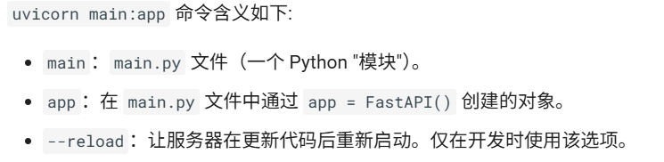
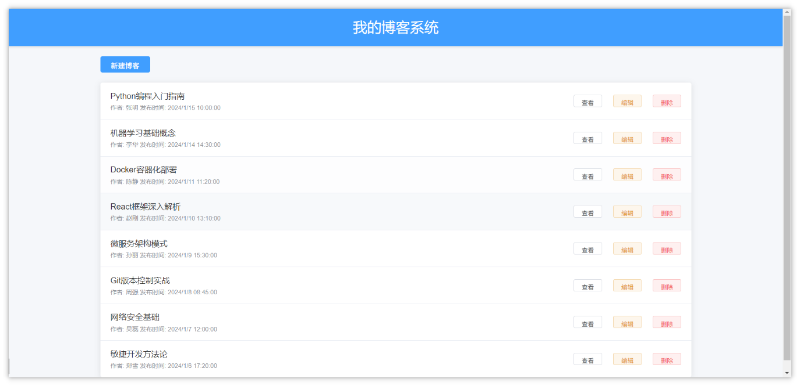
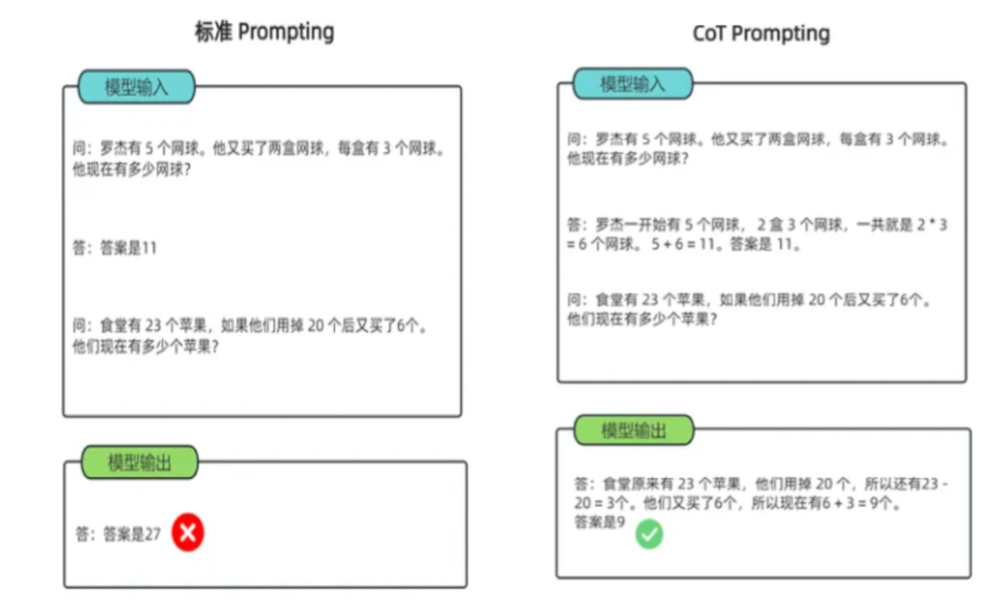

<title>03-python基础</title>

# 1 web开发

## 1.1 FastAPI

### 1.1.1 介绍

FastAPI是一个用于构建 API 的现代、快速（高性能）的 web 框架

**文档**： [https://fastapi.tiangolo.com](https://fastapi.tiangolo.com/)

**源码**： [https://github.com/fastapi/fastapi](https://github.com/fastapi/fastapi)

**关键特性:**

- **快速**：可与 **NodeJS** 和 **Go** 并肩的极高性能
- **高效编码**：提高功能开发速度约 200％ 至 300％。
- **更少 bug**：减少约 40％ 的人为（开发者）导致错误。
- **智能**：极佳的编辑器支持。处处皆可自动补全，减少调试时间。
- **简单**：设计的易于使用和学习，阅读文档的时间更短。
- **简短**：使代码重复最小化。通过不同的参数声明实现丰富功能。bug 更少。
- **健壮**：生产可用级别的代码。还有自动生成的交互式文档。
- **标准化**：基于（并完全兼容）API 的相关开放标准：[OpenAPI](https://github.com/OAI/OpenAPI-Specification) (以前被称为 Swagger) 和 [JSON Schema](https://json-schema.org/)。

### 1.1.2 依赖安装

```Bash
# 类似于SpringMVC的web框架
pip install fastapi

# 类似于Tomcat的中间件服务器
pip install "uvicorn[standard]"
```

### 1.1.3 入门代码

```Python
# 导入了Union(web服务器)和FastAPI(web框架)
from typing import Union
from fastapi import FastAPI

# 创建了FastAPI对象, 起名叫app
app = FastAPI()


# 定义请求方式和路径
@app.get("/")
async def read_root():
    return {"Hello": "World"}


# http://127.0.0.1:8000/items/123?q=你好
# 方式: get
# 路径: /items/{item_id}       {item_id} 路径参数
@app.get("/items/{item_id}")
# 参数1: int 类型的 item_id
# 参数2: Union[str, None] = None 类型的 q  可以接收str或者是None类型的参数, 默认值是None
async def read_item(item_id: int, q: Union[str, None] = None):
    return {"item_id": item_id, "q": q}
```

### 1.1.4 运行服务

运行服务有两种主要方式：

1. 命令行方式：在主文件所在目录运行下面命令  uvicorn main:app --reload

   
2. mian方式：在主文件中添加下面内容，然后直接main方法运行

   ```Python
   if __name__ == "__main__":
       uvicorn.run(app, host="127.0.0.1", port=8000)
   ```

使用浏览器访问 [http://127.0.0.1:8000/items/5?q=somequery](http://127.0.0.1:8000/items/5?q=somequery)    将会看到如下 JSON 响应：

```Bash
{"item_id": 5, "q": "somequery"}
```

### 1.1.5 接收参数

pydantic是一个基于Python类型注解的数据验证与解析库，支持自动校验、类型转换、嵌套模型、导入导出、配置管理等功能

它广泛用于数据清洗、API 参数校验、配置系统构建，尤其是FastAPI等现代Web框架的核心组件之一

现在修改main.py文件借助Pydantic来从PUT请求中接收请求体

```Python
from typing import Union

import uvicorn
from fastapi import FastAPI
from pydantic import BaseModel

app = FastAPI()

# 类似于Dto
class Item(BaseModel):
    name: str
    price: float
    is_offer: Union[bool, None] = None


@app.get("/")
async def read_root():
    return {"Hello": "World"}


@app.get("/items/{item_id}")
async def read_item(item_id: int, q: Union[str, None] = None):
    return {"item_id": item_id, "q": q}

@app.put("/items/{item_id}")
async def update_item(item_id: int, item: Item):
    return {"item_name": item.name, "item_id": item_id}


if __name__ == "__main__":
    uvicorn.run(app, host="0.0.0.0", port=8000)
```


## 1.2 web案例

使用FastAPI和PyMySQL来完成博客系统的**增删改查**

该前端在当天资料中，是一个html，用浏览器打开即可访问后端接口



### 1.2.1 创建项目

根据下面说明创建一个项目，并准备创建对应的文件

```Bash
b_blog_pro/
├── .env                 # 配置文件，包含所有模块的配置
├── blog_dao.py          # 封装操作mysql数据库的方法
├── main.py              # FastAPI 暴露对外访问的接口
├── requirements.txt     # 依赖文件
```

**requirements.txt**：项目的依赖文件，执行  pip install -r requirements.txt  可以安装配置

```Bash
# 项目依赖
# Usage: pip install -r requirements.txt
fastapi==0.119.0
uvicorn==0.37.0
SQLAlchemy==2.0.39
PyMySQL==1.1.1
python-dotenv==1.1.1
```

**.env：**在文件中新增MySQL的配置

```Bash
# MySQL链接
MySQL_HOST="localhost"
MySQL_PORT=3306
MySQL_USER="root"
MySQL_PASSWORD="root"
MySQL_DATABASE="blog_db"
MySQL_CHARSET="utf8"
```

**blog_dao.py：**在文件中添加blog增删改查的方法

```Python
import pymysql


# 操作博客表的工具类
class BlogDao:
    def __init__(self):
        self.cursor = None
        self.connect = None

    # 创建客户端
    def create_client(self):
        # 1. 创建连接
        self.connect = pymysql.connect(
            host="localhost",
            port=3306,
            user="root",
            password="root",
            database="blog_db",
            charset="utf8")
        # 2. 获取游标
        self.cursor = self.connect.cursor()

    # 关闭客户端
    def close_client(self):
        self.cursor.close()
        self.connect.close()

    # 新增
    def insert_blog(self, title, content, author):
        try:
            self.create_client()
            # 3. 编写SQL并执行
            sql = "insert into blog_posts(title,content,author) values(%s,%s,%s)"
            self.cursor.execute(sql, (title, content, author))
            # 4. 提交事务
            self.connect.commit()
            # 5. 处理结果(id)
            return self.cursor.lastrowid
        except Exception as e:
            self.connect.rollback()
            raise Exception(f"操作失败{e}")
        finally:
            # 6. 释放资源
            self.close_client()

    # 查询所有博客
    def find_all_blog(self):
        try:
            # 1. 创建连接
            self.create_client()
            # 2. 编写SQL并执行
            sql = "select * from blog_posts"
            self.cursor.execute(sql)
            # 3. 处理结果(id)
            return [Blog(*row) for row in self.cursor.fetchall()]
        except Exception as e:
            raise Exception(f"操作失败{e}")
        finally:
            # 4. 释放资源
            self.close_client()

    # 主键查询
    def find_blog_by_id(self, id):
        try:
            # 1. 创建连接
            self.create_client()
            # 2. 编写SQL并执行
            sql = "select * from blog_posts where id=%s"
            self.cursor.execute(sql, id)
            # 3. 返回结果
            row = self.cursor.fetchone()
            return Blog(*row)
        except Exception as e:
            raise Exception(f"操作失败{e}")
        finally:
            # 4. 释放资源
            self.close_client()

    # 根据id更新内容
    def update_blog(self, id, title, content, author):
        try:
            self.create_client()

            # 3. 编写SQL并执行
            sql = "update blog_posts set title = %s ,content = %s,author = %s where id = %s"
            rows = self.cursor.execute(sql, (title, content, author, id))

            # 4. 提交事务
            self.connect.commit()

            # 5. 处理结果(影响行数)
            return rows
        except Exception as e:
            self.connect.rollback()
            raise Exception(f"操作失败{e}")
        finally:
            # 6. 释放资源
            self.close_client()

    # 根据id删除
    def delete_blog(self, id):
        try:
            self.create_client()
            # 3. 编写SQL并执行
            sql = "delete from blog_posts where id = %s"
            rows = self.cursor.execute(sql, id)
            # 4. 提交事务
            self.connect.commit()
            # 5. 处理结果(影响行数)
            return rows
        except Exception as e:
            self.connect.rollback()
            raise Exception(f"操作失败{e}")
        finally:
            # 6. 释放资源
            self.close_client()


# 实体类
class Blog:
    def __init__(self, id, title, content, author, created_at, updated_at):
        self.id = id
        self.title = title
        self.content = content
        self.author = author
        self.created_at = created_at
        self.updated_at = updated_at

    def __str__(self):
        return f'Blog {self.id}, {self.title}'
```

**替换配置** 

load_dotenv() 会从项目根目录的 .env 文件（默认路径）中读取键值对，并将这些变量注入到 Python 的运行时环境变量（即 \`os.environ\`）中

避免在代码中硬编码敏感信息（如数据库密码、API 密钥），提升安全性


### 1.2.2 实现代码

定义`main.py`中新增查询所有博客的接口

```Python
from typing import Union

import uvicorn
from fastapi import FastAPI
from pydantic import BaseModel
from starlette.middleware.cors import CORSMiddleware

from blog_dao import BlogDao

app = FastAPI()

# CORS 解决跨域问题
app.add_middleware(
    CORSMiddleware,
    allow_origins=["*"],
    allow_credentials=True,
    allow_methods=["*"],
    allow_headers=["*"],
)


# DTO
class Blog(BaseModel):
    author: str
    title: str
    content: str


# 查询所有
@app.get("/posts")
async def find_all():
    try:
        return BlogDao().find_all_blog()
    except Exception as e:
        raise Exception(e)


# 主键查询
@app.get("/posts/{post_id}")
async def find_by_id(post_id: int):
    try:
        return BlogDao().find_blog_by_id(post_id)
    except Exception as e:
        raise Exception(e)


# 新增
@app.post("/posts")
async def save(blog: Blog):
    try:
        BlogDao().insert_blog(blog.title, blog.content, blog.author)
        return {"status": 200, "msg": "新增成功"}
    except Exception as e:
        print(e)
        return {"status": 500, "msg": "新增失败"}


# 更新
@app.put("/posts/{id}")
async def save(id: int, blog: Blog):
    try:
        BlogDao().update_blog(id, blog.title, blog.content, blog.author)
        return {"status": 200, "msg": "修改成功"}
    except Exception as e:
        print(e)
        return {"status": 500, "msg": "修改失败"}


# 删除
@app.delete("/posts/{post_id}")
async def save(post_id: int):
    try:
        BlogDao().delete_blog(post_id)
        return {"status": 200, "msg": "删除成功"}
    except Exception as e:
        print(e)
        return {"status": 500, "msg": "删除失败"}


if __name__ == "__main__":
    uvicorn.run(app, host="127.0.0.1", port=8000)
```


# 2 提示词工程

## 2.1 介绍

提示词工程（Prompt Engineering）是一种通过给大模型发送精心设计的提示词来引导大模型做出更符合人类预期操作的技术

提示词往往需要清晰明确地表达需求，并提供充足上下文，以使语言模型准确理解我们的意图

面向超大规模的模型的微调方法主要有下面几种：

- 上下文学习法 In-Context Learning：直接挑选少量的样本作为该任务的提示
- 指令学习法 Instruction-Tuning：构建任务指令集，促使模型根据任务指令做出反馈
- 思维链法 Chain-of-Thought：给予或激发模型具有推理和解释的信息，通过线性链式的模式指导模型生成合理的结果

### 2.1.1 上下文学习法

上下文学习法是直接在提供给模型的输入文本中，嵌入少量任务相关的输入-输出示例，但不包含任何明确的指令告诉模型“现在要做这个任务”

模型通过观察这些上下文中的示例模式，推断出当前任务的要求，并对新的输入生成相应的输出

根据提供的输入-输出示例的数量，又可以细分为下面三种情况：

- **Zero-shot：**给出任务的描述, 不提供任何示例，直接让大模型执行任务
- **One-shot：**给出任务描述，提供一个示例，然后让大模型执行任务
- **Few-shot：**给出任务描述，提供N个示例，然后让大模型执行任务


### 2.1.2 指令学习法

指令学习法本质上是对下游任务的指令，简单的来说：就是告诉模型需要做什么任务，输出什么内容

因此, 在对大规模模型进行微调时, 可以为各种类型的任务定义指令, 并进行训练，来提高模型对不同任务的泛化能力


### 2.1.3 思维链法

思维链 (Chain-of-thought，CoT) 是一种改进的提示策略，用于提高 LLM 在复杂推理任务中的性能，如算术推理、常识推理和符号推理.

相比于之前传统的上下文学习，思维链多了具体的步骤

下面是思维链法的一个案例



### 2.1.4 总结对比

<sheet sheet-id="5oC9UR" token="Tj1esjdlEhbQFstSGZ8cJKiunXc"></sheet>

三种方法可结合使用（如用ICL提供示例，CoT引导推理，Instruction约束输出格式），形成更强大的Prompt-Tuning策略

## 2.2 案例

当前金融领域数据大量激增, 如何从繁杂的数据中获取有效的信息, 进而帮助投资者或者研究者减少决策失误带来的损失，成为金融数据分析方法研究的热门话题

人工智能技术的应用可以为金融企业提供更高效、精准的服务，也可以帮助投资者更好的地进行投资决策

- 风险评估：通过AI技术识别出不同金融风险事件类型、反欺诈行为等风险，提高贷款的准确性和风险控制能力
- 投资决策：通过AI技术对历史数据、财务报表等信息分析，为投资者提供精准的投资决策支持
- 客户服务：通过AI技术，实现智能客服等功能，进而为客户提供便捷而又准确的答案

### 2.2.1 金融文本分类

本任务是帮助机构识别和评估不同类型的风险，包括信用风险、市场风险、操作风险等

下面几段文本来自某平台发布的金融领域文本，我们期望模型能够帮我们识别每一句话描述的是一个什么类型的报告

结果为：['新闻报道',  '公司公告',  '财务公告', '分析师报告'] 中的一个

```Bash
1."今日，央行发布公告宣布降低利率刺激经济。这一降息举措将影响贷款利率，并在未来几个季度内对金融市场产生影响。"
2."本公司宣布成功收购一家在创新科技领域领先的公司，这一战略性收购将有助于公司拓展技术能力和加速产品研发。"
3."公司资产负债表显示，公司偿债能力强劲，现金流充足，为未来投资和扩张提供了坚实的财务基础。"
4."最新的分析报告指出，可再生能源行业预计将在未来几年经历持续增长，投资者应该关注这一领域的投资机会"  
```

实现的基本思路

- 调用模型：Qwen2.5:0.5b，可以使用Ollama本地部署，也可以直接使用百炼平台提供的
- 实现方案：基于**Few-shot**方法设计Prompt，也就是发送少许示例给大模型，然后再进行提问

实现步骤如下：

① 安装ollama依赖  pip install ollama

② 测试使用python调用ollama：

```Python
import ollama

# 调用本地大模型
# model  可以指定模型的名称，要确定自己电脑上安装是哪个模型
# messages  就是发送给大模型的提示词，分为三种类型：system（系统提示词）、user（用户提示词）、assistant（大模型回复）
response = ollama.chat(
    model="qwen2.5:0.5b",
    messages=[
        {"role": "system", "content": "你是一个教学的助手，你叫小智"},
        {"role": "user", "content": "介绍下你自己"}
    ]
)
print(response["message"]["content"])
```

③ 思路分析

1. 定义示例数据：首先创建了不同类别（如新闻报道、财务报告、公司公告、分析师报告等）对应的示例文本，这些示例文本将作为模型学习分类规则的参考样本

```JSON
{
  "新闻报道": "今日，股市经历了一轮震荡，受到宏观经济数据和全球贸易紧张局势的影响。投资者密切关注美联储可能的政策调整，以适应市场的不确定性。",
  "财务报告": "本公司年度财务报告显示，去年公司实现了稳步增长的盈利，同时资产负债表呈现强劲的状况。经济环境的稳定和管理层的有效战略执行为公司的健康发展奠定了基础。",
  "公司公告": "本公司高兴地宣布成功完收成最新一轮并购交易，购了一家在人工智能领域领先的公司。这一战略举措将有助于扩大我们的业务领域，提高市场竞争力",
  "分析师报告": "最新的行业分析报告指出，科技公司的创新将成为未来增长的主要推动力。云计算、人工智能和数字化转型被认为是引领行业发展的关键因素，投资者应关注这些趋势"
}
```

1. 构建提示词，构建包含系统说明以及示例对话历史的内容，告知模型其作为文本分类器的任务以及各类别的示例情况，让模型基于这些上下文进行学习

```JSON
[
  {
    "role": "system",
    "content": "现在你是一个文本分类器，你需要按照要求将我给你的句子分类到：['新闻报道','财务报告','公司公告','分析师报告']类别中"
  },
  {
    "role": "user",
    "content": "今日，股市经历了一轮震荡，受到宏观经济数据和全球贸易紧张局势的影响。投资者密切关注美联储可能的政策调整，以适应市场的不确定性。是['新闻报道','财务报告','公司公告','分析师报告']里的什么类别？"
  },
  {
    "role": "assistant",
    "content": "新闻报道"
  },
  {
    "role": "user",
    "content": "本公司年度财务报告显示，去年公司实现了稳步增长的盈利，同时资产负债表呈现强劲的,状况。经济环境的稳定和管理层的有效战略执行为公司的健康发展奠定了基础。是['新闻报道', '财务报告', '公司公告', '分析师报告']里的什么类别？"
  },
  {
    "role": "assistant",
    "content": "财务报告"
  },
  {
    "role": "user",
    "content": "本公司高兴地宣布成功完收成最新一轮并购交易，购了一家在人工智能领域领先的公司。,这一战略举措将有助于扩大我们的业务领域，提高市场竞争力是['新闻报道','财务报告','公司公告','分析师报告']里的什么类别？"
  },
  {
    "role": "assistant",
    "content": "公司公告"
  },
  {
    "role": "user",
    "content": "最新的行业分析报告指出，科技公司的创新将成为未来增长的主要推动力。云计算、人工,智能和数字化转型被认为是引领行业发展的关键因素，投资者应关注这些趋势是['新闻报道', '财务报告', '公司公告', '分析师报告']里的什么类别？"
  },
  {
    "role": "assistant",
    "content": "分析师报告"
  }
]
```

1. 实现推理流程：将上述提示词的基础上，再追加一个新的问题，调用大模型，然后等待大模型回复

```JSON
[
  {
    "role": "system",
    "content": "现在你是一个文本分类器，你需要按照要求将我给你的句子分类到：['新闻报道','财务报告','公司公告','分析师报告']类别中"
  },
  {
    "role": "user",
    "content": "今日，股市经历了一轮震荡，受到宏观经济数据和全球贸易紧张局势的影响。投资者密切关注美联储可能的政策调整，以适应市场的不确定性。是['新闻报道','财务报告','公司公告','分析师报告']里的什么类别？"
  },
  {
    "role": "assistant",
    "content": "新闻报道"
  },
  {
    "role": "user",
    "content": "本公司年度财务报告显示，去年公司实现了稳步增长的盈利，同时资产负债表呈现强劲的,状况。经济环境的稳定和管理层的有效战略执行为公司的健康发展奠定了基础。是['新闻报道', '财务报告', '公司公告', '分析师报告']里的什么类别？"
  },
  {
    "role": "assistant",
    "content": "财务报告"
  },
  {
    "role": "user",
    "content": "本公司高兴地宣布成功完收成最新一轮并购交易，购了一家在人工智能领域领先的公司。,这一战略举措将有助于扩大我们的业务领域，提高市场竞争力是['新闻报道','财务报告','公司公告','分析师报告']里的什么类别？"
  },
  {
    "role": "assistant",
    "content": "公司公告"
  },
  {
    "role": "user",
    "content": "最新的行业分析报告指出，科技公司的创新将成为未来增长的主要推动力。云计算、人工,智能和数字化转型被认为是引领行业发展的关键因素，投资者应关注这些趋势是['新闻报道', '财务报告', '公司公告', '分析师报告']里的什么类别？"
  },
  {
    "role": "assistant",
    "content": "分析师报告"
  },
  {
    "role": "user",
    "content": "今日，央行发布公告宣布降低利率刺激经济。这一降息举措将影响贷款利率，并在未来几个季度内对金融市场产生影响，投资者应关注这些趋势是['新闻报道', '财务报告', '公司公告', '分析师报告']里的什么类别？"
  }
]
```

1. 代码实现


```Python
# 样本
import ollama

examples = {
    '新闻报道': '今日，股市经历了一轮震荡，受到宏观经济数据和全球贸易紧张局势的影响。投资者密切关注美联储可能的政策调整，以适应市场的不确定性。',
    '财务报告': '本公司年度财务报告显示，去年公司实现了稳步增长的盈利，同时资产负债表呈现强劲的状况。经济环境的稳定和管理层的有效战略执行为公司的健康发展奠定了基础。',
    '公司公告': '本公司高兴地宣布成功完收成最新一轮并购交易，购了一家在人工智能领域领先的公司。这一战略举措将有助于扩大我们的业务领域，提高市场竞争力',
    '分析师报告': '最新的行业分析报告指出，科技公司的创新将成为未来增长的主要推动力。云计算、人工智能和数字化转型被认为是引领行业发展的关键因素，投资者应关注这些趋势'
}

# 待检测文字
sentences = [
    "今日，央行发布公告宣布降低利率刺激经济。这一降息举措将影响贷款利率，并在未来几个季度内对金融市场产生影响。",
    "本公司宣布成功收购一家在创新科技领域领先的公司，这一战略性收购将有助于公司拓展技术能力和加速产品研发。",
    "公司资产负债表显示，公司偿债能力强劲，现金流充足，为未来投资和扩张提供了坚实的财务基础。",
    "最新的分析报告指出，可再生能源行业预计将在未来几年经历持续增长，投资者应该关注这一领域的投资机会",
]

# 文本分类
def text_classification():
    # 1. 获取到文本的分类
    class_list = list(examples.keys())  # ['新闻报道', '财务报告', '公司公告', '分析师报告']

    # 2. 准备提示词
    # 2-1 系统提示词
    pre_history = [
        {
            "role": "system",
            "content": f"现在你是一个文本分类器，你需要按照要求将我给你的句子分类到：{class_list}类别中"
        }
    ]
    # 2-2 用户问答模拟
    for key, value in examples.items():
        # 用户问题
        pre_history.append({
            "role": "user",
            "content": f"{value}是{class_list}里的什么类别？"
        })
        # AI回答
        pre_history.append({
            "role": "assistant",
            "content": f"{key}"
        })

    # 3. 遍历问题, 调用大模型
    for sentence in sentences:
        # 发问的问题
        user_question = [*pre_history, {
            "role": "user",
            "content": f"{sentence}，投资者应关注这些趋势是{class_list}里的什么类别？"
        }]

        # 调用大模型
        response = ollama.chat(model="qwen2.5:7b", messages=user_question)
        print(f"问题:{sentence}，投资者应关注这些趋势是{class_list}里的什么类别？")
        print(f"回答:{response['message']['content']}")
        print("=" * 50)


if __name__ == '__main__':
    text_classification()
```

### 2.2.2 金融文本匹配

本任务用于信息检索和过滤，匹配相关的金融信息文本，提供准确的搜索结果

下面几段文本来自某平台发布的新闻信息：

```Bash
1.('股票市场今日大涨，投资者乐观。', '持续上涨的市场让投资者感到满意。'),
2.('油价大幅下跌，能源公司面临挑战。', '未来智能城市的建设趋势愈发明显。'),
3.('利率上升，影响房地产市场。', '高利率对房地产有一定冲击。'),
```

我们期望模型能够帮我们识别出这 3 对句子中，哪几对描述的是相似的语言，期望模型输出的结果为：`['相似', '不相似', '相似']`

```JSON
[
  {
    'role': 'system',
    'content': '现在你需要帮助我完成文本匹配任务，当我给你两个句子时，你需要回答我这两句话语义是否相似。只需要回答是否相似，不要做多余的回答。'
  },
  {
    'role': 'user',
    'content': '句子一：公司ABC发布了季度财报，显示盈利增长。\n 句子二：财报披露，公司ABC利润上升。\n 上面两句话是相似的语义吗？'
  },
  {
    'role': 'assistant',
    'content': '相似'
  },
  {
    'role': 'user',
    'content': '句子一：黄金价格下跌，投资者抛售。\n 句子二：外汇市场交易额创下新高。\n 上面两句话是相似的语义吗？'
  },
  {
    'role': 'assistant',
    'content': '不相似'
  },
  {
    'role': 'user',
    'content': '句子一：央行降息，刺激经济增长。\n 句子二：新能源技术的创新。\n 上面两句话是相似的语义吗？'
  },
  {
    'role': 'assistant',
    'content': '不相似'
  }
]
```

代码实现

```Python
import ollama

# 样例
examples = {
    '相似': [
        ('公司ABC发布了季度财报，显示盈利增长。', '财报披露，公司ABC利润上升。'),
    ],
    '不相似': [
        ('黄金价格下跌，投资者抛售。', '外汇市场交易额创下新高。'),
        ('央行降息，刺激经济增长。', '新能源技术的创新。')
    ]
}

# 待检测文字
sentences = [
    ('股票市场今日大涨，投资者乐观。', '持续上涨的市场让投资者感到满意。'),
    ('油价大幅下跌，能源公司面临挑战。', '未来智能城市的建设趋势愈发明显。'),
    ('利率上升，影响房地产市场。', '高利率对房地产有一定冲击。'),
]


def text_matching():
    # 1. 准备提示词
    # 1-1 系统提示词
    pre_history = [{
        'role': 'system',
        'content': '现在你需要帮助我完成文本匹配任务，当我给你两个句子时，你需要回答我这两句话语义是否相似。只需要回答是否相似，不要做多余的回答。'
    }]

    # 1-2 用户问答模拟
    for key, value in examples.items():
        for v in value:
            # 问题
            pre_history.append({
                'role': 'user',
                'content': f'句子一：{v[0]}\n 句子二：{v[1]}\n 上面两句话是相似的语义吗？'
            })

            # 回答
            pre_history.append({
                'role': 'assistant',
                'content': f'{key}'
            })

    # 3. 遍历问题, 调用大模型
    for sentence in sentences:
        # 发问的问题
        user_question = [*pre_history, {
            'role': 'user',
            'content': f'句子一：{sentence[0]}\n 句子二：{sentence[1]}\n 上面两句话是相似的语义吗？'
        }]

        # 调用大模型
        response = ollama.chat(model="qwen2.5:7b", messages=user_question)
        print(f"问题:句子一：{sentence[0]}\n 句子二：{sentence[1]}\n 上面两句话是相似的语义吗？")
        print(f"回答:{response['message']['content']}")
        print("=" * 50)


if __name__ == '__main__':
    text_matching()
```

### 2.2.3 金融文本信息抽取

本功能用于自动识别和提取金融文本中的关键信息，如实体名称、日期、金额等，可以大大提高数据处理的效率，减少人工处理的工作量

下面几段文本来自某平台发布的股票信息：

```Bash
1.'2023-02-15，寓意吉祥的节日，股票佰笃[BD]美股开盘价10美元，虽然经历了波动，但最终以13美元收盘，成交量微幅增加至460,000，投资者情绪较为平稳。'
2.'2023-04-05，市场迎来轻松氛围，股票盘古(0021)开盘价23元，尽管经历了波动，但最终以26美元收盘，成交量缩小至310,000，投资者保持观望态度。'  
```

我们期望模型帮助我们抽取出这2段话中的关键实体信息，期望模型输出的结果为：`{'金融':  ['日期', '股票名称', '开盘价', '收盘价', '成交量']}`

```JSON
[
  {
    'role': 'system',
    'content': '你是一个信息提取助手。'
  },
  {
    'role': 'user',
    'content': "2023-01-10，股市震荡。股票古哥-D[EOOE]美股今日开盘价100美元，一度飙升至105美元，随后回落至98美元，最终以102美元收盘，成交量达到520000。\n\n提取上述句子中'金融'(日期,股票名称,开盘价,收盘价,成交量)的实体，并按照JSON格式输出，上述句子中不存在的信息用['原文中未提及']来表示，多个值之间用','分隔。",
  },
  {
    'role': 'assistant',
    'content': '{"日期": ["2023-01-10"], "股票名称": ["古哥-D[EOOE]美股"], "开盘价": ["100美元"], "收盘价": ["102美元"], "成交量": ["520000"]}'
  }
]
```

代码实现

```Python
import json
import ollama

# 不同类别需要抽取的内容
schema = {
    "金融": ["日期", "股票名称", "开盘价", "收盘价", "成交量"],
    "电商": ["订单号", "商品名称", "购买数量", "成交金额", "收货地址"],
}

# 样例
ie_example = {
    '金融': [
        {
            'content': '2023-01-10，股市震荡。股票古哥-D[EOOE]美股今日开盘价100美元，一度飙升至105美元，随后回落至98美元，最终以102美元收盘，成交量达到520000。',
            'answers': {
                '日期': ['2023-01-10'],
                '股票名称': ['古哥-D[EOOE]美股'],
                '开盘价': ['100美元'],
                '收盘价': ['102美元'],
                '成交量': ['520000'],
            }
        }
    ]
}

# 待检测文本(金融类型)
sentences = [
    '2023-02-15，寓意吉祥的节日，股票佰笃[BD]美股开盘价10美元，虽然经历了波动，但最终以13美元收盘，成交量微幅增加至460,000，投资者情绪较为平稳。',
]


# 信息抽取
def information_extraction():
    # 1. 准备提示词
    # 1-1 系统提示词
    pre_history = [{
        'role': 'system',
        'content': '你是一个信息提取助手。'
    }]

    # 1-2 用户问答模拟
    # key : 金融  电商
    # value: 列表
    for key, value in ie_example.items():
        for v in value:
            # '金融'(日期,股票名称,开盘价,收盘价,成交量)
            str = f"'{key}'({','.join(schema[key])})"

            # 问题
            pre_history.append({
                'role': 'user',
                'content': f"{v['content']}\n\n提取上述句子中{str}的实体，并按照JSON格式输出，上述句子中不存在的信息用['原文中未提及']来表示，多个值之间用','分隔。",
            })

            # 回答
            pre_history.append({
                'role': 'assistant',
                'content': f'{v["answers"]}'
            })

    # 2 遍历问题 , 调用大模型
    for sentence in sentences:
        key = "金融"

        # 发问的问题
        str = f"'{key}'({','.join(schema[key])})"
        user_question = [*pre_history, {
            'role': 'user',
            'content': f"{sentence}\n\n提取上述句子中{str}的实体，并按照JSON格式输出，上述句子中不存在的信息用['原文中未提及']来表示，多个值之间用','分隔。",
        }]

        # 调用大模型
        response = ollama.chat(model="qwen2.5:7b", messages=user_question)
        print(f"问题:{sentence}")
        print(f"回答:{response['message']['content']}")
        print("=" * 50)


if __name__ == '__main__':
    information_extraction()
```

# 补充

**python调用百炼模型**

1. 安装依赖

```Bash
pip install openai
```

1. 示例代码

```Python
import os
from openai import OpenAI

client = OpenAI(
    # 若没有配置环境变量，请用百炼API Key将下行替换为：api_key="sk-xxx",
    api_key= os.environ['ALIYUN_API_KEY'],
    base_url="https://dashscope.aliyuncs.com/compatible-mode/v1",
)

response = client.chat.completions.create(
    # 模型列表：https://help.aliyun.com/zh/model-studio/getting-started/models
    model="qwen-plus",
    messages=[
        {"role": "system", "content": "You are a helpful assistant."},
        {"role": "user", "content": "你是谁？"},
    ],
)
content = response.choices[0].message.content
print(content)
```

---
> 来源：飞书技术知识库（脱敏版） · 06 AI 应用开发 / Python 基础 / 03-python基础 · [原文](https://ccn8v2zngwsm.feishu.cn/wiki/Uv9ewP6sBi5lZIkUMqPcssONnsf)
