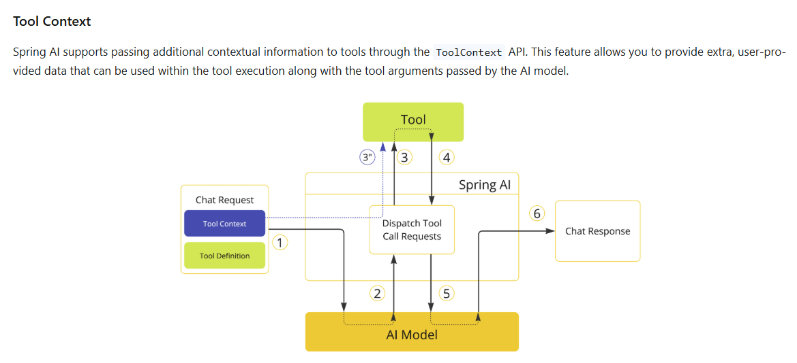
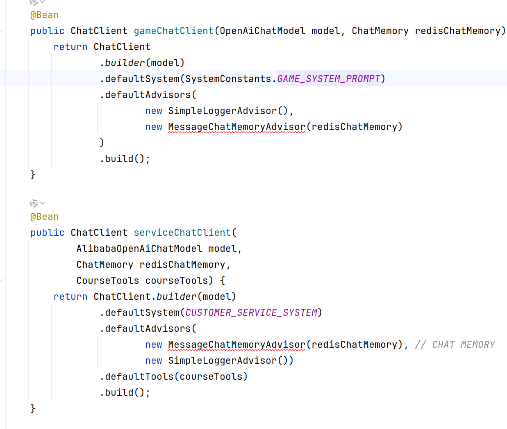
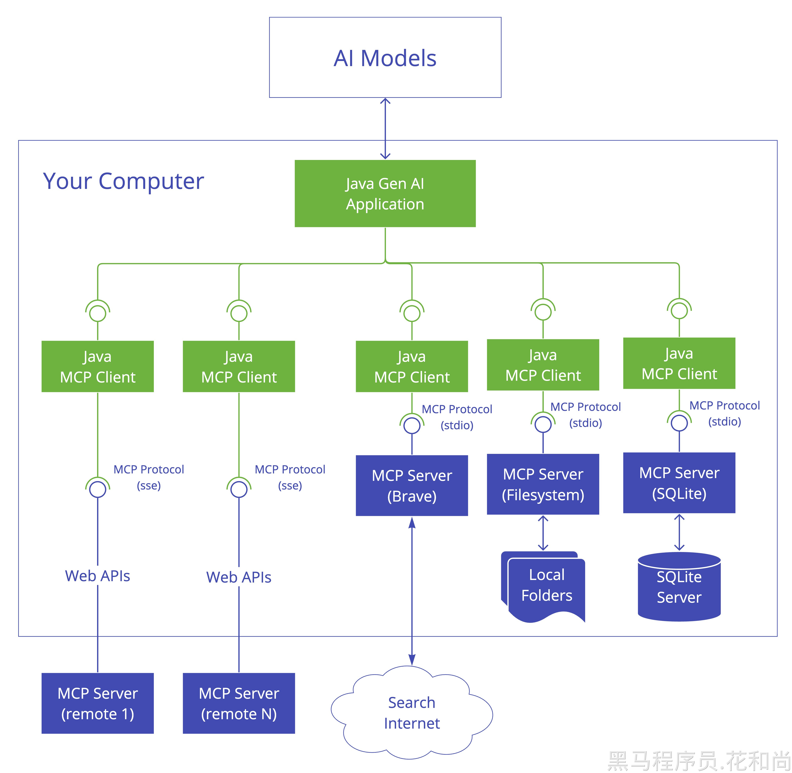
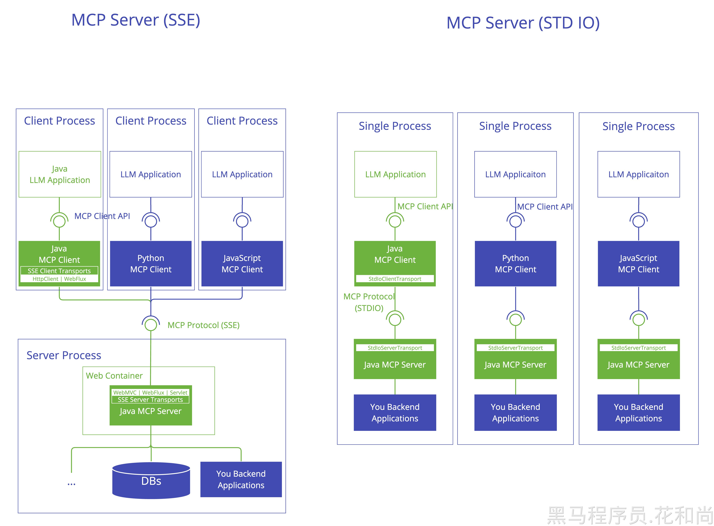
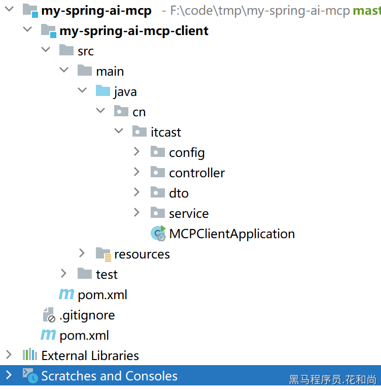
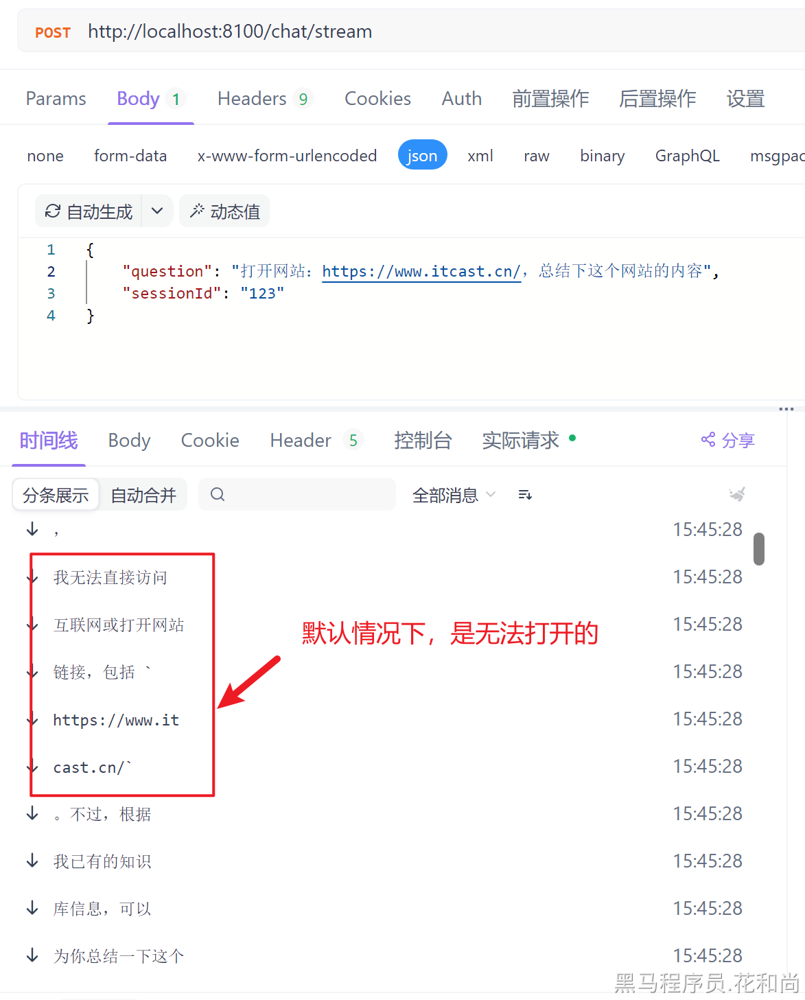
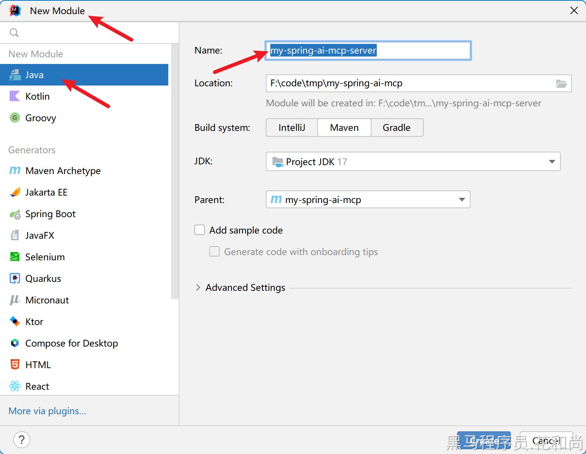
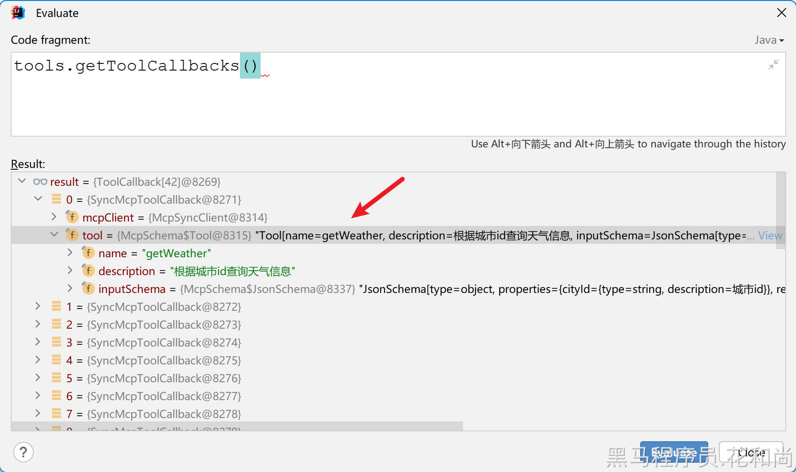

# 拓展内容-MCP

## 一、QA

1. openAI  的api key无法传入403，无法识别APIkey

> 答：通常有两种可能性：
> 
> - 环境变量配置错误导致，比如变量名称不一致
> - 平台的API KEY错误


1. 为什么我设的system没用啊，用`chatclient.defaultSystem`设置也没用

> 通常推理类大模型都是不支持System设定的，比如DeepSeek-R1模型、QwQ模型，DeepSeek官方有说明，System设定对它效果不佳，不建议设置


1. 如何把该项目由m6升级为m7？需要修改哪些地方？

>  目前SpringAI官方并未把m7版本上传至maven中央仓库，所以要想使用需要从spring仓库下载：
> 
> ```XML
> <repositories>
>   <repository>
>     <id>spring-snapshots</id>
>     <name>Spring Snapshots</name>
>     <url>https://repo.spring.io/snapshot</url>
>     <releases>
>       <enabled>false</enabled>
>     </releases>
>   </repository>
>   <repository>
>     <name>Central Portal Snapshots</name>
>     <id>central-portal-snapshots</id>
>     <url>https://central.sonatype.com/repository/maven-snapshots/</url>
>     <releases>
>       <enabled>false</enabled>
>     </releases>
>     <snapshots>
>       <enabled>true</enabled>
>     </snapshots>
>   </repository>
> </repositories>
> ```


1. InMemoryChatMemory这个方式会不会直接内存爆了？

> InMemoryChatMemory只适合教学和测试使用，生产环境建议使用spring官方提供的`CassandraChatMemory`或者自定义ChatMemory实现。


1. 企业中会话记忆会存在哪里?Redis还是向量数据库，存的特别多怎么持久化?删除策略怎么搞?能给个实际可行的方案吗？

> 在有用户参与的业务中，会话记忆是需要持久化保存的，而且通常还会与用户关联，数据量也会比较大。通常建议存储在支持海量数据存储的库中。
> 
> 例如：
> 
> - 关系型数据库，可以选择MySQL
> - 非关系型数据库，可以选Cassandra（Spring官方有实现）、MongoDB等
> - 向量数据库，各类向量库都可以，读取会话记忆时不再是全量提取，而是读取跟用户本次对话相关的记忆，从而实现理论上无限的记忆上下文
> 
> 删除策略要根据具体业务需求来看，例如大多数的像通义千问这样的对话类产品，是不删除会话记忆的。也有一些业务只保存最近1年的会话记忆，可以采用定时任务删除过期的数据。
> 
> 在最新的SpringAI里程碑版本中，已经新增了很多不同的会话记忆实现：
> 
> 


1. 如何使用mongdb存储会话记忆，我尝试会报错，显示springai下面有个usermessage没无参构造

> Message中有一些类比较特殊，是没有空参构造的，因此你从MongoDB中读取消息，反序列化为Java 对象时就会因为找不到空参构造而报错。
> 
> 解决方案就是手动处理UserMessage、AssistantMessage的序列化和反序列化，然后再与MongoDB交互。


1. 聊天记忆功能是否每次都是把所有聊天记录都一起传到大模型，这样对性能是不是影响很大

> 并不是所有的聊天记忆都会发送到大模型，通常是可以自己选择聊天记忆大小的，SpringAI中默认的最多允许传输最近的100次Message，可以通过参数调整：
> 
> 


1. 多模态, 上传图片描述后,  如果再问关于图片内容, ai表示不知道

> 通常来说多模态模型在每一轮对话中只能对当前的多模态数据做处理，多轮会话时只能根据上下文的聊天记录来回答。


1. functioncaling的原理是啥,  为啥会精准找到接口, 是匹配tool注解的信息吗

> FunctionCalling的关键就是tool注解中的描述。
> 
> spring会根据tool注解信息，结合反射得到的其它函数信息，为每一个tool生成一个严格的json schema定义（在日志中能看到）。
> 
> 在对话时，spring会将这些json 格式的函数定义发送给大模型，大模型可以根据与用户的对话判断是否需要调用这些工具，具体是哪个工具，而后返回一个json结果，其中包含要调用的tool name、args等
> 
> 然后spring就可以根据这些信息调用对应的tool

```JSON
tools: [
{
  tool_name: "queryCourse",
  description: "查询课程",
  args: [{xxx:""}],
  result: {}
}
]


tool_calls: [
{
 tool_name: "queryCourse",
 args: [xx]
}
]
```


1. functioncalling调用工具时，如何获得当前聊天用户的id等信息，比如叫ai帮我发一个帖子，修改自己头像，好像调用工具的时候的线程和原先不一样，而且不会走拦截器，获取不到token

Functioncalling 怎么获取 security中的用户

<whiteboard token="GD1UwEXLBhpSVAbOkQCcJZb3nDd"></whiteboard>

> SpringAI支持在tool调用时传递上下文参数：
> 
> 
> 
> 借助于ToolContext可以获取上下文中的信息。
> 
> 定义Tool执行逻辑的时候从ToolContext中获取userId：
> 
> ```Java
> class CustomerTools {
> 
>     @Tool(description = "Retrieve customer information")
>     Customer getCustomerInfo(Long id, ToolContext toolContext) {
>         // 调用其它微服务前，先把userID存入请求头
>         return customerRepository.findById(id, toolContext.get("userId"));
>     }
> 
> }
> ```
> 
> 每次请求时传递user信息到ToolContext:
> 
> ```Java
> ChatModel chatModel = ...
> 
> String response = ChatClient.create(chatModel)
>         .prompt("Tell me more about the customer with ID 42")
>         .tools(new CustomerTools())
>         .toolContext(Map.of("userId", "acme"))
>         .call()
>         .content();
> 
> System.out.println(response);
> ```


1. functioncalling怎么将千问模型换成调用deepseek模型，调用deepseekapi一直报错，是不兼容吗

> 在我们的课程发布时，DeepSeek-R1模型并不支持function calling
> 
> 目前，虽然DeepSeek官方已经升级了DeepSeek-R1模型，支持了FunctionCalling，但是大多数其它平台部署的DeepSeek-R1依然不支持。
> 
> 所以如果想用DeepSeek的FunctionCalling功能，有两种办法：
> 
> - 切换到官方的DeepSeek服务
> - 切换到其它DeepSeek版本，比如DeepSeek-v3


1. 智能客服那里配置了chatclient的defaultTools无法创建Bean，但是加了第四张图的依赖问题就解决了，课程内老师并没有说需要这个依赖

> 没有碰到你说的问题，猜测可能是依赖版本的问题


1. 智能客服我添加了修改的接口, 但是有时候会调用这个接口,有时候又不会调用,  但是ai告诉我都是调用了,  告诉我已经更新, 但是数据库实际是没有的

> 需要查看日志来分析，有时候大模型虽然回复中说会调用工具，但是返回的格式并不是tool calling格式，导致SpringAI无法识别，也不会调用
> 
> 还有，添加新的接口，那么提示词也需要重新编写，如果提示词不合理，可能也会导致调用工具失败


1. RAG搜索自己的pdf搜到不出来,  一直提示上下文没有信息

> 检查下你的文档是否真的写入向量库了
> 
> 检索向量库时，是否添加了额外的过滤条件，导致过滤掉了结果
> 
> 可以调低文档匹配阈值试试：
> 
> ```Java
> @Bean
> public ChatClient pdfChatClient(OpenAiChatModel model, ChatMemory chatMemory, VectorStore vectorStore) {
>     return ChatClient
>             .builder(model)
>             .defaultSystem("请根据上下文回答问题，遇到上下文没有的问题，不要随意编造。")
>             .defaultAdvisors(
>                     new SimpleLoggerAdvisor(),
>                     new MessageChatMemoryAdvisor(chatMemory),
>                     new QuestionAnswerAdvisor(
>                             vectorStore,
>                             SearchRequest.builder()
>                                     .similarityThreshold(0.5) // 文档相似度阈值
>                                     .topK(2)
>                                     .build()
>                     )
>             )
>             .build();
> }
> ```


1. 用redis vector store作为向量库，用过滤表达式，过滤不出数据，redis中已有数据 

> 原因：
> 
> Redis向量库中的数据过滤对中文和特殊字符会做切分处理，例如"中二知识笔记.pdf"中的`.`就会被特殊处理，在检索时需要加上转义字符：
> 
> ```Bash
> FT.SEARCH spring-ai-index "@file_name:{中二知识笔记\\.pdf}" RETURN 3 content page_number file_name
> ```
> 
> 解决方案：
> 
> 不以文件名作为过滤项，而是添加其它的不包含中文的过滤项。例如，以chatId作为过滤，也可以达成相同目的。
> 
> 要注意的时，SpringAI在读取时默认的Metadata只有file_name和page_number，如果要以chatID过滤，需要自己在生成文档时添加chatID，像这样：
> 
> ```Java
> private void writeToVectorStore(Resource resource, String chatId) {
>     // 1.创建PDF的读取器
>     PagePdfDocumentReader reader = new PagePdfDocumentReader(
>             resource, // 文件源
>             PdfDocumentReaderConfig.builder()
>                     .withPageExtractedTextFormatter(ExtractedTextFormatter.defaults())
>                     .withPagesPerDocument(1) // 每1页PDF作为一个Document
>                     .build()
>     );
>     // 2.读取PDF文档，拆分为Document
>     List<Document> documents = reader.read();
>     documents.forEach(d -> d.getMetadata().put("chat_id", chatId));
>     // 3.写入向量库
>     vectorStore.add(documents);
> }
> ```


1. 版本问题

问题：

- 最新的springAI依赖版本是多少      
- springAI目前用哪个版本好些呀，我没找到m6和m7版本，我看官网只有1.0.0-SNAPSHOT和1.0.0-RC1
- 从M7升级到RC1好多爆红，哪些地方要改，怎么改

  <grid>
  <column width-ratio="0.500000">
  
  </column>
  <column width-ratio="0.500000">
  
  </column>
  </grid>
- 介绍一下RC1和课程中的版本的区别吧，还有升级版本的时候需要注意改动什么


> SpringAI目前处于快速迭代期，还**没有发布正式版本。**目前发布的都是里程碑版，更新迭代的速度非常快，而且每个版本之间差别比较大，甚至依赖都不一样。
> 
> 因此，不建议大家在学习期间升级版本，使用课堂上讲的m6版本就行，等到正式版发布，比较稳定以后，我们会更新教程。
> 
> 大家在学习的时候不要关注API，而是关注底层的思想和设计，这样不管API怎么变，问题都不大。只需要查询官方文档，找出变化的点即可。


1. SyncMcpToolCallbackProvider这个类报无法注入，我想用它把McpSyncClient放到模型中去，我用的是1.0.0-RC1版本，是SpringAI源码目前还有问题还是我的问题，我看源码中他确实没有无参构造器只有有参构造器

> 在最新的SpringAI版本中，mcp的toolcallback.enabled功能默认是关闭的，需要手动开启才行：
> 
> ```YAML
> spring:
>   ai:
>     mcp:
>       client:
>         stdio:
>           servers-configuration: classpath:mcp-servers.json
>         toolcallback.enbled: true # 开启mcp转toolcallback
> ```


1. 有谁能解释一下这几个概念： coze dify 、langchain 、langgrah、rag 都是 干嘛的？？？网上说的有点抽象

> Coze、Dify :都是低代码智能体搭建平台
> 
> Coze更多是面向小白，快速构建智能应用；Dify更多是面向企业级用户，实现更灵活更复杂的智能体
> 
> Dify可以支持本地部署，数据安全性更好
> 
> langchain：用来开发大模型应用的Python库，类似Java中的jar包
> 
> langgrah：基于langchain进一步封装的Python库，基于有向无环图实现智能体工作流
> 
> rag：一种大模型开发技术方案，具体参考我们的课程


1. 以后讲师能把微调补充进课程吗

> 模型微调的内容需要一些前置知识，还有一定的Python基础，在咱们后面的课程中就有相关的内容


1. 老师可以讲一下spring ai结合mcp吗？例如调用高德地图mcp服务。

> MCP的内容，在咱们后面的课程中就有相关的内容


1. 智能聊天，需要老师讲一下连接自己搭建的deepseek进行分析，目前看见是连接的openai

> 入门篇就是对接的DeepSeek


1. 能否用Python出一个课程


1. 两个chatclient之间如何通信。比如第一个chatclient向第二个发布任务，第二个使用工具执行完需要告诉第一个执行结果，第一个获得结果后进行整理返回给用户

<blockquote><p>SpringAIAlibaba中有对应的功能：</p><readonly-block href="https://java2ai.com/docs/1.0.0-M6.1/tutorials/agent-agentic-patterns/?spm=5176.29160081.0.0.29a9aa5ctQuUI4" type="iframe"></readonly-block></blockquote>


1. 什么是智能体，跟MCP又有什么关系？和functioncalling有什么区别，他们的工作中有什么联系


1. MCP的stdio既可以调用本地服务又可以调用远程那，sse这种调用远程服务的还有什么优势吗

> 在MCP官方指南中，建议stdio用于本地服务，sse用于远程服务
> 
> - stdio，是基于本地进程通信，其server通常是一段NodeJS或Python程序
> - sse，是基于http协议的Server-Sent Events模式，需要建立网络长连接


| **特性** | **Stdio** | **SSE** | **Streamable HTTP** |
|-|-|-|-|
| 通信方向 | 双向（但仅限本地） | 单向（服务器到客户端） | 双向（适用于复杂交互） |
| 使用场景 | 本地进程间通信 | 实时数据推送，浏览器支持 | 跨服务、分布式系统、大规模并发支持 |
| 支持并发连接数 | 低 | 中等 | 高（适合大规模并发） |
| 适应性 | 局限于本地环境 | 支持浏览器，但单向通信 | 高灵活性，支持流式数据与请求批处理 |
| 实现难度 | 简单，适合本地调试 | 简单，但浏览器兼容性和长连接限制 | 复杂，需处理长连接和流管理 |
| 适合的业务类型 | 本地命令行工具，调试环境 | 实时推送，新闻、股票等实时更新 | 高并发、分布式系统，实时交互系统 |

表格内容转自掘金：https://juejin.cn/post/7494500661637611546


1. MCP使用stdio调用本地服务例如数据库时是怎样调用的，只需要配置好相应参数就可以直接调用数据库吗，那本地数据库的MCPServer是数据库安装时就搭建好的吗


> MysqlMcpServer是需要提前在本地部署的，并不是安装数据库时存在的。
> 
> 以mysql-mcp-server为例，调用mcp服务就是执行uv命令，然后传入参数即可。


## 二、智能体


### 什么是智能体

**智能体**，英文叫Agent，它指的是能够**自主执行任务的智能系统**。与传统软件只能按照程序员预先设定的流程执行步骤不同，AI Agent 可以在较大自主性下替用户完成复杂的工作流。


注意，智能体并不是简单的对话机器人。对话机器人只能与用户进行单轮或多轮对话，无法对复杂任务做拆解，也无法调用外部工具。


而智能体（AI Agent）则是利用大模型的逻辑分析能力在于用户对话过程中收集必要信息，然后分析任务实现的流程，接着自主的执行整个流程，在这个过程中可能会调用一些外部工具，比如访问浏览器，创建文件等等。最终完成整个任务工作流。当然在这个过程中，智能体也不是为所欲为的，而是要遵循提前设定好的指令。


简单来说，如果将大型语言模型比作Agent的大脑、各种外部工具比作Agent的手脚、预先设定的指令比作Agent的行为准则，那么AI Agent就是结合了大脑 + 手脚 + 行为准则，可以自主执行一系列操作的智能助手。


也就是说，通常一个智能体都有三部分组成：

- **模型**：也就是智能体的大脑，可以是各种具备FunctionCalling能力的通用模型
- **工具**：是模型与外界交互的桥梁，就是我们之前学习过的tool，或者叫function，可以分为三类：

  - 数据类工具（Data）：查询数据库、网页、文件等，获取用于执行任务所需的上下文
  - 行动类工具（Action）：用于执行具体的操作，比如发送邮件，更新数据库
  - 编排类工具：一种特殊工具，有可能是另一个Agent，实现多Agent互相协作
- **指令**：其实就是提示词，通常是System提示词


## 1. Spring AI MCP

### 1.1. 什么是MCP

MCP（Model Context Protocol ）叫作模型上下文协议，是一种标准化协议，它能够使 AI 大模型以结构化的方式与外部工具和资源进行交互。它支持多种传输机制，以在不同环境中提供灵活性。


由上图，可以看出，在Java应用程序中，通过MCP Client可以与各种的MCP Server进行交互，增强了AI大模型的能力。

看上去，似乎和Tool Calling差不多，也是增强大模型的能力，不同的是，MCP是标准，更通用。

举两个场景来说明：

- 在SpringAI中编写的Tools，可以放到Python中使用吗？，显然是不可以的，要想让Python中使用，就得使用Python语言重写一次Tool，才能使用，这就是不通用性的体现。
- 在企业项目开发中，我们采用了Spring AI框架来构建智能体。这些智能体通常需要执行一系列通用功能，如天气查询、商品检索及下单等。基于以往的做法，每当开发新项目时，都需要重新编写实现这些功能的工具（Tool），这显然不利于代码复用。为解决这一问题，可以采用MCP标准进行服务器端开发，并将这些常用工具封装成服务接口。这样一来，其他的智能体只需通过调用该服务即可轻松访问所需功能，从而极大地提高了代码的复用性和开发效率。

### 1.2. 技术架构

SpringAI对MCP做了支持，简化了Java项目中的MCP开发。参考文档：

[https://docs.spring.io/spring-ai/reference/1.0/api/mcp/mcp-overview.html](https://docs.spring.io/spring-ai/reference/1.0/api/mcp/mcp-overview.html)

#### 1.2.1. MCP Client



MCP Client 负责建立和管理与 MCP 服务器之间的连接，以及管理：

- 协议版本协商以确保与服务器的兼容性
- 功能协商以确定可用特性
- 消息传输和 JSON-RPC 通信
- 工具发现与执行
- 资源访问与管理
- 提示系统（Prompt ）交互
- 可选功能：

  - 根管理
  - 采样支持 
- 同步和异步操作 
- 传输选项：

  - 基于标准输入输出（stdio）的进程间通信传输
  - 基于 Java HttpClient 的 SSE 客户端传输
  - 用于响应式 HTTP 流的 WebFlux SSE 客户端传输

#### 1.2.2. MCP Server



- 服务器端协议操作实现

  - 工具暴露与发现
  - 基于URI的资源管理
  - 提示模板提供与处理
  - 与客户端的能力协商
  - 结构化日志记录和通知
- 并发客户端连接管理
- 同步和异步API支持
- 传输实现：

  - 基于标准输入输出（stdio）的进程间通信传输
  - 基于Servlet的SSE（服务器发送事件）服务器传输
  - 用于响应式HTTP流的WebFlux SSE服务器传输
  - WebMVC SSE 服务器传输，用于基于 Servlet 的 HTTP 流式传输

### 1.3. MCP Client实战

下面我们将基于`SpringAI`的`MCP`功能进行对`MCP`的`Client`进行学习。

#### 1.3.1. 功能需求

现在我们需要给AI大模型增强2个功能：

- 打开浏览器，浏览网页，进行总结网页中的内容

  - 提问：`打开网站：https://www.itcast.cn/，总结下这个网站的内容`
- 输入一个ip地址，让大模型解析出这个ip地址的所在地

  - 提问：`查询ip所在地：223.11.151.238`

显然，大模型如果不做增强的话，是做不到的，下面我们就基于MCP进行实现。

#### 1.3.2. 拉取代码

使用git拉取代码，地址：[https://gitee.com/zhijun.zhang/my-spring-ai-mcp.git](https://gitee.com/zhijun.zhang/my-spring-ai-mcp.git)



拉取完成后，启动服务，已经实现了基本的大模型对话功能，进行测试。（确保系统环境变量中存在`ALIYUN_API_KEY`信息）


#### 1.3.3. 实战1：控制浏览器

我们的需求是，给大模型提问：`打开网站：https://www.itcast.cn/，总结下这个网站的内容`，就会进行相应的操作。



下面我们来增强下大模型。

**第一步**，先在本机通过npm安装`@executeautomation/playwright-mcp-server`，如下：


```Shell
#使用国内源安装命令：

npm install -g @executeautomation/playwright-mcp-server --registry=https://registry.npmmirror.com
```

**第二步**，在`my-spring-ai-mcp-client`中增加依赖：

```XML
<dependency>
    <groupId>org.springframework.ai</groupId>
    <artifactId>spring-ai-starter-mcp-client-webflux</artifactId>
</dependency>
```

**第三步**，增加`mcp-servers.json`文件：

```JSON
{
  "mcpServers": {
    "playwright": {
      "command": "npx.cmd",
      "args": [
        "-y",
        "@executeautomation/playwright-mcp-server"
      ]
    }
  }
}
```

🚨 这一步，一定要确定在cmd命令行中，能够执行npx命令，如果不能执行，重新安装nodejs：


**第四步**，在`application.yml`中增加`MCP`的配置内容：

```YAML
server:
  port: 8100  #端口
  tomcat:
    uri-encoding: UTF-8   #服务编码
spring:
  application:
    name: my-spring-ai-mcp-client
  ai:
    dashscope:
      api-key: ${ALIYUN_API_KEY}
      chat:
        options:
          model: qwen-plus
    mcp:
      client:
        enabled: true # 启用mcp客户端
        name: ${spring.application.name} # 客户端名称
        version: 1.0.0 # 版本号
        request-timeout: 30s # 请求超时时间
        toolcallback:
          enabled: true # 开启工具回调功能
        stdio:
          servers-configuration: classpath:mcp-servers.json # mcp服务器配置文件
```

**第五步**，在`SpringAIConfig`中配置Tools

```Java
package cn.itcast.config;

import org.springframework.ai.chat.client.ChatClient;
import org.springframework.ai.tool.ToolCallbackProvider;
import org.springframework.context.annotation.Bean;
import org.springframework.context.annotation.Configuration;

@Configuration
public class SpringAIConfig {

    private static final String SYSTEM_PROMPT = """
            你是一个全能助手，可以帮我解决各种问题。
            """;

    /**
     * 创建并返回一个ChatClient的Spring Bean实例。
     *
     * @param builder 用于构建ChatClient实例的构建者对象
     * @return 构建好的ChatClient实例
     */
    @Bean
    public ChatClient chatClient(ChatClient.Builder builder,
                                 ToolCallbackProvider tools
    ) {
        return builder
                .defaultSystem(SYSTEM_PROMPT) // 设置默认的系统角色
                .defaultTools(tools) // 设置默认的工具
                .build();
    }

}
```

**第六步**，重启服务，进行测试：


#### 1.3.4. 原理分析

通过上面的实战，已经可以看到大模型可以控制浏览器了，是怎么做到的呢？

实际上，底层的实现也是基于Tool Calling实现的，由于配置了mcpServers，就拥有了好多的工具，注册到SpringAI中。


而这些工具的开发，并不是我们自己做的，也不是用java开发的，是别人开发好的，遵循了MCP协议，所以就可以集成到SpringAI中使用了，而这工具就是用来控制浏览器的，所以就实现了上面的效果。

#### 1.3.5. 实战2：ip地址所在地

需求是 ，向大模型提问：`查询ip所在地：223.11.151.238`，就可以查询到ip地址的所在地。要想实现这个功能，可以借助与高德地图服务来实现，也不需要我们自己来对接，直接基于写好的MCP服务即可。

##### 1.3.5.1. 查找MCP服务

首先，需要解决一个问题，就是MCP服务从哪里能找到呢？我们可以通过这个网站来查找：[https://mcp.so/zh/](https://mcp.so/zh/)


用法：


##### 1.3.5.2. 集成到项目

首先通过npm安装：


```Shell
#使用国内源安装命令：

npm install -g @amap/amap-maps-mcp-server --registry=https://registry.npmmirror.com
```

增加配置：

```JSON
{
  "mcpServers": {
    "playwright": {
      "command": "npx.cmd",
      "args": [
        "-y",
        "@executeautomation/playwright-mcp-server"
      ]
    },
    "amap-maps": {
      "command": "npx.cmd",
      "args": [
        "-y",
        "@amap/amap-maps-mcp-server"
      ],
      "env": {
        "AMAP_MAPS_API_KEY": "xxxxxx"
      }
    }
  }
}
```

🚨 注意：AMAP_MAPS_API_KEY这个值要填自己在高德服务申请的key值。

申请地址：[https://lbs.amap.com/dev/key](https://lbs.amap.com/dev/key)

申请时注意【服务平台】选项，需要申请【Web服务】的key。


##### 1.3.5.3. 测试

重启服务，进行测试：


#### 1.3.6. 练习：MCP操作Redis

按照上述的操作方法，为大模型增加Redis的操作工具。参考：

[https://mcp.so/zh/server/redis/modelcontextprotocol](https://mcp.so/zh/server/redis/modelcontextprotocol)

### 1.4. MCP Server实战

前面我们都是使用的已经写好的MCP Server，实际上，也可以自己来实现的。

接下来，我们将写一个自己的天气查询服务，将他封装成MCP Server，这样需要的天气查询服务的大模型，就可以直接集成了。

#### 1.4.1. 创建my-spring-ai-mcp-server



#### 1.4.2. 导入依赖

```XML
<?xml version="1.0" encoding="UTF-8"?>
<project xmlns="http://maven.apache.org/POM/4.0.0"
         xmlns:xsi="http://www.w3.org/2001/XMLSchema-instance"
         xsi:schemaLocation="http://maven.apache.org/POM/4.0.0 http://maven.apache.org/xsd/maven-4.0.0.xsd">
    <modelVersion>4.0.0</modelVersion>
    <parent>
        <groupId>com.tianji</groupId>
        <artifactId>my-spring-ai-mcp</artifactId>
        <version>1.0-SNAPSHOT</version>
    </parent>

    <artifactId>my-spring-ai-mcp-server</artifactId>

    <properties>
        <maven.compiler.source>17</maven.compiler.source>
        <maven.compiler.target>17</maven.compiler.target>
        <project.build.sourceEncoding>UTF-8</project.build.sourceEncoding>
    </properties>

    <dependencies>
        <dependency>
            <groupId>org.springframework.ai</groupId>
            <artifactId>spring-ai-starter-mcp-server-webflux</artifactId>
        </dependency>
    </dependencies>
</project>
```

#### 1.4.3. 编写配置

```YAML
server:
  port: 8101  #端口
  tomcat:
    uri-encoding: UTF-8   #服务编码
spring:
  application:
    name: my-spring-ai-mcp-server
  ai:
    mcp:
      server:
        enabled: true
        name: ${spring.application.name}
        version: 1.0.0
        type: ASYNC # 服务类型 异步，支持 SYNC 和 ASYNC
```

#### 1.4.4. 启动类

```Java
package cn.itcast;

import lombok.extern.slf4j.Slf4j;
import org.springframework.boot.SpringApplication;
import org.springframework.boot.autoconfigure.SpringBootApplication;
import org.springframework.boot.builder.SpringApplicationBuilder;
import org.springframework.core.env.Environment;

import java.net.InetAddress;
import java.net.UnknownHostException;

@Slf4j
@SpringBootApplication
public class MCPServerApplication {

    public static void main(String[] args) throws UnknownHostException {
        SpringApplication app = new SpringApplicationBuilder(MCPServerApplication.class).build(args);
        Environment env = app.run(args).getEnvironment();
        String protocol = "http";
        if (env.getProperty("server.ssl.key-store") != null) {
            protocol = "https";
        }
        log.info("--/\n---------------------------------------------------------------------------------------\n\t" +
                        "Application '{}' is running! Access URLs:\n\t" +
                        "Local: \t\t{}://localhost:{}\n\t" +
                        "External: \t{}://{}:{}\n\t" +
                        "Profile(s): \t{}" +
                        "\n---------------------------------------------------------------------------------------",
                env.getProperty("spring.application.name"),
                protocol,
                env.getProperty("server.port"),
                protocol,
                InetAddress.getLocalHost().getHostAddress(),
                env.getProperty("server.port"),
                env.getActiveProfiles());
    }

}
```

#### 1.4.5. 编写工具

```Java
package cn.itcast.dto;

import com.fasterxml.jackson.annotation.JsonPropertyDescription;
import lombok.AllArgsConstructor;
import lombok.Builder;
import lombok.Data;
import lombok.NoArgsConstructor;

@Data
@Builder
@NoArgsConstructor
@AllArgsConstructor
public class WeatherDTO {

    @JsonPropertyDescription("城市ID")
    private String cityId;

    @JsonPropertyDescription("城市名称")
    private String city;

    @JsonPropertyDescription("当前温度（单位：℃）")
    private String temperature;

    @JsonPropertyDescription("低温（单位：℃）")
    private String lowTemperature;

    @JsonPropertyDescription("高温（单位：℃）")
    private String highTemperature;

    @JsonPropertyDescription("数据日期（格式：YYYYMMDD）")
    private String date;

    @JsonPropertyDescription("空气质量指数")
    private String quality;

    @JsonPropertyDescription("PM2.5 浓度（单位：微克/立方米）")
    private double pm25;

}
```

```Java
package cn.itcast.tools;

import cn.hutool.http.HttpUtil;
import cn.hutool.json.JSONObject;
import cn.hutool.json.JSONUtil;
import cn.itcast.dto.WeatherDTO;
import org.springframework.ai.tool.annotation.Tool;
import org.springframework.ai.tool.annotation.ToolParam;
import org.springframework.stereotype.Service;

@Service
public class WeatherService {

    @Tool(description = "根据城市id查询天气信息")
    public WeatherDTO getWeather(@ToolParam(description = "城市id") String cityId) {
        // 通过http请求获取天气信息，并且通过json数据解析为WeatherDTO对象
        String url = "http://t.weather.itboy.net/api/weather/city/" + cityId;
        String data = HttpUtil.get(url);
        JSONObject jsonObject = JSONUtil.parseObj(data);

        return WeatherDTO.builder()
                .cityId(jsonObject.getByPath("cityInfo.citykey", String.class)) // 城市ID
                .city(jsonObject.getByPath("cityInfo.city", String.class)) // 城市名称
                .date(jsonObject.getByPath("date", String.class))// 数据日期
                .temperature(jsonObject.getByPath("data.wendu", String.class))   // 当前温度
                .lowTemperature(jsonObject.getByPath("data.forecast[0].low", String.class))// 低温
                .highTemperature(jsonObject.getByPath("data.forecast[0].high", String.class))// 高温
                .quality(jsonObject.getByPath("data.quality", String.class))// 空气质量
                .pm25(jsonObject.getByPath("data.pm25", Double.class))// PM2.5数值
                .build();
    }

}
```

#### 1.4.6. MCPServer配置

```Java
package cn.itcast.config;

import cn.itcast.tools.WeatherService;
import org.springframework.ai.tool.ToolCallback;
import org.springframework.ai.tool.ToolCallbacks;
import org.springframework.context.annotation.Bean;
import org.springframework.context.annotation.Configuration;

import java.util.List;

@Configuration
public class McpConfig {

    /**
     * 申明对外提供服务的工具
     */
    @Bean
    public List<ToolCallback> weatherTools(WeatherService weatherService) {
        return List.of(ToolCallbacks.from(weatherService));
    }

}
```

#### 1.4.7. 启动测试

浏览器访问地址：[http://localhost:8101/sse](http://localhost:8101/sse)


说明，MCPServer已经启动成功。

#### 1.4.8. 在MCPClient中集成服务

只需要在MCPClient中指定服务地址即可。

```YAML
server:
  port: 8100  #端口
  tomcat:
    uri-encoding: UTF-8   #服务编码
spring:
  application:
    name: my-spring-ai-mcp-client
  ai:
    dashscope:
      api-key: ${ALIYUN_API_KEY}
      chat:
        options:
          model: qwen-plus
    mcp:
      client:
        enabled: true # 启用mcp客户端
        name: ${spring.application.name} # 客户端名称
        version: 1.0.0 # 版本号
        request-timeout: 30s # 请求超时时间
        toolcallback:
          enabled: true # 开启工具回调功能
        stdio:
          servers-configuration: classpath:mcp-servers.json # mcp服务器配置文件
        type: ASYNC # 服务类型，指定为异步，支持 SYNC 和 ASYNC
        sse:
          connections:
            server1:
              url: http://localhost:8101 # 指定MCP Server服务器地址
```

启动服务，打断点可以看到，已经有天气的工具了：



#### 1.4.9. 功能测试


## 在trae中使用MCP

MCP（Model Context Protocol)，模型上下文协议，由Claude的母公司，Anthropic于2024年底开源发布。


### 什么是MCP

来看看官网的定义：

> MCP 是一种开放协议，它标准化了应用程序如何为 LLM 提供上下文。将 MCP 想象成 AI 应用程序的 USB-C 端口。正如 USB-C 提供了一种将设备连接到各种外围设备和配件的标准化方式一样，MCP 也提供了一种将 AI 模型连接到不同数据源和工具的标准化方式。

具体大家可以参考MCP官网：

<bookmark name="Introduction - Model Context Protocol" href="https://modelcontextprotocol.io/introduction"></bookmark>


<bookmark name="FAQs - Model Context Protocol" href="https://modelcontextprotocol.io/faqs"></bookmark>


MCP采用的是CS架构，分为Client和Server端：


- MCP Hosts：希望通过 MCP 访问数据的 Claude Desktop、IDE 或 AI 工具等程序
- MCP Client：与服务器保持 1对1 连接的协议客户端
- MCP Server：轻量级程序，每个程序都通过标准化的 Model Context Protocol 公开特定功能
- LocalDataSource：MCP 服务器可以安全访问的本地的计算机文件、数据库和服务
- RemoteService：MCP 服务器可以连接到的 Internet 上可用的外部系统（例如，通过 API）


也就是说，利用MCP Server我们可以非常方便的访问本地资源、第三方接口资源等等，最重要的是，所有访问这些资源的MCP Server都遵循了MCP的协议，因此我们无需重复开发这些MCP Server。


以高德地图提供的MCP为例，其工作流程如图：


### MCP服务

我们可以在MCP的官方找到常见的MCP服务：

<bookmark name="Example Servers - Model Context Protocol" href="https://modelcontextprotocol.io/examples"></bookmark>


另外，还有一些第三方平台集成了各种MCP服务：


- awesomemcp

<bookmark name="github.com" href="https://github.com/punkpeye/awesome-mcp-servers"></bookmark>


- SmitheryAI，集成了5000多个MCP服务

<bookmark name="smithery.ai" href="https://smithery.ai/"></bookmark>


mcp.so，收录了10000+MCP服务：

<bookmark name="MCP Server（MCP 服务器）" href="https://mcp.so/zh"></bookmark>


### Trae集成MCP

字节出品的AI开发工具Trae现已集成了MCP功能，非常强大。接下来我们来看看如何在Trae中使用MCP。


### 添加MCP服务

在Trae聊天界面中，点击右上角的齿轮：


然后在弹出的菜单中选择MCP：


进入MCP管理页面，点击添加MCP服务：


Trae集成了一个MCP市场，其中有大量优质MCP：


当然，我们也可以自己手动添加MCP服务，接下来我们以高德服务为例，来看看如何手动添加。

有关高德MCP信息，大家可以参考高德的官方说明：

<bookmark name="概述-MCP Server | 高德地图API" href="https://lbs.amap.com/api/mcp-server/summary"></bookmark>


点击上图中的手动配置按钮，在弹出的菜单中填写高德MCP的服务信息：


高德MCP服务信息如下：

```JSON
{
  "mcpServers": {
    "amap-maps": {
      "command": "npx",
      "args": ["-y", "@amap/amap-maps-mcp-server"],
      "env": {
        "AMAP_MAPS_API_KEY": "您在高德官网上申请的key"
      }
    }
  }
}
```


点击确认后，高德MCP就添加成功了。其中包含十几个不同的tool：


### 创建智能体

接下来，我们在Trae中创建一个智能体：


进入智能体管理页面：


点击创建智能体：


点击创建，选择立即使用：


即可与智能体对话了：

---
> 来源：飞书技术知识库（脱敏版） · 06 AI 应用开发 / Spring AI Alibaba 与 MCP / 拓展内容-MCP · [原文](https://ccn8v2zngwsm.feishu.cn/wiki/QUQ2wZ5ayixDVZkiXSbcqkLHncd)
