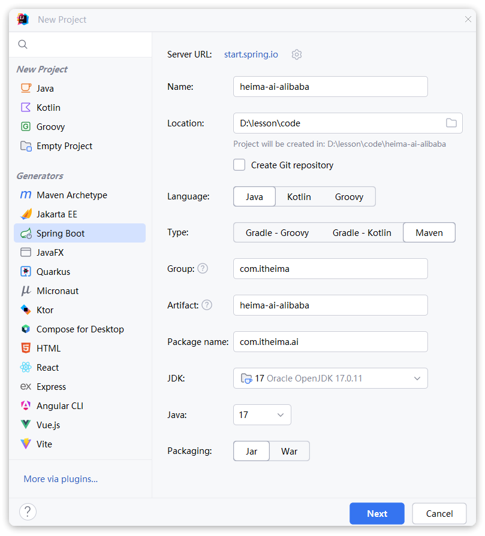
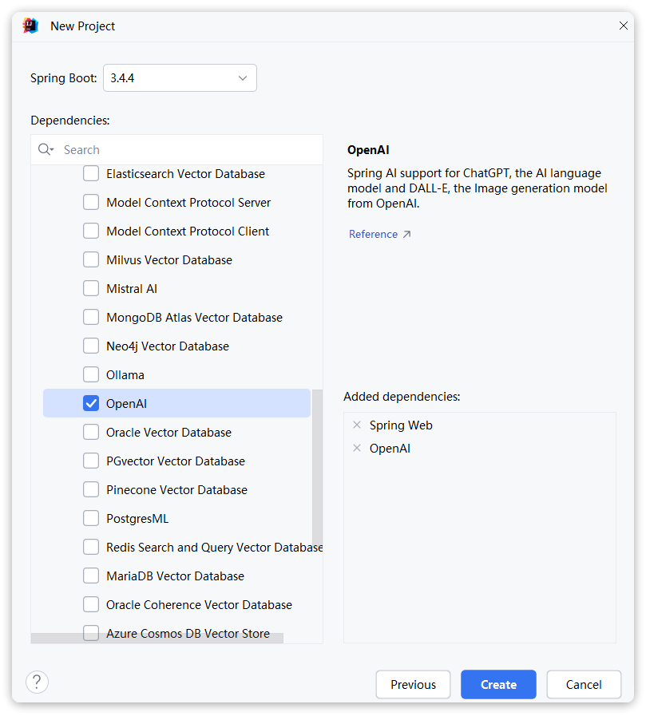
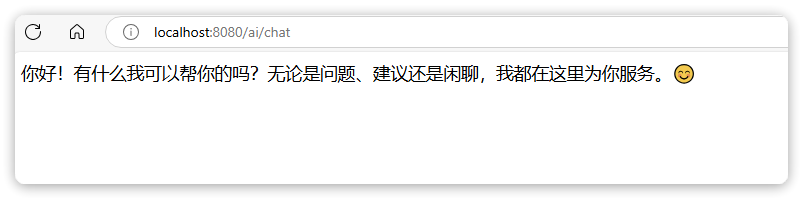
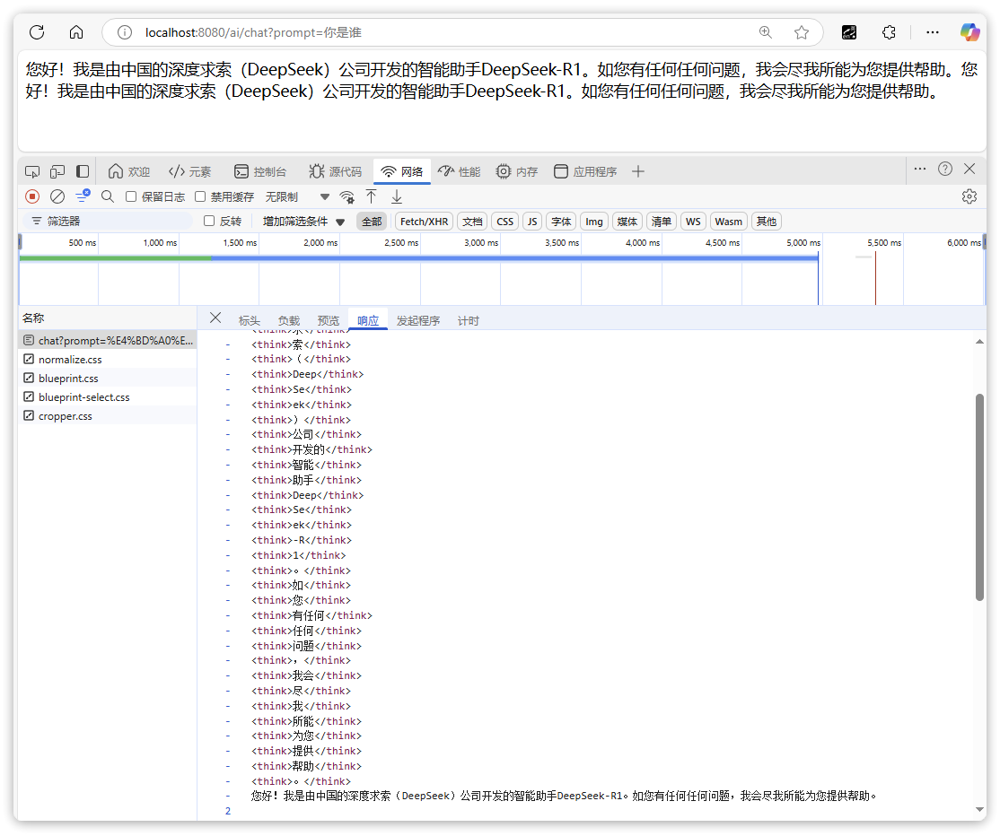
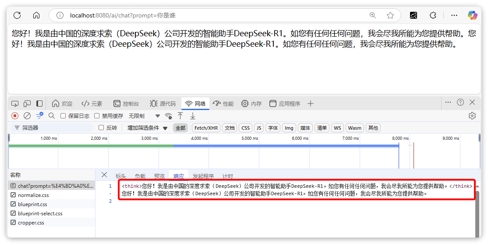

# 拓展-Spring AI Alibaba

之前我们对接阿里云百炼平台一直都是用SpringAI中的OpenAI模块，不过由于阿里云百炼与OpenAI之间并不是完全兼容，所以还存在许多问题。


为了更好的与阿里云百炼平台对接，同时又能兼容SpringAI，阿里巴巴官方就在SpringAI的基础上推出了自己的集成API，Spring AI Alibaba.

<readonly-block href="https://java2ai.com/" type="iframe"></readonly-block>


接下来，我们一起来看下如何使用Spring AI Alibaba对接百炼平台。


## 快速入门

接下来我们通过一个快速入门案例，学习如何对接Spring AI Alibaba.


### 创建工程

首先，我们创建一个SpringBoot工程：


> 图注：这张图片是创建SpringBoot工程的“New Project”窗口，位于文档说明的创建工程步骤中。窗口左侧的Generators区域已选中“Spring Boot”选项，右侧展示了项目创建的相关配置项，其中项目名称（Name）设为“heima-ai-alibaba”，项目存储位置（Location）为指定的本地路径，语言（Language）选择了Java，构建工具（Type）选择Maven，组（Group）、构件（Artifact）、包名（Package name）等配置也已填入，JDK选用17版本，打包方式（Packaging）选了Jar，底部有Next和Cancel操作按钮，与文档中创建工程、选择依赖的内容相呼应。

点击**next**，选择依赖：


> 图注：图片展示的是IntelliJ IDEA中创建Spring Boot工程时的依赖选择界面。在“Dependencies”区域，左侧有多个数据库相关选项，如Elasticsearch Vector Database等，其中“OpenAI”选项被勾选。右侧显示已添加的依赖为“Spring Web”和“OpenAI”。该图片与上下文紧密相关，上下文提到在创建SpringBoot工程时，需点击“next”选择依赖，此图直观呈现了选择依赖时的界面及已勾选的“OpenAI”选项，帮助用户了解如何进行依赖选择操作。

依赖我们选择两个，一个是**Spring Web**依赖，另一个是**AI**依赖。由于SpringAI默认不支持alibaba的百炼，所以我们先勾选**OpenAI**依赖，等会儿再修改。

点击create，项目创建完成。


### 引入依赖

接下来，我们用alibaba的依赖取代OpenAI：

```XML
<!--注释或删除OpenAI依赖-->
<!--<dependency>
    <groupId>org.springframework.ai</groupId>
    <artifactId>spring-ai-openai-spring-boot-starter</artifactId>
</dependency>-->

<!--引入Alibaba的AI依赖-->
<dependency>
    <groupId>com.alibaba.cloud.ai</groupId>
    <artifactId>spring-ai-alibaba-starter</artifactId>
    <version>1.0.0-M6.1</version>
</dependency>
```


### 配置文件

接下来，理论上说，我们同样需要配置模型的关键信息：

- API_KEY
- BASE_URL
- 模型名称和参数等


不过，由于**Spring AI Alibaba**默认已经设定好了url路径，所以BASE_URL就可以省略了。


我们修改**application.yml**配置， 内容如下：

```YAML
spring:
  application:
    name: heima-ai-alibaba
  ai:
    dashscope: # 这里的dashscope就是阿里云百炼的默认接口规范
      api-key: ${ALIBABA_API_KEY} # 同样通过环境变量来设置
      chat:
        options:
          model: deepseek-r1 # 模型名称
logging:
  level:
    com.itheima.ai: debug
    org.springframework.ai: debug
```


### 配置ChatClient

接下来，同样是配置ChatClient，我们在`com.itheima.ai.config`包下新建一个`CommonConfiguration`类，代码如下：

```Java
package com.itheima.ai.config;

import com.alibaba.cloud.ai.dashscope.chat.DashScopeChatModel;
import org.springframework.ai.chat.client.ChatClient;
import org.springframework.ai.chat.client.advisor.MessageChatMemoryAdvisor;
import org.springframework.ai.chat.client.advisor.SimpleLoggerAdvisor;
import org.springframework.ai.chat.memory.ChatMemory;
import org.springframework.ai.chat.memory.InMemoryChatMemory;
import org.springframework.context.annotation.Bean;
import org.springframework.context.annotation.Configuration;

@Configuration
public class CommonConfiguration {
    
    @Bean
    public ChatMemory chatMemory() {
        return new InMemoryChatMemory();
    }

    @Bean
    public ChatClient chatClient(
        DashScopeChatModel chatModel, ChatMemory chatMemory) {
        return ChatClient
                .builder(chatModel)
                .defaultAdvisors(
                        new SimpleLoggerAdvisor(),
                        new MessageChatMemoryAdvisor(chatMemory)
                )
                .build();
    }
}
```


<callout emoji="❗">
**注意：**
阿里云百炼提供的对话模型是`DashScopeChatModel`，所以配置`ChatClient`的时候注入的也是这个。
</callout>


### 对话接口

接下来，我们来定义对话接口。

在`com.itheima.ai.controller`包下新建一个`ChatController`类，代码如下：

```Java
package com.itheima.ai.controller;

import lombok.RequiredArgsConstructor;
import org.springframework.ai.chat.client.ChatClient;
import org.springframework.web.bind.annotation.RequestMapping;
import org.springframework.web.bind.annotation.RequestParam;
import org.springframework.web.bind.annotation.RestController;
import reactor.core.publisher.Flux;

@RequiredArgsConstructor
@RestController
@RequestMapping("/ai")
public class ChatController {

    private final ChatClient chatClient;

    @RequestMapping(value = "/chat", produces = "text/html;charset=utf-8")
    public Flux<String> chat(
            @RequestParam(value = "prompt", defaultValue = "你好") String prompt) {
        return chatClient.prompt()
                .user(prompt)
                .stream()
                .content();
    }
}
```


### 测试

启动项目，打开浏览器，访问：http://localhost:8080/ai/chat


> 图注：图片展示的是在浏览器中访问http://localhost:8080/ai/chat后的界面。界面上方显示网址为“localhost:8080/ai/chat”。下方文本框内容为“你好！有什么我可以帮你的吗？无论是问题、建议还是闲聊，我都在这里为你服务。”并配有笑脸表情。该图片与文档中“测试”部分对应，直观呈现了项目启动后通过访问指定URL所看到的聊天界面，验证了配置和代码实现的效果。


## 推理模型

像DeepSeek-R1这样的模型具备深度思考能力，并且在输出结果中包含模型本身的推理、思考流程。我们称这样的模型为**推理模型** (**Reasoning Model**) 。

阿里云百炼有满血版的DeepSeek-R1模型，不仅如此，阿里云百炼也有自己的推理模型：**qwq-plus。**


推理模型相比普通对话模型，其响应结果比较特殊。下面我们一起分析一下。


### 模型响应格式

推理模型由于返回结果中包含两部分内容：

- 思考流程
- 响应结果

因此，推理模型的响应格式比较特殊:

```JSON
{
  "choices": [
    {
      "message": {
        "content": "9.9比9.11大。",
        "reasoning_content": "\n嗯，用户问的是9.9和9.11谁大。这个问题看起来好像挺简单的，但可能有些小陷阱，特别是涉及到小数点的比较。首先，我需要确认用户是否在问数字的大小比较，还是有没有其他可能的含义，比如日期之类的。不过根据数字的写法，应该是数字比较。...\n",
        "role": "assistant"
      },
      "finish_reason": "stop",
      "index": 0,
      "logprobs": null
    }
  ],
  "object": "chat.completion",
  "usage": {
    "prompt_tokens": 19,
    "completion_tokens": 797,
    "total_tokens": 816
  },
  "created": 1739069910,
  "system_fingerprint": null,
  "model": "deepseek-r1",
  "id": "chatcmpl-e55cdb8a-9ce1-9662-b87c-cf3da706e4f3"
}
```


注意，在message中包含两部分内容：

- content：响应结果
- reasoning_content：思考过程


### 自定义Advisor处理思考过程

SpringAI的当前版本还不支持推理模型，或者换句话说，不处理响应结果中的思考过程（reasoning_content）。所以默认是看不到思考内容的。


Spring AI Alibaba提供了对思考过程的处理，同时把**reasoning_content**放到了**ChatResponse**中的**Metadata**中。

因此，我们需要自定义Advisor，把metadata中的**reasoning_content**取出来，放到普通content中返回。


这里给大家提供两个版本的Advisor：

- **版本1**：阿里巴巴官方文档中提供的，在stream模式下思维链会呈现片段化，如图：

  ```Java
  $ curl http://localhost:10002/qwq/chat-client/stream/chat
  
  <think>好的，用户让我</think>
  <think>介绍自己，我之前</think>
  <think>已经回答过一次了</think>
  <think>，现在又问</think>
  <think>同样的问题。用户</think>
  <think>可能是想再确认一下</think>
  <think>我的功能，或者需要</think>
  <think>更详细的介绍？</think>
  <think>也有可能他们想</think>
  <think>测试我的一致性hink>
  <think>又全面，同时保持简洁</think>
  <think>。首先，回顾之前的回答</think>
  <think>，已经涵盖了基本</think>
  <think>功能、支持的语言、应用场景</think>
  <think>。这次可能需要添加</think>
  <think>一些信息，比如</think>
  <think>最近的更新或者</think>
  <think>更多例子，让用户</think>
  <think>觉得有新内容</think>
  <think>。不过根据指示</think>
  <think>，不能编造新</think>
  <think>功能，所以只能</think>
  <think>在原有基础上调整</think>
  <think>结构或补充细节。</think>
  <think>用户可能希望了解我的应用场景</think>
  <think>，或者想确认</think>
  <think>我的能力是否符合他们的</think>
  <think>需求。需要强调</think>
  <think>我的多语能力和</think>
  <think>具体应用实例，比如编程</think>
  <think>、逻辑推理等。</think>
  <think>另外，可以加入</think>
  <think>一些鼓励用户提问的</think> >
  <think>语句，促进进一步互动</think>
  <think>。检查是否有需要</think>
  <think>避免的内容，比如不</think>
  <think>提及未实现的功能。</think>
  <think>确保语气友好，使用</think>
  <think>表情符号增加亲切</think>
  <think>。最后，保持回答自然</think>
  <think>流畅，避免重复之前的</think>
  <think>结构，但信息</think>
  <think>要准确一致。</think>
  
  你好！我是是义千问（Qwen），阿里巴巴集团旗下的超大规模语言模型。我能够帮助你完成各种任务，比如：
  
  - **回答问题**：无论是常识、专业知识，还是复杂问题，我都会尽力为你解答。
  - **创作文字**：写故事、公文、邮件、剧本、诗歌等，我都可以尝试。
  - **逻辑与编程**：解决数学问题、编写代码、进行逻辑推理。
  - **多语言支持**：除了中文，我还支持英文、德语、法语、西班牙语等多种语言。
  - **表达观点与互动**：聊日常话题、玩游戏，甚至讨论观点。
  
  我的目标是成为一位全能的AI助手，无论你需要学习、工作还是娱乐上的帮助，我都会用友好且实用的方式回应你。有什么需要我帮忙的吗？😊
  ```
- **版本2**：自定义版本，在stream模式下，思维链还是一个整体：

  ```Java
  $ curl http://localhost:10002/qwq/chat-client/stream/chat
  
  <think>好的，用户让我介绍自己，我之前已经回答过一次了，现在又问同样的问题。用户可能是想再确认一下我的功能，或者需要更详细的介绍？也有可能他们想测试我的一致性。首先，回顾之前的回答，已经涵盖了基本功能、支持的语言、应用场景。这次可能需要添加一些信息，比如最近的更新或者更多例子，让用户觉得有新内容。不过根据指示，不能编造新功能，所以只能在原有基础上调整结构或补充细节。用户可能希望了解我的应用场景，或者想确认我的能力是否符合他们的需求。需要强调我的多语能力和具体应用实例，比如编程、逻辑推理等。另外，可以加入一些鼓励用户提问的语句，促进进一步互动。检查是否有需要避免的内容，比如不提及未实现的功能。确保语气友好，使用表情符号增加亲切。最后，保持回答自然流畅，避免重复之前的结构，但信息要准确一致。</think>
  
  你好！我是是义千问（Qwen），阿里巴巴集团旗下的超大规模语言模型。我能够帮助你完成各种任务，比如：
  
  - **回答问题**：无论是常识、专业知识，还是复杂问题，我都会尽力为你解答。
  - **创作文字**：写故事、公文、邮件、剧本、诗歌等，我都可以尝试。
  - **逻辑与编程**：解决数学问题、编写代码、进行逻辑推理。
  - **多语言支持**：除了中文，我还支持英文、德语、法语、西班牙语等多种语言。
  - **表达观点与互动**：聊日常话题、玩游戏，甚至讨论观点。
  
  我的目标是成为一位全能的AI助手，无论你需要学习、工作还是娱乐上的帮助，我都会用友好且实用的方式回应你。有什么需要我帮忙的吗？😊
  ```


#### 官方版本


在`com.itheima.ai.advisor`包下新建一个`ReasoningContentAdvisor`类:

```Java
package com.itheima.ai.advisors;

import lombok.extern.slf4j.Slf4j;
import org.springframework.ai.chat.client.advisor.api.AdvisedRequest;
import org.springframework.ai.chat.client.advisor.api.AdvisedResponse;
import org.springframework.ai.chat.client.advisor.api.BaseAdvisor;
import org.springframework.ai.chat.messages.AssistantMessage;
import org.springframework.ai.chat.model.ChatResponse;
import org.springframework.ai.chat.model.Generation;
import org.springframework.util.StringUtils;

import javax.validation.constraints.NotNull;
import java.util.List;
import java.util.Objects;

@Slf4j
public class ReasoningContentAdvisor implements BaseAdvisor {

    private final int order;

    public ReasoningContentAdvisor(Integer order) {
        this.order = order != null ? order : 0;
    }

    @NotNull
    @Override
    public AdvisedRequest before(@NotNull AdvisedRequest request) {

        return request;
    }

    @NotNull
    @Override
    public AdvisedResponse after(AdvisedResponse advisedResponse) {

        ChatResponse resp = advisedResponse.response();
        if (Objects.isNull(resp)) {

            return advisedResponse;
        }
        String reasoningContent = String.valueOf(resp.getResults().get(0).getOutput().getMetadata().get("reasoningContent"));

        if (StringUtils.hasText(reasoningContent)) {
            List<Generation> thinkGenerations = resp.getResults().stream()
                    .map(generation -> {
                        AssistantMessage output = generation.getOutput();
                        AssistantMessage thinkAssistantMessage = new AssistantMessage(
                                String.format("<think>%s</think>", reasoningContent) + output.getText(),
                                output.getMetadata(),
                                output.getToolCalls(),
                                output.getMedia()
                        );
                        return new Generation(thinkAssistantMessage, generation.getMetadata());
                    }).toList();

            ChatResponse thinkChatResp = ChatResponse.builder().from(resp).generations(thinkGenerations).build();
            return AdvisedResponse.from(advisedResponse).response(thinkChatResp).build();

        }

        return advisedResponse;
    }

    @Override
    public int getOrder() {

        return this.order;
    }

}
```


#### 自定义版本

如果要使用自定义版本，请先删除官方版本的`ReasoningContentAdvisor`。


在`com.itheima.ai.advisor`包下新建一个`ReasoningContentAdvisor`类:

```Java
package com.itheima.ai.advisors;

import lombok.extern.slf4j.Slf4j;
import org.springframework.ai.chat.client.advisor.api.AdvisedRequest;
import org.springframework.ai.chat.client.advisor.api.AdvisedResponse;
import org.springframework.ai.chat.client.advisor.api.BaseAdvisor;
import org.springframework.ai.chat.messages.AssistantMessage;
import org.springframework.ai.chat.model.ChatResponse;
import org.springframework.ai.chat.model.Generation;
import org.springframework.util.StringUtils;

import javax.validation.constraints.NotNull;
import java.util.List;
import java.util.Objects;

@Slf4j
public class ReasoningContentAdvisor implements BaseAdvisor {


    private final int order;

    private final ThreadLocal<Boolean> isThinking = ThreadLocal.withInitial(() -> false);

    public ReasoningContentAdvisor(Integer order) {
        this.order = order != null ? order : 0;
    }

    @NotNull
    @Override
    public AdvisedRequest before(@NotNull AdvisedRequest request) {

        return request;
    }

    @NotNull
    @Override
    public AdvisedResponse after(AdvisedResponse advisedResponse) {

        ChatResponse resp = advisedResponse.response();
        if (Objects.isNull(resp)) {

            return advisedResponse;
        }
        String reasoningContent = String.valueOf(resp.getResults().get(0).getOutput().getMetadata().get("reasoningContent"));
        String textContent = resp.getResults().get(0).getOutput().getText();

        if (StringUtils.hasText(reasoningContent)) {
            if (!isThinking.get()) {
                reasoningContent = "<think>" + reasoningContent;
                isThinking.set(true);
            }
            return AdvisedResponse.from(advisedResponse)
                    .response(
                            ChatResponse.builder()
                                    .from(resp)
                                    .generations(rebuildGeneration(resp, reasoningContent + textContent))
                                    .build())
                    .build();
        }

        if (isThinking.get()) {
            isThinking.set(false);
            return AdvisedResponse.from(advisedResponse)
                    .response(
                            ChatResponse.builder()
                                    .from(resp)
                                    .generations(rebuildGeneration(resp, reasoningContent + "</think>" + textContent))
                                    .build())
                    .build();
        }
        return advisedResponse;
    }

    private static List<Generation> rebuildGeneration(ChatResponse resp, String message) {
        return resp.getResults().stream()
                .map(generation -> {
                    AssistantMessage output = generation.getOutput();
                    log.debug("output: {}", output);
                    AssistantMessage thinkAssistantMessage = new AssistantMessage(message,
                            output.getMetadata(),
                            output.getToolCalls(),
                            output.getMedia()
                    );
                    return new Generation(thinkAssistantMessage, generation.getMetadata());
                }).toList();
    }

    @Override
    public int getOrder() {

        return this.order;
    }

}
```


<callout emoji="❗">
**注意:**
当前版本是基于ThreadLocal存储思考标记，可能存在内存占用或线程安全风险，请谨慎使用。
</callout>


### 配置Advisor

接下来，我们配置Advisor到ChatClient.


修改`CommonConfiguration`中的`ChatClient`配置：

```Java
@Bean
public ChatClient chatClient(DashScopeChatModel chatModel, ChatMemory chatMemory) {
    return ChatClient
            .builder(chatModel)
            .defaultAdvisors(
                    new SimpleLoggerAdvisor(),
                    new ReasoningContentAdvisor(0),
                    new MessageChatMemoryAdvisor(chatMemory)
            )
            .build();
}
```


### 2.4.测试

重启测试，可以看到响应结果的变化.


官方Advisor效果：


> 图注：图片展示了在浏览器开发者工具中查看ChatClient响应结果的界面。上方显示“你好！我是由中国的深度求索（DeepSeek）公司开发的智能助手DeepSeek R1，如您有任何任何问题，我会尽我所能为您提供帮助。”下方是响应的HTML代码，包括多个“<script>”标签，其中包含“chatPrompt”等代码。该图片与文档中测试配置Advisor到ChatClient后响应结果变化的内容相关，直观呈现了测试后的响应内容。


自定义Advisor效果：


> 图注：这张截图展示了浏览器中发起请求并获取响应的页面内容，页面显示由中国深度求索（DeepSeek）公司开发的智能助手DeepSeek-R1的两次相同问候语，下方开发者工具的“网络”面板中，对应请求的响应内容被红框标注，响应文本同样是两次重复的问候语，与页面显示的内容一致，该内容是配置Advisor后测试时产生的官方Advisor效果与自定义Advisor效果的实际运行结果，直观呈现了相关配置生效后的助手响应表现。


## 其它模型

如果大家想要使用阿里云百炼的其它模型，可以参考官方的示例代码：

<readonly-block href="https://java2ai.com/cloud/?spm=5176.29160081.0.0.2856aa5cExVdxQ" type="iframe"></readonly-block>

---
> 来源：飞书技术知识库（脱敏版） · 06 AI 应用开发 / Spring AI Alibaba 与 MCP / 拓展-Spring AI Alibaba · [原文](https://ccn8v2zngwsm.feishu.cn/wiki/V2C5ww0hNiZgU9kQQ0KceY76nJc)
