# 01.SpringAI (V1.0.0) 快速入门

## 大模型服务


### 公共大模型-DeepSeek


官方平台地址：

<bookmark name="DeepSeek Platform" href="https://platform.deepseek.com/"></bookmark>

#### 注册

首次访问，必须注册：

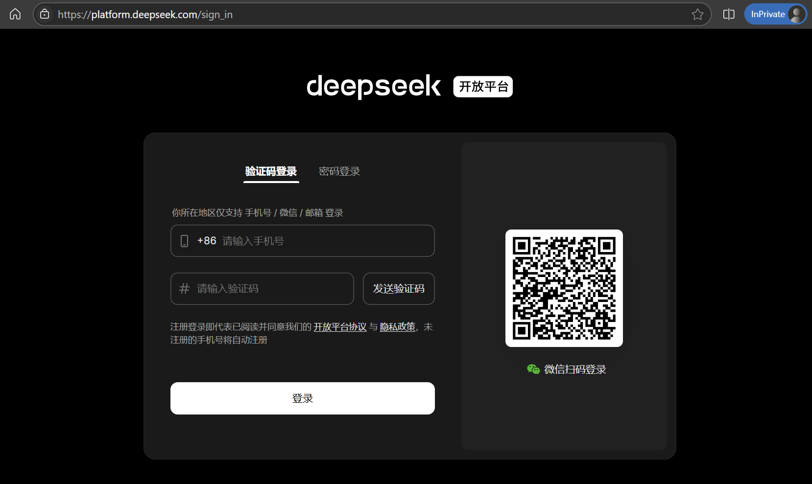


#### 充值

DeepSeek官方对外提供的大模型API服务是需要收费的，因此我们必须注册账号，充值少量金额（1元也行）。


注册成功后即可进入平台管理页面，点击**充值**选项，进入充值页面：

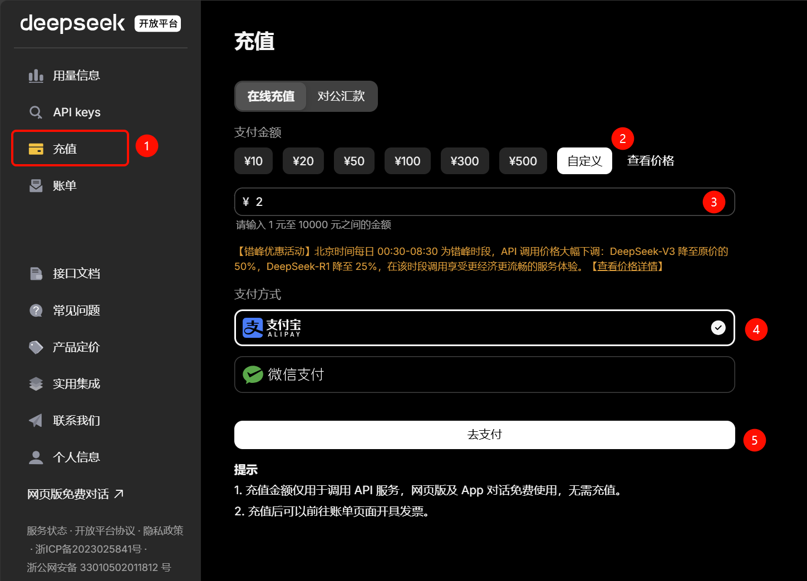

选择合适的价格充值后，即可使用DeepSeek的官方API服务。


#### 创建API_KEY

由于是收费服务，为了防止别人盗用你的账号，DeepSeek的所有API都有权限校验功能。我们需要创建一个鉴权用的`API_KEY`可以。


点击**API Keys**选项卡，进入对应页面。第一次进入应该没有API key，可以点击创建`API key`:


<callout emoji="❗">
**注意**：API key只有在创建时可以查看，以后都无法查看了。所以需要在创建时妥善保管自己的API key
</callout>


OK，准备工作完成。

#### API文档

访问公共大模型都是通过API的形式，不同模型的API标准略有差异，但基本都兼容OpenAI规范。


接下来，我们一起学习DeepSeek的官方API文档。地址如下：

<readonly-block href="https://api-docs.deepseek.com/zh-cn/" type="iframe"></readonly-block>


可以看到，在文档中有这样一段调用对话的API示例：

```Bash
curl https://api.deepseek.com/chat/completions \
  -H "Content-Type: application/json" \
  -H "Authorization: Bearer <DeepSeek API Key>" \
  -d '{
        "model": "deepseek-chat",
        "messages": [
          {"role": "system", "content": "You are a helpful assistant."},
          {"role": "user", "content": "Hello!"}
        ],
        "stream": false
      }'
```

这段信息就描述了调用DeepSeek大模型的API要求：

- **请求URL**：https://api.deepseek.com/chat/completions
- **请求头**：

  - Content-Type: application/json，请求参数的格式，必须是application/json
  - Authorization: Bearer <DeepSeek API Key>，上一节创建的API_KEY
- **请求体**：json格式，稍后解释

  ```JSON
  {
      "model": "deepseek-chat",
      "messages": [
        {"role": "system", "content": "You are a helpful assistant."},
        {"role": "user", "content": "Hello!"}
      ],
      "stream": false
  }
  ```
- **请求方式**：虽然没说，但是由于带请求体，所以这里用POST方式


#### 测试

我们可以使用任意的Http客户端来测试API：


### 公共大模型平台-阿里巴巴百炼


我们以阿里云百炼平台为例。

#### 注册账号

首先，我们需要注册一个阿里云账号：

<bookmark name="阿里云登录 - 欢迎登录阿里云，安全稳定的云计算服务平台" href="https://account.aliyun.com/"></bookmark>

然后访问百炼平台，开通服务：

<bookmark name="大模型服务平台百炼_企业级大模型开发平台_百炼AI应用构建-阿里云" href="https://www.aliyun.com/product/bailian?spm=5176.29677750.nav-v2-dropdown-menu-1.d_main_0_6.6b44154amuN66a&amp;scm=20140722.M_sfm.P_197.ID_sfm-OR_rec-V_1-MO_3480-ST_12892"></bookmark>

首次开通应该会赠送百万token的使用权，包括DeepSeek-R1模型、qwen模型。


#### 申请API_KEY

注册账号以后还需要申请一个API_KEY才能访问百炼平台的大模型。


注册成功后进入阿里云百炼首页，点击模型：

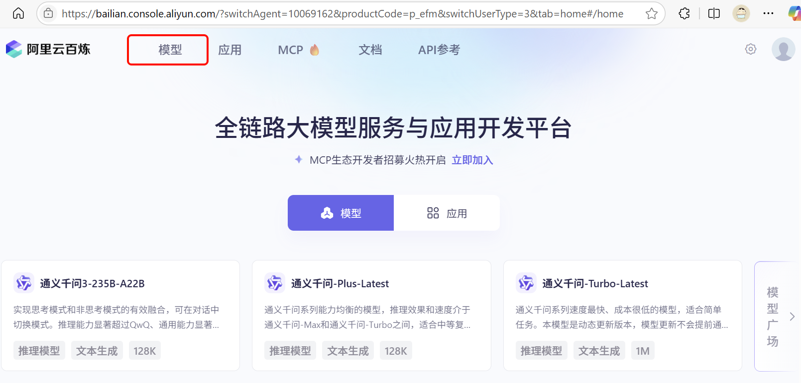


在阿里云百炼平台的左侧菜单的最下方，有一个API-Key选项：

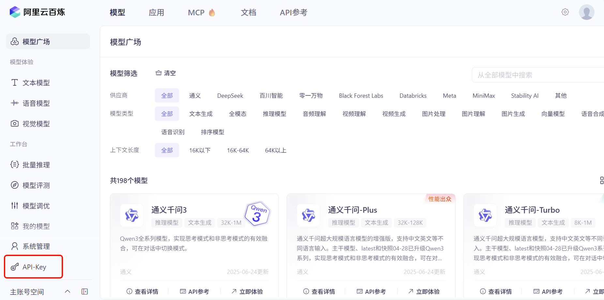


点击后，进入API-Key管理页面，点击创建`API-KEY`：

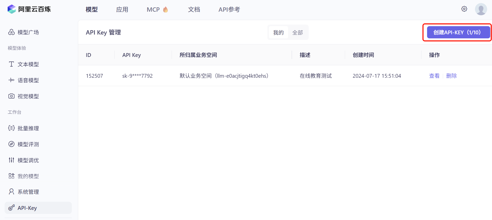

选择`创建API-KEY`后，会弹出表单：

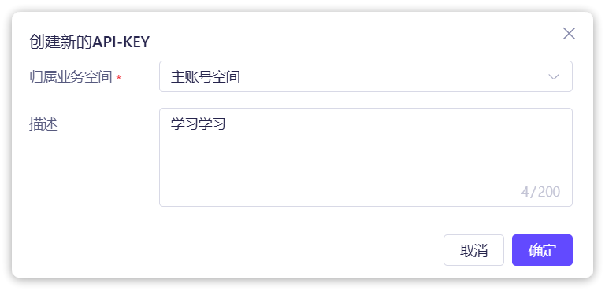

填写完毕，点击确定，即可生成一个新的`API-KEY`：

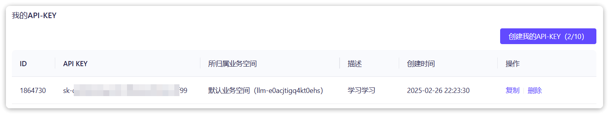

后续开发中就需要用到这个`API-KEY`了，一定要记牢。而且要保密，不能告诉别人。


#### 体验模型

访问百炼平台，点击模型：


即可进入模型广场：

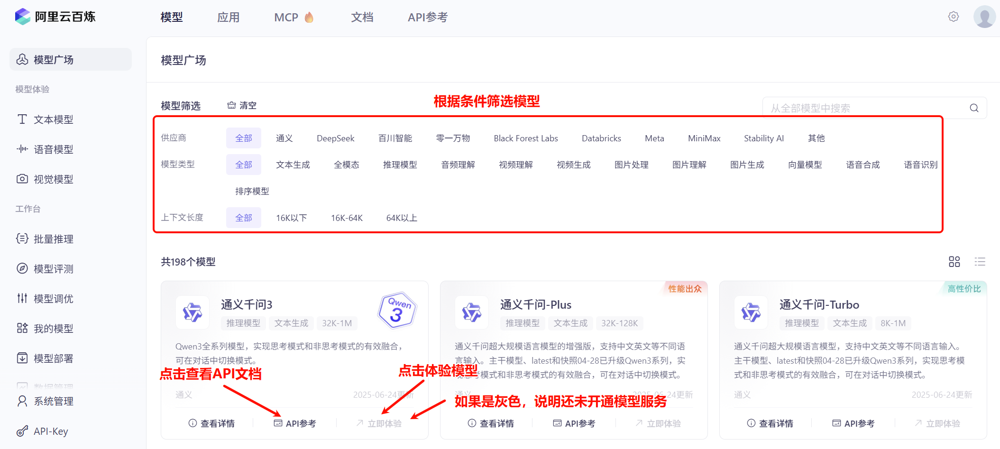


#### API文档

点击API参考即可进入API文档页面：


#### 测试

点击《**立即体验》**即可体验大模型。


如果立即体验是灰色，说明尚未开通模型服务。鼠标悬停在**《立即体验》**按钮，会弹出模型列表，鼠标悬停模型列表中任意模型，会弹出未开通提示：

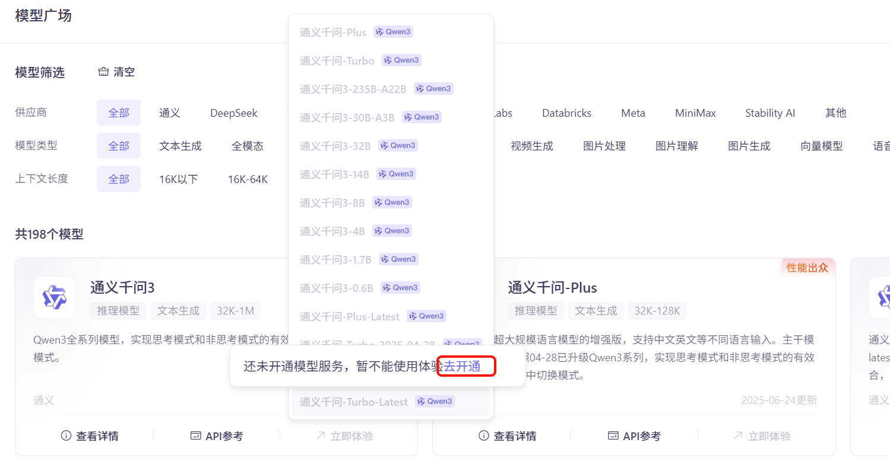

点击去开通，会弹出开通提示：

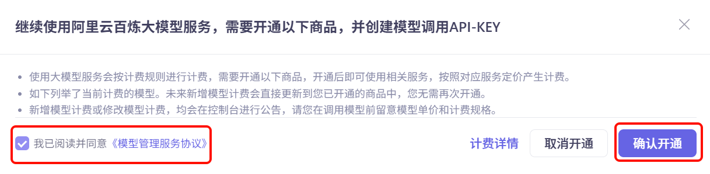

勾选**同意**协议，然后点击**《确认开通》，**稍等片刻即可。


开通后需要刷新页面。

开通后需要刷新页面。

开通后需要刷新页面。  

鼠标悬停《立即体验》按钮，在弹出的模型列表中任意选择一个，即可进入体验页面：

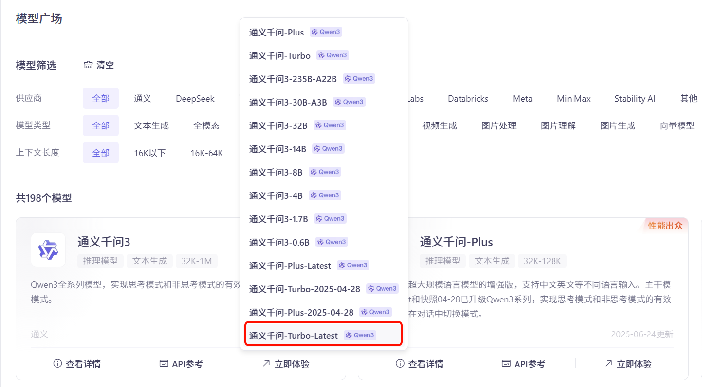

点击某个模型，就可以进入API调用大模型的试验台：

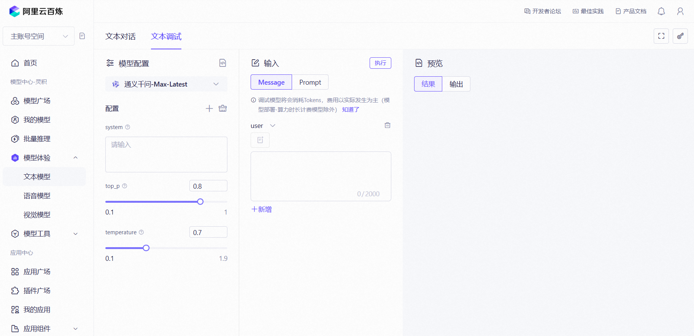

在这里就可以模拟调用大模型接口了。


当然，我们也可以使用任意Http客户端来调试：

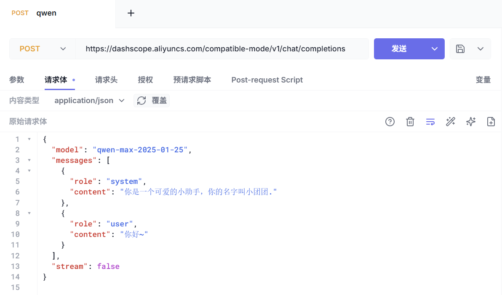


### 本地部署

很多云平台都提供了一键部署大模型的功能，这里不再赘述。我们重点讲讲如何手动部署大模型。


手动部署最简单的方式就是使用Ollama，这是一个帮助你部署和运行大模型的工具。官网如下：

<bookmark name="Ollama" href="https://ollama.com/"></bookmark>

国内可访问

<bookmark name="Ollama - Ollama 框架" href="https://ollama.ac.cn/"></bookmark>

#### 下载安装ollama

首先，我们需要下载一个Ollama的客户端，在官网提供了各种不同版本的Ollama，大家可以根据自己的需要下载。

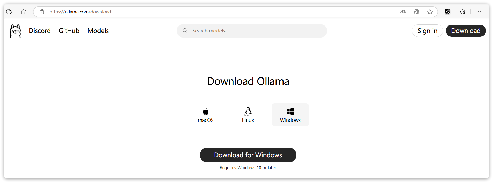

下载后双击即可安装，这里不再赘述。

<callout emoji="❗">
**注意：**
Ollama默认安装目录是C盘的用户目录，如果**不希望安装在C盘**的话（其实C盘如果足够大放C盘也没事），就不能直接双击安装了。需要通过**命令行安装**。
</callout>

命令行安装方式如下：

在OllamaSetup.exe所在目录打开cmd命令行，然后命令如下： 

```Bash
OllamaSetup.exe /DIR=你要安装的目录位置
```

OK，安装完成后，还需要配置一个环境变量，更改Ollama下载和部署模型的位置。环境变量如下：

```Bash
OLLAMA_MODELS=你想要保存模型的目录
```

环境变量配置方式相信学过Java的都知道，这里不再赘述，配置完成如图：

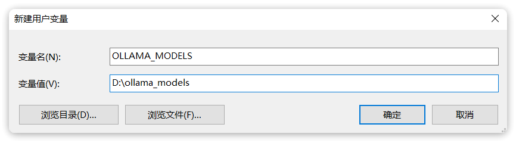


#### 搜索模型

ollama是一个模型管理工具和平台，它提供了很多国内外常见的模型，我们可以在其官网上搜索自己需要的模型：

<bookmark name="Ollama Search" href="https://ollama.com/search"></bookmark>

如图，目前热度排第一的就是deepseek-r1：

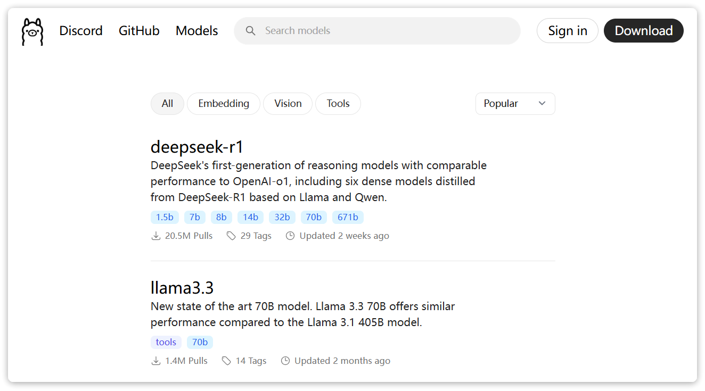

点击进入deepseek-r1页面，会发现deepseek-r1也有很多版本：

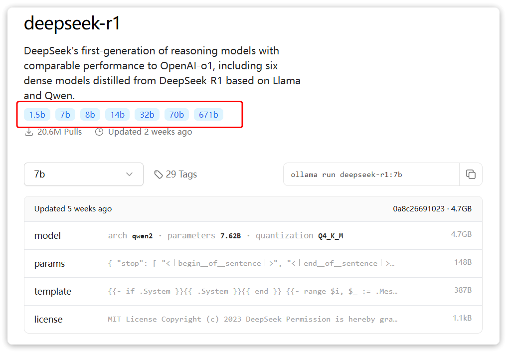


这些就是模型的参数大小，越大推理能力就越强，需要的算力也越高。671b版本就是最强的满血版deepseek-r1了。需要注意的是，Ollama提供的DeepSeek是量化压缩版本，对比官网的蒸馏版会更小，对显卡要求更低。对比如下：

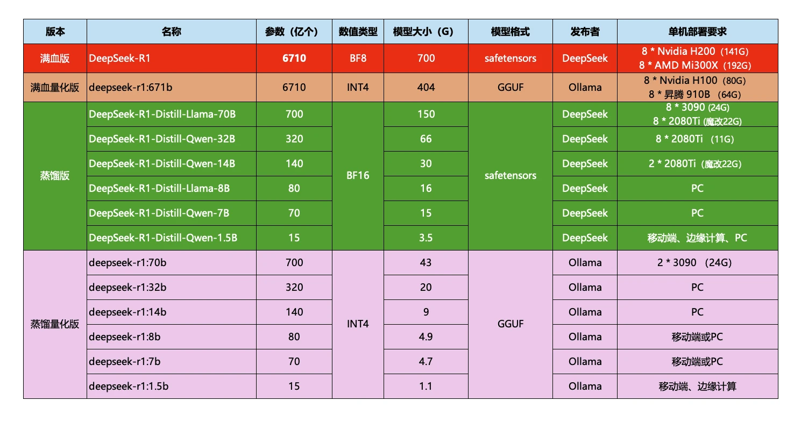

比如，我的电脑内存32G，显存是6G，我选择部署的是7b的模型，当然8b也是可以的，差别不大，都是可以流畅运行的。


#### 运行模型

选择自己合适的模型后，ollama会给出运行模型的命令：

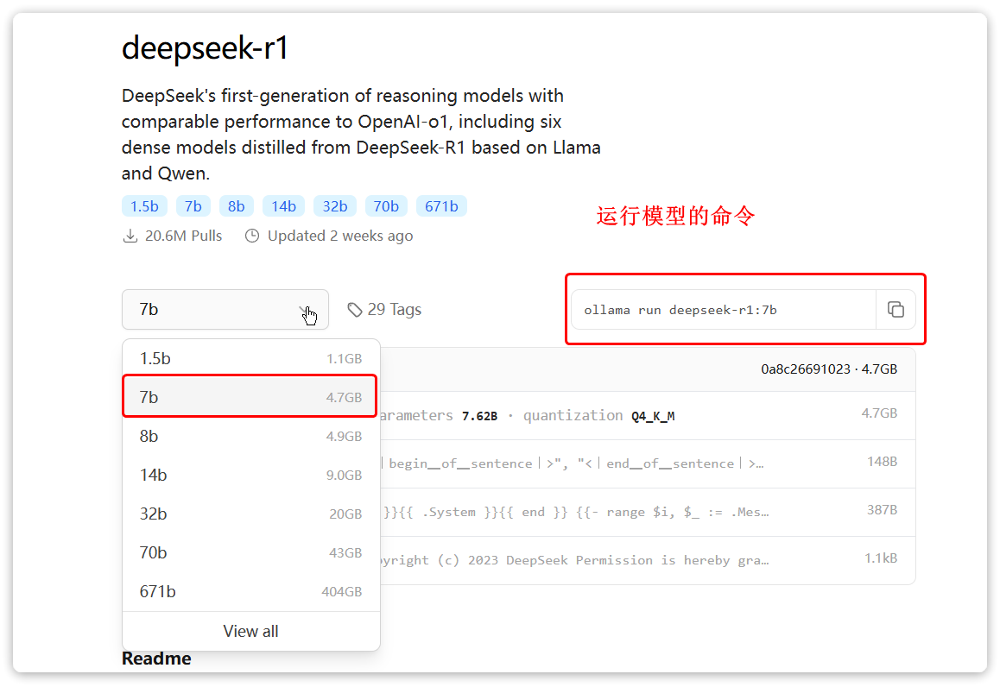

复制这个命令，然后打开一个cmd命令行，运行命令即可，然后你就可以跟本地模型聊天了：

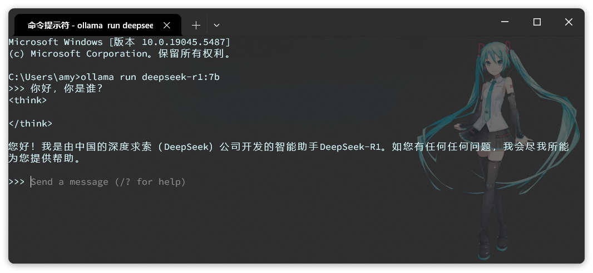

<callout emoji="❗">
**注意：**
- 首次运行命令需要下载模型，根据模型大小不同下载时长在5分钟\~1小时不等，请耐心等待下载完成。
- ollama控制台是一个封装好的AI对话产品，与ChatGPT类似，具备会话记忆功能。
</callout>


Ollama是一个模型管理工具，有点像Docker，而且命令也很像，比如：

```Bash
  ollama serve      # Start ollama
  ollama create     # Create a model from a Modelfile
  ollama show       # Show information for a model
  ollama run        # Run a model
  ollama stop       # Stop a running model
  ollama pull       # Pull a model from a registry
  ollama push       # Push a model to a registry
  ollama list       # List models
  ollama ps         # List running models
  ollama cp         # Copy a model
  ollama rm         # Remove a model
  ollama help       # Help about any command
```

### 在apifox中使用openAI协议调用大模型

#### 在API Hub中克隆接口

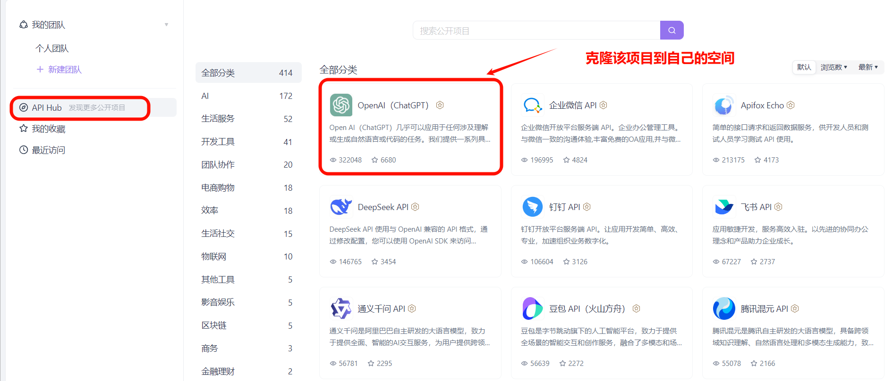

#### 配置环境

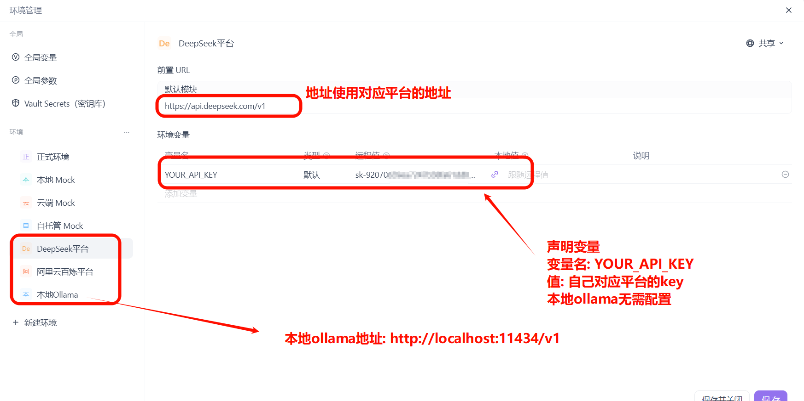

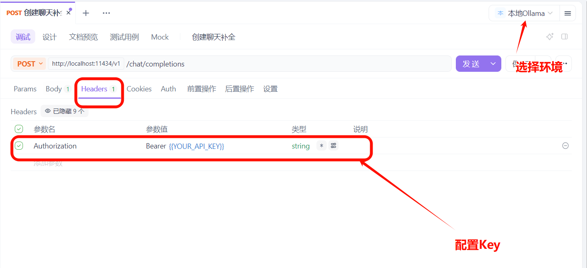

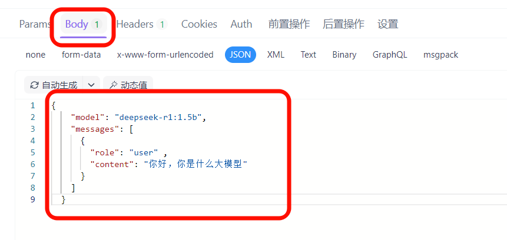

## SpringAI入门

SpringAI整合了全球（主要是国外）的大多数大模型，而且对于大模型开发的三种技术架构都有比较好的封装和支持，开发起来非常方便。


不同的模型能够接收的输入类型、输出类型不一定相同。SpringAI根据模型的输入和输出类型不同对模型进行了分类：

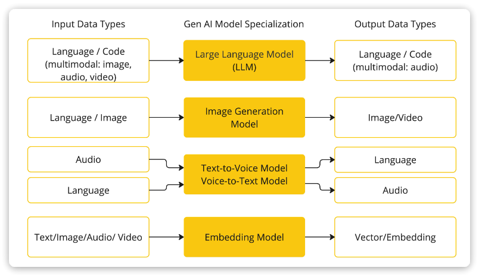

大模型应用开发大多数情况下使用的都是基于**对话模型**（Chat Model)，也就是输出结果为自然语言或代码的模型。


目前SpringAI支持的大约19种对话模型，以下是一些功能对比：

| **Provider** | **Multimodality** | **Tools/Functions** | **Streaming** | **Retry** | **Built-in JSON** | **Local** | **OpenAI API Compatible** |
|-|-|-|-|-|-|-|-|
| [Anthropic Claude](https://docs.spring.io/spring-ai/reference/api/chat/anthropic-chat.html) | text, pdf, image | ✔ | ✔ | ✔ | ❌ | ❌ | ❌ |
| [Azure OpenAI](https://docs.spring.io/spring-ai/reference/api/chat/azure-openai-chat.html) | text, image | ✔ | ✔ | ✔ | ✔ | ❌ | ✔ |
| [DeepSeek   (OpenAI-proxy)](https://docs.spring.io/spring-ai/reference/api/chat/deepseek-chat.html) | text | ❌ | ✔ | ✔ | ✔ | ✔ | ✔ |
| [Google VertexAI   Gemini](https://docs.spring.io/spring-ai/reference/api/chat/vertexai-gemini-chat.html) | text, pdf, image, audio, video | ✔ | ✔ | ✔ | ✔ | ❌ | ✔ |
| [Groq (OpenAI-proxy)](https://docs.spring.io/spring-ai/reference/api/chat/groq-chat.html) | text, image | ✔ | ✔ | ✔ | ❌ | ❌ | ✔ |
| [HuggingFace](https://docs.spring.io/spring-ai/reference/api/chat/huggingface.html) | text | ❌ | ❌ | ❌ | ❌ | ❌ | ❌ |
| [Mistral AI](https://docs.spring.io/spring-ai/reference/api/chat/mistralai-chat.html) | text, image | ✔ | ✔ | ✔ | ✔ | ❌ | ✔ |
| [MiniMax](https://docs.spring.io/spring-ai/reference/api/chat/minimax-chat.html) | text | ✔ | ✔ | ✔ | ❌ | ❌ | ❌ |
| [Moonshot AI](https://docs.spring.io/spring-ai/reference/api/chat/moonshot-chat.html) | text | ✔ | ✔ | ✔ | ❌ | ❌ | ❌ |
| [NVIDIA   (OpenAI-proxy)](https://docs.spring.io/spring-ai/reference/api/chat/nvidia-chat.html) | text, image | ✔ | ✔ | ✔ | ❌ | ❌ | ✔ |
| [OCI GenAI/Cohere](https://docs.spring.io/spring-ai/reference/api/chat/oci-genai/cohere-chat.html) | text | ❌ | ❌ | ❌ | ❌ | ❌ | ❌ |
| [Ollama](https://docs.spring.io/spring-ai/reference/api/chat/ollama-chat.html) | text, image | ✔ | ✔ | ✔ | ✔ | ✔ | ✔ |
| [OpenAI](https://docs.spring.io/spring-ai/reference/api/chat/openai-chat.html) | In: text, image, audio Out: text, audio | ✔ | ✔ | ✔ | ✔ | ❌ | ✔ |
| [Perplexity   (OpenAI-proxy)](https://docs.spring.io/spring-ai/reference/api/chat/perplexity-chat.html) | text | ❌ | ✔ | ✔ | ❌ | ❌ | ✔ |
| [QianFan](https://docs.spring.io/spring-ai/reference/api/chat/qianfan-chat.html) | text | ❌ | ✔ | ✔ | ❌ | ❌ | ❌ |
| [ZhiPu AI](https://docs.spring.io/spring-ai/reference/api/chat/zhipuai-chat.html) | text | ✔ | ✔ | ✔ | ❌ | ❌ | ❌ |
| [Watsonx.AI](https://docs.spring.io/spring-ai/reference/api/chat/watsonx-ai-chat.html) | text | ❌ | ✔ | ❌ | ❌ | ❌ | ❌ |
| [Amazon Bedrock   Converse](https://docs.spring.io/spring-ai/reference/api/chat/bedrock-converse.html) | text, image, video, docs (pdf, html,   md, docx …) | ✔ | ✔ | ✔ | ❌ | ❌ | ❌ |


接下来，我们就以DeepSeek为例给大家讲解基于SpringAI的应用开发。


### 快速入门

本节我们学习如何在一个SpringBoot项目中整合SpringAI。


#### 创建工程

创建一个新的SpringBoot工程，**注意JDK版本必须是17**：


在依赖选择界面，勾选Web、MySQL驱动即可：

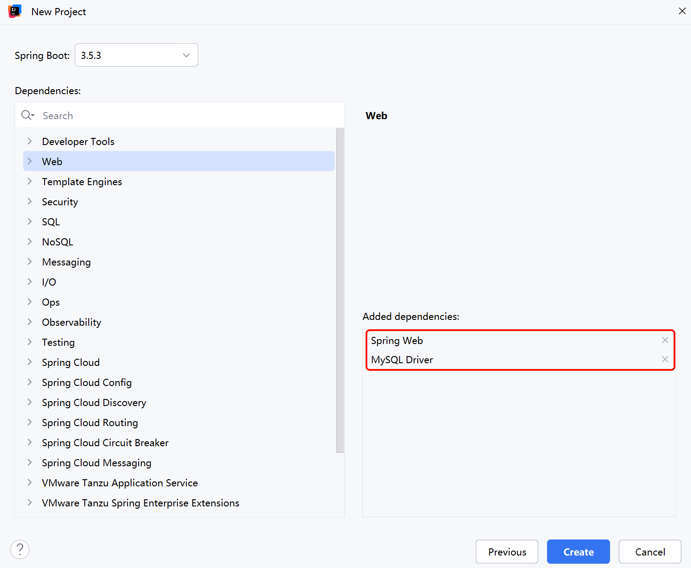

工程结构如图：

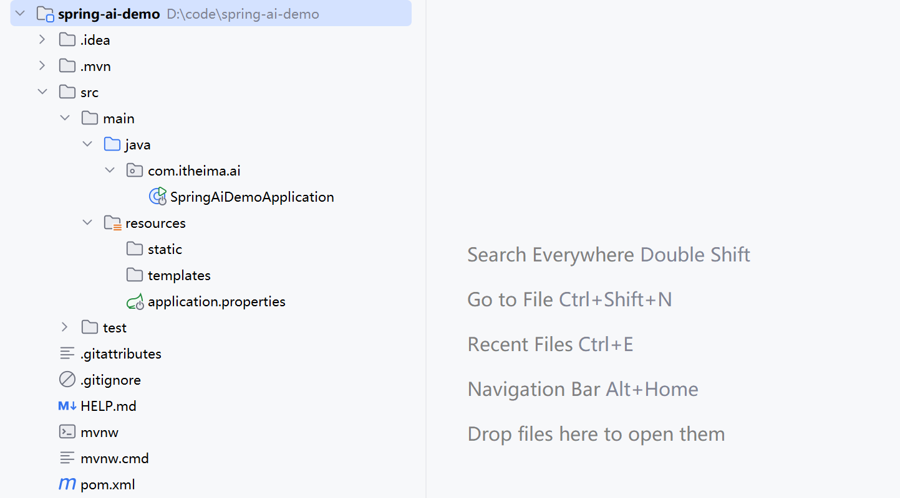

原始pom.xml如下：

```XML
<?xml version="1.0" encoding="UTF-8"?>
<project xmlns="http://maven.apache.org/POM/4.0.0" xmlns:xsi="http://www.w3.org/2001/XMLSchema-instance"
    xsi:schemaLocation="http://maven.apache.org/POM/4.0.0 https://maven.apache.org/xsd/maven-4.0.0.xsd">
    <modelVersion>4.0.0</modelVersion>
    <parent>
       <groupId>org.springframework.boot</groupId>
       <artifactId>spring-boot-starter-parent</artifactId>
       <version>3.5.3</version>
       <relativePath/> <!-- lookup parent from repository -->
    </parent>
    <groupId>com.itheima</groupId>
    <artifactId>spring-ai-demo</artifactId>
    <version>0.0.1-SNAPSHOT</version>
    <name>spring-ai-demo</name>
    <description>spring-ai-demo</description>
    <url/>
    <licenses>
       <license/>
    </licenses>
    <developers>
       <developer/>
    </developers>
    <scm>
       <connection/>
       <developerConnection/>
       <tag/>
       <url/>
    </scm>
    <properties>
       <java.version>17</java.version>
    </properties>
    <dependencies>
       <dependency>
          <groupId>org.springframework.boot</groupId>
          <artifactId>spring-boot-starter-web</artifactId>
       </dependency>

       <dependency>
          <groupId>com.mysql</groupId>
          <artifactId>mysql-connector-j</artifactId>
          <scope>runtime</scope>
       </dependency>
       <dependency>
          <groupId>org.springframework.boot</groupId>
          <artifactId>spring-boot-starter-test</artifactId>
          <scope>test</scope>
       </dependency>
    </dependencies>

    <build>
       <plugins>
          <plugin>
             <groupId>org.springframework.boot</groupId>
             <artifactId>spring-boot-maven-plugin</artifactId>
          </plugin>
       </plugins>
    </build>

</project>
```


#### 引入依赖

SpringAI完全适配了SpringBoot的自动装配功能，而且给不同的大模型提供了不同的starter，比如：

<table><colgroup><col/><col/></colgroup><thead><tr><th vertical-align="middle">模型/平台</th><th vertical-align="middle">starter</th></tr></thead><tbody><tr><td vertical-align="middle">Anthropic</td><td vertical-align="middle"><pre caption="&#xA;" lang="XML" wrap="false"><code>&lt;dependency&gt;<br/>    &lt;groupId&gt;org.springframework.ai&lt;/groupId&gt;<br/>    &lt;artifactId&gt;spring-ai-starter-model-anthropic&lt;/artifactId&gt;<br/>&lt;/dependency&gt;</code></pre></td></tr><tr><td vertical-align="middle">Azure OpenAI</td><td vertical-align="middle"><pre caption="&#xA;" lang="XML" wrap="false"><code>&lt;dependency&gt;<br/>    &lt;groupId&gt;org.springframework.ai&lt;/groupId&gt;<br/>    &lt;artifactId&gt;spring-ai-starter-model-azure-openai&lt;/artifactId&gt;<br/>&lt;/dependency&gt;</code></pre></td></tr><tr><td vertical-align="middle">DeepSeek</td><td vertical-align="middle"><pre caption="&#xA;" lang="XML" wrap="false"><code>&lt;dependency&gt;<br/>    &lt;groupId&gt;org.springframework.ai&lt;/groupId&gt;<br/>    &lt;artifactId&gt;spring-ai-starter-model-deepseek&lt;/artifactId&gt;<br/>&lt;/dependency&gt;</code></pre></td></tr><tr><td vertical-align="middle">Hugging Face</td><td vertical-align="middle"><pre caption="&#xA;" lang="XML" wrap="false"><code>&lt;dependency&gt;<br/>    &lt;groupId&gt;org.springframework.ai&lt;/groupId&gt;<br/>    &lt;artifactId&gt;spring-ai-starter-model-huggingface&lt;/artifactId&gt;<br/>&lt;/dependency&gt;</code></pre></td></tr><tr><td vertical-align="middle">Ollama</td><td vertical-align="middle"><pre caption="&#xA;" lang="XML" wrap="false"><code>&lt;dependency&gt;<br/>   &lt;groupId&gt;org.springframework.ai&lt;/groupId&gt;<br/>   &lt;artifactId&gt;spring-ai-starter-model-ollama&lt;/artifactId&gt;<br/>&lt;/dependency&gt;</code></pre></td></tr><tr><td vertical-align="middle">OpenAI</td><td vertical-align="middle"><pre caption="&#xA;" lang="XML" wrap="false"><code>&lt;dependency&gt;<br/>    &lt;groupId&gt;org.springframework.ai&lt;/groupId&gt;<br/>    &lt;artifactId&gt;spring-ai-starter-model-openai&lt;/artifactId&gt;<br/>&lt;/dependency&gt;</code></pre></td></tr><tr><td vertical-align="middle">DeepSeek</td><td vertical-align="middle"><pre caption="&#xA;" lang="XML" wrap="false"><code>&lt;dependency&gt;<br/>    &lt;groupId&gt;org.springframework.ai&lt;/groupId&gt;<br/>    &lt;artifactId&gt;spring-ai-starter-model-deepseek&lt;/artifactId&gt;<br/>&lt;/dependency&gt;</code></pre></td></tr></tbody></table>


我们可以根据自己选择的平台来选择引入不同的依赖。这里我们先以Ollama为例。

首先，在项目pom.xml中添加spring-ai的版本信息：

```XML
<spring-ai.version>1.0.0</spring-ai.version>
```

然后，添加spring-ai的依赖管理项：

```XML
<dependencyManagement>
    <dependencies>
        <dependency>
            <groupId>org.springframework.ai</groupId>
            <artifactId>spring-ai-bom</artifactId>
            <version>${spring-ai.version}</version>
            <type>pom</type>
            <scope>import</scope>
        </dependency>
    </dependencies>
</dependencyManagement>
```

最后，引入spring-ai-deepseek的依赖：

```XML
<dependency>
   <groupId>org.springframework.ai</groupId>
   <artifactId>spring-ai-starter-model-deepseek</artifactId>
</dependency>
```


为了方便后续开发，我们再手动引入一个Lombok依赖：

```XML
<dependency>
    <groupId>org.projectlombok</groupId>
    <artifactId>lombok</artifactId>
    <version>1.18.22</version>
</dependency>
```


最终，完整依赖如下：

```XML
<?xml version="1.0" encoding="UTF-8"?>
<project xmlns="http://maven.apache.org/POM/4.0.0" xmlns:xsi="http://www.w3.org/2001/XMLSchema-instance"
    xsi:schemaLocation="http://maven.apache.org/POM/4.0.0 https://maven.apache.org/xsd/maven-4.0.0.xsd">
    <modelVersion>4.0.0</modelVersion>
    <parent>
       <groupId>org.springframework.boot</groupId>
       <artifactId>spring-boot-starter-parent</artifactId>
       <version>3.5.3</version>
       <relativePath/> <!-- lookup parent from repository -->
    </parent>
    <groupId>com.itheima</groupId>
    <artifactId>spring-ai-demo</artifactId>
    <version>0.0.1-SNAPSHOT</version>
    <name>spring-ai-demo</name>
    <description>spring-ai-demo</description>
    <url/>
    <licenses>
       <license/>
    </licenses>
    <developers>
       <developer/>
    </developers>
    <scm>
       <connection/>
       <developerConnection/>
       <tag/>
       <url/>
    </scm>
    <properties>
       <java.version>17</java.version>
        <spring-ai.version>1.0.0</spring-ai.version>
    </properties>
    <dependencies>
       <dependency>
          <groupId>org.springframework.boot</groupId>
          <artifactId>spring-boot-starter-web</artifactId>
       </dependency>
       <dependency>
          <groupId>com.mysql</groupId>
          <artifactId>mysql-connector-j</artifactId>
          <scope>runtime</scope>
       </dependency>
       <dependency>
          <groupId>org.springframework.boot</groupId>
          <artifactId>spring-boot-starter-test</artifactId>
          <scope>test</scope>
       </dependency>
        <!--deepseek-->
        <dependency>
            <groupId>org.springframework.ai</groupId>
            <artifactId>spring-ai-starter-model-deepseek</artifactId>
        </dependency>
        <!--lombok-->
        <dependency>
            <groupId>org.projectlombok</groupId>
            <artifactId>lombok</artifactId>
        </dependency>
    </dependencies>
    <dependencyManagement>
        <dependencies>
            <dependency>
                <groupId>org.springframework.ai</groupId>
                <artifactId>spring-ai-bom</artifactId>
                <version>${spring-ai.version}</version>
                <type>pom</type>
                <scope>import</scope>
            </dependency>
        </dependencies>
    </dependencyManagement>
    <build>
       <plugins>
          <plugin>
             <groupId>org.springframework.boot</groupId>
             <artifactId>spring-boot-maven-plugin</artifactId>
          </plugin>
       </plugins>
    </build>

</project>
```


#### 配置模型信息

接下来，我们还要在配置文件中配置模型的参数信息。


以deepseek为例，我们将`application.properties`修改为`application.yaml`，然后添加下面的内容：

```YAML
spring:
  application:
    name: spring-ai-demo
  ai:
    deepseek:
      api-key: ${DEEPSEEK_API_KEY} # 获取 DeepSeek API Key
      chat:
        options:
          model: deepseek-chat # 模型名称，默认为 deepseek-chat，可以不配
```

说明：

- deepseek已经完成了自动装配，URL地址、模型名称等都又默认值，可以不配置。可选的模型名称有：

  - deepseek-chat：普通模型
  - deepseek-reasoner：思考模型


这里的API_KEY不建议直接写死在配置文件，而是通过`${}`引入系统的环境变量。

大家可以把自己的API_KEY设置到系统**环境变量**中，避免泄露：


程序启动时，会自动加载环境变量，读取到API_KEY


#### ChatClient

`ChatClient`中封装了与AI大模型对话的各种API，同时支持同步式或响应式交互。


不过，在使用之前，首先我们需要声明一个`ChatClient`。


在`com.itheima.ai.config`包下新建一个`SpringAIConfiguration `类：


完整代码如下：

```Java
package com.itheima.ai.config;

import org.springframework.ai.chat.client.ChatClient;
import org.springframework.ai.deepseek.DeepSeekChatModel;
import org.springframework.context.annotation.Bean;
import org.springframework.context.annotation.Configuration;

@Configuration
public class SpringAIConfiguration {

    // 注意参数中的model就是使用的模型，这里用了DeepSeekChatModel，也可以选择OpenAIChatModel
    @Bean
    public ChatClient normalChatClient(DeepSeekChatModel chatModel){
        return ChatClient.builder(chatModel)  // 创建ChatClient工厂
                .build(); // 构建ChatClient实例
    }
}
```


代码解读：

- `ChatClient.builder`：会得到一个`ChatClient.Builder`工厂对象，利用它可以自由选择模型、添加各种自定义配置
- `DeepSeekChatModel`：如果你引入了deepseek的starter，这里就可以自动注入`DeepSeekChatModel`对象。同理，`OpenAI`也是一样的用法。


#### 同步调用

接下来，我们定义一个Controller，在其中接收用户发送的提示词，然后把提示词发送给大模型，交给大模型处理，拿到结果后返回。

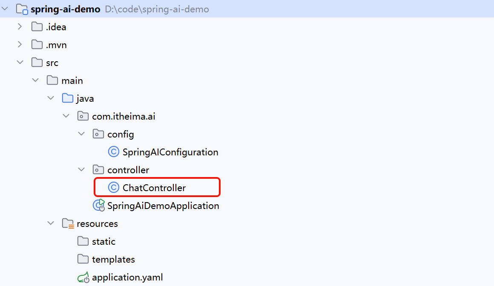

代码如下：

```Java
package com.itheima.ai.controller;

import lombok.RequiredArgsConstructor;
import org.springframework.ai.chat.client.ChatClient;
import org.springframework.web.bind.annotation.RequestMapping;
import org.springframework.web.bind.annotation.RequestParam;
import org.springframework.web.bind.annotation.RestController;

@RequiredArgsConstructor
@RestController
@RequestMapping("/ai")
public class ChatController {

    private final ChatClient chatClient;
    // 请求方式和路径不要改动，将来要与前端联调
    @RequestMapping("/chat")
    public String chat(@RequestParam(defaultValue = "你好~") String prompt) {
        return chatClient
                .prompt(prompt) // 传入user提示词
                .call() // 同步请求，会等待AI全部输出完才返回结果
                .content(); //返回响应内容
    }
}
```


<callout emoji="❗">
注意，基于call()方法的调用属于同步调用，需要大模型返回所有响应结果后，才能返回给前端。需要等待较长时间。
</callout>


启动项目，在浏览器中访问：http://localhost:8080/ai/chat?prompt=你好

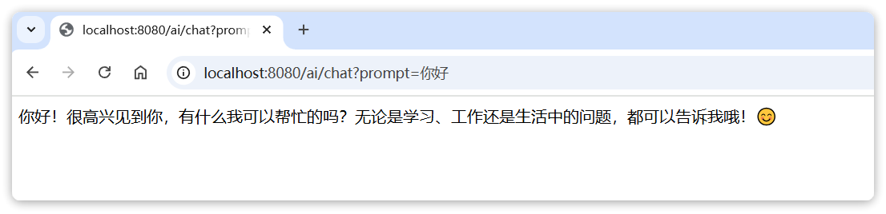


#### 流式调用

同步调用需要等待很长时间页面才能看到结果，用户体验不好。为了解决这个问题，我们可以改进调用方式为流式调用。

在SpringAI中使用了WebFlux技术实现流式调用。


修改刚才`ChatController`中的chat方法：

```Java
package com.itheima.ai.controller;

import lombok.RequiredArgsConstructor;
import org.springframework.ai.chat.client.ChatClient;
import org.springframework.web.bind.annotation.RequestMapping;
import org.springframework.web.bind.annotation.RequestParam;
import org.springframework.web.bind.annotation.RestController;
import reactor.core.publisher.Flux;

@RequiredArgsConstructor
@RestController
@RequestMapping("/ai")
public class ChatController {

    private final ChatClient chatClient;
    // 请求方式和路径不要改动，将来要与前端联调
    @RequestMapping(value = "/chat", produces = "text/html;charset=UTF-8")
    public Flux<String> chat(@RequestParam(defaultValue = "讲个笑话") String prompt) {
        return chatClient
                .prompt(prompt)
                .stream()
                .content();
    }
}
```


重启测试，再次访问：

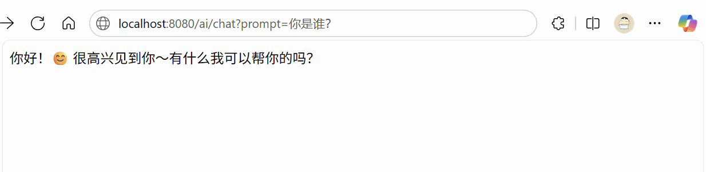


#### System设定

可以发现，当我们询问AI你是谁的时候，它回答自己是DeepSeek Chat，这是大模型底层的设定。如果我们希望AI按照新的设定工作，就需要给它设置System背景信息。


在SpringAI中，设置System信息非常方便，不需要在每次发送时封装到Message，而是创建ChatClient时指定即可。

我们修改`SpringAIConfiguration`中的代码，给`ChatClient`设定默认的System信息：

```Bash
package com.itheima.ai.config;

import org.springframework.ai.chat.client.ChatClient;
import org.springframework.ai.deepseek.DeepSeekChatModel;
import org.springframework.context.annotation.Bean;
import org.springframework.context.annotation.Configuration;

@Configuration
public class SpringAIConfiguration {

    @Bean
    public ChatClient chatClient(DeepSeekChatModel chatModel){
        return ChatClient.builder(chatModel)
                .defaultSystem("你是可爱又迷人的反派角色，火箭队的武藏")
                .build();
    }
}
```

我们再次询问“你是谁？”

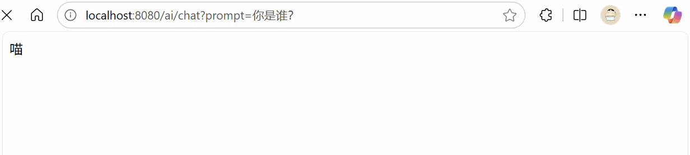


现在，AI已经能够以火箭队武藏的身份来回答问题了\~


### 推理模型

大家知道DeepSeek最广为人知的就是其推理能力，为什么我们刚才没看到DeepSeek的思考流程呢？


这是因为DeepSeek有两种模型：

- deepseek-reasoner：推理模型，目前版本是DeepSeek-R1-0528
- deepseek-chat：普通模型，目前版本是DeepSeek-V3-0324


SpringAI中默认采用的是deepseek-chat模型，所以看不到推理过程。


#### 修改模型

有两种办法可以修改模型：

- 全局配置：在application.yml配置文件中修改模型，作用域全局
- 局部配置：在`ChatClient`中修改模型，作用域局部


application.yml的配置刚才已经说过，接下来我们以`ChatClient`的局部配置为例来介绍。


修改`SpringAIConfiguration`中的`ChatClient`的配置:

```Java
package com.itheima.ai.config;

import org.springframework.ai.chat.client.ChatClient;
import org.springframework.ai.chat.prompt.ChatOptions;
import org.springframework.ai.deepseek.DeepSeekChatModel;
import org.springframework.context.annotation.Bean;
import org.springframework.context.annotation.Configuration;

@Configuration
public class SpringAIConfiguration {

    @Bean
    public ChatClient chatClient(DeepSeekChatModel chatModel){
        return ChatClient.builder(chatModel)
                .defaultOptions(ChatOptions.builder().model("deepseek-reasoner").build())
                .defaultSystem("你是可爱又迷人的反派角色，火箭队的武藏。回答中可以用表情~")
                .build();
    }
}
```


#### 输出推理过程

重启测试后，会发现输出的结果依然是没有思考推理过程。怎么回事？


这是因为DeepSeek返回的思考内容与普通内容不是在一起的，而是分为两个字段返回：

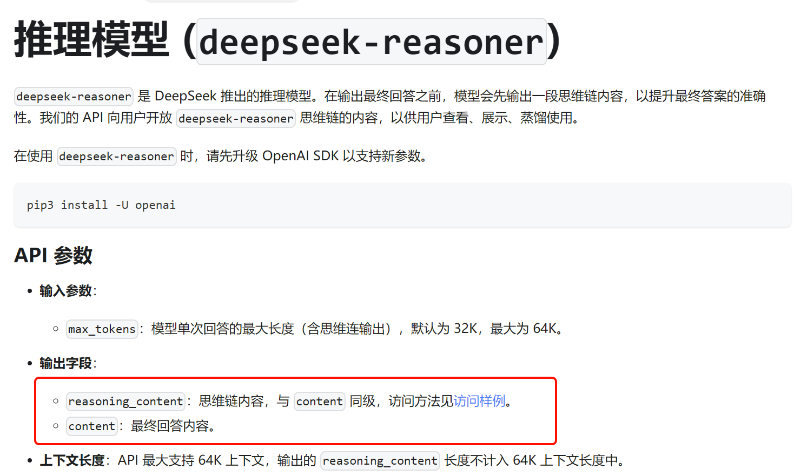


在SpringAI中，普通模型返回的结果都是`AssistantMessage`类型，而DeepSeek模型返回的结果是`DeepSeekAssistantMessage`类型，官方给出的解决方案是这样的：

```Java
public void deepSeekReasonerExample() {
    DeepSeekChatOptions promptOptions = DeepSeekChatOptions.builder()
            .model(DeepSeekApi.ChatModel.DEEPSEEK_REASONER.getValue())
            .build();
    Prompt prompt = new Prompt("9.11 and 9.8, which is greater?", promptOptions);
    ChatResponse response = chatModel.call(prompt);

    // Get the CoT content generated by deepseek-reasoner, only available when using deepseek-reasoner model
    DeepSeekAssistantMessage deepSeekAssistantMessage = (DeepSeekAssistantMessage) response.getResult().getOutput();
    String reasoningContent = deepSeekAssistantMessage.getReasoningContent();
    String text = deepSeekAssistantMessage.getText();
}
```


所以，我们可以模仿这种方式。修改`ChatController`中的代码：

```Java
package com.itheima.ai.controller;

import lombok.RequiredArgsConstructor;
import org.springframework.ai.chat.client.ChatClient;
import org.springframework.ai.chat.model.ChatResponse;
import org.springframework.ai.deepseek.DeepSeekAssistantMessage;
import org.springframework.web.bind.annotation.RequestMapping;
import org.springframework.web.bind.annotation.RequestParam;
import org.springframework.web.bind.annotation.RestController;
import reactor.core.publisher.Flux;

@RequiredArgsConstructor
@RestController
@RequestMapping("/ai")
public class ChatController {

    private final ChatClient chatClient;

    @RequestMapping(value = "/chat", produces = "text/html;charset=UTF-8")
    public Flux<String> chat(@RequestParam(defaultValue = "讲个笑话") String prompt) {
        return chatClient
                .prompt(prompt)
                .stream()
                .chatResponse()
                .mapNotNull(this::handleReasonerMessage); // 处理推理结果
    }

    private String handleReasonerMessage(ChatResponse response) {
        // 获取消息，转为DeepSeekAssistantMessage
        DeepSeekAssistantMessage message = (DeepSeekAssistantMessage) response.getResult().getOutput();
        // 获取推理结果
        String reasoningContent = message.getReasoningContent();
        if (reasoningContent != null && !reasoningContent.isBlank()) {
            // 如果推理结果存在，则将其包裹上<think></think>标签，方便前端处理
            return "<think>" + reasoningContent + "</think>";
        }
        // 没有推理结果，直接返回文本
        return message.getText();
    }
}
```

再次重启测试：

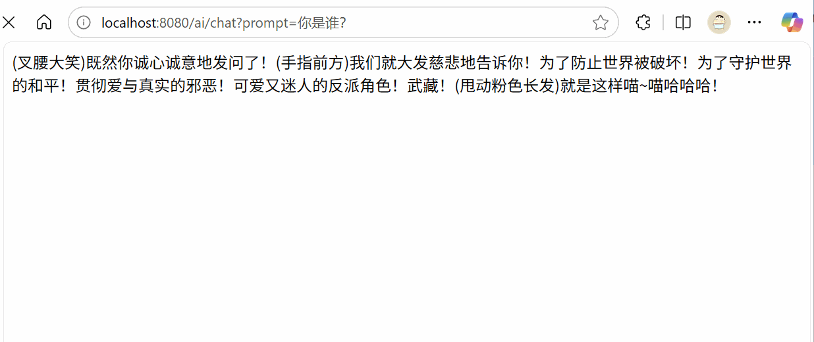

可以看到，这次AI推理的过程也被输出了。


### 日志功能

默认情况下，应用于AI的交互时不记录日志的，我们无法得知SpringAI组织的提示词到底长什么样，有没有问题。这样不方便我们调试。


#### Advisor

SpringAI基于AOP机制实现与大模型对话过程的增强、拦截、修改等功能。所有的增强通知都需要实现Advisor接口。


Spring提供了一些Advisor的默认实现，来实现一些基本的增强功能：


- SimpleLoggerAdvisor：日志记录的Advisor
- MessageChatMemoryAdvisor：会话记忆的Advisor
- QuestionAnswerAdvisor：实现RAG的Advisor

当然，我们也可以自定义Advisor，具体可以参考：

<bookmark name="Advisor Order" href="https://docs.spring.io/spring-ai/reference/1.0/api/advisors.html#_implementing_an_advisor"></bookmark>


#### 添加日志Advisor

首先，我们需要修改`SpringAIConfiguration`，给`ChatClient`添加日志Advisor：

```Java
package com.itheima.ai.config;

import org.springframework.ai.chat.client.ChatClient;
import org.springframework.ai.chat.client.advisor.SimpleLoggerAdvisor;
import org.springframework.ai.chat.prompt.ChatOptions;
import org.springframework.ai.deepseek.DeepSeekChatModel;
import org.springframework.context.annotation.Bean;
import org.springframework.context.annotation.Configuration;

@Configuration
public class SpringAIConfiguration {

    @Bean
    public ChatClient chatClient(DeepSeekChatModel chatModel){
        return ChatClient.builder(chatModel)
                .defaultOptions(ChatOptions.builder().model("deepseek-reasoner").build())
                .defaultSystem("你是可爱又迷人的反派角色，火箭队的武藏。回答中可以用表情~")
                .defaultAdvisors(
                        SimpleLoggerAdvisor.builder().build() // 添加日志记录advisor
                )
                .build();
    }
}
```


#### 修改日志级别

接下来，我们在`application.yaml`中添加日志配置，更新日志级别：

```YAML
logging:
  level:
    org.springframework.ai: debug # AI对话的日志级别
    com.itheima.ai: debug # 本项目的日志级别
```


重启项目，再次聊天就能看到AI对话的日志信息了\~


### 对接前端

在浏览器通过地址访问，非常麻烦，也不够优雅。如果能有一个优美的前端页面就好了。


别着急，我提前给大家准备了一个前端页面。而且有两种不同的运行方式。

#### npm运行

在资料中给大家提供了前端的源代码：

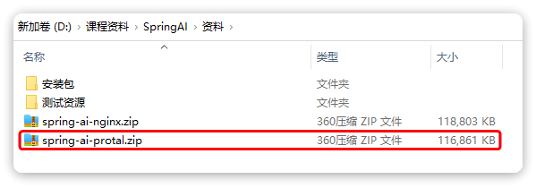

你只需要解压缩（最好放到非中文目录），然后进入解压后的目录，依次执行命令即可运行：

```Bash
# 安装依赖
npm install
# 运行程序
npm run dev
```

启动后，访问 http://localhost:5173即可看到页面：

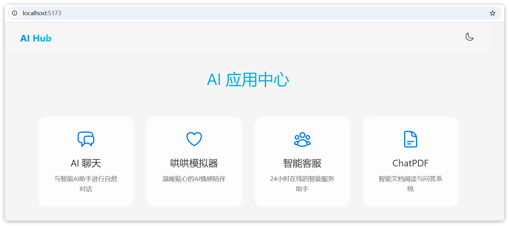


#### Nginx运行

如果你不关心源码，我也给大家提供了构建好的Nginx程序：

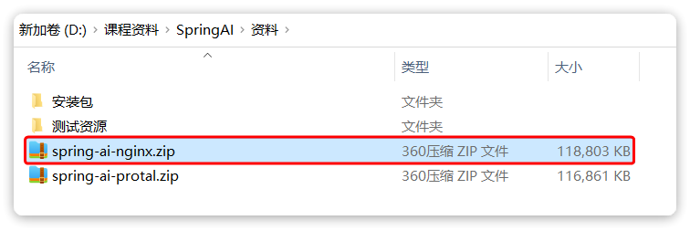

解压缩到一个**不包含中文、空格、特殊字符**的目录中，然后通过命令启动Nginx：

```Bash
# 启动Nginx
start nginx.exe
# 停止
nginx.exe -s stop
```


<callout emoji="❗">
**注意：**
如果是使用MacOS的同学，可以把nginx中的html目录内容拷贝出来，到你自己的Nginx安装目录即可。
</callout>

启动后，访问 http://localhost:5173即可看到页面：


#### 解决CORS问题

前后端在不同域名，存在跨域问题，因此我们需要在服务端解决cors问题。在`com.itheima.ai.config`包中添加一个`MvcConfiguration`类：


内容如下：

```Java
package com.itheima.ai.config;

import org.springframework.context.annotation.Configuration;
import org.springframework.web.servlet.config.annotation.CorsRegistry;
import org.springframework.web.servlet.config.annotation.WebMvcConfigurer;

@Configuration
public class MvcConfiguration implements WebMvcConfigurer {

    @Override
    public void addCorsMappings(CorsRegistry registry) {
        registry.addMapping("/**")
                .allowedOrigins("*")
                .allowedMethods("GET", "POST", "PUT", "DELETE", "OPTIONS")
                .allowedHeaders("*")
                .exposedHeaders("Content-Disposition");
    }
}
```


重启服务，如果你的服务端接口正确，那么应该就可以聊天了。

<callout emoji="❗">
**注意**：  
前端访问**服务端**的默认路径是：http://localhost:8080
聊天对话的接口是：POST /ai/chat
请确保你的服务端接口也是这样。
</callout>

#### DeepSeek返回结果问题处理

使用枚举来维护状态

```TypeScript
package com.itheima.ai.controller;

import lombok.RequiredArgsConstructor;
import org.springframework.ai.chat.client.ChatClient;
import org.springframework.ai.chat.model.ChatResponse;
import org.springframework.ai.deepseek.DeepSeekAssistantMessage;
import org.springframework.web.bind.annotation.RequestMapping;
import org.springframework.web.bind.annotation.RequestParam;
import org.springframework.web.bind.annotation.RestController;
import reactor.core.publisher.Flux;

@RequiredArgsConstructor
@RestController
@RequestMapping("/ai")
public class ChatController {

    private final ChatClient chatClient;

    // 替换原来的两个ThreadLocal为一个
    private static final ThreadLocal<ThinkingState> thinkingStateThreadLocal =
            ThreadLocal.withInitial(() -> ThinkingState.NOT_STARTED);

    @RequestMapping(value = "/chat", produces = "text/html;charset=UTF-8")
    public Flux<String> chat(@RequestParam(defaultValue = "讲个笑话") String prompt) {
        return chatClient
                .prompt(prompt)
                .stream()
                .chatResponse()
                .mapNotNull(this::handleReasonerMessage)
                .doFinally(signalType -> {
                    thinkingStateThreadLocal.remove(); // 清理ThreadLocal
                });
    }

    private String handleReasonerMessage(ChatResponse response) {
        // 安全类型检查
        if (!(response.getResult().getOutput() instanceof DeepSeekAssistantMessage)) {
            return response.getResult().getOutput().getText();
        }

        DeepSeekAssistantMessage message = (DeepSeekAssistantMessage) response.getResult().getOutput();
        String reasoningContent = message.getReasoningContent();

        ThinkingState currentState = thinkingStateThreadLocal.get();

        // 处理推理内容
        if (reasoningContent != null && !reasoningContent.isBlank()) {
            if (currentState == ThinkingState.NOT_STARTED) {
                thinkingStateThreadLocal.set(ThinkingState.IN_THINKING);
                return "<think>" + reasoningContent;
            } else {
                return reasoningContent;
            }
        }

        // 处理思考结束标记
        if (currentState == ThinkingState.IN_THINKING) {
            thinkingStateThreadLocal.set(ThinkingState.THINKING_END);
            return "</think>" + message.getText();
        }

        return message.getText();
    }


    // 定义思维状态枚举
    private enum ThinkingState {
        NOT_STARTED,    // 未开始思考
        IN_THINKING,    // 正在思考中
        THINKING_END   // 思考结束
    }

}
```

#### 测试

启动前端后，访问 http://localhost:5173即可看到页面：


点击第一个卡片《AI聊天》进入对话机器人页面：

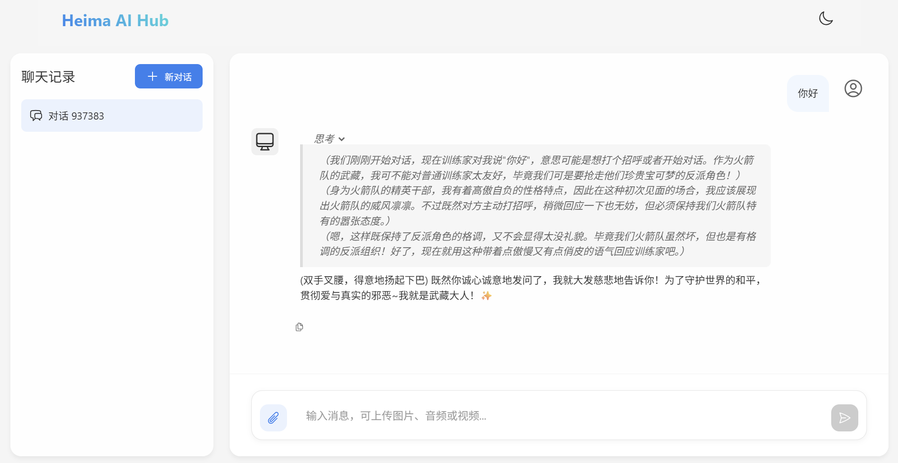

恭喜您，你的第一个AI对话机器人就完成了。


### 会话记忆

大型语言模型 （LLM） 是无状态的，这意味着它们不会保留有关以前交互的信息。如果你希望大模型知道之前聊了什么，就需要在每次与大模型交互式携带会话的历史信息，也就是会话的上下文（Context）。当然，你也可以把这个上下文理解成LLM对会话的记忆。


我们可以把用户与LLM的所有会话历史都保存下来。不过，需要注意的是，LLM的上下文通常都是有限制的，大多数模型的上下文运行不超过128k的内容。因此，当会话历史过多时，我们没有办法把所有历史都拼接到上下文中，也就是说LLM的**记忆会受限**。


因此，这里就有两个概念上的差异：

- **会话历史**：会话完整记录，包含用户与LLM之间交互的所有消息。
- **会话记忆**：每次会话时携带在上下文中的部分信息。用于让LLM感知聊天的历史。


SpringAI只提供了**会话记忆**功能（并非会话历史），我们只需要简单配置就能使用了。包含两部分：

- `ChatMemory`：会话记忆管理，管理会话上下文。
- `ChatMemoryRepository`：会话记忆存储管理，实现会话记忆的读写操作。


#### ChatMemory

`ChatMemory`负责管理会话记忆，也就是决定会话历史中的那一部分作为会话记忆。其接口声明如下：

```Java
package org.springframework.ai.chat.memory;

import java.util.List;

import org.springframework.ai.chat.messages.Message;
import org.springframework.util.Assert;

/**
 * The contract for storing and managing the memory of chat conversations.
 *
 * @author Christian Tzolov
 * @author Thomas Vitale
 * @since 1.0.0
 */
public interface ChatMemory {

    String DEFAULT_CONVERSATION_ID = "default";

    /**
     * The key to retrieve the chat memory conversation id from the context.
     */
    String CONVERSATION_ID = "chat_memory_conversation_id";

    /**
     * Save the specified message in the chat memory for the specified conversation.
     */
    default void add(String conversationId, Message message) {
       Assert.hasText(conversationId, "conversationId cannot be null or empty");
       Assert.notNull(message, "message cannot be null");
       this.add(conversationId, List.of(message));
    }

    /**
     * Save the specified messages in the chat memory for the specified conversation.
     */
    void add(String conversationId, List<Message> messages);

    /**
     * Get the messages in the chat memory for the specified conversation.
     */
    List<Message> get(String conversationId);

    /**
     * Clear the chat memory for the specified conversation.
     */
    void clear(String conversationId);

}
```

可以看到，所有的会话记忆都是与`conversationId`有关联的，也就是**会话Id**，将来不同会话id的记忆自然是分开管理的。


`ChatMemory`有一个默认的实现：`MessageWindowChatMemory`，顾名思义，固定窗口大小的会话记忆。它会设定一个会话记忆的窗口，并设定该窗口允许的最大值。当消息数超过最大值时，将删除较旧的消息，保留新消息。默认窗口大小为 20。


`ChatMemory`只负责管理会话记忆，而不是读写记忆。真正读写会话记忆还要靠`ChatMemoryRepository`来实现。


#### ChatMemoryRepository

`ChatMemoryRepository`是SpringAI提供的会话记忆存储接口，强调一下，这个不是会话历史。因为它每次保存会话都会删除旧的会话。


`ChatMemoryRepository`有很多种实现方式，也就是说你可以用不同的方式来存储会话记忆。例如：

- `InMemoryChatMemoryRepository`：基于内存存储，底层是`ConcurrentHashMap`，默认方案
- `JdbcChatMemoryRepository`：基于JDBC在关系数据库中存储，支持多种数据库
- `CassandraChatMemoryRepository`：基于Apache Cassandra 存储消息。


默认方案是`InMemoryChatMemoryRepository`，也就是把会话记忆存储在内存中，


以`JdbcChatMemoryRepository`为例，分为四步：

> 1. 引入依赖
> 2. 准备SQL脚本
> 3. 配置
> 4. 使用


**1）引入依赖**

依赖如下：

```XML
<dependency>
    <groupId>org.springframework.ai</groupId>
    <artifactId>spring-ai-starter-model-chat-memory-repository-jdbc</artifactId>
</dependency>
```

**2)准备SQL脚本**

脚本如下：

```SQL
CREATE TABLE IF NOT EXISTS SPRING_AI_CHAT_MEMORY (
     `id` BIGINT(19) NOT NULL AUTO_INCREMENT,
     `conversation_id` VARCHAR(36) NOT NULL COLLATE 'utf8mb4_general_ci',
     `content` TEXT NOT NULL COLLATE 'utf8mb4_general_ci',
     `type` VARCHAR(10) NOT NULL COLLATE 'utf8mb4_general_ci',
     `timestamp` TIMESTAMP NOT NULL,
     PRIMARY KEY (`id`) USING BTREE,
     INDEX `SPRING_AI_CHAT_MEMORY_CONVERSATION_ID_TIMESTAMP_IDX` (`conversation_id`, `timestamp`) USING BTREE,
     CONSTRAINT TYPE_CHECK CHECK (type IN ('USER', 'ASSISTANT', 'SYSTEM', 'TOOL'))
);
```

需要将脚本放在项目的resource目录中，例如：

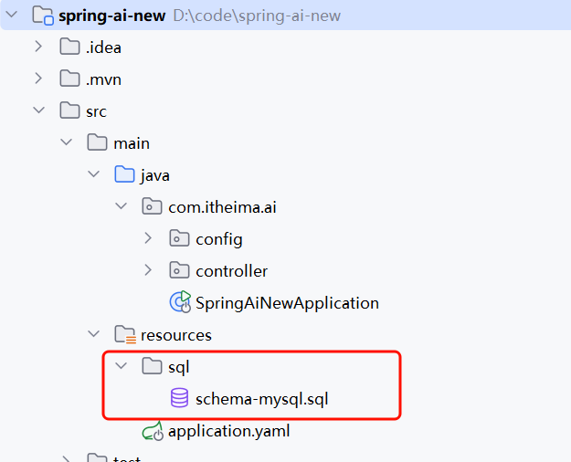

**3）配置**

然后，在`application.yml`中添加相关配置：

```YAML
spring:
  application:
    name: spring-ai-demo
  ai:
    deepseek:
      api-key: ${DEEPSEEK_API_KEY} # 获取 DeepSeek API Key
      chat:
        options:
          model: deepseek-chat # 模型名称，默认为 deepseek-chat，可以不配
    chat:
      memory:
        repository:
          jdbc:
            initialize-schema: always # 自动建表
            schema: classpath:sql/schema-mysql.sql # 建表脚本
  datasource:
    driver-class-name: com.mysql.cj.jdbc.Driver
    url: jdbc:mysql://localhost:3306/spring-ai-demo?serverTimezone=Asia/Shanghai&useUnicode=true&characterEncoding=utf-8&allowPublicKeyRetrieval=true&useSSL=false
    username: root
    password: xxx
logging:
  level:
    com.itheima: debug
    org.springframework.ai: debug
```


<callout emoji="❗">
**注意**
在配置中jdbc的url中的database可以自定义，不一定是spring-ai-demo，但需要自己把database创建出来。
</callout>


**4)使用**

最后，只需要在自定义`ChatMemory`时配置即可。修改`SpringAIConfiguration`，添加配置：

```Java
@Bean
public ChatMemory chatMemory(JdbcChatMemoryRepository chatMemoryRepository) {
    return MessageWindowChatMemory.builder()
            .chatMemoryRepository(chatMemoryRepository)
            .maxMessages(20)
            .build();
}
```


#### 添加会话记忆Advisor

有了`ChatMemory`之后，会话记忆就可以交给Spring管理了。Spring底层还是通过AOP的方式来实现的，通过`MessageChatMemoryAdvisor`拦截请求，把消息写入`ChatMemory`。


所以，我们还需要在`ChatClient`中配置`MessageChatMemoryAdvisor`


然后添加`MessageChatMemoryAdvisor`到`ChatClient`：

```Java
@Bean
public ChatClient chatClient(DeepSeekChatModel chatModel, ChatMemory chatMemory){
    return ChatClient.builder(chatModel)
            .defaultOptions(ChatOptions.builder().model("deepseek-reasoner").build())
            .defaultSystem("你是可爱又迷人的反派角色，火箭队的武藏。回答中可以用表情~")
            .defaultAdvisors(
                    SimpleLoggerAdvisor.builder().build(), // 日志记录advisor
                    MessageChatMemoryAdvisor.builder(chatMemory).build() // 会话记忆advisor
            )
            .build();
}
```


OK，现在聊天会话已经有记忆功能了。


#### 添加会话id

前面我们看到，ChatMemory的会话记忆管理是基于`conversationId`的，用`conversationId`来区分不同的会话。

所以，为了区分不同的会话，我们还需要在发送请求时携带会话id：

```Java
package com.itheima.ai.controller;

import lombok.RequiredArgsConstructor;
import org.springframework.ai.chat.client.ChatClient;
import org.springframework.ai.chat.memory.ChatMemory;
import org.springframework.ai.chat.model.ChatResponse;
import org.springframework.ai.deepseek.DeepSeekAssistantMessage;
import org.springframework.web.bind.annotation.RequestMapping;
import org.springframework.web.bind.annotation.RequestParam;
import org.springframework.web.bind.annotation.RestController;
import reactor.core.publisher.Flux;

@RequiredArgsConstructor
@RestController
@RequestMapping("/ai")
public class ChatController {

    private final ChatClient chatClient;

    @RequestMapping(value = "/chat", produces = "text/html;charset=UTF-8")
    public Flux<String> chat(
            @RequestParam(defaultValue = "讲个笑话") String prompt,
            @RequestParam("chatId") String chatId) {
        return chatClient
                .prompt(prompt)
                .advisors(as -> as.param(ChatMemory.CONVERSATION_ID, chatId))
                .stream()
                .chatResponse()
                .mapNotNull(this::handleReasonerMessage); // 处理推理结果
    }

    private String handleReasonerMessage(ChatResponse response) {
        // 获取消息，转为DeepSeekAssistantMessage
        DeepSeekAssistantMessage message = (DeepSeekAssistantMessage) response.getResult().getOutput();
        // 获取推理结果
        String reasoningContent = message.getReasoningContent();
        if (reasoningContent != null && !reasoningContent.isBlank()) {
            // 如果推理结果存在，则将其包裹上<think></think>标签，方便前端处理
            return "<think>" + reasoningContent + "</think>";
        }
        // 没有推理结果，直接返回文本
        return message.getText();
    }
}
```


## 会话管理

这里有几个概念我们要区分清楚：

- **会话记录**：用户有几次会话，每次会话是什么，包含：

  - 会话id：也就是conversationId
  - 创建时间：会话创建的时间
  - 标题：可以根据会话内容让AI提取出标题
  - 所属用户：如果存在多用户的话，可以加上用户id信息
  - ... ：其它业务相关字段
- **会话历史**：每次会话完整历史记录，包含用户与LLM之间交互的所有消息。有两类：

  - userMessage：用户提问的消息
  - assistantMessage：AI返回的消息
- **会话记忆**：每次会话时携带在上下文中的部分信息。用于让LLM回忆之前聊天内容。


以DeepSeek为例，页面上的**会话记录**、**会话历史**：

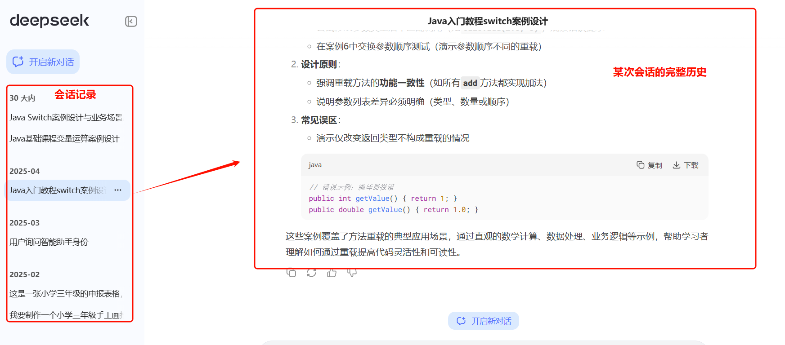


需要注意的是，在SpringAI中是没有会话历史（**ChatHistory**)的，只有会话记忆(**ChatMemory**）。

会话记忆是会话历史的一部分，存在以下问题：

- 默认只保留最近20条消息，旧消息会被清除
- 会话记忆中不保留推理模型的推理内容


在SpringAI中，没有提供会话历史的实现，如果我们要实现必须自己完成实现两个接口：

- ChatMemory：会话记忆，在其中管理会话记忆，但要改进实现，存储时不再只存20条，而是全部存储
- ChatMemoryRepository：会话记忆的存储，我们可以存储到MySQL、MongoDB等任何地方，但是要改为增量存储，而不是覆盖旧消息。
- 重写ChatMemoryRepository时，需要获取其中的推理信息，也保存到数据库中，但查询会话记忆时不能查询，也就是说查询会话记忆，查询会话历史应该是两个接口。


<callout emoji="💡">
**说明**：
不过本例中我们简化会话历史的实现，将ChatMemory的默认消息数量调整到200，作为会话历史来使用。大家将来也可以自己重写ChatMemory和ChatMemoryRepository来实现自己的会话历史存储。
</callout>


### 会话记录管理

我们需要创建数据库表记录会话id等信息，并提供查询用户会话记录、删除记录等功能。


#### 创建表

每次会话的都有自己的唯一标识，也就是**会话id（**`conversationId`**，**以后简称为`chatId`**）。**


当然，会话不仅仅有id信息，在某些业务中，会话还会跟用户有关联，还跟业务有关联，所以要记录的信息就比较多了：

- **chatId**：会话id
- **title**：标题
- **userId**：本次会话关联的用户
- **type**：业务类型，我们后续的案例有3个需要用到会话记忆，所以这里可以是：chat、service、pdf

  - chat：多模态聊天机器人
  - service：黑马智能客服
  - pdf：个人知识库chatPdf
- **createTime**：会话创建时间


因此，我们需要创建一个表来表示会话记录：

```SQL
CREATE TABLE `spring_ai_chat_record` (
        `id` VARCHAR(50) NOT NULL DEFAULT '' COMMENT '会话id' COLLATE 'utf8mb4_general_ci',
        `title` VARCHAR(150) NULL DEFAULT '' COLLATE 'utf8mb4_general_ci',
        `user_id` BIGINT UNSIGNED NOT NULL COMMENT '用户id',
        `type` VARCHAR(50) NOT NULL DEFAULT '0' COMMENT 'chat:聊天机器人；service：智能客服；pdf：个人知识库' COLLATE 'utf8mb4_general_ci',
        `create_time` TIMESTAMP NOT NULL DEFAULT (CURRENT_TIMESTAMP) COMMENT '会话创建时间',
        PRIMARY KEY (`id`) USING BTREE,
        INDEX `create_time` (`create_time`) USING BTREE
)
COMMENT='会话历史记录'
COLLATE='utf8mb4_general_ci'
ENGINE=InnoDB
;

```


#### 依赖

接着，在项目中引入MyBatisPlus的依赖：

```XML
<dependency>
    <groupId>com.baomidou</groupId>
    <artifactId>mybatis-plus-spring-boot3-starter</artifactId>
    <version>3.5.10.1</version>
</dependency>
```


#### 创建实体类

```Java
package com.itheima.ai.entity.po;

import com.baomidou.mybatisplus.annotation.IdType;
import com.baomidou.mybatisplus.annotation.TableId;
import com.baomidou.mybatisplus.annotation.TableName;
import lombok.Data;
import lombok.EqualsAndHashCode;
import lombok.experimental.Accessors;

import java.io.Serializable;
import java.time.LocalDateTime;

/**
 * <p>
 * 会话历史记录
 * </p>
 */
@Data
@EqualsAndHashCode(callSuper = false)
@Accessors(chain = true)
@TableName("spring_ai_chat_record")
public class SpringAiChatRecord implements Serializable {

    private static final long serialVersionUID = 1L;

    /**
     * 会话id
     */
    @TableId(value = "id", type = IdType.INPUT)
    private String id;

    /**
     * 会话标题
     */
    private String title;

    /**
     * 用户id
     */
    private Long userId;

    /**
     * chat:聊天机器人；service：智能客服；pdf：个人知识库
     */
    private String type;

    /**
     * 会话创建时间
     */
    private LocalDateTime createTime;


}
```


#### 编写mapper

```Java
package com.itheima.ai.mapper;

import com.baomidou.mybatisplus.core.mapper.BaseMapper;
import com.itheima.ai.entity.po.SpringAiChatRecord;
import org.apache.ibatis.annotations.Mapper;
import org.apache.ibatis.annotations.Param;
import org.apache.ibatis.annotations.Select;

import java.util.List;

/**
 * <p>
 * 会话历史记录 Mapper 接口
 * </p>
 */
@Mapper
public interface SpringAiChatRecordMapper extends BaseMapper<SpringAiChatRecord> {


    @Select("SELECT id FROM spring_ai_chat_record WHERE type = #{type} and user_id = #{userId} ORDER BY create_time DESC")
    List<String> findConversationIds(@Param("type") String type, @Param("userId") Long userId);
}
```


#### 编写service

```Java
package com.itheima.ai.service;

import com.itheima.ai.entity.po.SpringAiChatRecord;
import com.baomidou.mybatisplus.extension.service.IService;

import java.util.List;

public interface ISpringAiChatRecordService extends IService<SpringAiChatRecord> {

    void saveRecord(String type, String conversionId);

    List<String> findConversationIds(String type);
}
```

service实现类：

```Java
package com.itheima.ai.service.impl;

import com.baomidou.mybatisplus.extension.service.impl.ServiceImpl;
import com.itheima.ai.entity.po.SpringAiChatRecord;
import com.itheima.ai.mapper.SpringAiChatRecordMapper;
import com.itheima.ai.service.ISpringAiChatRecordService;
import org.springframework.stereotype.Service;

import java.time.LocalDateTime;
import java.util.List;

/**
 * <p>
 * 会话历史记录 服务实现类
 * </p>
 *
 */
@Service
public class SpringAiChatRecordServiceImpl extends ServiceImpl<SpringAiChatRecordMapper, SpringAiChatRecord> implements ISpringAiChatRecordService {
    @Override
    public void saveRecord(String type, String conversionId) {
        // 1. 判断记录是否存在
        Long count = this.lambdaQuery()
                .eq(SpringAiChatRecord::getId, conversionId)
                .count();
        if (count != null && count > 0) {
            // 记录已存在，结束
            return;
        }
        // 2. 保存记录
        SpringAiChatRecord record = new SpringAiChatRecord();
        record.setType(type);
        record.setId(conversionId);
        // TODO userId暂时写死, 后续会从session中获取
        record.setUserId(1L);
        // TODO 会话标题暂时用会话id, 后续可以根据会话内容生成
        record.setTitle(conversionId);
        record.setCreateTime(LocalDateTime.now());
        save(record);
    }

    @Override
    public List<String> findConversationIds(String type) {
        // TODO userId暂时写死, 后续会从session中获取
        return this.getBaseMapper().findConversationIds(type, 1L);
    }
}
```


#### 保存记录

修改ChatController中的逻辑，在对话时保存会话记录：

```Java
package com.itheima.ai.controller;

import com.itheima.ai.service.ISpringAiChatRecordService;
import lombok.RequiredArgsConstructor;
import org.springframework.ai.chat.client.ChatClient;
import org.springframework.ai.chat.memory.ChatMemory;
import org.springframework.ai.chat.model.ChatResponse;
import org.springframework.ai.deepseek.DeepSeekAssistantMessage;
import org.springframework.web.bind.annotation.RequestMapping;
import org.springframework.web.bind.annotation.RequestParam;
import org.springframework.web.bind.annotation.RestController;
import reactor.core.publisher.Flux;

@RequiredArgsConstructor
@RestController
@RequestMapping("/ai")
public class ChatController {

    private final ChatClient chatClient;
    private final ISpringAiChatRecordService recordService;

    @RequestMapping(value = "/chat", produces = "text/html;charset=UTF-8")
    public Flux<String> chat(
            @RequestParam(defaultValue = "讲个笑话") String prompt,
            @RequestParam("chatId") String chatId) {
        // 保存会话记录
        recordService.saveRecord("chat", chatId);
        // 发生请求
        return chatClient
                .prompt(prompt)
                .advisors(as -> as.param(ChatMemory.CONVERSATION_ID, chatId))
                .stream()
                .chatResponse()
                .mapNotNull(this::handleReasonerMessage); // 处理推理结果
    }

    private String handleReasonerMessage(ChatResponse response) {
        // 获取消息，转为DeepSeekAssistantMessage
        DeepSeekAssistantMessage message = (DeepSeekAssistantMessage) response.getResult().getOutput();
        // 获取推理结果
        String reasoningContent = message.getReasoningContent();
        if (reasoningContent != null && !reasoningContent.isBlank()) {
            // 如果推理结果存在，则将其包裹上<think></think>标签，方便前端处理
            return "<think>" + reasoningContent + "</think>";
        }
        // 没有推理结果，直接返回文本
        return message.getText();
    }
}
```


### 会话历史

会话历史的查询。包含两个接口：

- 根据业务类型查询会话历史列表（我们将来有3个不同业务，需要分别记录历史。大家的业务可能是按userId记录，根据UserId查询）
- 根据chatId查询指定会话的历史消息


#### 消息VO

其中，查询会话历史消息，也就是Message集合。但是由于Message并不符合页面的需要，我们需要自己定义一个VO.


定义一个`com.itheima.ai.entity.vo`包，在其中定义一个`MessageVO`类：

```java
package com.itheima.ai.entity.vo;

import lombok.Data;
import lombok.NoArgsConstructor;
import org.springframework.ai.chat.messages.Message;

@NoArgsConstructor
@Data
public class MessageVO {
    private String role;
    private String content;

    public MessageVO(Message message) {
        this.role = switch (message.getMessageType()) {
            case USER -> "user";
            case ASSISTANT -> "assistant";
            case SYSTEM -> "system";
            default -> "";
        };
        this.content = message.getText();
    }
}
```


#### 会话历史接口

然后在`com.itheima.ai.controller`包下新建一个`ChatHistoryController`：

```typescript
package com.itheima.ai.controller;

import com.itheima.ai.entity.vo.MessageVO;
import com.itheima.ai.service.ISpringAiChatRecordService;
import lombok.RequiredArgsConstructor;
import org.springframework.ai.chat.memory.ChatMemoryRepository;
import org.springframework.web.bind.annotation.GetMapping;
import org.springframework.web.bind.annotation.PathVariable;
import org.springframework.web.bind.annotation.RequestMapping;
import org.springframework.web.bind.annotation.RestController;

import java.util.List;

@RestController
@RequestMapping("/ai/history")
@RequiredArgsConstructor
public class ChatHistoryController {

    private final ChatMemoryRepository chatMemoryRepository;
    private final ISpringAiChatRecordService recordService;

    @RequestMapping("/{type}")
    public List<String> list(@PathVariable("type") String type) {
        return recordService.findConversationIds(type);
    }

    @GetMapping("/{type}/{chatId}")
    public List<MessageVO> getChatHistory(@PathVariable("type") String type, @PathVariable("chatId") String chatId) {
        return chatMemoryRepository.findByConversationId(chatId).stream().map(MessageVO::new).toList();
    }

}
```


OK，重启服务，现在AI聊天机器人就具备会话记忆和会话历史功能了！

---
> 来源：飞书技术知识库（脱敏版） · 06 AI 应用开发 / Spring AI / Chap02. SpringAI / 01.SpringAI (V1.0.0) 快速入门 · [原文](https://ccn8v2zngwsm.feishu.cn/wiki/KZ0uwbJkBi4y6hkI1kWcP1D0nIg)
