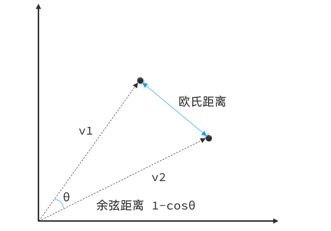
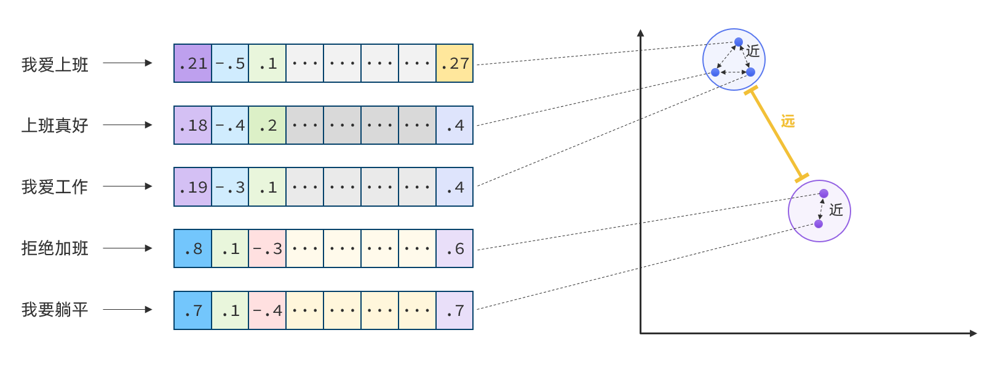
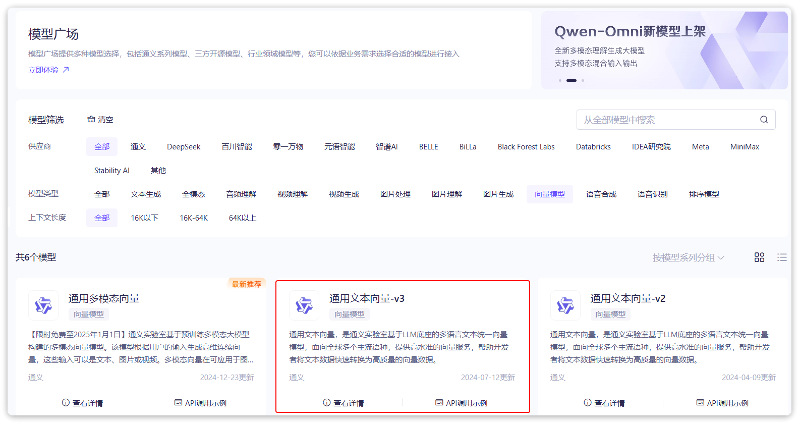
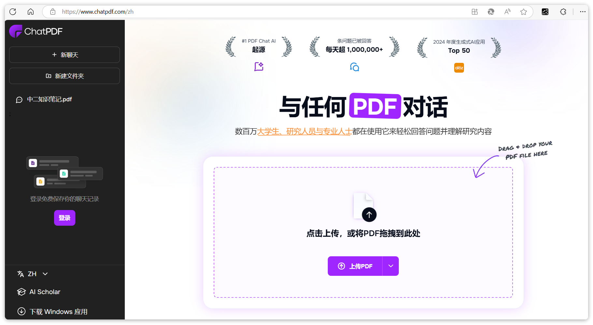
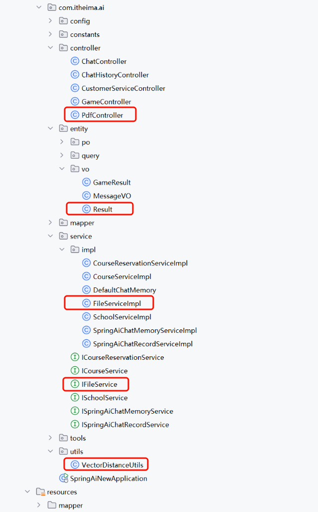
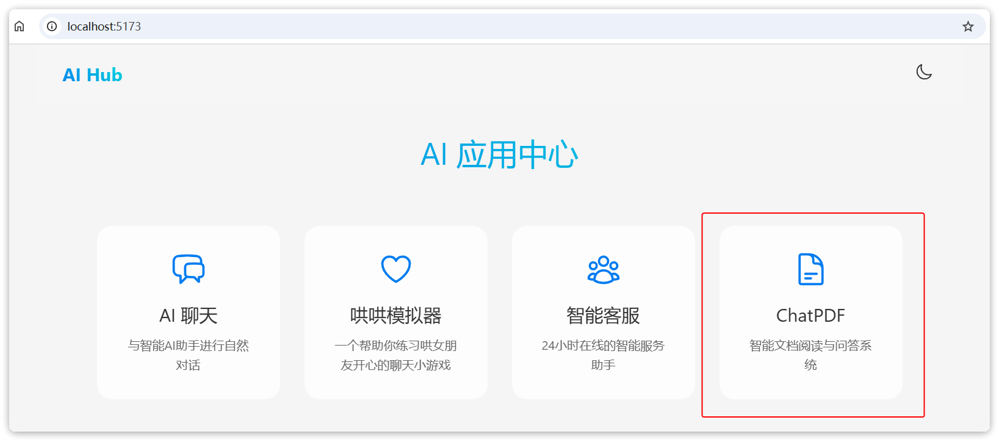
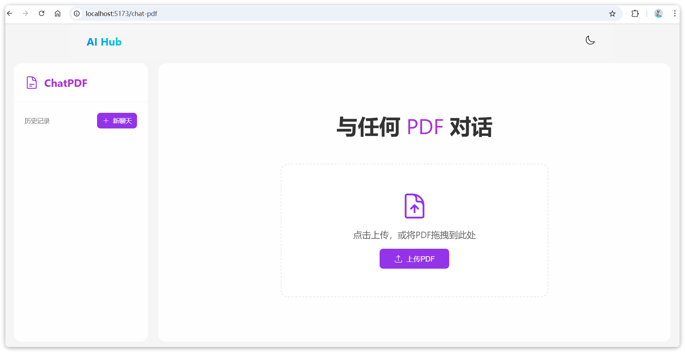
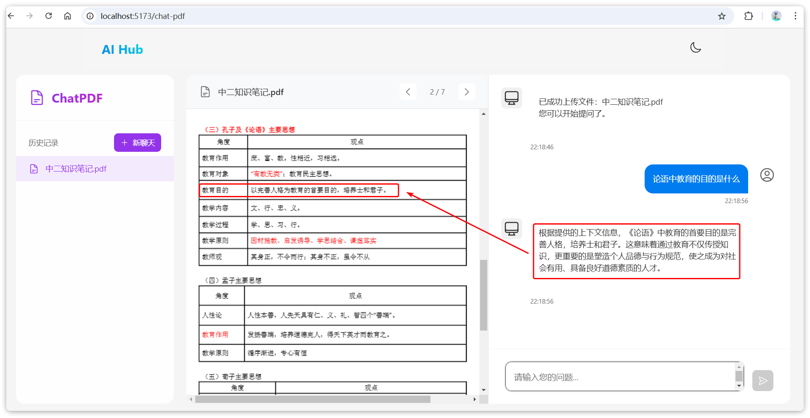

# 03.SpringAI(V1.0.0)-RAG Embedding


今天我们继续大模型应用开发的实战学习。我们会利用RAG技术来实现一个个人知识库应用：ChatPDF


由于训练大模型非常耗时，再加上训练语料本身比较滞后，所以大模型存在**知识限制**问题：

- 知识数据比较落后，往往是几个月之前的
- 不包含太过**专业领域**或者**企业私有**的数据


为了解决这些问题，我们就需要用到RAG了。下面我们简单回顾下RAG原理


## RAG原理

要解决大模型的知识限制问题，其实并不复杂。


解决的思路就是给大模型外挂一个**知识库**，可以是专业领域知识，也可以是企业私有的数据。


不过，知识库不能简单的直接拼接在提示词中。


因为通常知识库数据量都是非常大的，而大模型的上下文是有大小限制的，早期的GPT上下文不能超过2000token，现在也不到200k token，因此知识库不能直接写在提示词中。


怎么办？


思路很简单，庞大的知识库中与用户问题相关的其实并不多。

所以，我们需要想办法**从庞大的知识库中找到与用户问题相关的一小部分，组装成提示词**，发送给大模型就可以了。


那么问题来了，我们该如何从知识库中找到与用户问题相关的内容呢？


可能有同学会相到全文检索，但是在这里是不合适的，因为全文检索是文字匹配，这里我们要求的是内容上的相似度。


而要从内容相似度来判断，这就不得不提到**向量模型**的知识了。


### 向量模型

先说说向量，向量是空间中有方向和长度的量，空间可以是二维，也可以是多维。


向量既然是在空间中，两个向量之间就一定能计算距离。


我们以二维向量为例，向量之间的距离有两种计算方法：



通常，两个向量之间**欧式距离越近**，我们认为两个向量的**相似度越高**（距离值越小，相似度越高）


所以，如果我们能**把文本转为向量**，就可以**通过向量距离来判断文本的相似度**了。


现在，有不少的专门的**向量模型**，就可以实现将文本向量化。一个好的向量模型，就是要**尽可能让文本含义相似的向量，在空间中距离更近**：




接下来，我们就准备一个向量模型，用于将文本向量化。


阿里云百炼平台就提供了这样的模型：




这里我们选择`通用文本向量-v3`，这个模型兼容OpenAI，所以我们采用OpenAI的配置，但地址和API_KEY都采用阿里云百炼平台的地址。

导入openAI依赖

```XML
<dependency>
    <groupId>org.springframework.ai</groupId>
    <artifactId>spring-ai-starter-model-openai</artifactId>
</dependency>
```


修改`application.yaml`，添加向量模型配置：

```YAML
spring:
  application:
    name: spring-ai-demo
  ai:
    deepseek:
      api-key: ${DEEPSEEK_API_KEY} # 获取 DeepSeek API Key
      chat:
        options:
          model: deepseek-chat # 模型名称，默认为 deepseek-chat，可以不配
    chat:
      memory:
        repository:
          jdbc:
            initialize-schema: always # 自动建表
            schema: classpath:sql/schema-mysql.sql # 建表脚本
    openai: # 阿里云百炼平台兼容OpenAI，所以这里使用阿里云百炼平台地址
      base-url: https://dashscope.aliyuncs.com/compatible-mode
      api-key: ${QWEN_API_KEY}
      embedding:
        options:
          model: text-embedding-v3
          dimensions: 1024
  datasource:
    driver-class-name: com.mysql.cj.jdbc.Driver
    url: jdbc:mysql://localhost:3306/spring-ai-demo?serverTimezone=Asia/Shanghai&useUnicode=true&characterEncoding=utf-8&allowPublicKeyRetrieval=true&useSSL=false
    username: root
    password: MySQL123
logging:
  level:
    com.itheima: debug
    org.springframework.ai: debug
```


### 向量模型测试

前面说过，文本向量化以后，可以通过向量之间的距离来判断文本相似度。


接下来，我们就来测试下阿里百炼提供的向量大模型好不好用。


首先，我们在项目中写一个工具类，用以计算向量之间的**欧氏距离**和**余弦距离。**

新建一个`com.itheima.ai.util`包，在其中新建一个类：

```Java
package com.itheima.ai.util;

public class VectorDistanceUtils {
    
    // 防止实例化
    private VectorDistanceUtils() {}

    // 浮点数计算精度阈值
    private static final double EPSILON = 1e-12;

    /**
     * 计算欧氏距离
     * @param vectorA 向量A（非空且与B等长）
     * @param vectorB 向量B（非空且与A等长）
     * @return 欧氏距离
     * @throws IllegalArgumentException 参数不合法时抛出
     */
    public static double euclideanDistance(float[] vectorA, float[] vectorB) {
        validateVectors(vectorA, vectorB);
        
        double sum = 0.0;
        for (int i = 0; i < vectorA.length; i++) {
            double diff = vectorA[i] - vectorB[i];
            sum += diff * diff;
        }
        return Math.sqrt(sum);
    }

    /**
     * 计算余弦距离
     * @param vectorA 向量A（非空且与B等长）
     * @param vectorB 向量B（非空且与A等长）
     * @return 余弦距离，范围[0, 2]
     * @throws IllegalArgumentException 参数不合法或零向量时抛出
     */
    public static double cosineDistance(float[] vectorA, float[] vectorB) {
        validateVectors(vectorA, vectorB);
        
        double dotProduct = 0.0;
        double normA = 0.0;
        double normB = 0.0;
        
        for (int i = 0; i < vectorA.length; i++) {
            dotProduct += vectorA[i] * vectorB[i];
            normA += vectorA[i] * vectorA[i];
            normB += vectorB[i] * vectorB[i];
        }
        
        normA = Math.sqrt(normA);
        normB = Math.sqrt(normB);
        
        // 处理零向量情况
        if (normA < EPSILON || normB < EPSILON) {
            throw new IllegalArgumentException("Vectors cannot be zero vectors");
        }
        
        // 处理浮点误差，确保结果在[-1,1]范围内
        double similarity =  dotProduct / (normA * normB);
        similarity = Math.max(Math.min(similarity, 1.0), -1.0);
        
        return 1 - similarity;
    }

    // 参数校验统一方法
    private static void validateVectors(float[] a, float[] b) {
        if (a == null || b == null) {
            throw new IllegalArgumentException("Vectors cannot be null");
        }
        if (a.length != b.length) {
            throw new IllegalArgumentException("Vectors must have same dimension");
        }
        if (a.length == 0) {
            throw new IllegalArgumentException("Vectors cannot be empty");
        }
    }
}
```


由于SpringBoot的自动装配能力，刚才我们配置的向量模型可以直接使用。


接下来，我们写一个测试类：

```Java
package com.itheima.ai;

import com.itheima.ai.util.VectorDistanceUtils;
import org.junit.jupiter.api.Test;
import org.springframework.ai.chat.client.ChatClient;
import org.springframework.ai.openai.OpenAiChatModel;
import org.springframework.ai.openai.OpenAiEmbeddingModel;
import org.springframework.beans.factory.annotation.Autowired;
import org.springframework.boot.test.context.SpringBootTest;

import java.util.Arrays;
import java.util.List;

@SpringBootTest
class AiDemoApplicationTests {

    // 自动注入向量模型
    @Autowired
    private OpenAiEmbeddingModel embeddingModel;

    @Test
    public void testEmbedding() {
        // 1.测试数据
        // 1.1.用来查询的文本，国际冲突
        String query = "global conflicts";
        
        // 1.2.用来做比较的文本
        String[] texts = new String[]{
                "哈马斯称加沙下阶段停火谈判仍在进行 以方尚未做出承诺",
                "土耳其、芬兰、瑞典与北约代表将继续就瑞典“入约”问题进行谈判",
                "日本航空基地水井中检测出有机氟化物超标",
                "国家游泳中心（水立方）：恢复游泳、嬉水乐园等水上项目运营",
                "我国首次在空间站开展舱外辐射生物学暴露实验",
        };
        // 2.向量化
        // 2.1.先将查询文本向量化
        float[] queryVector = embeddingModel.embed(query);

        // 2.2.再将比较文本向量化，放到一个数组
        List<float[]> textVectors = embeddingModel.embed(Arrays.asList(texts));
        
        // 3.比较欧氏距离
        // 3.1.把查询文本自己与自己比较，肯定是相似度最高的
        System.out.println(VectorDistanceUtils.euclideanDistance(queryVector, queryVector));
        // 3.2.把查询文本与其它文本比较
        for (float[] textVector : textVectors) {
            System.out.println(VectorDistanceUtils.euclideanDistance(queryVector, textVector));
        }
        System.out.println("------------------");
        
        // 4.比较余弦距离
        // 4.1.把查询文本自己与自己比较，肯定是相似度最高的
        System.out.println(VectorDistanceUtils.cosineDistance(queryVector, queryVector));
        // 4.2.把查询文本与其它文本比较
        for (float[] textVector : textVectors) {
            System.out.println(VectorDistanceUtils.cosineDistance(queryVector, textVector));
        }
    }

}
```


运行结果：

```Bash
0.0
1.0722205301828829
1.0844350869313875
1.1185223356097924
1.1693257901084286
1.1499045763089124
------------------
2.220446049250313E-16
0.5748283836130118
0.5879996713271627
0.6255460276872555
0.6836613679467995
0.6611402672465168
```

可以看到，向量相似度确实符合我们的预期。


OK，有了比较文本相似度的办法，知识库的问题就可以解决了。


前面说了，知识库数据量很大，无法全部写入提示词。但是庞大的知识库中与用户问题相关的其实并不多。


所以，我们需要想办法**从庞大的知识库中找到与用户问题相关的一小部分，组装成提示词**，发送给大模型就可以了。


现在，利用向量大模型就可以帮助我们比较文本相似度。


但是新的问题来了：向量模型是帮我们生成向量的，如此庞大的知识库，谁来帮我们从中**比较和检索数据**呢？


这就需要用到**向量数据库**了。


### 向量数据库

向量数据库的主要作用有两个：

- 存储向量数据
- 基于相似度检索数据


刚好符合我们的需求。


SpringAI支持很多向量数据库，并且都进行了封装，可以用统一的API去访问：

- [Azure Vector Search](https://docs.spring.io/spring-ai/reference/api/vectordbs/azure.html) - The [Azure](https://learn.microsoft.com/en-us/azure/search/vector-search-overview) vector store.
- [Apache Cassandra](https://docs.spring.io/spring-ai/reference/api/vectordbs/apache-cassandra.html) - The [Apache Cassandra](https://cassandra.apache.org/doc/latest/cassandra/vector-search/overview.html) vector store.
- [Chroma Vector Store](https://docs.spring.io/spring-ai/reference/api/vectordbs/chroma.html) - The [Chroma](https://www.trychroma.com/) vector store.
- [Elasticsearch Vector Store](https://docs.spring.io/spring-ai/reference/api/vectordbs/elasticsearch.html) - The [Elasticsearch](https://www.elastic.co/) vector store.
- [GemFire Vector Store](https://docs.spring.io/spring-ai/reference/api/vectordbs/gemfire.html) - The [GemFire](https://tanzu.vmware.com/content/blog/vmware-gemfire-vector-database-extension) vector store.
- [MariaDB Vector Store](https://docs.spring.io/spring-ai/reference/api/vectordbs/mariadb.html) - The [MariaDB](https://mariadb.com/) vector store.
- [Milvus Vector Store](https://docs.spring.io/spring-ai/reference/api/vectordbs/milvus.html) - The [Milvus](https://milvus.io/) vector store.
- [MongoDB Atlas Vector Store](https://docs.spring.io/spring-ai/reference/api/vectordbs/mongodb.html) - The [MongoDB Atlas](https://www.mongodb.com/atlas/database) vector store.
- [Neo4j Vector Store](https://docs.spring.io/spring-ai/reference/api/vectordbs/neo4j.html) - The [Neo4j](https://neo4j.com/) vector store.
- [OpenSearch Vector Store](https://docs.spring.io/spring-ai/reference/api/vectordbs/opensearch.html) - The [OpenSearch](https://opensearch.org/platform/search/vector-database.html) vector store.
- [Oracle Vector Store](https://docs.spring.io/spring-ai/reference/api/vectordbs/oracle.html) - The [Oracle Database](https://docs.oracle.com/en/database/oracle/oracle-database/23/vecse/overview-ai-vector-search.html) vector store.
- [PgVector Store](https://docs.spring.io/spring-ai/reference/api/vectordbs/pgvector.html) - The [PostgreSQL/PGVector](https://github.com/pgvector/pgvector) vector store.
- [Pinecone Vector Store](https://docs.spring.io/spring-ai/reference/api/vectordbs/pinecone.html) - [PineCone](https://www.pinecone.io/) vector store.
- [Qdrant Vector Store](https://docs.spring.io/spring-ai/reference/api/vectordbs/qdrant.html) - [Qdrant](https://www.qdrant.tech/) vector store.
- [Redis Vector Store](https://docs.spring.io/spring-ai/reference/api/vectordbs/redis.html) - The [Redis](https://redis.io/) vector store.
- [SAP Hana Vector Store](https://docs.spring.io/spring-ai/reference/api/vectordbs/hana.html) - The [SAP HANA](https://news.sap.com/2024/04/sap-hana-cloud-vector-engine-ai-with-business-context/) vector store.
- [Typesense Vector Store](https://docs.spring.io/spring-ai/reference/api/vectordbs/typesense.html) - The [Typesense](https://typesense.org/docs/0.24.0/api/vector-search.html) vector store.
- [Weaviate Vector Store](https://docs.spring.io/spring-ai/reference/api/vectordbs/weaviate.html) - The [Weaviate](https://weaviate.io/) vector store.
- [SimpleVectorStore](https://github.com/spring-projects/spring-ai/blob/main/spring-ai-core/src/main/java/org/springframework/ai/vectorstore/SimpleVectorStore.java) - A simple implementation of persistent vector storage, good for educational purposes.


这些库都实现了统一的接口：`VectorStore`，因此操作方式一模一样，大家学会任意一个，其它就都不是问题。


不过，除了最后一个库以外，其它所有向量数据库都是需要安装部署的。每个企业用的向量库都不一样，这里我就不一一演示了。


#### SimpleVectorStore

最后一个`SimpleVectorStore`向量库是基于内存实现，是一个专门用来测试、教学用的库，非常适合我们。

我们需要先引入依赖：

```XML
<dependency>
    <groupId>org.springframework.ai</groupId>
    <artifactId>spring-ai-advisors-vector-store</artifactId>
</dependency>
```

然后直接修改`SpringAIConfiguration`，添加一个`VectorStore`的Bean：

```Java
@Configuration
public class SpringAIConfiguration{

    @Bean
    public VectorStore vectorStore(OpenAiEmbeddingModel embeddingModel) {
        return SimpleVectorStore.builder(embeddingModel).build();
    }
    
    // ... 略
}
```


#### VectorStore接口


接下来，你就可以使用`VectorStore`中的各种功能了，可以参考SpringAI官方文档：

<bookmark name="Vector Databases" href="https://docs.spring.io/spring-ai/reference/api/vectordbs.html"></bookmark>

这是`VectorStore`中声明的方法：

```Java
public interface VectorStore extends DocumentWriter {

    default String getName() {
                return this.getClass().getSimpleName();
        }
    // 保存文档到向量库
    void add(List<Document> documents);
    // 根据文档id删除文档
    void delete(List<String> idList);

    void delete(Filter.Expression filterExpression);

    default void delete(String filterExpression) { ... };
    // 根据条件检索文档
    List<Document> similaritySearch(String query);
    // 根据条件检索文档
    List<Document> similaritySearch(SearchRequest request);

    default <T> Optional<T> getNativeClient() {
                return Optional.empty();
        }
}
```


注意，`VectorStore`操作向量化的基本单位是`Document`，我们在使用时需要将自己的知识库分割转换为一个个的`Document`，然后写入`VectorStore`.


那么问题来了，我们该如何把各种不同的知识库文件转为Document呢？


### 文件读取和转换

前面说过，知识库太大，是需要拆分成文档片段，然后再做向量化的。而且SpringAI中向量库接收的是Document类型的文档，也就是说，我们处理文档还要转成Document格式。


不过，文档读取、拆分、转换的动作并不需要我们亲自完成。在SpringAI中提供了各种文档读取的工具，可以参考官网：

<bookmark name="ETL Interfaces" href="https://docs.spring.io/spring-ai/reference/api/etl-pipeline.html#_pdf_paragraph"></bookmark>


比如PDF文档读取和拆分，SpringAI提供了两种默认的拆分原则：

- `PagePdfDocumentReader` ：按页拆分，推荐使用
- `ParagraphPdfDocumentReader` ：按pdf的目录拆分，不推荐，因为很多PDF不规范，没有章节标签


当然，大家也可以自己实现PDF的读取和拆分功能。


这里我们选择使用`PagePdfDocumentReader`。

首先，我们需要在pom.xml中引入依赖：

```XML
<dependency>
    <groupId>org.springframework.ai</groupId>
    <artifactId>spring-ai-pdf-document-reader</artifactId>
</dependency>
```

然后就可以利用工具把PDF文件读取并处理成Document了。


我们在`SpringAiDemoApplicationTests`中写一个单元测试：

```java

@SpringBootTest
class SpringAiDemoApplicationTests {

    // 自动注入向量模型
    @Autowired
    private OpenAiEmbeddingModel embeddingModel;

    @Autowired
    private VectorStore vectorStore;

    @Test
    public void testEmbedding() {
        // 。。。略
    }

    @Test
    public void testVectorStore(){
       Resource resource = new FileSystemResource("java手册.pdf");
       // 1.创建PDF的读取器
       PagePdfDocumentReader reader = new PagePdfDocumentReader(
             resource, // 文件源
             PdfDocumentReaderConfig.builder()
                   .withPageExtractedTextFormatter(ExtractedTextFormatter.defaults())
                   .withPagesPerDocument(1) // 每1页PDF作为一个Document
                   .build()
       );
       // 2.读取PDF文档，拆分为Document
       List<Document> documents = reader.read();
       // 3.写入向量库
       vectorStore.add(documents);
       // 4.搜索
       SearchRequest request = SearchRequest.builder()
             .query("数据库索引规范有哪些")
             .topK(5)
             .similarityThreshold(0.6)
             .filterExpression("file_name == 'java手册.pdf'")
             .build();
       List<Document> docs = vectorStore.similaritySearch(request);
       if (docs == null) {
          System.out.println("没有搜索到任何内容");
          return;
       }
       for (Document doc : docs) {
          System.out.println(doc.getId());
          System.out.println(doc.getScore());
          System.out.println(doc.getText());
       }
    }
}
```


### RAG原理总结

OK，现在我们有了这些工具：

- PDFReader：读取文档并拆分为片段
- 向量大模型：将文本片段向量化
- 向量数据库：存储向量，检索向量


让我们梳理一下要解决的问题和解决思路：

- 要解决大模型的知识限制问题，需要外挂知识库
- 受到大模型上下文限制，知识库不能简单的直接拼接在提示词中
- 我们需要从庞大的知识库中找到与用户问题相关的一小部分，再组装成提示词
- 这些可以利用**文档读取器**、**向量大模型**、**向量数据库**来解决。


所以RAG要做的事情就是将知识库分割，然后利用向量模型做向量化，存入向量数据库，然后查询的时候去检索：


**第一阶段（存储知识库）**：

- 将知识库内容切片，分为一个个片段
- 将每个片段利用向量模型向量化
- 将所有向量化后的片段写入向量数据库


**第二阶段（检索知识库）**：

- 每当用户询问AI时，将用户问题向量化
- 拿着问题向量去向量数据库检索最相关的片段


**第三阶段（对话大模型）**：

- 将检索到的片段、用户的问题一起拼接为提示词
- 发送提示词给大模型，得到响应


<whiteboard token="VJfowMWSzhMHCTbnPYycRNngnSe"></whiteboard>


### 目标

好了，现在RAG所需要的基本工具都有了。


接下来，我们就来实现一个非常火爆的个人知识库AI应用，ChatPDF，原网站如下：  




这个网站其实就是把你个人的PDF文件作为知识库，让AI基于PDF内容来回答你的问题，对于大学生、研究人员、专业人士来说，非常方便。


当你学会了这个功能，实现其它知识库也都是类似的流程了。


来吧，我们一起动起来！


## PDF上传下载、向量化

既然是ChatPDF，也就是说所有知识库都是PDF形式的，由用户提交给我们。所以，我们需要先实现一个上传PDF的接口，在接口中实现下列功能：

- 校验文件格式是否为PDF
- 保存文件信息

  - 保存文件（可以是oss或本地保存）
  - 保存会话ID和文件路径的映射关系（方便查询会话历史的时候再次读取文件）
- 文档拆分和向量化（文档太大，需要拆分为一个个片段，分别向量化）


另外，将来用户查询会话历史，我们还需要返回pdf文件给前端用于预览，所以需要实现一个下载PDF接口，包含下面功能：

- 读取文件
- 返回文件给前端


### PDF文件管理

由于将来要实现PDF下载功能，我们需要记住每一个chatId对应的PDF文件名称。

所以，我们定义一个类，记录chatId与pdf文件的映射关系，同时实现基本的文件保存、文件向量化。

先在`com.itheima.ai.service`中定义接口：

```java
package com.itheima.ai.service;

import org.springframework.core.io.Resource;

public interface IFileService {
    /**
     * 保存文件,还要记录chatId与文件的映射关系
     * @param chatId 会话id
     * @param resource 文件
     * @return 上传成功，返回true； 否则返回false
     */
    boolean save(String chatId, Resource resource);

    /**
     * 根据chatId获取文件
     * @param chatId 会话id
     * @return 找到的文件
     */
    Resource getFile(String chatId);
}
```

再写一个实现类：

```java
package com.itheima.ai.service.impl;

import com.itheima.ai.service.IFileService;
import jakarta.annotation.PostConstruct;
import jakarta.annotation.PreDestroy;
import lombok.RequiredArgsConstructor;
import lombok.extern.slf4j.Slf4j;
import org.springframework.ai.document.Document;
import org.springframework.ai.reader.ExtractedTextFormatter;
import org.springframework.ai.reader.pdf.PagePdfDocumentReader;
import org.springframework.ai.reader.pdf.config.PdfDocumentReaderConfig;
import org.springframework.ai.vectorstore.SimpleVectorStore;
import org.springframework.ai.vectorstore.VectorStore;
import org.springframework.core.io.FileSystemResource;
import org.springframework.core.io.Resource;
import org.springframework.stereotype.Service;

import java.io.*;
import java.nio.charset.StandardCharsets;
import java.nio.file.Files;
import java.time.LocalDateTime;
import java.util.List;
import java.util.Objects;
import java.util.Properties;

@Slf4j
@Service
@RequiredArgsConstructor
public class FileServiceImpl implements IFileService {

    private final VectorStore vectorStore;

    // 会话id 与 文件名的对应关系，方便查询会话历史时重新加载文件
    private final Properties chatFiles = new Properties();

    @Override
    public boolean save(String chatId, Resource resource) {
        // 1.保存到本地磁盘
        String filename = resource.getFilename();
        File target = new File(Objects.requireNonNull(filename));
        if (!target.exists()) {
            try {
                Files.copy(resource.getInputStream(), target.toPath());
            } catch (IOException e) {
                log.error("Failed to save PDF resource.", e);
                return false;
            }
        }
        // 2.保存映射关系
        chatFiles.put(chatId, filename);
        // 3.写入向量库
        writeToVectorStore(resource, chatId);
        return true;
    }

    @Override
    public Resource getFile(String chatId) {
        return new FileSystemResource(chatFiles.getProperty(chatId));
    }

    @PostConstruct
    private void init() {
        FileSystemResource pdfResource = new FileSystemResource("chat-pdf.properties");
        if (pdfResource.exists()) {
            try {
                chatFiles.load(new BufferedReader(new InputStreamReader(pdfResource.getInputStream(), StandardCharsets.UTF_8)));
            } catch (IOException e) {
                throw new RuntimeException(e);
            }
        }
        FileSystemResource vectorResource = new FileSystemResource("chat-pdf.json");
        if (vectorResource.exists()) {
            SimpleVectorStore simpleVectorStore = (SimpleVectorStore) vectorStore;
            simpleVectorStore.load(vectorResource);
        }
    }

    @PreDestroy
    private void persistent() {
        try {
            chatFiles.store(new FileWriter("chat-pdf.properties"), LocalDateTime.now().toString());
            if(vectorStore != null && vectorStore instanceof SimpleVectorStore simpleVectorStore) {
                simpleVectorStore.save(new File("chat-pdf.json"));
            }
        } catch (IOException e) {
            throw new RuntimeException(e);
        }
    }

    private void writeToVectorStore(Resource resource, String chatId) {
        // 1.创建PDF的读取器
        PagePdfDocumentReader reader = new PagePdfDocumentReader(
                resource, // 文件源
                PdfDocumentReaderConfig.builder()
                        .withPageExtractedTextFormatter(ExtractedTextFormatter.defaults())
                        .withPagesPerDocument(1) // 每1页PDF作为一个Document
                        .build()
        );
        // 2.读取PDF文档，拆分为Document
        List<Document> documents = reader.read();
        documents.forEach(document -> document.getMetadata().put("chat_id", chatId));
        // 3.写入向量库
        vectorStore.add(documents);
    }
}
```


<callout emoji="❗">
**注意**：
由于我们选择了基于内存的SimpleVectorStore，重启就会丢失向量数据。所以这里我依然是将pdf文件与chatId的对应关系、VectorStore都持久化到了磁盘。
实际开发中，如果你选择了RedisVectorStore，或者CassandraVectorStore，则无序自己持久化。但是chatId和PDF文件之间的对应关系，还是需要自己维护的。
</callout>


### 上传文件响应结果

由于前端文件上传需要返回响应结果，我们先在`com.itheima.ai.entity.vo`中定义一个`Result`类：

```Java
package com.itheima.ai.entity.vo;

import lombok.Data;
import lombok.NoArgsConstructor;

@Data
@NoArgsConstructor
public class Result {
    private Integer ok;
    private String msg;

    private Result(Integer ok, String msg) {
        this.ok = ok;
        this.msg = msg;
    }

    public static Result ok() {
        return new Result(1, "ok");
    }

    public static Result fail(String msg) {
        return new Result(0, msg);
    }
}
```


### 文件上传、下载

接下来，我们实现上传和下载文件接口。


在`com.itheima.ai.controller`中创建一个`PdfController`：

```java
package com.itheima.ai.controller;

import com.itheima.ai.entity.vo.Result;
import com.itheima.ai.service.IFileService;
import com.itheima.ai.service.ISpringAiChatRecordService;
import lombok.RequiredArgsConstructor;
import lombok.extern.slf4j.Slf4j;
import org.springframework.ai.chat.client.ChatClient;
import org.springframework.ai.chat.client.advisor.vectorstore.QuestionAnswerAdvisor;
import org.springframework.ai.chat.memory.ChatMemory;
import org.springframework.core.io.Resource;
import org.springframework.http.MediaType;
import org.springframework.http.ResponseEntity;
import org.springframework.web.bind.annotation.*;
import org.springframework.web.multipart.MultipartFile;
import reactor.core.publisher.Flux;

import java.io.IOException;
import java.net.URLEncoder;
import java.nio.charset.StandardCharsets;
import java.util.Objects;

@Slf4j
@RequiredArgsConstructor
@RestController
@RequestMapping("/ai/pdf")
public class PdfController {

    private final IFileService fileService;

    private final ChatClient pdfChatClient;
    /**
     * 文件上传
     */
    @RequestMapping("/upload/{chatId}")
    public Result uploadPdf(@PathVariable String chatId, @RequestParam("file") MultipartFile file) {
        try {
            // 1. 校验文件是否为PDF格式
            if (!Objects.equals(file.getContentType(), "application/pdf")) {
                return Result.fail("只能上传PDF文件！");
            }
            // 2.保存文件
            boolean success = fileService.save(chatId, file.getResource());
            if(! success) {
                return Result.fail("保存文件失败！");
            }
            return Result.ok();
        } catch (Exception e) {
            log.error("Failed to upload PDF.", e);
            return Result.fail("上传文件失败！");
        }
    }

    /**
     * 文件下载
     */
    @GetMapping("/file/{chatId}")
    public ResponseEntity<Resource> download(@PathVariable("chatId") String chatId) throws IOException {
        // 1.读取文件
        Resource resource = fileService.getFile(chatId);
        if (!resource.exists()) {
            return ResponseEntity.notFound().build();
        }
        // 2.文件名编码，写入响应头
        String filename = URLEncoder.encode(Objects.requireNonNull(resource.getFilename()), StandardCharsets.UTF_8);
        // 3.返回文件
        return ResponseEntity.ok()
                .contentType(MediaType.APPLICATION_OCTET_STREAM)
                .header("Content-Disposition", "attachment; filename=\"" + filename + "\"")
                .body(resource);
    }
}
```


### 上传大小限制

SpringMVC有默认的文件大小限制，只有10M，很多知识库文件都会超过这个值，所以我们需要修改配置，增加文件上传允许的上限。

修改`application.yaml`文件，添加配置：

```yaml
spring:
  servlet:
    multipart:
      max-file-size: 30MB
      max-request-size: 40MB
```


### 暴露响应头

默认情况下跨域请求的响应头是不暴露的，这样前端就拿不到下载的文件名，我们需要修改CORS配置，暴露响应头：

```java
package com.itheima.ai.config;

import org.springframework.context.annotation.Configuration;
import org.springframework.web.servlet.config.annotation.CorsRegistry;
import org.springframework.web.servlet.config.annotation.WebMvcConfigurer;

@Configuration
public class MvcConfiguration implements WebMvcConfigurer {

    @Override
    public void addCorsMappings(CorsRegistry registry) {
        registry.addMapping("/**")
                .allowedOrigins("*")
                .allowedMethods("GET", "POST", "PUT", "DELETE", "OPTIONS")
                .allowedHeaders("*")
                .exposedHeaders("Content-Disposition");
    }
}
```


## 配置ChatClient

接下来就是最后的环节了，实现RAG的对话流程。

理论上来说，我们每次与AI对话的完整流程是这样的：

- 将用户的问题利用向量大模型做向量化 OpenAiEmbeddingModel
- 去向量数据库检索相关的文档 VectorStore
- 拼接提示词，发送给大模型
- 解析响应结果


不过，SpringAI同样基于AOP技术帮我们完成了全部流程，用到的是一个名`QuestionAnswerAdvisor`的Advisor。我们只需要把`VectorStore`配置到Advisor即可。


我们在`SpringAIConfiguration`中给ChatPDF也单独定义一个`ChatClient`：

```Java
@Bean
public ChatClient pdfChatClient(
        DeepSeekChatModel model,
        ChatMemory chatMemory,
        VectorStore vectorStore) {
    return ChatClient.builder(model)
            .defaultAdvisors(
                    SimpleLoggerAdvisor.builder().build(),
                    MessageChatMemoryAdvisor.builder(chatMemory).build(),
                    QuestionAnswerAdvisor
                            .builder(vectorStore)
                            .searchRequest(
                                    SearchRequest.builder() // 向量检索的请求参数
                                            .similarityThreshold(0.5d) // 相似度阈值
                                            .topK(2) // 返回的文档片段数量
                                            .build()
                            ).build()
            )
            .build();
}
```

我们也可以自己自定义RAG查询的流程，不使用Advisor，具体可参考官网：

<bookmark name="RetrievalAugmentationAdvisor (Incubating)" href="https://docs.spring.io/spring-ai/reference/api/retrieval-augmented-generation.html"></bookmark>


## 对话接口

最后，就是对接前端，然后与大模型对话了。修改`PdfController`，添加一个接口：

```Java
package com.itheima.ai.controller;

//  ... 略

@Slf4j
@RequiredArgsConstructor
@RestController
@RequestMapping("/ai/pdf")
public class PdfController {

    private final IFileService fileService;

    private final ISpringAiChatRecordService recordService;

    private final ChatClient pdfChatClient;
    // ... 略

    @RequestMapping(value = "/chat", produces = "text/html;charset=UTF-8")
    public Flux<String> chat(String prompt, String chatId) {
        recordService.saveRecord("pdf", chatId);
        return pdfChatClient
                .prompt(prompt)
                .advisors(a -> a.param(ChatMemory.CONVERSATION_ID, chatId))
                .advisors(a -> a.param(QuestionAnswerAdvisor.FILTER_EXPRESSION, "chat_id == '"+chatId+"'"))
                .stream()
                .content();
    }
}
```


## 总结测试

最终，项目结构如下：



打开浏览器，访问http://localhost:5173



点击ChatPDF卡片，进入对应页面：



上传一个PDF文件之后，就可以对PDF提问了，AI也会根据文档来回答问题



---
> 来源：飞书技术知识库（脱敏版） · 06 AI 应用开发 / Spring AI / Chap02. SpringAI / 03.SpringAI(V1.0.0)-RAG Embedding · [原文](https://ccn8v2zngwsm.feishu.cn/wiki/BKJ5wmShoiviEnknJpmcZMhdnlf)
