# 06 Elasticsearch入门

##  学习目标

1. 能够说出什么是倒排索引
2. 能够说出我们用的中文分词器是什么
3. 能够说出IK分词器如何扩展词典
4. 能够使用DSL操作索引库和文档（CRUD）
5. 能够使用Java Client向索引增删改查文档
6. 能够使用Java Client向索引批量导入文档
7. 能够使用Java Client进行Term查询
8. 能够使用Java Client进行全文检索
9. 能够使用Java Client实现排序和分页
10. 能够使用Java Client实现布尔查询


## 1  Elasticsearch快速入门

### 1.1. 认识Elasticsearch

#### 1.1.1 搜索需求

黑马商城作为一个电商项目，商品的搜索肯定是访问频率最高的页面之一。目前搜索功能是基于数据库的模糊搜索来实现的，存在很多问题。

##### 查询效率较低

由于数据库模糊查询不走索引，在数据量较大的时候，查询性能很差。黑马商城的商品表中仅仅有不到9万条数据，基于数据库查询时，搜索接口的表现如图：

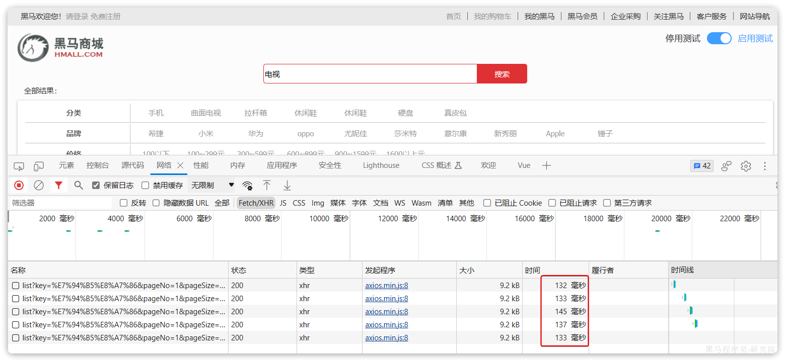

改为基于搜索引擎后，查询表现如下：

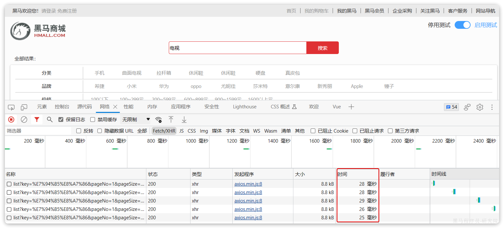

需要注意的是，数据库模糊查询随着表数据量的增多，查询性能的下降会非常明显，而搜索引擎的性能则不会随着数据增多而下降太多。目前仅10万不到的数据量差距就如此明显，如果数据量达到百万、千万、甚至上亿级别，这个性能差距会非常夸张。

##### 功能单一

数据库的模糊搜索功能单一，匹配条件非常苛刻，必须恰好包含用户搜索的关键字。而在搜索引擎中，用户输入出现个别错字，或者用拼音搜索、同义词搜索都能正确匹配到数据。

综上，在面临海量数据的搜索，或者有一些复杂搜索需求的时候，推荐使用全文搜索技术来实现搜索功能。

AI:开源全文搜索引擎，按使用用户量降序排序

根据社区支持、知名度和普遍的应用情况，我们可以做出一个大致的估计。以下是几个较为知名的开源全文搜索引擎，按照它们的流行度和使用广泛程度进行排序：

1. Elasticsearch

   - 概述：Elasticsearch 是一个分布式的、RESTful 接口的搜索引擎和分析引擎，基于 Lucene 构建。
   - 使用情况：被广泛用于日志分析、全文搜索、实时分析等领域，是 Elastic Stack 的核心组件之一。
   - 社区支持：拥有庞大的社区和丰富的文档，以及大量的第三方插件和工具。
   - 官网：[https://www.elastic.co/elasticsearch](https://www.elastic.co/elasticsearch)
2. Apache Solr

   - 概述：Solr 是一个高性能的企业级搜索平台，同样基于 Lucene 构建。
   - 使用情况：广泛应用于电子商务、新闻媒体、社交网络等多个领域。
   - 社区支持：拥有成熟的社区和文档，支持多种语言和框架。
   - 官网：[https://solr.apache.org/](https://solr.apache.org/)
3. Apache Lucene

   - 概述：Lucene 是一个高性能的全文检索库，是许多搜索引擎的基础。
   - 使用情况：由于其高度可定制性，Lucene 被广泛应用于构建定制化的搜索解决方案。
   - 社区支持：拥有庞大的 Java 开发者社区，支持多种编程语言。
   - 官网：[http://lucene.apache.org/](http://lucene.apache.org/)
4. MeiliSearch

   - 概述：MeiliSearch 是一个高度可配置、易于使用的搜索引擎。
   - 使用情况：适用于需要快速部署的项目，特别是在开发阶段。
   - 社区支持：拥有活跃的社区和良好的文档。
   - 官网：[https://meilisearch.com/](https://meilisearch.com/)
5. Zinc

   - 概述：Zinc 是一个轻量级的全文搜索引擎，用 Go 语言编写，旨在作为 Elasticsearch 的轻量级替代方案。
   - 使用情况：适用于资源有限的环境，如嵌入式系统或小型项目。
   - 社区支持：相对较小的社区，但持续增长。
   - 官网：[https://github.com/justwatchcom/zinc](https://github.com/justwatchcom/zinc)
6. CloriSearch

   - 概述：CloriSearch 是一个轻量级的全文搜索引擎，用 Rust 语言编写。
   - 使用情况：适用于需要高性能和稳定性的项目。
   - 社区支持：社区正在成长中，但提供了一个简洁且强大的接口。
   - 官网：[https://gitcode.net/shpilu/cloriSearch](https://gitcode.net/shpilu/cloriSearch)


排名第一的就是我们今天要学习的Elasticsearch.

Elasticsearch是一款非常强大的开源搜索引擎，支持的功能非常多，例如：

<grid>
<column width-ratio="0.500000">
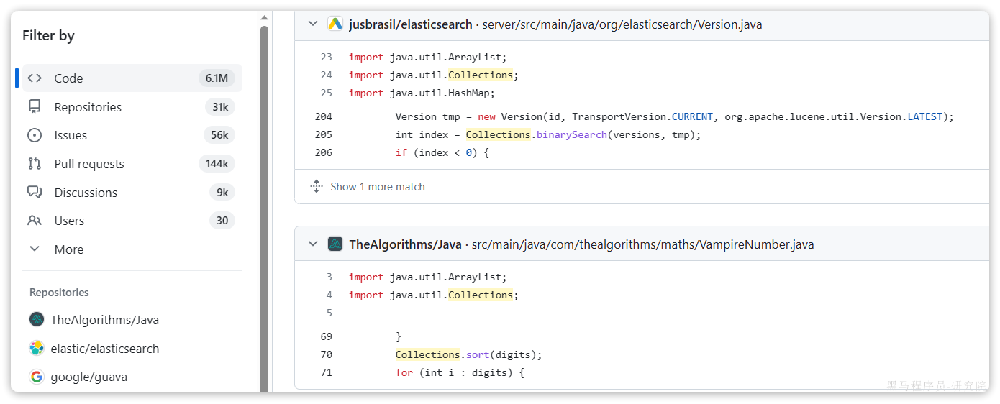
**代码搜索**
</column>
<column width-ratio="0.500000">

**商品搜索**
</column>
</grid>

<grid>
<column width-ratio="0.500000">
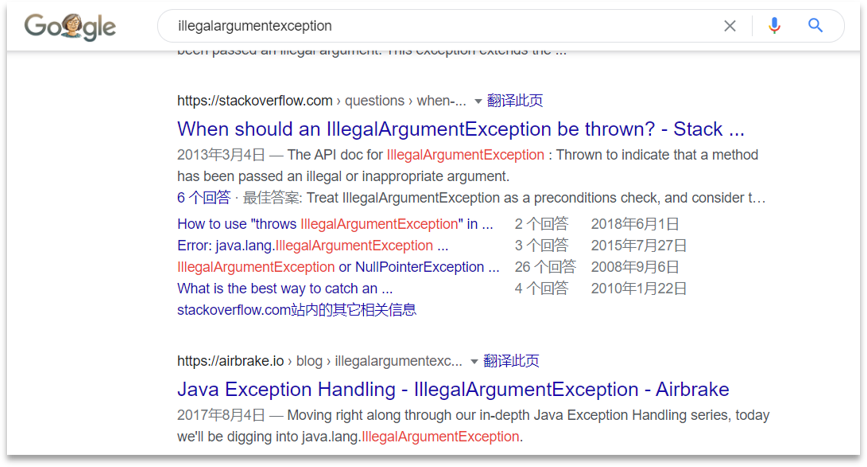
**解决方案搜索**
</column>
<column width-ratio="0.500000">

**地图搜索**
</column>
</grid>


#### 1.1.2 倒排索引

Elasticsearch之所以有如此高性能的搜索表现，正是得益于底层的倒排索引技术。那么什么是倒排索引呢？

**倒排**索引的概念是基于**正向**索引而言的。

##### 1.1.2.1 正向索引

我们先来回顾一下正向索引。

例如有一张名为`tb_goods`的表：

| **id** | **title** | **price** |
|-|-|-|
| 1 | 小米手机 | 3499 |
| 2 | 华为手机 | 4999 |
| 3 | 华为小米充电器 | 49 |
| 4 | 小米手环 | 49 |
| ... | ... | ... |


其中的`id`字段已经创建了索引，由于索引底层采用了B+树结构，因此我们根据id搜索的速度会非常快。但是其他字段例如`title`，只在叶子节点上存在。

因此要根据`title`搜索的时候只能遍历树中的每一个叶子节点，判断title数据是否符合要求。

比如用户的SQL语句为：

```SQL
select * from tb_goods where title like '%手机%';
```

那搜索的大概流程如图：

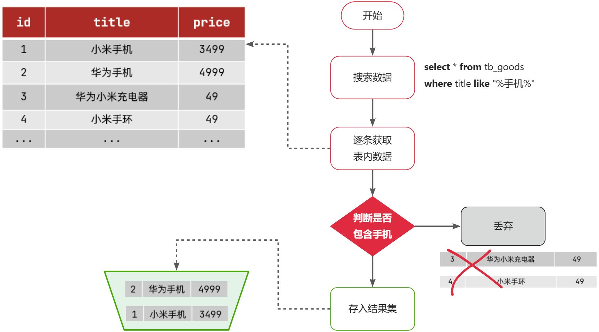

说明：

- 1）检查到搜索条件为`like '%手机%'`，需要找到`title`中包含`手机`的数据
- 2）逐条遍历每行数据（每个叶子节点），比如第1次拿到`id`为1的数据
- 3）判断数据中的`title`字段值是否符合条件
- 4）如果符合则放入结果集，不符合则丢弃
- 5）回到步骤1


综上，根据id精确匹配时，可以走索引，查询效率较高。而当搜索条件为模糊匹配时，由于索引无法生效，导致从索引查询退化为全表扫描，效率很差。

因此，正向索引适合于根据索引字段的精确搜索，不适合基于部分词条的模糊匹配。

而倒排索引恰好解决的就是根据部分词条模糊匹配的问题。

##### 1.1.2.2 倒排索引

倒排索引中有两个非常重要的概念：

- 文档（`Document`）：用来搜索的数据，其中的每一条数据就是一个文档。例如一个网页、一个商品信息
- 词条（`Term`）：对文档数据或用户搜索数据，利用某种算法分词，得到的具备含义的词语就是词条。例如：我是中国人，就可以分为：我、是、中国人、中国、国人这样的几个词条


**创建倒排索引**是对正向索引的一种特殊处理和应用，流程如下：

- 将每一个文档的数据利用**分词算法**根据语义拆分，得到一个个词条
- 倒排索引记录每个词条对应的文档id

此时形成的这张以词条为索引的表，就是倒排索引表，两者对比如下：

<grid>
<column width-ratio="0.500000">
**正向索引**
| **id（索引）** | **title** | **price** |
|-|-|-|
| 1 | 小米手机 | 3499 |
| 2 | 华为手机 | 4999 |
| 3 | 华为小米充电器 | 49 |
| 4 | 小米手环 | 49 |
| ... | ... | ... |
</column>
<column width-ratio="0.500000">
**倒排索引**
| **词条（索引）** | **文档id** |
|-|-|
| 小米 | 1，3，4 |
| 手机 | 1，2 |
| 华为 | 2，3 |
| 充电器 | 3 |
| 手环 | 4 |
</column>
</grid>


倒排索引的**搜索流程**如下（以搜索"华为手机"为例），如图：

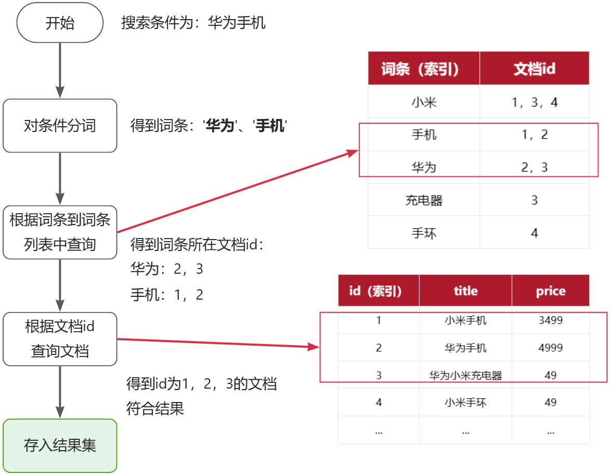

流程描述：

1）用户输入条件`"华为手机"`进行搜索。

2）对用户输入条件**分词**，得到词条：`华为`、`手机`。

3）拿着词条在倒排索引中查找（**由于词条有索引，查询效率很高**），即可得到包含词条的文档id：`1、2、3`。

4）拿着文档`id`到正向索引中查找具体文档即可（由于`id`也有索引，查询效率也很高）。


虽然要先查询倒排索引，再查询倒排索引，但是无论是词条、还是文档id都建立了索引，查询速度非常快！无需全表扫描。

##### 1.1.2.3 面试题

- 说下倒排索引？为什么叫倒排索引？

  - 对文档进行分词，形成不重复的词条和文档id列表的对应关系
  - 搜索的时候对搜索条件进行分词
- 项目为什么要用Elasticsearch？数据很多吗？


### 1.2. 安装Elasticsearch

#### 1.2.1 介绍Elasticsearch

Elasticsearch是由elastic公司开发的一套搜索引擎技术，Elasticsearch的官方网站如下：

<bookmark name="www.elastic.co" href="https://www.elastic.co/cn/elasticsearch/"></bookmark>

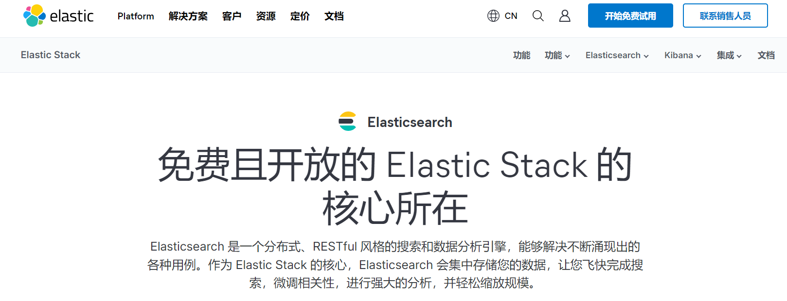

它是elastic技术栈中的一部分，整套技术栈被称为ELK，经常用来做日志收集、系统监控和状态分析等等。

AI:ELK是干什么的

ELK 是指一套流行的技术栈，用于构建高级的日志收集、分析和展示系统。ELK 是三个组件首字母的缩写，它们分别是：

1. Elasticsearch：这是一个分布式的、RESTful接口的搜索和分析引擎。它能够存储大量的数据，并且提供近乎实时的搜索能力。在ELK栈中，Elasticsearch作为存储和搜索日志数据的核心。
2. Logstash：Logstash 是一个服务器端的工具，用于接收来自各种数据源的日志数据，它可以解析、转换这些数据，并将其发送到Elasticsearch中存储。Logstash支持多种插件，可以轻松地从不同的数据源收集数据。
3. Kibana：Kibana 是一个基于Web的用户界面，用于对存储在Elasticsearch中的数据进行可视化。它允许用户创建复杂的查询来分析数据，并以图表、表格等形式展示数据。

近年来，随着Elastic生态的发展，Beats（比如Filebeat）这类轻量级的日志收集器也被广泛采用，它们通常部署在多个服务器上，负责将日志数据发送给Logstash或者直接送入Elasticsearch。尽管Beats不是传统意义上的ELK栈的一部分，但是它们经常被一起提及，因为它们简化了日志数据的收集过程。

总的来说，ELK栈提供了一个全面的日志管理系统，它能够帮助组织捕获、存储、分析和展示大量的日志数据。这套系统常被用来监测应用程序性能、跟踪用户行为、进行网络安全分析等多种用途。


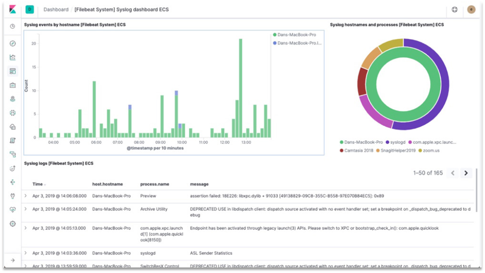


整套技术栈的核心就是用来**存储**、**搜索**、**计算**的Elasticsearch，因此我们接下来学习的核心也是Elasticsearch。

我们要安装的内容包含2部分：

- elasticsearch：存储、搜索和运算
- kibana：图形化展示控制台

#### 1.2.2 安装Elasticsearch

删除旧容器

```Plain Text
docker rm -f elasticsearch7.17.7
```


创建容器

```Java
docker run -d \
--name es \
--restart always \
-p 9200:9200 \
-p 9300:9300 \
-e "discovery.type=single-node" \
-e "ES_JAVA_OPTS=-Xms512m -Xmx512m" \
-v /data/soft/es7.17.7/xzb/data:/usr/share/elasticsearch/data \
-v /data/soft/es7.17.7/xzb/plugins:/usr/share/elasticsearch/plugins \
-v /data/soft/es7.17.7/xzb/config:/usr/share/elasticsearch/config \
elasticsearch:7.17.7
```


安装完成后，访问9200端口(http://192.168.101.68:9200/)，即可看到响应的Elasticsearch服务的基本信息：

```JavaScript
{
  "name" : "4251f98ff357",
  "cluster_name" : "docker-cluster",
  "cluster_uuid" : "aB_5c-y4St-NU-MFHxiVvg",
  "version" : {
    "number" : "7.17.7",
    "build_flavor" : "default",
    "build_type" : "docker",
    "build_hash" : "78dcaaa8cee33438b91eca7f5c7f56a70fec9e80",
    "build_date" : "2022-10-17T15:29:54.167373105Z",
    "build_snapshot" : false,
    "lucene_version" : "8.11.1",
    "minimum_wire_compatibility_version" : "6.8.0",
    "minimum_index_compatibility_version" : "6.0.0-beta1"
  },
  "tagline" : "You Know, for Search"
}
```

#### 1.2.3 安装Kibana

删除旧容器

```Plain Text
docker rm -f kibana7.17.7

curl -X DELETE http://192.168.101.68:9200/.kibana_task_manager*
```


启动新容器

```Java
docker run --name kibana \
-e ELASTICSEARCH_HOSTS=http://192.168.101.68:9200 \
--restart always \
-p 5601:5601 \
-d kibana:7.17.7
```

下边启动容器，先保证Elasticsearch启动成功。

启动kibana容器成功，在浏览器输入地址访问：`http://192.168.101.68:5601`


#### 1.2.4 小结

安装Elasticsearch和Kibana需要注意：Elasticsearch和Kibana的版本需要保持一致。

我们项目用的版本是7.17.7。


ELK是干什么的？包括哪些中间件？

ELK用于构建日志收集分析系统，包括：

- Elasticsearch：用于数据存储、计算和搜索
- Logstash/Beats：用于数据收集
- Kibana：用于数据可视化

通过Logstash将应用程序的日志采集到Elasticsearch中，通过Elasticsearch对日志进行分析，通过Kibana展示查询日志，展示分析的结果。


### 1.3.基础概念

elasticsearch中有很多独有的概念，与mysql中略有差别，但也有相似之处。

#### 1.3.1 文档和字段

elasticsearch是面向**文档（Document）**存储的，可以是数据库中的一条商品数据，一个订单信息。文档数据会被序列化为`json`格式后存储在`elasticsearch`中：

<grid>
<column width-ratio="0.500000">
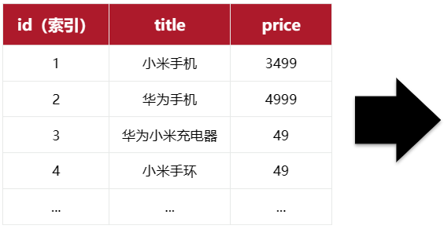
</column>
<column width-ratio="0.500000">
```JSON
{
    "id": 1,
    "title": "小米手机",
    "price": 3499
}
{
    "id": 2,
    "title": "华为手机",
    "price": 4999
}
{
    "id": 3,
    "title": "华为小米充电器",
    "price": 49
}
{
    "id": 4,
    "title": "小米手环",
    "price": 299
}

```
</column>
</grid>

因此，原本数据库中的一行数据就是ES中的一个JSON文档；而数据库中每行数据都包含很多列，这些列就转换为JSON文档中的**字段（Field）**。


#### 1.3.2 索引和映射

随着业务发展，需要在es中存储的文档也会越来越多，比如有商品的文档、用户的文档、订单文档等等：

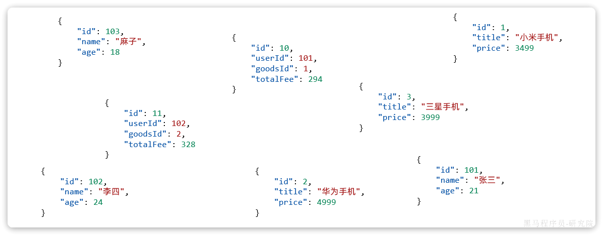

所有文档都散乱存放显然非常混乱，也不方便管理，因此，我们要将相同类型的文档集中在一起管理，称为**索引（Index）**。例如：

<grid>
<column width-ratio="0.333333">
**商品索引**
```JSON
{
    "id": 1,
    "title": "小米手机",
    "price": 3499
}

{
    "id": 2,
    "title": "华为手机",
    "price": 4999
}

{
    "id": 3,
    "title": "三星手机",
    "price": 3999
}
```
</column>
<column width-ratio="0.333333">
**用户索引**
```JSON
{
    "id": 101,
    "name": "张三",
    "age": 21
}

{
    "id": 102,
    "name": "李四",
    "age": 24
}

{
    "id": 103,
    "name": "麻子",
    "age": 18
}
```
</column>
<column width-ratio="0.333333">
**订单索引**
```JSON
{
    "id": 10,
    "userId": 101,
    "goodsId": 1,
    "totalFee": 294
}

{
    "id": 11,
    "userId": 102,
    "goodsId": 2,
    "totalFee": 328
}

```
</column>
</grid>

- 所有用户文档，就可以组织在一起，称为用户的索引；
- 所有商品的文档，可以组织在一起，称为商品的索引；
- 所有订单的文档，可以组织在一起，称为订单的索引；


**索引就类似数据库表**，MySQL中我们会先创建表结构再向表中插入数据，同样，ES中的索引也有结构，那就是**映射(mapping)**，在 Elasticsearch 中，映射(mapping)定义了索引(index)中文档(document)的结构和字段(field)的数据类型及属性，映射类似于关系数据库中的表结构定义，它告诉 Elasticsearch 如何解析、存储和索引数据。


#### 1.3.3 总结

我们对mysql与elasticsearch的概念做一下对比：

| **MySQL** | **Elasticsearch** | **说明** |
|-|-|-|
| Table | Index | 索引(index)，就是文档的集合，类似数据库的表(table) |
| Row | Document | 文档（Document），就是一条条的数据，类似数据库中的行（Row），文档都是JSON格式 |
| Column | Field | 字段（Field），就是JSON文档中的字段，类似数据库中的列（Column） |
| Schema | Mapping | Mapping（映射）是索引中文档的约束，例如字段类型约束。类似数据库的表结构（Schema） |
| SQL | DSL | DSL是elasticsearch提供的JSON风格的请求语句，用来操作elasticsearch，实现CRUD |

如图：

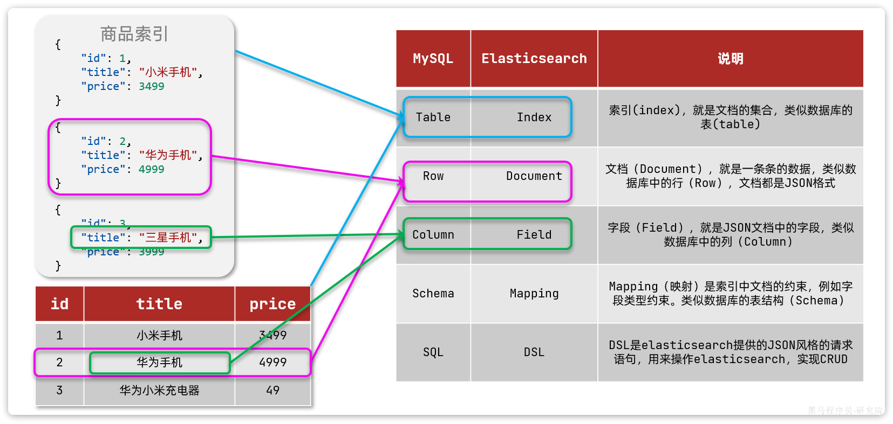


那是不是说，我们学习了elasticsearch就不再需要mysql了呢？

并不是如此，两者各自有自己的擅长之处：

-  Mysql：擅长事务类型操作，可以确保数据的安全和一致性 
-  Elasticsearch：擅长海量数据的搜索、分析、计算 


因此在企业中，往往是两者结合使用：

- 对安全性要求较高的写操作，使用mysql实现
- 对查询性能要求较高的搜索需求，使用elasticsearch实现
- 两者再基于某种方式，实现数据的同步，保证一致性

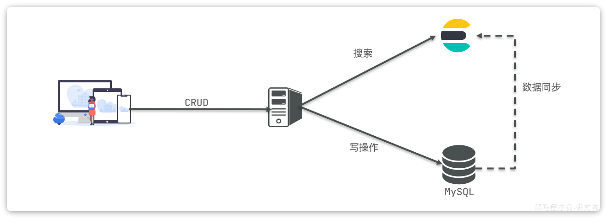


### 1.4. IK分词器

#### 1.4.1 认识分词器

Elasticsearch的底层是倒排索引，倒排索引中的词条来源于对文档内容的分词，分词器正是负责对文档内容进行分词。

Elasticsearch 的分词器(analyzers)是用于处理文本数据的关键组件。它们负责将原始文本分解成一系列词条(tokens)，并对这些词条进行规范化(normalization)，以便进行索引和搜索。分词器由两个主要部分组成：tokenizer（分词） 和 filter（过滤）。Tokenizer 负责将文本分割成词条，而 filter 则对这些词条进行额外的处理，比如转换为小写、去除停用词等。

Elasticsearch 提供了多种内置分词器：

Standard Analyzer:标准分词器（standard），这是默认的分词器，用于大多数情况。它会移除标点符号，并将文本转换为小写。

Stop Analyzer：停用词分词器（stop），除了执行标准分词器的操作之外，还会过滤掉一些常见的英文停用词(stop words)。

Simple Analyzer：简单分词器（simple），会移除常见的 HTML 标签，并且会将所有字母转换为小写。

Whitespace Analyzer：空白字符分词器（whitespace），仅根据空白字符分割文本。


下边可以测试标准分词器的分词效果：

标准分词器是根据空格进行分词。

"analyzer"指定分词器名称"standard"

"text"：分词内容

```JavaScript

POST _analyze
{
  "analyzer": "standard",
  "text": "The quick brown fox jumps over the lazy dog."
}


```

效果：

```JavaScript

{
  "tokens" : [
    {
      "token" : "the",
      "start_offset" : 0,
      "end_offset" : 3,
      "type" : "<ALPHANUM>",
      "position" : 0
    },
    {
      "token" : "quick",
      "start_offset" : 4,
      "end_offset" : 9,
      "type" : "<ALPHANUM>",
      "position" : 1
    },
    {
      "token" : "brown",
      "start_offset" : 10,
      "end_offset" : 15,
      "type" : "<ALPHANUM>",
      "position" : 2
    },
    {
      "token" : "fox",
      "start_offset" : 16,
      "end_offset" : 19,
      "type" : "<ALPHANUM>",
      "position" : 3
    },
    {
      "token" : "jumps",
      "start_offset" : 20,
      "end_offset" : 25,
      "type" : "<ALPHANUM>",
      "position" : 4
    },
    {
      "token" : "over",
      "start_offset" : 26,
      "end_offset" : 30,
      "type" : "<ALPHANUM>",
      "position" : 5
    },
    {
      "token" : "the",
      "start_offset" : 31,
      "end_offset" : 34,
      "type" : "<ALPHANUM>",
      "position" : 6
    },
    {
      "token" : "lazy",
      "start_offset" : 35,
      "end_offset" : 39,
      "type" : "<ALPHANUM>",
      "position" : 7
    },
    {
      "token" : "dog",
      "start_offset" : 40,
      "end_offset" : 43,
      "type" : "<ALPHANUM>",
      "position" : 8
    }
  ]
}

```

再测试停用词分词器：

在 Elasticsearch 中，停用词(stop words)是指在索引和搜索过程中被忽略的常见词汇。这些词汇通常是语言中的功能词，如冠词、介词、连词等，它们在自然语言处理中出现频率很高，但对于文档的语义意义贡献较小。因此，在全文搜索中，停用词通常被过滤掉，以提高搜索性能和相关性。

```JavaScript
POST _analyze
{
  "analyzer": "stop",
  "text": "The quick brown fox jumps over the lazy dog."
}

```

效果：

```JavaScript

{
  "tokens" : [
    {
      "token" : "quick",
      "start_offset" : 4,
      "end_offset" : 9,
      "type" : "word",
      "position" : 1
    },
    {
      "token" : "brown",
      "start_offset" : 10,
      "end_offset" : 15,
      "type" : "word",
      "position" : 2
    },
    {
      "token" : "fox",
      "start_offset" : 16,
      "end_offset" : 19,
      "type" : "word",
      "position" : 3
    },
    {
      "token" : "jumps",
      "start_offset" : 20,
      "end_offset" : 25,
      "type" : "word",
      "position" : 4
    },
    {
      "token" : "over",
      "start_offset" : 26,
      "end_offset" : 30,
      "type" : "word",
      "position" : 5
    },
    {
      "token" : "lazy",
      "start_offset" : 35,
      "end_offset" : 39,
      "type" : "word",
      "position" : 7
    },
    {
      "token" : "dog",
      "start_offset" : 40,
      "end_offset" : 43,
      "type" : "word",
      "position" : 8
    }
  ]
}

```


上边内置的分词器都不支持对中文分词，我们用标准分词器测试：


```JavaScript
POST /_analyze
{
  "analyzer": "standard",
  "text": "黑马程序员学习java太棒了"
}
```

结果如下：

```JSON
{
  "tokens" : [
    {
      "token" : "黑",
      "start_offset" : 0,
      "end_offset" : 1,
      "type" : "<IDEOGRAPHIC>",
      "position" : 0
    },
    {
      "token" : "马",
      "start_offset" : 1,
      "end_offset" : 2,
      "type" : "<IDEOGRAPHIC>",
      "position" : 1
    },
    {
      "token" : "程",
      "start_offset" : 2,
      "end_offset" : 3,
      "type" : "<IDEOGRAPHIC>",
      "position" : 2
    },
    {
      "token" : "序",
      "start_offset" : 3,
      "end_offset" : 4,
      "type" : "<IDEOGRAPHIC>",
      "position" : 3
    },
    {
      "token" : "员",
      "start_offset" : 4,
      "end_offset" : 5,
      "type" : "<IDEOGRAPHIC>",
      "position" : 4
    },
    {
      "token" : "学",
      "start_offset" : 5,
      "end_offset" : 6,
      "type" : "<IDEOGRAPHIC>",
      "position" : 5
    },
    {
      "token" : "习",
      "start_offset" : 6,
      "end_offset" : 7,
      "type" : "<IDEOGRAPHIC>",
      "position" : 6
    },
    {
      "token" : "java",
      "start_offset" : 7,
      "end_offset" : 11,
      "type" : "<ALPHANUM>",
      "position" : 7
    },
    {
      "token" : "太",
      "start_offset" : 11,
      "end_offset" : 12,
      "type" : "<IDEOGRAPHIC>",
      "position" : 8
    },
    {
      "token" : "棒",
      "start_offset" : 12,
      "end_offset" : 13,
      "type" : "<IDEOGRAPHIC>",
      "position" : 9
    },
    {
      "token" : "了",
      "start_offset" : 13,
      "end_offset" : 14,
      "type" : "<IDEOGRAPHIC>",
      "position" : 10
    }
  ]
}

```


可以看到，标准分词器智能1字1词条，无法正确对中文做分词。

接下来我们安装一种可以进行中文分词的分词器：IK分词器。


#### 1.4.2 IK分词器

##### 1.4.2.1 安装

IK 分词器是一种广泛应用于中文文本处理的分词工具，尤其在中文搜索引擎和文本分析领域非常常见。


**方案一**：在线安装（不建议）

运行一个命令即可：

```Shell
docker exec -it es ./bin/elasticsearch-plugin  install https://github.com/medcl/elasticsearch-analysis-ik/releases/download/v7.12.1/elasticsearch-analysis-ik-7.12.1.zip
```

然后重启es容器：

```Shell
docker restart es
```


**方案二**：离线安装（推荐）

如果网速较差，也可以选择离线安装。

首先，找到Elasticsearch容器的plugins数据卷目录：/data/soft/es7.17.7/xzb/plugins

我们需要把IK分词器上传至这个目录。


找到课前资料提供的ik分词器插件，

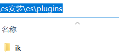

将ik目录上传至虚拟机的/data/soft/es7.17.7/xzb/plugins这个目录：

最后，重启es容器：

```Shell
docker restart es
```

我们在安装ES时已经将此目录拷贝到了虚拟机，所以IK分词已经安装成功。

##### 1.4.2.2 测试

下边测试IK分词器：

IK分词器包含两种模式：

`ik_smart`：智能模式

- 特点：尽可能地减少输出的词数，适合用于标题或者短文本的分词。
- 示例：对于输入“中华人民共和国”，智能模式会输出“中华人民共和国”。

`ik_max_word`：最细粒度模式

- 特点：尽可能多地输出词，适合用于正文或者长文本的分词。
- 示例：对于输入“中华人民共和国”，细粒度模式会输出“中华”、“人民”、“中华人”、“中华人民”、“中华人民共和国”。

我们先用智能模式测试：

```JSON
POST /_analyze
{
  "analyzer": "ik_smart",
  "text": "中华人民共和国"
}
```

执行结果如下：

```JSON
{
  "tokens" : [
    {
      "token" : "中华人民共和国",
      "start_offset" : 0,
      "end_offset" : 7,
      "type" : "CN_WORD",
      "position" : 0
    }
  ]
}
```

我们再用细粒度模式测试：

```JSON
POST /_analyze
{
  "analyzer": "ik_max_word",
  "text": "中华人民共和国"
}


```

执行结果如下：

```JSON

{
  "tokens" : [
    {
      "token" : "中华人民共和国",
      "start_offset" : 0,
      "end_offset" : 7,
      "type" : "CN_WORD",
      "position" : 0
    },
    {
      "token" : "中华人民",
      "start_offset" : 0,
      "end_offset" : 4,
      "type" : "CN_WORD",
      "position" : 1
    },
    {
      "token" : "中华",
      "start_offset" : 0,
      "end_offset" : 2,
      "type" : "CN_WORD",
      "position" : 2
    },
    {
      "token" : "华人",
      "start_offset" : 1,
      "end_offset" : 3,
      "type" : "CN_WORD",
      "position" : 3
    },
    {
      "token" : "人民共和国",
      "start_offset" : 2,
      "end_offset" : 7,
      "type" : "CN_WORD",
      "position" : 4
    },
    {
      "token" : "人民",
      "start_offset" : 2,
      "end_offset" : 4,
      "type" : "CN_WORD",
      "position" : 5
    },
    {
      "token" : "共和国",
      "start_offset" : 4,
      "end_offset" : 7,
      "type" : "CN_WORD",
      "position" : 6
    },
    {
      "token" : "共和",
      "start_offset" : 4,
      "end_offset" : 6,
      "type" : "CN_WORD",
      "position" : 7
    },
    {
      "token" : "国",
      "start_offset" : 6,
      "end_offset" : 7,
      "type" : "CN_CHAR",
      "position" : 8
    }
  ]
}

```


#### 1.4.3.拓展词典

随着互联网的发展，“造词运动”也越发的频繁。出现了很多新的词语，在原有的词汇列表中并不存在。比如：“泰裤辣”，“传智播客”, "奥利给" 等。

IK分词器无法对这些词汇分词，测试一下：

```JSON
POST /_analyze
{
  "analyzer": "ik_max_word",
  "text": "传智播客开设大学,奥利给！"
}
```

结果：

```JSON
#! Elasticsearch built-in security features are not enabled. Without authentication, your cluster could be accessible to anyone. See https://www.elastic.co/guide/en/elasticsearch/reference/7.17/security-minimal-setup.html to enable security.
{
  "tokens" : [
    {
      "token" : "传智播客",
      "start_offset" : 0,
      "end_offset" : 4,
      "type" : "CN_WORD",
      "position" : 0
    },
    {
      "token" : "开设",
      "start_offset" : 4,
      "end_offset" : 6,
      "type" : "CN_WORD",
      "position" : 1
    },
    {
      "token" : "大学",
      "start_offset" : 6,
      "end_offset" : 8,
      "type" : "CN_WORD",
      "position" : 2
    },
    {
      "token" : "奥",
      "start_offset" : 9,
      "end_offset" : 10,
      "type" : "CN_CHAR",
      "position" : 3
    },
    {
      "token" : "利",
      "start_offset" : 10,
      "end_offset" : 11,
      "type" : "CN_CHAR",
      "position" : 4
    },
    {
      "token" : "给",
      "start_offset" : 11,
      "end_offset" : 12,
      "type" : "CN_CHAR",
      "position" : 5
    }
  ]
}

```

可以看到，传智播客能分词（因为已经配置了扩展词），奥利给无法正确分词（还未配置扩展词）。

所以要想正确分词，IK分词器的词库也需要不断的更新，IK分词器提供了扩展词汇的功能。

1）打开IK分词器config目录：

```Shell
cd /data/soft/es7.17.7/xzb/plugins/ik/config/
```

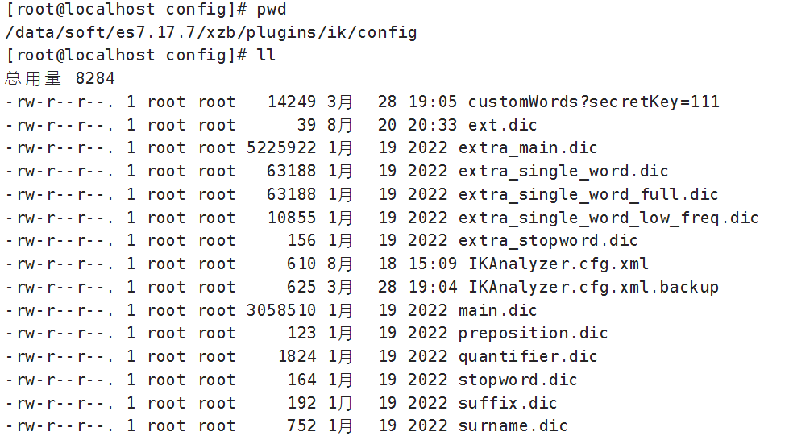

注意，如果采用在线安装的通过，默认是没有config目录的，需要把课前资料提供的ik下的config上传至对应目录。


2）在IKAnalyzer.cfg.xml配置文件内容添加：

```JavaScript
<?xml version="1.0" encoding="UTF-8"?>
<!DOCTYPE properties SYSTEM "http://java.sun.com/dtd/properties.dtd">
<properties>
        <comment>IK Analyzer 扩展配置</comment>
        <!--用户可以在这里配置自己的扩展字典 -->
        <entry key="ext_dict"></entry>
         <!--用户可以在这里配置自己的扩展停止词字典-->
        <entry key="ext_stopwords"></entry>
        <!--用户可以在这里配置远程扩展字典 -->
         <entry key="remote_ext_dict"></entry>
        <!--用户可以在这里配置远程扩展停止词字典-->
        <!-- <entry key="remote_ext_stopwords">words_location</entry> -->
</properties>

```

ext_dict：本地扩展词典

ext_stopwords：本地扩展停用词

remote_ext_dict：远程扩展词典，配置一个http连接，通过经连接可以获取扩展词典。

remote_ext_stopwords：远程扩展停用词

我们用ext_dict进行测试，配置一个本地扩展词典文件。


3）在IK分词器的config目录新建一个 `ext.dic`，一行占一个词语。

```Plain Text
奥利给
```

在IKAnalyzer.cfg.xml文件中配置ext.dic。

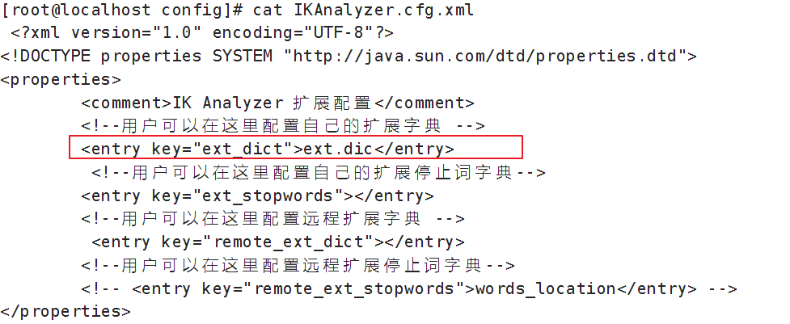


4）重启elasticsearch

```Shell
docker restart es
```


再次测试，请求：

```JavaScript
POST /_analyze
{
  "analyzer": "ik_max_word",
  "text": "传智播客开设大学,奥利给！"
}
```

可以发现奥利给正确分词了：

```JSON
#! Elasticsearch built-in security features are not enabled. Without authentication, your cluster could be accessible to anyone. See https://www.elastic.co/guide/en/elasticsearch/reference/7.17/security-minimal-setup.html to enable security.
{
  "tokens" : [
    {
      "token" : "传智播客",
      "start_offset" : 0,
      "end_offset" : 4,
      "type" : "CN_WORD",
      "position" : 0
    },
    {
      "token" : "开设",
      "start_offset" : 4,
      "end_offset" : 6,
      "type" : "CN_WORD",
      "position" : 1
    },
    {
      "token" : "大学",
      "start_offset" : 6,
      "end_offset" : 8,
      "type" : "CN_WORD",
      "position" : 2
    },
    {
      "token" : "奥利给",
      "start_offset" : 9,
      "end_offset" : 12,
      "type" : "CN_WORD",
      "position" : 3
    }
  ]
}

```


#### 1.4.4总结

分词器的作用是什么？

- 创建倒排索引时，对文档分词
- 用户搜索时，对输入的内容分词


IK分词器有几种模式？

- `ik_smart`：智能模式，粗粒度
- `ik_max_word`：细粒度模式，细粒度


IK分词器如何拓展词条？

- 利用config目录的`IkAnalyzer.cfg.xml`文件添加拓展词典和停用词典
- 在词典中添加拓展词条或者停用词条

### 1.5. 快速入门

#### 1.5.1 创建索引

根据前边对倒排索引的理解，倒排索引就是根据词找文档，词就是索引，所以要想完成搜索功能开发第一步就是要创建索引，有了索引就可以搜索了。

打开Kibana，进入DevTools，如下图：

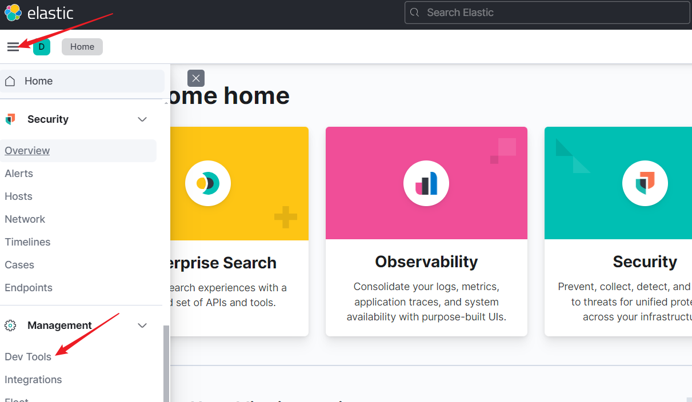

进入DevTools

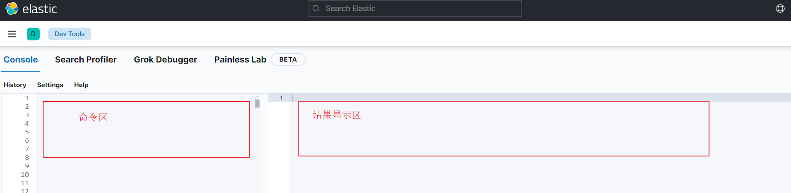


AI: elasticsearch快速入门


执行下边的命令向ES添加文档，如果my_index索引不存在会自动创建：

```JavaScript
POST /my_index/_doc/1
{
  "title": "Elasticsearch: cool and easy",
  "content": "This is a test document"
}

```

Elasticsearch提供RESTful接口供创建索引、修改索引、删除索引等操作。

**请求路径**：/my_index/\_doc/1

**请求内容**：json结构

整体路径表示一个文档的地址。

**my_index**：表示索引名称，相当于MySQL的表名，如果没有会自动创建。

**\_doc**：索引类型(type)， 在Elasticsearch 7.x 版本之前一个索引中的文档可以归属不同的类型，这样非常不好理解，从7.x 及之后 统一使用 `_doc` 作为索引的类型，也就是不存在类型这个概念了，固定写为_doc即可。

1: 是文档的唯一标识符(ID)。在 Elasticsearch 中，每个文档都有一个唯一的 ID，相当于MySQL中一个表的主键值。

Elasticsearch会对title、content两个字段的内容进行分词，每个词条关联1号文档。

"Elasticsearch: cool and easy" 分词为：Elasticsearch、cool、and、easy，默认分词器按空格分词。

"This is a test document" 分词为：this、is、a、test、document

执行结果如下图：

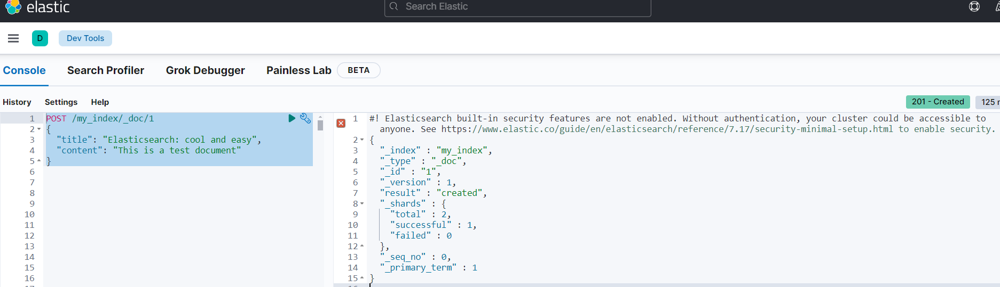

结果显示：索引名称为my_index

successful: 插入成功1个文档。


#### 1.5.2 查询文档

根据id查询文档：GET /my_index/\_doc/1

my_index：索引名

\_doc: 固定

1: 文档的id

查询结果

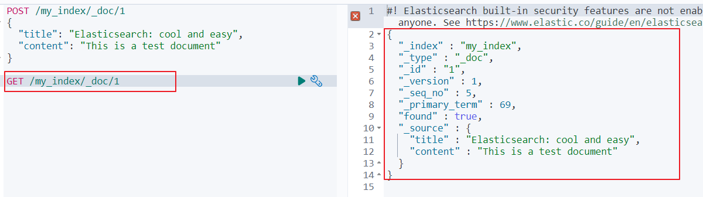


#### 1.5.3 搜索文档

下边进行搜索：

执行下边的命令：

```JavaScript
GET /my_index/_search
{
  "query": {
    "match": {
      "content": "test"
    }
  }
}
```

说明：

content：my_index索引中的字段名。

"test"： 搜索的关键字。

搜索流程：

1. 对搜索的关键字进行分词
2. 拿的词去索引中搜索，最终找到匹配分词的文档。


执行结果：

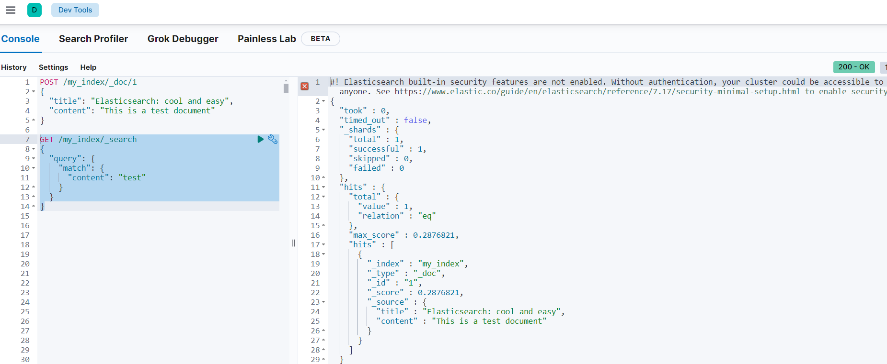

动手实验，下边的搜索可以搜出结果吗？

```JavaScript
GET /my_index/_search
{
  "query": {
    "match": {
      "content": "test java"
    }
  }
}
```


#### 1.5.4 删除文档

执行下边的语句删除文档：

```JavaScript
DELETE /my_index/_doc/1
```

如下图：

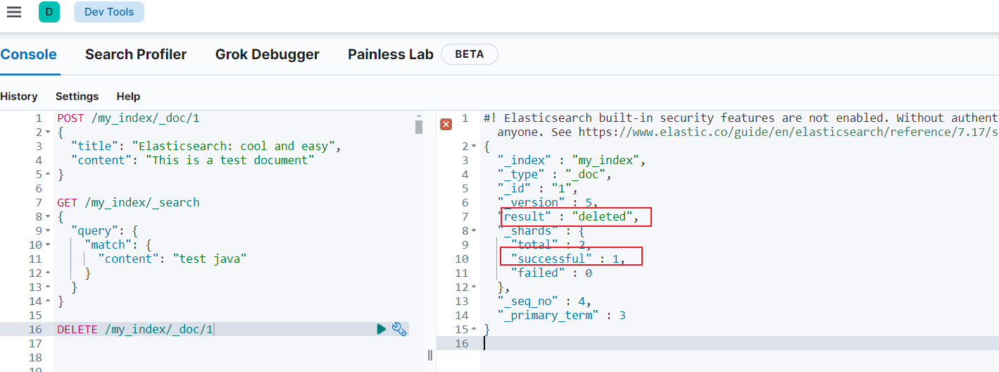

删除了1号文档，此时再去搜索1号文档的内容还可以找到吗？

执行下边的搜索再试试：

```JavaScript
GET /my_index/_search
{
  "query": {
    "match": {
      "content": "test java"
    }
  }
}
```


#### 1.5.5 总结

通过Elasticsearch提供的RESTful接口操作索引：

1、添加索引

将文档信息提交给Elasticsearch，指定索引名称及文档内容，它对文档内容进行分词、存储。

索引的结构是倒排索引表。

2、搜索

根据文档id查询文档

指定文档的字段及搜索关键字进行搜索。

搜索过程会先将关键字进行分词，再拿词去索引中查询。


基本概念：

相关概念如下：

1. 索引 (`index`):

   - Elasticsearch 中的数据被组织成索引，每个索引都有一个唯一的名称。
   - 一个索引可以包含多个文档。
2. 文档 (`document`):

   - 文档是 Elasticsearch 中的基本单位，每个文档都是一个 JSON 对象。
   - 文档包含一个或多个字段。
3. 字段 (`field`):

   - 字段是文档中的基本单元，用于存储数据。
   - 每个字段都有一个数据类型，例如 `text`、`keyword`、`integer`、`float` 等。

## 2.索引操作

Mapping映射就类似表的结构。我们要向es中存储数据，必须先创建Index和Mapping

### 2.1 Mapping映射属性

在MySQL中创建表结构时需要指定每个字段的类型，同样，创建索引的映射也需要指定每个字段的类型及其它属性。

常见的Mapping属性包括：

- `type`：字段数据类型，常见的简单类型有： 

  - 字符串：
  
    - `text`（可分词的文本）,不能参与聚合
    - `keyword`（（不可分词）精确值，例如：品牌、国家、ip地址），`keyword` 类型主要用于存储不需要分词处理的字符串，例如电子邮件地址、标签、ID 等，这些字符串通常用于精确匹配搜索。可以参与聚合
  - 数值：`long`、`integer`、`short`、`byte`、`double`、`float`、
  - 布尔：`boolean`
  - 日期：`date`
  - 对象：`object`
- `index`：是否索引

index为true时可对此字段搜索，并且如果type为text则会对文本内容进行分词

index为false表示不分词也不能搜索。

- `analyzer`：添加索引时使用哪种分词器分词
- `properties`：该字段的子字段
- search_analyzer: 搜索时使用哪种分词器分词

通常情况下，我们在搜索和创建索引时使用的是同一分析器，默认情况下搜索将会使用字段映射时定义的分析器，也能通过**search_analyzer** 设置不同的分词器。

拿ik分词器举例：

通常会设置如下：

```JavaScript
    "analyzer": "ik_max_word",
    "search_analyzer":"ik_smart"
```

添加索引时分词使用细粒度模式`ik_max_word` ，因为`ik_max_word` 会尽可能多地分出词条，这对于分词创建索引是有益的，因为它可以增加索引中的词条数量

搜索时使用智能模式`ik_smart` 因为`ik_smart` 分词器会更加注重分词的准确性，减少不必要的词条，以提高搜索的精度。

比如：搜索“中华人民共和国”，如果搜索时采用ik_max_word模式，会将“中华人民共和国”分为中华、人民、华人等词语，此时就会拿这些词去匹配文档，搜索出来的文章可能并不是用户想要的结果，用户想要的结果是“中华人民共和国”相关的文章 。

如果搜索时使用ik_smart模式，此时“中华人民共和国”分词为“中华人民共和国”，此时去搜索出的文档正是用户想要的。

### 2.2 创建索引

**基本语法**：

- 请求方式：`PUT`
- 请求路径：`/索引名`，可以自定义
- 请求参数：`mapping`映射

**格式**：

```JSON
PUT /索引名称
{
  "mappings": {
    "properties": {
      "字段名":{
        "type": "text",
        "analyzer": "ik_smart"
      },
      "字段名2":{
        "type": "keyword",
        "index": "false"
      },
      "字段名3":{
        "properties": {
          "子字段": {
            "type": "keyword"
          }
        }
      },
      // ...略
    }
  }
}
```

举例：

例如下面的json文档：

```JSON
{
    "age": 21,
    "weight": 52.1,
    "isMarried": false,
    "info": "黑马程序员Java讲师",
    "email": "zy@itcast.cn",
    "score": [99.1, 99.5, 98.9],
    "name": {
        "firstName": "云",`
        "lastName": "赵"
    }
}
```

对应的每个字段映射（Mapping）：

<table><colgroup><col/><col/><col/><col/><col/><col/><col/></colgroup><thead><tr><th colspan="2" vertical-align="middle"><b>字段名</b></th><th vertical-align="middle"><b>字段类型</b></th><th vertical-align="middle"><b>类型说明</b></th><th vertical-align="middle"><b>是否</b><br/><b>参与搜索</b></th><th vertical-align="middle"><b>是否</b><br/><b>参与分词</b></th><th vertical-align="middle"><b>分词器</b></th></tr></thead><tbody><tr><td colspan="2" vertical-align="middle">age</td><td vertical-align="middle"><code>integer</code></td><td vertical-align="middle">整数</td><td vertical-align="middle"><checkbox done="true"></checkbox></td><td vertical-align="middle"><checkbox done="false"></checkbox></td><td vertical-align="middle">——</td></tr><tr><td colspan="2" vertical-align="middle">weight</td><td vertical-align="middle"><code>float</code></td><td vertical-align="middle">浮点数</td><td vertical-align="middle"><checkbox done="true"></checkbox></td><td vertical-align="middle"><checkbox done="false"></checkbox></td><td vertical-align="middle">——</td></tr><tr><td colspan="2" vertical-align="middle">isMarried</td><td vertical-align="middle"><code>boolean</code></td><td vertical-align="middle">布尔</td><td vertical-align="middle"><checkbox done="true"></checkbox></td><td vertical-align="middle"><checkbox done="false"></checkbox></td><td vertical-align="middle">——</td></tr><tr><td colspan="2" vertical-align="middle">info</td><td vertical-align="middle"><code>text</code></td><td vertical-align="middle">字符串，但需要分词</td><td vertical-align="middle"><checkbox done="true"></checkbox></td><td vertical-align="middle"><checkbox done="true"></checkbox></td><td vertical-align="middle">IK</td></tr><tr><td colspan="2" vertical-align="middle">email</td><td vertical-align="middle"><code>keyword</code></td><td vertical-align="middle">字符串，但是不分词</td><td vertical-align="middle"><checkbox done="false"></checkbox></td><td vertical-align="middle"><checkbox done="false"></checkbox></td><td vertical-align="middle">——</td></tr><tr><td colspan="2" vertical-align="middle">score</td><td vertical-align="middle"><code>float</code></td><td vertical-align="middle">只看数组中元素类型</td><td vertical-align="middle"><checkbox done="true"></checkbox></td><td vertical-align="middle"><checkbox done="false"></checkbox></td><td vertical-align="middle">——</td></tr><tr><td rowspan="2" vertical-align="middle">name</td><td vertical-align="middle">firstName</td><td vertical-align="middle"><code>keyword</code></td><td vertical-align="middle">字符串，但是不分词</td><td vertical-align="middle"><checkbox done="true"></checkbox></td><td vertical-align="middle"><checkbox done="false"></checkbox></td><td vertical-align="middle">——</td></tr><tr><td vertical-align="middle">lastName</td><td vertical-align="middle"><code>keyword</code></td><td vertical-align="middle">字符串，但是不分词</td><td vertical-align="middle"><checkbox done="true"></checkbox></td><td vertical-align="middle"><checkbox done="false"></checkbox></td><td vertical-align="middle">——</td></tr></tbody></table>


AI:根据下边文档内容生成创建Elasticsearch映射语句：

```JavaScript
elasticsearch的文档如下：
{
    "age": 21,
    "weight": 52.1,
    "isMarried": false,
    "info": "黑马程序员Java讲师",
    "email": "zy@itcast.cn",
    "score": [99.1, 99.5, 98.9],
    "name": {
        "firstName": "云",
        "lastName": "赵"
    }
}

```

根据生成结果再对照所学知识进行微调。

正确的语句如下：

```JavaScript
PUT /heima
{
  "mappings": {
    "properties": {
      "age": {
        "type": "integer"
      },
      "weight": {
        "type": "float"
      },
      "isMarried": {
        "type": "boolean"
      },
      "info": {
        "type": "text",
        "analyzer": "ik_max_word",
        "search_analyzer":"ik_smart"
      },
      "email": {
        "type": "keyword",
        "index": false // 不对email字段进行索引，既不分词也不搜索
      },
      "score": {
        "type": "float"
      },
      "name": {
        "properties": {
          "firstName": {
            "type": "keyword"
          },
          "lastName": {
            "type": "keyword"
          }
        }
      }
    }
  }
}

```

info字段说明：

"analyzer": "ik_max_word"：表示索引时用细粒度分词，尽可能多的分多个词条

"search_analyzer":"ik_smart"：表示搜索时用智能模式（粗粒度）

执行上边的语句如果报：index [heima/fQsg0fUbTfyUk3L-c6in0w] already exists  

说明heima 索引已存在，需要先删除再创建。

执行：DELETE /heima  删除heima索引

创建成功返回下边的结果

```Java
{
  "acknowledged" : true,
  "shards_acknowledged" : true,
  "index" : "heima"
}

```

注意：如果在虚拟机中创建时报错resource_already_exists_exception，则需要先删除此索引。

执行：DELETE /heima


### 2.3 查询索引

**基本语法**：

-  请求方式：GET 
-  请求路径：/索引名 
-  请求参数：无 


**格式**：

```Plain Text
GET /索引名
```


**示例**：

```Plain Text
GET /heima
```


### 2.4 修改索引

倒排索引结构虽然不复杂，但是一旦数据结构改变（比如改变了分词器），就需要重新创建倒排索引，这简直是灾难。因此索引**一旦创建，无法修改mapping**。


虽然无法修改mapping中已有的字段，但是却允许添加新的字段到mapping中，因为不会对倒排索引产生影响。因此修改索引能做的就是向索引中添加新字段，或者更新索引的基础属性。

**语法说明**：

```JSON
PUT /索引名/_mapping
{
  "properties": {
    "新字段名":{
      "type": "integer"
    }
  }
}
```


**示例**：

添加新字段age

```JSON
PUT /heima/_mapping
{
  "properties": {
    "age":{
      "type": "integer"
    }
  }
}
```


### 2.5 删除索引

**语法：**

-  请求方式：DELETE 
-  请求路径：/索引名 
-  请求参数：无 


**格式：**

```Plain Text
DELETE /索引名
```


示例：

```Plain Text
DELETE /heima
```


### 2.6 总结

索引操作有哪些？

- 创建索引：PUT /索引名
- 查询索引：GET /索引名
- 删除索引：DELETE /索引名
- 修改索引，添加字段：PUT /索引名/\_mapping


可以看到，对索引的操作基本遵循的Restful的风格，因此API接口非常统一，方便记忆。


## 3.文档操作

有了索引，接下来就可以向索引中添加数据了。

Elasticsearch中的数据其实就是JSON风格的文档。操作文档自然保护`增`、`删`、`改`、`查`等几种常见操作，我们分别来学习。

### 3.1 新增文档

**语法：**

```JSON
POST /索引名/_doc/文档id
{
    "字段1": "值1",
    "字段2": "值2",
    "字段3": {
        "子属性1": "值3",
        "子属性2": "值4"
    },
}
```


**示例：**

```JSON
POST /heima/_doc/1
{
    "info": "黑马程序员Java讲师",
    "email": "zy@itcast.cn",
    "name": {
        "firstName": "云",
        "lastName": "赵"
    }
}
```


**响应：**

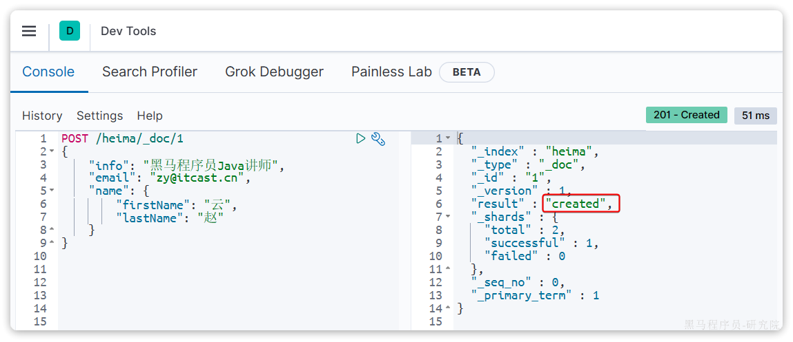


### 3.2 查询文档

根据rest风格，新增是post，查询应该是get，不过查询一般都需要条件，这里我们把文档id带上。

**语法：**

```JSON
GET /{索引名称}/_doc/{id}
```


**示例：**

```JavaScript
GET /heima/_doc/1
```


**查看结果：**

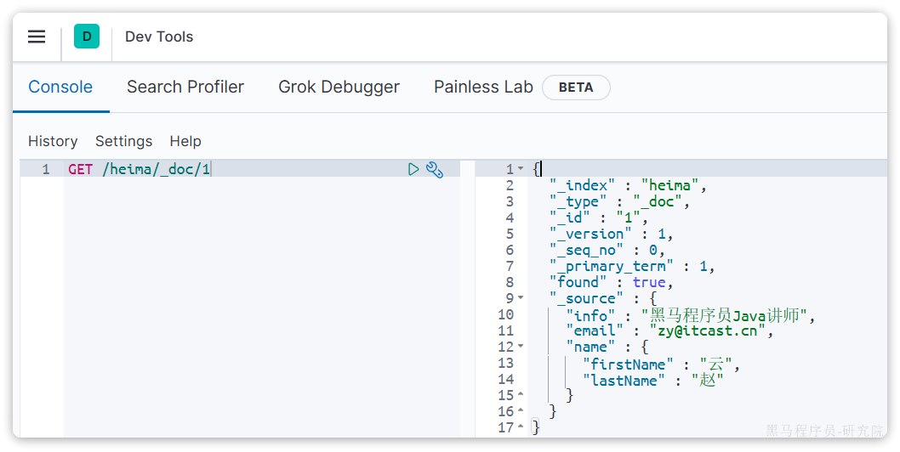

### 3.3 修改文档

修改有两种方式：

- 全量修改：直接覆盖原来的文档
- 局部修改：修改文档中的部分字段


#### 3.3.1 全量修改

全量修改是覆盖原来的文档，其本质是两步操作：

- 根据指定的id删除文档
- 新增一个相同id的文档

**注意**：如果根据id删除时，id不存在，第二步的新增也会执行，也就从修改变成了新增操作了。


**语法：**

```JSON
PUT /{索引名}/_doc/文档id
{
    "字段1": "值1",
    "字段2": "值2",
    // ... 略
}
```


**示例：**

```JSON
PUT /heima/_doc/1
{
    "info": "黑马程序员高级Java讲师",
    "email": "zy@itcast.cn",
    "name": {
        "firstName": "云",
        "lastName": "赵"
    }
}
```


由于`id`为`1`的文档已经被删除，所以第一次执行时，得到的反馈是`created`：

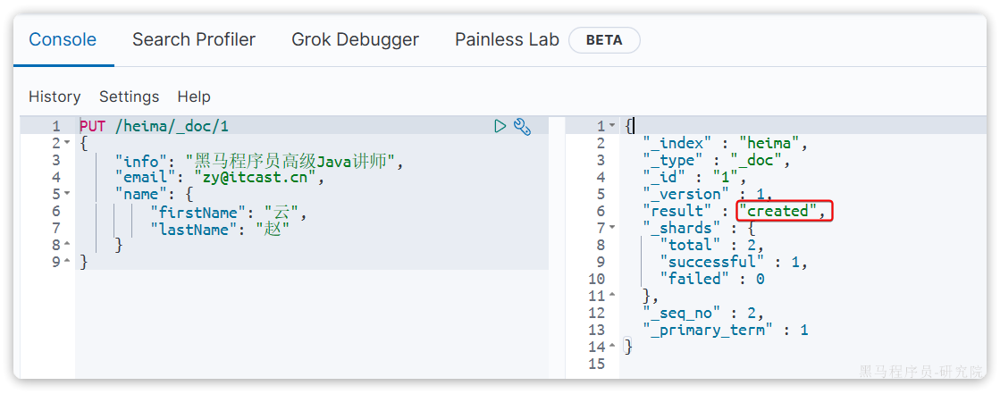

所以如果执行第2次时，得到的反馈则是`updated`：

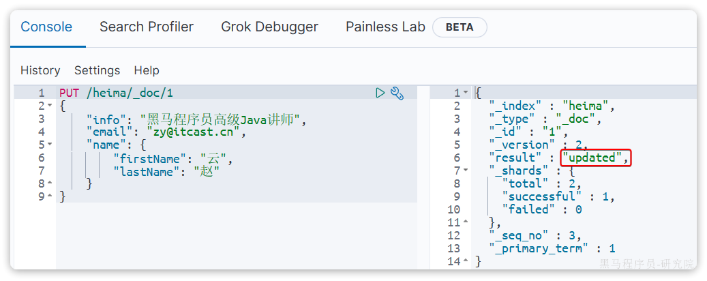


#### 3.3.2 局部修改

局部修改是只修改指定id匹配的文档中的部分字段。

**语法：**

```JSON
POST /{索引名}/_update/文档id
{
    "doc": {
         "字段名": "新的值",
    }
}
```


**示例：**

```JSON
POST /heima/_update/1
{
  "doc": {
    "email": "ZhaoYun@itcast.cn"
  }
}
```


**执行结果**：

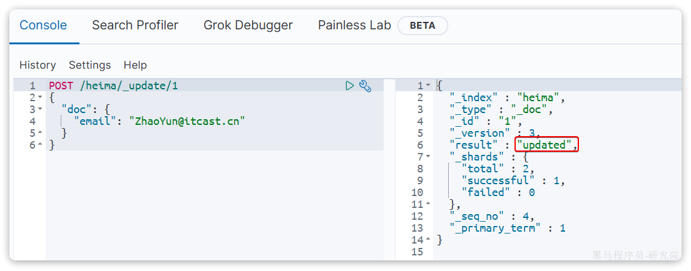

### 3.4 删除文档

删除使用DELETE请求，同样，需要根据id进行删除：

**语法：**

```JavaScript
DELETE /{索引名}/_doc/id值
```


**示例：**

```JSON
DELETE /heima/_doc/1
```


**结果：**

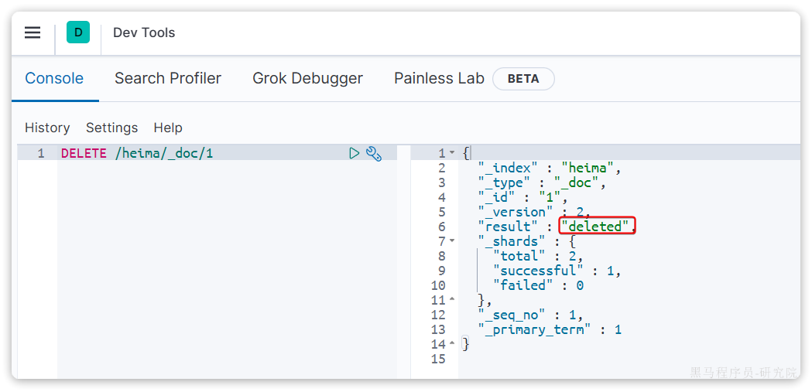

### 3.5 批处理

批处理采用POST请求，基本语法如下：

```Java
POST _bulk
{ "index" : { "_index" : "test", "_id" : "1" } }
{ "field1" : "value1" }
{ "delete" : { "_index" : "test", "_id" : "2" } }
{ "create" : { "_index" : "test", "_id" : "3" } }
{ "field1" : "value3" }
{ "update" : {"_id" : "1", "_index" : "test"} }
{ "doc" : {"field2" : "value2"} }
```

其中：

- `index`代表全量修改

  - `_index`：指定索引名
  - `_id`指定要操作的文档id
  - `{ "field1" : "value1" }`：则是要新增的文档内容
- create代表新增加，如果文档已存在则报错

  - `_index`：指定索引名
  - `_id`指定要操作的文档id
  - `{ "field1" : "value1" }`：则是要新增的文档内容
- `delete`代表删除操作

  - `_index`：指定索引名
  - `_id`指定要操作的文档id
- `update`代表更新操作

  - `_index`：指定索引名
  - `_id`指定要操作的文档id
  - `{ "doc" : {"field2" : "value2"} }`：要更新的文档字段


示例，批量新增：

```Java
POST /_bulk
{"index": {"_index":"heima", "_id": "3"}}
{"info": "黑马程序员C++讲师", "email": "ww@itcast.cn", "name":{"firstName": "五", "lastName":"王"}}
{"index": {"_index":"heima", "_id": "4"}}
{"info": "黑马程序员前端讲师", "email": "zhangsan@itcast.cn", "name":{"firstName": "三", "lastName":"张"}}
```


批量删除：

```Java
POST /_bulk
{"delete":{"_index":"heima", "_id": "3"}}
{"delete":{"_index":"heima", "_id": "4"}}
```


### 3.6 总结

文档操作有哪些？

- 创建文档：`POST /{索引名}/_doc/文档id   { json文档 }`
- 查询文档：`GET /{索引名}/_doc/文档id`
- 删除文档：`DELETE /{索引名}/_doc/文档id`
- 修改文档： 

  - 全量修改：`PUT /{索引名}/_doc/文档id { json文档 }`
  - 局部修改：`POST /{索引名}/_update/文档id { "doc": {字段}}`
- 批量操作：POST \_bulk


## 4 Java Client

### 4.1. 配置Java client

前边我们都是在Kibana中使用DSL语法直接请求Elasticsearch的HTTP 接口进行测试，DSL是Elasticsearch的领域特定语言（Domain Specific Language, DSL）是一种基于JSON的查询语言。

在项目开发中为了提高开发效率ES官方提供了各种不同语言的客户端，这些客户端的本质就是组装DSL语句，通过http请求发送给ES。


官方文档地址：

[https://www.elastic.co/guide/en/elasticsearch/client/index.html](https://www.elastic.co/guide/en/elasticsearch/client/index.html)

由于ES目前最新版本是8.x，提供了全新版本的客户端Java Client，老版本的客户端Java REST  Client已经被标记为过时。

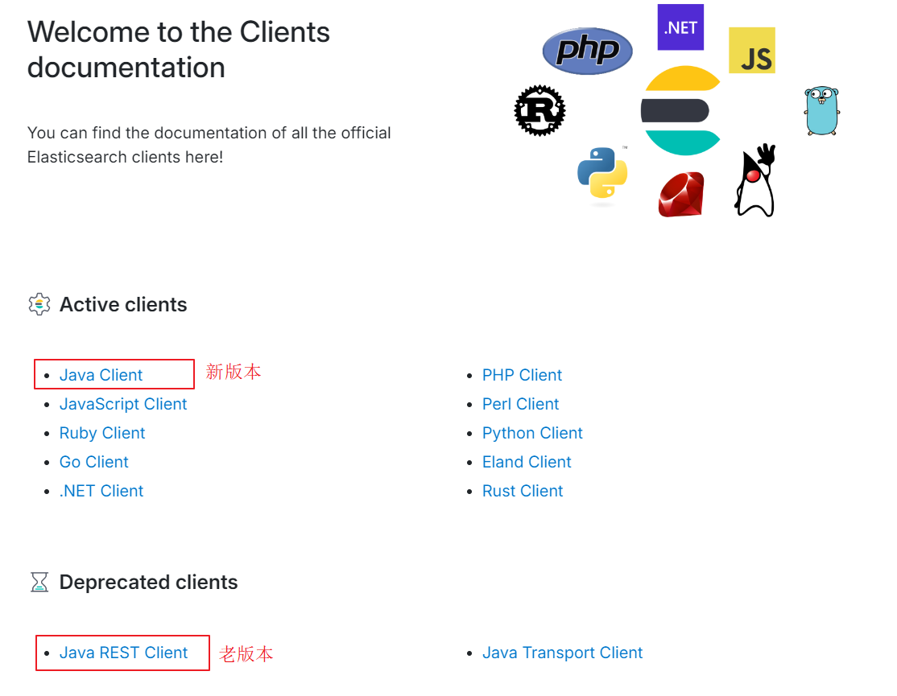

我们使用的是7.17.x版本，新版本和老版本都支持，将来的版本会全面抛弃老版本的Java  REST Client ，所以本教程使用新版本的Java Client。


Java  Client要求：

- Java 8 或更高版本。
- JSON 对象映射库，可将您的应用程序类与 Elasticsearch API 无缝集成。Java 客户端支持[Jackson](https://github.com/FasterXML/jackson)或 [JSON-B](https://github.com/eclipse-ee4j/jsonb-api)库（如 [Eclipse Yasson）](https://github.com/eclipse-ee4j/yasson)。

如何集成Java Client，可参考文档，地址在：https://www.elastic.co/guide/en/elasticsearch/client/java-api-client/7.17/installation.html 

在hmall-parent中添加依赖管理：

```JavaScript
<properties>
    <es.version>7.17.7</es.version>
    <jackson.version>2.13.0</jackson.version>
    <jakarta.json-ai.version>2.0.1</jakarta.json-ai.version>
</properties>

<!-- 对依赖包进行管理 -->
<dependencyManagement>
  <dependencies>
    <!--es-->
    <dependency>
        <groupId>co.elastic.clients</groupId>
        <artifactId>elasticsearch-java</artifactId>
        <version>${es.version}</version>
    </dependency>
    <dependency>
        <groupId>com.fasterxml.jackson.core</groupId>
        <artifactId>jackson-databind</artifactId>
        <version>${jackson.version}</version>
    </dependency>
    <dependency>
        <groupId>jakarta.json</groupId>
        <artifactId>jakarta.json-api</artifactId>
        <version>${jakarta.json-ai.version}</version>
    </dependency>
  </dependencies>
</dependencyManagement>
```


在hmall-item添加如下依赖：

```JavaScript
<dependency>
    <groupId>co.elastic.clients</groupId>
    <artifactId>elasticsearch-java</artifactId>
</dependency>
<dependency>
    <groupId>com.fasterxml.jackson.core</groupId>
    <artifactId>jackson-databind</artifactId>
</dependency>
<dependency>
    <groupId>jakarta.json</groupId>
    <artifactId>jakarta.json-api</artifactId>
</dependency>
```


这里为了单元测试方便，我们创建一个测试类`IndexTest`，然后将初始化的代码编写在`@BeforeEach`方法中：

参考：https://www.elastic.co/guide/en/elasticsearch/client/java-api-client/7.17/connecting.html

```Java
package com.hmall.item;

import co.elastic.clients.elasticsearch.ElasticsearchClient;
import co.elastic.clients.json.jackson.JacksonJsonpMapper;
import co.elastic.clients.transport.ElasticsearchTransport;
import co.elastic.clients.transport.rest_client.RestClientTransport;
import com.fasterxml.jackson.databind.ObjectMapper;
import lombok.extern.slf4j.Slf4j;
import org.apache.http.HttpHost;
import org.elasticsearch.client.RestClient;
import org.junit.jupiter.api.AfterEach;
import org.junit.jupiter.api.BeforeEach;
import org.springframework.boot.test.context.SpringBootTest;

import java.io.IOException;

/**
 * ES文档增删改查测试
 *
 * @Author mr.wu
 * @Date 2025-6-21 19:58
 */
@Slf4j
@SpringBootTest
public class ESTest {

    private ElasticsearchClient esClient;
    private ElasticsearchTransport transport;

    @BeforeEach
    public void init() {
        // Create the low-level client
        RestClient restClient = RestClient.builder(
                new HttpHost("192.168.101.68", 9200)).build();
        transport = new RestClientTransport(
                restClient, new JacksonJsonpMapper());

        esClient = new ElasticsearchClient(transport);

    }

    @AfterEach
    public void destroy() throws IOException {
        transport.close();
    }

}
```


### 4.2. 创建索引

下边我们以商城项目为例，使用Java Client维护索引数据。

搜索页面的效果如图所示：


最终我们使用Elaticsearch实现搜索接口。

#### 4.2.1 分析索引的映射

首先我们需要创建索引，配置映射，首先针对上图去分析映射结构，包括哪些字段以及字段的类型等属性。

实现搜索功能需要的字段包括三大部分：

- 搜索关键字字段：

  - 商品名称
- 过滤字段

  - 分类
  - 品牌
  - 价格
- 排序字段

  - 默认：按照更新时间降序排序
  - 销量
  - 价格
- 展示字段

  - 商品id：用于点击后跳转
  - 图片地址
  - 是否是广告推广商品
  - 名称
  - 价格
  - 评价数量
  - 销量

对应的商品表结构如下，索引库无关字段已经划掉：

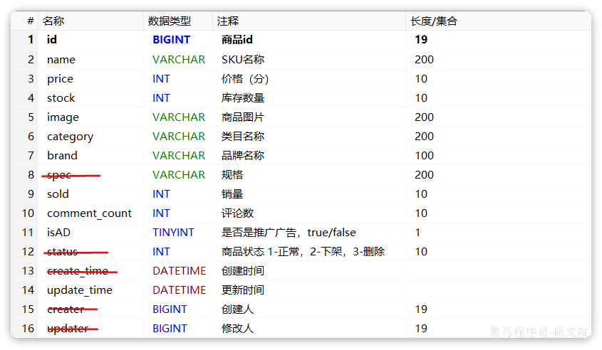


结合数据库表结构，以上字段对应的mapping映射属性如下：

<table><colgroup><col/><col/><col/><col/><col/><col/><col/></colgroup><tbody><tr><td colspan="2" vertical-align="middle"><b>字段名</b></td><td vertical-align="middle"><b>字段类型</b></td><td vertical-align="middle"><b>类型说明</b></td><td vertical-align="middle"><b>是否</b><br/><b>参与搜索</b></td><td vertical-align="middle"><b>是否</b><br/><b>参与分词</b></td><td vertical-align="middle"><b>分词器</b></td></tr><tr><td colspan="2" vertical-align="middle">id</td><td vertical-align="middle"><code>long</code></td><td vertical-align="middle">长整数</td><td vertical-align="middle"><checkbox done="true"></checkbox></td><td vertical-align="middle"><checkbox done="false"></checkbox></td><td vertical-align="middle">——</td></tr><tr><td colspan="2" vertical-align="middle">name</td><td vertical-align="middle"><code>text</code></td><td vertical-align="middle">字符串，参与分词搜索</td><td vertical-align="middle"><checkbox done="true"></checkbox></td><td vertical-align="middle"><checkbox done="true"></checkbox></td><td vertical-align="middle">IK</td></tr><tr><td colspan="2" vertical-align="middle">price</td><td vertical-align="middle"><code>integer</code></td><td vertical-align="middle">以分为单位，所以是整数</td><td vertical-align="middle"><checkbox done="true"></checkbox></td><td vertical-align="middle"><checkbox done="false"></checkbox></td><td vertical-align="middle">——</td></tr><tr><td colspan="2" vertical-align="middle">stock</td><td vertical-align="middle"><code>integer</code></td><td vertical-align="middle">字符串，但是不分词</td><td vertical-align="middle"><checkbox done="true"></checkbox></td><td vertical-align="middle"><checkbox done="false"></checkbox></td><td vertical-align="middle">——</td></tr><tr><td colspan="2" vertical-align="middle">image</td><td vertical-align="middle"><code>keyword</code></td><td vertical-align="middle">字符串，但是不分词</td><td vertical-align="middle"><checkbox done="false"></checkbox></td><td vertical-align="middle"><checkbox done="false"></checkbox></td><td vertical-align="middle">——</td></tr><tr><td colspan="2" vertical-align="middle">category</td><td vertical-align="middle"><code>keyword</code></td><td vertical-align="middle">字符串，但是不分词</td><td vertical-align="middle"><checkbox done="true"></checkbox></td><td vertical-align="middle"><checkbox done="false"></checkbox></td><td vertical-align="middle">——</td></tr><tr><td colspan="2" vertical-align="middle">brand</td><td vertical-align="middle"><code>keyword</code></td><td vertical-align="middle">字符串，但是不分词</td><td vertical-align="middle"><checkbox done="true"></checkbox></td><td vertical-align="middle"><checkbox done="false"></checkbox></td><td vertical-align="middle">——</td></tr><tr><td colspan="2" vertical-align="middle">sold</td><td vertical-align="middle"><code>integer</code></td><td vertical-align="middle">销量，整数</td><td vertical-align="middle"><checkbox done="true"></checkbox></td><td vertical-align="middle"><checkbox done="false"></checkbox></td><td vertical-align="middle">——</td></tr><tr><td colspan="2" vertical-align="middle">commentCount</td><td vertical-align="middle"><code>integer</code></td><td vertical-align="middle">评价，整数</td><td vertical-align="middle"><checkbox done="false"></checkbox></td><td vertical-align="middle"><checkbox done="false"></checkbox></td><td vertical-align="middle">——</td></tr><tr><td colspan="2" vertical-align="middle">isAD</td><td vertical-align="middle"><code>boolean</code></td><td vertical-align="middle">布尔类型</td><td vertical-align="middle"><checkbox done="true"></checkbox></td><td vertical-align="middle"><checkbox done="false"></checkbox></td><td vertical-align="middle">——</td></tr><tr><td colspan="2" vertical-align="middle">updateTime</td><td vertical-align="middle"><code>Date</code></td><td vertical-align="middle">更新时间</td><td vertical-align="middle"><checkbox done="true"></checkbox></td><td vertical-align="middle"><checkbox done="false"></checkbox></td><td vertical-align="middle">——</td></tr></tbody></table>

#### 4.2.2 创建索引

根据分析我们使用下边的语句创建items索引：

先删除原来的索引库

`DELETE /items`

再创建新的索引库

```Bash
PUT /items
{
  "mappings": {
    "properties": {
      "id": {
        "type": "keyword"
      },
      "name":{
        "type": "text",
        "analyzer": "ik_max_word",
        "search_analyzer": "ik_smart"
      },
      "price":{
        "type": "integer"
      },
      "stock":{
        "type": "integer"
      },
      "image":{
        "type": "keyword",
        "index": false
      },
      "category":{
        "type": "keyword"
      },
      "brand":{
        "type": "keyword"
      },
      "sold":{
        "type": "integer"
      },
      "commentCount":{
        "type": "integer",
        "index": false
      },
      "isAD":{
        "type": "boolean"
      },
      "updateTime":{
        "type": "date"
      }
    }
  }
}
```

我们为什么不用Java Client去创建索引呢？

这就好比在MySQL中创建表，通常我们使用DDL语句通过MySQL客户端执行，而对于数据的CRUD及复杂的SQL语句我们会通过jdbc  去访问mysql数据库一样。

所以，使用Elasticsearch通常我们使用Kibana通过DSL语句去创建索引，而不会使用Java Client去创建索引，使用Java Client主要是为了向索引中添加文档、从索引中搜索文档。


### 4.3. 新增文档

接下来我们使用Java Client向索引中添加文档。

Java Client的使用方法可以参考文档学习：

https://www.elastic.co/guide/en/elasticsearch/client/java-api-client/7.17/indexing.html

#### 4.3.1 **创建模型类（ES文档的实体类）**

就和使用MyBatis一样操作数据库需要一个模型对象，使用Elasticsearch向索引执行CRUD操作也需要模型类。

依据索引映射创建模型类：

小技巧：创建模型类可以提供索引映射由AI去生成模型类。

```TypeScript
package com.hmall.item.domain.po;

import io.swagger.annotations.ApiModel;
import io.swagger.annotations.ApiModelProperty;
import lombok.AllArgsConstructor;
import lombok.Builder;
import lombok.Data;
import lombok.NoArgsConstructor;

import java.time.LocalDateTime;

/**
 * @author Mr.M
 * @version 1.0
 * @description Elasticsearch模型类
 * @date 2024/8/18 20:26
 */
@Data
@ApiModel(description = "索引库实体")
@Builder
@AllArgsConstructor
@NoArgsConstructor
public class ItemDoc {

    @ApiModelProperty("商品id")
    private String id;

    @ApiModelProperty("商品名称")
    private String name;

    @ApiModelProperty("价格（分）")
    private Integer price;

    @ApiModelProperty("库存")
    private Integer stock;

    @ApiModelProperty("商品图片")
    private String image;

    @ApiModelProperty("类目名称")
    private String category;

    @ApiModelProperty("品牌名称")
    private String brand;

    @ApiModelProperty("销量")
    private Integer sold;

    @ApiModelProperty("评论数")
    private Integer commentCount;

    @ApiModelProperty("是否是推广广告，true/false")
    private Boolean isAD;

    @ApiModelProperty("更新时间")
    private LocalDateTime updateTime;
}
```

#### 4.3.2 **编写客户端代码**

下边参考ES文档编写客户端代码。

```Java
    @Autowired
    private IItemService itemService;

    @DisplayName("新增文档")
    @Test
    public void addDocument() throws IOException {
        //查询商品
        Item item = itemService.getById(317578L);

        //转换类型（表实体->ES实体）
        ItemDoc itemDoc = BeanUtil.toBean(item, ItemDoc.class);

        //构建索引请求实例
//        IndexRequest indexRequest = new IndexRequest.Builder<ItemDoc>()
//                .index("items")
//                .id(itemDoc.getId())
//                .document(itemDoc)
//                .build();
        //执行新增商品请求
//        IndexResponse response = esClient.index(indexRequest);

        //执行新增商品请求
        IndexResponse response = esClient.index(i ->
            i.index("items")
                    .id(itemDoc.getId())
                    .document(itemDoc)
        );

        //4. 处理响应结果
        String result = response.result().jsonValue();
        Assertions.assertTrue(result.equals("created") || result.equals("updated"), "新增商品数据到ES失败");
    }
```

#### 4.3.3 测试

下边进行运行测试方法。

报错：

```Java
Caused by: com.fasterxml.jackson.databind.exc.InvalidDefinitionException: Java 8 date/time type `java.time.LocalDateTime` not supported by default: add Module "com.fasterxml.jackson.datatype:jackson-datatype-jsr310" to enable handling (through reference chain: com.hmall.item.domain.po.ItemDoc["updateTime"])
```

根据提示猜测是数据绑定出问题，现在是要把Java 对象的信息映射为ES的索引文档，jackson-datatype-jsr310对于LocalDateTime不支持。


使用AI解决：

```Java
elasticsearch使用的是7.17.7，使用co.elastic.clients.elasticsearch.ElasticsearchClient 向索引新增文档报错如下：
Caused by: com.fasterxml.jackson.databind.exc.InvalidDefinitionException: Java 8 date/time type `java.time.LocalDateTime` not supported by default: add Module "com.fasterxml.jackson.datatype:jackson-datatype-jsr310" to enable handling (through reference chain: com.hmall.item.domain.po.ItemDoc["updateTime"])
```


根据AI提示修改如下：

添加 JavaTimeModule 以支持 LocalDateTime 类型。

完整代码如下：

```Java
package com.hmall.item;

import co.elastic.clients.elasticsearch.ElasticsearchClient;
import co.elastic.clients.json.jackson.JacksonJsonpMapper;
import co.elastic.clients.transport.ElasticsearchTransport;
import co.elastic.clients.transport.rest_client.RestClientTransport;
import com.fasterxml.jackson.databind.ObjectMapper;
import com.fasterxml.jackson.datatype.jsr310.JavaTimeModule;
import lombok.extern.slf4j.Slf4j;
import org.apache.http.HttpHost;
import org.elasticsearch.client.RestClient;
import org.junit.jupiter.api.AfterEach;
import org.junit.jupiter.api.BeforeEach;
import org.springframework.boot.test.context.SpringBootTest;

import java.io.IOException;

/**
 * ES文档增删改查测试
 *
 * @Author mr.wu
 * @Date 2025-6-21 19:58
 */
@Slf4j
@SpringBootTest
public class ESTest {

    private ElasticsearchClient esClient;
    private ElasticsearchTransport transport;

    @BeforeEach
    public void init() {
        // Create the low-level client
        RestClient restClient = RestClient.builder(
                new HttpHost("192.168.101.68", 9200)).build();

        ObjectMapper objectMapper = new ObjectMapper();
        objectMapper.registerModule(new JavaTimeModule());

        transport = new RestClientTransport(
                restClient, new JacksonJsonpMapper(objectMapper));

        esClient = new ElasticsearchClient(transport);

    }

    @AfterEach
    public void destroy() throws IOException {
        transport.close();
    }

}
```

执行成功进行验证

我们使用DSL查询：

```JavaScript
GET /items/_search
```

结果：

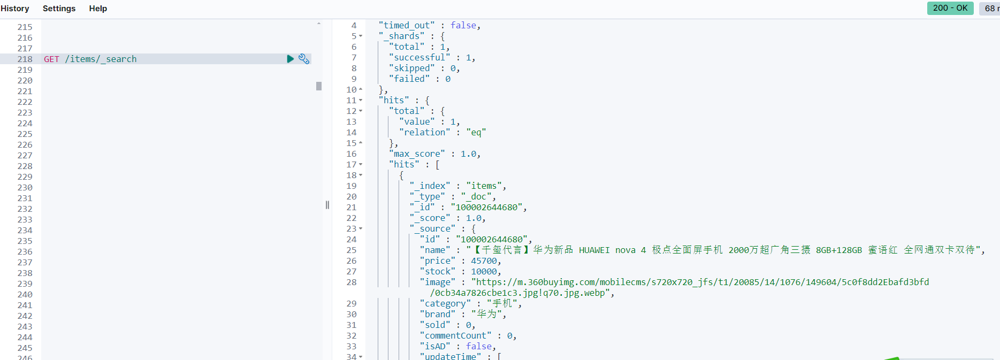

确定ES的索引中存在刚才添加的文档。


### 4.4. 批量导入

文档地址：

<bookmark name="www.elastic.co" href="https://www.elastic.co/guide/en/elasticsearch/client/java-api-client/7.17/indexing-bulk.html"></bookmark>

测试代码如下：

```Java
@DisplayName("批量新增文档")
@Test
public void batchAddDocument() throws IOException {
    //分页查询10条文档
    Page<Item> page = itemService.lambdaQuery().page(Page.of(1, 10));
    List<Item> itemList = page.getRecords();

    //类型转换
    List<ItemDoc> itemDocList = BeanUtil.copyToList(itemList, ItemDoc.class);

    //批量添加索引请求实例
    BulkRequest.Builder bulkBuilder = new BulkRequest.Builder();
    itemDocList.forEach(x->{
        bulkBuilder.operations(o->o.index(
                    i-> i.index("items").id(x.getId()).document(x)
                ));
    });

    //构建批量请求实例
    BulkRequest bulkRequest = bulkBuilder.build();

    //执行批量新增商品请求
    BulkResponse response = esClient.bulk(bulkRequest);

    //处理响应结果
    long count = response.items().stream().filter(x -> x.result().equals("created")||x.result().equals("updated")).count();
    Assertions.assertEquals(10,count, "批量新增商品到ES失败");
}
```


导入全部商品

```Java
@DisplayName("批量新增文档")
@Test
public void batchAddDocument() throws IOException {
    Integer itemTotal = itemService.lambdaQuery().count();
    double ceil = Math.ceil(itemTotal / 1000d);
    int pageNumTotal = (int)ceil;
    log.info("总记录数：{}，计算结果：{}，总页数：{}",itemTotal, ceil, pageNumTotal);

    int pageNum = 1;

    while(pageNum<=pageNumTotal) {
        //分页查询10条文档
        Page<Item> page = itemService.lambdaQuery().page(Page.of(pageNum, 1000));
        List<Item> itemList = page.getRecords();

        //类型转换
        List<ItemDoc> itemDocList = BeanUtil.copyToList(itemList, ItemDoc.class);

        //批量添加索引请求实例
        BulkRequest.Builder bulkBuilder = new BulkRequest.Builder();
        itemDocList.forEach(x->{
            bulkBuilder.operations(o->o.index(
                    i-> i.index("items").id(x.getId()).document(x)
            ));
        });

        //构建批量请求实例
        BulkRequest bulkRequest = bulkBuilder.build();

        //执行批量新增商品请求
        BulkResponse response = esClient.bulk(bulkRequest);

        //处理响应结果
        long count = response.items().stream().filter(x -> x.result().equals("created")||x.result().equals("updated")).count();
        //Assertions.assertEquals(10,count, "批量新增商品到ES失败");
        log.info("导入成功第{}页，导入成功：{}条",pageNum,count);
        pageNum++;
    }
}
```

确认导入数量

```JavaScript
#查询文档总数
GET /item/_count
#查询文档总数
GET /item/_search
{
  "track_total_hits" : true
}
```

### 4.5 查询文档

参考文档：https://www.elastic.co/guide/en/elasticsearch/client/java-api-client/7.17/reading.html

通过阅读文档可知，这里实现的是根据ID查询文档。

编写代码：

```Java
    @DisplayName("查询文档")
    @Test
    public void getDocument() throws IOException {
//        //构建查询请求实例
//        GetRequest getRequest = new GetRequest.Builder()
//                .index("item")
//                .id("317578")
//                .build();
//        //执行查询商品请求
//        GetResponse<ItemDoc> response = esClient.get(getRequest, ItemDoc.class);

        //执行查询商品请求
        GetResponse<ItemDoc> response = esClient.get(
                g-> g.index("items").id("317578")
                , ItemDoc.class);
        //处理响应结果
        ItemDoc itemDoc = response.source();
        Assertions.assertEquals(28900, itemDoc.getPrice());
        log.info("商品信息：{}",itemDoc);
    }
```


### 4.6 修改文档

如果docAsUpsert没设置的话，表示更新文档，如果要更新的文档不存在会报错。

如果docAsUpsert(true)设置了，表示有就更新文档，没有就新增文档。

```Java
    @DisplayName("更新文档")
    @Test
    public void updateDocument() throws IOException {
//        //构建更新请求实例
//        UpdateRequest updateRequest = new UpdateRequest.Builder<>()
//                .index("items")
//                .id("317578")
//                .doc(ItemDoc.builder().stock(1000).build())
//                .docAsUpsert(true)//有就更新，没有就新增
//                .build();
//
//        //执行更新商品请求
//        UpdateResponse<ItemDoc> response = esClient.update(updateRequest, ItemDoc.class);

        //执行更新商品请求
        UpdateResponse<ItemDoc> response = esClient.update(u->
                        u.index("items")
                        .id("317578")
                        .doc(ItemDoc.builder().stock(999).build())
                        .docAsUpsert(true)//有就更新，没有就新增
                ,
                ItemDoc.class);

        //处理响应结果
        String result = response.result().jsonValue();
        Assertions.assertTrue(result.equals("created") || result.equals("updated"), "更新商品数据到ES失败");
    }
```


### 4.7 删除文档

通过两个API方法的学习：

新增文档：esClient.index()方法

查询文档：esClient.get()方法

对于删除文档的方式可以根据代码提示自行编写，如下：

```Java
    @DisplayName("删除文档")
    @Test
    public void deleteDocument() throws IOException {
//        //构建删除请求实例
//        DeleteRequest deleteRequest = new DeleteRequest.Builder()
//                .index("items")
//                .id("317578")
//                .build();
//
//        //执行删除商品请求
//        DeleteResponse response = esClient.delete(deleteRequest);

        //执行删除商品请求
        DeleteResponse response = esClient.delete(d->
                    d.index("items").id("317578")
                );

        //处理响应结果
        Assertions.assertEquals(response.result().jsonValue(),"deleted");
    }
```


## 5 搜索

### 5.1 搜索入门

#### 5.1.1 介绍

最终我们使用Elasticsearch实现搜索功能，现在已经将文档添加到了索引中，接下来学习搜索的方法。

首先我们学习DSL搜索方式，参考DSL搜索语法再学习Java Client方式，最终在微服务中使用Java Client方式完成搜索接口的开发。

Elasticsearch的查询可以分为两大类：

文档参考：

<bookmark name="Elasticsearch Guide:" href="https://www.elastic.co/guide/en/elasticsearch/reference/7.17/query-dsl.html"></bookmark>

1. **叶子查询（Leaf query clauses）**：叶查询子句在特定字段中查找特定值，例如 [`match`](https://www.elastic.co/guide/en/elasticsearch/reference/current/query-dsl-match-query.html)、[`term`](https://www.elastic.co/guide/en/elasticsearch/reference/current/query-dsl-term-query.html)或 [`range`](https://www.elastic.co/guide/en/elasticsearch/reference/current/query-dsl-range-query.html)查询。

- **精确查询**：根据精确词条值查找数据，一般是查找keyword、数值、日期、boolean等类型字段。例如：

  - ids: 根据文档 ID 查找文档
  - range:返回包含指定范围内的文档，比如：查询年龄在10到20岁的学生信息。
  - term: 根据精确值（例如价格、产品 ID 或用户名）查找文档。
- **全文检索（full text）查询**：利用分词器对用户输入内容分词，然后去倒排索引库中匹配。例如：

  - match_query：对一个字段进行全文检索
  - multi_match_query：对多个字段进行全文检索


1. **复合查询（Compound query clauses）**：以逻辑方式组合多个叶子查询或者更改叶子查询的行为方式。


- 第一类：基于逻辑运算组合叶子查询，实现组合条件，例如

  - bool：实现组合条件查询，项目使用较多。
- 第二类：基于某种算法修改查询时的文档相关性算分，从而改变文档排名。例如：

  - function_score：通过条件，指定算分函数，控制文档得分，得分越高排名越靠前，比如：百度竞价排名。
  - dis_max：从多个查询中选择得分最高的结果。

其它复合查询及相关语法可以参考官方文档：

<bookmark name="www.elastic.co" href="https://www.elastic.co/guide/en/elasticsearch/reference/7.17/compound-queries.html"></bookmark>

#### 5.1.2 精确查询

精确查询，英文是`Term-level query`，顾名思义，词条级别的查询。也就是说不会对用户输入的搜索条件再分词，而是作为一个词条，与搜索的字段内容精确值匹配。因此推荐查找`keyword`、数值、日期、`boolean`类型的字段。例如：

- id
- price
- 城市
- 地名
- 人名

等等，作为一个整体才有含义的字段。

详情可以查看官方文档：

<bookmark name="Elasticsearch Guide:" href="https://www.elastic.co/guide/en/elasticsearch/reference/7.17/term-level-queries.html"></bookmark>

##### 5.1.2.1 term

以`term`查询为例，其语法如下：

```JSON
GET /{索引库名}/_search
{
  "query": {
    "term": {
      "字段名": {
        "value": "搜索条件"
      }
    }
  }
}
```

示例：

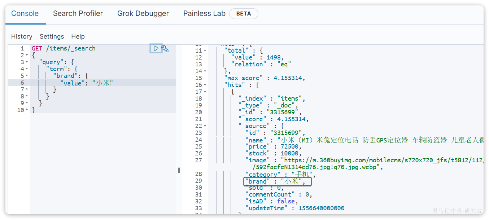


当你输入的搜索条件不是词条，而是短语时，由于不做分词，你反而搜索不到：

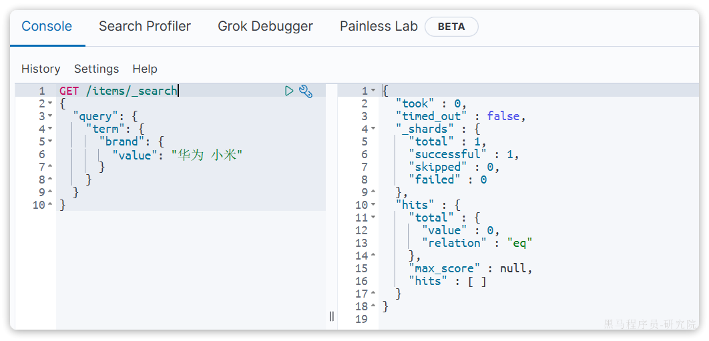


##### 5.1.2.2 range

再来看下`range`查询，语法如下：

```JSON
GET /{索引库名}/_search
{
  "query": {
    "range": {
      "字段名": {
        "gte": {最小值},
        "lte": {最大值}
      }
    }
  }
}
```

`range`是范围查询，对于范围筛选的关键字有：

- `gte`：大于等于
- `gt`：大于
- `lte`：小于等于
- `lt`：小于

示例：

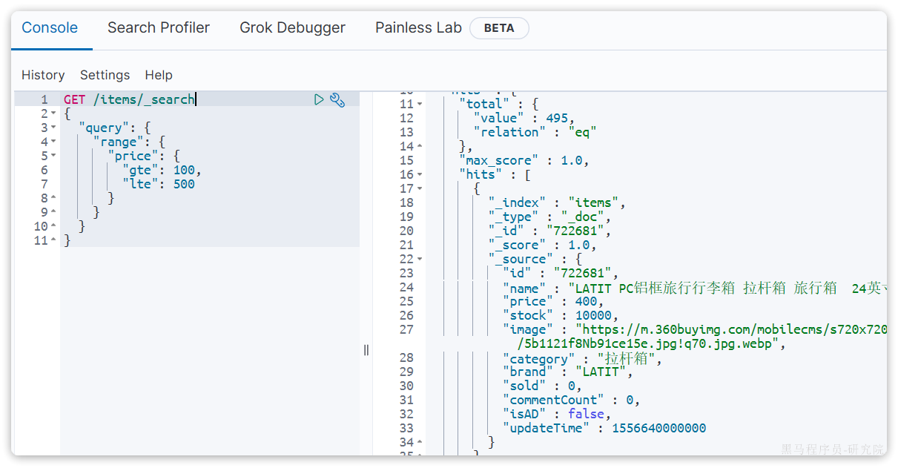

#### 5.1.3 全文检索

全文检索的种类也很多，详情可以参考官方文档：

<bookmark name="Full text queries | Elasticsearch Guide [7.12] | Elastic" href="https://www.elastic.co/guide/en/elasticsearch/reference/7.12/full-text-queries.html"></bookmark>

##### 5.1.3.1 match

以全文检索中的`match`为例，语法如下：

```JSON
GET /{索引库名}/_search
{
  "query": {
    "match": {
      "字段名": "搜索条件"
    }
  }
}
```

示例：

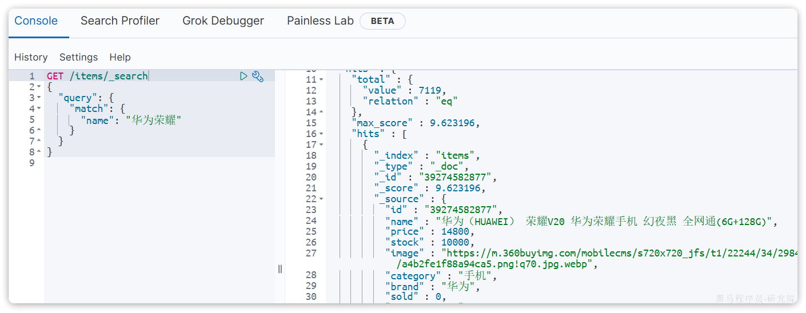

##### 5.1.3.2 multi_match

与`match`类似的还有`multi_match`，区别在于可以同时对多个字段搜索，而且多个字段都要满足，语法示例：

```JSON
GET /{索引库名}/_search
{
  "query": {
    "multi_match": {
      "query": "搜索条件",
      "fields": ["字段1", "字段2"]
    }
  }
}
```

示例：

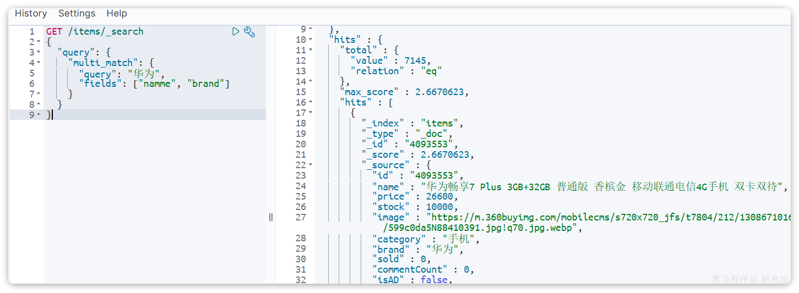


#### 5.1.4 排序

elasticsearch默认是根据相关度算分（`_score`）来排序，但是也支持自定义方式对搜索结果排序。不过分词字段无法排序，能参与排序字段类型有：`keyword`类型、数值类型、地理坐标类型、日期类型等。

详细说明可以参考官方文档：

<bookmark name="Elasticsearch Guide:" href="https://www.elastic.co/guide/en/elasticsearch/reference/7.17/sort-search-results.html"></bookmark>

语法说明：

```JSON
GET /indexName/_search
{
  "query": {
    "match_all": {}
  },
  "sort": [
    {
      "排序字段": {
        "order": "排序方式asc和desc"
      }
    }
  ]
}
```


示例，我们按照商品价格排序：

```JSON
GET /items/_search
{
  "query": {
    "match_all": {}
  },
  "sort": [
    {
      "price": {
        "order": "desc"
      }
    }
  ]
}
```


#### 5.1.5 分页查询

elasticsearch 默认情况下只返回top10的数据。而如果要查询更多数据就需要修改分页参数了。

elasticsearch中通过修改`from`、`size`参数来控制要返回的分页结果：

- `from`：从第几个文档开始
- `size`：总共查询几个文档

类似于mysql中的`limit ?, ?`

官方文档如下：

<bookmark name="Elasticsearch Guide:" href="https://www.elastic.co/guide/en/elasticsearch/reference/7.17/paginate-search-results.html"></bookmark>

语法如下：

```JSON
GET /items/_search
{
  "query": {
    "match_all": {}
  },
  "from": 0, // 分页开始的位置，默认为0
  "size": 10,  // 每页文档数量，默认10
  "sort": [
    {
      "price": {
        "order": "desc"
      }
    }
  ]
}
```


### 5.2. Java Client实现搜索

#### 5.2.1. Term查询

文档：

<bookmark name="Searching for documents" href="https://www.elastic.co/guide/en/elasticsearch/client/java-api-client/7.17/searching.html"></bookmark>

根据DSL语句编写java代码：

```Java
GET /items/_search
{
  "query": {
    "term": {
      "brand": {
        "value": "RIMOWA"
      }
    }
  }
}
```

代码如下：

```JavaScript
@DisplayName("精确查询")
    @Test
    public void termQuery() throws IOException {
//        //构建查询请求实例
//        SearchRequest searchRequest = new SearchRequest.Builder()
//                .index("items")
//                .query(new Query.Builder()
//                        .term(new TermQuery.Builder()
//                                .field("brand")
//                                .value("RIMOWA")
//                                .build())
//                        .build())
//                .build();
//
//        //执行查询商品请求
//        SearchResponse<ItemDoc> response = esClient.search(searchRequest, ItemDoc.class);

        //执行查询商品请求
        SearchResponse<ItemDoc> response = esClient.search(s->
                s.index("items" )
                        .query(
                                q->q.term(
                                        t->t.field("brand").value("RIMOWA")
                                )
                        )
                , ItemDoc.class);

        //处理响应结果
        long total = response.hits().total().value();
        Assertions.assertEquals(total,37, "查询结果失败");
        List<Hit<ItemDoc>> hits = response.hits().hits();
        hits.forEach(x-> log.info("查询到的商品：{}", x.source()));
    }
    
   
   /**
 * term查询
 * @throws IOException
 */
@Test
void testTermQuery2() throws IOException {

    //构建request
    SearchRequest request = SearchRequest.of(s -> s
            .index("items")
            .query(q -> q
                    .term(t -> t
                            .field("brand").value("RIMOWA")
                    )
            )
            .trackTotalHits(t -> t.enabled(true))
    );

    //执行搜索
    SearchResponse<ItemDoc> response = esClient.search(request, ItemDoc.class);
    log.info("{}", response);
    //获取总记录数
    long value = response.hits().total().value();
    log.info("总记录数：{}", value);

    //获取结果集
    List<Hit<ItemDoc>> hitList = response.hits().hits();
    hitList.forEach(hit -> log.info("{}", hit.source()));
}
```

说明：

esClient.search()方法的签名为：

```JavaScript
public final <TDocument> SearchResponse<TDocument> search(Function<SearchRequest.Builder, ObjectBuilder<SearchRequest>> fn, Class<TDocument> tDocumentClass) throws IOException, ElasticsearchException {
    return this.search((SearchRequest)((ObjectBuilder)fn.apply(new SearchRequest.Builder())).build(), tDocumentClass);
}
```

search()方法第一个参数是一个函数式接口，第二个参数为模型类的Class类型。

SearchResponse为响应类型，可以依据DSL查询结果进行解析，如下：

```JSON
{
  "took" : 0,
  "timed_out" : false,
  "_shards" : {
    "total" : 1,
    "successful" : 1,
    "skipped" : 0,
    "failed" : 0
  },
  "hits" : {
    "total" : {
      "value" : 60,
      "relation" : "eq"
    },
    "max_score" : 0.35950777,
    "hits" : [
      {
        "_index" : "items",
        "_type" : "_doc",
        "_id" : "317578",
        "_score" : 0.35950777,
        "_source" : {
          "id" : "317578",
          "name" : "RIMOWA 21寸托运箱拉杆箱 SALSA AIR系列果绿色 820.70.36.4",
          "price" : 28900,
          "stock" : 9985,
          "image" : "https://m.360buyimg.com/mobilecms/s720x720_jfs/t6934/364/1195375010/84676/e9f2c55f/597ece38N0ddcbc77.jpg!q70.jpg.webp",
          "category" : "拉杆箱",
          "brand" : "RIMOWA",
          "sold" : 0,
          "commentCount" : 0,
          "isAD" : false,
          "updateTime" : [
            2024,
            10,
            25,
            17,
            52,
            8
          ]
        }
      },
    ...
```

结合解析handleResponse()方法阅读代码：

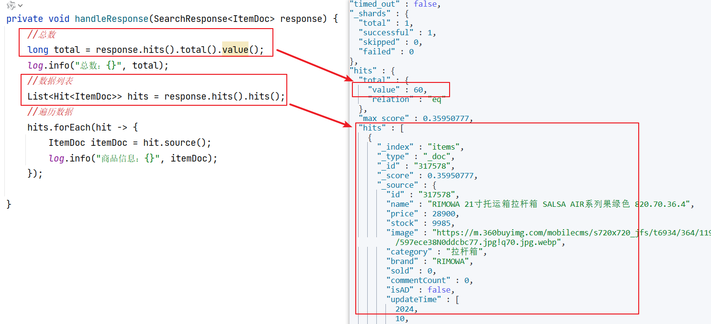

**代码解读**：

elasticsearch返回的结果是一个JSON字符串，结构包含：

- `hits`：命中的结果 

  - `total`：总条数，其中的value是具体的总条数值
  - `max_score`：所有结果中得分最高的文档的相关性算分
  - `hits`：搜索结果的文档数组，其中的每个文档都是一个json对象 
  
    - `_source`：文档中的原始数据，也是json对象


因此，我们解析响应结果，就是逐层解析JSON字符串，流程如下：

- `SearchHits`：通过`response.getHits()`获取，就是JSON中的最外层的`hits`，代表命中的结果 

  - `SearchHits#getTotalHits().value`：获取总条数信息
  - `SearchHits#getHits()`：获取`SearchHit`数组，也就是文档数组 
  
    - `SearchHit#getSourceAsString()`：获取文档结果中的`_source`，也就是原始的`json`文档数据


我们是根据DSL编写java代码，也可以跟踪java代码查看最终执行的DSL是否正确。

上边的代码改为如下代码，并打断点,复制DSL语句

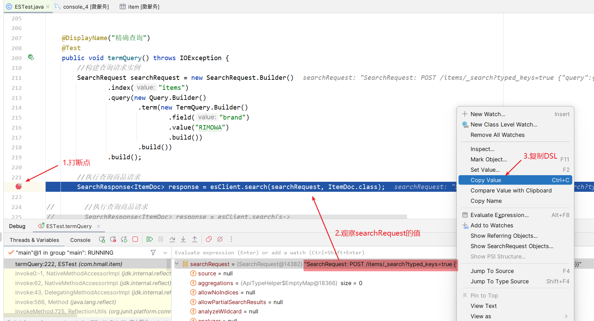


```Java
SearchRequest: POST /items/_search?typed_keys=true {"query":{"term":{"brand":{"value":"RIMOWA"}}}}
```

去掉前边的字符串SearchRequest: 拿到DSL语句，然后ctrl+i快捷键格式化后再执行

```Java
POST /items/_search?typed_keys=true 
{
  "query": {
    "term": {
      "brand": {
        "value": "RIMOWA"
      }
    }
  }
}
```

然后在kibana中进行测试。


#### 5.2.2. 全文检索

下边使用Java Client实现全文检索：

`match`查询：

根据DSL编写java代码：

```Java
POST /items/_search
{
  "track_total_hits" : true,
  "query": {
    "match": {
      "name": "绿色拉杆箱"
    }
  }
}
```

java代码：

```JavaScript
@DisplayName("全文检索查询-单字段查询")
@Test
public void matchQuery() throws IOException {
    //执行查询商品请求
    SearchResponse<ItemDoc> response = esClient.search(s->
            s.index("items" )
                    .trackTotalHits(t->t.enabled(true))//设置确定查询真实总记录数，否则最多数量上限为10000
                    .query(
                           q->q.match(m->
                                      m.field("name").query("绿色拉杆箱")
                                   )
                    )
            , ItemDoc.class);

    //处理响应结果
    long total = response.hits().total().value();
    log.info("查询到的商品数量：{}", total);
    List<Hit<ItemDoc>> hits = response.hits().hits();
    hits.forEach(x-> log.info("查询到的商品：{}", x.source()));
}
```


`multi_match`查询：

DSL:

```Java
GET /items/_search
{
  "track_total_hits" : true,
  "query": {
    "multi_match": {
      "query": "RIMOWA手机",
      "fields": ["name","brand"]
    }
  }
}

```

Java:

```Java
@DisplayName("全文检索查询-多字段查询")
@Test
public void multiMatchQuery() throws IOException {
    //执行查询商品请求
    SearchResponse<ItemDoc> response = esClient.search(s->
                    s.index("items" )
                            .trackTotalHits(t->t.enabled(true))//设置确定查询真实总记录数，否则最多数量上限为10000
                            .query(
                                    q->q.multiMatch(m->
                                            m.fields("name","brand").query("RIMOWA手机")
                                            )
                            )
            , ItemDoc.class);

    //处理响应结果
    long total = response.hits().total().value();
    log.info("查询到的商品数量：{}", total);
    List<Hit<ItemDoc>> hits = response.hits().hits();
    hits.forEach(x-> log.info("查询到的商品：{}", x.source()));
}
```

#### 5.2.3 排序和分页

DSL:

```Java
GET /items/_search
{
  "query": {
    "multi_match": {
      "query": "RIMOWA手机",
      "fields": ["name","category"]
    }
  },
  "sort": [
    {
      "price": {
        "order": "asc"
      }
    }
  ],
  "size": 20,
  "from": 0
}
```

Java:

```JavaScript
@DisplayName("全文检索查询-结果分页排序")
@Test
public void multiMatchQuery() throws IOException {
    Integer pageNum=1,pageSize=20;

    //执行查询商品请求
    SearchResponse<ItemDoc> response = esClient.search(s->
                    s.index("items" )
                            .trackTotalHits(t->t.enabled(true))//设置确定查询真实总记录数，否则最多数量上限为10000
                            .query(
                                    q->q.multiMatch(m->
                                            m.fields("name","brand").query("RIMOWA手机")
                                            )
                            )
                            .from((pageNum-1)*pageSize)
                            .size(pageSize)
                            .sort(st->st.field(f->f.field("price").order(SortOrder.Desc)))
            , ItemDoc.class);

    //处理响应结果
    long total = response.hits().total().value();
    log.info("查询到的商品数量：{}", total);
    List<Hit<ItemDoc>> hits = response.hits().hits();
    hits.forEach(x-> log.info("查询到的商品：{}", x.source()));
}
```


### 5.3 复合查询

第一类：基于逻辑运算组合叶子查询，实现组合条件，例如

- bool：实现组合条件查询，项目使用较多。

第二类：基于某种算法修改查询时的文档相关性算分，从而改变文档排名。例如：

- function_score：通过条件，指定算分函数，控制文档得分，得分越高排名越靠前，比如：百度竞价排名。
- dis_max：从多个查询中选择得分最高的结果。

其它复合查询及相关语法可以参考官方文档：

其它复合查询及相关语法可以参考官方文档：

<bookmark name="Elasticsearch Guide:" href="https://www.elastic.co/guide/en/elasticsearch/reference/7.17/compound-queries.html"></bookmark>


#### 5.3.1.布尔查询

bool查询，即布尔查询。就是利用逻辑运算来组合一个或多个查询子句的组合。bool查询支持的逻辑运算有：

- must：必须匹配每个子查询，类似“与”
- should：选择性匹配子查询，类似“或”
- must_not：必须不匹配，**不参与算分**，类似“非”
- filter：必须匹配，**不参与算分（精确匹配）类似“与”**

bool查询的语法如下：

```JSON
GET /items/_search
{
  "query": {
    "bool": {
      "must": [
        {
          "match": {
            "name": "手机"
          }
        }
      ],
      "should": [
        {
          "term": {
            "brand": {
              "value": "小米"
            }
          }
        },
        {
          "term": {
            "brand": {
              "value": "vivo"
            }
          }
        }
      ]
      , "must_not": [
        {
          "range": {
            "price": {
              "gte": 500
            }
          }
        }
      ]
      , "filter": [
        {
          "range": {
            "price": {
              "gte": 200
            }
          }
        }
      ]
    }
  }
  , "sort": [
    {
      "brand": {
        "order": "desc"
      }
    }
  ]
  , "size": 100
}
```

这个查询的整体逻辑如下：

1. 必须条件 (`must`):

   - 文档的 `name` 字段必须包含“手机”。
2. 可选条件 (`should`):

   - 文档的 `brand` 字段应该是“vivo”或者“小米”。只要满足其中一个条件即可。
3. 排除条件 (`must_not`):

   - 文档的 `price` 字段不能大于等于 500元。
4. 过滤条件 (`filter`):

   - 文档的 `price` 字段必须大于等于 200 元。

最终，这个查询会返回所有符合条件的文档，即名称包含“手机”，品牌为“vivo”或“小米”，并且价格在 200和500区间内，同时在500元以上的文档会被排除在外。

运行上边的语句发现型号除了vivo和小米的记录也出现在查询结果中了，这说明should条件没有起作用。

当should与must、must_not同时使用时should会失效，需要指定minimum_should_match。

minimum_should_match：指定should中至少满足几个条件，默认为0。

语句修改如下：

```Java
GET /items/_search
{
  "query": {
    "bool": {
      "minimum_should_match": 1, 
      "must": [
        {
          "match": {
            "name": "手机"
          }
        }
      ],
      "should": [
        {
          "term": {
            "brand": {
              "value": "小米"
            }
          }
        },
        {
          "term": {
            "brand": {
              "value": "vivo"
            }
          }
        }
      ]
      , "must_not": [
        {
          "range": {
            "price": {
              "gte": 500
            }
          }
        }
      ]
      , "filter": [
        {
          "range": {
            "price": {
              "gte": 200
            }
          }
        }
      ]
    }
  }
  , "sort": [
    {
      "brand": {
        "order": "desc"
      }
    }
  ]
  , "size": 100
}
```

minimum_should_match也可以指定百分比例，比如：minimum_should_match: "50%" 表示至少有一半的条件满足。


#### 5.3.2 尽量使用filter

出于性能考虑，与搜索关键字无关的查询尽量采用must_not或filter逻辑运算，避免参与相关性算分。

例如黑马商城的搜索页面：


其中输入框的搜索条件肯定要参与相关性算分，可以采用match。但是价格范围过滤、品牌过滤、分类过滤等尽量采用filter，不要参与相关性算分。

比如，我们要搜索`手机`，但分类必须是手机，品牌必须是小米，价格必须是100-300区间，那么可以这样写：

```JSON
GET /items/_search
{
  "query": {
    "bool": {
      "must": [
        {
          "match": {
            "name": "手机"
          }
        }
      ],
      "filter": [
        {
          "term": {
            "category": "手机"
          }
        },
        {
          "term": {
            "brand": "小米"
          }
        },
        {
          "range": {
            "price": {
              "gte": 100,
              "lte": 300
            }
          }
        }
      ]
    }
  }
}
```


#### 5.3.3. Java Client

对照dsl语句结合AI编写Java Client程序

```JavaScript
@DisplayName("复合查询-布尔查询")
@Test
public void boolQuery() throws IOException {
    //执行查询商品请求
    SearchResponse<ItemDoc> response = esClient.search(s ->
                s.index("items")
                        .query(q->
                                q.bool(b->
                                        b.must(m->m.match(v->v.field("name").query("手机")))
                                                .filter(f->f.term(t->t.field("category").value("手机")))
                                                .filter(f->f.term(t->t.field("brand").value("小米")))
                                                .filter(f->f.range(r->r.field("price").gte(JsonData.of(100)).lte(JsonData.of(300))))
                                        )
                                )
            , ItemDoc.class);

    //处理响应结果
    long total = response.hits().total().value();
    log.info("查询到的商品数量：{}", total);
    List<Hit<ItemDoc>> hits = response.hits().hits();
    hits.forEach(x-> log.info("查询到的商品：{}", x.source()));
}
```


### 5.4.高亮显示

#### 5.4.1 高亮显示原理

什么是高亮显示呢？

我们在百度，京东搜索时，关键字会变成红色，比较醒目，这叫高亮显示：

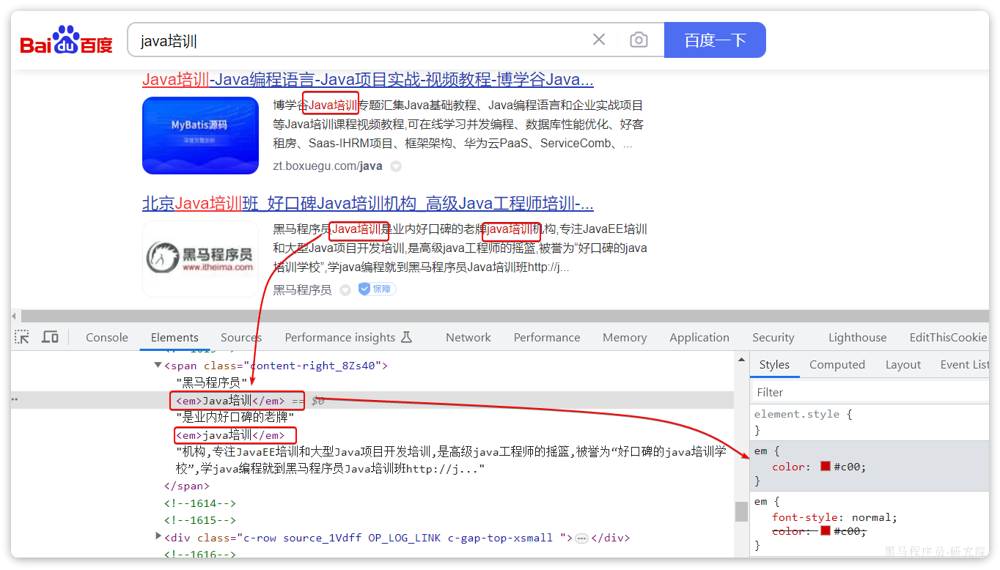

观察页面源码，你会发现两件事情：

- 高亮词条都被加了`<em>`标签
- `<em>`标签都添加了红色样式


css样式肯定是前端实现页面的时候写好的，但是前端编写页面的时候是不知道页面要展示什么数据的，不可能给数据加标签。而服务端实现搜索功能，要是有`elasticsearch`做分词搜索，是知道哪些词条需要高亮的。

因此词条的**高亮标签肯定是由服务端提供数据的时候已经加上的**。


因此实现高亮的思路就是：

- 用户输入搜索关键字搜索数据
- 服务端根据搜索关键字到elasticsearch搜索，并给搜索结果中的关键字词条添加`html`标签
- 前端提前给约定好的`html`标签添加`CSS`样式


#### 5.4.2 实现高亮

事实上elasticsearch已经提供了给搜索关键字加标签的语法，无需我们自己编码。

基本语法如下：

```JSON
GET /{索引库名}/_search
{
  "query": {
    "match": {
      "搜索字段": "搜索关键字"
    }
  },
  "highlight": {
    "fields": {
      "高亮字段名称": {
        "pre_tags": "<em>",
        "post_tags": "</em>"
      }
    }
  }
}
```

<callout emoji="❗">
**注意**：
- 搜索必须有查询条件，而且是全文检索类型的查询条件，例如`match`
- 参与高亮的字段必须是`text`类型的字段
- 默认情况下参与高亮的字段要与搜索字段一致，除非添加：`required_field_match=false`
</callout>


示例：

```SQL
GET /items/_search
{
  "query": {
    "match": {
      "name": "全脱脂牛奶"
    }
  }
  , "highlight": {
    "fields": {
      "name": {
        "pre_tags": "<em>",
        "post_tags": "</em>"
      }
    }
  }
}
```

下边用Java Client实现，对照dsl语句结合AI编写Java Client程序

```JavaScript
@DisplayName("复合查询-高亮查询")
@Test
public void higlightQuery() throws IOException {
    //执行查询商品请求
    SearchResponse<ItemDoc> response = esClient.search(s ->
                            s.index("items")
                            .query(q->q.match(m->m.field("name").query("全脱脂牛奶")))
                            .highlight(h->h.fields("name",x->x.preTags("<em>").postTags("</em>")))
            , ItemDoc.class);

    //处理响应结果
    long total = response.hits().total().value();
    log.info("查询到的商品数量：{}", total);
    List<Hit<ItemDoc>> hits = response.hits().hits();
    hits.forEach(x-> log.info("查询到的商品：{}", x.highlight().get("name")));
}
```


## 6 数据聚合

### 6.1 介绍

聚合（`aggregations`）可以让我们极其方便的实现对数据的统计、分析、运算。例如：

- 什么品牌的手机最受欢迎？
- 这些手机的平均价格、最高价格、最低价格？
- 这些手机每月的销售情况如何？

实现这些统计功能的比数据库的sql要方便的多，而且查询速度非常快，可以实现近实时搜索效果。

应用场景：

1. 对数据进行统计
2. 在搜索界面显示符合条件的品牌、分类、规格等信息，如下图：


聚合常见的有三类：

官方文档：

<bookmark name="www.elastic.co" href="https://www.elastic.co/guide/en/elasticsearch/reference/7.17/search-aggregations.html"></bookmark>

-  **桶（`Bucket`）**聚合：用来对文档做分组 

  - `TermAggregation`：按照文档字段值分组，例如按照品牌值分组、按照国家分组
  - `Date Histogram`：按照日期阶梯分组，例如一周为一组，或者一月为一组
-  **度量（`Metric`）**聚合：用以计算一些值，比如：最大值、最小值、平均值等 

  - `Avg`：求平均值
  - `Max`：求最大值
  - `Min`：求最小值
  - `Stats`：同时求`max`、`min`、`avg`、`sum`等
-  **管道（`pipeline`）**聚合：其它聚合的结果为基础做进一步运算 


**注意：**参加聚合的字段必须是keyword、日期、数值、布尔类型


### 6.2. Bucket聚合

#### 6.2.1 语法

例如我们要统计所有商品中共有哪些商品分类，其实就是以分类（category）字段对数据分组。category值一样的放在同一组，属于`Bucket`聚合中的`Term`聚合。

基本语法如下：

```JSON
GET /items/_search
{
  "size": 0,
  "aggs": {
    "category_agg": {
      "terms": {
        "field": "category",
        "size": 20,
        "order": {
          "_count": "desc"
        }
      }
    }
  }
}
```

语法说明：

- `size`：设置`size`为0，查询0条数据即结果中不包含文档，只包含聚合
- `aggregations`：定义聚合

  - `category_agg`：聚合名称，自定义，但不能重复
  
    - `terms`：聚合的类型，按分类聚合，所以用`term`
    
      - `field`：参与聚合的字段名称
      - `size`：希望返回的聚合结果的最大数量
      - order: 对聚合结果排序

来看下查询的结果：

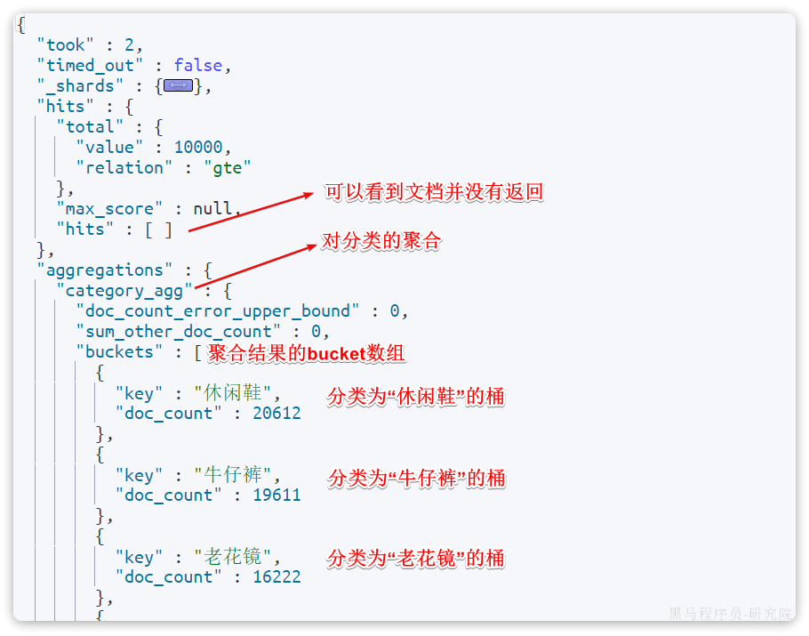

#### 6.2.2 多级聚合

同时对品牌分组统计，此时需要按分类统计，按品牌统计，这时需要定义多个桶，如下：

```TypeScript
GET /items/_search
{
  "size": 0, 
  "aggs": {
    "category_agg": {
      "terms": {
        "field": "category",
        "size": 20
      }
    },
    "brand_agg":{
       "terms": {
        "field": "brand",
        "size": 20
      }
    }
  }
}
```

结果：

```TypeScript
{
  "took" : 7,
  "timed_out" : false,
  "_shards" : {
    "total" : 1,
    "successful" : 1,
    "skipped" : 0,
    "failed" : 0
  },
  "hits" : {
    "total" : {
      "value" : 2000,
      "relation" : "eq"
    },
    "max_score" : null,
    "hits" : [ ]
  },
  "aggregations" : {
    "category_agg" : {
      "doc_count_error_upper_bound" : 0,
      "sum_other_doc_count" : 0,
      "buckets" : [
        {
          "key" : "拉杆箱",
          "doc_count" : 1323
        },
        {
          "key" : "真皮包",
          "doc_count" : 210
        },
        {
          "key" : "手机",
          "doc_count" : 151
        },
        {
          "key" : "牛奶",
          "doc_count" : 145
        }
      ]
    },
    "brand_agg" : {
      "doc_count_error_upper_bound" : 0,
      "sum_other_doc_count" : 863,
      "buckets" : [
        {
          "key" : "美旅箱包",
          "doc_count" : 110
        },
        {
          "key" : "汉客",
          "doc_count" : 90
        }
      ]
    }
  }
}
```


现在需要统计同一分类下的不同品牌的商品数量，这时就需要对桶内的商品二次聚合，如下：

```TypeScript
GET /items/_search
{
   "aggs" : {
      "category_agg" : {
         "aggs" : {
            "brand_agg" : {
               "terms" : {
                  "field" : "brand",
                  "size" : 20
               }
            }
         },
         "terms" : {
            "field" : "category",
            "size" : 20
         }
      }
   },
   "size" : 0
}
```

结果：

截取部分结果如下，拉杆箱是按分类聚合的一级聚合结果，其下的“汉客”、"新秀丽"是按品牌聚合的二级聚合结果。

```TypeScript
{
  "took" : 1,
  "timed_out" : false,
  "_shards" : {
    "total" : 1,
    "successful" : 1,
    "skipped" : 0,
    "failed" : 0
  },
  "hits" : {
    "total" : {
      "value" : 4002,
      "relation" : "eq"
    },
    "max_score" : null,
    "hits" : [ ]
  },
  "aggregations" : {
    "category_agg" : {
      "doc_count_error_upper_bound" : 0,
      "sum_other_doc_count" : 0,
      "buckets" : [
        {
          "key" : "拉杆箱",
          "doc_count" : 2088,
          "brand_agg" : {
            "doc_count_error_upper_bound" : 0,
            "sum_other_doc_count" : 594,
            "buckets" : [
              {
                "key" : "美旅箱包",
                "doc_count" : 187
              },
              {
                "key" : "PointKid",
                "doc_count" : 128
              },
              {
                "key" : "汉客",
                "doc_count" : 120
              },
              {
                "key" : "新秀丽",
                "doc_count" : 104
              },
              {
                "key" : "DELSEY",
                "doc_count" : 99
              },
              {
                "key" : "莎米特",
                "doc_count" : 91
              },
              {
                "key" : "文森保罗",
                "doc_count" : 89
              },
              {
                "key" : "旅行之家",
                "doc_count" : 78
              },
              {
                "key" : "爱华仕",
                "doc_count" : 72
              },
              {
                "key" : "梵地亚",
                "doc_count" : 70
              },
              {
                "key" : "瑞动",
                "doc_count" : 66
              },
              {
                "key" : "银座",
                "doc_count" : 59
              },
              {
                "key" : "Diplomat",
                "doc_count" : 58
              },
              {
                "key" : "博兿",
                "doc_count" : 46
              },
              {
                "key" : "宾豪",
                "doc_count" : 41
              },
              {
                "key" : "卡拉羊",
                "doc_count" : 40
              },
              {
                "key" : "瑞界",
                "doc_count" : 38
              },
              {
                "key" : "Kamiliant",
                "doc_count" : 37
              },
              {
                "key" : "ITO",
                "doc_count" : 36
              },
              {
                "key" : "EAZZ",
                "doc_count" : 35
              }
            ]
          }
        },
```

#### 6.2.3 思考

下边的语句中包含两个“brand_agg”，它们有什么不同？

```TypeScript
GET /items/_search
{
   "aggs" : {
      "brand_agg" : {
         "terms" : {
            "field" : "brand",
            "size" : 20,
            "order": {
              "_count": "desc"
            }
         }
      },
      "category_agg" : {
         "aggs" : {
            "brand_agg" : {
               "terms" : {
                  "field" : "brand",
                  "size" : 20
               }
            }
         },
         "terms" : {
            "field" : "category",
            "size" : 20
         }
      }
   },
   "size" : 0
}
```


### 6.3 带条件聚合

默认情况下，Bucket聚合是对索引库的所有文档做聚合，例如我们统计商品中所有的品牌，结果如下：

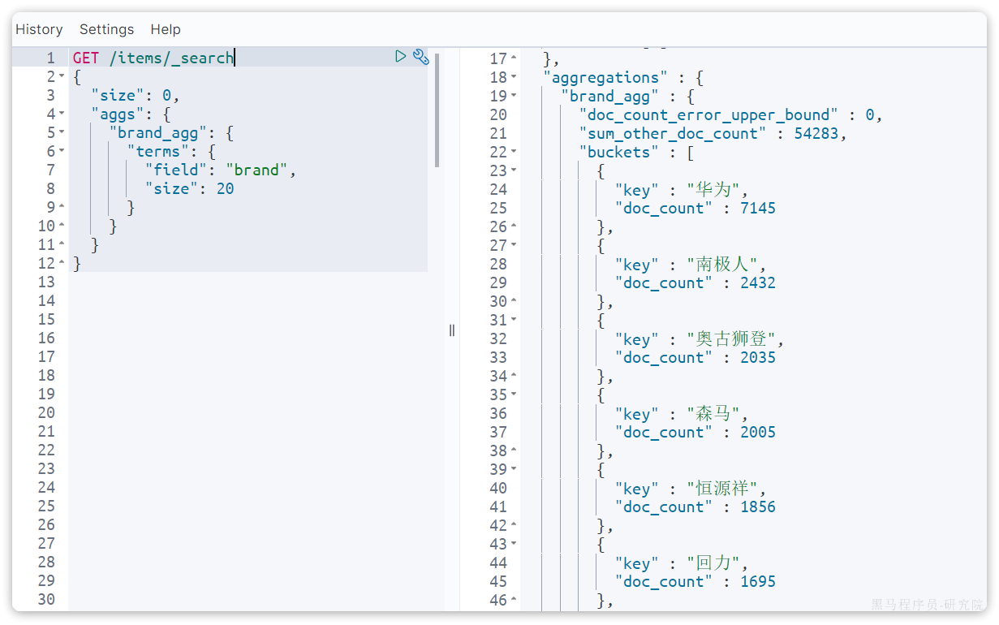

可以看到统计出的品牌非常多。

但真实场景下，用户会输入搜索条件，因此聚合必须是对搜索结果聚合。那么聚合必须添加限定条件。

例如，我想知道价格高于3000元的手机品牌有哪些，该怎么统计呢？

我们需要从需求中分析出搜索查询的条件和聚合的目标：

- 搜索查询条件：

  - 价格高于3000
  - 必须是手机
- 聚合目标：统计的是品牌，肯定是对brand字段做term聚合

语法如下：

增加"query"标签。

```JSON
GET /items/_search
{
  "query": {
    "bool": {
      "filter": [
        {
          "term": {
            "category": "手机"
          }
        },
        {
          "range": {
            "price": {
              "gte": 300000
            }
          }
        }
      ]
    }
  }, 
  "size": 0, 
  "aggs": {
    "brand_agg": {
      "terms": {
        "field": "brand",
        "size": 20
      }
    }
  }
}
```

聚合结果如下：

```JSON
{
  "took" : 2,
  "timed_out" : false,
  "hits" : {
    "total" : {
      "value" : 13,
      "relation" : "eq"
    },
    "max_score" : null,
    "hits" : [ ]
  },
  "aggregations" : {
    "brand_agg" : {
      "doc_count_error_upper_bound" : 0,
      "sum_other_doc_count" : 0,
      "buckets" : [
        {
          "key" : "华为",
          "doc_count" : 7
        },
        {
          "key" : "Apple",
          "doc_count" : 5
        },
        {
          "key" : "小米",
          "doc_count" : 1
        }
      ]
    }
  }
}

```

可以看到，结果中只剩下3个品牌了。

### 6.4 Metric聚合

上节课，我们统计了价格高于3000的手机品牌，形成了一个个桶。现在我们需要对桶内的商品做运算，获取每个品牌价格的最小值、最大值、平均值。

这就要用到`Metric`聚合了，例如stats聚合，就可以同时获取`min`、`max`、`avg`等结果。

语法如下：

```JSON
GET /items/_search
{
  "query": {
    "bool": {
      "filter": [
        {
          "range": {
            "price": {
              "gte": 100000
            }
          }
        },
        {
          "term": {
            "category": "手机"
          }
        }
      ]
    }
  },
  "aggs": {
    "brand_agg": {
      "terms": {
        "field": "brand",
        "size": 100,
        "order": {
          "stats_metric.avg": "desc"
        }
      }
      , "aggs": {
        "stats_metric": {
          "stats": {
            "field": "price"
          }
        }
      }
    }
  }
  , "size": 0
}
```

`query`部分就不说了，我们重点解读聚合部分语法。

可以看到我们在`brand_agg`聚合的内部，我们新加了一个`aggs`参数。这个聚合就是`brand_agg`的子聚合，会对`brand_agg`形成的每个桶中的文档分别统计。

- `stats_meric`：聚合名称,自定义名称

  - `stats`：聚合类型，stats是`metric`聚合的一种
  
    - `field`：聚合字段，这里选择`price`，统计价格


由于stats是对brand_agg形成的每个品牌桶内文档分别做统计，因此每个品牌都会统计出自己的价格最小、最大、平均值。

结果如下：

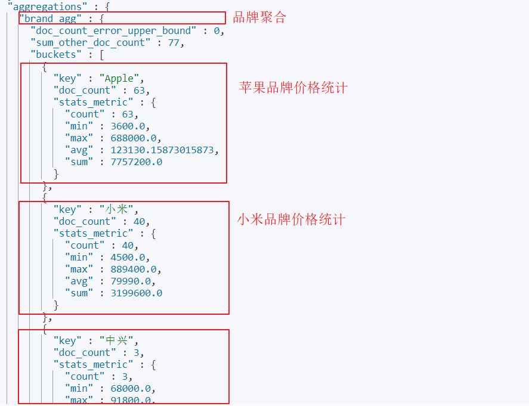

另外，我们还可以让聚合按照每个品牌的价格平均值排序：

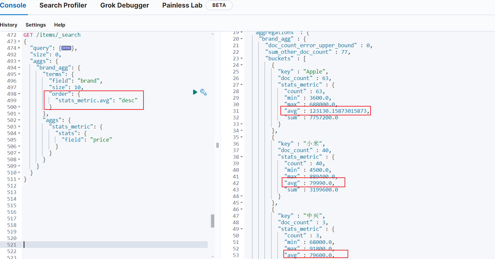


### 6.5. Java Client

参考DSL语句编写Java Client代码。


先完成第一个简单根据分类聚合的代码

```JavaScript
@DisplayName("聚合查询-桶聚合")
@Test
public void aggTermQuery() throws IOException {
    //执行聚合查询请求
    SearchResponse<ItemDoc> response = esClient.search(s ->
                    s.index("items")
                            .size(0)
                            .aggregations("category_agg",
                                    a->a.terms(t->t.field("category").size(20).order(NamedValue.of("_count",SortOrder.Desc))))
            , ItemDoc.class);

    //处理响应结果
    Aggregate cateAgg = response.aggregations().get("category_agg");
    List<StringTermsBucket> array = cateAgg.sterms().buckets().array();
    log.info("聚合结果数据量：{}", array.size());
    array.forEach(x->log.info("key:{},docCount:{}", x.key().stringValue(), x.docCount()));
}
```


再完成后面带条件等要求的聚合代码

```JavaScript
@DisplayName("聚合查询-桶聚合+指标聚合")
@Test
public void aggTermAndMetricQuery() throws IOException {
    //执行聚合查询请求
    SearchResponse<ItemDoc> response = esClient.search(s ->
                    s.index("items")
                            .size(0)
                            .query(q-> q.bool(b->b.filter(f->f.range(r->r.field("price").gte(JsonData.of(100000))))
                                                 .filter(f->f.term(t->t.field("category").value("手机")))))
                            .aggregations("brand_agg",
                                    a->a.terms(t->t.field("brand").size(100).order(NamedValue.of("stats_metric.avg",SortOrder.Desc)))
                                            .aggregations("stats_metric", aa->aa.stats(st->st.field("price")))
                            )
            , ItemDoc.class);

    //处理响应结果
    Aggregate cateAgg = response.aggregations().get("brand_agg");
    List<StringTermsBucket> array = cateAgg.sterms().buckets().array();
    log.info("聚合结果数据量：{}", array.size());
    array.forEach(x->{
        StatsAggregate aggregate = x.aggregations().get("stats_metric").stats();
        log.info("key:{},docCount:{}, 价格统计结果：count:{},avg:{},sum:{},min:{},max:{}", x.key().stringValue(), x.docCount(), aggregate.count(),aggregate.avg(),aggregate.sum(),aggregate.min(),aggregate.max() );
    });
}
```


## 作业


### 新建搜索服务

#### **需求**

搜索业务并发压力可能会比较高，目前与商品服务在一起，不方便后期优化。

将搜索相关功能抽取到这个微服务中（原有代码迁移过来）。

搜索功能支持：

1. 输入关键字进行全文检索，匹配商品名称、品牌、分类信息。
2. 按分类、品牌、价格进行检索
3. 商品名称高亮显示 

示例：


#### 提示

修改原来的搜索接口，改为使用Elasticsearch实现，实现根据关键字搜索，实现分页、排序。

创建搜索服务，命名为`search-service`，端口为8083。


创建配置类

```Java
package com.hmall.search.config;

import co.elastic.clients.elasticsearch.ElasticsearchClient;
import co.elastic.clients.json.jackson.JacksonJsonpMapper;
import co.elastic.clients.transport.ElasticsearchTransport;
import co.elastic.clients.transport.rest_client.RestClientTransport;
import com.fasterxml.jackson.databind.ObjectMapper;
import com.fasterxml.jackson.datatype.jsr310.JavaTimeModule;
import lombok.extern.slf4j.Slf4j;
import org.apache.http.HttpHost;
import org.elasticsearch.client.RestClient;
import org.springframework.boot.context.properties.EnableConfigurationProperties;
import org.springframework.context.annotation.Bean;
import org.springframework.context.annotation.Configuration;

import javax.annotation.PreDestroy;
import java.io.IOException;

/**
 * @author Mr.M
 * @version 1.0
 * @description Elasticsearch配置类
 * @date 2024/8/19 18:09
 */
@Slf4j
@Configuration
@EnableConfigurationProperties(EsProperties.class)
public class EsConfiguration {
    private ElasticsearchTransport transport;
    @Bean
    public ElasticsearchClient esClient(EsProperties esProperties) {
        // Create the low-level client
        RestClient restClient = RestClient.builder(
                new HttpHost(esProperties.getHost(), esProperties.getPort())).build();
        // 创建 ObjectMapper 实例
        ObjectMapper objectMapper = new ObjectMapper();
        // 添加 JavaTimeModule 以支持 LocalDateTime 类型
        objectMapper.registerModule(new JavaTimeModule());

        // Create the transport with a Jackson mapper
        transport = new RestClientTransport(
                restClient, new JacksonJsonpMapper(objectMapper));


        // And create the API client
        ElasticsearchClient esClient = new ElasticsearchClient(transport);
        return esClient;
    }

    // 应用关闭时自动调用此方法
    @PreDestroy
    public void closeTransport() {
        if (transport != null) {
            try {
                // 关闭底层的RestClient
                transport.close();

                log.info("关闭ES的transport完毕");
            } catch (IOException e) {
                // 记录错误日志，避免影响应用关闭
                log.error("关闭ES的transport出错", e);
            }
        }
    }

}
```

EsProperties类如下：

```Java
package com.hmall.search.properties;

import lombok.Data;
import org.springframework.boot.context.properties.ConfigurationProperties;
import org.springframework.context.annotation.Configuration;

@Configuration
@ConfigurationProperties(prefix = "hm.es")
@Data
public class EsProperties {
    /**
     * es host
     */
    private String host;
    /**
     * es 端口
     */
    private Integer port;
}
```

在application.yaml中配置：

```Java
hm:
  es:
    host: 192.168.101.68
    port: 9200
```


屏蔽item-service中的*SearchController*

在网关中添加搜索服务的路由配置，修改完配置文件重启网关，如果网关无法启动需要查看控制台是否无法加载配置文件。


确保：搜索手机关键词能像原来一样搜到结果

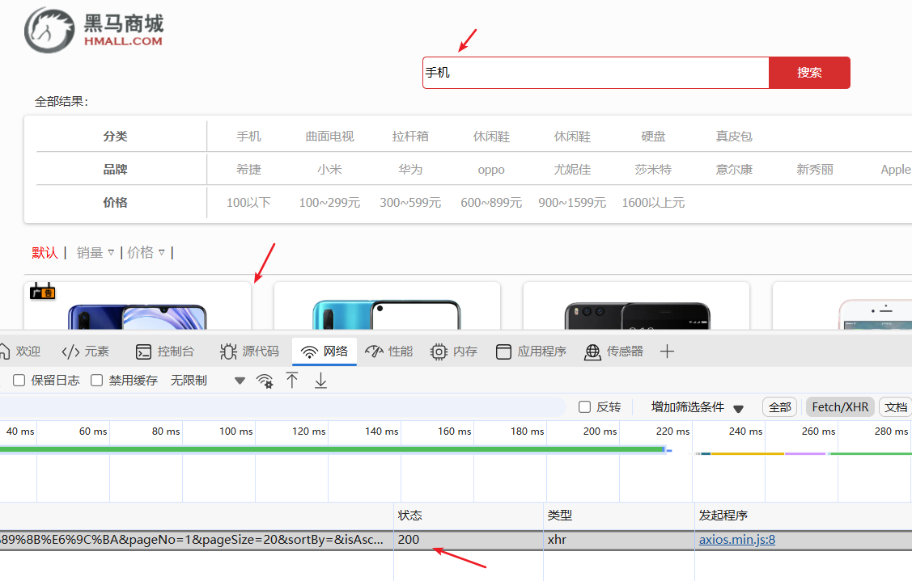

新建的search-service控制台会有对应的SQL日志


**最后，将mysql版本的商品搜索功能，改为基于ES实现，最终实现效果如下：**


---
> 来源：飞书技术知识库（脱敏版） · 04 微服务与中间件 / Elasticsearch / 06 Elasticsearch入门 · [原文](https://ccn8v2zngwsm.feishu.cn/wiki/WbhYwokcsiJTrfkHwKXc9PqMnce)
