# 07 Elasticsearch高级

## 学习目标

1. 能够使用function_score修改文档得分
2. 能够说出深度分页的方案
3. 能够使用Java Client测试地理坐标查询
4. 能够说出实现同义词的方案
5. 能够说出自动补全方案
6. 能够完善商城项目商品搜索功能
7. 能够实现商城项目自动补全功能


## 1 搜索高级

### 1.1. 算分函数

#### 1.1.1 **function_score**

当我们利用match查询时，文档结果会根据与搜索词条的**关联度打分**（**\_score**），返回结果时按照分值降序排列。

<callout emoji="🎨">
在 Elasticsearch 7.17.7 中，默认的自然算分算法是 BM25（Best Matching 25）。从 ES 5.0 版本开始，BM25 就取代了 TF-IDF 成为默认的相似度算法。
**BM25 算法简介**
BM25 是一种基于概率检索模型的算法，相比 TF-IDF 有以下改进：
- 词频饱和度：解决了 TF-IDF 中词频无限增长的问题，避免长文档过度加权。
- 文档长度归一化：对短文档更友好，避免长文档因包含更多词而获得不公平的高分。
</callout>

例如，我们搜索 "手机"，结果如下：

\_score：文档与用户搜索的关键字的相关度得分

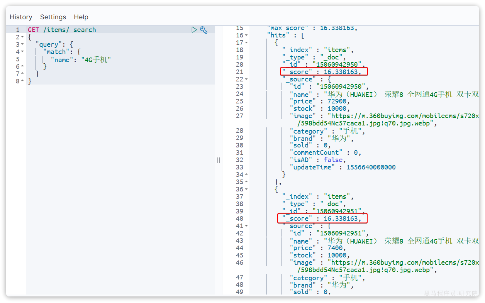
> 图注：图片展示了Elasticsearch中使用BM25算法搜索“手机”时的搜索结果及算分情况。左侧为搜索请求代码，右侧是搜索结果JSON数据。搜索结果中“score”字段值均为16.338163，对应文档包含“手机”关键词。该图片与上下文紧密相关，直观呈现了BM25算法在实际搜索中的应用效果，帮助理解BM25算法在文档与用户搜索关键字相关度得分方面的表现。


在实际业务需求中，常常会有竞价排名的功能。不是相关度越高排名越靠前，而是花的钱多的排名靠前。

例如在百度中搜索Java培训，排名靠前的就是广告推广：


> 图注：图片展示了百度搜索“java培训”结果页面。搜索框内显示“java培训”，下方有“网页”“资讯”“视频”等分类选项。搜索结果中，一个红色背景的广告推广内容被突出显示，其下方有“广告”“推荐”标识。该图片与上下文关系紧密，用于说明在百度搜索中搜索Java培训时，排名靠前的广告推广情况，引出人为控制相关性算分需利用Elasticsearch中function score查询的背景。

要想人为控制相关性算分，就需要利用elasticsearch中的function score 查询了。

一个例子：

给小米这个品牌的手机算分提高十倍，分析如下：

- 过滤条件：品牌必须为小米
- 算分函数：常量weight，值为10
- 算分模式：相乘multiply

```JSON
GET /items/_search
{
  "query": {
    "function_score": {
      "query": {
        "match": {
          "name":"手机"
        }
      }, 
      "functions": [
        {
          "filter": { 
            "term": {
              "brand": "小米"
            }
          },
          "weight": 10 
        }
      ],
      "boost_mode": "multiply"
    }
  },
  "from": 0,
  "size": 10
}
```

从结果可以看到小米手机排在前边，因为对品牌为“小米”的文档得分在原有分值基础上乘以10,分值越大越排在前边。


function score的运行流程如下：

- 1）根据**原始条件**查询搜索文档，并且计算相关性算分，称为**原始算分**（query score）
- 2）根据**过滤条件**，过滤文档
- 3）符合**过滤条件**的文档，基于**算分函数**运算，得到**函数算分**（function score）
- 4）将**原始算分**（query score）和**函数算分**（function score）基于**运算模式**做运算，得到最终结果，作为相关性算分。


因此，其中的关键点是：

- 过滤条件：决定哪些文档的算分被修改
- 算分函数：决定函数算分的算法
- 运算模式：决定最终算分结果


本例中**function_score的语法**如下：

function score 查询中包含四部分内容：

- **原始查询**条件：query部分，基于这个条件搜索文档，并且基于BM25算法给文档打分，**原始算分**（query score)
- **过滤条件**：filter部分，符合该条件的文档才会重新算分
- **算分函数**：符合filter条件的文档要根据这个函数做运算，得到的**函数算分**（function score），有四种函数 

  - weight：函数结果是常量
  - field_value_factor：以文档中的某个字段值作为函数结果，适用于那些需要根据某个数值字段来影响文档排序的情况，例如根据产品的价格、文章的阅读量或者用户的活跃度来对结果进行评分。
  - random_score：以随机数作为函数结果，用于测试或某些特定的用例，比如创建一个随机排序的效果
  - script_score：自定义算分函数算法，允许你在查询时动态地编写脚本来计算每个文档的分数
- **boost_mode运算模式**：决定了如何将评分函数的结果与基础查询得分相结合，包括： 

  - multiply：评分函数的结果与基础查询的得分相乘。这是默认行为，适用于希望评分函数增强或减弱基础查询得分的情况。
  - replace：评分函数的结果将完全替换基础查询的得分。这意味着最终得分将完全基于评分函数的结果，而不考虑基础查询的原始得分。
  - `sum`:评分函数的结果与基础查询的得分相加。这使得评分函数的结果直接增加到基础查询得分上，适合于希望累加评分因素的情况。
  - `avg`:评分函数的结果与基础查询的得分取平均值。这种方式适用于希望平衡基础查询得分与评分函数得分的情况。

算分函数的其它选项，比如：field_value_factor、script_score大家使用AI自学。


示例2：

将下边的查询改为算分函数查询，品牌为“爱氏晨曦”排在前边

```Java

GET /items/_search
{
   "from" : 0,
   "query" : {
      "multi_match" : {
         "fields" : [ "name", "category" ],
         "query" : "脱脂牛奶"
      }
   },
   "size" : 5
}

```


#### 1.1.2 Java Client

使用Java Client实现算分函数查询

```Java
@DisplayName("聚合查询-算分查询")
@Test
public void functionScoreQuery() throws IOException {
    //执行算分查询请求
    SearchResponse<ItemDoc> response = esClient.search(s ->
                    s.index("items")
                            .trackTotalHits(t->t.enabled(true))
                            .query(q-> q.functionScore(
                                    f->f.query(qq->qq.multiMatch(m->m.fields("name","category").query("脱脂牛奶")))
                                            .functions(ff->ff.filter(fff->fff.term(t->t.field("brand").value("爱氏晨曦"))).weight(10d))
                                            .boostMode(FunctionBoostMode.Multiply)
                            ))
                            .size(5)
            , ItemDoc.class);

    //处理响应结果
    long total = response.hits().total().value();
    log.info("查询到的商品数量：{}", total);
    List<Hit<ItemDoc>> hits = response.hits().hits();
    hits.forEach(x-> log.info("查询到的商品：{}", x));
}
```


### 1.2. 深度分页

#### 1.2.1 深度分页问题

前边我们学习分页查询是通过修改`from`、`size`参数来控制要返回的分页结果,类似于mysql中的`limit ?, ?`

elasticsearch的数据一般会采用分片存储，也就是把一个索引中的数据分成N份，存储到不同节点上。这种存储方式比较有利于数据扩展，但给分页带来了一些麻烦。

比如一个索引库中有100000条数据，分别存储到4个分片，每个分片25000条数据。现在每页查询10条，查询第100页。那么分页查询的条件如下：

```JSON
GET /items/_search
{
  "from": 990, // 从第991条开始查询
  "size": 10, // 每页查询10条
  "sort": [
    {
      "price": "asc"
    }
  ]
}
```

从语句来分析，要查询第990\~1000名的数据。

从实现思路来分析，是将所有数据排序，找出前1000名，截取其中的990\~1000的部分。但问题来了，我们如何才能找到所有数据中的前1000名呢？

要知道每一片的数据都不一样，第1片上的第900\~1000，在另1个节点上并不一定依然是900\~1000名。所以我们只能在每一个分片上都找出排名前1000的数据，然后汇总到一起，重新排序，才能找出整个索引库中真正的前1000名，此时截取990\~1000的数据即可。

如图：

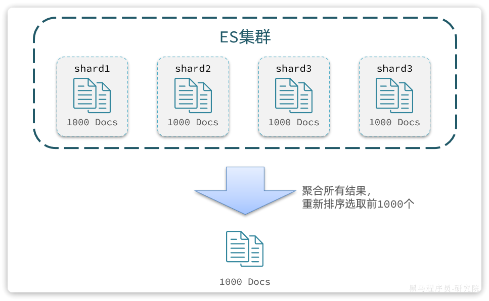
> 图注：这张图展示了Elasticsearch深度分页的核心逻辑，上方虚线框内为ES集群，包含shard1、shard2、shard3、shard3四个分片，每个分片各存储1000条文档。下方通过向下的箭头标注了关键步骤：聚合所有分片的结果，重新排序后选取前1000个文档，这一流程对应文档中深度分页的解决逻辑，即因各分片数据顺序独立，需先获取所有分片的前N条数据汇总排序，再截取目标位置数据，该图直观呈现了这一操作的具体过程。

试想一下，假如我们现在要查询的是第1000页数据呢，是不是要找第9990\~10000的数据，那岂不是需要把每个分片中的前10000名数据都查询出来，汇总在一起，在内存中排序？如果查询的分页深度更深呢，需要一次检索的数据岂不是更多？

由此可知，当查询分页深度较大时，汇总数据过多，对内存和CPU会产生非常大的压力，特别是在 `from` 值非常大的情况下。这是因为Elasticsearch需要先跳过前面的所有文档才能获取到所需的文档，这可能导致大量的磁盘I/O操作和CPU使用率。

因此elasticsearch会限制`from+ size `请求：

1. `size` 参数的最大值：

默认情况下，`size` 参数的最大值被限制为 10,000。这意味着每次查询最多只能返回 10,000 条记录。

1. `from` 参数的最大值：

默认情况下，`from` 参数的最大值也被限制为 10,000。这意味着您不能请求超过第 10,000 条记录之后的数据。

这意味着，理论上，您可以查询的最大页数是 `10,000 / size`。例如，如果 `size` 设置为 100，则最多可以查询 100 页。

#### 1.1.2 `search after`

针对深度分页，elasticsearch提供了两种解决方案：

- `search after`：分页时需要排序，原理是从上一次的排序值开始，查询下一页数据。官方推荐使用的方式。
- `scroll`滚动查询：原理将排序后的文档id形成快照，保存下来，基于快照做分页。官方已经不推荐使用。


详情见文档：https://www.elastic.co/guide/en/elasticsearch/reference/7.17/paginate-search-results.html


search after举例：

查询第一页：

```Java
GET /items/_search
{
  "track_total_hits": true, 
  "query": {
    "match": {
      "name": "手机"
    }
  },
  "sort": [
    {
      "_id": {
        "order": "asc"
      }
    }
  ], 
  "size": 10,
  "search_after": ["0"]
}
```


查询第二页：

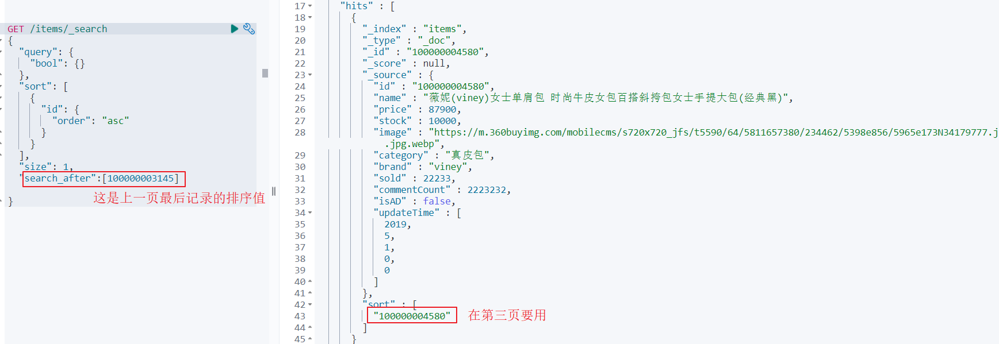
> 图注：图片展示了使用Elasticsearch搜索API实现深度分页的示例代码及响应结果。代码中使用了`search_after`参数，其值为上一页最后记录的排序值，即`1000000003145`。响应结果中，`search_after`值为`1000000004580`，在第三页使用。该图片与上下文紧密相关，直观呈现了`search_after`参数在实现深度分页时的应用场景，帮助理解其在Elasticsearch搜索中的具体操作。


如何使用search_after实现降序排序呢，排序字段是ID？


第一页的search_after值就需要设置一个最大值

```Java
GET /items/_search
{
  "track_total_hits": true, 
  "query": {
    "match": {
      "name": "手机"
    }
  },
  "sort": [
    {
      "_id": {
        "order": "desc"
      }
    }
  ], 
  "size": 10,
  "search_after": ["999999999999"]
}
```


下边使用Java client实现深度分页，请大家自行测试。

```JavaScript
@DisplayName("深度分页查询")
@Test
public void searchAfterQuery() throws IOException {
    //执行深度分页查询请求
    SearchResponse<ItemDoc> response = esClient.search(s ->
                    s.index("items")
                            .trackTotalHits(t->t.enabled(true))
                            .query(q-> q.match(m->m.field("name").query("手机")))
                            .sort(ss-> ss.field(f->f.field("_id").order(SortOrder.Asc)))
                            .searchAfter("0")
                            .size(10)
            , ItemDoc.class);

    //处理响应结果
    long total = response.hits().total().value();
    log.info("查询到的商品数量：{}", total);
    List<Hit<ItemDoc>> hits = response.hits().hits();
    hits.forEach(x-> log.info("查询到的商品：{}", x));

    //下一页查询起始的值
    Hit<ItemDoc> hit = hits.get(hits.size() - 1);
    String startId = hit.sort().get(0);
    log.info("下一页查询起始值：{}",startId);
}
```


<callout emoji="❗">
**总结：**
大多数情况下，我们采用普通分页就可以了。查看百度、京东等网站，会发现其分页都有限制。例如百度最多支持77页，每页不足20条。京东最多100页，每页最多60条。
因此，一般我们采用限制分页深度的方式即可。
</callout>


### 1.3.地理坐标查询

#### 1.3.1 介绍

所谓的地理坐标查询，其实就是根据经纬度查询，官方文档：

<bookmark name="Elasticsearch Guide:" href="https://www.elastic.co/guide/en/elasticsearch/reference/7.17/geo-queries.html"></bookmark>

常见的使用场景包括：

- 携程：搜索我附近的酒店
- 滴滴：搜索我附近的出租车
- 微信：搜索我附近的人

找附近的酒店：


> 图注：图片展示的是地图预览界面，标注了“黑马程序员上海校区”“上海宝华喜来登酒店”“上海中优城市万豪酒店”等地点。该图片与文档中介绍地理坐标查询的内容相关，用于直观呈现常见的使用场景，如携程搜索附近的酒店、滴滴打车等，通过地图展示这些地点的位置，帮助理解地理坐标查询在实际应用中的应用。

打车：


> 图注：图片展示的是滴滴出行打车界面，显示了“黑马程序员训练营(上海校区)”为推荐的上车点。界面中还标注了航头路/航都路(路口)东南侧等地点信息，以及上海市今日天气情况。图片与上下文的关系是，通过滴滴打车场景举例说明地理坐标查询在打车场景中的应用，即根据用户当前位置附近的位置信息进行查询。

#### 1.3.2. 矩形范围查询

##### 1.3.2.1 语法

矩形范围查询，也就是geo_bounding_box查询，查询坐标落在某个矩形范围的所有文档：

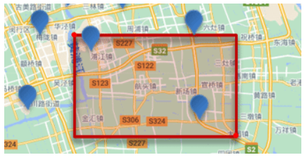
> 图注：这是用于说明Elasticsearch矩形范围查询的示意图，图中以红色矩形标识了查询指定的矩形范围，该范围覆盖了道路S32、S122、S123等区域。图中的蓝色标记代表待查询的坐标点，直观呈现了geo_bounding_box查询的逻辑：通过指定的左上、右下两点坐标确定查询矩形，落在该矩形内的坐标点即为符合查询条件的目标，对应搜索附近地点这类地理查询场景的可视化示例。

查询时，需要指定矩形的**左上**、**右下**两个点的坐标，然后画出一个矩形，落在该矩形内的都是符合条件的点。

语法如下：

```JavaScript
// geo_bounding_box查询
GET /indexName/_search
{
  "query": {
    "geo_bounding_box": {
      "FIELD": {
        "top_left": { // 左上点
          "lat": 31.1,
          "lon": 121.5
        },
        "bottom_right": { // 右下点
          "lat": 30.9,
          "lon": 121.7
        }
      }
    }
  }
}
```

##### 1.3.2.2 **向索引添加坐标值**

下边进行测试：

1. **首先向索引添加坐标值**

添加映射：

```JavaScript
PUT /items/_mapping
{
  "properties": {
    "location": {
      "type": "geo_point"
    }
  }
}
```

设置坐标值：

首先找到坐标值，我们使用高德地图取坐标点

访问：https://lbs.amap.com/tools/picker

输入关键，查找坐标

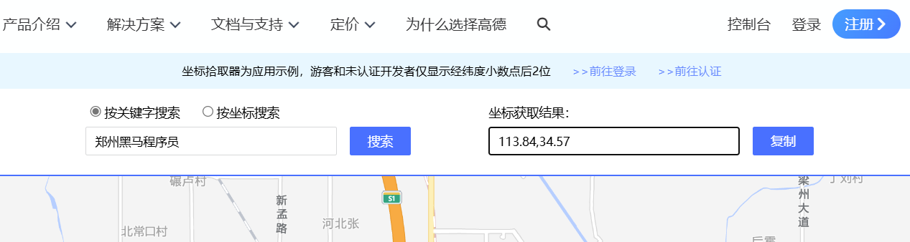
> 图注：图片展示的是高德地图坐标拾取器界面。上方有“按关键字搜索”和“按坐标搜索”选项，当前选中“按关键字搜索”。输入框内显示“郑州黑马程序员”，点击“搜索”按钮后，右侧“坐标获取结果”框显示经纬度为113.84,34.57。界面底部有地图显示区域，标注有“新孟路”等地名。该图片用于辅助说明文档中向索引添加坐标值时，使用高德地图取坐标点的操作，直观呈现了坐标拾取结果。


纬度：34.57

经度：113.84

纬度的有效范围是从 `-90` 到 `+90` 度，而经度的有效范围是从 `-180` 到 `+180` 度。


执行更新语句，更新坐标值：

```JavaScript
POST /items/_update/584391
{
  "doc": {
    "location": {
      "lat": 34.57, 
      "lon": 113.84
    }
  }
}
```


##### 1.3.2.3 地理坐标搜索测试

1. 地理坐标搜索

找到左上和右下的坐标。

```JavaScript
GET /items/_search
{
  "query": {
    "geo_bounding_box":{
      "location": {
        "top_left": {
          "lat": 34.59,
          "lon": 113.82
        },
        "bottom_right":
        {
          "lat": 34.55,
          "lon": 113.86
        }
      }
    }
  }
}
```

结果：

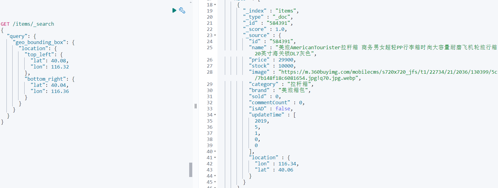
> 图注：图片展示了在Elasticsearch中进行地理坐标搜索的代码及结果。左侧代码部分使用`geo_bounding_box`查询语法，设置左上角和右下角的经纬度坐标，用于搜索指定地理范围内的物品。右侧结果部分显示了搜索到的物品信息，包括物品ID、名称、图片链接、品牌等，其中物品的地理坐标与查询条件相匹配。该图片与上下文紧密相关，直观呈现了地理坐标查询的实际操作及结果。


#### 1.3.3  附近搜索（圆形范围查询）

##### 1.3.3.1 介绍

附近查询，也叫做距离查询（geo_distance）：查询到指定中心点小于某个距离值的所有文档。

换句话来说，在地图上找一个点作为圆心，以指定距离为半径，画一个圆，落在圆内的坐标都算符合条件：

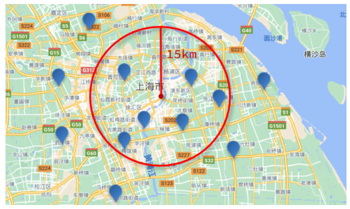
> 图注：这张图片是一张上海市区域的地图，展示了附近搜索的圆形范围查询原理。地图以上海市的核心位置为圆心，用红色圆圈勾勒出半径15km的圆形查询范围，该区域内部及周边分布着多个蓝色标记点，对应符合查询条件的坐标位置。这张图直观呈现了地理坐标查询中“以指定距离为半径画圆，圆内坐标即为符合条件结果”的核心逻辑，与文档中附近搜索（圆形范围查询）的介绍内容相对应。

> 这种查询方式比矩形范围查询更加常用，常见的附近搜索都是这种方式

##### 1.3.3.2 语法

语法说明：

```JavaScript
// geo_distance 查询
GET /indexName/_search
{
  "query": {
    "geo_distance": {
      "distance": "15km", // 半径
      "FIELD": "31.21,121.5" // 圆心
    }
  }
}
```

##### 1.3.3.3 测试

执行下边语句进行测试：

```JavaScript
GET /items/_search
{
  "query": {
    "geo_distance": {
      "distance": "10km",
      "location": {
        "lat": 34.57,
        "lon": 113.84
      }
    }
  }
}
```


#### 1.3.4. Java Client

GeoPoint 类型是Spring data elasticsearch中的一个类，需要将它的依赖添加到pom.xml中

```JavaScript
<!--加入spring data elasticsearch-->
<dependency>
    <groupId>org.springframework.data</groupId>
    <artifactId>spring-data-elasticsearch</artifactId>
</dependency>
```

在ItemDoc类中添加地理坐标字段

```JavaScript
@ApiModelProperty("地理坐标")
private GeoPoint location;
```

对照下边的dsl语句结合AI编写Java Client程序：

dsl：

```Java
GET /items/_search
{
  "query": {
    "geo_distance": {
      "distance": "10km",
      "location": {
        "lat": 34.57,
        "lon": 113.84
      }
    }
  }
}
```

Java 程序：

```JavaScript
@DisplayName("地理位置查询-圆形范围查询")
@Test
public void geoDistanceQuery() throws IOException {
    //执行地理位置查询-圆形范围查询请求
    SearchResponse<ItemDoc> response = esClient.search(s ->
                    s.index("items")
                            .trackTotalHits(t->t.enabled(true))
                            .query(q-> q.geoDistance(g->g.field("location").distance("10km").location(geo->geo.latlon(ll->ll.lat(34.57).lon(113.84)))))
            , ItemDoc.class);

    //处理响应结果
    long total = response.hits().total().value();
    log.info("查询到的商品数量：{}", total);
    List<Hit<ItemDoc>> hits = response.hits().hits();
    hits.forEach(x-> log.info("查询到的商品：{}", x));
}
```


## 2. 同义词

### 2.1 设置同义词

搜索中同义词的需求：在搜索时输入一个关键字，包含关键字同义词的文档应该也可以搜索出来。

比如：输入“电脑”，会搜索出包含“计算机”的文档，输入“黑马”搜索出“黑马程序员”、“传智播客”的文章。

elasticsearch 的同义词有如下两种形式：

- 单向同义词：

```Plain Text
heima,黑马=>黑马程序员,黑马、传智播客
```

箭头左侧的词都会映射成箭头右侧的词。

输入箭头左侧的词可以搜索出箭头右侧的词。


- 双向同义词：

```Plain Text
马铃薯, 土豆, potato
```

双向同义词可以互相映射。

输入“土豆”可以搜索出“potato”，输入“potato”可以搜索出“土豆”


怎么设置同义词？

首先在同义词加到synonyms.txt文件中，synonyms.txt文件在es的config目录下。

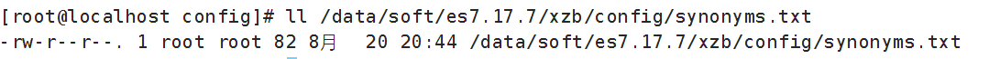
> 图注：图片展示了在Linux系统下，使用`ll`命令查看`/data/soft/es7.17.7/xzb/config/synonyms.txt`文件权限和大小的界面。文件权限为`-rw-r--r--`，属主为root，属组为root，大小为82字节，修改时间为8月20日20:44。该图片与文档中介绍如何设置Elasticsearch同义词的内容相关，直观呈现了同义词文件所在位置及文件信息，辅助说明同义词文件的存储位置和状态。

```Java
vim /data/soft/es7.17.7/xzb/config/synonyms.txt
```

我们在synonyms.txt中加入：

```JavaScript
我的国,中国,中华人民共和国,china
heima,黑马=>黑马程序员,黑马,传智播客,传智教育
```

### 2.2 定义同义词分词器

在设置索引映射时自定义同义词分词器my_synonyms_analyzer，并且用于“title”字段的搜索。

举例：

```JSON
# 先删除原来的索引库
DELETE /test_index

# 再添加新的索引库
PUT /test_index
{
  "settings": {
    "analysis": {
      "filter": {
        "my_synonym_filter": {
          "type": "synonym",
          "updateable": true,
          "synonyms_path": "synonyms.txt"
        }
      },
      "analyzer": {
        "my_synonyms_analyzer": {
          "tokenizer": "ik_smart",
          "filter": [
            "my_synonym_filter"
          ]
        }
      }
    }
  },
  "mappings": {
    "properties": {
      "title": {
        "type": "text",
        "analyzer": "ik_max_word",
        "search_analyzer": "my_synonyms_analyzer"
      }
    }
  }
}
```

`my_synonym_filter`是自定义的`词汇过滤器`,

`my_synonyms_analyzer`是自定义的分析器, `my_synonyms_analyzer`包含并引用了`my_synonym_filter`

`updateable`指示**能否动态更新**, 必须为`true`才能动态更新同义词

`synonyms_path`指示同义词文件的位置

`my_synonyms_analyzer`分析器里用`ik_smart`的分词器, my_synonyms_analyzer的分词流程是原始文本先经过`ik_smart`分词的结果再用my_synonym_filter处理。

`mappings.properties.title.search_analyzer`指示`title`字段在搜索时使用`my_synonyms_analyzer`分析器。


### 2.3 测试

首先向test_index索引中添加数据

```JavaScript
POST /_bulk
{"index": {"_index":"test_index", "_id": "5"}}
{"title": "china你好"}
{"index": {"_index":"test_index", "_id": "4"}}
{"title": "中国你好"}
{"index": {"_index":"test_index", "_id": "6"}}
{"title": "中华人民共和国你好"}
{"index": {"_index":"test_index", "_id": "7"}}
{"title": "China你好"}
{"index": {"_index":"test_index", "_id": "8"}}
{"title": "这是一匹黑马"}
{"index": {"_index":"test_index", "_id": "9"}}
{"title": "黑马是中国良心培训机构"}
{"index": {"_index":"test_index", "_id": "10"}}
{"title": "黑马程序员是中国良心培训机构"}
{"index": {"_index":"test_index", "_id": "11"}}
{"title": "传智播客一所IT培训机构"}
```

搜索关键字“china”

```JavaScript

GET /test_index/_search
{
  "query": {
    "match": {
      "title": "china"
    }
  }
}
```

结果中包括：中国,中华人民共和国,china词。

输入“黑马”会搜索出包括：黑马程序员,黑马、传智播客 词的文档 。

输入“传智播客”只能搜索出包含“传智播客”的文章 。


如果要实现输入“hello”搜索出“你好”的文档 怎么实现？

在同义词文件中加入：传智播客,黑马程序员

执行：POST /test_index/\_reload_search_analyzers  使用同义词生效。

再次测试：

```JavaScript
GET /test_index/_search
{
  "query": {
    "match": {
      "title": "hello"
    }
  }
}
```

输出结果：

```JavaScript
#! Elasticsearch built-in security features are not enabled. Without authentication, your cluster could be accessible to anyone. See https://www.elastic.co/guide/en/elasticsearch/reference/7.17/security-minimal-setup.html to enable security.
{
  "took" : 0,
  "timed_out" : false,
  "_shards" : {
    "total" : 1,
    "successful" : 1,
    "skipped" : 0,
    "failed" : 0
  },
  "hits" : {
    "total" : {
      "value" : 4,
      "relation" : "eq"
    },
    "max_score" : 0.9282145,
    "hits" : [
      {
        "_index" : "test_index",
        "_type" : "_doc",
        "_id" : "5",
        "_score" : 0.9282145,
        "_source" : {
          "title" : "china你好"
        }
      },
      {
        "_index" : "test_index",
        "_type" : "_doc",
        "_id" : "4",
        "_score" : 0.9282145,
        "_source" : {
          "title" : "中国你好"
        }
      },
      {
        "_index" : "test_index",
        "_type" : "_doc",
        "_id" : "7",
        "_score" : 0.9282145,
        "_source" : {
          "title" : "China你好"
        }
      },
      {
        "_index" : "test_index",
        "_type" : "_doc",
        "_id" : "6",
        "_score" : 0.50589883,
        "_source" : {
          "title" : "中华人民共和国你好"
        }
      }
    ]
  }
}

```


### 2.4 思考

如果要实现搜索itheima将黑马程序员相关的记录搜索出来怎么做？

自己在同义词配置文件配置同义词进行测试。


搜索“手机壳”不要搜索出手机的记录？


## 3 自动补全

### 3.1 介绍

当用户在搜索框输入字符时提示出与该字符有关的搜索项，这个效果就是自动补全，如下图输入拼音可以补全拼音对应的中文：


> 图注：图片展示了淘宝首页搜索框的自动补全效果。在搜索框输入“dian”后，下方弹出多个与“dian”相关的搜索项，如“电动车”“电风扇”“电脑包”等，其中“电影票”被红色框线突出显示。该图片与文档中介绍自动补全功能的内容相关，直观呈现了输入拼音可补全对应中文的效果，与文档中提到的自动补全功能相呼应。


输入中文也可以自动补全：


> 图注：这张图展示了淘宝的搜索界面，作为自动补全功能的示例。在搜索栏输入了拼音“电”后，界面下方立刻弹出对应候选项，包含电动车、电风扇、电脑包、电视柜、电脑桌、电饭锅等以“电”开头的相关结果，直观呈现了拼音输入时的自动补全效果。该图片对应文档中关于“输入拼音可以补全拼音对应的中文”的说明，清晰体现了自动补全功能的实际表现。

Elasticsearch如何实现自动补全？

要实现上述自动补全的需求需要完成两个功能：

1. 拼音搜索
2. 前缀搜索


### 3.2. 拼音分词器

#### 3.2.1 安装拼音分词器

##### 3.2.1.1 安装

自动补全如何实现根据拼音字母来补全? 

效果如下图：


> 图注：这张图片是拼音分词器实现自动补全效果的示例界面，呈现的是淘宝的搜索页面。在搜索框中输入拼音“dian”后，下方自动列出了带有“dian”相关汉字的词条选项，包括电动车、电风扇、电脑包、电视柜、电脑桌、电饭锅、电动牙刷、电影票等。该效果符合拼音分词器的作用，也就是将中文词条生成对应拼音存入索引，让输入拼音就能匹配出含对应汉字的相关词条，以此实现拼音搜索补全的功能。

输入拼音"dian"提示“电动车”、“电风扇”等，根据搜索的原理，输入的关键字去匹配索引中的词，所以索引中必须有“dian”这个词条，而"dian"拼音来源于中文汉字，所以首先要解决的是中文在分词后将每个词条生成拼音，也就是在索引的词条中既有中文汉字又有拼音，这样就可以实现输入拼音可以搜索出匹配的词条。

实现拼音搜索就要用到拼音分词器。

与IK分词器一样，拼音分词器也有插件，在GitHub上有elasticsearch的拼音分词插件。

地址：[https://github.com/medcl/elasticsearch-analysis-pinyin](https://github.com/medcl/elasticsearch-analysis-pinyin)

找到与Elasticsearch版本一致的插件下载包。

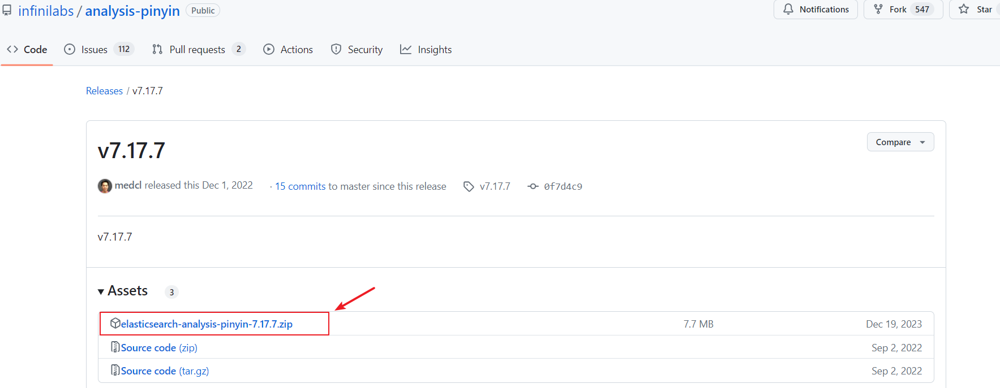
> 图注：这张图片是GitHub页面展示的infinilabs/analysis-pinyin仓库v7.17.7版本的Release界面，界面的Assets区域中，名为elasticsearch-analysis-pinyin-7.17.7.zip的压缩包被红色框线标注，还有红色箭头指向该压缩包，这个压缩包正是拼音分词器的安装包，对应文档中安装拼音分词器步骤里需要解压的文件，是安装拼音分词器流程里的关键下载资源。

可自行下载也可从课程资料目录获取

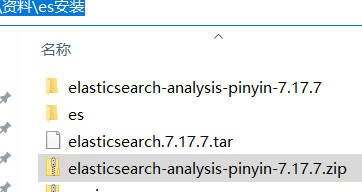
> 图注：这张图片展示了安装拼音分词器所需的相关文件列表，包含两个文件夹和两个压缩包文件。其中，名称为“elasticsearch-analysis-pinyin-7.17.7.zip”的文件被灰色高亮选中，对应文档中提及的安装步骤里需要解压的核心安装包文件，该文件与IK分词器的安装步骤相匹配，是安装拼音分词器时需要获取的关键文件。

安装方式与IK分词器一样，分三步：

        ①解压elasticsearch-analysis-pinyin-7.17.7.zip

        ②上传到虚拟机中elasticsearch的plugin目录

        ③重启elasticsearch

        ④测试


目前虚拟机中已经提供好了，大家无需操作，直接使用即可

##### 3.2.1.2 测试

测试用法如下：

```JavaScript

POST /_analyze
{
 "text": "黑马程序员",
 "analyzer": "pinyin"
}

```

结果如下：

token:即分词结果，全部为拼音

```JavaScript
{
  "tokens" : [
    {
      "token" : "hei",
      "start_offset" : 0,
      "end_offset" : 0,
      "type" : "word",
      "position" : 0
    },
    {
      "token" : "hmcxy",
      "start_offset" : 0,
      "end_offset" : 0,
      "type" : "word",
      "position" : 0
    },
    {
      "token" : "ma",
      "start_offset" : 0,
      "end_offset" : 0,
      "type" : "word",
      "position" : 1
    },
    {
      "token" : "cheng",
      "start_offset" : 0,
      "end_offset" : 0,
      "type" : "word",
      "position" : 2
    },
    {
      "token" : "xu",
      "start_offset" : 0,
      "end_offset" : 0,
      "type" : "word",
      "position" : 3
    },
    {
      "token" : "yuan",
      "start_offset" : 0,
      "end_offset" : 0,
      "type" : "word",
      "position" : 4
    }
  ]
}
```

#### 3.2.2 自定义分词器

##### 3.2.2.1 定义分词器

默认的拼音分词器会将每个汉字单独分为拼音，而我们希望的是每个词条形成一组拼音，需要对拼音分词器做个性化定制，形成自定义分词器。

elasticsearch中分词器（analyzer）的组成包含三部分：

- character filters：在tokenizer之前对文本进行处理。例如删除字符、替换字符
- tokenizer：将文本按照一定的规则切割成词条（term）。例如keyword，就是不分词；还有ik_smart
- tokenizer filter：将tokenizer输出的词条做进一步处理。例如大小写转换、同义词处理、拼音处理等

文档分词时会依次由这三部分来处理文档：

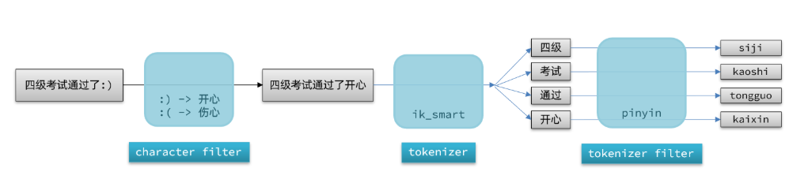
> 图注：这张图展示了Elasticsearch自定义分词器的工作流程示例，对应“3.2.2自定义分词器”部分的内容。流程从左侧输入文本“四级考试通过了:)”开始，首先经过character filter，将文本中的表情符号“:)”转换为“开心”，“:(”转换为“伤心”，得到处理后的文本“四级考试通过了开心”。接着该文本经过tokenizer，选用ik_smart分词器，切分出“四级”“考试”“通过”“开心”四个词条。最后这些词条经过tokenizer filter，由pinyin分词器处理，输出对应拼音siji、kaoshi、tongguo、kaixin，直观呈现了自定义分词器依次处理文档的完整过程。

声明自定义分词器的语法如下：

在test_index2索引中自定义my_analyzer分词器，my_analyzer的功能是ik_max_word加拼音分词器。

```JavaScript
# 先删除旧的索引库
DELETE /test_index2

PUT /test_index2
{
  "settings": {
    "analysis": {
      "analyzer": { // 自定义分词器
        "my_analyzer": {  // 分词器名称
          "tokenizer": "ik_max_word",
          "filter": "py"
        }
      },
      "filter": { // 自定义tokenizer filter
        "py": { // 过滤器名称
          "type": "pinyin", // 过滤器类型，这里是pinyin
          "keep_full_pinyin": true,
          "keep_joined_full_pinyin": true,
          "keep_original": true,
          "limit_first_letter_length": 16,
          "remove_duplicated_term": true,
          "none_chinese_pinyin_tokenize": false
        }
      }
    }
  },
  "mappings": {
    "properties": {
      "name": {
        "type": "text",
        "analyzer": "my_analyzer",
        "search_analyzer": "ik_smart"
      }
    }
  }
}
```

说明：

1. `type`: "pinyin"

   - 这指定了过滤器的类型为 `pinyin`，即使用拼音分词器。
2. `keep_full_pinyin`: false

   - 控制是否保留完整的拼音形式。设置为 `false` 表示不保留完整的拼音形式。
3. `keep_joined_full_pinyin`: true

   - 控制是否保留连接的完整拼音形式。设置为 `true` 表示保留连接的完整拼音形式，例如 “你好” 可能会被转换为 “nihao”。
4. `keep_original`: true

   - 控制是否保留原文本。设置为 `true` 表示保留原文本，这在某些情况下很有用，例如需要同时支持拼音和原文本的搜索。
5. `limit_first_letter_length`: 16

   - 控制首字母的最大长度。例如，“你好” 的首字母形式为 “n h”，这个值控制了首字母的最大长度。
6. `remove_duplicated_term`: true

   - 控制是否移除重复的词条。设置为 `true` 表示移除重复的词条，这有助于减少索引大小。
7. `none_chinese_pinyin_tokenize`: false

   - 控制是否对非中文文本也进行拼音分词。设置为 `false` 表示不对非中文文本进行拼音分词。


##### 3.2.2.2 测试

下边测试my_analyzer的分词效果：

```JavaScript
POST /test_index2/_analyze
{
 "text": "黑马程序员",
 "analyzer": "my_analyzer"
}
```

结果如下：

 "黑马程序员"分词结果包括中文分词和拼音。

```JavaScript
{
  "tokens" : [
    {
      "token" : "黑马程序员",
      "start_offset" : 0,
      "end_offset" : 5,
      "type" : "CN_WORD",
      "position" : 0
    },
    {
      "token" : "heimachengxuyuan",
      "start_offset" : 0,
      "end_offset" : 5,
      "type" : "CN_WORD",
      "position" : 0
    },
    {
      "token" : "hmcxy",
      "start_offset" : 0,
      "end_offset" : 5,
      "type" : "CN_WORD",
      "position" : 0
    },
    {
      "token" : "黑马",
      "start_offset" : 0,
      "end_offset" : 2,
      "type" : "CN_WORD",
      "position" : 1
    },
    {
      "token" : "heima",
      "start_offset" : 0,
      "end_offset" : 2,
      "type" : "CN_WORD",
      "position" : 1
    },
    {
      "token" : "hm",
      "start_offset" : 0,
      "end_offset" : 2,
      "type" : "CN_WORD",
      "position" : 1
    },
    {
      "token" : "程序员",
      "start_offset" : 2,
      "end_offset" : 5,
      "type" : "CN_WORD",
      "position" : 2
    },
    {
      "token" : "chengxuyuan",
      "start_offset" : 2,
      "end_offset" : 5,
      "type" : "CN_WORD",
      "position" : 2
    },
    {
      "token" : "cxy",
      "start_offset" : 2,
      "end_offset" : 5,
      "type" : "CN_WORD",
      "position" : 2
    },
    {
      "token" : "程序",
      "start_offset" : 2,
      "end_offset" : 4,
      "type" : "CN_WORD",
      "position" : 3
    },
    {
      "token" : "chengxu",
      "start_offset" : 2,
      "end_offset" : 4,
      "type" : "CN_WORD",
      "position" : 3
    },
    {
      "token" : "cx",
      "start_offset" : 2,
      "end_offset" : 4,
      "type" : "CN_WORD",
      "position" : 3
    },
    {
      "token" : "员",
      "start_offset" : 4,
      "end_offset" : 5,
      "type" : "CN_CHAR",
      "position" : 4
    },
    {
      "token" : "yuan",
      "start_offset" : 4,
      "end_offset" : 5,
      "type" : "CN_CHAR",
      "position" : 4
    },
    {
      "token" : "y",
      "start_offset" : 4,
      "end_offset" : 5,
      "type" : "CN_CHAR",
      "position" : 4
    }
  ]
}
```


下边向test_index2索引中添加一些文档进行测试。

```JavaScript
POST test_index2/_doc/100
{
  "id":100,
"name":"RIMOWA 30寸托运箱拉杆箱 SALSA AIR系列果绿色 820.70.36.4"
}


POST test_index2/_doc/101
{
  "id":101,
"name":"莎米特SUMMIT 旅行拉杆箱28英寸PC材质大容量旅行行李箱PC154 黑色"
}

```

搜索测试：

搜索拼音：

```JavaScript
GET /test_index2/_search
{
  "query": {
    "match": {
      "name": "laganxiang"
    }
  }
}
```

搜索汉字：

```JavaScript
GET /test_index2/_search
{
  "query": {
    "match": {
      "name": "拉杆箱"
    }
  }
}
```


### 3.3 自动补全查询

#### 3.3.1. `completion`

##### 3.3.1.1 前缀搜索

拼音搜索问题解决了，下边要实现前缀搜索，从自动补全的效果看，当输入一个汉字或拼音此时就要搜索出匹配的词条。

关于前缀搜索有最简单的query.prefix方式，如下：查询items索引中category字段前缀是“手”的文档。

```JavaScript

GET /items/_search
{
  "query": {
    "prefix": {
      "category": "手"
    }
  }
}
```

搜索结果：

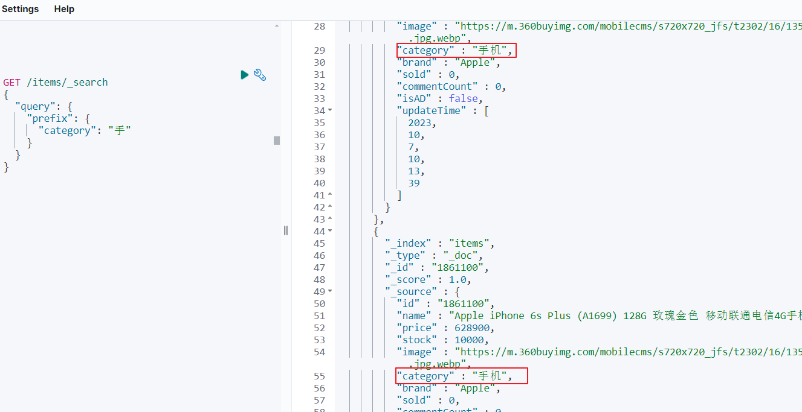
> 图注：这张图片展示了Elasticsearch的前缀搜索相关的代码与返回结果界面，左侧是构造的查询请求，为GET /items/search，通过query.prefix指定category字段的前缀为“手”；右侧是返回的匹配文档内容，其中有两处被红色框标注，一处是请求内容里的category值为“手机”，另一处是匹配文档的category字段，该条内容是Apple iPhone 6s Plus的商品信息，说明前缀搜索成功匹配了category前缀为“手”的相关词条。

对于前缀查询：

1. 性能问题：

   - 当提供的前缀较短时性能慢，因为它需要扫描更多的文档来查找匹配项。为了提高性能，尽量使用更长的前缀进行查询。
2. 不计算相关性得分：

   - `prefix` 查询不会计算相关性得分，它仅仅是一个过滤器操作。这意味着它只返回匹配的文档，但不考虑它们的相关性顺序。
3. 与 filter 的差异：

   - `prefix` 查询不会像 `filter` 那样缓存结果，因此如果预期会有重复查询，则使用 `filter` 可能会更高效。

##### 3.3.1.2 `completion`

Elasticsearch专门设计`completion` 查询用于自动补全，`completion` 查询可以实现前缀搜索的效果，性能比前缀搜索更快。

参考文档：

<bookmark name="Elasticsearch Guide:" href="https://www.elastic.co/guide/en/elasticsearch/reference/7.17/search-suggesters.html"></bookmark>

`completion` 查询会匹配以用户输入内容开头的词条并返回，使用`completion` 查询对文档中字段的类型有一些约束：

- 参与补全查询的字段必须是completion类型。
- 字段的内容一般是用来补全的多个词条形成的数组。

首先创建映射时指定专门的字段为自动补全使用，并且字段的类型为completion类型。

我们在test_index2索引中添加suggestion字段并且设置为completion类型

```JavaScript
PUT /test_index2/_mapping
{
    "properties":{
        "suggestion":{
            "type":"completion"
        }
    }
}
```


##### 3.3.1.2 测试

然后更新原有文档，文档中指定了自动补全的内容。

```JavaScript
POST /test_index2/_update/100
{
  "doc": {
    "suggestion": ["拉杆箱","托运箱"]
  }
}


POST /test_index2/_update/101
{
  "doc": {
    "suggestion": ["拉杆箱","旅行箱","莎米特"]
  }
}
```

使用下边的语句测试自动补全：

```JavaScript
GET /test_index2/_search
{
   "suggest" : {
      "suggestion_suggest" : {  
         "completion" : { 
            "field" : "suggestion",  
            "size" : 10,  
            "skip_duplicates" : true  
         },
         "text" : "旅"  
      }
   }
}
```

1. `suggest`:

   - 这是建议器的顶级对象，用于配置建议器。
2. `suggestion_suggest`:

   - 这是建议器的名称，可以自定义。它用于标识建议器。
3. `completion`:

   - 这是指定建议器类型的部分。在这里，我们使用的是`completion`类型，它是专门为自动补全设计的建议器。
4. `field`:

   - 这是用于建议的字段名称。在这个例子中，我们使用名为`suggestion`的字段，该字段应该已经被配置为`completion`类型的字段。
5. `size`:

   - 这个参数控制返回的建议数量。在这个例子中，我们设置了`size`为10，意味着最多返回10个建议。
6. `skip_duplicates`:

   - 这个参数用于控制是否在返回的建议中跳过重复的条目。在这个例子中，我们设置为`true`，意味着如果某个建议在多个文档中出现，只会返回一次。
7. `text`:

   - 这是用户输入的文本，用于生成建议。在这个例子中，我们输入了字符“黑”。


执行结果：

重点看suggest片段。

```Java
{
  "took" : 2,
  "timed_out" : false,
  "_shards" : {
    "total" : 1,
    "successful" : 1,
    "skipped" : 0,
    "failed" : 0
  },
  "hits" : {
    "total" : {
      "value" : 0,
      "relation" : "eq"
    },
    "max_score" : null,
    "hits" : [ ]
  },
  "suggest" : {
    "suggestion_suggest" : [
      {
        "text" : "旅", //输入的前缀
        "offset" : 0,
        "length" : 1,
        "options" : [
          {
            "text" : "旅行箱", //完整的建议文本
            "_index" : "test_index2",
            "_type" : "_doc",
            "_id" : "101",
            "_score" : 1.0, //这个建议的相关性评分，分数越高表示与查询越匹配。
            "_source" : {
              "id" : 101,
              "name" : "莎米特SUMMIT 旅行拉杆箱28英寸PC材质大容量旅行行李箱PC154 黑色",
              "suggestion" : [
                "拉杆箱",
                "旅行箱",
                "莎米特"
              ]
            }
          }
        ]
      }
    ]
  }
}
```

通过上边的结果可以拿到输入前缀“旅”的建议结果"旅行箱"。


#### 3.3.3. Java Client

首先需要定义模型类，模型类中定义字段 List<String> suggestion;与文档中的自动补全字段对应。

参考DSL语句编写Java Client代码。

```JavaScript
@Test
 void testSuggest() throws IOException {
     SearchRequest.Builder builder = new SearchRequest.Builder();
     builder.index("test_index2");
    builder.suggest(s -> s
            .suggesters("suggestion_suggest", ss -> ss
                    .completion(c -> c
                            .field("suggestion")
                            .size(10)
                            .skipDuplicates(true))
                    .text("拉"))
            );
     SearchRequest request = builder.build();
     SearchResponse<Index2> response = esClient.search(request, Index2.class);
     Map<String, List<Suggestion<Index2>>> suggest = response.suggest();
     List<Suggestion<Index2>> suggestion_suggest = suggest.get("suggestion_suggest");
     suggestion_suggest.stream().forEach(suggestion -> {
         suggestion.completion().options().forEach(option -> {
             String text = option.text();
             System.out.println(text);
         });
     });
 }

 /**
  * 测试自动补全模型类
  */
@Data
 public static class Index2 {
     //id
    private Long id;
    //name
    private String name;
     private List<String> suggestion;

 }
```


### 3.4. 拼音自动补全

#### 3.4.1 需求分析

学习了自动补全的查询方法后接下来思考如何在电商项目的搜索输入框实现自动补全功能。

效果如下：

输入拼音可以补全拼音对应的中文：

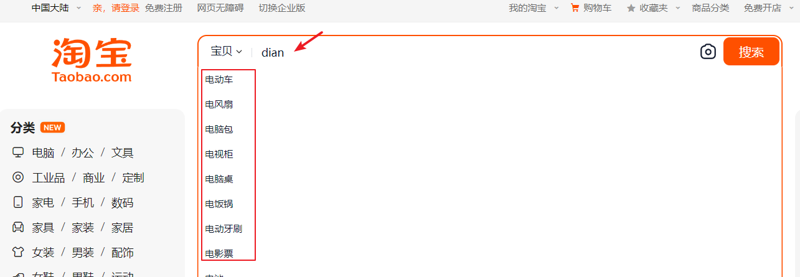
> 图注：图片展示了淘宝搜索页面的自动补全效果。在搜索框输入“dian”后，下方弹出多个商品类别选项，如电动车、电风扇、电脑包等，其中“电动牙刷”被红色框突出显示。该图片与文档中关于电商项目搜索输入框实现自动补全功能的需求分析上下文对应，直观呈现了输入拼音可补全对应中文商品类别的效果，辅助说明了自动补全功能的实现效果。


输入中文也可以自动补全：


> 图注：图片展示了淘宝网站搜索页面，搜索框内输入“电”，下方自动补全显示了多个与“电”相关的商品类别，如电动车、电风扇、电脑包等。该图片与文档中关于电商项目搜索输入框实现自动补全功能的需求分析上下文对应，直观呈现了自动补全效果，帮助理解在商品索引映射中添加suggestion字段后，输入拼音或中文可自动补全对应内容的功能。


1. 首先在商品索引映射中添加suggestion字段，专门用于自动补全，此字段的内容可以是商品的品牌、分类。

此字段的type为completion。

要实现拼音搜索那么此字段分词器具有拼音分词功能

对suggestion字段不分词但需要搜索，比如：“电动牙刷”只有输入前缀可以搜索到，所以分词器用keyword加拼音分词。

1. 在商品索引对应的模型类中添加suggestion字段，类型为List<String>
2. 如果在索引中后来添加的自动补全字段，要想对以前的文档生效自动补全功能则需要添加过suggestion字段后重新更新文档内容。


#### 3.4.2 创建自动补全字段

自定义分词器，

```JavaScript
# 先删除原来的索引库
DELETE /test_index3

# 再添加新的索引库
PUT /test_index3
{
  "settings": {
    "analysis": {
      "analyzer": {
        "completion_analyzer": {
          "tokenizer": "keyword",
          "filter": "py"
        }
      },
      "filter": {
        "py": {
          "type": "pinyin",
          "keep_full_pinyin": true,
          "keep_joined_full_pinyin": true,
          "keep_original": true,
          "limit_first_letter_length": 16,
          "remove_duplicated_term": true,
          "none_chinese_pinyin_tokenize": false
        }
      }
    }
  },
  "mappings": {
    "properties": {
      "id": {
        "type": "keyword"
      },
      "name":{
        "type": "text",
        "analyzer": "ik_max_word",
        "search_analyzer": "ik_smart"
      },
      "suggestion":{
          "type": "completion",
          "analyzer": "completion_analyzer"
      }
    }
  }
}

```


#### 3.4.3 更新/新增文档

```JavaScript

POST test_index3/_doc/100
{
  "id":100,
"name":"RIMOWA 30寸托运箱拉杆箱 SALSA AIR系列果绿色 820.70.36.4",
"suggestion": ["拉杆箱","托运箱"]
}


POST test_index3/_doc/101
{
  "id":101,
"name":"莎米特SUMMIT 旅行拉杆箱28英寸PC材质大容量旅行行李箱PC154 黑色",
"suggestion": ["拉杆箱","旅行箱","莎米特"]
}

POST test_index3/_doc/102
{
  "id":102,
"name":"拉菲斯汀（La Festin）612026 新款女士钱包 头层牛皮短款钱包 凯利黑",
"suggestion": ["拉菲斯汀","女包"]
}
```


#### 3.4.4 测试

测试自动补全：

输入汉字：

```JavaScript

GET /test_index3/_search
{
   "suggest" : {
      "suggestion_suggest" : {
         "completion" : {
            "field" : "suggestion",
            "size" : 2,
            "skip_duplicates" : true
         },
         "text" : "la"
      }
   }
}

```

结果：

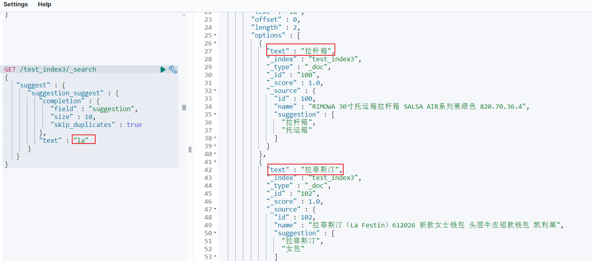
> 图注：这张图片是Elasticsearch拼音自动补全的测试结果界面，展示了向test_index3索引发送查询请求后返回的两条结果。左侧是查询语句，通过“suggest”指定了“suggestion_suggest”的补全设置，包含“completion”类型、“field”指定字段和查询文本“la”；右侧为返回结果，“text”字段分别是“拉杆箱”和“拉蒂斯汀”，包含对应索引类型、得分、文档来源等信息，体现输入拼音“la”时自动补全出的相关内容。


## 4 实战

### 自动补全功能

搜索框实现自动补全功能，效果如下图：


> 图注：这是黑马商城的搜索界面，呈现了Elasticsearch自动补全功能的实战效果。界面顶部是“黑马商城”标识及导航栏，搜索框内输入了“拉”，下方自动补全下拉框同步显示匹配联想词，包含“LATIT”“兰雀”“拉拉裤”“拉杆箱”等选项。界面下方展示了全部结果的分类、品牌、价格维度，还标注了商品总数共320件，当前为1/1600的分页状态，该效果和文档中自动补全功能的实现内容相呼应，能直观体现功能的运行状态。


#### 提示

1. 在原有items索引结构基础添加自动补全字段suggestion（支持拼音分词）

删除原来的索引：

```Java
DELETE /items
```

创建新索引

```Java

PUT /items
{
  "settings": {
    "analysis": {
      "analyzer": {
        "completion_analyzer": {
          "tokenizer": "keyword",
          "filter": "py"
        }
      },
      "filter": {
        "py": {
          "type": "pinyin",
          "keep_full_pinyin": true,
          "keep_joined_full_pinyin": true,
          "keep_original": true,
          "limit_first_letter_length": 16,
          "remove_duplicated_term": true,
          "none_chinese_pinyin_tokenize": false
        }
      }
    }
  },
  "mappings" : {
      "properties" : {
        "brand" : {
          "type" : "keyword"
        },
        "category" : {
          "type" : "keyword"
        },
        "commentCount" : {
          "type" : "integer",
          "index" : false
        },
        "id" : {
          "type" : "keyword"
        },
        "image" : {
          "type" : "keyword",
          "index" : false
        },
        "isAD" : {
          "type" : "boolean"
        },
        "location" : {
          "type" : "geo_point"
        },
        "name" : {
          "type" : "text",
          "analyzer" : "ik_max_word",
          "search_analyzer" : "ik_smart"
        },
        "price" : {
          "type" : "integer"
        },
        "sold" : {
          "type" : "integer"
        },
        "stock" : {
          "type" : "integer"
        },
        "suggestion" : {
          "type" : "completion",
          "analyzer" : "completion_analyzer",
          "preserve_separators" : true,
          "preserve_position_increments" : true,
          "max_input_length" : 50
        },
        "updateTime" : {
          "type" : "date"
        }
      }
    }
}
```


1. 在ItemDoc模型类中添加自动补全字段。

```Java
//自动补全字段suggestion
@ApiModelProperty("自动补全字段")
private List<String> suggestion;
```

完整的模型类如下：

```Java
package com.hmall.item.domain.po;

import co.elastic.clients.elasticsearch._types.mapping.FieldType;
import io.swagger.annotations.ApiModel;
import io.swagger.annotations.ApiModelProperty;
import lombok.Data;
import org.springframework.data.elasticsearch.core.geo.GeoPoint;

import java.time.LocalDateTime;
import java.util.List;

/**
 * @author Mr.M
 * @version 1.0
 * @description Elasticsearch模型类
 * @date 2024/8/18 20:26
 */
@Data
@ApiModel(description = "索引库实体")
public class ItemDoc {

 @ApiModelProperty("商品id")
 private String id;

 @ApiModelProperty("商品名称")
 private String name;

 @ApiModelProperty("价格（分）")
 private Integer price;

 @ApiModelProperty("库存")
 private Integer stock;

 @ApiModelProperty("商品图片")
 private String image;

 @ApiModelProperty("类目名称")
 private String category;

 @ApiModelProperty("品牌名称")
 private String brand;

 @ApiModelProperty("销量")
 private Integer sold;

 @ApiModelProperty("评论数")
 private Integer commentCount;

 @ApiModelProperty("是否是推广广告，true/false")
 private Boolean isAD;

 @ApiModelProperty("更新时间")
 private LocalDateTime updateTime;

 @ApiModelProperty("地理坐标")
 private GeoPoint location;

 //自动补全字段suggestion
 @ApiModelProperty("自动补全字段")
 private List<String> suggestion;
}
```

1. 使用批量导入程序向items索引结构中导入数据

自动补全字段的值为：商品品牌、商品分类。

参考代码如下：

```Java
@Test
public void testBatchAddDocment() throws IOException {
    //定义page对象
    Page<Item> page = Page.of(1, 100);//第1页，每页查询100条

    //分页查询一批商品信息
    Page<Item> itemPage = itemService.page(page, new LambdaQueryWrapper<>());
    //拿到商品列表
    List<Item> records = itemPage.getRecords();

    //将 List<Item>转成 List<ItemDoc>
    List<ItemDoc> itemDocs = BeanUtils.copyList(records, ItemDoc.class);

    //将records批量插入到es索引中

    BulkRequest.Builder builder = new BulkRequest.Builder();
    //遍历商品列表itemDocs，构建批量请求
    itemDocs.forEach(itemDoc -> {
        String category = itemDoc.getCategory();
        String brand = itemDoc.getBrand();
        //将分类和品牌设置到建议字段
        itemDoc.setSuggestion(List.of(category,brand));

        builder.operations(op -> op
                .index(idx -> idx
                        .id(itemDoc.getId().toString())
                        .index("items")
                        .document(itemDoc)));

    });
    //构建批量请求
    BulkRequest bulkRequest = builder.build();
    BulkResponse bulkResponse = esClient.bulk(bulkRequest);
    //解析响应结果
    bulkResponse.items().forEach(item -> log.info("添加文档结果：{}", item.result()));

}
```


数据导入完成测试completion效果：

1) 输入拼音测试自动补全效果

```Java

GET /items/_search
{
   "suggest" : {
     "text":"la",
      "suggestion_suggest" : {  
         "completion" : { 
            "field" : "suggestion",  
            "size" : 10,  
            "skip_duplicates" : true  
         }
         
      }
   }
}
```

2）输入中文测试自动补全效果

```Java

GET /items/_search
{
   "suggest" : {
     "text":"拉",
      "suggestion_suggest" : {  
         "completion" : { 
            "field" : "suggestion",  
            "size" : 10,  
            "skip_duplicates" : true  
         }
         
      }
   }
}
```


1. 定义自动补全接口，前端通过此接口获取补全关键字

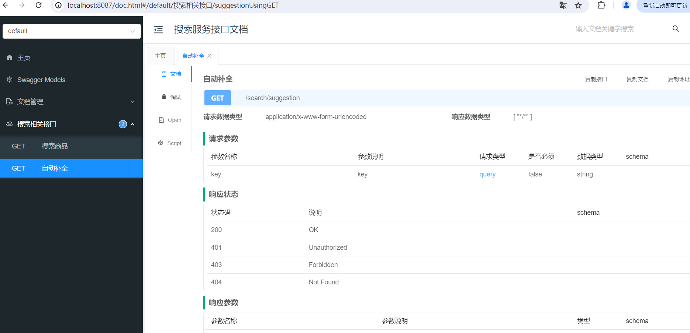
> 图注：该图片为搜索服务接口文档页面，展示的是Elasticsearch自动补全功能相关的补全接口定义，接口名称为searchsuggestion，请求方式为GET。页面包含该接口的详细参数信息，请求参数仅有作为查询参数的key，数据类型为string，无需必填；同时标注了该接口的响应状态码，包括200（成功）、401（未授权）、403（禁止访问）、404（未找到），响应数据类型为字符串数组，用于为前端提供自动补全的关键字。

响应结果：字符串数组。


#### 测试

测试效果

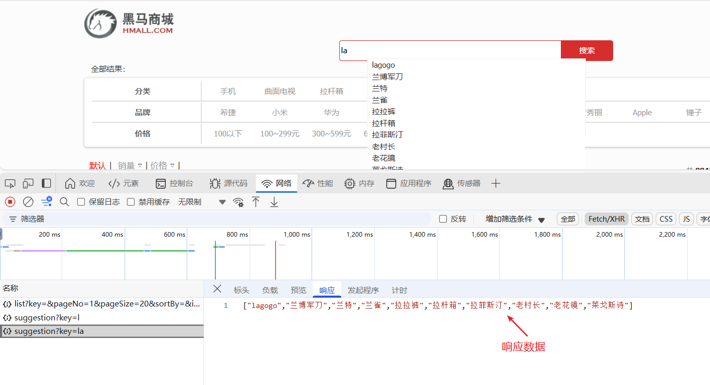
> 图注：这张图片展示了黑马商城系统的自动补全效果测试界面，上方是商城搜索区域，输入拼音“la”后，搜索框下拉区域显示出对应补全的商品品牌、分类相关候选内容；下方是开发者工具的网络请求面板，呈现出输入“la”关键字后，接口返回的响应数据，为包含“lagogo”“兰博军刀”等内容的字符串数组，验证了自动补全接口的实际效果。

---
> 来源：飞书技术知识库（脱敏版） · 04 微服务与中间件 / Elasticsearch / 07 Elasticsearch高级 · [原文](https://ccn8v2zngwsm.feishu.cn/wiki/T9Rxwav9OiH2ONk2JMqcfmaYnIb)
