# 01 微服务服务注册与发现

## 学习目标

1. 能够说出单体架构与微服务架构的优缺点
2. 能够搭建黑马商城项目环境
3. 能够测试黑马商城项目的业务流程
4. 能够说出商城项目的业务模块及技术架构
5. 能够创建商品服务、购物车服务
6. 能够使用RestTemplate实现远程调用
7. 能够说出服务注册与发现流程
8. 能够使用Nacos实现服务注册与发现
9. 会使用OpenFeign实现远程调用
10. 能够抽取API工程


## 搭建环境-重点

在开始本课程之前请**参考“ 环境搭建” 文档搭建黑马商城项目运行环境，最终将黑马商城项目跑起来。**

黑马商城项目是一个单体项目，基于Spring Boot开发，数据库使用MySQL。

微服务框架阶段的课程以黑马商城项目作为案例驱动，使用微服务架构去构建黑马商城项目，并解决其中出现的各种问题。


## 1.认识微服务

学习要点：

1. 认识单体架构，了解其优缺点，以及适合什么场景

   1. 前期项目简单易上手
   2. 开发部署简单
2. 认识微服务架构，了解其优缺点，以及适合什么场景

<whiteboard token="Eo1ZwqHc8hxcwJbu3Rfci4yZnlh"></whiteboard>


咱们之前学习的项目都是单体项目，可以满足小型项目或传统项目的开发。而在互联网时代，越来越多的公司采用微服务架构。

这一章我们从单体架构的优缺点来分析，看看开发大型项目采用单体架构存在哪些问题，而微服务架构又是如何解决这些问题的。

### 1.1 单体架构

单体架构：整个项目只有一个工程，所有业务模块都在这一个工程中，并采用一个数据库，如下图：

<whiteboard token="Q7REwZttch7e2TbDZxjcJCSEn8f"></whiteboard>


项目部署时需要对所有模块一起编译、打包，打成一个jar包或war包，如下图：


当项目规模较小时，这种模式上手快，部署、运维也都很方便，因此早期很多小型项目都采用这种模式。

**优点：**

1.整个项目只有一个工程，结构简单，开发周期短。

2.部署简单。

**缺点？**

随着项目的规模越来越大，团队开发人员也不断增加，单体架构就呈现出越来越多的问题：


1.**团队协作成本高-代码冲突率增大。**

2.**系统发布效率低-无法只发布某个模块的代码。**

3.**扩展困难-无法针对某个模块进行扩缩容，必须整个系统一起扩展。**


**如何解决呢？拆分**


**应用场景：**

单体架构适合小型项目。


### 1.2 微服务架构

随着软件业的兴起，以及互联网的发展，对于一些大型的软件项目，单体架构已不能适应需求，软件架构经过的几代的演变，如今对于大型项目更多的会采用微服务架构。

微服务架构，将整个项目分为多个服务，每个服务是一个工程，通常是根据业务模块去划分，比如：电商项目如果按微服务架构开发就需要独立出来：商品服务、用户服务、交易服务、支付服务等多个服务，这些服务最主要的是要做到边界清晰，单一职责，服务的功能范围可以很小，所以称为微服务架构。

例如，黑马商城项目，我们就可以把商品、用户、购物车、交易等模块拆分，交给不同的团队去开发，并独立部署：


微服务架构的一些特点：

1. **单一职责原则**：每个微服务专注于执行单一业务功能，并且尽量减少对外部服务的依赖，实现高内聚低耦合。
2. **团队自治**：每个微服务通常由一个小团队（通常不超过10人，即所谓的“两块披萨团队”）负责，包括开发、测试、部署和运维等全过程。
3. **服务自治**：每个微服务都是独立的，可以独立部署、扩展和维护，拥有自己的数据库实例，以确保服务之间的隔离性和最小化相互影响。

以上可以简单理解为：**微服务架构就是由若干小的单体系统组成的。**

单体架构存在的问题可以通过采用微服务架构来解决：

1. **问题**：团队协作成本高**解决**：通过服务拆分，每个服务的代码量相对较小，每个服务通常由1至3名开发者维护，显著降低了协作成本。
2. **问题**：系统发布效率低**解决**：每个服务都是独立部署的，当某个服务需要更新时，只需对该服务进行打包和部署，提高了发布效率并减少了风险。
3. **问题**：系统可用性差**解决**：通过将服务独立部署，并确保每个服务都有自己的资源（如独立的数据库），可以有效防止一个服务的问题影响到其他服务。
4. **问题**：扩展困难**解决**：微服务架构允许根据实际需求有针对性地对特定服务进行扩展或升级，而不需要对整个系统进行扩展，提高了资源利用率和灵活性。


根据上述内容，我们可以总结出微服务架构的优点和缺点如下：

**优点**

1. 有利于项目的扩展与维护

   - 服务之间解耦，易于理解和维护。
   - 每个服务可以独立扩展，提高资源利用效率。

**缺点**

1. 项目复杂性增加

   - 每个服务需要独立的设计、开发和测试，增加了项目的复杂度。
   - 管理多个服务间的依赖关系变得更加困难，例如交易服务可能依赖于商品服务和用户服务。
2. 运维成本增加

   - 需要管理和监控多个服务实例，增加了运维的复杂度。
   - 每个服务都需要单独部署、监控和维护，这可能需要更多的自动化工具和技术支持。

综上所述，虽然微服务架构带来了更好的扩展性和维护性，但也引入了额外的复杂性和运维挑战。

**应用场景：**

微服务架构是适合大型项目


### 1.3 小结

为什么会有微服务架构：随着项目规模的逐渐扩大，无论是从团队协作上还是代码维护上来讲，单体项目已经无法满足开发需求，而微服务架构则恰好能解决上面提到的问题。当然，解决问题的同时也相应带来了一些挑战，这些咱们在接下来的课程中会进行讲解。

最后，同学们心里一定要清楚一件事，微服务架构不是万能的，单体服务有单体服务的优点，微服务架构也有微服务的缺点。实际开发过程中，依照具体项目，选择适合的架构才是最重要的！

<callout emoji="📌">
单体架构：适合小型项目
微服架构：适合大型项目
</callout>

### 1.4. 扩展

AI:分布式架构是什么？

分布式架构是指由多个独立计算机组成的一个系统，即一个系统由多个部分组成，每个部分分别部署在不同的计算机上，这些计算机通过网络互相连接，并且能够协同工作以完成共同的任务。

早期的分布式架构是将整个项目拆分成多个系统，相比微服务架构划分服务的粒度是粗的，比如：一个电商项目包括了认证系统，门户，主站等。

发展到微服务架构会将一个项目划分为多个微服务，例如电商项目包括：商品服务、用户服务、认证服务、订单服务等微服务。

所以，微服务架构就是一种分布式架构，将各个服务分布在不同的计算机上，这些服务之间通过协作去完成业务流程。

下面分享几个微服务架构图：

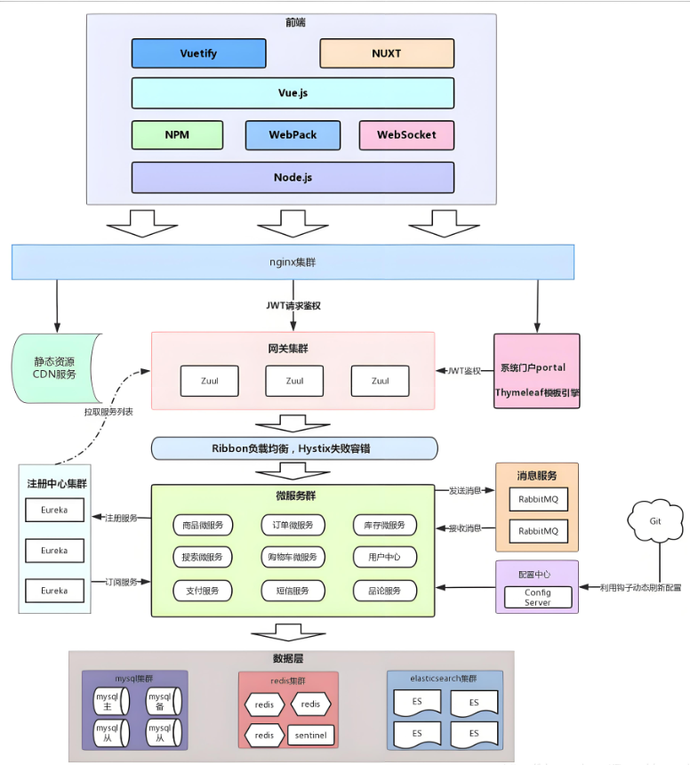


AI:云原生架构是什么？

云原生(Cloud Native)应用程序是为云环境而设计的，能够利用云平台的弹性、可扩展性和服务导向的特性。云原生架构的核心理念包括容器化、微服务、持续交付和DevOps实践。

云原生架构就可以理解为微服务架构的项目使用云平台（阿里云、腾讯云等）去构建。

**主要特征**

1. **容器化**：

   - 应用程序运行在容器内，如Docker容器，以便于标准化、隔离和移植。
   - 容器化提供了轻量级的虚拟化，使应用程序能够在任何环境中一致地运行。
2. **微服务**：

   - 将应用程序分解为一组小型、独立的服务，每个服务都实现了特定的功能。
   - 微服务可以独立部署、扩展和更新，提高了应用程序的可维护性和灵活性。
3. **持续交付**：

   - 采用自动化工具和流程来频繁地部署和更新应用程序。
   - 通过持续集成和持续部署（CI/CD）管道实现快速迭代和反馈循环。
4. **DevOps文化**：

   - 强调开发人员和运维团队之间的紧密合作。
   - 通过自动化和协作工具促进敏捷开发、快速部署和持续改进。
5. **弹性与可扩展性**：

   - 设计应用程序以适应不断变化的工作负载，能够自动伸缩资源。
   - 利用云平台提供的服务，如自动扩展、负载均衡和冗余机制，以保证高可用性和性能。


### 1.5 面试题

你们的项目为什么要用微服务架构？


## 2 构建微服务工程

#### 2.0 环境准备

接下来，我们就一起使用微服务架构去构建黑马商城项目，并解决其中出现的各种问题。

还没有完成环境搭建的同学请**参考“环境搭建” 文档搭建黑马商城项目运行环境，最终将黑马商城项目跑起来。**

本项目是为教学需求而设计的简化版项目，在后期的互相网项目阶段我们会接触完整的电商项目。

### 2.1 [熟悉黑马商城](https://twk3l3l09tj.feishu.cn/wiki/MYNvwtoDniMjuAk4qGcc2sBQnlh)

1. 整体介绍下黑马商城的各个模块
2. idea中介绍下项目模块
3. 启动服务演示下各个模块
4. 最后总结下，以及要如何把功能模块拆分成哪些微服务


#### 2.1.1. 熟悉项目

##### 2.1.1.1 登录功能

首先来看一下登录业务流程，下图黄色框内。

<whiteboard token="QN8DwcjCVhvdfGbceUNcwevcnJc"></whiteboard>

登录入口在`com.hmall.controller.UserController`中的`login`方法：

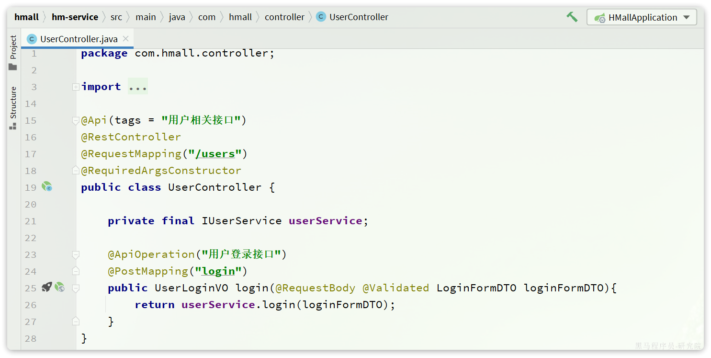


##### 2.1.1.2 搜索商品

在首页搜索框输入关键字，点击搜索即可进入搜索列表页面：


该页面会调用接口：`/search/list`，对应的服务端入口在`com.hmall.controller.SearchController`中的`search`方法：

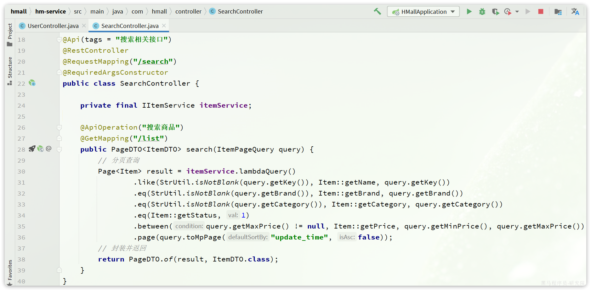

这里目前是利用数据库实现了简单的分页查询。

##### 2.1.1.3 购物车

在搜索到的商品列表中，点击按钮`加入购物车`，即可将商品加入购物车：


加入成功后即可进入购物车列表页，查看自己购物车商品列表：


同时这里还可以对购物车实现修改、删除等操作。

相关功能全部在`com.hmall.controller.CartController`中：


##### 2.1.1.4 下单

在购物车页面点击`结算`按钮，会进入订单结算页面：


点击提交订单，会提交请求到服务端，服务端做3件事情：

- 创建一个新的订单
- 扣减商品库存
- 清理购物车中商品

业务入口在`com.hmall.controller.OrderController`中的`createOrder`方法：


##### 2.1.1.5 支付

下单完成后会跳转到支付页面，目前只支持**余额支付**：


在选择**余额支付**这种方式后，会发起请求到服务端，服务端会立刻创建一个支付流水单，并返回支付流水单号到前端。

当用户输入用户密码，然后点击确认支付时，页面会发送请求到服务端，而服务端会做几件事情：

- 校验用户密码
- 扣减余额
- 修改支付流水状态
- 修改交易订单状态

支付成功：


请求入口在`com.hmall.controller.PayController`中：

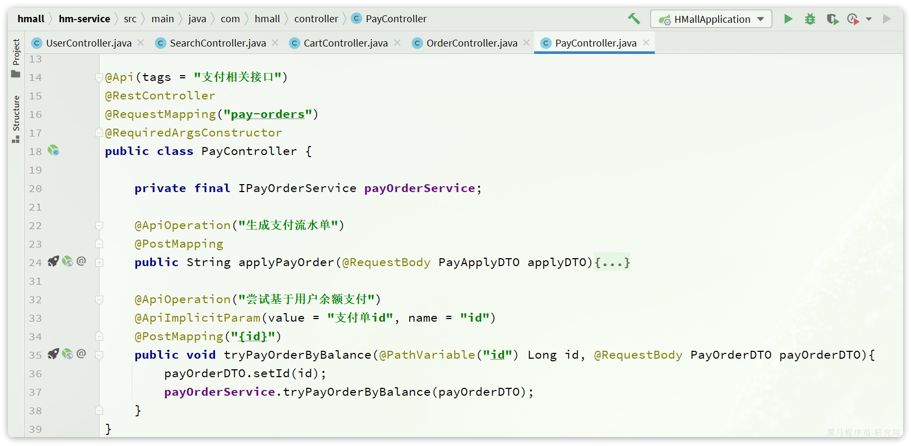

支付成功可以查看user表的余额字段是否减少


###### bug修复

Bug描述: 在测试中发现支付成功后用户表的余额字段并没有减少相应的金额。

请排查问题并进行修复。

修复后进行测试。


##### 2.1.1.6 小结

如何去熟悉一个项目？

首先要去熟悉项目的业务需求、业务流程、业务模块等。

然后再去熟悉项目的技术架构，以及所用到的技术点，可以通过阅读代码、系统测试，分模块去熟悉项目。


黑马商城项目包括几个模块：

认证模块、用户管理、商品管理、购物车、交易模块、支付模块等。


黑马商城项目用的什么技术架构：

黑马商城单体项目使用Spring Boot 2.7.X版本开发，数据库用的MySQL8，还用到了MQ、Redis、Elasticsearch等中间件。


### 2.2 创建微服务工程 -学习一个微服务架构-Springcloud

本节我们开始使用微服务架构去开发黑马商城项目。


#### 2.2.1. 系统架构

- 微服架构存在的问题
- 认识微服务框架-springcloud
- 熟悉并掌握掌握相关功能组件
- Spring Cloud Alibaba与Spring Cloud 的联系

##### 2.2.1.1 系统架构图

我们用微服务架构开发黑马商城项目首先需要划分微服务，通常是按照业务模块进行划分，同时也会将一些通用的功能抽取成一个微服务，微服务要做到单一职责，高内聚低耦合。

- 用户端请统一请求到网关（比如nginx），由网关将请求转发到微服务。
- 每个微服务是一个Spring Boot工程，微服务的地址统一由服务注册中心管理。
- 每个微服务有自己的数据库，比如：商品数据库、用户数据库。
- 在数据层除了MySQL之外还有非关系数据库Redis、ES等，满足不同的需求。

系统架构图如下：

<whiteboard token="NUnzwStKuhsHeYbWxfncldttnkf"></whiteboard>

有什么问题？

- 服务变多，客户端该如何访问？
- 服务变多，实例以及配置如何管理？
- 服务变多，服务之间又该如何访问？

答案是：Spring Cloud提供了相关组件的集成！！！


##### 2.2.1.2 认识Spring Cloud

每个微服务是一个SpringBoot工程，微服务之间的通信协作、服务保护等各种问题都有对应的解决方案和微服务组件，SpringCloud框架可以说是目前Java领域最全面的微服务组件的集合了，如下图：

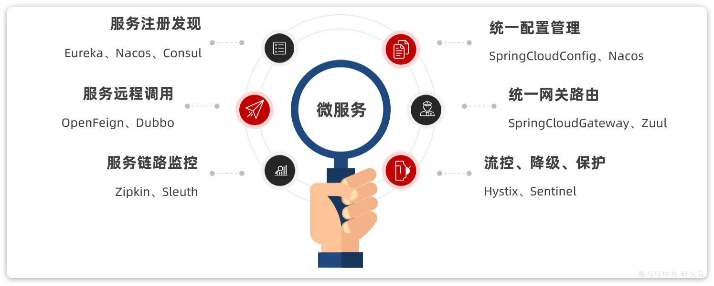

Spring Cloud 是一个基于 Spring Boot 的**微服务开发框架**，它依托于SpringBoot的自动装配能力，它提供了**一套完整的微服务解决方案**。Spring Cloud 旨在帮助开发者快速构建分布式系统中的服务，包括服务发现、配置管理、API 网关、断路器、智能路由、负载均衡、消息总线、服务间通信等功能。Spring Cloud 是一个非常强大的工具集，可以帮助开发者快速构建健壮的微服务架构。

<bookmark name="Spring Cloud" href="https://spring.io/projects/spring-cloud#overview"></bookmark>

Spring Cloud主要组件包括：

- Eureka、nacos：服务发现与注册。
- Zuul 或 Spring Cloud Gateway：API 网关。
- Hystrix：断路器。
- Ribbon，Spring Cloud LoadBalancer：客户端负载均衡。
- Feign、OpenFeign：声明式服务调用。
- Config Server：外部配置中心。


以下是SpringCloud和SpringBoot的版本对应关系，SpringCloud依赖SpringBoot：


当前SpringBoot版本为4`.0.x`版本，目前在企业中大部分还在使用 2.7.x及以下版本，所以**我们的课程使用：Spring Cloud 2021.0.x以及Spring Boot 2.7.x版本，重点讲解Spring Cloud Alibaba 框架的核心组件。**


Spring Cloud Alibaba 是阿里巴巴基于 Spring Cloud 开发的一套微服务开发工具包在当前非常流行，它**针对 Spring Cloud 的一些组件进行了扩展和替换**，以便更好地适应中国开发者的需求和阿里巴巴集团内部的技术栈。

Spring Cloud Alibaba主要组件包括：

- **Nacos：服务发现和配置中心。**
- **Sentinel：流量控制组件。**
- Dubbo：RPC 框架的 Spring Cloud 支持。
- RocketMQ：消息中间件的支持。


Spring Cloud Alibaba与Spring Cloud 的联系：

- 基于 Spring Boot：两者都是基于 Spring Boot 的微服务框架。
- Spring Cloud 核心理念：Spring Cloud Alibaba 遵循 Spring Cloud 的设计理念和模式。
- 组件兼容：Spring Cloud Alibaba 的组件可以与 Spring Cloud 的其他组件配合使用。

Spring Cloud Alibaba与Spring Cloud 的区别：

- 服务发现：Spring Cloud 使用的是 Netflix Eureka，而 Spring Cloud Alibaba 使用的是 Nacos。
- 断路器：Spring Cloud 原生支持 Hystrix，而 Spring Cloud Alibaba 推荐使用 Sentinel。
- 配置管理：Spring Cloud 使用 Spring Cloud Config Server，而 Spring Cloud Alibaba 使用 Nacos 作为配置中心。
- 负载均衡：Spring Cloud LoadBalancer结合 Nacos实现负载均衡。
- 远程调用支持：Spring Cloud Alibaba 支持 Dubbo 作为 RPC 调用框架，而 Spring Cloud 默认不包含 RPC 支持。


##### 2.2.1.3 面试题

SpringBoot和SpringCloud,请你谈谈对他们的理解？

 

Spring Cloud Alibaba与Spring Cloud区别和联系？


你们Spring Cloud用的什么版本？


学习要点

1. 创建基础工程
2. 创建common工程（复制单体架构下面的模块即可）
3. 拆分商品服务
4. 购物车服务（练习）

#### 2.2.2. 创建基础工程

##### 2.2.2.1 创建父工程

本课程使用maven创建微服务架构的电商项目，首先需要创建父工程hmall-parent（普通maven项目，非脚手架项目），在父工程中主要是要pom.xml中规范依赖的版本，我们已经明确使用Spring Cloud Alibaba ，且SpringBoot的版本使用 2.7.x版本。

在项目根目录创建pom.xml：

```JavaScript
<?xml version="1.0" encoding="UTF-8"?>
<project xmlns="http://maven.apache.org/POM/4.0.0"
         xmlns:xsi="http://www.w3.org/2001/XMLSchema-instance"
         xsi:schemaLocation="http://maven.apache.org/POM/4.0.0 http://maven.apache.org/xsd/maven-4.0.0.xsd">
    <modelVersion>4.0.0</modelVersion>

    <groupId>com.hmall</groupId>
    <artifactId>hmall-parent</artifactId>
    <packaging>pom</packaging>
    <version>1.0.0</version>

    <parent>
        <groupId>org.springframework.boot</groupId>
        <artifactId>spring-boot-starter-parent</artifactId>
        <version>2.7.12</version>
        <relativePath/>
    </parent>

    <properties>
        <maven.compiler.source>11</maven.compiler.source>
        <maven.compiler.target>11</maven.compiler.target>
        <project.build.sourceEncoding>UTF-8</project.build.sourceEncoding>
        <project.reporting.outputEncoding>UTF-8</project.reporting.outputEncoding>
        <org.projectlombok.version>1.18.20</org.projectlombok.version>
        <spring-cloud.version>2021.0.3</spring-cloud.version>
        <spring-cloud-alibaba.version>2021.0.4.0</spring-cloud-alibaba.version>
        <mybatis-plus.version>3.4.3</mybatis-plus.version>
        <hutool.version>5.8.11</hutool.version>
        <mysql.version>8.0.23</mysql.version>
    </properties>

    <!-- 对依赖包进行管理 -->
    <dependencyManagement>
        <dependencies>
            <!--spring cloud-->
            <dependency>
                <groupId>org.springframework.cloud</groupId>
                <artifactId>spring-cloud-dependencies</artifactId>
                <version>${spring-cloud.version}</version>
                <!--   type=pom ,scope=import 表示继承 和 parent 作用一样             -->
                <type>pom</type>
                <scope>import</scope>
            </dependency>
            <!--spring cloud alibaba-->
            <dependency>
                <groupId>com.alibaba.cloud</groupId>
                <artifactId>spring-cloud-alibaba-dependencies</artifactId>
                <version>${spring-cloud-alibaba.version}</version>
                <type>pom</type>
                <scope>import</scope>
            </dependency>
            <!-- 数据库驱动包管理 -->
            <dependency>
                <groupId>mysql</groupId>
                <artifactId>mysql-connector-java</artifactId>
                <version>${mysql.version}</version>
            </dependency>
            <!-- mybatis plus 管理 -->
            <dependency>
                <groupId>com.baomidou</groupId>
                <artifactId>mybatis-plus-boot-starter</artifactId>
                <version>${mybatis-plus.version}</version>
            </dependency>
            <!--hutool工具包-->
            <dependency>
                <groupId>cn.hutool</groupId>
                <artifactId>hutool-all</artifactId>
                <version>${hutool.version}</version>
            </dependency>
        </dependencies>
    </dependencyManagement>
    <dependencies>
        <!-- lombok 管理 -->
        <dependency>
            <groupId>org.projectlombok</groupId>
            <artifactId>lombok</artifactId>
            <version>${org.projectlombok.version}</version>
        </dependency>
        <!--单元测试-->
        <dependency>
            <groupId>org.springframework.boot</groupId>
            <artifactId>spring-boot-starter-test</artifactId>
            <scope>test</scope>
        </dependency>
    </dependencies>

    <build>
        <pluginManagement>
            <plugins>
                <plugin>
                    <groupId>org.apache.maven.plugins</groupId>
                    <artifactId>maven-compiler-plugin</artifactId>
                    <version>3.8.1</version>
                    <configuration>
                        <source>11</source> <!-- depending on your project -->
                        <target>11</target> <!-- depending on your project -->
                    </configuration>
                </plugin>
            </plugins>
        </pluginManagement>
    </build>
</project>
```

如果pom.xml文件图标不是pom字样需要右键点击


如下图：


选择jdk版本为11：


在pom.xml中重点定义了Spring Boot、Spring Cloud和Spring Cloud Alibaba的版本号：

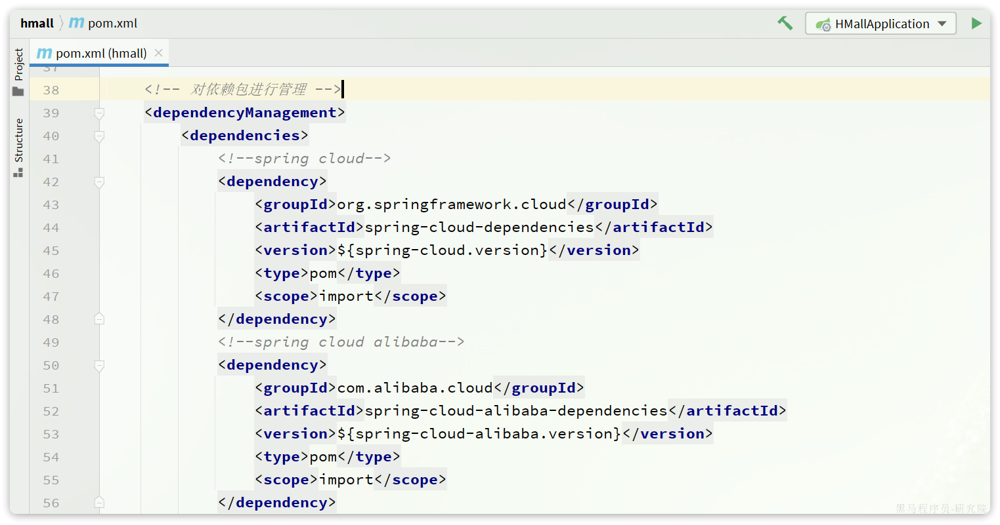

对应的版本：


##### 2.2.2.2 创建common工程

将原项目的hm-common拷贝到新项目目录下

如果pom.xml文件图标不是pom字样需要右键点击


如下图：


#### 2.2.3.商品服务

接下来，我们先把商品管理功能、购物车功能抽取为两个独立的微服务，其它的微服务根据教学的需求大家请自行创建。

##### 2.2.3.1 创建数据库


查看购物车微服务使用的数据库：


##### 2.2.3.2 创建工程

在项目中创建module：

选择maven模块，设定JDK版本为11，模块名为：

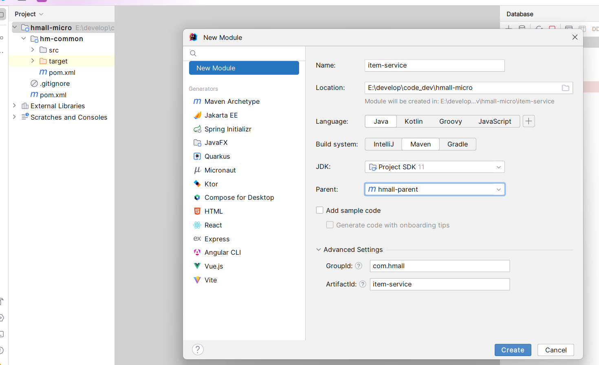


引入依赖：

```XML
<?xml version="1.0" encoding="UTF-8"?>
<project xmlns="http://maven.apache.org/POM/4.0.0"
         xmlns:xsi="http://www.w3.org/2001/XMLSchema-instance"
         xsi:schemaLocation="http://maven.apache.org/POM/4.0.0 http://maven.apache.org/xsd/maven-4.0.0.xsd">
    <parent>
        <artifactId>hmall-parent</artifactId>
        <groupId>com.hmall</groupId>
        <version>1.0.0</version>
    </parent>
    <modelVersion>4.0.0</modelVersion>

    <artifactId>item-service</artifactId>

    <properties>
        <maven.compiler.source>11</maven.compiler.source>
        <maven.compiler.target>11</maven.compiler.target>
    </properties>
    <dependencies>
        <!--common-->
        <dependency>
            <groupId>com.hmall</groupId>
            <artifactId>hm-common</artifactId>
            <version>1.0.0</version>
        </dependency>
        <!--web-->
        <dependency>
            <groupId>org.springframework.boot</groupId>
            <artifactId>spring-boot-starter-web</artifactId>
        </dependency>
        <!--数据库-->
        <dependency>
            <groupId>mysql</groupId>
            <artifactId>mysql-connector-java</artifactId>
        </dependency>
        <!--mybatis-->
        <dependency>
            <groupId>com.baomidou</groupId>
            <artifactId>mybatis-plus-boot-starter</artifactId>
        </dependency>
        <!--单元测试-->
        <dependency>
            <groupId>org.springframework.boot</groupId>
            <artifactId>spring-boot-starter-test</artifactId>
        </dependency>
    </dependencies>
    <build>
        <finalName>${project.artifactId}</finalName>
        <plugins>
            <plugin>
                <groupId>org.springframework.boot</groupId>
                <artifactId>spring-boot-maven-plugin</artifactId>
            </plugin>
        </plugins>
    </build>
</project>
```

##### 2.2.3.3 复制并修改代码

拷贝`hm-service`中与商品管理有关的代码到`item-service`，按照模型、持久层、业务层、控制层的顺序拷贝代码，最终效果如下图（注意跟hm-service对比，这里多了item这层包）：

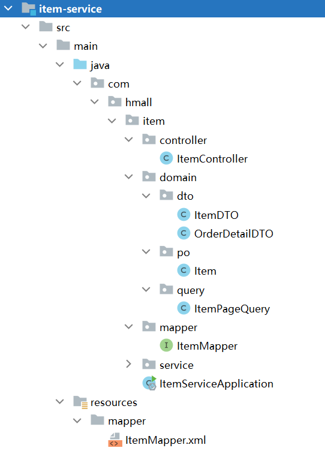

在ItemMapper.xml文件中需要修改包路径。


这也是因为ItemMapper的所在包发生了变化，因此这里代码必须修改包路径。

编写启动类，代码如下：

```Java
package com.hmall.item;

import org.mybatis.spring.annotation.MapperScan;
import org.springframework.boot.SpringApplication;
import org.springframework.boot.autoconfigure.SpringBootApplication;

@MapperScan("com.hmall.item.mapper")
@SpringBootApplication
public class ItemServiceApplication {

    public static void main(String[] args) {
        SpringApplication.run(ItemServiceApplication.class, args);
    }

}
```

##### 2.2.3.4 创建配置文件

接下来是配置文件，可以从`hm-service`中拷贝：

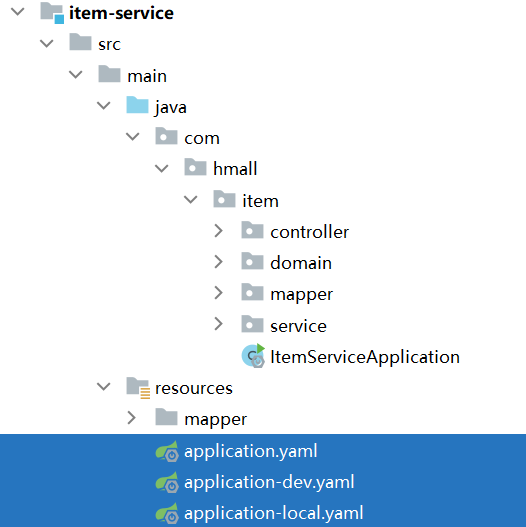

其中，`application.yaml`内容如下（以下方内容为主，覆盖掉原有的内容）：

注意设置端口号、服务名、数据库账号和密码、swagger接口的包路径com.hmall.item.controller

```YAML
server:
  port: 8081
spring:
  application:
    name: item-service
  profiles:
    active: dev
  datasource:
    url: jdbc:mysql://${hm.db.host}:3306/hm-item?useUnicode=true&characterEncoding=UTF-8&autoReconnect=true&serverTimezone=Asia/Shanghai
    driver-class-name: com.mysql.cj.jdbc.Driver
    username: root
    password: ${hm.db.pw}
mybatis-plus:
  configuration:
    default-enum-type-handler: com.baomidou.mybatisplus.core.handlers.MybatisEnumTypeHandler
  global-config:
    db-config:
      update-strategy: not_null
      id-type: auto
logging:
  level:
    com.hmall: debug
  pattern:
    dateformat: HH:mm:ss:SSS
  file:
    path: "logs/${spring.application.name}"
knife4j:
  enable: true
  openapi:
    title: 商品服务接口文档
    description: "商品服务接口文档"
    url: https://www.itcast.cn
    version: v1.0.0
    group:
      default:
        group-name: default
        api-rule: package
        api-rule-resources:
          - com.hmall.item.controller
```

剩下的`application-dev.yaml`和`application-local.yaml`直接从hm-service拷贝即可。

##### 2.2.3.5 启动微服务

直接运行启动类


启动成功：


##### 2.2.3.6 测试微服务

访问商品微服务的swagger接口文档：[http://localhost:8081/doc.html](http://localhost:8081/doc.html)

然后测试其中的根据id批量查询商品这个接口：


我们从hm-item数据库的item表找几条商品的id进行测试


测试参数：100002672302,100002624500,100002533430，结果如下：


说明商品微服务创建成功了。


##### 2.2.3.7. 小节

创建商品服务步骤：

1. 创建一个SpringBoot工程
2. 创建controller、service、mapper、domain包结构
3. 拷贝修改代码
4. 创建修改配置文件
5. 启动微服务


#### 2.2.4.购物车服务(练习)

##### 2.2.4.1 创建数据库

查看购物车微服务使用的数据库：


##### 2.2.4.2 创建工程

与商品服务类似，在hmall下创建一个新的`module`，起名为`cart-service`

引入依赖：

```JavaScript
<?xml version="1.0" encoding="UTF-8"?>
<project xmlns="http://maven.apache.org/POM/4.0.0"
         xmlns:xsi="http://www.w3.org/2001/XMLSchema-instance"
         xsi:schemaLocation="http://maven.apache.org/POM/4.0.0 http://maven.apache.org/xsd/maven-4.0.0.xsd">
    <parent>
        <artifactId>hmall-parent</artifactId>
        <groupId>com.hmall</groupId>
        <version>1.0.0</version>
    </parent>
    <modelVersion>4.0.0</modelVersion>

    <artifactId>cart-service</artifactId>

    <properties>
        <maven.compiler.source>11</maven.compiler.source>
        <maven.compiler.target>11</maven.compiler.target>
    </properties>
    <dependencies>
        <!--common-->
        <dependency>
            <groupId>com.hmall</groupId>
            <artifactId>hm-common</artifactId>
            <version>1.0.0</version>
        </dependency>
        <!--web-->
        <dependency>
            <groupId>org.springframework.boot</groupId>
            <artifactId>spring-boot-starter-web</artifactId>
        </dependency>
        <!--数据库-->
        <dependency>
            <groupId>mysql</groupId>
            <artifactId>mysql-connector-java</artifactId>
        </dependency>
        <!--mybatis-->
        <dependency>
            <groupId>com.baomidou</groupId>
            <artifactId>mybatis-plus-boot-starter</artifactId>
        </dependency>
        <!--单元测试-->
        <dependency>
            <groupId>org.springframework.boot</groupId>
            <artifactId>spring-boot-starter-test</artifactId>
        </dependency>
    </dependencies>
    <build>
        <finalName>${project.artifactId}</finalName>
        <plugins>
            <plugin>
                <groupId>org.springframework.boot</groupId>
                <artifactId>spring-boot-maven-plugin</artifactId>
            </plugin>
        </plugins>
    </build>
</project>
```


##### 2.2.4.3 复制与修改代码

把hm-service中的与购物车有关功能拷贝过来，最终的项目结构如下：

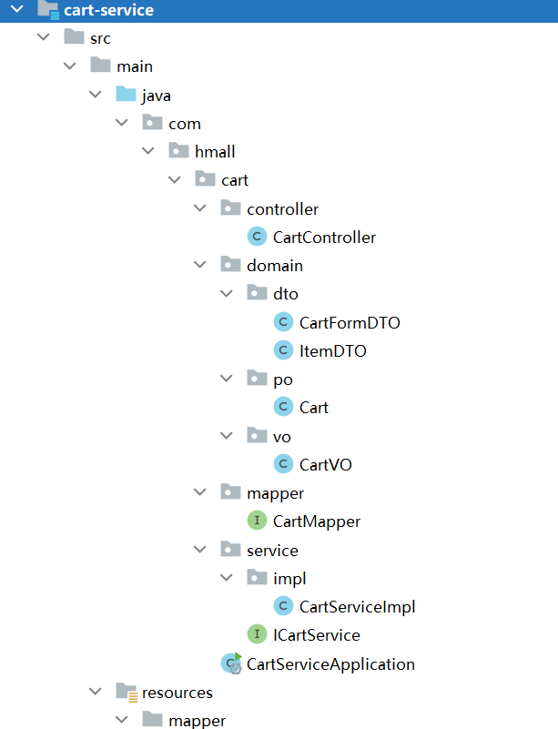

注意：需要修改CartMapper.xml文件中的包路径。


特别注意的是`com.hmall.cart.service.impl.CartServiceImpl`，其中有两个地方获取当前的用户id，目前我们还没有创建用户服务所以修改UserContext的getUser()方法固定返回1。


**屏蔽ItemService相关代码**


编写启动类：

```JavaScript
package com.hmall.cart;

import org.mybatis.spring.annotation.MapperScan;
import org.springframework.boot.SpringApplication;
import org.springframework.boot.autoconfigure.SpringBootApplication;

@MapperScan("com.hmall.cart.mapper")
@SpringBootApplication
public class CartServiceApplication {

    public static void main(String[] args) {
        SpringApplication.run(CartServiceApplication.class, args);
    }

}
```


##### 2.2.4.4 创建配置文件

拷贝商品服务的配置文件到购物车服务下。

`购物车服务的application.yaml`内容如下，注意设置端口号、服务名、数据库名、swagger文档的包路径com.hmall.cart.controller。

```JavaScript
server:
  port: 8082
spring:
  application:
    name: cart-service
  profiles:
    active: dev
  datasource:
    url: jdbc:mysql://${hm.db.host}:3306/hm-cart?useUnicode=true&characterEncoding=UTF-8&autoReconnect=true&serverTimezone=Asia/Shanghai
    driver-class-name: com.mysql.cj.jdbc.Driver
    username: root
    password: ${hm.db.pw}
mybatis-plus:
  configuration:
    default-enum-type-handler: com.baomidou.mybatisplus.core.handlers.MybatisEnumTypeHandler
  global-config:
    db-config:
      update-strategy: not_null
      id-type: auto
logging:
  level:
    com.hmall: debug
  pattern:
    dateformat: HH:mm:ss:SSS
  file:
    path: "logs/${spring.application.name}"
knife4j:
  enable: true
  openapi:
    title: 购物车服务接口文档
    description: "购物车服务接口文档"
    url: https://www.itcast.cn
    version: v1.0.0
    group:
      default:
        group-name: default
        api-rule: package
        api-rule-resources:
          - com.hmall.cart.controller
```

另外两个环境配置文件也复制过来

##### 2.2.4.5 启动微服务

直接运行启动类启动微服务。

然后启动`CartApplication`，访问swagger文档页面：[http://localhost:8082/doc.html](http://localhost:8082/doc.html)

我们测试其中的`查询我的购物车列表`接口：


下边继续测试接口，无需填写参数，直接访问：

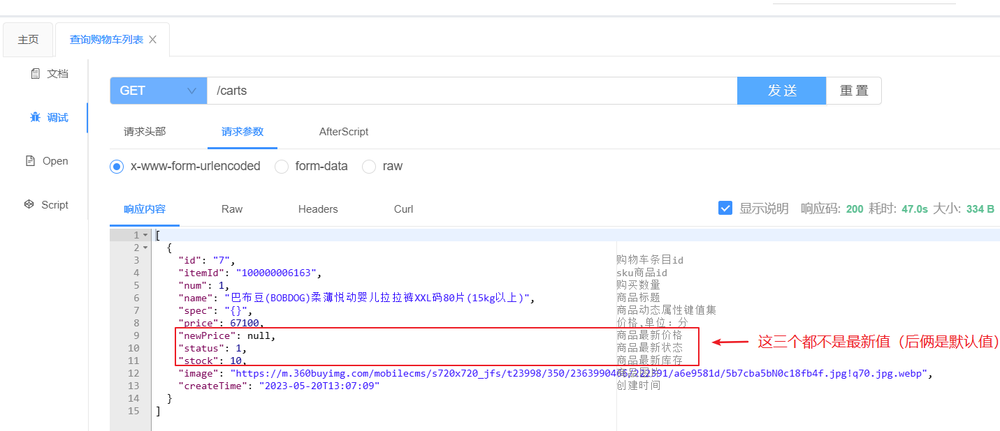

我们注意到，其中与商品newPrice属性值都为空，其他俩stock和status是vo类里属性的默认值！这就是因为刚才我们注释掉了查询购物车时，查询商品信息的相关代码。

那么，我们该如何在`cart-service`服务中实现对`item-service`服务的查询呢？


#### 2.2.5. 小结

如何创建微服务工程？

1. 首先确定Spring Cloud、Spring Boot版本，在父工程pom.xml中设定版本号。
2. 每个微服务创建独立的数据库。
3. 每个微服务创建Spring Boot工程，继承父工程，并在application.yaml配置端口号、服务名、数据库连接池、日志、swagger文件等配置信息。
4. 每个微服务工程的最少的项目包结构包括：controller：web接口service：服务接口domain：模型类mapper：数据库mapper


### 2.3 RestTemplate

1. 介绍远程调用技术以及为什么需要它

   <whiteboard token="PSucwJzt4hNjuXb6Ckxc02Ptn5d"></whiteboard>
2. RestTemplate的具体使用

<callout emoji="🥇">
1.写一个Spring配置
2.向Spring容器注入一个bean对象
3.使用RestTemplate
</callout>

#### 2.3.1. Java远程调用技术介绍

我们发现一个问题：在购物车业务中需要查询商品信息，但商品信息查询的逻辑全部迁移到了`item-service`服务，导致我们无法查询，查询端口信息的代码已经屏蔽：


最终结果就是查询到的购物车数据不完整，因此要想解决这个问题就需要通过远程调用技术。

一个微服务架构的项目会包括很多的微服务，一次业务操作会由多个微服务互相协作完成，比如：一次下单操作的执行流程如下：


执行流程如下：

1.用户请求订单服务提交订单

2.订单服务在数据库创建订单

3.订单服务请求账户服务扣减余额

4.订单服务请求库存服务扣减库存

从以上执行流程可以看出提交订单是通过订单服务、账户服务、库存服务三个微服务共同协作完成的。

服务之间进行交互是通过网络协议进行通信，在Spring Cloud中是通过HTTP协议进行通信。

拿上图举例：

订单服务提供“提交订单接口”供手机客户端调用，手机为客户端，订单服务为服务端。

账户服务提供“扣减余额接口”供订单服务调用，订单服务为客户端，账户服务为服务端。

库存服务提供“扣减库存接口”供订单服务调用，订单服务为客户端，库存服务为服务端。

**总结：调用方为客户端，被调方为服务端，客户端为消费者，服务端为生产者。**


AI：在Java中客户端与服务端远程调用（Remote Procedure Call, RPC）的技术有哪些？

常用的如下：

1. **RMI (Remote Method Invocation)**

- RMI 是 Java 提供的一种标准远程过程调用机制。
- 客户端可以像调用本地对象一样调用远程对象的方法。
- RMI 使用 Java 序列化机制来传输对象。

2.**REST (Representational State Transfer)**

- RESTful 服务使用 HTTP 协议来访问资源。
- 它通常使用 JSON 或 XML 格式来传输数据。
- REST 是一种轻量级的架构风格，广泛应用于现代 Web 服务。

3.**Apache Dubbo**

- Dubbo 是一个高性能、轻量级的微服务框架。
- Dubbo 支持多种协议远程调用，如 Dubbo 协议、HTTP 协议等。


**不管哪种技术它们的底层还是通过TCP、UDP网络协议进行通信。**


我们现在要在**Spring Boot**工程中实现远程调用，我们通过AI看下在Spring Boot中有哪些远程调用技术

AI：Spring Boot中远程调用的技术

摘要信息如下：

1. **Feign**

   - Feign 是一个声明式的HTTP客户端，它简化了HTTP请求的发送。
   - 使用Feign，你可以通过定义接口来创建客户端，Feign会自动生成调用逻辑。
   - Feign支持多种序列化库，如Jackson和Gson。
   - Feign可以与Spring Cloud Discovery Client集成，实现服务发现。
2. **RestTemplate**

   - RestTemplate 是Spring提供的一个模板类，用于简化HTTP请求的发送。
   - 通过RestTemplate，你可以轻松地发起GET、POST等请求，并处理响应。
   - RestTemplate支持多种数据格式，如JSON和XML。
   - RestTemplate常用于简单的HTTP调用，但在Spring Cloud中也有广泛应用。

RestTemplate不依赖SpringCloud框架，Feign依赖SpringCloud框架。


AI: RestTemplate远程调用例子

其中提供了大量的方法，方便我们发送Http请求，例如：

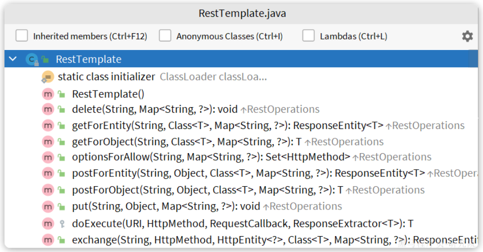

可以看到常见的Get、Post、Put、Delete请求都支持，如果请求参数比较复杂，还可以使用exchange方法来构造请求。


#### 2.3.2.RestTemplate实现远程调用

##### 2.3.2.1 明确需求

刚开始学习我们用一个简单点的例子，在购物车中需要显示商品信息，而商品信息在item-service服务，因此要想在购物车拿到商品信息就需要购物车服务远程调用商品服务去获取商品信息，流程图如下：

<whiteboard token="UfIcwpaiVhxF7UbT5jmcsX0TnAD"></whiteboard>

代码中需要变化的就是这一步：


##### 2.3.2.2 注入RestTemplate


<callout emoji="🎼">
1.一个配置类
2.注入一个RestTemplate的bean实例
3.使用
</callout>

现在需求明确，在购物车服务中远程调用商品服务查询商品信息。

首先在商品服务提供一个RESTful接口，传入商品id查询商品信息后返回。

然后在购物车服务用RestTemplate去请求商品服务的商品查询接口。


我们在`cart-service`服务中定义一个配置类：


先将RestTemplate注册为一个Bean：

```JavaScript
package com.hmall.cart.config;

import org.springframework.context.annotation.Bean;
import org.springframework.context.annotation.Configuration;
import org.springframework.web.client.RestTemplate;

/**
 * @author Mr.M
 * @version 1.0
 * @description RestTemplate配置类
 * @date 2024/8/2 19:46
 */

@Configuration
public class RemoteCallConfig {

 @Bean
 public RestTemplate restTemplate() {
  return new RestTemplate();
 }
}
```

接下来，我们修改`cart-service`中的`com.hmall.cart.service.impl.CartServiceImpl`的`handleCartItems`方法，发送http请求到`item-service`：

首先在`CartServiceImpl`中注入RestTemplate。

```JavaScript
...
public class CartServiceImpl extends ServiceImpl<CartMapper, Cart> implements ICartService {

//    private final IItemService itemService;

    private final RestTemplate restTemplate;
    ...
```

##### 2.3.2.3 实现远程调用

接下来修改代码，使用RestTemplate实现远程调用，使用RestTemplate进行远程调用的代码如下：


可以看到，利用RestTemplate发送http请求与前端ajax发送请求非常相似，都包含四部分信息：

- 请求方式
- 请求路径
- 请求参数（本案例中，为?参数）
- 返回值类型

##### 2.3.2.4 测试

好了，现在重启`cart-service`，再次测试查询我的购物车列表接口：


可以发现，所有商品相关数据都已经查询到了。


在这个过程中，`item-service`提供了查询接口，`cart-service`利用Http请求调用该接口。因此`item-service`可以称为服务的提供者，而`cart-service`则称为服务的消费者或服务调用者。

#### 2.3.3. 小结

微服务之间的远程调用被称为RPC，即远程过程调用。RPC的实现方式有很多，比如：

- 基于Http协议
- 基于Dubbo协议


我们课堂中使用的是Http方式，这种方式不关心服务提供者的具体技术实现，只要对外暴露Http接口即可，更符合微服务的需要。

Java使用Spring提供的RestTemplate向服务端接口发送http请求，基本步骤如下：

- 注册RestTemplate到Spring容器
- 调用RestTemplate的API发送请求，常见方法有：

  - getForObject：发送Get请求并返回指定类型对象
  - PostForObject：发送Post请求并返回指定类型对象
  - put：发送PUT请求
  - delete：发送Delete请求
  - exchange：发送任意类型请求，返回ResponseEntity
- 解析响应结果


#### 2.3.4 面试题

说几个Java远程调用的技术？你们项目用的什么技术？


总结：

<whiteboard token="KiEgwvX5MhGcW8bqOojchHVynSe"></whiteboard>


## 3 服务注册和发现

<callout emoji="📌">
1.为什么需要负载均衡
2.nginx和nacos又有什么区别
</callout>

### 3.1. Nginx负载均衡

#### 3.1.1 问题说明

在上一章我们实现了微服务的构建以及微服务之间的远程调用。不过这种手动发送Http请求的方式存在一些问题。

试想一下，假如商品微服务被调用较多，为了应对更高的并发，我们进行了多实例部署，如图：

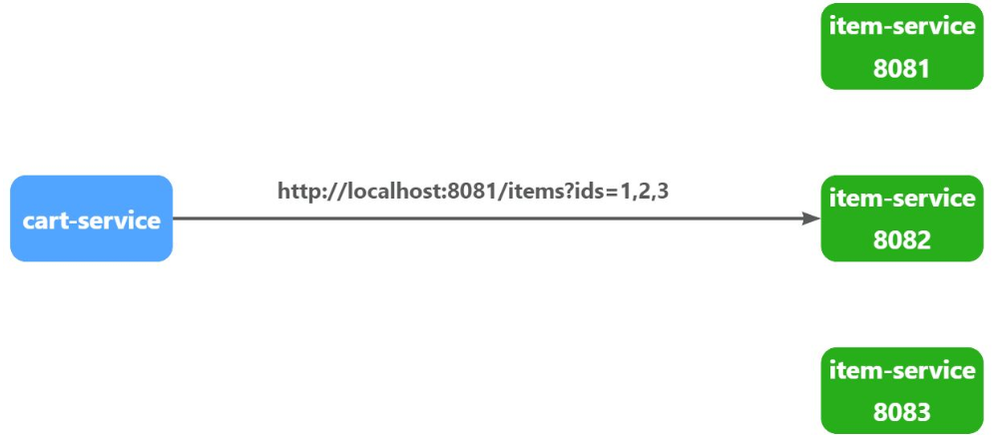

此时，每个`item-service`的实例其IP或端口不同，问题来了：

- item-service这么多实例，cart-service如何知道每一个实例的地址？
- http请求要写url地址，`cart-service`服务到底该调用哪个实例呢？
- 如果在运行过程中，某一个`item-service`实例宕机，`cart-service`依然在调用该怎么办？
- 如果并发太高，`item-service`临时多部署了N台实例，`cart-service`如何知道新实例的地址？

#### 3.1.2 Nginx负载均衡


<callout emoji="🏆">
1. nginx新增配置
2. 重启nginx
3. 修改CartServiceImpl
</callout>

如何解决上边的问题？

要解决上边的问题需要引入负载均衡器，比如：Nginx就提供负载均衡的功能，负载均衡器是一种网络设备或软件组件，用于在多台服务器之间分发网络流量。这有助于提高应用程序的可用性和响应速度，同时也能增加系统的容错能力。

Nginx 不仅是一个高性能的 Web 服务器，也是一个强大的反向代理，可以做为负载均衡器。

它可以支持多种负载均衡算法，包括轮询、最少连接、IP 哈希：

1. 轮询 (默认)

   - 按照顺序将请求分发给不同的服务器。
2. 最少连接

   - 将请求发送到当前活跃连接数最少的服务器。
3. IP 哈希

   - 根据客户端 IP 地址进行哈希计算，使得来自同一客户端的请求始终被路由到同一台服务器。


通过nginx实现负载均衡的结构图如下：


<whiteboard token="T4u0wCZNfh3rKsbm2vYcLtYKnbb"></whiteboard>

在nginx的配置方法也非常简单，只要配置上游服务器和具体的代理位置即可，大家可作为参考

```JavaScript
http {
    upstream item_services {
        server 127.0.0.1:8081 weight=3;  # 分配较高权重
        server 127.0.0.1:7081 weight=2;  # 分配中等权重
        server 127.0.0.1:6081 weight=1;  # 分配较低权重
    }

     server {
        listen       80;
        server_name  localhost;
        # 指定前端项目所在的位置
        location / {
            root html;
        }

        location /items {  # 这里可以根据需要调整路径前缀
            proxy_pass http://item_services;
            proxy_set_header Host $host;
            proxy_set_header X-Real-IP $remote_addr;
            proxy_set_header X-Forwarded-For $proxy_add_x_forwarded_for;
            proxy_set_header X-Forwarded-Proto $scheme;

            # 其他可选配置
            proxy_redirect off;
            proxy_buffering off;
            proxy_read_timeout 90;
        }

        error_page   500 502 503 504  /50x.html;
        location = /50x.html {
            root   html;
        }
    }
    
    ////省略其他
}
```

说明：

1. upstream 块定义了一个名为 `item_services` 的服务器组，包含三个服务器实例。你可以通过修改 `server` 行中的地址和端口来指向实际的服务实例。
2. server 块定义了 Nginx 的监听端口和服务名称。
3. location 块指定了路径 `/items/` 下的所有请求将被代理到 `item_services` 上游组。
4. proxy_pass 指令指定了代理目标。
5. proxy_set_header 指令设置了转发给后端服务的 HTTP 头。


这种方案在我们学习nginx就接触到了，这是一种服务端负载均衡的做法，即客户端（cart-service）请求nginx(服务端)，由nginx负载均衡器完成将请求转发到具体的服务实例。

如果增加了服务实例可以在nginx的upstream 上配置服务实例地址即可。


下边进行测试

首先在nginx的nginx.conf配置文件中配置upstream 和虚拟目录


cmd进入nginx目录，输入下边的命令加载配置：


然后在idea中启动多个商品服务：

注意：为了避免多个服务端口冲突这里需要指定端口

产生复制一个启动配置


然后再修改启动参数，添加启动参数


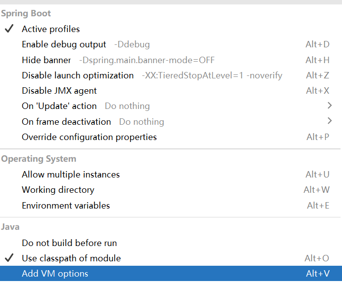

在启动参数中传入：server.port=7081如下图：


启动成功如下：

两个商品服务实例，一个购物车服务实例。


然后修改购物车服务中远程调用商品服务地址为nginx虚拟目录的地址


重启购物车服务。

重新测试查询购物车接口，观察两个商品服务的控制台，购物车服务通过nginx请求商品服务时通过轮询算法请求商品服务


#### 3.2.3 面试题

如何使用nginx实现负载均衡？


Nginx是反向代理，为什么叫反向代理？


### 3.2. 服务注册与发现流程

#### 3.3.1 区分客户端与服务端负载均衡

刚才使用nginx实现负载均衡解决了我们面临的问题。

nginx作为服务端，客户端请求nginx服务端，通过Nginx负载均衡器将请求转发到不同的后端服务，这是一种服务端负载均衡。

**服务端负载均衡**是客户端请求到Nginx服务端由Nginx实现负载均衡。

但是是不是不好用，不灵活，**比如每多一个实例，都需要去改nginx的配置？**接下来我们再讲一种客户端负载均衡的做法来解决我们面临的问题。

**客户端负载均衡**是客户端在发起调用时自己实现了负载均衡的作用，自己通过负载均衡算法找到一个目标服务进行调用。

如下图：

购物车服务自己通过负载均衡器挑选一个目标地址进行远程调用。

<whiteboard token="Wd2Xwoq7EhpqkPbawficDrrUnue"></whiteboard>


#### 3.3.2 服务注册与发现流程

<callout emoji="❤️">
1.学习nacos
2.安装nacos
3.服务引用它
</callout>

接下来我们讲的服务注册与发现流程正是用于实现客户端负载均衡。

首先引入注册中心的概念。

在微服务远程调用的过程中，包括两个角色：

- 服务提供者：提供接口供其它微服务访问，比如`item-service`
- 服务消费者：调用其它微服务提供的接口，比如`cart-service`

在大型微服务项目中，服务提供者的数量会非常多，为了管理服务提供者就引入了**注册中心**的概念。注册中心、服务提供者、服务消费者三者间关系如下：


三者的分工如下：

1 **注册中心**：提供服务注册接口，接收服务注册请求，保存服务实例的信息。

目前开源的注册中心中间件有很多，国内比较常见的有：

- Eureka：Netflix公司出品，目前被集成在SpringCloud当中，一般用于Java应用
- **Nacos**：Alibaba公司出品，目前被集成在SpringCloudAlibaba中，一般用于Java应用，我们项目使用Nacos。
- Consul：HashiCorp公司出品，目前集成在SPringCloud中，不限制微服务语言

2 **服务提供者**：服务接口提供方，请求注册中心将服务信息注册到注册中心。

3 **服务调用者**：远程调用的客户端，请求注册中心查询服务地址，通过负载均衡选取目标服务地址进行远程调用。


服务注册与发现流程如下：

- 服务启动时就会注册自己的服务信息（服务名、IP、端口）到注册中心
- 调用者可以从注册中心订阅想要的服务，获取服务对应的实例列表（1个服务可能多实例部署）
- 调用者作为客户端自己通过负载均衡算法挑选一个服务提供者实例进行远程调用，即客户端负载均衡
- 调用者向该实例发起远程调用


当服务提供者的实例宕机或者启动新实例时，调用者如何得知呢？

- 服务提供者会定期向注册中心发送请求，报告自己的健康状态（心跳请求）
- 当注册中心长时间收不到提供者的心跳时，会认为该实例宕机，将其从服务的实例列表中剔除
- 当服务有新实例启动时，会发送注册服务请求，其信息会被记录在注册中心的服务实例列表
- 当注册中心服务列表变更时，会主动通知微服务，更新本地服务列表


#### 3.3.3 面试题

说一下服务注册与发现流程？


### 3.3.Nacos安装配置

#### 3.3.1 介绍

接下来我们就去实现整个服务注册与发现的流程。

Nacos是国内产品，中文文档比较丰富，而且同时具备**配置管理**功能（后面会学习），因此在国内使用较多，课堂中我们会Nacos为例来学习。


官方网站如下：

[https://nacos.io/zh-cn/docs/v2/what-is-nacos.html](https://nacos.io/zh-cn/docs/v2/what-is-nacos.html)


#### 3.3.2 安装数据库

我们基于Docker来部署Nacos的注册中心，首先我们要准备MySQL数据库表，用来存储Nacos的数据。由于是Docker部署，需要用到数据库（虚拟机已经提供）：

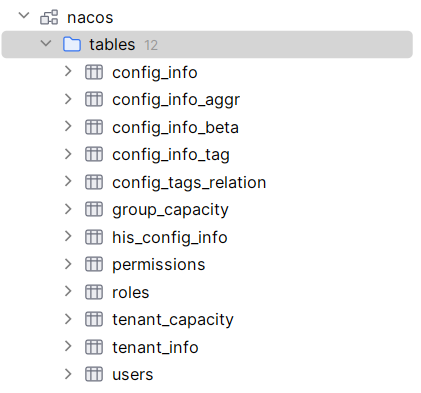


#### 3.3.3 创建容器

然后，找到课前资料下的nacos文件夹和nacos.2.4.tar，全部上传到/root下：

nacos.2.4.tar是nacos的镜像文件，nacos文件夹下是nacos配置文件。


课程资料中的`nacos/custom.env`需要上传到虚拟机/root目录下，在该文件中，注意：有一个MYSQL_SERVICE_HOST也就是mysql地址为虚拟机IP地址：

```Plain Text
PREFER_HOST_MODE=hostname
MODE=standalone
SPRING_DATASOURCE_PLATFORM=mysql
MYSQL_SERVICE_HOST=192.168.101.68
MYSQL_SERVICE_DB_NAME=nacos
MYSQL_SERVICE_PORT=3306
MYSQL_SERVICE_USER=root
MYSQL_SERVICE_PASSWORD=mysql
MYSQL_SERVICE_DB_PARAM=characterEncoding=utf8&connectTimeout=1000&socketTimeout=3000&autoReconnect=true&useSSL=false&allowPublicKeyRetrieval=true&serverTimezone=Asia/Shanghai
```

进入虚拟机的`/root`目录，导入nacos.tar镜像文件：

```JavaScript
docker load -i nacos.2.4.tar
```


进入root目录，然后执行下面的docker命令：

先执行删除旧容器命令

```Plain Text
docker rm -f nacos2.4.0.1 nacos nacos2.1
```

在执行创建新容器命令(**要在custom.env文件这一级目录执行启动命令**)

```PowerShell
docker run -d \
--name nacos \
--env-file custom.env \
-p 8848:8848 \
-p 9848:9848 \
-p 9849:9849 \
--restart=always \
nacos/nacos-server:v2.4.0.1
```

#### 3.3.4 访问nacos

启动完成后，访问下面地址：[http://192.168.101.68:8848/nacos/](http://192.168.101.68:8848/nacos/)，注意将`192.168.101.68`替换为你自己的虚拟机IP地址。

进入首页：


注意：2.4版本开始nacos默认不进行认证直接进入首页，以前的版本首次访问会跳转到登录页，**账号密码都是nacos**


#### 3.3.5 小结

Nacos安装步骤小结：

1. 准备nacos数据库
2. 准备nacos 镜像 及配置(配置需要修改为自己虚拟机的ip)
3. docker load -i nacos.2.4.tar 加载镜像
4. 运行docker 启动命令


### 3.4. 服务注册


<whiteboard token="Qc0iwAqddh5H1zbVFCJckn45nhg"></whiteboard>

接下来，我们把`item-service`注册到Nacos，步骤如下：

- 引入依赖
- 配置Nacos地址
- 重启


#### 3.4.1 添加依赖

在父工程中已经添加Spring Cloud及Spring Cloud Alibaba的版本约束，如下

```JavaScript
<!--spring cloud-->
<dependency>
    <groupId>org.springframework.cloud</groupId>
    <artifactId>spring-cloud-dependencies</artifactId>
    <version>${spring-cloud.version}</version>
    <!--   type=pom ,scope=import 表示继承 和 parent 作用一样             -->
    <type>pom</type>
    <scope>import</scope>
</dependency>
<!--spring cloud alibaba-->
<dependency>
    <groupId>com.alibaba.cloud</groupId>
    <artifactId>spring-cloud-alibaba-dependencies</artifactId>
    <version>${spring-cloud-alibaba.version}</version>
    <type>pom</type>
    <scope>import</scope>
</dependency>
```

因为我们安装的是2.4.0版本的nacos，S**pring Boot默认使用的Nacos比该版本低**，所以需要在父pom.xml中约定nacos-client版本，如下（复制到父工程的dependencies标签中）：

```JavaScript
<dependencies>
    <!-- lombok 管理 -->
    <dependency>
        <groupId>org.projectlombok</groupId>
        <artifactId>lombok</artifactId>
        <version>${org.projectlombok.version}</version>
    </dependency>
    <!--单元测试-->
    <dependency>
        <groupId>org.springframework.boot</groupId>
        <artifactId>spring-boot-starter-test</artifactId>
        <scope>test</scope>
    </dependency>
    <dependency>
        <groupId>com.alibaba.nacos</groupId>
        <artifactId>nacos-client</artifactId>
        <version>2.4.0</version>
    </dependency>
</dependencies>
```

在`item-service`的`pom.xml`中添加依赖：

```XML
<!--nacos 服务注册发现-->
<dependency>
    <groupId>com.alibaba.cloud</groupId>
    <artifactId>spring-cloud-starter-alibaba-nacos-discovery</artifactId>
</dependency>

```


#### 3.4.2 配置Nacos

在`item-service`的`application.yml`中添加nacos地址配置：

```YAML
spring:
  application:
    name: item-service # 服务名称
  cloud:
    nacos:
      server-addr: 192.168.101.68:8848 # nacos地址
```

注意：修改nacos的ip和端口。


#### 3.4.3 启动服务实例

启动两个商品服务实例。


启动过程中观察日志，发现如下日志则表示注册成功

```JavaScript
Success to connect to server [192.168.101.68:8848] on start up, connectionId ...
```

#### 3.4.4 查看服务注册信息

访问nacos控制台，可以发现服务注册成功：


点击详情，可以查看到`item-service`服务的两个实例信息：

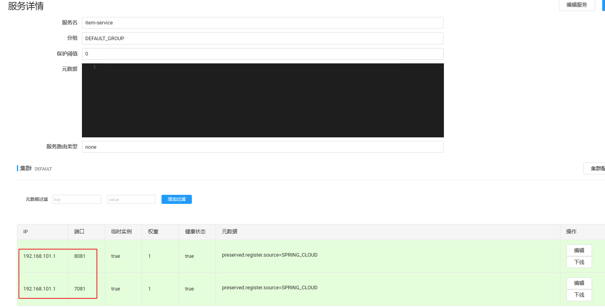


#### 3.4.5 小结

服务注册过程：

1. 在微服务添加spring-cloud-starter-alibaba-nacos-discovery 依赖。
2. `application.yml`中添加nacos地址配置，微服务根据配置连接nacos进行注册。
3. 可通过nacos的服务列表查询服务注册信息。


### 3.5. 服务发现

服务的消费者要去nacos订阅服务，这个过程就是服务发现，步骤如下：

- 引入依赖
- 配置Nacos地址
- 发现并调用服务

  - 修改RestTemplate


#### 3.5.1 引入依赖

服务发现除了要引入nacos依赖以外，由于还需要负载均衡，因此要引入SpringCloud提供的LoadBalancer依赖。

我们在`cart-service`中的`pom.xml`中添加下面的依赖：

```XML
<!--nacos 服务注册发现-->
<dependency>
    <groupId>com.alibaba.cloud</groupId>
    <artifactId>spring-cloud-starter-alibaba-nacos-discovery</artifactId>
</dependency>
<!--负载均衡器-->
<dependency>
    <groupId>org.springframework.cloud</groupId>
    <artifactId>spring-cloud-starter-loadbalancer</artifactId>
</dependency>
```

可以发现，这里Nacos的依赖于服务注册时一致，这个依赖中同时包含了服务注册和发现的功能。因为任何一个微服务都可以调用别人，也可以被别人调用，即可以是调用者，也可以是提供者。

因此，等一会儿`cart-service`启动，同样会注册到Nacos

#### 3.5.2 配置Nacos地址

在`cart-service`的`application.yml`中添加nacos地址配置：

```YAML
spring:
  cloud:
    nacos:
      server-addr: 192.168.101.68:8848
```


#### 3.5.3 服务发现并调用服务

接下来，服务调用者`cart-service`就可以去订阅`item-service`服务了，它的底层使用了Spring Cloud Loadbalancer组件实现客户端负载均衡，常见的负载均衡算法有：

- 随机
- 轮询
- IP的hash
- 最近最少访问
- ...

接下来，我们就可以对原来的远程调用做修改了，之前调用时我们需要写死服务提供者的IP和端口，

Spring Cloud Loadbalancer 提供了现成的客户端负载均衡器可以非常方便的实现客户端负载均衡。

修改RemoteCallConfig类，使用@LoadBalanced注解标识RestTemplate，如下：

```JavaScript
@Configuration
public class RemoteCallConfig {

 @Bean
 @LoadBalanced
 public RestTemplate restTemplate() {
  return new RestTemplate();
 }
}
```

修改代码，屏蔽使用discoveryClient从注册中心查询服务列表以及随机选择服务实例的代码，RestTemplate在远程调用时指定服务名“item-service”，如下：

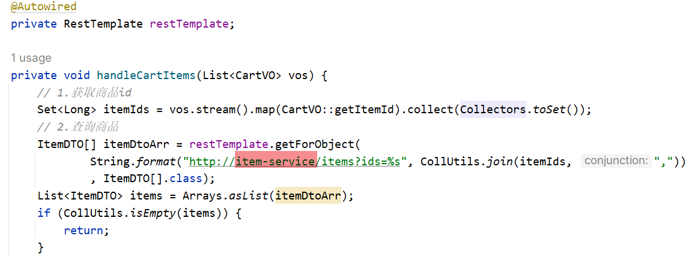

重启cart-service，测试查询购物车列表接口，功能正常，并且连续请求接口通过观察两个商品服务实例的控制台都输出商品查询的日志，说明实现了负载均衡。


#### 3.5.4 小结

服务发现流程：

1. 在服务调用方引入依赖spring-cloud-starter-alibaba-nacos-discovery
2. 在服务调用方配置Nacos地址
3. 发现并调用服务

使用@LoadBalanced注解标识RestTemplate，RestTemplate在远程调用时指定目标服务名即可。


### 3.6. Spring Cloud Loadbalancer 原理-根据截图里的内容，断点跟下源码

<whiteboard token="Maxtw2YQohIMYebbumxcheSLnFf"></whiteboard>

#### 3.6.1 源码解析

为什么我们只输入了service名称就可以访问了呢？之前还要获取ip和端口。 显然有人帮我们根据service名称，获取到了服务实例的ip和端口。这就是 @LoadBalanced注解起到的作用。

@LoadBalanced注解是如何实现负载均衡呢？

首先在创建RestTemplate的bean时添加@LoadBalanced注解，LoadBalancerAutoConfiguration自动配置筛选出添加@LoadBalanced注解的RestTemplate，为RestTemplate设置LoadBalancerInterceptor。

 LoadBalancerInterceptor会在对RestTemplate的请求进行拦截，然后从nacos中根据服务id获取服务列表，随后利用负载均衡算法得到真实的服务地址信息，替换服务id。 

下边通过跟踪源代码解释整个执行过程。


可以看到这里的intercept方法，拦截了用户的HttpRequest请求，然后做了几件事： 

request.getURI() ：获取请求uri，本例中就是 http://item-service/items?ids=100000006163

originalUri.getHost() ：获取uri路径的主机名，其实就是服务id， item-service 

this.loadBalancer.execute() ：处理服务id，和用户请求。 

这里的 this.loadBalancer 是 LoadBalancerClient 类型，LoadBalancerClient 会根据负载均衡算法选择一个实例并发起请求，我们继续跟入。


调用choose方法根据负载均衡算法选择一个服务实例，继续跟入


默认使用的负载均衡策略是轮询，通过RoundRobinLoadBalancer实现

最终选择一个服务实例


放行继续执行。

继续测试该接口，因为是轮询策略，下次会选择另一个服务实例


在Spring Cloud 2020版本以前客户端负载均衡使用的是Netflix公司的Ribbon组件，由于Netflix公司对一些组件不再更新，Spring Cloud之后的版本就移除了Ribbon,使用Spring Cloud LoadBalance实现客户端负载均衡。

#### 3.6.2 面试题

微服务是怎么实现远程调用的？


## 4 OpenFeign-**让远程调用像本地方法调用一样简单**

### 4.1. 认识OpenFeign

在上一章，我们利用Nacos实现了服务的治理，利用RestTemplate实现了服务的远程调用，虽然ip和端口换成了服务名，但是**远程调用的代码还有些复杂**：


有没有一种类似调用本地service方法的方式去实现远程调用呢？

接下来我们讲解的OpenFeign技术就可以让**远程调用像本地方法调用一样简单**。


AI:OpenFeign是什么

Spring Cloud早期版本使用的Feign组件实现远程调用，Feign中集成了Ribbon，随着Netflix公司不再维护Feign，Spring Cloud在Feign基础上新建了一个开源项目OpenFeign，是一个声明式的 HTTP 客户端框架，它简化了编写 REST 客户端的过程。

1. 添加依赖:

在你的项目中添加 OpenFeign 的依赖。如果你使用 Maven，可以添加以下依赖：

```Plaintext

<dependency>
    <groupId>org.springframework.cloud</groupId>
    <artifactId>spring-cloud-starter-openfeign</artifactId>
</dependency>
```


1. 创建 Feign 客户端接口:

   - 定义一个接口来描述你的远程服务。
   - 使用 `@FeignClient` 注解来标识远程调用接口，并指定服务名、接口路径。用的都是SpringMVC的注解，开发简单。

```Plaintext

@FeignClient(name = "item-service")
public interface ItemClient {
    @GetMapping("/items/{id}")
    Item getItem(@PathVariable("id") String id);
}
```


1. 注入`FeignClient` 接下来在购物车服务注入 Feign 客户端，通过Feign客户端进行远程调用。

```Plaintext

@RestController
public class CartController {
    @Autowired
    private ItemClient itemClient;
    @GetMapping("/carts/{id}/items/{itemId}")
    public ResponseEntity<Item> getCartItem(@PathVariable("id") String cartId, @PathVariable("itemId") String itemId) {
        Item item = itemClient.getItem(itemId);
       // 处理 item 数据...
        return ResponseEntity.ok(item);
    }
}
```

使用OpenFeign是非常简单的，只需要定义一个接口，用FeignClient标识目标服务的名称，在接口中定义要调用的接口，使用Spring MVC注解进行标识。在其它bean中注入此接口即可使用。


其实远程调用的关键点就在于四个：

- 请求方式
- 请求路径
- 请求参数
- 返回值类型

所以，OpenFeign就利用SpringMVC的相关注解来声明上述4个参数，然后基于动态代理帮我们生成远程调用的代码，而无需我们手动再编写，非常方便。

接下来，我们就通过一个快速入门的案例来体验一下OpenFeign的便捷吧。

<callout emoji="🎁">
1. 引入依赖
2. 编写Feign客户端

   1. feign会生成一个代理类
3. 简单使用
</callout>

### 4.2.快速入门

我们还是以cart-service中的查询我的购物车为例。因此下面的操作都是在cart-service中进行。

#### 4.2.1 引入依赖

在消费者端即`cart-service`服务的pom.xml中引入`OpenFeign`的依赖：

```XML
  <!--openFeign-->
  <dependency>
      <groupId>org.springframework.cloud</groupId>
      <artifactId>spring-cloud-starter-openfeign</artifactId>
  </dependency>
```


#### 4.2.2 编写OpenFeign客户端

在`cart-service`中，定义一个新的接口，该接口将来通过OpenFeign去访问商品服务中ItemController类的方法，所以参考商品服务的ItemController类去编写Feign接口

其中代码如下：

```Java
package com.hmall.cart.client;

import com.hmall.cart.domain.dto.ItemDTO;
import org.springframework.cloud.openfeign.FeignClient;
import org.springframework.web.bind.annotation.GetMapping;
import org.springframework.web.bind.annotation.RequestParam;

import java.util.Collection;
import java.util.List;

/**
 * @author Mr.M
 * @version 1.0
 * @description 商品服务Feign接口
 * @date 2024/8/3 16:21
 */
@FeignClient(name="item-service",path = "/items")
public interface ItemClient {
    @GetMapping
    List<ItemDTO> queryItemByIds(@RequestParam("ids") Collection<Long> ids);
}
```

**这里只需要声明接口，无需实现方法。接口中的几个关键信息：**

- `@FeignClient(name="item-service")` ：声明服务名称
- `@FeignClient(path = "/items")`: 相当于ItemController类上的@RequestMapping("/items")指定的路径
- `@GetMapping` ：声明请求方式
- `@RequestParam("ids") Collection<Long> ids` ：声明请求参数
- `List<ItemDTO>` ：返回值类型


有了上述信息，OpenFeign就可以利用动态代理帮我们实现这个方法，并且向`http://item-service/items`发送一个`GET`请求，携带ids请求参数，并自动将返回值处理为`List<ItemDTO>`。

我们只需要直接调用这个方法，即可实现远程调用了。


#### 4.2.3 使用FeignClient

最后，我们在`cart-service`的`com.hmall.cart.service.impl.CartServiceImpl`中改造代码，直接调用`ItemClient`的方法：

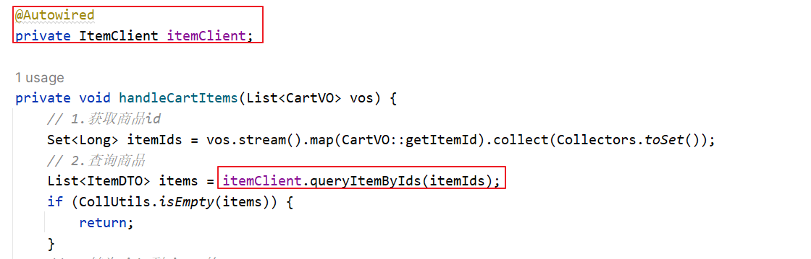

feign替我们完成了服务拉取、负载均衡、发送http请求的所有工作，是不是看起来优雅多了。


而且，这里我们不再需要RestTemplate了，还省去了RestTemplate的注册。


#### 4.2.4 启用OpenFeign

接下来，我们在`cart-service`的`CartApplication`启动类上添加注解，启动OpenFeign功能：


@EnableFeignClients注解的作用寻找使用 `@FeignClient` 注解的接口生成Feign客户端(代理对象)，自动配置 Feign 客户端与 Spring Cloud LoadBalancer 的集成。

#### 4.2.5 测试

通过我们购物车接口测试OpenFeign实现远程调用。

#### 4.2.6 Feign和RestTemplate对比（掌握就行）

二者**核心原理完全相同**（客户端负载均衡、服务发现 + 选路 + 地址替换），仅**集成方式和入口不同**，如下图：

<sheet sheet-id="OBNZNa" token="JDEOsrliIhs5vWt01T4c2aVtnQc"></sheet>

#### 4.2.7 小结

OpenFeign的使用过程？

1. 将服务提供方提供的接口定义为Interface接口，并且@FeignClient注解标识，在接口方法上使用SpringMVC注解标识方法的路径、参数等。
2. 在服务调用方注入FeignClient接口，OpenFeign组件会根据接口生成代理对象，服务调用方通过FeignClient接口的代理对象进行远程调用。
3. 在服务调用方启动类上添加@EnableFeignClients


### 4.2 最佳实践

#### 4.2.1. OkHttp

##### 4.2.1.1 介绍

Feign底层发起http请求，依赖于第三方的**http客户端框架**。常用的http客户端有：

- HttpURLConnection：默认实现，不支持连接池

`HttpURLConnection` 是 Java 标准库中用于发送 HTTP 请求和接收 HTTP 响应的一个类。它位于 `java.net` 包中，提供了一组丰富的 API 来处理 HTTP 连接。`HttpURLConnection` 可以用于发送 GET、POST、PUT、DELETE 等各种 HTTP 方法的请求，并允许设置请求头、请求体等。

- Apache HttpClient ：支持连接池

Apache HttpClient 是一个用于发送 HTTP 请求和接收 HTTP 响应的强大客户端库，它是 Apache HttpComponents 项目的一部分。这个库为 Java 开发者提供了高级别的 API 来处理 HTTP 和 HTTPS 协议，同时也提供了低级别的组件来构建和定制 HTTP 客户端。

- OKHttp：支持连接池

OkHttp 是一个高效的 HTTP 客户端库，由 Square Inc. 开发和维护。它最初是为了提高 Android 应用程序中的网络请求效率而设计的，但现在也被广泛用于 Java 应用程序中。OkHttp 提供了许多高级功能，以简化 HTTP 请求的处理并提高性能。

因此我们通常会使用带有连接池的客户端来代替默认的HttpURLConnection。比如，我们使用OKHttp，使用连接池可以提升 HTTP 请求的效率。

首先我们跟踪源代码，查看当前默认的Client底层是HttpURLConnection，请求查询购物车接口，在远程调用商品服务处打断点：

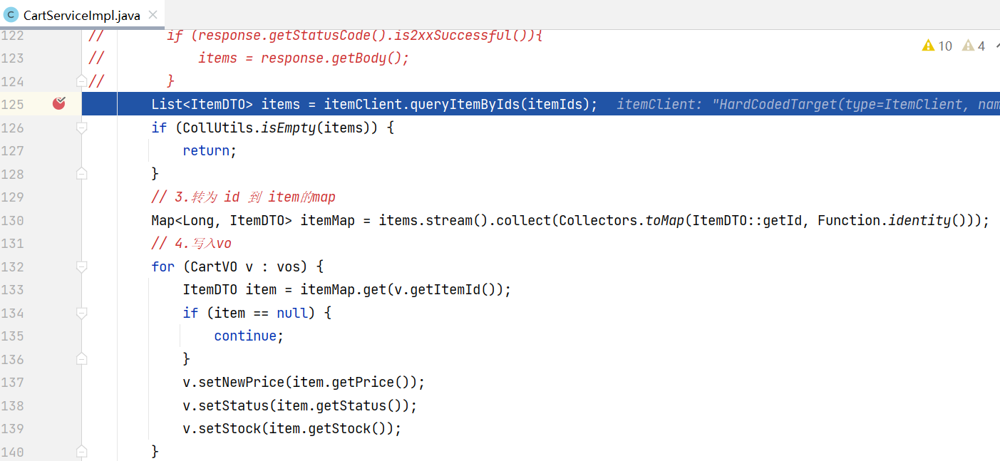

继续跟入


继续跟入


继续跟入

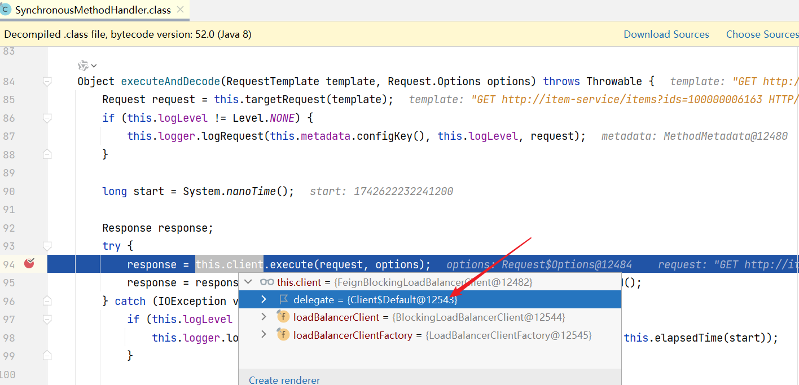

使用的是默认的Client客户端，继续跟入

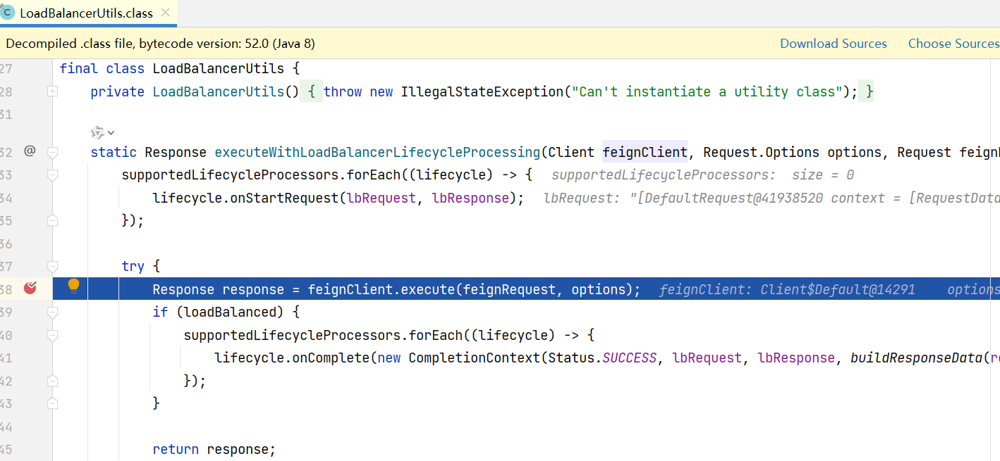

继续跟入，Client执行使用**HttpURLConnection**请求http。

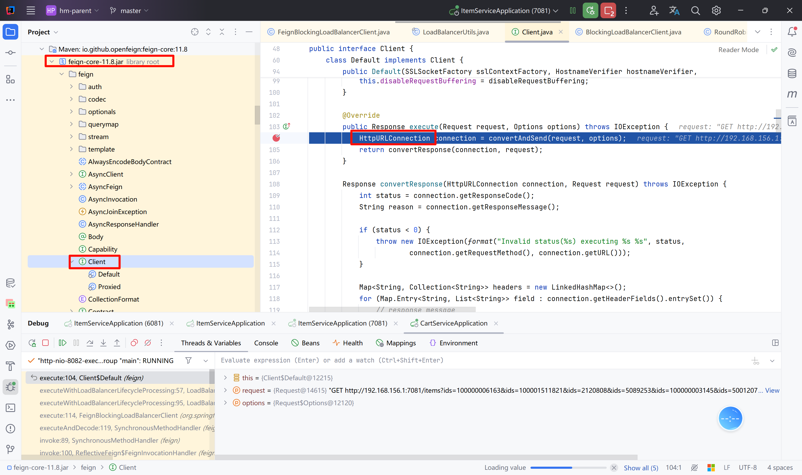

##### 4.2.1.2 更换为okhttp

<callout emoji="🏆">
1. 引入依赖
2. 修改配置，自动生效
</callout>


下边我们更换Client为okhttp

在`cart-service`的`pom.xml`中引入依赖：

```XML
<!--OK http 的依赖 -->
<dependency>
  <groupId>io.github.openfeign</groupId>
  <artifactId>feign-okhttp</artifactId>
</dependency>
```

在`cart-service`的`application.yml`配置文件中开启Feign的连接池功能：

```YAML
feign:
  okhttp:
    enabled: true # 开启OKHttp功能
```

重启服务，okhttp就生效了。

重新请求查询购物车接口，跟踪源代码查看Client的代理已变为OkHttpClient。


继续跟入代码，使用OkHttpClient发起请求并拿到响应结果。

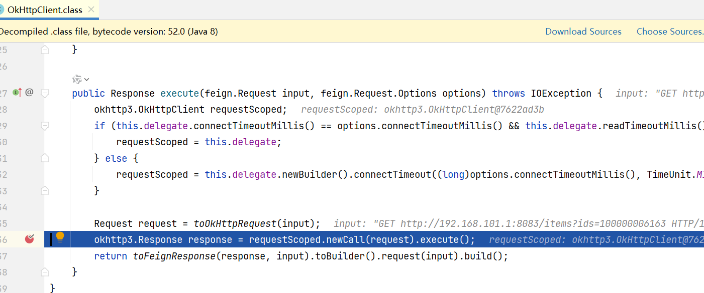


#### 4.2.2. 抽取API工程

##### 4.2.2.1 思路分析


<whiteboard token="UCG1wni2ThSS6cbgocrcoihAngh"></whiteboard>

上边学习了使用OpenFeign方式实现微服务接口的远程调用，每个微服务都可能需要提供接口供其它微服务调用，仍然拿商品服务举例，除了购物车服务需要调用商品服务的接口以外，订单服务也需要调用商品服务，实现的方式可参考购物车服务，在订单服务中编写Feign接口，或者直接将购物车服务中的Feign接口拷贝到订单服务。

这不是重复编码吗？ 有什么办法可以避免重复编码呢？

避免重复编码的办法就是**抽取**。不过这里有两种抽取思路：

- 思路一：抽取到微服务之外的公共module
- 思路二：每个微服务自己抽取一个module

如图：


<whiteboard token="EWaZwPuS3hpNunbkkDicQtu2nHe"></whiteboard>


方案一抽取更加简单，所有微服务提供的外部接口都在一个工程中，工程结构也比较清晰，但缺点是整个项目耦合度偏高，比如：hm-api中包括了A、B、C三个微服务的接口，D服务即使只用A，只要依赖hm-api工程就会自动依赖B、C。

方案二抽取相对麻烦，每个微服务工程都需要有一个api模块，但服务之间耦合度降低。比如：A、B、C三个微服务D服务用A只需要依赖A服务下的api模块即可。


对于**中小型项目规模通常选择方案一**，不用维护太多的api的工程，简单高效。

##### 4.2.2.2 抽取API工程

<callout emoji="🏆">
1.抽取一个新的模块：hm-api
2.移动咱们的ItemClient到api工程下面去
3.cart-service依赖hm-api
</callout>

下边我们将黑马商城项目的api按方案一抽取。

在`hmall`下定义一个新的module，命名为hm-api

其依赖如下：

```XML
<?xml version="1.0" encoding="UTF-8"?>
<project xmlns="http://maven.apache.org/POM/4.0.0"
         xmlns:xsi="http://www.w3.org/2001/XMLSchema-instance"
         xsi:schemaLocation="http://maven.apache.org/POM/4.0.0 http://maven.apache.org/xsd/maven-4.0.0.xsd">
    <parent>
        <groupId>com.hmall</groupId>
        <artifactId>hmall-parent</artifactId>
        <version>1.0.0</version>
    </parent>
    <modelVersion>4.0.0</modelVersion>

    <artifactId>hm-api</artifactId>

    <properties>
        <maven.compiler.source>11</maven.compiler.source>
        <maven.compiler.target>11</maven.compiler.target>
    </properties>

    <dependencies>
        <!--open feign-->
        <dependency>
            <groupId>org.springframework.cloud</groupId>
            <artifactId>spring-cloud-starter-openfeign</artifactId>
        </dependency>
        <!-- load balancer-->
        <dependency>
            <groupId>org.springframework.cloud</groupId>
            <artifactId>spring-cloud-starter-loadbalancer</artifactId>
        </dependency>
        <!--OK http 的依赖 -->
        <dependency>
            <groupId>io.github.openfeign</groupId>
            <artifactId>feign-okhttp</artifactId>
        </dependency>
        <dependency>
            <groupId>com.hmall</groupId>
            <artifactId>hm-common</artifactId>
            <version>1.0.0</version>
        </dependency>
        <!-- swagger 注解依赖 -->
        <dependency>
            <groupId>io.swagger</groupId>
            <artifactId>swagger-annotations</artifactId>
            <version>1.6.6</version>
            <scope>compile</scope>
        </dependency>
    </dependencies>
</project>
```


然后把ItemDTO和ItemClient都移动到hm-api工程中，最终结构如下：

注意：ItemDTO和ItemClient在购物车工程不存在了。

下图中：com.hmall.api.item包为商品服务接口包，后期还会创建与com.hmall.api.item包平级的其它服务的接口包。


现在，任何微服务要调用`item-service`中的接口，只需要引入`hm-api`模块依赖即可，无需自己编写Feign客户端了。

##### 4.2.2.3 使用API

接下来，我们在`cart-service`的`pom.xml`中引入`hm-api`模块：

```XML
  <!--feign模块-->
  <dependency>
      <groupId>com.hmall</groupId>
      <artifactId>hm-api</artifactId>
      <version>1.0.0</version>
  </dependency>
```

删除`cart-service`中原来的ItemDTO和ItemClient，重启项目发现报错了：


这里因为`ItemClient`现在定义到了`com.hmall.api.item`包下，而cart-service的启动类定义在`com.hmall.cart`包下，扫描不到`ItemClient`，所以报错了。


解决办法很简单，在cart-service的启动类上添加声明即可，两种方式：

- 方式1：声明扫描包：(推荐此方式)


- 方式2：声明要用的FeignClient


推荐方式一。


#### 4.2.3. 完善服务接口

目前为止我们把商品服务的查询商品信息接口作为Feign接口抽取到了hm-api工程中，假设**有一天接变更了该怎么办？比如：商品查询接口加了一个参数，首先需要修改商品服务的商品查询Controller方法**，添加一个参数，然后修改hm-api工程的对应的接口添加一个参数。

这两个地方都要改，一个是服务端的接口，一个是于服务端接口对应的Feign接口。

如果忘记修改其中一个地方或两个地方修改的不一致则会导致接口无法正常调用。为了解决这个问题我们可以让服务端controller类去实现hm-api中的Feign接口，这样一来要改就一起修改了。

首先在商品服务引入hm-api

```JavaScript
<dependency>
    <groupId>com.hmall</groupId>
    <artifactId>hm-api</artifactId>
    <version>1.0.0</version>
</dependency>
```

然后让ItemController类实现ItemClient接口

```JavaScript
package com.hmall.item.controller;


import com.baomidou.mybatisplus.extension.plugins.pagination.Page;
import com.hmall.api.item.ItemClient;
import com.hmall.common.domain.PageDTO;
import com.hmall.common.domain.PageQuery;
import com.hmall.common.utils.BeanUtils;
import com.hmall.item.domain.dto.ItemDTO;
import com.hmall.item.domain.dto.OrderDetailDTO;
import com.hmall.item.domain.po.Item;
import com.hmall.item.service.IItemService;
import io.swagger.annotations.Api;
import io.swagger.annotations.ApiOperation;
import lombok.RequiredArgsConstructor;
import org.springframework.web.bind.annotation.*;

import java.time.LocalDateTime;
import java.util.List;
import java.util.concurrent.TimeUnit;

@Api(tags = "商品管理相关接口")
@RestController
@RequestMapping("/items")
@RequiredArgsConstructor
public class ItemController implements ItemClient {
....


@ApiOperation("根据id批量查询商品")
@GetMapping
@Override
public List<ItemDTO> queryItemByIds(@RequestParam("ids") Collection<Long> ids){
    return itemService.queryItemByIds(ids);
}


```

代码报错，发现是ItemDTO冲突，删除商品服务中的ItemDTO,统一使用hm-api中的ItemDTO。

修改完成重启商品服务和购物车服务测试查询购物车接口。


### 4.3 面试题

OpenFeign的工作原理？


## 5 总结

<whiteboard token="FdlBwujE2horyLbyw8ccDGiJn8d"></whiteboard>

## 作业

### 创建用户微服务

将hm-service中用户管理相关的业务抽取出来,创建用户微服务user-service。

pom.xml

```XML
<?xml version="1.0" encoding="UTF-8"?>
<project xmlns="http://maven.apache.org/POM/4.0.0"
         xmlns:xsi="http://www.w3.org/2001/XMLSchema-instance"
         xsi:schemaLocation="http://maven.apache.org/POM/4.0.0 http://maven.apache.org/xsd/maven-4.0.0.xsd">
    <modelVersion>4.0.0</modelVersion>
    <parent>
        <groupId>com.hmall</groupId>
        <artifactId>hmall-parent</artifactId>
        <version>1.0.0</version>
    </parent>

    <artifactId>user-service</artifactId>

    <properties>
        <maven.compiler.source>11</maven.compiler.source>
        <maven.compiler.target>11</maven.compiler.target>
        <project.build.sourceEncoding>UTF-8</project.build.sourceEncoding>
    </properties>

    <dependencies>
        <!--common-->
        <dependency>
            <groupId>com.hmall</groupId>
            <artifactId>hm-common</artifactId>
            <version>1.0.0</version>
        </dependency>
        <!--web-->
        <dependency>
            <groupId>org.springframework.boot</groupId>
            <artifactId>spring-boot-starter-web</artifactId>
        </dependency>
        <!--加密-->
        <dependency>
            <groupId>org.springframework.security</groupId>
            <artifactId>spring-security-crypto</artifactId>
        </dependency>
        <dependency>
            <groupId>org.springframework.security</groupId>
            <artifactId>spring-security-rsa</artifactId>
            <version>1.0.9.RELEASE</version>
        </dependency>
        <!--数据库-->
        <dependency>
            <groupId>mysql</groupId>
            <artifactId>mysql-connector-java</artifactId>
        </dependency>
        <!--mybatis-->
        <dependency>
            <groupId>com.baomidou</groupId>
            <artifactId>mybatis-plus-boot-starter</artifactId>
        </dependency>
        <!--单元测试-->
        <dependency>
            <groupId>org.springframework.boot</groupId>
            <artifactId>spring-boot-starter-test</artifactId>
        </dependency>
        <!--nacos 服务注册发现-->
        <dependency>
            <groupId>com.alibaba.cloud</groupId>
            <artifactId>spring-cloud-starter-alibaba-nacos-discovery</artifactId>
        </dependency>
    </dependencies>
    <build>
        <finalName>${project.artifactId}</finalName>
        <plugins>
            <plugin>
                <groupId>org.springframework.boot</groupId>
                <artifactId>spring-boot-maven-plugin</artifactId>
            </plugin>
        </plugins>
    </build>
</project>
```

application.yaml

```YAML
server:
  port: 8084
spring:
  application:
    name: user-service
  cloud:
    nacos:
      server-addr: 192.168.101.68:8848 # nacos地址
  profiles:
    active: dev
  datasource:
    url: jdbc:mysql://${hm.db.host}:3306/hm-user?useUnicode=true&characterEncoding=UTF-8&autoReconnect=true&serverTimezone=Asia/Shanghai
    driver-class-name: com.mysql.cj.jdbc.Driver
    username: root
    password: ${hm.db.pw}
mybatis-plus:
  configuration:
    default-enum-type-handler: com.baomidou.mybatisplus.core.handlers.MybatisEnumTypeHandler
  global-config:
    db-config:
      update-strategy: not_null
      id-type: auto
logging:
  level:
    com.hmall: debug
  pattern:
    dateformat: HH:mm:ss:SSS
  file:
    path: "logs/${spring.application.name}"
knife4j:
  enable: true
  openapi:
    title: 用户服务接口文档
    description: "用户服务接口文档"
    url: https://www.itcast.cn
    version: v1.0.0
    group:
      default:
        group-name: default
        api-rule: package
        api-rule-resources:
          - com.hmall.user.controller
hm:
  jwt:
    location: classpath:hmall.jks
    alias: hmall
    password: hmall123
    tokenTTL: 30m
  auth:
    excludePaths:
      - /search/**
      - /users/login
      - /items/**
      - /hi
```

项目结构

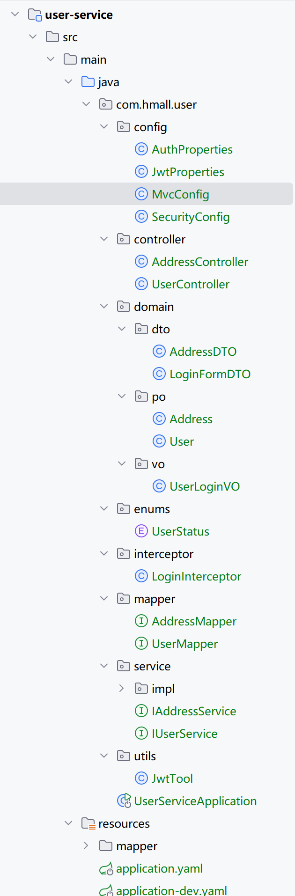


#### 注意事项

当业务代码中需要知道当前登录用户是谁，目前暂未实现，先将用户id写死，修改UserContext如下：


user-service也需要自己的独立的database，向MySQL中导入课前资料提供的SQL：

注意：即使虚拟机已存在hm-user数据库也需要运行此脚本。


导入结果如下：


#### 测试

启动UserApplication，访问[http://localhost:8084/doc.html#/default/用户相关接口/loginUsingPOST](http://localhost:8084/doc.html#/default/%E7%94%A8%E6%88%B7%E7%9B%B8%E5%85%B3%E6%8E%A5%E5%8F%A3/loginUsingPOST)，测试登录接口：

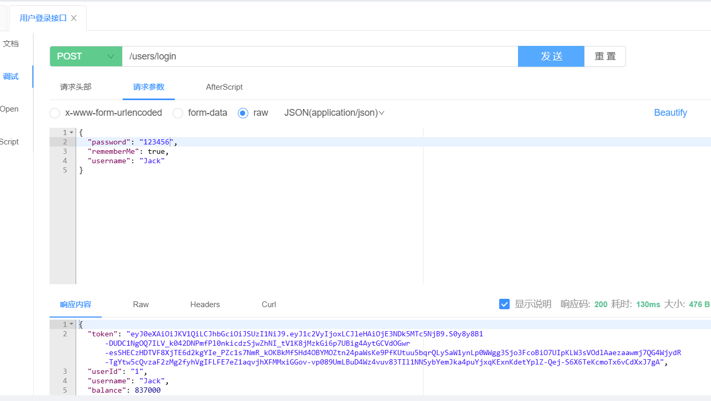

用户服务测试通过。


### 创建交易微服务

将hm-service中交易相关的业务抽取出来,创建交易微服务trade-service。

pom.xml

```XML
<?xml version="1.0" encoding="UTF-8"?>
<project xmlns="http://maven.apache.org/POM/4.0.0"
         xmlns:xsi="http://www.w3.org/2001/XMLSchema-instance"
         xsi:schemaLocation="http://maven.apache.org/POM/4.0.0 http://maven.apache.org/xsd/maven-4.0.0.xsd">
    <modelVersion>4.0.0</modelVersion>
    <parent>
        <groupId>com.hmall</groupId>
        <artifactId>hmall-parent</artifactId>
        <version>1.0.0</version>
    </parent>

    <artifactId>trade-service</artifactId>

    <properties>
        <maven.compiler.source>11</maven.compiler.source>
        <maven.compiler.target>11</maven.compiler.target>
    </properties>
    <dependencies>
        <!--common-->
        <dependency>
            <groupId>com.hmall</groupId>
            <artifactId>hm-common</artifactId>
            <version>1.0.0</version>
        </dependency>
        <!--web-->
        <dependency>
            <groupId>org.springframework.boot</groupId>
            <artifactId>spring-boot-starter-web</artifactId>
        </dependency>
        <!--数据库-->
        <dependency>
            <groupId>mysql</groupId>
            <artifactId>mysql-connector-java</artifactId>
        </dependency>
        <!--mybatis-->
        <dependency>
            <groupId>com.baomidou</groupId>
            <artifactId>mybatis-plus-boot-starter</artifactId>
        </dependency>
        <!--单元测试-->
        <dependency>
            <groupId>org.springframework.boot</groupId>
            <artifactId>spring-boot-starter-test</artifactId>
        </dependency>
        <!--nacos 服务注册发现-->
        <dependency>
            <groupId>com.alibaba.cloud</groupId>
            <artifactId>spring-cloud-starter-alibaba-nacos-discovery</artifactId>
        </dependency>

        <dependency>
            <groupId>com.hmall</groupId>
            <artifactId>hm-api</artifactId>
            <version>1.0.0</version>
        </dependency>
    </dependencies>
    <build>
        <finalName>${project.artifactId}</finalName>
        <plugins>
            <plugin>
                <groupId>org.springframework.boot</groupId>
                <artifactId>spring-boot-maven-plugin</artifactId>
            </plugin>
        </plugins>
    </build>

</project>
```

application.yaml

```YAML
server:
  port: 8085
spring:
  application:
    name: trade-service
  cloud:
    nacos:
      server-addr: 192.168.101.68:8848 # nacos地址
  profiles:
    active: dev
  datasource:
    url: jdbc:mysql://${hm.db.host}:3306/hm-trade?useUnicode=true&characterEncoding=UTF-8&autoReconnect=true&serverTimezone=Asia/Shanghai
    driver-class-name: com.mysql.cj.jdbc.Driver
    username: root
    password: ${hm.db.pw}
mybatis-plus:
  configuration:
    default-enum-type-handler: com.baomidou.mybatisplus.core.handlers.MybatisEnumTypeHandler
  global-config:
    db-config:
      update-strategy: not_null
      id-type: auto
logging:
  level:
    com.hmall: debug
  pattern:
    dateformat: HH:mm:ss:SSS
  file:
    path: "logs/${spring.application.name}"
knife4j:
  enable: true
  openapi:
    title: 交易服务接口文档
    description: "交易服务接口文档"
    url: https://www.itcast.cn
    version: v1.0.0
    group:
      default:
        group-name: default
        api-rule: package
        api-rule-resources:
          - com.hmall.trade.controller
feign:
  okhttp:
    enabled: true # 开启OKHttp功能
```

项目结构如下

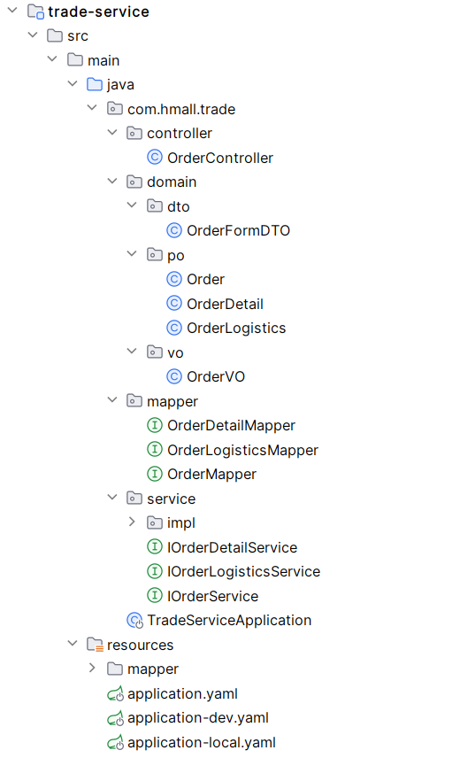


#### 提示

在交易服务中，用户下单时需要做下列事情：

- **根据id查询商品列表**
- 计算商品总价
- 保存订单
- **扣减库存**
- **清理购物车商品**


其中，查询商品、扣减库存都是与商品有关的业务，在item-service中有相关功能；清理购物车商品是购物车业务，在cart-service中有相关功能。

因此**交易服务**要调用他们，必须通过OpenFeign远程调用。我们需要将上述功能抽取为FeignClient.

在抽取FeignClient的过程中，接口涉及的DTO需要迁移到hm-api工程中。

比如：

将`OrderDetailDTO`抽取到`hm-api`模块的`com.hmall.api.item.dto`包下，删除原来商品服务下的OrderDetailDTO。

注意：删除原来商品服务下的OrderDetailDTO后很多代码报错，需要细心修改OrderDetailDTO的最新包路径。


抽取FeignClient接口完成后需要改造OrderServiceImpl中的createOrder方法，将查询商品、扣减库存、清理购物车这三个本地方法调用改造为基于FeignClient的调用。

```Java
package com.hmall.api.cart;

import org.springframework.cloud.openfeign.FeignClient;
import org.springframework.web.bind.annotation.DeleteMapping;
import org.springframework.web.bind.annotation.RequestParam;

import java.util.Collection;
import java.util.List;

@FeignClient(name="cart-service",path="/carts")
public interface CartClient {
    @DeleteMapping
    void deleteCartItemByIds(@RequestParam("ids")Collection<Long> ids);
}
```

#### 测试

启动TradeApplication，访问[http://localhost:8085/doc.html](http://localhost:8085/doc.html#/default/%E8%AE%A2%E5%8D%95%E7%AE%A1%E7%90%86%E6%8E%A5%E5%8F%A3/queryOrderByIdUsingGET)

测试创建订单接口。

测试参数说明：

代码中目前我们将用户ID硬编码为 1，用户名为jack，在hm-user数据库的user表中。

addressId：收货地址，在hm-user数据库的address表中。

itemId: 购买商品的id，在hm-item数据库的item表中。

num：购买数量。

paymentType：支付方式，1：支付宝、2：微信，3：余额支付。

测试效果如下：


创建订单成功返回订单ID。


测试查询订单接口：

使用上个测试返回的订单ID测试查询订单信息接口。


### 创建支付微服务

将hm-service中支付相关的业务抽取出来,创建支付微服务pay-service。


pom.xml

```XML
<?xml version="1.0" encoding="UTF-8"?>
<project xmlns="http://maven.apache.org/POM/4.0.0"
         xmlns:xsi="http://www.w3.org/2001/XMLSchema-instance"
         xsi:schemaLocation="http://maven.apache.org/POM/4.0.0 http://maven.apache.org/xsd/maven-4.0.0.xsd">
    <modelVersion>4.0.0</modelVersion>
    <parent>
        <groupId>com.hmall</groupId>
        <artifactId>hmall-parent</artifactId>
        <version>1.0.0</version>
    </parent>

    <artifactId>pay-service</artifactId>

    <properties>
        <maven.compiler.source>11</maven.compiler.source>
        <maven.compiler.target>11</maven.compiler.target>
    </properties>
    <dependencies>
        <!--common-->
        <dependency>
            <groupId>com.hmall</groupId>
            <artifactId>hm-common</artifactId>
            <version>1.0.0</version>
        </dependency>
        <!--web-->
        <dependency>
            <groupId>org.springframework.boot</groupId>
            <artifactId>spring-boot-starter-web</artifactId>
        </dependency>
        <!--数据库-->
        <dependency>
            <groupId>mysql</groupId>
            <artifactId>mysql-connector-java</artifactId>
        </dependency>
        <!--mybatis-->
        <dependency>
            <groupId>com.baomidou</groupId>
            <artifactId>mybatis-plus-boot-starter</artifactId>
        </dependency>
        <!--单元测试-->
        <dependency>
            <groupId>org.springframework.boot</groupId>
            <artifactId>spring-boot-starter-test</artifactId>
        </dependency>
        <!--nacos 服务注册发现-->
        <dependency>
            <groupId>com.alibaba.cloud</groupId>
            <artifactId>spring-cloud-starter-alibaba-nacos-discovery</artifactId>
        </dependency>

        <dependency>
            <groupId>com.hmall</groupId>
            <artifactId>hm-api</artifactId>
            <version>1.0.0</version>
        </dependency>
    </dependencies>
    <build>
        <finalName>${project.artifactId}</finalName>
        <plugins>
            <plugin>
                <groupId>org.springframework.boot</groupId>
                <artifactId>spring-boot-maven-plugin</artifactId>
            </plugin>
        </plugins>
    </build>

</project>
```


application.yaml

```YAML
server:
  port: 8086
spring:
  application:
    name: pay-service
  cloud:
    nacos:
      server-addr: 192.168.101.68:8848 # nacos地址
  profiles:
    active: dev
  datasource:
    url: jdbc:mysql://${hm.db.host}:3306/hm-pay?useUnicode=true&characterEncoding=UTF-8&autoReconnect=true&serverTimezone=Asia/Shanghai
    driver-class-name: com.mysql.cj.jdbc.Driver
    username: root
    password: ${hm.db.pw}
mybatis-plus:
  configuration:
    default-enum-type-handler: com.baomidou.mybatisplus.core.handlers.MybatisEnumTypeHandler
  global-config:
    db-config:
      update-strategy: not_null
      id-type: auto
logging:
  level:
    com.hmall: debug
  pattern:
    dateformat: HH:mm:ss:SSS
  file:
    path: "logs/${spring.application.name}"
knife4j:
  enable: true
  openapi:
    title: 支付服务接口文档
    description: "支付服务接口文档"
    url: https://www.itcast.cn
    version: v1.0.0
    group:
      default:
        group-name: default
        api-rule: package
        api-rule-resources:
          - com.hmall.pay.controller
feign:
  okhttp:
    enabled: true # 开启OKHttp功能
```

项目结构如下：

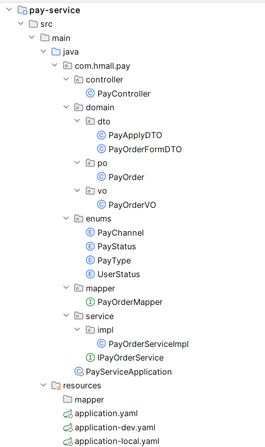


#### 提示

在支付服务中，基于用户余额支付时需要做下列事情：

- **扣减用户余额**
- 标记支付单状态为已支付
- **标记订单状态为已支付**


其中，**扣减用户余额**是在`user-service`中有相关功能；**标记订单状态**则是在`trade-service`中有相关功能。因此交易服务要调用他们，必须通过OpenFeign远程调用。我们需要将上述功能抽取为FeignClient.

抽取FeignClient完成后就可以改造`PayOrderServiceImpl`中的逻辑，将扣减用户余额、标记订单状态为已支付这两个本地方法调用改造为基于`FeignClient`的调用。


#### 测试

启动PayApplication，访问[http://localhost:8086/doc.html](http://localhost:8086/doc.html#/default/%E6%94%AF%E4%BB%98%E7%9B%B8%E5%85%B3%E6%8E%A5%E5%8F%A3/queryPayOrdersUsingGET)。

测试创建支付单。

接口参数说明：

bizOrderNo：业务订单号，在测试交易服务创建订单接口生成的订单ID，对应hm-trade数据库的order表的ID。

amount：订单金额，单位：分，对应hm-trade数据库的order表的total_fee字段

payChannelCode：支付渠道编码，余额支付渠道编码为balance，支付渠道编码在枚举类PayChannel中定义。

payType：余额支付类型为5

orderInfo：订单信息字符串。


测试成功返回支付单ID，对应hm-pay数据库中的pay-order表的ID。


测试余额支付接口：

参数测试：

Id: 支付单ID

pw：支付密码，即用户的登录密码，账号为1的用户密码为123.


支付成功可以从hm-pay数据库中的pay-order表找到对应的记录，查看status字段值是否为3(表示支付成功)

---
> 来源：飞书技术知识库（脱敏版） · 04 微服务与中间件 / 服务注册与发现 / 01 微服务服务注册与发现 · [原文](https://ccn8v2zngwsm.feishu.cn/wiki/GTHrwjDCViHF4skYj05cs2iknLg)
