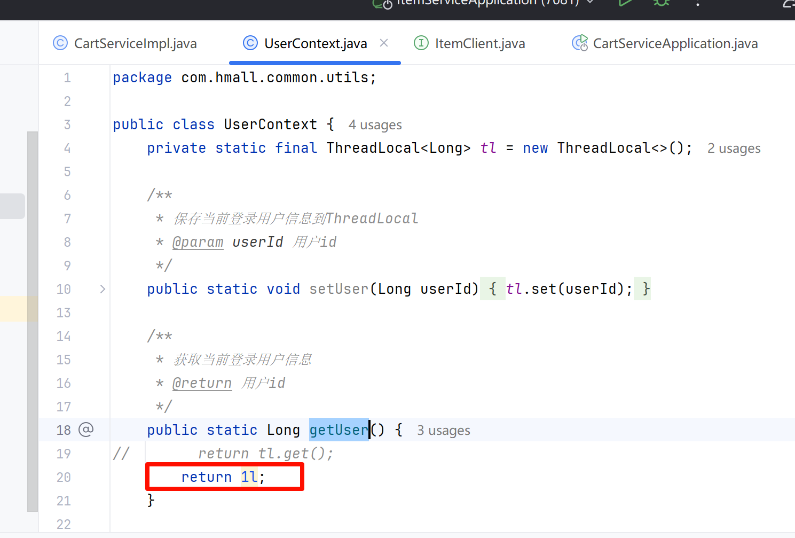

<title>问题汇总</title>

# FAQ

## 购物车查询上商品无数据

排查下UserContext的getUser方法是否有修改，返回默认值1L,如下图



## API注解没有生效，可能是没有识别到hm-common

具体服务下的pom文件里，删除下hm-common依赖，刷新下maven，然后再重新引入下hm-common，再刷新下maven。


## 引入ItemClient后服务启动报错


检查下是不是ItemClient类写的不对，比如缺少注解信息，参考如下：

```Java
package com.hmall.api.item;

import com.hmall.api.item.dto.ItemDTO;
import org.springframework.cloud.openfeign.FeignClient;
import org.springframework.web.bind.annotation.GetMapping;
import org.springframework.web.bind.annotation.RequestParam;

import java.util.Collection;
import java.util.List;

@FeignClient(name = "item-service",path = "/items")
public interface ItemClient {
    @GetMapping
    public List<ItemDTO> queryItemByIds(@RequestParam("ids") Collection<Long> ids);
}
```

---
> 来源：飞书技术知识库（脱敏版） · 04 微服务与中间件 / 服务注册与发现 / 01 微服务服务注册与发现 / 问题汇总 · [原文](https://ccn8v2zngwsm.feishu.cn/wiki/XwRgwofuci7JnFk9NmAcBgS8nHf)
