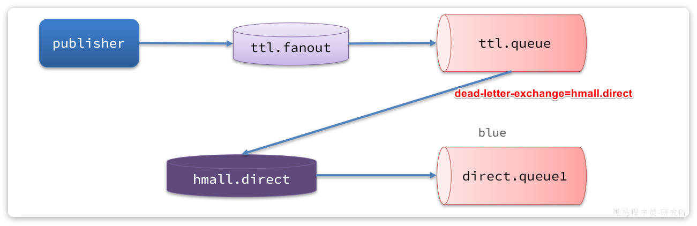
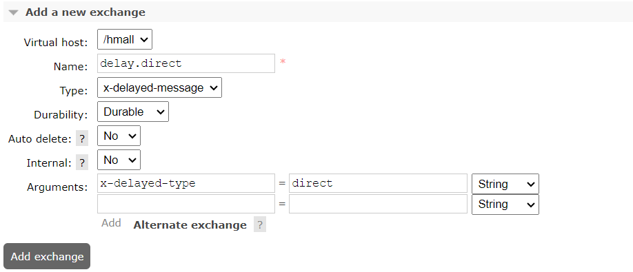
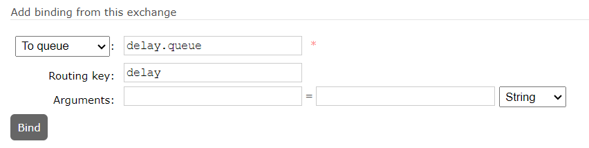

# MQ高级-简要

## **如何确保MQ消息的可靠性**

消息从生产者到消费者的每一步都可能导致消息丢失，要解决消息丢失问题，保证MQ的可靠性，从3个方面解决：

1. **保证生产消息的可靠性**

   - **生产者重试机制** ：当RabbitTemplate与MQ连接超时后，多次重试。可通过配置initial-interval（初始等待时间）、multiplier（倍增器）和max-attempts（最大重试次数）来实现。
   - **生产者确认机制** ：RabbitMQ提供了Publisher Confirm和Publisher Return两种确认机制：
   
     - Publisher Return：消息投递成功但路由失败时调用回调方法返回异常信息
     - Publisher Confirm：消息投递成功返回ack，投递失败返回nack
   - **发送失败处理机制** ：可将发送失败的消息记录到失败消息表，由定时任务进行发布，达到最大失败次数后由人工处理。
2. **确保MQ不会将消息弄丢**

   - **交换机持久化** ：将交换机的定义信息(元数据)持久化到RabbitMQ的数据库中，RabbitMQ重启后交换机定义仍然存在。在控制台添加交换机时可配置Durability参数为Durable。
   - **队列持久化** ：将队列的定义信息(元数据)持久化到RabbitMQ的数据库中，保证队列本身的元数据不会因异常情况而丢失。在控制台添加队列时可配置Durability参数为Durable。
   - **消息持久化** ：要确保消息不会丢失需要将消息设置为持久化。在控制台发送消息时，可通过设置delivery_mode=2来实现消息持久化。
3. **保证消费消息的可靠性**

   - **消费者手动确认机制** ：确保消息被成功处理后才会从队列中删除
   - **消息幂等性处理** ：确保消息重复消费时不会产生副作用

## **如何实现延迟消息**

在RabbitMQ中实现延迟消息有两种方案：

1. **死信交换机+TTL**

   - 死信交换机（Dead Letter Exchange, DLX）是一种处理消息队列中无法被消费的消息的方式
   - 结合TTL（Time To Live），设定消息在队列中的存活时间，当消息在队列中停留的时间超过了设定的TTL后，消息就会成为死信
   - 当消息变成死信时，会被发送到死信交换机中，通过死信交换机转发到指定的队列，由应用程序去消费
   - 延迟消息处理流程如（图 1）所示
   
     
2. **延迟消息插件**

   - RabbitMQ社区提供了一个延迟消息插件来实现相同的效果
   - 安装延迟消息插件，发送消息时指定延迟时间，到达延迟时间消息被消费
   - 延迟消息插件内部会维护一个本地数据库表，同时使用Elang Timers功能实现计时
   - 如果消息的延迟时间设置较长，可能会导致堆积的延迟消息非常多，会带来较大的CPU开销，同时延迟消息的时间会存在误差
   - 不建议设置延迟时间过长的延迟消息

**推荐使用延迟消息插件实现** ，实现过程更简单直观。具体步骤如下：

1. 下载并安装延迟消息插件
2. 声明延迟交换机，类型为x-delayed-message，如（图 2）所示

   
3. 创建队列并绑定到延迟交换机，如（图 3）所示

   
4. 发送消息时，通过x-delay属性设定延迟时间

## **RabbitMQ有哪些集群，它们的特点是什么？**

RabbitMQ主要有以下几种集群模式：

1. **普通集群模式**

   - **特点** ：
   
     - 节点之间能共享元数据
     - 可以通过任意节点访问数据，间接通过主节点访问
     - 节点之间不能共享数据，队列所在的主节点如果宕机后，数据就丢失了
   - **缺点** ：不具备高可用能力，一旦创建队列的主机宕机，队列就会不可用
2. **镜像模式集群**

   - **特征** ：
   
     - 镜像队列结构是一主多从（从就是镜像）
     - 所有操作都是主节点完成，然后同步给镜像节点
     - 一个队列的主节点也可能是其他队列的镜像节点
     - 主宕机后，镜像节点会替代成新的主（如果在主从同步完成前，主就已经宕机，可能出现数据丢失）
     - 不具备负载均衡功能，因为所有操作都会有主节点完成（但是不同队列，其主节点可以不同，可以利用这个提高吞吐量）
   - **配置模式** ：
   
     - 精确模式(exactly)：设定镜像数量
     - all模式：在所有节点镜像
     - nodes：指定镜像节点
3. **仲裁队列**

   - **特征** ：
   
     - 基于Raft共识算法的强一致性
     - 从RabbitMQ 3.8版本开始引入的新功能
     - 仲裁队列默认的镜像数为5，如果集群节点数少于5，则镜像数为节点数-1
   - **创建方式** ：在任意控制台添加队列时，选择队列类型为Quorum类型

在实际应用中， **镜像模式集群** 和 **仲裁队列** 都能提供高可用性，但实现方式和特点有所不同，可根据具体场景选择合适的集群模式。

---
> 来源：飞书技术知识库（脱敏版） · 04 微服务与中间件 / 消息队列 MQ / MQ高级 / MQ高级-简要 · [原文](https://ccn8v2zngwsm.feishu.cn/wiki/KRF4w94kfi11lPkY7izcnPc4n6b)
