# 04 MQ基础

## 学习目标

1. 能够说出MQ的应用场景
2. 能够编写RabbitMQ收发消息的入门程序
3. 能够说出工作队列模型的特点
4. 能够说出发布订阅模型的交换机类型
5. 能够说出fanout交换机的特性
6. 能够说出Direct交换机的特性
7. 能够说出Topic交换机的特性
8. 能够说出惰性队列的特性
9. 能够说出优先级队列的特性
10. 能够说出如何解决MQ消息堆积问题
11. 能够在商城项目应用MQ

## 1.初识MQ

### 1.1 同步调用与异步调用

前边我们学习了微服务之间远程调用方式，通常服务端提供HTTP RESTful接口，客户端通过HTTP Client工具进行远程调用，远程调用工具有RestTemplate、OpenFeign、OkHttp等技术，这些技术实现的都是一种类型即同步调用，微服务之间通信还有一种异步调用，什么是同步调用？什么是异步调用？

拿订单支付功能举例：

下图表示了同步调用

<whiteboard token="Cs53wdrrHhPxXUb5GsQcag3Snhd"></whiteboard>

支付的交互流程如下：

1. 支付服务调用用户服务扣减余额。
2. 余额扣减成功后支付服务更新数据库中的交易流水状态为已支付。
3. 更新成功后支付服务调用交易服务更新订单状态为已支付。

像这种每一步调用者必须等待被调用方完全执行完毕并返回结果之后才能继续执行后续代码，叫**同步调用**。

同步调用就是顺序执行，执行完一步再执行下一步。


什么是异步调用？

**异步调用是调用者发出调用后无需等待被调用方完成就可以继续执行其他任务。**

举例：

<whiteboard token="HnmAwWqiUhEkhYb3zGqcAcmpn3e"></whiteboard>

支付的交互流程如下：

1. 支付服务调用用户服务扣减余额。
2. 余额扣减成功后支付服务更新数据库中的交易流水状态为已支付。
3. 更新交易流水成功支付服务向消息中间件发了一条消息（XX订单支付成功），此时支付服务程序执行结束
4. 由消息中间件去通知交易服务更新订单状态
5. 由消息中间件去通知短信服务通知用户订单支付成功啦

上边交互流程中前3步为**同步调用**，后2步为**异步调用**。

支付服务向消息中间件发过消息后不用等继续执行其它操作，这就是**异步调用**。

现在生活中异步调用的例子很多：

餐厅点餐：

想象一下你去一家餐厅吃饭，你坐下后，服务员过来让你点菜。在这个过程中：

- 异步调用：你告诉服务员你想要什么菜品，然后服务员把订单送到厨房。你不需要等待食物准备完成，可以继续聊天或浏览菜单。当食物准备好时，服务员会将食物端到你的桌上。
- 同步调用：如果你必须站在厨房门口等着厨师为你准备食物，那么这就是一个同步的过程。你无法做其他事情，直到食物准备完毕。

医院挂号：

异步调用：打电话挂号，接通电话你告诉工作人员挂哪个科室，工作人员让你挂断电话稍后通过手机查看挂号结果。

同步调用：打电话挂号，接通电话你告诉工作人员挂哪个科室，工作人员开始查看该科室是否有号，并进行挂号，挂号结束告诉你几点来看病，最后挂断电话。


**同步调用：**

**特点：**

- 在同步调用中，调用者必须等待被调用方完全执行完毕并返回结果之后才能继续执行后续代码。
- 控制流是**线性**的，即程序按照顺序执行每个操作。
- 如果被调用方执行时间较长，那么整个程序会处于等待状态，直到该调用完成。

**适合场景：**

- 对实时性要求较高的场景，例如用户界面操作。
- 调用简单且执行快速的操作。

**优点**

- 简单直观：代码易于理解和编写，因为它是按顺序执行的。
- 易于调试：由于执行顺序明确，调试起来相对容易。

**缺点**

- 阻塞执行：如果一个操作需要很长时间来完成，那么整个程序会被阻塞，不能执行其他任务。
- 资源浪费：在等待长时间操作完成时，CPU和其他资源可能会处于空闲状态。


**异步调用：**

**特点：**

- 在异步调用中，调用者发出调用后无需等待被调用方完成就可以继续执行其他任务。
- 被调用方完成操作后，通常会通过**回调函数、事件通知或者完成信号**等方式告知调用者。
- 可以提高程序的并发能力和响应速度。

**适合场景：**

- 需要处理耗时操作，例如网络请求、文件I/O等。
- 多个操作之间不存在严格的依赖关系。
- 对系统性能和响应时间有较高要求的应用场景。

**优点**

- 提高效率：异步调用可以使得程序在等待某些耗时操作完成的同时执行其他任务，提高了整体的执行效率。
- 资源利用率高：在等待耗时操作时，可以释放资源给其他任务使用，避免了资源浪费。
- 更好的用户体验：在网络应用中，用户不必等待页面加载完成就能进行其他操作，提高了用户体验。

**缺点**

- 复杂性增加：异步编程通常比同步编程更复杂，因为它涉及更多的控制结构和错误处理逻辑。
- 调试困难：由于执行路径不是线性的，调试起来相对困难。


### 1.2 初识MQ

异步调用方式其实就是基于消息通知的方式，一般包含三个角色：

- 消息发送者：投递消息的人，就是原来的调用方
- 消息Broker(消息代理/消息中间件)：管理、暂存、转发消息，你可以把它理解成微信服务器
- 消息接收者：接收和处理消息的人，就是原来的服务提供方

<whiteboard token="SXAxwv5M6h1ODlbNqlOcd7cmnvd"></whiteboard>


在异步调用中，发送者不再直接同步调用接收者的业务接口，而是发送一条消息投递给消息Broker。然后接收者根据自己的需求从消息Broker那里订阅消息。每当发送方发送消息后，接收者都能获取消息并处理。

这样，发送消息的人和接收消息的人就完全**解耦**了。


消息Broker，目前常见的实现方案就是消息队列（MessageQueue），简称为MQ.


AI:消息队列的应用场景

1. 异步处理:

   - 场景: 当应用程序需要执行耗时的操作（如发送电子邮件、文件上传或下载等）时，可以将这些任务发送到消息队列中，由专门的任务处理程序异步执行。
   - 好处: 减少了用户的等待时间，提高了用户体验。
2. 解耦:

   - 场景: 当一个系统由多个组件组成时，这些组件之间可以使用消息队列进行通信。
   - 好处: 单个组件的变化不会直接影响到其他组件，提高了系统的可扩展性。
3. 流量削峰

   - 场景：在许多互联网应用和服务中，尤其是那些具有明显周期性流量特征的应用（如电商平台、社交网络等），常常会遇到流量突增的情况。例如，在电商促销期间，大量的用户会在短时间内访问网站并提交订单，这种短时间内产生的巨大流量可能会导致服务器过载，影响用户体验甚至导致服务不可用。
   - 好处：当流量激增时接收到请求会被暂时存储在消息队列中，而不是直接发送到后端服务进行处理。这样做可以避免后端服务因为短时间内处理大量请求而过载。后端服务可以从消息队列中按需拉取消息进行处理。这种异步处理机制可以有效地分散流量峰值，确保后端服务的稳定运行。如下图：

   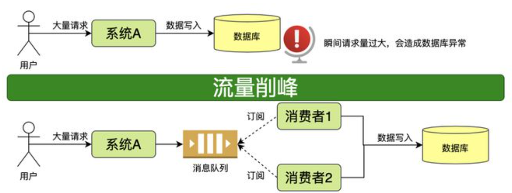

   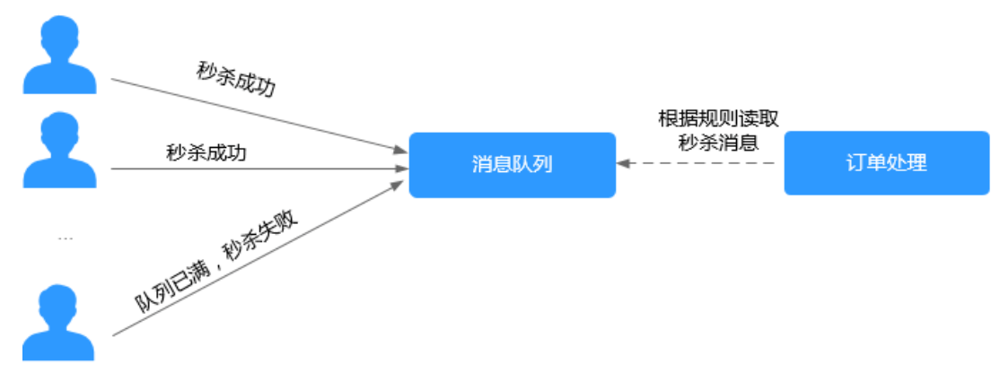


目比较常见的MQ实现：

- ActiveMQ
- RabbitMQ
- RocketMQ
- Kafka


几种常见MQ的对比：

追求可靠性：RabbitMQ、RocketMQ

追求吞吐能力：RocketMQ、Kafka

追求消息低延迟：RabbitMQ、Kafka

这四种的MQ在市场都是非常流行，本课程讲解RabbitMQ。

Spring Boot默认支持AMQP协议，RabbitMQ支持AMQP协议 。

### 1.3 面试题

MQ有什么应用场景？


## 2 RabbitMQ入门

### 2.1 RabbitMQ介绍

RabbitMQ是基于Erlang语言开发的开源消息通信中间件，官网地址：[https://www.rabbitmq.com/](https://www.rabbitmq.com/)


RabbitMQ的架构如图：


其中包含几个概念：

- **`publisher`**：生产者，也就是发送消息的应用程序
- **`consumer`**：消费者，也就是消费消息的应用程序
- **`queue`**：队列，存储消息的缓冲区。生产者投递的消息会暂存在消息队列中，等待消费者处理
- **`exchange`**：交换机，负责消息路由。生产者发送的消息由交换机决定投递到哪个队列。
- **`virtual host`**：虚拟主机，起到数据隔离的作用。每个虚拟主机相互独立，有各自的exchange、queue


上述这些东西都可以在RabbitMQ的管理控制台来管理，下一节我们就一起来学习控制台的使用。


### 2.2. 安装

我们同样基于Docker来安装RabbitMQ，使用下面的命令即可：

删除旧容器

```Plain Text
docker rm -f rabbitmq mq
```


执行下边的脚本创建容器：

```Shell
docker run \
 -e RABBITMQ_DEFAULT_USER=itheima \
 -e RABBITMQ_DEFAULT_PASS=123321 \
 -v mq-plugins:/plugins \
 --name mq \
 -p 15672:15672 \
 -p 5672:5672 \
 -d --restart=always \
 rabbitmq:3.8-management
```


可以看到在安装命令中有两个映射的端口：

- **15672**：RabbitMQ提供的管理控制台的端口     http
- **5672**：RabbitMQ的消息发送处理接口       amqp


安装完成后，我们访问 http://192.168.101.68:15672即可看到管理控制台。首次访问需要登录，默认的用户名：itheima，密码：123321

登录后即可看到管理控制台总览页面：

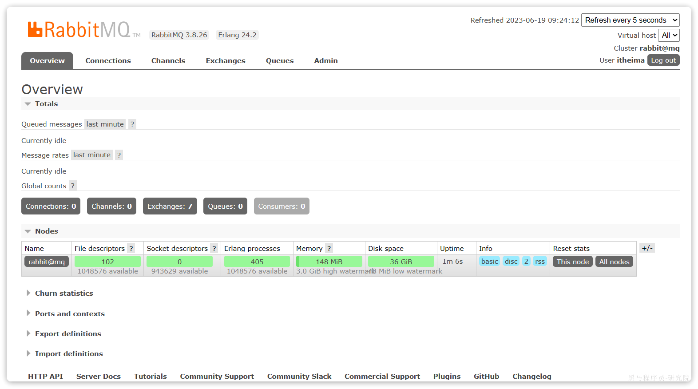


### 2.3. 收发消息

#### 2.3.1 搭建环境

RabbitMQ安装成功后下边我们编写消息发送与消息接收程序实现收发消息，如下图：publisher即消息发送者将消息发送到MQ的队列中，consumer即消息消费者从MQ中接收消息。

`与RabbitMQ`通信采用了AMQP (Advanced Message Queuing Protocol) 协议，因此它具备跨语言的特性，任何语言只要遵循AMQP协议都可以使用RabbitMQ收发消息。

<whiteboard token="H8ViwqgXshXhNvbrzbOcve0MnKc"></whiteboard>

`RabbitMQ`官方也提供了各种不同语言的客户端API，RabbitMQ官方提供的Java客户端编码相对复杂，一般生产环境下我们更多会结合Spring来使用。而Spring的官方刚好基于RabbitMQ提供了这样一套消息收发的模板工具：SpringAMQP。并且还基于SpringBoot对其实现了自动装配，使用起来非常方便。


SpringAmqp的官方地址：

<bookmark name="Spring AMQP" href="https://spring.io/projects/spring-amqp"></bookmark>

SpringAMQP提供了三个功能：

- 自动声明队列、交换机及其绑定关系
- 基于注解的监听器模式，异步接收消息
- 封装了RabbitTemplate工具，用于发送消息


下边使用SpringAMQP实现消息收发，上图是RabbitMQ最简单的工作模型。


在课前资料给大家提供了一个Demo工程，方便我们学习SpringAMQP的使用：

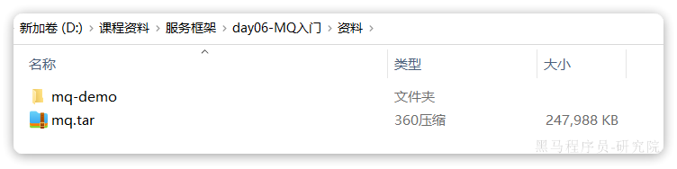

将其复制到你的工作空间，然后用Idea打开，项目结构如图：


包括三部分：

- mq-demo：父工程，管理项目依赖
- publisher：消息的发送者
- consumer：消息的消费者


在mq-demo这个父工程中，已经配置好了SpringAMQP相关的依赖：

```XML
<?xml version="1.0" encoding="UTF-8"?>
<project xmlns="http://maven.apache.org/POM/4.0.0"
         xmlns:xsi="http://www.w3.org/2001/XMLSchema-instance"
         xsi:schemaLocation="http://maven.apache.org/POM/4.0.0 http://maven.apache.org/xsd/maven-4.0.0.xsd">
    <modelVersion>4.0.0</modelVersion>

    <groupId>cn.itcast.demo</groupId>
    <artifactId>mq-demo</artifactId>
    <version>1.0-SNAPSHOT</version>
    <modules>
        <module>publisher</module>
        <module>consumer</module>
    </modules>
    <packaging>pom</packaging>

    <parent>
        <groupId>org.springframework.boot</groupId>
        <artifactId>spring-boot-starter-parent</artifactId>
        <version>2.7.12</version>
        <relativePath/>
    </parent>

    <properties>
        <maven.compiler.source>8</maven.compiler.source>
        <maven.compiler.target>8</maven.compiler.target>
    </properties>

    <dependencies>
        <dependency>
            <groupId>org.projectlombok</groupId>
            <artifactId>lombok</artifactId>
        </dependency>
        <!--AMQP依赖，包含RabbitMQ-->
        <dependency>
            <groupId>org.springframework.boot</groupId>
            <artifactId>spring-boot-starter-amqp</artifactId>
        </dependency>
        <!--单元测试-->
        <dependency>
            <groupId>org.springframework.boot</groupId>
            <artifactId>spring-boot-starter-test</artifactId>
        </dependency>
    </dependencies>
</project>
```

设置java版本


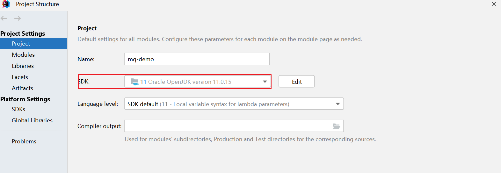

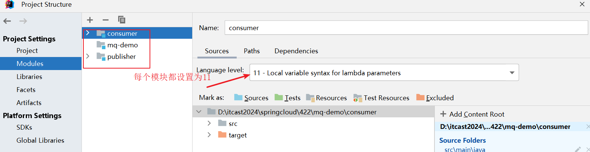


因此，子工程中就可以直接使用SpringAMQP了。


#### 2.3.2 创建队列

首先进入RabbitMQ控制台创建队列，新建一个队列：simple.queue

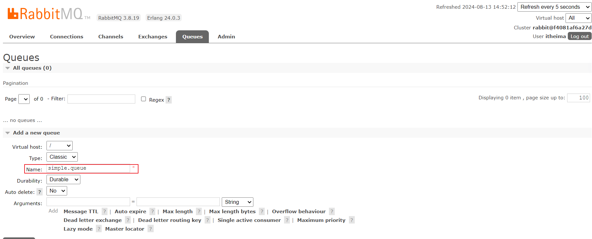

添加成功：

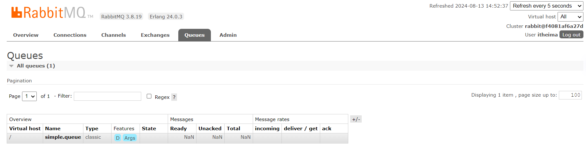

接下来，我们就可以利用Java代码收发消息了。

#### 2.3.3 消息发送

首先配置MQ地址，在`publisher`服务的`application.yml`中添加配置：

```YAML
spring:
  rabbitmq:
    host: 192.168.101.68 # 你的虚拟机IP
    port: 5672 # 端口
    virtual-host: / # 虚拟主机
    username: itheima # 用户名
    password: 123321 # 密码
```


然后在`publisher`服务的test下编写测试类`SpringAmqpTest`，并利用`RabbitTemplate`实现消息发送：

```Java
package com.itheima.publisher.amqp;

import org.junit.jupiter.api.Test;
import org.springframework.amqp.rabbit.core.RabbitTemplate;
import org.springframework.beans.factory.annotation.Autowired;
import org.springframework.boot.test.context.SpringBootTest;

@SpringBootTest
@Slf4j
public class SpringAmqpTest {

    @Autowired
    private RabbitTemplate rabbitTemplate;

    @Test
    public void testSimpleQueue() {
        // 队列名称
        String queueName = "simple.queue";
        // 消息
        String message = "hello, spring amqp!";
        // 发送消息
        rabbitTemplate.convertAndSend(queueName, message);
        log.info("消息发送成功:{}",message);
    }
}
```


打开控制台，可以看到消息已经发送到队列中：

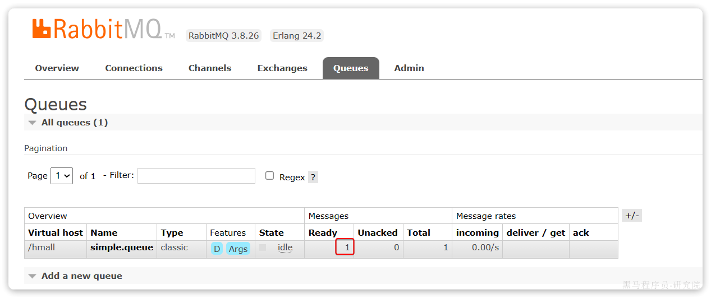

接下来，我们再来实现消息接收。

我们可以在RabbitMQ的控制台去查看消息


#### 2.3.4 消息接收

首先配置MQ地址，在`consumer`服务的`application.yml`中添加配置：

```YAML
spring:
  rabbitmq:
    host: 192.168.101.68 # 你的虚拟机IP
    port: 5672 # 端口
    virtual-host: / # 虚拟主机
    username: itheima # 用户名
    password: 123321 # 密码
```


然后在`consumer`服务的`com.itheima.consumer.listener`包中新建一个类`SpringRabbitListener`，代码如下：

```Java
package com.itheima.consumer.listener;

import org.springframework.amqp.rabbit.annotation.RabbitListener;
import org.springframework.stereotype.Component;

@Component
public class SpringRabbitListener {
        // 利用RabbitListener来声明要监听的队列信息
    // 将来一旦监听的队列中有了消息，就会推送给当前服务，调用当前方法，处理消息。
    // 可以看到方法体中接收的就是消息体的内容
    @RabbitListener(queues = "simple.queue")
    public void listenSimpleQueueMessage(String msg) throws InterruptedException {
        System.out.println("spring 消费者接收到消息：【" + msg + "】");
    }
}
```


#### 2.3.5 测试

测试流程：

启动consumer服务

在publisher服务中运行测试代码，发送MQ消息。

观察consumer控制台日志收到消息：

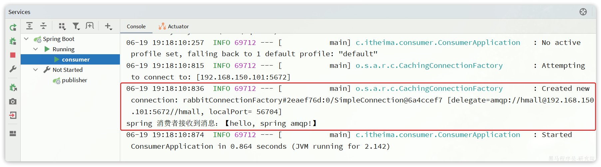


#### 2.3.6 推模式与拉模式

在RabbitMQ中，消息传递给消费者的方式有两种：推模式（Push）和拉模式（Pull）。

1. 推模式（Push）：这是最常用的模式，在这种模式下，一旦消费者订阅了一个队列，RabbitMQ就会自动将队列中的消息发送给消费者，这种方式不需要消费者持续地询问是否有新的消息，而是由Broker在有消息时主动发送给消费者。
2. 拉模式（Pull）：在这种模式下，消费者需要主动请求Broker来获取消息。

在实践中，推模式更常见，因为它可以减少消费者的网络负载，并且可以让Broker更好地控制消息的传递速率。然而，拉模式也有其应用场景，比如当消费者想要精确控制消息获取的时候。

RabbitMQ默认采用的是推模式，但同时也提供了拉模式的支持，以满足不同的应用场景需求。


### 2.4. 数据隔离

#### 2.4.1 用户管理

RabbitMQ支持多租户，多个系统可以同时使用一个RabbitMQ。

公司内的多个不同项目同时使用。这个时候为了避免互相干扰， 我们会利用虚拟主机进行隔离，将不同项目隶属不同的虚拟主机。一般会做两件事情：

- 给每个项目创建独立的**运维账号**，将管理权限分离。
- 给每个项目创建不同的**虚拟主机**，将每个项目的数据隔离。

下边学习用户管理和虚拟主机的配置。


点击`Admin`选项卡，首先会看到RabbitMQ控制台的用户管理界面：


这里的用户都是RabbitMQ的管理或运维人员。目前只有安装RabbitMQ时添加的`itheima`这个用户。仔细观察用户表格中的字段，如下：

- `Name`：`itheima`，也就是用户名
- `Tags`：`administrator`，说明`itheima`用户是超级管理员，拥有所有权限
- `Can access virtual host`： `/`，可以访问的`virtual host`，这里的`/`是默认的`virtual host`


下边我们给黑马商城创建一个新的用户，命名为`hmall`,密码123，注意选择adminstrator

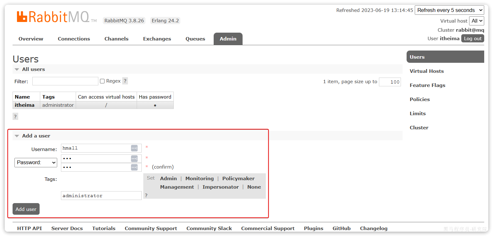

你会发现此时hmall用户没有任何`virtual host`的访问权限：

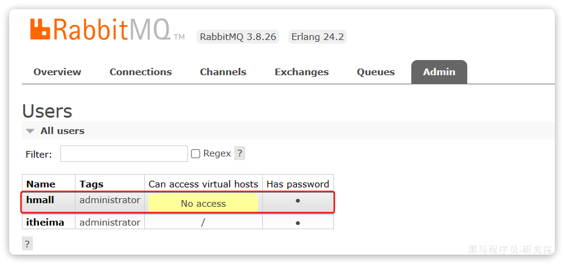

接下来我们来给hmall用户授权。


#### 2.4.2 虚拟主机

下边配置虚拟主机。

我们先退出登录：

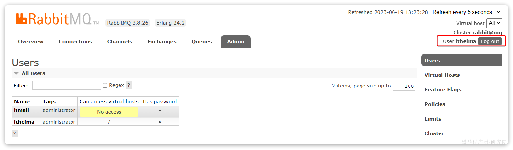

切换到刚刚创建的hmall用户登录，然后点击`Virtual Hosts`菜单，进入`virtual host`管理页：


可以看到目前只有一个默认的`virtual host`，名字为 `/`。

 我们可以给黑马商城项目创建一个单独的`virtual host`，而不是使用默认的`/`。

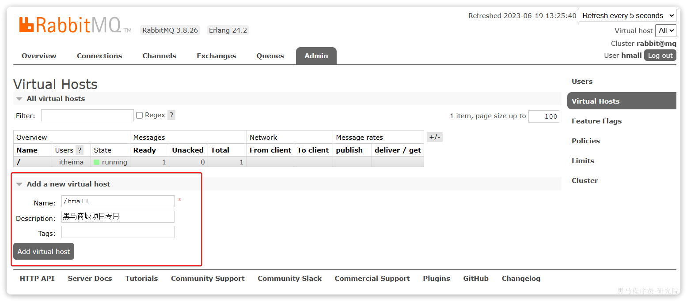

创建完成后如图：


由于我们是登录`hmall`账户后创建的`virtual host`，因此回到`users`菜单，你会发现当前用户已经具备了对`/hmall`这个`virtual host`的访问权限了：


此时，点击页面右上角的`virtual host`下拉菜单，切换`virtual host`为 `/hmall`：

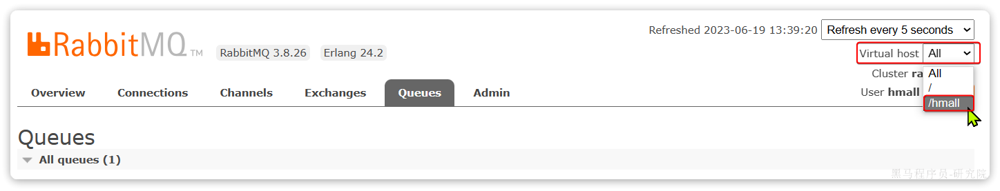

然后再次查看queues选项卡，会发现之前的队列已经看不到了：

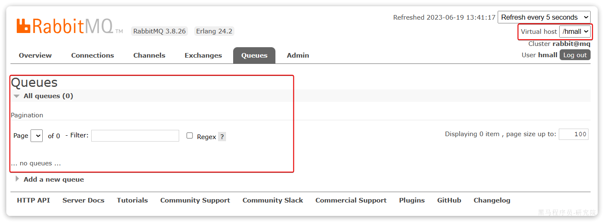

这就是基于`virtual host `的隔离效果。


#### 2.4.3 测试

下边我们用hmall用户及新创建虚拟主机。

修改publisher及consumer的application.yml

```JavaScript
spring:
  rabbitmq:
    host: 192.168.101.68 # 你的虚拟机IP
    port: 5672 # 端口
    virtual-host: /hmall # 虚拟主机
    username: hmall # 用户名
    password: 123 # 密码
```

在/hmall中新建simple.queue队列，重新进行收发消息的测试，发现消息发发放到了virtual-host: /hmall 下的队列，如下图：

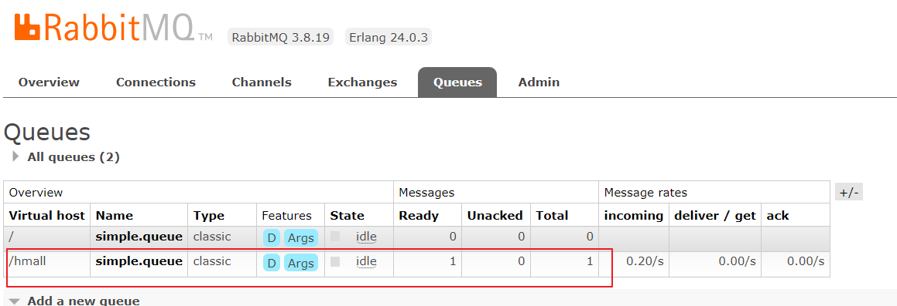

再启动consumer服务接收消息。


## 3 RabbitMQ工作模型

### 3.1. 工作队列模型（WorkQueues）

#### 3.1.1 介绍

在入门程序中实现的是一种最简单的工作队列模型,消费者直接绑定到队列上，如下图: 

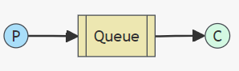

这种方式实现最基本的异步通信，一个生产者，一个队列，一个消费者，生产者将消息发到队列，消费者从队列接收消息。

由于绑定队列的消费者只有一个所以处理消息的能力就比较弱，下边情况将不适合这种方式：

1. 如果有大量的任务就需要多个消费者去共同处理。
2. 当生产者发送消息的速度远远大于消费者处理任务的速度此时由于消费者只有一个将造成消息堆积。

为了解决上边的问题可以使用到下边的方式，**让多个消费者绑定到一个队列，共同消费队列中的消息**。

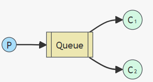

#### 3.1.2 测试

##### 3.1.2.1 创建队列

接下来我们测试工作队列模型。

首先，我们在控制台创建一个新的队列，命名为`work.queue`：

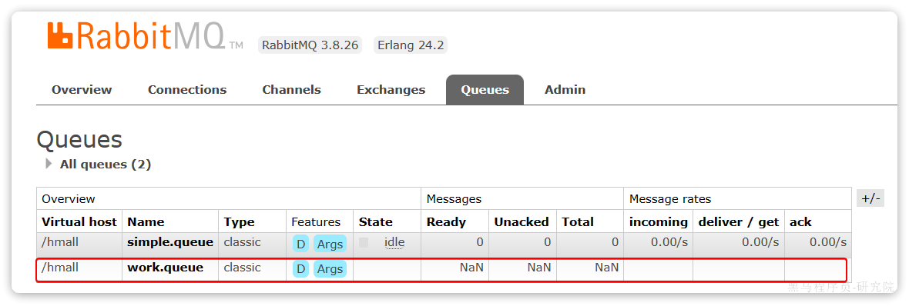

##### 3.1.2.2 发送消息程序

这次我们循环发送，模拟大量消息堆积现象。

在publisher服务中的SpringAmqpTest类中添加一个测试方法：

```Java
/**
     * workQueue
     * 向队列中不停发送消息，模拟消息堆积。
     */
@Test
public void testWorkQueue() throws InterruptedException {
    // 队列名称
    String queueName = "work.queue";
    // 消息
    String message = "hello, message_";
    for (int i = 0; i < 50; i++) {
        // 发送消息，每20毫秒发送一次，相当于每秒发送50条消息
        rabbitTemplate.convertAndSend(queueName, message + i);
        Thread.sleep(20);
    }
}
```


##### 3.1.2.3 接收消息程序

要模拟多个消费者绑定同一个队列，我们在consumer服务的SpringRabbitListener中添加2个新的方法：

```Java
@RabbitListener(queues = "work.queue")
public void listenWorkQueue1(String msg) throws InterruptedException {
    System.out.println("消费者1接收到消息：【" + msg + "】" + LocalTime.now());
    Thread.sleep(20);
}

@RabbitListener(queues = "work.queue")
public void listenWorkQueue2(String msg) throws InterruptedException {
    System.err.println("消费者2........接收到消息：【" + msg + "】" + LocalTime.now());
    Thread.sleep(200);
}
```


注意到这两消费者，都设置了`Thead.sleep`，模拟任务耗时：

- 消费者1 sleep了20毫秒，相当于每秒钟处理50个消息
- 消费者2 sleep了200毫秒，相当于每秒处理5个消息


##### 3.1.2.4 测试

测试流程：

1. 启动ConsumerApplication。

观察mq控制台点击“work.queue”发现消费者程序和mq建立了两个通道（连接），在监听队列。


1. 执行publisher服务中刚刚编写的发送方法testWorkQueue。
2. 观察消费端控制台中消费消息的情况

最终结果如下：

```Java
消费者1接收到消息：【hello, message_0】21:06:00.869555300
消费者2........接收到消息：【hello, message_1】21:06:00.884518
消费者1接收到消息：【hello, message_2】21:06:00.907454400
消费者1接收到消息：【hello, message_4】21:06:00.953332100
消费者1接收到消息：【hello, message_6】21:06:00.997867300
消费者1接收到消息：【hello, message_8】21:06:01.042178700
消费者2........接收到消息：【hello, message_3】21:06:01.086478800
消费者1接收到消息：【hello, message_10】21:06:01.087476600
消费者1接收到消息：【hello, message_12】21:06:01.132578300
消费者1接收到消息：【hello, message_14】21:06:01.175851200
消费者1接收到消息：【hello, message_16】21:06:01.218533400
消费者1接收到消息：【hello, message_18】21:06:01.261322900
消费者2........接收到消息：【hello, message_5】21:06:01.287003700
消费者1接收到消息：【hello, message_20】21:06:01.304412400
消费者1接收到消息：【hello, message_22】21:06:01.349950100
消费者1接收到消息：【hello, message_24】21:06:01.394533900
消费者1接收到消息：【hello, message_26】21:06:01.439876500
消费者1接收到消息：【hello, message_28】21:06:01.482937800
消费者2........接收到消息：【hello, message_7】21:06:01.488977100
消费者1接收到消息：【hello, message_30】21:06:01.526409300
消费者1接收到消息：【hello, message_32】21:06:01.572148
消费者1接收到消息：【hello, message_34】21:06:01.618264800
消费者1接收到消息：【hello, message_36】21:06:01.660780600
消费者2........接收到消息：【hello, message_9】21:06:01.689189300
消费者1接收到消息：【hello, message_38】21:06:01.705261
消费者1接收到消息：【hello, message_40】21:06:01.746927300
消费者1接收到消息：【hello, message_42】21:06:01.789835
消费者1接收到消息：【hello, message_44】21:06:01.834393100
消费者1接收到消息：【hello, message_46】21:06:01.875312100
消费者2........接收到消息：【hello, message_11】21:06:01.889969500
消费者1接收到消息：【hello, message_48】21:06:01.920702500
消费者2........接收到消息：【hello, message_13】21:06:02.090725900
消费者2........接收到消息：【hello, message_15】21:06:02.293060600
消费者2........接收到消息：【hello, message_17】21:06:02.493748
消费者2........接收到消息：【hello, message_19】21:06:02.696635100
消费者2........接收到消息：【hello, message_21】21:06:02.896809700
消费者2........接收到消息：【hello, message_23】21:06:03.099533400
消费者2........接收到消息：【hello, message_25】21:06:03.301446400
消费者2........接收到消息：【hello, message_27】21:06:03.504999100
消费者2........接收到消息：【hello, message_29】21:06:03.705702500
消费者2........接收到消息：【hello, message_31】21:06:03.906601200
消费者2........接收到消息：【hello, message_33】21:06:04.108118500
消费者2........接收到消息：【hello, message_35】21:06:04.308945400
消费者2........接收到消息：【hello, message_37】21:06:04.511547700
消费者2........接收到消息：【hello, message_39】21:06:04.714038400
消费者2........接收到消息：【hello, message_41】21:06:04.916192700
消费者2........接收到消息：【hello, message_43】21:06:05.116286400
消费者2........接收到消息：【hello, message_45】21:06:05.318055100
消费者2........接收到消息：【hello, message_47】21:06:05.520656400
消费者2........接收到消息：【hello, message_49】21:06:05.723106700
```


可以看到消费者1和消费者2竟然每人消费了25条消息：

- 消费者1很快完成了自己的25条消息
- 消费者2却在缓慢的处理自己的25条消息。

也就是说消息是平均分配给每个消费者，并没有考虑到消费者的处理能力。导致1个消费者空闲，另一个消费者忙的不可开交。没有充分利用每一个消费者的能力，最终消息处理的耗时**远远超过了1秒**。这样显然是有问题的。

##### 3.1.2.5 能者多劳

在spring中有一个简单的配置，可以解决这个问题。我们修改consumer服务的application.yml文件，添加配置：

```YAML
spring:
  rabbitmq:
    listener:
      simple:
        prefetch: 1 # 每次只能获取一条消息，处理完成才能获取下一个消息
```


再次测试，发现结果如下：

```Java
消费者1接收到消息：【hello, message_0】21:12:51.659664200
消费者2........接收到消息：【hello, message_1】21:12:51.680610
消费者1接收到消息：【hello, message_2】21:12:51.703625
消费者1接收到消息：【hello, message_3】21:12:51.724330100
消费者1接收到消息：【hello, message_4】21:12:51.746651100
消费者1接收到消息：【hello, message_5】21:12:51.768401400
消费者1接收到消息：【hello, message_6】21:12:51.790511400
消费者1接收到消息：【hello, message_7】21:12:51.812559800
消费者1接收到消息：【hello, message_8】21:12:51.834500600
消费者1接收到消息：【hello, message_9】21:12:51.857438800
消费者1接收到消息：【hello, message_10】21:12:51.880379600
消费者2........接收到消息：【hello, message_11】21:12:51.899327100
消费者1接收到消息：【hello, message_12】21:12:51.922828400
消费者1接收到消息：【hello, message_13】21:12:51.945617400
消费者1接收到消息：【hello, message_14】21:12:51.968942500
消费者1接收到消息：【hello, message_15】21:12:51.992215400
消费者1接收到消息：【hello, message_16】21:12:52.013325600
消费者1接收到消息：【hello, message_17】21:12:52.035687100
消费者1接收到消息：【hello, message_18】21:12:52.058188
消费者1接收到消息：【hello, message_19】21:12:52.081208400
消费者2........接收到消息：【hello, message_20】21:12:52.103406200
消费者1接收到消息：【hello, message_21】21:12:52.123827300
消费者1接收到消息：【hello, message_22】21:12:52.146165100
消费者1接收到消息：【hello, message_23】21:12:52.168828300
消费者1接收到消息：【hello, message_24】21:12:52.191769500
消费者1接收到消息：【hello, message_25】21:12:52.214839100
消费者1接收到消息：【hello, message_26】21:12:52.238998700
消费者1接收到消息：【hello, message_27】21:12:52.259772600
消费者1接收到消息：【hello, message_28】21:12:52.284131800
消费者2........接收到消息：【hello, message_29】21:12:52.306190600
消费者1接收到消息：【hello, message_30】21:12:52.325315800
消费者1接收到消息：【hello, message_31】21:12:52.347012500
消费者1接收到消息：【hello, message_32】21:12:52.368508600
消费者1接收到消息：【hello, message_33】21:12:52.391785100
消费者1接收到消息：【hello, message_34】21:12:52.416383800
消费者1接收到消息：【hello, message_35】21:12:52.439019
消费者1接收到消息：【hello, message_36】21:12:52.461733900
消费者1接收到消息：【hello, message_37】21:12:52.485990
消费者1接收到消息：【hello, message_38】21:12:52.509219900
消费者2........接收到消息：【hello, message_39】21:12:52.523683400
消费者1接收到消息：【hello, message_40】21:12:52.547412100
消费者1接收到消息：【hello, message_41】21:12:52.571191800
消费者1接收到消息：【hello, message_42】21:12:52.593024600
消费者1接收到消息：【hello, message_43】21:12:52.616731800
消费者1接收到消息：【hello, message_44】21:12:52.640317
消费者1接收到消息：【hello, message_45】21:12:52.663111100
消费者1接收到消息：【hello, message_46】21:12:52.686727
消费者1接收到消息：【hello, message_47】21:12:52.709266500
消费者2........接收到消息：【hello, message_48】21:12:52.725884900
消费者1接收到消息：【hello, message_49】21:12:52.746299900
```


可以发现，由于消费者1处理速度较快，所以处理了更多的消息；消费者2处理速度较慢，只处理了6条消息。而最终总的执行耗时也在1秒左右，大大提升。

正所谓能者多劳，这样充分利用了每一个消费者的处理能力，可以有效避免消息积压问题。


#### 3.1.3 小结

Work模型的使用：

- 多个消费者绑定到一个队列，同一条消息只会被一个消费者处理
- 通过设置prefetch来控制消费者预取的消息数量


### 3.2. 发布订阅模型(Publish/Subscribe)

#### 3.2.1 介绍

工作队列模型一次只能将消息发给一个队列，绑定队列的多个消息者只能有一个消费者处理消息。如果一条消息要发给多个应用程序使用工作队列模型将无法实现。举例，下图中支付成功后支付服务将消息发给交易服务和通知服务，使用工作队列模型将无法实现。

<whiteboard token="RWNpwNInXhMdnkbWJUfcgO3Lnfb"></whiteboard>

使用发布订阅模型可以实现上图的需求，**发布订阅模型可以实现一条消息发给多个队列**，每个队列绑定到同一个交换机，最终实现了向多个消费者发送一条消息,这种模式称为“发布/订阅”模型。

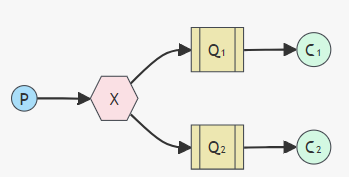

发布订阅模型里，生产者只能将消息发送到交换机，由交换机将消息推送到队列，交换机可以将消息推送给绑定它的所有队列，也可以有针对性的将消息推送给某几个队列，这就相当于有一批消费者订阅了消息，交换机根据各自的订阅去推送消息，组成部分如下：

- **Publisher**：生产者，不再发送消息到队列中，而是发给交换机
- **Exchange**：交换机，一方面，接收生产者发送的消息。另一方面，将消息推送给队列，是将消息推送给某个特别队列、递交给所有队列、或是将消息丢弃，到底如何操作，取决于交换机的类型。
- **Queue**：消息队列也与以前一样，接收消息、缓存消息。不过队列一定要与交换机绑定。
- **Consumer**：消费者，与以前一样，订阅队列，没有变化

注意：**Exchange（交换机）只负责转发消息，不具备存储消息的能力**，因此如果没有任何队列与Exchange绑定，或者没有符合路由规则的队列，那么消息会丢失！


#### 3.2.2 交换机类型

交换机是如何实现将消息推送给所有队列，还是有针对性的将消息推送给某几个队列呢？

实现不同的需求要选用不同类型的交换机，可用的交换机类型：`direct`, `topic`, `headers` 和`fanout`.

- **Fanout**：广播类型，将消息交给所有绑定到交换机的队列。
- **Direct**：直接类型，基于RoutingKey（路由key）发送给订阅了消息的队列，交换机根据routingkey去判断消息应该转发到哪个队列
- **Topic**：通配符类型（主题类型），与Direct类似，只不过RoutingKey可以使用通配符
- Headers：头匹配类型，基于MQ的消息头匹配，用的较少。

课堂中，我们讲解前面的三种交换机模式。


### 3.3. fanout交换机

#### 3.3.1 介绍

Fanout，英文翻译是扇出，我觉得在MQ中叫广播更合适。

在广播模式下，消息发送流程是这样的：

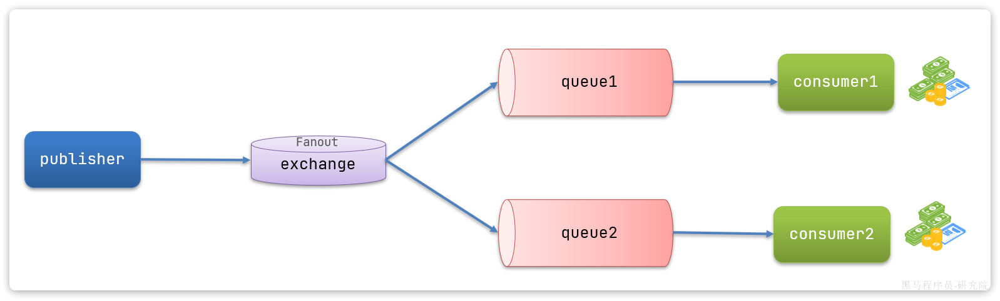

- 1）  可以有多个队列
- 2）  每个队列都要绑定到Exchange（交换机）
- 3）  生产者发送的消息，只能发送到交换机
- 4）  交换机把消息发送给绑定过的所有队列
- 5）  订阅队列的消费者接收消息，每个队列订阅的消费者只有一个能拿到消息。

#### 3.3.2 测试

##### 3.3.2.1 创建队列

我们的计划是这样的：

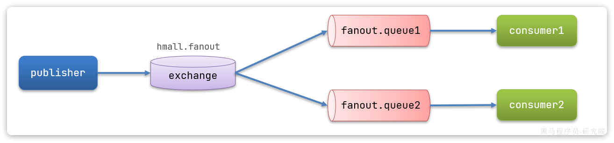

- 创建一个名为` hmall.fanout`的交换机，类型是`Fanout`
- 创建两个队列`fanout.queue1`和`fanout.queue2`，绑定到交换机`hmall.fanout`


在控制台创建队列`fanout.queue1`:


在创建一个队列`fanout.queue2`：

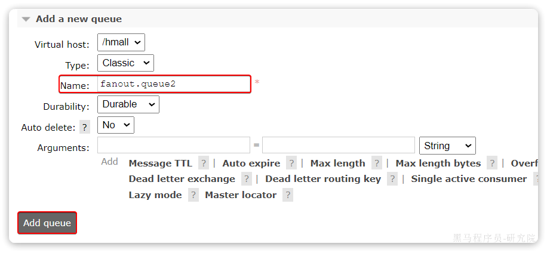

##### 3.3.2.2 创建交换机

然后再创建一个交换机hmall.fanout：

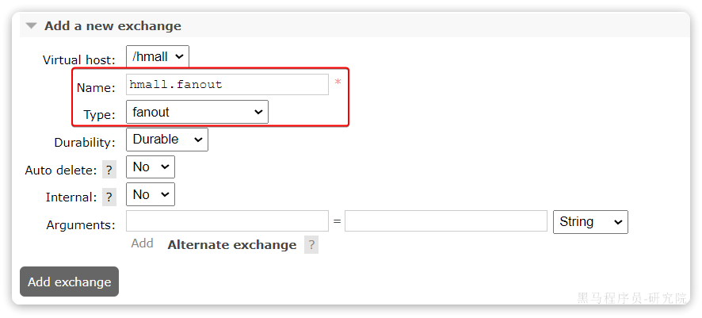

##### 3.3.2.3 绑定队列到交换机

然后绑定两个队列到交换机：


##### 3.3.2.4 发送消息

下边实现消息发送：

在publisher服务的SpringAmqpTest类中添加测试方法：

```Java
@Test
public void testFanoutExchange() {
    // 交换机名称
    String exchangeName = "hmall.fanout";
    // 消息
    String message = "hello, everyone!";
    rabbitTemplate.convertAndSend(exchangeName, "", message);
}
```

发送成功查看mq控制台消息转发到了绑定此交换机的两个队列


##### 3.3.2.5 接收消息

下边实现消息接收：

在consumer服务的SpringRabbitListener中添加两个方法，作为消费者：

```Java
@RabbitListener(queues = "fanout.queue1")
public void listenFanoutQueue1(String msg) {
    System.out.println("消费者1接收到Fanout消息：【" + msg + "】");
}

@RabbitListener(queues = "fanout.queue2")
public void listenFanoutQueue2(String msg) {
    System.out.println("消费者2接收到Fanout消息：【" + msg + "】");
}
```

将consumer服务启动起来后可以通过rabbitmq控制台查看消费者监听情况

进入队列界面，点击fanout.queue1：

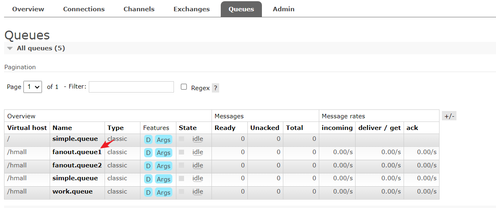

进入队列界面，查看consumers，下图表示fanout.queue1队列有一个监听者。


同样的方法可以查看fanout.queue2队列的监听情况。

fanout.queue1和fanout.queue2每个队列都有一个监听者。

下边执行发送消息程序，观察控制台，下图说明每个消费者成功收到消息。

```JavaScript
消费者1接收到Fanout消息：【hello, everyone!】
消费者2接收到Fanout消息：【hello, everyone!】
```

##### 3.3.2.6 启动多个消费者实例

下边我们把consumer服务启动两个实例

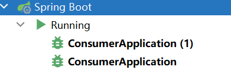

此时再观察fanout.queue1和fanout.queue2的监听者，发现每个队列有两个监听者


此时的结果相当于下图：

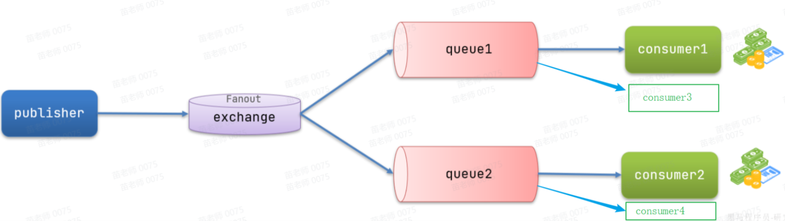

此时执行发送消息程序后四个消息者都可以收到消息吗？


通过测试我们发现：

在每个队列的消费者中，发送一条消息只会有一个消费者接收到消息。

每个队列默认采用轮询的方式向消费者推送消息。


#### 3.3.3 小结

交换机的作用是什么？

- 接收publisher发送的消息
- 将消息按照规则路由到与之绑定的队列
- 不能缓存消息，路由失败，消息丢失
- FanoutExchange的会将消息路由到每个绑定的队列


### 3.4.Direct交换机

#### 3.4.1 介绍

在Fanout模式中，一条消息，会被所有订阅的队列都消费。但是，在某些场景下，我们希望不同的消息被不同的队列消费。这时就要用到Direct类型的Exchange。


在Direct模型下：

- 队列与交换机的绑定，不能是任意绑定了，而是要指定一个`RoutingKey`（路由key）
- 消息的发送方在 向 Exchange发送消息时，也必须指定消息的 `RoutingKey`。
- Exchange不再把消息交给每一个绑定的队列，而是根据消息的`Routing Key`进行判断，只有队列的`Routingkey`与消息的 `Routing key`完全一致，才会接收到消息


**案例需求如图**：


1.  声明一个名为`hmall.direct`的交换机
2. 声明队列`direct.queue1`，绑定`hmall.direct`，`bindingKey`为`blud`和`red`
3. 声明队列`direct.queue2`，绑定`hmall.direct`，`bindingKey`为`yellow`和`red`
4.  在`consumer`服务中，编写两个消费者方法，分别监听direct.queue1和direct.queue2 
5.  在publisher中编写测试方法，向`hmall.direct`发送消息 


#### 3.4.2 测试

##### 3.4.2.1 创建队列和交换机

首先在控制台声明两个队列`direct.queue1`和`direct.queue2`，这里不再展示过程：


然后声明一个direct类型的交换机，命名为`hmall.direct`:

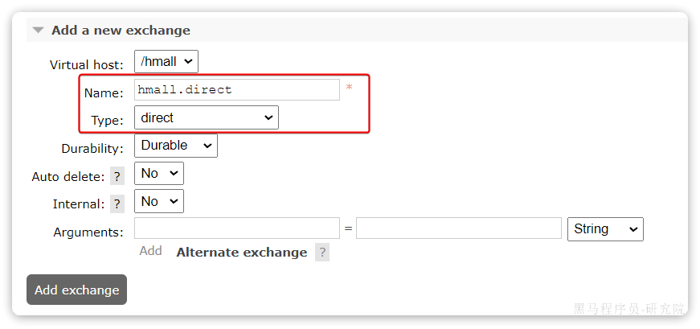

然后使用`red`和`blue`作为key，绑定`direct.queue1`到`hmall.direct`：


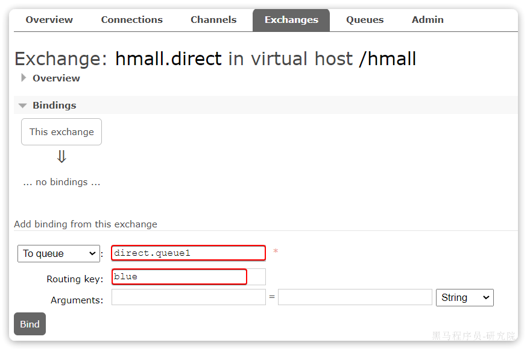


同理，使用`red`和`yellow`作为key，绑定`direct.queue2`到`hmall.direct`，步骤略，最终结果：


##### 3.4.2.2 监听队列

在consumer服务的SpringRabbitListener中添加方法：

```Java
@RabbitListener(queues = "direct.queue1")
public void listenDirectQueue1(String msg) {
    System.out.println("消费者1接收到direct.queue1的消息：【" + msg + "】");
}

@RabbitListener(queues = "direct.queue2")
public void listenDirectQueue2(String msg) {
    System.out.println("消费者2接收到direct.queue2的消息：【" + msg + "】");
}
```


##### 3.4.2.3  消息发送

在publisher服务的SpringAmqpTest类中添加测试方法：

```Java
@Test
public void testSendDirectExchange() {
    // 交换机名称
    String exchangeName = "hmall.direct";
    // 消息
    String message = "红色警报！日本乱排核废水，导致海洋生物变异，惊现哥斯拉！";
    // 发送消息
    rabbitTemplate.convertAndSend(exchangeName, "red", message);
}
```

由于使用的red这个key，所以两个消费者都收到了消息：


我们再切换为blue这个key：

```Java
@Test
public void testSendDirectExchange() {
    // 交换机名称
    String exchangeName = "hmall.direct";
    // 消息
    String message = "最新报道，哥斯拉是居民自治巨型气球，虚惊一场！";
    // 发送消息
    rabbitTemplate.convertAndSend(exchangeName, "blue", message);
}
```

你会发现，只有消费者1收到了消息：

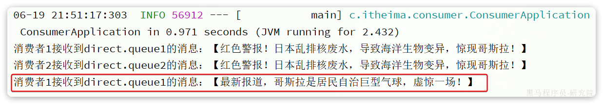


#### 3.4.3 小结

描述下Direct交换机与Fanout交换机的差异？

- Fanout交换机将消息路由给每一个与之绑定的队列
- Direct交换机根据RoutingKey判断路由给哪个队列
- 如果多个队列具有相同的RoutingKey，则与Fanout功能类似


### 3.5.Topic交换机

#### 3.5.1 介绍

`Topic`类型的`Exchange`与`Direct`相比，都是可以根据`RoutingKey`把消息路由到不同的队列。

只不过`Topic`类型`Exchange`可以让队列在绑定`BindingKey` 的时候使用通配符！


`BindingKey` 一般都是有一个或多个单词组成，多个单词之间以`.`分割，例如： `item.insert`


通配符规则：

- `#`：匹配任意个单词
- `*`：匹配不多不少恰好1个单词


举例：

- `item.#`：能够匹配`item.spu.insert` 或者 `item.spu`
- `item.*`：只能匹配`item.spu`


图示：


假如此时publisher发送的消息使用的`RoutingKey`共有四种：

- `china.news `代表有中国的新闻消息；
- `china.weather` 代表中国的天气消息；
- `japan.news` 则代表日本新闻
- `japan.weather` 代表日本的天气消息；


解释：

- `topic.queue1`：绑定的是`china.#` ，凡是以 `china.`开头的`routing key` 都会被匹配到，包括：

  - `china.news`
  - `china.weather`
- `topic.queue2`：绑定的是`#.news` ，凡是以 `.news`结尾的 `routing key` 都会被匹配。包括:

  - `china.news`
  - `japan.news`


#### 3.5.2 测试

##### 3.5.2.1 创建队列和交换机

接下来，我们就按照上图所示，来演示一下Topic交换机的用法。

首先，在控制台按照图示例子创建队列、交换机，并利用通配符绑定队列和交换机。


创建队列：`topic.queue1`、`topic.queue`2

创建交换机：hmall.topic

绑定队列：

`topic.queue1`：绑定的是`china.#`

`topic.queue2`：绑定的是`#.news`


最终结果如下：

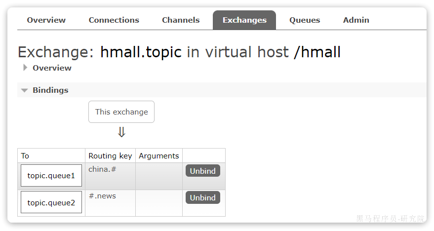

##### 3.5.2.2 消息接收

在consumer服务的SpringRabbitListener中添加方法：

```Java
@RabbitListener(queues = "topic.queue1")
public void listenTopicQueue1(String msg){
    System.out.println("消费者1接收到topic.queue1的消息：【" + msg + "】");
}

@RabbitListener(queues = "topic.queue2")
public void listenTopicQueue2(String msg){
    System.out.println("消费者2接收到topic.queue2的消息：【" + msg + "】");
}
```


##### 3.5.2.3 消息发送

在publisher服务的SpringAmqpTest类中添加测试方法：

```Java
/**
 * topicExchange
 */
@Test
public void testSendTopicExchange() {
    // 交换机名称
    String exchangeName = "hmall.topic";
    // 消息
    String message = "喜报！孙悟空大战哥斯拉，胜!";
    // 发送消息
    rabbitTemplate.convertAndSend(exchangeName, "china.news", message);
}
```

执行测试方法，routingKey为china.news可以匹配topic.queue1和topic.queue2，日志输出：

```Java
消费者1接收到topic.queue1的消息：【喜报！孙悟空大战哥斯拉，胜!】
消费者2接收到topic.queue2的消息：【喜报！孙悟空大战哥斯拉，胜!】
```

更改routingKey为china.weather，只可以匹配到topic.queue1，日志输出：

```Java
消费者1接收到topic.queue1的消息：【喜报！孙悟空大战哥斯拉，胜!】
```


#### 3.5.3 小结


描述下Direct交换机与Topic交换机的差异？

- Topic交换机接收的消息RoutingKey必须是多个单词，以 **`.`** 分割
- Topic交换机与队列绑定时的bindingKey可以指定通配符
- `#`：代表0个或多个词
- `*`：代表1个词


### 3.6.基于注解声明队列和交换机

在之前我们都是基于RabbitMQ控制台来创建队列、交换机。但是在实际开发时，队列和交换机是程序员定义的，将来项目上线，又要交给运维去创建。那么程序员就需要把程序中运行的所有队列和交换机都写下来，交给运维。在这个过程中是很容易出现错误的。

因此推荐的做法是由程序启动时检查队列和交换机是否存在，如果不存在自动创建。

#### 3.8.1. 基本API的方式（了解）

##### 3.8.1.1 介绍

SpringAMQP提供了一个Queue类，用来创建队列：

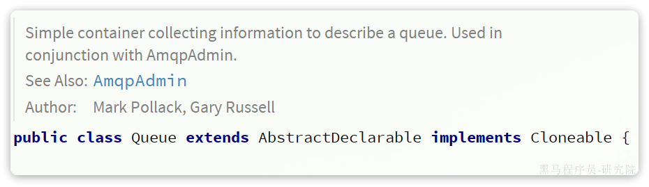


SpringAMQP还提供了一个Exchange接口，来表示所有不同类型的交换机：


我们可以自己创建队列和交换机，不过SpringAMQP还提供了ExchangeBuilder来简化这个过程：


而在绑定队列和交换机时，则需要使用BindingBuilder来创建Binding对象：


##### 3.8.1.2 API方式声明举例

**下边是fanout示例**

在consumer中创建一个类，声明队列和交换机：

```Java
package com.itheima.consumer.config;

import org.springframework.amqp.core.Binding;
import org.springframework.amqp.core.BindingBuilder;
import org.springframework.amqp.core.FanoutExchange;
import org.springframework.amqp.core.Queue;
import org.springframework.context.annotation.Bean;
import org.springframework.context.annotation.Configuration;

@Configuration
public class FanoutConfig {
    /**
     * 声明交换机
     * @return Fanout类型交换机
     */
    @Bean
    public FanoutExchange fanoutExchange(){
        return new FanoutExchange("hmall.fanout");
    }

    /**
     * 第1个队列
     */
    @Bean
    public Queue fanoutQueue1(){
        return new Queue("fanout.queue1");
    }

    /**
     * 绑定队列和交换机
     */
    @Bean
    public Binding bindingQueue1(Queue fanoutQueue1, FanoutExchange fanoutExchange){
        return BindingBuilder.bind(fanoutQueue1).to(fanoutExchange);
    }

    /**
     * 第2个队列
     */
    @Bean
    public Queue fanoutQueue2(){
        return new Queue("fanout.queue2");
    }

    /**
     * 绑定队列和交换机
     */
    @Bean
    public Binding bindingQueue2(Queue fanoutQueue2, FanoutExchange fanoutExchange){
        return BindingBuilder.bind(fanoutQueue2).to(fanoutExchange);
    }
}
```

**下边是direct示例**

direct模式由于要绑定多个KEY，会非常麻烦，每一个Key都要编写一个binding：

```Java
package com.itheima.consumer.config;

import org.springframework.amqp.core.*;
import org.springframework.context.annotation.Bean;
import org.springframework.context.annotation.Configuration;

@Configuration
public class DirectConfig {

    /**
     * 声明交换机
     * @return Direct类型交换机
     */
    @Bean
    public DirectExchange directExchange(){
        return ExchangeBuilder.directExchange("hmall.direct").build();
    }

    /**
     * 第1个队列
     */
    @Bean
    public Queue directQueue1(){
        return new Queue("direct.queue1");
    }

    /**
     * 绑定队列和交换机
     */
    @Bean
    public Binding bindingQueue1WithRed(Queue directQueue1, DirectExchange directExchange){
        return BindingBuilder.bind(directQueue1).to(directExchange).with("red");
    }
    /**
     * 绑定队列和交换机
     */
    @Bean
    public Binding bindingQueue1WithBlue(Queue directQueue1, DirectExchange directExchange){
        return BindingBuilder.bind(directQueue1).to(directExchange).with("blue");
    }

    /**
     * 第2个队列
     */
    @Bean
    public Queue directQueue2(){
        return new Queue("direct.queue2");
    }

    /**
     * 绑定队列和交换机
     */
    @Bean
    public Binding bindingQueue2WithRed(Queue directQueue2, DirectExchange directExchange){
        return BindingBuilder.bind(directQueue2).to(directExchange).with("red");
    }
    /**
     * 绑定队列和交换机
     */
    @Bean
    public Binding bindingQueue2WithYellow(Queue directQueue2, DirectExchange directExchange){
        return BindingBuilder.bind(directQueue2).to(directExchange).with("yellow");
    }
}
```


#### 3.8.2. 基于注解声明

基于@Bean的方式声明队列和交换机比较麻烦，Spring还提供了基于注解方式来声明。


例如，我们同样声明Direct模式的交换机和队列：

```Java
@RabbitListener(bindings = @QueueBinding(
    value = @Queue(name = "direct.queue1"),
    exchange = @Exchange(name = "hmall.direct", type = ExchangeTypes.DIRECT),
    key = {"red", "blue"}
))
public void listenDirectQueue1(String msg){
    System.out.println("消费者1接收到direct.queue1的消息：【" + msg + "】");
}

@RabbitListener(bindings = @QueueBinding(
    value = @Queue(name = "direct.queue2"),
    exchange = @Exchange(name = "hmall.direct", type = ExchangeTypes.DIRECT),
    key = {"red", "yellow"}
))
public void listenDirectQueue2(String msg){
    System.out.println("消费者2接收到direct.queue2的消息：【" + msg + "】");
}
```

测试方法非常简单，把hmall.direct交换机及绑定的队列通过rabbitmq控制台删除，重启consumer服务后hmall.direct交换机及绑定的队列会自动创建。

是不是简单多了。


再试试Topic模式：

```Java
@RabbitListener(bindings = @QueueBinding(
    value = @Queue(name = "topic.queue1"),
    exchange = @Exchange(name = "hmall.topic", type = ExchangeTypes.TOPIC),
    key = "china.#"
))
public void listenTopicQueue1(String msg){
    System.out.println("消费者1接收到topic.queue1的消息：【" + msg + "】");
}

@RabbitListener(bindings = @QueueBinding(
    value = @Queue(name = "topic.queue2"),
    exchange = @Exchange(name = "hmall.topic", type = ExchangeTypes.TOPIC),
    key = "#.news"
))
public void listenTopicQueue2(String msg){
    System.out.println("消费者2接收到topic.queue2的消息：【" + msg + "】");
}
```

### 3.7.消息转换器

#### 3.9.1 测试默认转换器

Spring的消息发送代码接收的消息体是一个Object：

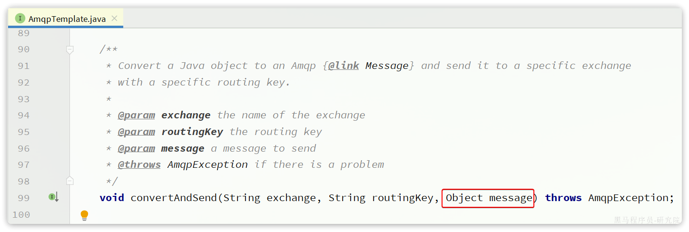

而在数据传输时，它会把你发送的消息序列化为字节发送给MQ，接收消息的时候，还会把字节反序列化为Java对象。

只不过，默认情况下Spring采用的序列化方式是JDK序列化。众所周知，JDK序列化存在下列问题：

- 数据体积过大
- 有安全漏洞
- 可读性差


我们来测试一下。


1）创建测试队列:object.queue

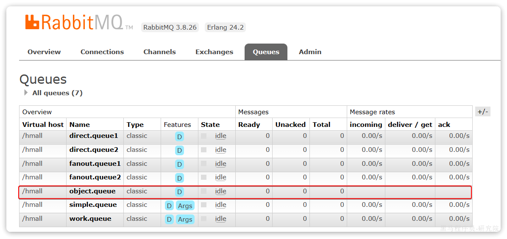


2）发送消息

我们在publisher模块的SpringAmqpTest中新增一个消息发送的代码，发送一个Map对象：

```Java
@Test
public void testSendMap() throws InterruptedException {
    // 准备消息
    Map<String,Object> msg = new HashMap<>();
    msg.put("name", "柳岩");
    msg.put("age", 21);
    // 发送消息
    rabbitTemplate.convertAndSend("object.queue", msg);
}
```

注意，这里我们先不要给这个队列添加消费者，我们要查看消息体的格式。


发送消息后查看控制台：

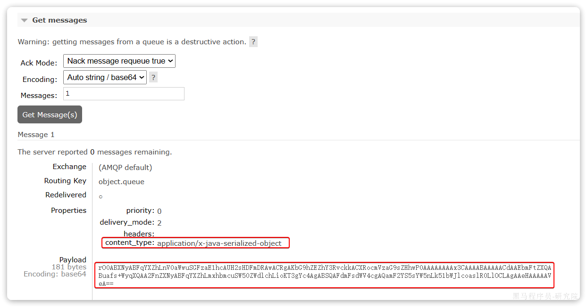

可以看到消息格式非常不友好。

#### 3.9.2 配置JSON转换器

##### 3.9.2.1 引入依赖

显然，JDK序列化方式并不合适。我们希望消息体的体积更小、可读性更高，因此可以使用JSON方式来做序列化和反序列化。


在`publisher`和`consumer`两个服务的父工程中都引入依赖：

```XML
<dependency>
    <groupId>com.fasterxml.jackson.dataformat</groupId>
    <artifactId>jackson-dataformat-xml</artifactId>
    <version>2.9.10</version>
</dependency>
```

注意，如果项目中引入了`spring-boot-starter-web`依赖，则无需再次引入`Jackson`依赖。

##### 3.9.2.2 配置消息转换器

配置消息转换器，在`publisher`和`consumer`两个服务中添加一个Bean即可：

注意：MessageConverter要导入org.springframework.amqp.support.converter.MessageConverter

```Java
package com.itheima.consumer.config;

import org.springframework.amqp.support.converter.Jackson2JsonMessageConverter;
import org.springframework.amqp.support.converter.MessageConverter;
import org.springframework.context.annotation.Bean;
import org.springframework.context.annotation.Configuration;

/**
 * @author Mr.M
 * @version 1.0
 * @description mq配置类
 * @date 2024/8/13 19:28
 */
@Configuration
public class MesaageConfig {

    @Bean
    public MessageConverter messageConverter() {
        // 定义消息转换器
        Jackson2JsonMessageConverter jackson2JsonMessageConverter = new Jackson2JsonMessageConverter();
        //设置消息id,自动生成一个id，可用于消息幂等性处理
        jackson2JsonMessageConverter.setCreateMessageIds(true);
        return jackson2JsonMessageConverter;
    }
}
```


##### 3.9.2.3 测试

此时，我们到MQ控制台**删除**`object.queue`中的旧的消息。然后再次执行刚才的消息发送的代码，到MQ的控制台查看消息结构：


#### 3.9.3 消费者接收Object

我们在consumer服务中定义一个新的消费者，publisher是用Map发送，那么消费者也一定要用Map接收，格式如下：

```Java
@RabbitListener(queues = "object.queue")
public void listenSimpleQueueMessage(Map<String, Object> msg) throws InterruptedException {
    System.out.println("消费者接收到object.queue消息：【" + msg + "】");
}
```


### 3.8 面试题

RabbitMQ 的工作模型有哪些？


如何解决MQ消息堆积问题？


## 4 高级队列

### 4.5. LazyQueue

#### 4.5.1 介绍

在默认情况下，RabbitMQ会将接收到的信息先保存在内存中然后再保存至磁盘，以降低消息收发的延迟。但在某些特殊情况下，这会导致消息积压，比如：

- 消费者宕机或出现网络故障
- 消息发送量激增，超过了消费者处理速度
- 消费者处理业务发生阻塞


一旦出现消息堆积问题，RabbitMQ的内存占用就会越来越高，直到触发内存预警上限。此时RabbitMQ会将内存消息刷到磁盘上，这个行为称为`PageOut`. `PageOut`会耗费一段时间，并且会阻塞队列进程。因此在这个过程中RabbitMQ不会再处理新的消息，生产者的所有请求都会被阻塞。


为了解决消息堆积问题，从RabbitMQ的3.6.0版本开始，就增加了Lazy Queues的模式，也就是惰性队列。惰性队列的特征如下：

- 接收到消息后直接存入磁盘而非内存
- 消费者要消费消息时才会从磁盘中读取并加载到内存（也就是懒加载）
- 支持数百万条的消息存储


**LazyQueue的特点**：

Lazy Queue 通过将大部分消息存储在磁盘上而不是内存中来减少内存占用。它使用内存映射文件技术来实现高效的磁盘访问。

即使在处理大量消息的情况下，Lazy Queue 也能保持较高的性能。通过减少内存占用，可以避免频繁的垃圾回收操作，从而提高整体性能。

**LazyQueue应用场景**：

当消息队列非常大并且消息数量非常多时，使用 Lazy Queue 可以显著减少内存使用量，从而提高系统性能。例如，在日志聚合系统中，需要处理大量的日志消息，使用 Lazy Queue 可以有效管理内存资源。


#### 4.5.2 控制台配置Lazy模式

在添加队列的时候，添加`x-queue-mod=lazy`参数即可设置队列为Lazy模式：


#### 4.5.3 代码配置Lazy模式

在利用SpringAMQP声明队列的时候，添加`x-queue-mod=lazy`参数也可设置队列为Lazy模式，

基于注解来声明队列并设置为Lazy模式：

```Java
//掌握注解方式
@RabbitListener(queuesToDeclare = @Queue(
        name = "lazy.queue",
        durable = "true",
        arguments = @Argument(name = "x-queue-mode", value = "lazy")
))
public void listenLazyQueue(String msg){
    log.info("接收到 lazy.queue的消息：{}", msg);
}
```


#### 4.5.4 测试

测试流程：

创建一个惰性队列，一次写入100条消息

```JavaScript
@Test
public void testLazyQueue() {
    for (int i = 0; i < 100; i++) {
        // 队列名称
        String queueName = "lazy.queue";
        // 消息
        String message = "hello, spring amqp!"+i;
        // 发送消息
        rabbitTemplate.convertAndSend(queueName, message);
    }

}
```

写入成功观察队列信息：


100条消息全部在磁盘，内存消息个数为0.


再向非惰性队列写入100条消息观察消息存储情况

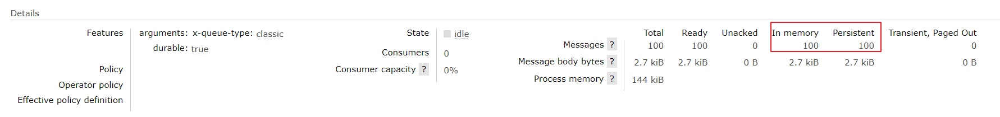

100条消息分别在内存和磁盘存储。


#### 4.5.5 小结

**LazyQueue的特点**：

Lazy Queue 惰性队列将大部分消息存储在磁盘上而不是内存中来减少内存占用。

即使在处理大量消息的情况下，Lazy Queue 也能保持较高的性能。通过减少内存占用，可以避免频繁的垃圾回收操作，从而提高整体性能。

**LazyQueue应用场景**：

当消息队列非常大并且消息数量非常多时，使用 Lazy Queue 可以显著减少内存使用量，从而提高系统性能。


### 4.6. 优先级队列

#### 4.6.1 介绍

自从 RabbitMQ 3.5.0 版本起，引入了优先级队列的功能，允许开发者根据消息的重要程度来设定不同的优先级。这在处理紧急或重要的消息时非常有用。

通过设置 `x-max-priority` 参数，可以实现这一功能。然而，在消费速度远高于生产速度且消息队列中没有积压消息的情况下，优先级的作用就不那么明显了。


应用场景：

1. 交易处理

- 场景: 在金融交易系统中，需要处理不同类型的交易请求，如紧急交易和常规交易。
- 实现: 使用优先级队列，将紧急交易请求设置为最高优先级，常规交易设置为较低优先级。
- 好处: 确保紧急交易能够被优先处理，提高了交易系统的响应速度。

1. 任务调度

- 场景: 在一个任务调度系统中，可能存在不同优先级的任务需要被处理。
- 实现: 使用优先级队列，高优先级的任务（如紧急任务或关键任务）会被优先处理。
- 好处: 保证了重要任务能够被及时处理，提高了系统的响应能力和可靠性。


#### 4.6.2 创建优先级队列

创建优先级队列：priority.queue

设置x-max-priority ，定义优先级的最大值

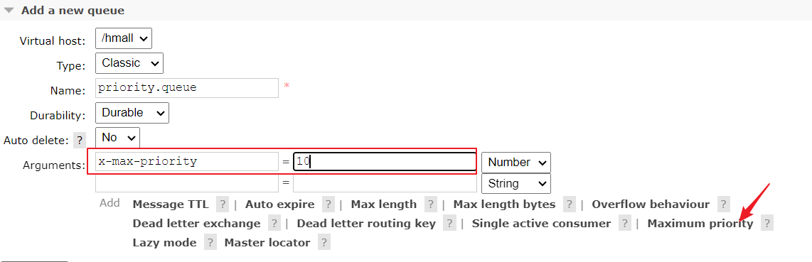

#### 4.6.3 测试

向优先级队列发100条消息，优先级用随机数生成，最大为10，优先级越大越优先出队。

```JavaScript
//向优先级队列发100条消息
@Test
public void testPriorityQueue() {
    for (int i = 0; i < 100; i++) {
        // 队列名称
        String queueName = "priority.queue";
        //优先级随机数为1到10
        int priority = new Random().nextInt(10) + 1;
        // 消息
        String message = "hello, spring amqp!"+priority;
        // 向优先级队列发送消息
        rabbitTemplate.convertAndSend(queueName, message, msg -> {
            MessageProperties messageProperties = msg.getMessageProperties();
            //设置优先级
            messageProperties.setPriority(priority);
            return msg;
        });
    }

}
```

发送成功观察控制台：


运行消费程序

```Java
//监听优先级队列
@RabbitListener(queuesToDeclare = @Queue(
        name="priority.queue",
        durable = "true",
        arguments = @Argument(name = "x-max-priority", value = "10",type="java.lang.Integer")))
public void listenPriorityQueue(String msg) throws InterruptedException {
  System.out.println("消费者接收到priority.queue消息：【" + msg + "】");
}
```

观察控制台，按优先级消费消息，优先级高（priority值越大优先级越高）的最先消费。


## 5.业务改造

### 5.1 需求分析

案例需求：改造余额支付功能，将支付成功后基于OpenFeign远程调用交易服务更新订单状态接口由同步调用改为基于RabbitMQ的异步通知。

如图：


说明：目前没有通知服务和积分服务，因此我们只关注交易服务，步骤如下：

- 定义`direct`类型交换机，命名为`pay.direct`
- 定义消息队列，命名为pay.success.queue
- 将pay.success.queue与`pay.direct`绑定，`BindingKey`为`pay.success`
- 支付成功时不再调用交易服务更新订单状态的接口，而是发送一条消息到`pay.direct`，发送消息的`RoutingKey`  为`pay.success`，消息内容是订单id
- 交易服务监听pay.success.queue 队列，接收到消息后更新订单状态为已支付


### 5.2 配置MQ

不管是生产者还是消费者，都需要配置MQ的基本信息。分为两步：

1）添加依赖：

在支付服务、交易服务添加amqp依赖。

```XML
  <!--消息发送-->
  <dependency>
      <groupId>org.springframework.boot</groupId>
      <artifactId>spring-boot-starter-amqp</artifactId>
  </dependency>
```


2）配置MQ地址：

在支付服务、交易服务添加MQ地址配置。

```YAML
spring:
  rabbitmq:
    host: 192.168.101.68 # 你的虚拟机IP
    port: 5672 # 端口
    virtual-host: /hmall # 虚拟主机
    username: hmall # 用户名
    password: 123 # 密码
```


### 5.3 发送消息

#### 5.3.1 常量类

在common模块配置常量类，包括支付交换机，支付成功key等信息

```JavaScript
package com.hmall.common.constants;

/**
 * @author Mr.M
 * @version 1.0
 * @description MQ常量配置
 * @date 2024/8/30 11:45
 */
public interface MqConstants {
    String PAY_EXCHANGE_NAME = "pay.direct";
    String PAY_SUCCESS_KEY = "pay.success";
    String PAY_SUCCESS_QUEUE = "pay.success.queue";
}
```

#### 5.3.2 编写代码

修改`pay-service`服务下的`com.hmall.pay.service.impl.PayOrderServiceImpl`类中的`tryPayOrderByBalance`方法：

屏蔽tradeClient.markOrderPaySuccess(po.getBizOrderNo())

支付成功后发送消息

代码如下：

```Java
private final RabbitTemplate rabbitTemplate;

@Override
@Transactional
public void tryPayOrderByBalance(PayOrderFormDTO payOrderDTO) {
   Long userId = UserContext.getUser();
    // 1.查询支付单
    PayOrder po = getById(payOrderDTO.getId());
    // 2.判断状态
    if(!PayStatus.WAIT_BUYER_PAY.equalsValue(po.getStatus())){
        // 订单不是未支付，状态异常
        throw new BizIllegalException("交易已支付或关闭！");
    }
    // 3.尝试扣减余额
    userClient.deductMoney(userId,payOrderDTO.getPw(), po.getAmount());
    // 4.修改支付单状态
    boolean success = markPayOrderSuccess(payOrderDTO.getId(), LocalDateTime.now());
    if (!success) {
        throw new BizIllegalException("交易已支付或关闭！");
    }
    // 5.修改订单状态
    // tradeClient.markOrderPaySuccess(po.getBizOrderNo());
    try {
        rabbitTemplate.convertAndSend(MqConstants.PAY_EXCHANGE_NAME, MqConstants.PAY_SUCCESS_KEY, po.getBizOrderNo());
    } catch (Exception e) {
        log.error("支付成功的消息发送失败，支付单id：{}， 交易单id：{}", po.getId(), po.getBizOrderNo(), e);
    }
}
```


### 5.4 接收消息

在trade-service服务中定义一个消息监听类，接收到消息，调用方法更新订单状态为已支付。

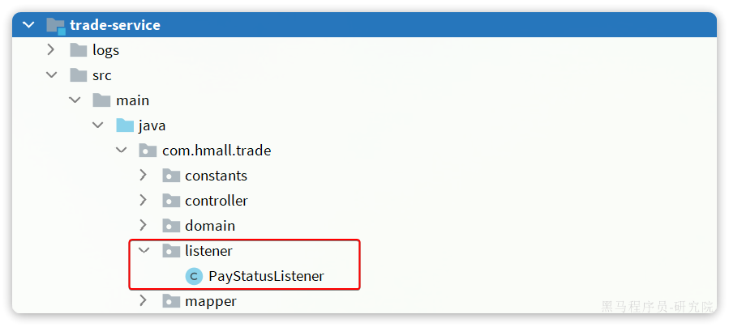

其代码如下：

```Java
package com.hmall.trade.listener;

import com.hmall.trade.service.IOrderService;
import lombok.RequiredArgsConstructor;
import org.springframework.amqp.core.ExchangeTypes;
import org.springframework.amqp.rabbit.annotation.Exchange;
import org.springframework.amqp.rabbit.annotation.Queue;
import org.springframework.amqp.rabbit.annotation.QueueBinding;
import org.springframework.amqp.rabbit.annotation.RabbitListener;
import org.springframework.stereotype.Component;

@Component
@RequiredArgsConstructor
public class PayStatusListener {

    private final IOrderService orderService;

    @RabbitListener(bindings = @QueueBinding(
            value = @Queue(name = MqConstants.PAY_SUCCESS_QUEUE, durable = "true"),
            exchange = @Exchange(name = MqConstants.PAY_EXCHANGE_NAME, type = "direct"),
            key = MqConstants.PAY_SUCCESS_KEY
    ))
    public void listenPaySuccess(Long orderId){
        orderService.markOrderPaySuccess(orderId);
    }
}
```


## 作业

- 完成课堂上的五种消息模型
- 完成业务改造
- 练习基于api的方式声明交换机和队列
- 练习高级队列（惰性队列、优先级队列）

---
> 来源：飞书技术知识库（脱敏版） · 04 微服务与中间件 / 消息队列 MQ / 04 MQ基础 · [原文](https://ccn8v2zngwsm.feishu.cn/wiki/Pxt4wV5f0iPSkqkIPKncWU3UnYb)
