# 05 MQ高级

## 学习目标

1. 能够测试生产者重试机制
2. 能够测试生产者确认机制
3. 能够说出生产者确认机制的两种方式
4. 能够说出发送失败处理机制
5. 能够说出消息持久化机制
6. 能够测试消费者确认机制
7. 能够说出消费失败重试机制
8. 能够说出MQ消息幂等性方案
9. 能够说出延迟消息方案
10. 能够实现自动取消超时未支付订单功能
11. 能够说出保证消息的可靠性的完整方案


## 1 消息可靠性

### 1.1. 思路分析

在昨天的练习作业中，我们改造了余额支付功能，在支付成功后利用RabbitMQ通知交易服务，更新业务订单状态为已支付。

但是大家思考一下，如果这里MQ通知失败，支付服务中支付流水显示支付成功，而交易服务中的订单状态却显示未支付，数据出现了不一致。


<whiteboard token="NEzDwqX4aheiAobMJM8cT2SunSo"></whiteboard>


首先，我们一起分析一下消息丢失的可能性有哪些。

消息从发送者发送消息，到消费者处理消息，需要经过的流程是这样的：

<whiteboard token="ZULLwGQAahAokAbTj7HcYQ1qnId"></whiteboard>

消息从生产者到消费者的每一步都可能导致消息丢失：

- 发送消息时丢失：

  - 生产者发送消息时连接MQ失败
  - 生产者发送消息到达MQ后未找到`Exchange`
  - 生产者发送消息到达MQ的`Exchange`后，未找到合适的`Queue`
- MQ导致消息丢失：

  - 消息到达MQ，保存到队列后，尚未消费就突然宕机
- 消费者处理消息时：

  - 消息接收后尚未处理突然宕机
  - 消息接收后处理过程中抛出异常


综上，我们要解决消息丢失问题，保证MQ的可靠性，就必须从3个方面入手：

1. 保证生产消息的可靠性
2. 确保MQ不会将消息弄丢
3. 保证消费消息的可靠性


注意：使用MQ并不是所有场景对消息的可靠性要求都很高，比如上图中，支付成功短信通知的流程对消息可靠性要求就不高，通常都可以保证消息正常到达消费者，即使个别没有成功通知用户也不影响主体业务流程，所以在设计技术方案时一定要根据业务需求具体分析。


### 1.2 生产消息可靠性

#### 1.2.1. 生产者重试机制

##### 1.2.1.1 配置

首先第一种情况，就是生产者发送消息时，出现了网络故障，导致与MQ的连接中断。


为了解决这个问题，SpringAMQP提供的消息发送时的重试机制。即：当`RabbitTemplate`与MQ连接超时后，多次重试。

从课程资料中找到mq-demo-v2.zip，并解压，使用IDEA打开mq-demo-v2工程。

修改`publisher`模块的`application.yaml`文件，添加下面的内容：

```YAML
spring:
  rabbitmq:
    connection-timeout: 1s # 设置MQ的连接超时时间
    template:
      retry:
        enabled: true # 开启超时重试机制
        initial-interval: 1000ms # 失败后的初始等待时间
        multiplier: 1 # 失败后下次的等待时长倍数，下次等待时长 = 上次等待时长 * multiplier
        max-attempts: 3 # 总共尝试次数
```

配置参数解释

- `initial-interval`:  失败后的初始等待时间
- `multiplier`: 倍增器，每次重试的等待时间是前一次几倍。  

失败后下次等待时长 =上次等待时长 \* multiplier

- `max-attempts`: 最大重试次数（包括第一次尝试）


举例：

由于`multiplier`设置为1，这意味着每次重试之间的间隔是固定的，不会增加。

假设在t=0时刻首次尝试发送消息，如果发送失败，则会按照以下时间点进行重试：

第一次尝试（也是首次发送）：t=0（假设即时失败）

第一次重试：等待1秒后重试，t=1秒（首次失败后等待1秒）

第二次重试：等待1秒\*1=1秒 后重试，t=2秒（从第一次重试再等待1秒）


如果设置如下：

```JavaScript
initial-interval:1000ms
multiplier:2
max-attempts: 5
```

由于`multiplier`设置为2，这意味着每次重试之间的间隔会翻倍。

假设在t=0时刻首次尝试发送消息，如果发送失败，则会按照以下时间点进行重试：

第一次尝试（也是首次发送）：t=0（假设即时失败）

第一次重试：等待1秒后重试，t=1秒（首次失败后等待1秒）

第二次重试：等待1\*2=2秒 后重试，t=3秒

第三次重试：等待2\*2=4秒 后重试，t=7秒

第四次重试：等待4\*2=8秒 后重试，t=15秒


##### 1.2.1.2 测试

我们利用命令停掉RabbitMQ服务：

```Shell
docker stop mq
```

然后测试发送一条消息，会发现会每隔1秒重试1次，总共重试了3次。消息发送的超时重试机制配置成功了！


**注意**：当网络不稳定的时候，利用重试机制可以有效提高消息发送的成功率。不过SpringAMQP提供的重试机制是**阻塞式**的重试，也就是说多次重试等待的过程中，当前线程是被阻塞的。

如果对于业务性能有要求，建议禁用重试机制。如果一定要使用，请合理配置等待时长和重试次数，当然也可以考虑使用异步线程来执行发送消息的代码。


#### 1.2.2. 生产者确认机制

##### 1.2.2.1 两种机制介绍

一般情况下，只要生产者与MQ之间的网路连接顺畅，基本不会出现发送消息丢失的情况，因此大多数情况下我们无需考虑这种问题。

不过，在少数情况下，也会出现消息发送到MQ之后丢失的现象，比如：

- MQ内部处理消息的进程发生了异常
- 生产者发送消息到达MQ后未找到`Exchange`
- 生产者发送消息到达MQ的`Exchange`后，未找到合适的`Queue`，因此无法路由


针对上述情况，RabbitMQ提供了生产者消息确认机制，包括`Publisher Confirm`和`Publisher Return`两种。在开启确认机制的情况下，当生产者发送消息给MQ后，MQ会根据消息处理的情况返回不同的**回执**。

具体如图所示：

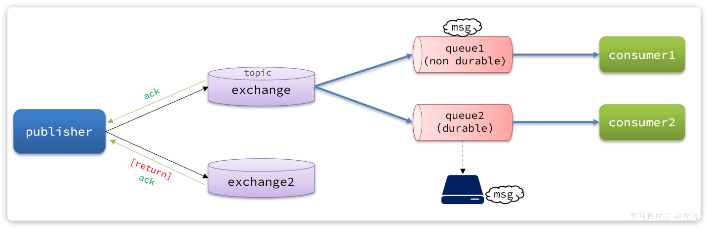
> 图注：这张图展示了MQ生产者（publisher）的两种消息可靠性确认机制的流程。左侧的publisher与exchange、exchange2交互，其中publisher向exchange投递消息时，会收到“ack”确认；当消息投递后路由失败，会触发“return”回调并返回ack。exchange会将消息分发给两个队列：non durable的queue1和durable的queue2，两个队列分别将消息传递给consumer1、consumer2消费；queue2还会落地存储消息。该图配合文档对Producer Confirm、Publisher Return两种生产者确认机制的说明，直观呈现了不同场景下的消息传递流程与交互逻辑。


生产者确认机制：

1.Publisher Return   回退机制

消息投递成功但路由失败会调用Publisher Return回调方法返回异常信息。

2.Publisher Confirm  确认机制

消息投递成功返回ack，投递失败返回nack。

注意：消息投递成功但可能路由失败了，此时会通过Publisher Confirm返回ack，通过Publisher Return回调方法返回异常信息。


默认两种机制都是关闭状态，需要通过配置文件来开启。

##### 1.2.2.2 开启生产者确认

在publisher模块的`application.yaml`中添加配置：

```YAML
spring:
  rabbitmq:
    publisher-confirm-type: correlated # 开启publisher confirm机制，并设置confirm类型
    publisher-returns: true # 开启publisher return机制
```

这里`publisher-confirm-type`有三种模式可选：

- `none`：关闭confirm机制
- `simple`：同步阻塞等待MQ的回执(回调方法)
- `correlated`：MQ异步回调返回回执


一般我们推荐使用`correlated`，回调机制。


##### 1.2.2.3 实现方法


内容如下：

```Java
@Test
public void testSendDirectExchange() {
    // 交换机名称
    String exchangeName = "hmall.direct1";
    // 消息
    String message = "红色警报！日本乱排核废水，导致海洋生物变异，惊现哥斯拉！";

    //confirm回调处理
    rabbitTemplate.setConfirmCallback(new RabbitTemplate.ConfirmCallback() {
        @Override
        public void confirm(CorrelationData correlationData, boolean ack, String cause) {
            if(ack) {
                log.info("发送消息到交换机成功");
            } else {
                log.error("发送消息到交换机失败，原因：{}", cause);
            }
        }
    });

    //return回调处理
    rabbitTemplate.setReturnsCallback(new RabbitTemplate.ReturnsCallback() {
        @Override
        public void returnedMessage(ReturnedMessage returned) {
            log.error("发送消息到队列失败，原因：{}", returned.getReplyText());
        }
    });

    // 发送消息
    rabbitTemplate.convertAndSend(exchangeName, "blue1", message);
}
```


##### 1.2.2.4 测试


测试步骤：

可以看到，由于传递的`RoutingKey`是错误的，路由失败后，触发了`return callback`，同时也收到了ack。

当我们修改为正确的`RoutingKey`以后，就不会触发`return callback`了，只收到ack。

当我们把交换机名称修改错误则只会收到nack。


#### 1.2.3. 发送失败处理机制

##### 1.2.3.1 失败处理机制

在ConfirmCallback中收到nack表示消息投递失败，`ReturnCallback`异常表示路由失败，消息投递失败怎么处理？

可以将消息记录到失败消息表，由定时任务进行发布，每隔10秒钟(可设置)执行获取失败消息重新发送，发送一次则在失败次数字段加一，达到3次停止自动发送由人工处理。

在commonn-rabbitmq模块中实现了发送消息的工具方法，此方法实现了发送失败处理机制。


`ReturnCallback`回调逻辑在com.itheima.common.rabbitmq.config.RabbitMqConfiguration中，核心代码如下：

```Java
@Configuration
@ConditionalOnProperty(prefix = "rabbit-mq", name = "enable", havingValue = "true")
@Import({RabbitClient.class, FailMsgDaoImpl.class})
@Slf4j
public class RabbitMqConfiguration implements ApplicationContextAware {

    /**
     * 并发数量
     */
    public static final int DEFAULT_CONCURRENT = 10;

    @Autowired(required = false)
    private FailMsgDao failMsgDao;


    @Override
    public void setApplicationContext(ApplicationContext applicationContext) throws BeansException {
        // 获取RabbitTemplate
        RabbitTemplate rabbitTemplate = applicationContext.getBean(RabbitTemplate.class);
        //定义returnCallback回调方法
        rabbitTemplate.setReturnsCallback(
                new RabbitTemplate.ReturnsCallback() {
                    @Override
                    public void returnedMessage(ReturnedMessage returnedMessage) {
                        byte[] body = returnedMessage.getMessage().getBody();
                        //消息id
                        String messageId = returnedMessage.getMessage().getMessageProperties().getMessageId();
                        String content = new String(body, Charset.defaultCharset());
                        log.info("消息发送失败，应答码{}，原因{}，交换机{}，路由键{},消息id{},消息内容{}",
                                returnedMessage.getReplyCode(),
                                returnedMessage.getReplyText(),
                                returnedMessage.getExchange(),
                                returnedMessage.getRoutingKey(),
                                messageId,
                                content);
                        if (failMsgDao != null) {
                            failMsgDao.save(messageId, returnedMessage.getExchange(), returnedMessage.getRoutingKey(), content, 0, DateUtils.getCurrentTime()+10, "returnCallback");
                        }
                    }
                }
        );
    }

}
```


ApplicationContextAware 的作用：如果 Bean 实现了 ApplicationContextAware 接口，Spring 容器会调用 setApplicationContext 方法，将 ApplicationContext 传递给该 Bean。

> Bean 创建：Spring 容器首先创建 Bean 实例。
> 
> 属性注入：Spring 容器对 Bean 的属性进行依赖注入。
> 
> Aware 接口回调：如果 Bean 实现了 ApplicationContextAware 接口，Spring 容器会调用 setApplicationContext 方法，将 ApplicationContext 传递给该 Bean。
> 
> 初始化方法：如果 Bean 配置了初始化方法（例如通过 @PostConstruct 注解或 init-method 属性），Spring 容器会调用这些初始化方法。


ConfirmCallback的逻辑在RabbitClient 工具类的sendMsg方法中，通过sendMsg方法发送消息，在发送消息时指定

correlationData对象，在correlationData对象中指定了ConfirmCallback回调方法的逻辑，当返回nack会将消息写入失败表，如果消息重发成功会将该记录从失败表删除。


核心代码如下：

```JavaScript
@Slf4j
@Service
public class RabbitClient {
    ....

    @Resource
    private RabbitTemplate rabbitTemplate;
    @Autowired(required = false)
    private FailMsgDao failMsgDao;
    
    /**
 * 发送消息 重试3次
 *
 * @param exchange   交换机
 * @param routingKey 路由key
 * @param msg        消息对象，会将对象序列化成json字符串发出
 * @param delay      延迟时间 秒
 * @param msgId      消息id
 * @param isFailMsg  是否是失败消息
 * @return 是否发送成功
 */
@Retryable(value = MqException.class, maxAttempts = 3, backoff = @Backoff(value = 3000, multiplier = 1.5), recover = "saveFailMag")
public void sendMsg(String exchange, String routingKey, Object msg, Integer delay, String msgId, boolean isFailMsg) {
    // 1.发送消息前准备
    // 1.1获取消息内容，如果非字符串将其序列化
    String jsonMsg = JsonUtils.toJsonStr(msg);
    // 1.2.全局唯一消息id，如果调用者设置了消息id，使用调用者消息id，如果为配置，默认雪花算法生成消息id
    if(StrUtil.isBlank(msgId)){
        msgId = IdUtil.getSnowflakeNextIdStr();
    }
    // 1.3.设置默认延迟时间，默认立即发送
    delay = NumberUtils.null2Default(delay, -1);
    log.debug("消息发送！exchange = {}, routingKey = {}, msg = {}, msgId = {}", exchange, routingKey, jsonMsg, msgId);


    // 1.4.构建回调
    RabbitMqListenableFutureCallback futureCallback = RabbitMqListenableFutureCallback.builder()
            .exchange(exchange)
            .routingKey(routingKey)
            .msg(jsonMsg)
            .msgId(msgId)
            .delay(delay)
            .isFailMsg(isFailMsg)
            .failMsgDao(failMsgDao)
            .build();
    // 1.5.CorrelationData设置
    CorrelationData correlationData = new CorrelationData(msgId.toString());
    correlationData.getFuture().addCallback(futureCallback);

    // 1.6.构造消息对象
    Message message = MessageBuilder.withBody(StrUtil.bytes(jsonMsg, CharsetUtil.CHARSET_UTF_8))
            //持久化
            .setDeliveryMode(MessageDeliveryMode.PERSISTENT)
            //消息id
            .setMessageId(msgId.toString())
            .build();

    try {
        // 2.发送消息
        this.rabbitTemplate.convertAndSend(exchange, routingKey, message, new DelayMessagePostProcessor(delay), correlationData);
    } catch (Exception e) {
        log.error("send error:" + e);
        // 3.构建异常回调，并抛出异常
        MqException mqException = new MqException();
        mqException.setMsg(ExceptionUtil.getMessage(e));
        mqException.setMqId(msgId);
        throw mqException;
    }
}
    
 public class RabbitMqListenableFutureCallback implements ListenableFutureCallback<CorrelationData.Confirm> {

    //记录失败消息service
    private FailMsgDao failMsgDao;

    private String exchange;
    private String routingKey;
    private String msg;
    private String msgId;
    private Integer delay;

    //是否是失败消息
    private boolean isFailMsg=false;

    @Override
    public void onFailure(Throwable ex) {
        if(failMsgDao == null) {
            return;
        }
        failMsgDao.save(msgId, exchange, routingKey, msg, delay, DateUtils.getCurrentTime() + 10, ExceptionUtil.getMessage(ex));
    }

    @Override
    public void onSuccess(CorrelationData.Confirm result) {
        if(failMsgDao == null){
            return;
        }
        if(!result.isAck()){
            // 执行失败保存失败信息，如果已经存在保存信息，如果不在信息信息
            failMsgDao.save(msgId, exchange, routingKey, msg, delay,DateUtils.getCurrentTime() + 10, "MQ回复nack");
        }else if(isFailMsg && msgId != null){
            // 如果发送的是失败消息，当收到ack需要从fail_msg删除该消息
            failMsgDao.removeById(msgId);
        }
    }
}
```

当发送消息失败会入库到失败消息表。

我们可以启动定时任务去扫描失败消息表的记录，重新发送，当达到最大失败次数后由人工处理。


##### 1.2.3.4 测试

下边测试发送失败入库功能：

1. 首先在publisher模块添加common-rabbitmq依赖
2. 在hmall中创建失败消息表

查看hmall数据库，如果已存在fail_msg表需要删除原表再通过下边的语句新建表。

```Java
create table fail_msg
(
    id                     varchar(255)  not null comment '消息id'
        primary key,
    exchange               varchar(255)  not null comment '交换机',
    routing_key            varchar(255)  not null comment '路由key',
    msg                    text          not null comment '消息',
    reason                 varchar(255)  not null comment '原因',
    delay_msg_execute_time int           null comment '延迟消息执行时间',
    next_fetch_time        int           null comment '下次拉取时间',
    create_time            datetime      DEFAULT CURRENT_TIMESTAMP comment '创建时间',
    update_time            datetime      DEFAULT CURRENT_TIMESTAMP  ON UPDATE CURRENT_TIMESTAMP comment '更新时间',
    fail_count             int default 0 null comment '失败次数'
)
    comment '失败消息记录表' charset = utf8mb4;
```

1. 在publisher模块进行配置

在启动类中添加@MapperScan("com.itheima.common.rabbitmq.dao.mapper")

在application.yaml添加

```Java
rabbit-mq:
  enable: true
  persistence:
    enable: true
```


1. 使用RabbitClient工具类发送消息

```Java
@Resource
private RabbitClient rabbitClient;
@Test
void testPublisherReturn() {
    rabbitClient.sendMsg("hmall.directa", "q", "hello");
}
```

分别测试ReturnCallback和ConfirmCallback不同情况下失败消息入库。

测试ReturnCallback时注意：单元测试方法运行完就完毕了数据库连接池，而ReturnCallback是回调方法，是在单元测试方法执行完再执行，在ReturnCallback中操作数据库时报没有可用的数据库连接的错误，需要在单元测试方法最后添加休眠代码，保证ReturnCallback执行完成再结束整个单元测试方法。


#### 1.2.3 小结

如何保证生产消息可靠性？

首先在发送消息时可以开启重试机制，避免因为短暂的网络问题导致发送消息失败。

RabbitMQ还提供生产者确认机制保证发送消息到MQ的可靠性。

生产者确认机制包括两种：

1.Publisher Return

消息投递成功但路由失败会调用Publisher Return回调方法返回异常信息。

2.Publisher Confirm

消息投递成功返回ack，投递失败返回nack。

注意：消息投递成功但可能路由失败了，此时会通过Publisher Confirm返回ack，通过Publisher Return回调方法返回异常信息。


我们在发送消息时给每个消息指定一个唯一ID，设置回调方法，如果Publisher Return失败或Publisher Confirm返回nack，我们在回调方法中解析失败消息，并记录到失败表由定时任务去异步重新发送。


### 1.3.消息持久化

为了提升性能，默认情况下MQ的数据都是在内存存储的临时数据，重启后就会消失。为了保证数据的可靠性，必须配置持久化，包括：

- 交换机持久化
- 队列持久化
- 消息持久化

我们以控制台界面为例来说明。

#### 1.3.1 交换机持久化

交换机持久化是指将交换机的定义信息(元数据)持久化到RabbitMQ的数据库（mnesia）中，RabbitMQ重启后交换机定义仍然存在。

若交换机不设置持久化，在rabbitmq服务重启之后，相关的交换机元数据会丢失，但消息不会丢失，只是不能将消息发送到这个交换机中，所以通常要设置交换机持久化。

在控制台中声明交换机是默认设置持久化的。

设置方法：

在控制台的`Exchanges`页面，添加交换机时可以配置交换机的`Durability`参数：

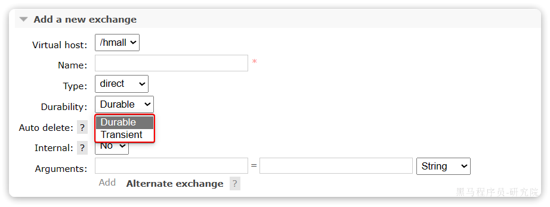
> 图注：图片展示了RabbitMQ控制台中添加新交换机的界面。在“Add a new exchange”区域，有多个参数设置项，其中“Durability”参数下拉菜单被红色框突出显示，可选择“Durable”（持久化模式）和“Transient”（临时模式）两种模式。该图片与上下文紧密相关，上下文在介绍设置交换机持久化的方法，即在控制台的“Exchanges”页面添加交换机时，配置交换机的“Durability”参数，设置为“Durable”即为持久化模式，此图直观呈现了参数设置界面及可选模式。

设置为`Durable`就是持久化模式，`Transient`就是临时模式。

设置持久化后在交换机列表会有一个"D"标识

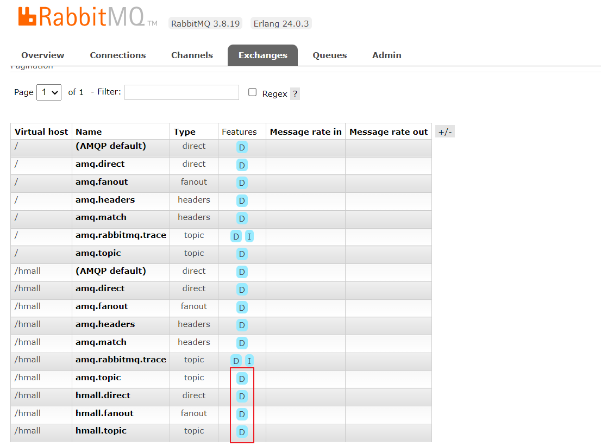
> 图注：这张图片是RabbitMQ 3.8.19版本控制台的Exchanges页面界面，页面中展示了不同虚拟主机下的交换机列表，列表包含交换机的名称、类型等信息，部分交换机旁标注有字母“D”，这些是设置交换机持久化模式后添加的标识，对应上下文里设置交换机Durability参数为“Durable”（持久化模式）后产生的“D”标识，用于直观区分持久化与临时模式的交换机。


#### 1.3.2 队列持久化

队列持久化也是将队列的定义信息(元数据)持久化到RabbitMQ的数据库中。

如果队列不设置持久化，在RabbitMQ重启后队列的元数据丢失。

设置队列持久化可以保证队列本身的元数据不会因异常情况而丢失，队列中存储的是消息的在队列中的位置、消息的ID、存储位置等，消息会存储在独立的rdq数据文件中，队列持久化不能保证消息数据不会丢失。

在控制台的Queues页面，添加队列时，同样可以配置队列的`Durability`参数：

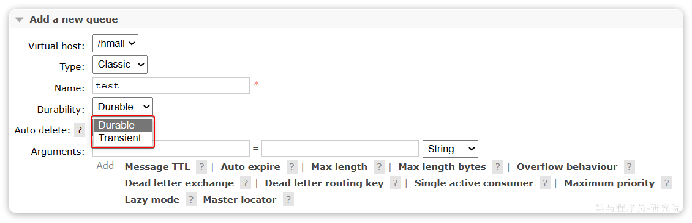
> 图注：图片展示了RabbitMQ控制台中添加队列时的配置界面。在“Durability”下拉菜单中，有“Durable”和“Transient”两个选项，其中“Durable”被红色框突出显示。该图片与上下文紧密相关，上下文在介绍设置队列持久化以保证队列元数据不丢失，且消息会存储在独立的rdq数据文件中，但不能保证消息数据不丢失的内容，此图直观呈现了设置队列持久化时可选择的参数选项。

除了持久化以外，你可以看到队列还有很多其它参数，有一些我们会在后期学习。

设置持久化后在队列列表会有一个"D"标识

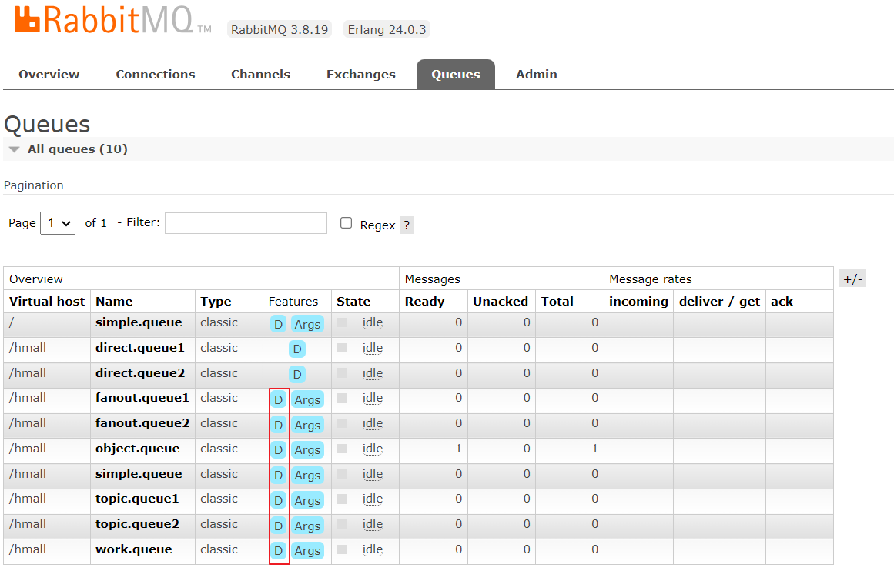
> 图注：图片展示的是RabbitMQ控制台Queues页面。页面上方有导航栏，选中“Queues”选项卡。下方表格中列出了多个队列信息，包括虚拟主机、名称、类型、状态、消息数量等。其中，部分队列名称前有蓝色“D”标识，对应“Features”列的“Args”选项，这些标识与上下文提到的设置持久化后队列列表中出现的“D”标识相呼应，直观呈现了队列持久化设置的效果。


#### 1.3.3 消息持久化

**要确保消息不会丢失需要将消息设置为持久化**。

在控制台发送消息的时候，可以添加很多参数，而消息的持久化是要配置一个`properties`：

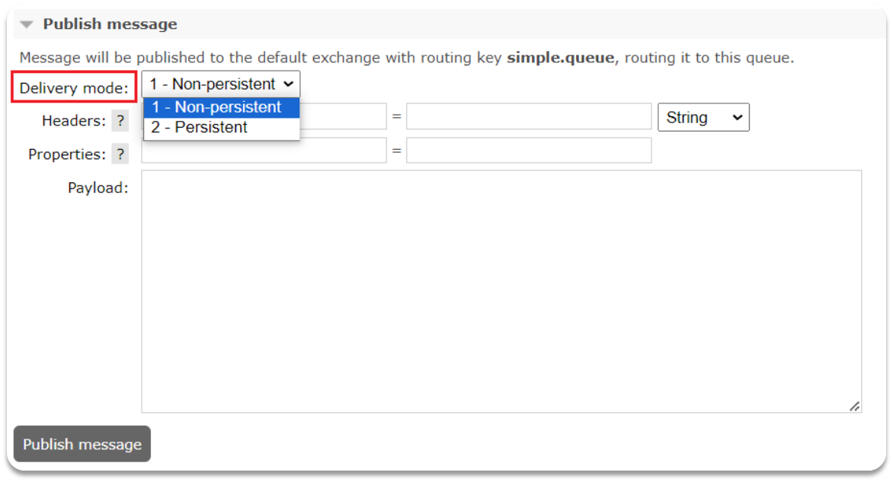
> 图注：这张图片展示的是RabbitMQ控制台发送消息的页面，用于配置消息的持久化参数。页面里的“Delivery mode”项被红色框标出，该选项的下拉菜单中，选中的内容为“1 - Non-persistent”，菜单内还包含“2 - Persistent”的选项，对应文档中提及的持久化相关配置，用于设置发送消息的持久化属性。页面还显示消息将发布到默认交换机，路由键为simple.queue，下方设有Headers、Properties配置区域和Payload输入框，底部有“Publish message”按钮，用于完成消息发布操作。

查看持久消息的内容：

delivery_mode=2 表示持久化

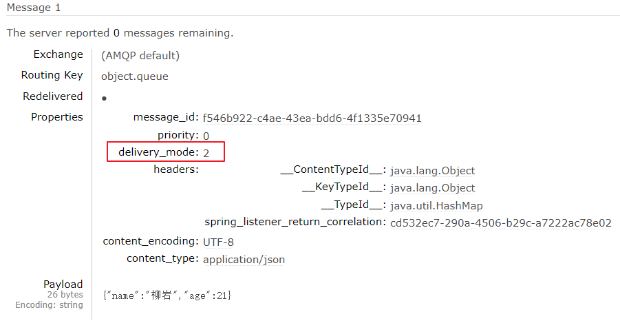
> 图注：图片展示的是在控制台发送消息时查看消息内容的界面。上方显示“Message 1”，并提示服务器剩余0条消息。消息的Exchange为(AMQP default)，Routing Key为object.queue，Properties部分突出显示了delivery_mode=2，表明该消息为持久化消息。Payload部分显示消息内容为JSON格式，包含“name”和“age”两个字段。该图片与上下文紧密相关，直观呈现了消息持久化设置后在控制台查看消息内容时的显示情况。


### 1.4 消费消息可靠性

当RabbitMQ向消费者投递消息以后，需要知道消费者的处理状态如何。因为消息投递给消费者并不代表就一定被正确消费了，可能出现的故障有很多，比如：

- 消息投递的过程中出现了网络故障
- 消费者接收到消息后突然宕机
- 消费者接收到消息后，因处理不当导致异常
- ...

一旦发生上述情况，消息也会丢失。因此，RabbitMQ必须知道消费者的处理状态，一旦消息处理失败能重新投递消息。

但问题来了：RabbitMQ如何得知消费者的处理状态呢？


本章我们就一起研究一下消费者处理消息时的可靠性解决方案。

#### 1.4.1. 消费者确认机制

##### 1.4.1.1 介绍

为了确认消费者是否成功处理消息，RabbitMQ提供了消费者确认机制（Consumer Acknowledgement）。即：当消费者处理消息结束后，应该向RabbitMQ发送一个回执，告知RabbitMQ消息处理状态。回执有三种可选值：

- ack：成功处理消息，RabbitMQ从队列中删除该消息
- nack：消息处理失败，RabbitMQ需要再次投递消息
- reject：消息处理失败并拒绝该消息，RabbitMQ从队列中删除该消息


一般reject方式用的较少，除非是消息格式有问题，那就是开发问题了。因此大多数情况下我们需要将消息处理的代码通过`try catch`机制捕获，消息处理成功时返回ack，处理失败时返回nack.


SpringAMQP帮我们实现了消息确认，并可以通过配置文件设置消息确认的处理方式，有三种模式：

- **`none`**：不处理。即消息投递给消费者后消息会立刻从MQ删除。非常不安全，不建议使用
- **`manual`**：手动模式。需要自己在业务代码中调用api，发送`ack`或`reject`，存在业务入侵，但更灵活
- **`auto`**：自动模式。当业务正常执行时则自动返回`ack`.  当业务出现异常时，根据异常判断返回不同结果：

  - 如果是**业务异常**，会自动返回`nack`；
  - 如果是**消息处理或校验异常**，自动返回`reject`，返回的异常包括：MessageConversionException、MethodArgumentTypeMismatchException等


##### 1.4.1.2 auto模式测试

通过下面的配置可以修改消息确认的处理方式为auto：

```YAML
spring:
  rabbitmq:
    listener:
      simple:
        acknowledge-mode: auto # 自动ack
```


修改consumer服务的SpringRabbitListener类中的方法，模拟一个消息处理的异常：

```Java
@RabbitListener(queues = "simple.queue")
public void listenSimpleQueueMessage2(String msg) throws InterruptedException {
    log.info("spring 消费者接收到消息：【" + msg + "】");
    if (true) {
        throw new RuntimeException("故意的");
    }
    log.info("消息处理完成");
}
```

在此方法内第一句打断点，我们向队列“simple.queue”发一条消息，此时进入断点

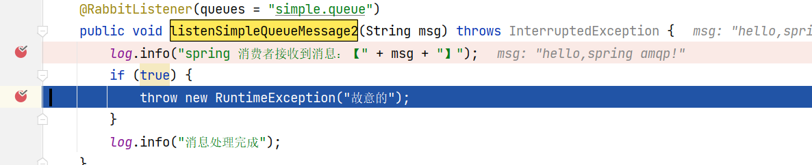
> 图注：这张图片展示了一段Java代码，属于consumer服务中SpringRabbitListener类里的listenSimpleQueueMessage方法，该方法对应监听simple.queue队列，是测试auto模式消息确认机制的内容。代码中先通过log.info打印接收到的消息内容，随后设置了true的判断条件，在判断体中抛出故意生成的RuntimeException异常，以此模拟消息处理时的业务异常场景，这一设置正是为了测试异常场景下auto模式的消息确认与重投递逻辑。


可以发现此时有一条消息状态为`unacked`（未确定状态）：

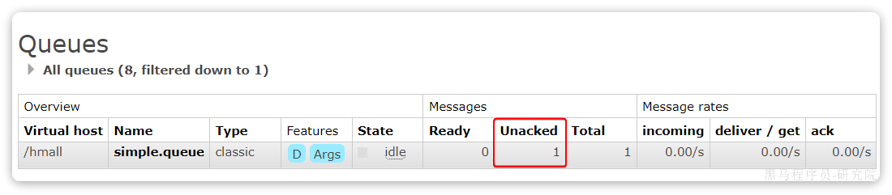
> 图注：这张图是RabbitMQ队列监控的Queues页面，展示了simple.queue的运行状态，其中Virtual host为/hmall，队列类型为classic，当前状态为idle。在Messages栏目下，Ready数值为0，Unacked（未确定状态）的数值被红框标注，为1，Total数值为1，同时该页面的Message rates板块显示incoming、deliver/get、ack的速率均为0.00/s，该内容对应文档中“有一条消息状态为unacked”的测试结果，印证了消费者异常时消息的未确认状态。

放行以后，由于抛出的是业务异常，消息处理失败后，会回到RabbitMQ，并重新投递到消费者。


##### 1.4.1.3 **`manual`**模式测试(自学)

通常在应用程序中会使用**`auto`**自动模式，手动模式在生产中不常用可以自行学习。

通过 api指定是否重新入队，具体返回ack或nack通过手动编程实现。

由于手动模式需要通过api编程，需要在监听方法添加Channel、Message类型的参数，如下：

Message：是spring AMQP封装的底层消息对象。

Channel：是消费端与MQ基于通道的操作对象。


```JavaScript
    @RabbitListener(queues = "simple.queue")
    public void listenSimpleQueueMessage(String msg, Channel channel, Message message) throws InterruptedException, IOException {
        log.info("spring 消费者接收到消息：【" + msg + "】");
        //返回nack
        //每个参数的意义：1.消息的标记 2.是否确认之前所有未确认的消息 3.是否重新入队
        channel.basicNack(message.getMessageProperties().getDeliveryTag(), false, true);
//        log.info("消息处理完成");
//        //返回ack,每个参数的意义：1.消息的标记 2.是否确认之前所有消息
//        channel.basicAck(message.getMessageProperties().getDeliveryTag(), false);
    }
```


##### 1.4.1.4 小结

消息者确认机制怎么实现？

消费者处理消息结束后，应该向RabbitMQ发送一个回执，告知RabbitMQ消息处理状态：

- ack：成功处理消息，RabbitMQ从队列中删除该消息
- nack：消息处理失败，RabbitMQ需要再次投递消息
- reject：消息处理失败并拒绝该消息，RabbitMQ从队列中删除该消息

具体实现方法：

SpringAMQP提供消息确认配置，有三种模式：

- **`none`**：不处理。即消息投递给消费者后消息会立刻从MQ删除。非常不安全，不建议使用。
- **`manual`**：手动模式。需要自己在业务代码中调用api，发送`ack`或`reject`。
- **`auto`**：自动模式。当业务正常执行时则自动返回`ack`.  当业务出现异常时会自动返回`nack`.

我们通常使用auto自动模式，业务处理完成没有异常则自动返回ack，如果存在业务异常则自动返回nack，如果在消息处理或消息校验异常时自动返回reject。


除了自动确认还要了解手动确认，手动确认是将返回ack或nack在程序中编码实现，举例如下：

返回ack：

```JavaScript
    //返回ack,每个参数的意义：1.消息的标记 2.是否确认之前所有消息
    channel.basicAck(message.getMessageProperties().getDeliveryTag(), false);
```

返回nack:

```JavaScript
 //每个参数的意义：1.消息的标记 2.是否确认之前所有消息 3.是否重新入队
channel.basicNack(message.getMessageProperties().getDeliveryTag(), false, false);
```


#### 1.4.2. 失败重试机制

##### 1.4.2.1 本地重试机制

当消费者出现异常后，消息会不断requeue（重入队）到队列，再重新发送给消费者。如果消费者再次执行依然出错，消息会再次返回到队列，再次投递，直到消息处理成功为止。

极端情况就是消费者一直无法执行成功，那么消息投递就会无限循环，导致mq的消息处理飙升，带来不必要的压力：

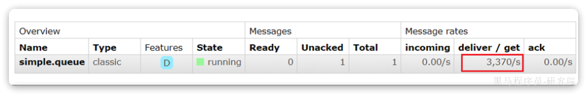
> 图注：这张图片展示了一个消息队列的监控面板，其中核心信息是simple.queue队列的消息投递速度指标，被红色框标注出来，数值为3370/s。结合上下文可知，该图片用于说明消费者在缺少合理重试机制时，会出现消息投递无限循环的极端情况，导致消息处理压力飙升，图中的高消息投递速率正是这种异常情况的直观体现。该队列状态为运行中，具备持久化特征（标识为D），未确认消息数量为1，当前的高消息投递速度也直观展现了无限重试带来的负载问题。


当然，上述极端情况发生的概率还是非常低的，不过不怕一万就怕万一。为了应对上述情况Spring又提供了消费者失败重试机制：在消费者出现异常时利用本地重试，而不是无限制的投递到mq队列。


修改consumer服务的application.yml文件，添加内容：

```YAML
spring:
  rabbitmq:
    listener:
      simple:
        retry:
          enabled: true # 开启消费者失败重试
          initial-interval: 1000ms # 初识的失败等待时长为1秒
          multiplier: 1 # 失败的等待时长倍数，下次等待时长 = 上次等待时长 * multiplier
          max-attempts: 3 # 最大重试次数
```


重启consumer服务，重复之前的测试。可以发现：

- 消费者在失败后消息没有重新回到MQ无限重新投递，而是在本地重试了3次
- 本地重试3次以后，查看RabbitMQ控制台，发现消息被删除了，说明最后SpringAMQP返回的是`reject`


结论：

- 开启本地重试时，消息处理过程中抛出异常，不会请求到队列，而是在消费者本地重试
- 重试达到最大次数后，Spring会返回reject，消息会被丢弃

##### 1.4.2.2 失败消息入队

本地测试达到最大重试次数后，消息会被丢弃。这在某些对于消息可靠性要求较高的业务场景下，显然不太合适了。

因此Spring允许我们自定义重试次数耗尽后的消息处理策略，这个策略是由`MessageRecovery`接口来定义的，它有3个不同实现：

-  `RejectAndDontRequeueRecoverer`：重试耗尽后，直接`reject`，丢弃消息。默认就是这种方式 
-  `ImmediateRequeueMessageRecoverer`：重试耗尽后，返回`nack`，消息重新入队 
-  `RepublishMessageRecoverer`：重试耗尽后，将失败消息投递到指定的交换机 


比较优雅的一种处理方案是`RepublishMessageRecoverer`，失败后将消息投递到一个固定交换机，通过交换机将消息转发到失败消息队列，程序监听失败消息队列，接收到失败消息，将失败消息存入失败消息表，通过定时任务进行处理。


1）在consumer服务中定义处理失败消息的交换机和队列

```Java
@Bean
public DirectExchange errorMessageExchange(){
    return new DirectExchange("error.direct");
}
@Bean
public Queue errorQueue(){
    return new Queue("error.queue", true);
}
@Bean
public Binding errorBinding(Queue errorQueue, DirectExchange errorMessageExchange){
    return BindingBuilder.bind(errorQueue).to(errorMessageExchange).with("error");
}
```


2）定义一个RepublishMessageRecoverer，指定失败消息投递交换机的名称及routingkey

```Java
@Bean
public MessageRecoverer republishMessageRecoverer(RabbitTemplate rabbitTemplate){
    return new RepublishMessageRecoverer(rabbitTemplate, "error.direct", "error");
}
```


完整代码如下：

```Java
package com.itheima.consumer.config;

import org.springframework.amqp.core.Binding;
import org.springframework.amqp.core.BindingBuilder;
import org.springframework.amqp.core.DirectExchange;
import org.springframework.amqp.core.Queue;
import org.springframework.amqp.rabbit.core.RabbitTemplate;
import org.springframework.amqp.rabbit.retry.MessageRecoverer;
import org.springframework.amqp.rabbit.retry.RepublishMessageRecoverer;
import org.springframework.context.annotation.Bean;

@Configuration
@ConditionalOnProperty(name = "spring.rabbitmq.listener.simple.retry.enabled", havingValue = "true")
public class ErrorMessageConfig {
    @Bean
    public DirectExchange errorMessageExchange(){
        return new DirectExchange("error.direct");
    }
    @Bean
    public Queue errorQueue(){
        return new Queue("error.queue", true);
    }
    @Bean
    public Binding errorBinding(Queue errorQueue, DirectExchange errorMessageExchange){
        return BindingBuilder.bind(errorQueue).to(errorMessageExchange).with("error");
    }

    @Bean
    public MessageRecoverer republishMessageRecoverer(RabbitTemplate rabbitTemplate){
        return new RepublishMessageRecoverer(rabbitTemplate, "error.direct", "error");
    }
}
```


##### 1.4.2.3 测试失败消息入队

测试流程：

启动消费端程序：

```JavaScript
@RabbitListener(queues = "simple.queue")
public void listenSimpleQueueMessage(String msg) throws InterruptedException {
    log.info("spring 消费者接收到消息：【" + msg + "】");
    if (true) {
        throw new RuntimeException("故意的");
    }
    log.info("消息处理完成");
}
```

达到最大重试次数将会投递到失败消息队列。

监听失败消息队列将失败消息写入数据库中，由人工定期处理。

```JavaScript
@RabbitListener(queues = "error.queue")
public void listenErrorQueue(String msg) throws InterruptedException {
    System.out.println("接收失败消息：【" + msg + "】" + LocalTime.now());
    //存入数据库失败消息表...
}
```


##### 1.4.2.4 小结

消费消息失败重试机制是什么？

提供三种策略：

- `RejectAndDontRequeueRecoverer`：重试耗尽后，直接`reject`，丢弃消息。默认就是这种方式 
-  `ImmediateRequeueMessageRecoverer`：重试耗尽后，返回`nack`，消息重新入队 
-  `RepublishMessageRecoverer`：重试耗尽后，将失败消息投递到指定的交换机 

推荐使用`RepublishMessageRecoverer`，将失败消息投递到固定的交换机，通过交换机将消息转发到失败消息队列，程序监听失败消息队列，接收到失败消息，将失败消息存入失败消息表，通过定时任务进行处理。


#### 1.4.3. MQ消息幂等性

##### 1.4.3.1 什么是幂等性

何为幂等性？

在程序开发中，是指同一个业务，执行一次或多次对业务状态的影响是一致的。例如：

- 根据id删除数据
- 查询数据


但数据的更新往往不是幂等的，如果重复执行可能造成不一样的后果。比如：

- 取消订单，恢复库存的业务。如果多次恢复就会出现库存重复增加的情况
- 退款业务。重复退款对商家而言会有经济损失。

所以，我们要尽可能避免业务被重复执行，然而在实际业务场景中，由于意外经常会出现业务被重复执行的情况。例如：

- 页面卡顿时频繁刷新导致表单重复提交
- 服务间调用的重试
- MQ消息的重复投递


因此，我们必须想办法保证消息处理的幂等性。这里给出两种方案：

- 唯一消息ID
- 业务状态判断


##### 1.4.4.2 唯一消息ID

这个思路非常简单：

1. 每一条消息都生成一个唯一的id，与消息一起投递给消费者。
2. 消费者接收到消息后处理自己的业务，业务处理成功后将消息ID保存到数据库或Redis
3. 如果下次又收到相同消息，去数据库或Redis查询判断是否存在，存在则为重复消息放弃处理。


我们该如何给消息添加唯一ID呢？

其实很简单，SpringAMQP的MessageConverter自带了MessageID的功能，我们只要开启这个功能即可。

以Jackson的消息转换器为例：

```Java
@Bean
public MessageConverter messageConverter(){
    // 1.定义消息转换器
    Jackson2JsonMessageConverter jjmc = new Jackson2JsonMessageConverter();
    // 2.配置自动创建消息id，用于识别不同消息，也可以在业务中基于ID判断是否是重复消息
    jjmc.setCreateMessageIds(true);
    return jjmc;
}
```

接收消息的方法中添加org.springframework.amqp.core.Message类型的参数，整体的处理逻辑是：

1. 接收消息解析出消息id
2. 根据消息id查询数据库已处理消息表如果存在说明已处理该消息，如果查询不到说明未处理该消息
3. 根据判断结果去处理消息
4. 处理消息完毕将消息id写入已处理消息表。

代码如下：

```JavaScript
@RabbitListener(queues = "simple.queue")
public void listenSimpleQueueMessage(String msg,Channel channel,Message message) throws InterruptedException {
    log.info("spring 消费者接收到消息：【" + msg + "】");
    //消息id
    String messageId = message.getMessageProperties().getMessageId();
    //先从数据库查询是否已处理该消息，否则已处理直接return
    if (true) {
        throw new RuntimeException("故意的");
    }
    //将已处理的消息id存入数据库中...
    log.info("消息处理完成");
}
```


##### 1.4.4.3 业务判断

业务判断就是基于业务本身的逻辑或状态来判断是否是重复的请求，不同的业务场景判断的思路也不一样。

例如在支付通知案例中，处理消息的业务逻辑是把订单状态从未支付修改为已支付。因此我们就可以在执行更新时判断订单状态是否是未支付，如果不是则证明订单已经被处理过，无需重复处理。

可以针对使用唯一消息ID的方案（操作数据库或Redis保存消息ID），再补充业务判断方案更完善。


以支付修改订单的业务为例，我们需要修改`OrderServiceImpl`中的`markOrderPaySuccess`方法：

```Java
    @Override
    public void markOrderPaySuccess(Long orderId) {
        //加锁判断
    
        // 1.查询订单
        Order old = getById(orderId);
        // 2.判断订单状态
        if (old == null || old.getStatus() != 1) {
            // 订单不存在或者订单状态不是1，放弃处理
            return;
        }
        // 3.尝试更新订单
        Order order = new Order();
        order.setId(orderId);
        order.setStatus(2);
        order.setPayTime(LocalDateTime.now());
        updateById(order);
        
        //释放锁
    }
```

直接update语句中添加条件也可以，如下(乐观锁机制)：

```Java
@Override
public void markOrderPaySuccess(Long orderId) {
    // UPDATE `order` SET status = ? , pay_time = ? WHERE id = ? AND status = 1
    lambdaUpdate()
            .set(Order::getStatus, 2)
            .set(Order::getPayTime, LocalDateTime.now())
            .eq(Order::getId, orderId)
            .eq(Order::getStatus, 1)
            .update();
}
```

注意看，上述代码等同于这样的SQL语句：

```SQL
UPDATE `order` SET status = ? , pay_time = ? WHERE id = ? AND status = 1
```

我们在where条件中除了判断id以外，还加上了status必须为1的条件。如果条件不符（说明订单已支付），则SQL匹配不到数据，根本不会执行。


##### 1.4.4.4 面试题

如何保证MQ幂等性？或 如何防止消息重复消费？


#### 1.4.4. 业务补偿

虽然我们利用各种机制尽可能增加了消息的可靠性，但也不好说能保证消息100%的可靠。万一真的MQ通知失败该怎么办呢？有没有其它补偿方案，能够确保订单的支付状态一致呢？


其实思想很简单：既然MQ通知不一定发送到交易服务，那么交易服务就必须自己**主动去查询**支付状态。这样即便支付服务的MQ通知失败，我们依然能通过主动查询来保证订单状态的一致。

流程如下：

<whiteboard token="Y5cYw4QgIhW2pHbhc93cT8xCnnc"></whiteboard>


图中黄色线圈起来的部分就是MQ通知失败后的补偿处理方案，由交易服务自己主动去查询支付状态。


不过需要注意的是，交易服务并不知道用户会在什么时候支付，如果查询的时机不正确（比如查询的时候用户正在支付中），可能查询到的支付状态也不正确。

那么问题来了，我们到底该在什么时间主动查询支付状态呢？

1. 由用户在页面中主动点击“已完成支付”按钮时去查询最新的支付结果。


> 图注：图片展示的是一个支付订单界面。上方显示支付剩余时间为11:58，订单总价1元，待付金额1.00元。中间有一个二维码，下方有“支付成功”提示。底部有一个红色的“支付完成”按钮。该图片与文档中“由用户在页面中主动点击‘已完成支付’按钮时去查询最新的支付结果”这一内容相关，直观呈现了用户在支付成功后点击“已完成支付”按钮的场景。

1. 通过定时任务去定义查询支付结果，比如：对于30分钟内的订单状态为未支付状态时去主动查询支付结果，超过30分钟用户未支付将自动取消订单。

可以每隔一段时间查询一次，并判断支付状态。如果发现订单已经支付，则立刻更新订单状态为已支付即可。

定时任务大家之前学习过，具体的实现这里就不再赘述了。


至此，消息可靠性的问题已经解决了。


综上，支付服务与交易服务之间的订单状态一致性是如何保证的？

- 首先，支付服务在用户支付成功以后利用MQ消息通知交易服务，完成订单状态同步。
- 其次，为了保证MQ消息的可靠性，我们采用了生产者确认机制、消费者确认、消费者失败重试等策略，确保消息投递的可靠性
- 最后，我们提供了用户主动查询支付结果的入口 ，并且还在交易服务设置了定时任务，定期查询订单支付状态。这样即便MQ通知失败，还可以利用定时任务作为兜底方案，确保订单支付状态的最终一致性。


#### 1.4.5. 面试题

如何保证消息的可靠性？可以百分百保证MQ的消息可靠性吗？


如何保证MQ幂等性？或 如何防止消息重复消费？


## 2.延迟消息

### 2.1. 技术方案

在电商的支付业务中，对于一些库存有限的商品，为了更好的用户体验，通常都会在用户下单时立刻扣减商品库存。例如电影院购票、高铁购票，下单后就会锁定座位资源，其他人无法重复购买。


但是这样就存在一个问题，假如用户下单后一直不付款，就会一直占有库存资源，导致其他客户无法正常交易，最终导致商户利益受损！


因此，电商中通常的做法就是：**对于超过一定时间未支付的订单会自动取消订单并释放占用的库存**。

例如，订单支付超时时间为30分钟，则我们应该在用户下单后的第30分钟检查订单支付状态，如果发现未支付，应该立刻取消订单，释放库存。


但问题来了：如何才能准确的实现在下单后第30分钟去检查支付状态呢？


像这种在一段时间以后才执行的任务，我们称之为**延迟任务**，而要实现延迟任务，最简单的方案就是利用MQ的延迟消息了。


在RabbitMQ中实现延迟消息也有两种方案：

#### 2.1.1 **死信交换机+TTL**

该方案利用死信交换机实现，死信交换机（Dead Letter Exchange, DLX）是一种处理消息队列中无法被消费的消息的方式。当消息因为某些原因（如消费者拒绝消费消息、消息过期等）而无法被正常消费时，这些消息就会成为“死信”。

结合 TTL（Time To Live），你可以设定消息在队列中的存活时间，当消息在队列中停留的时间超过了设定的 TTL 后，消息就会成为死信。当消息变成死信时，会被发送到死信交换机中去，通过死信交换机转发到指定的队列，由应用程序去消费，进一步处理这些消息。

假设需求是下单后30分钟对未支付订单自动取消订单，通过下图举例说明： 

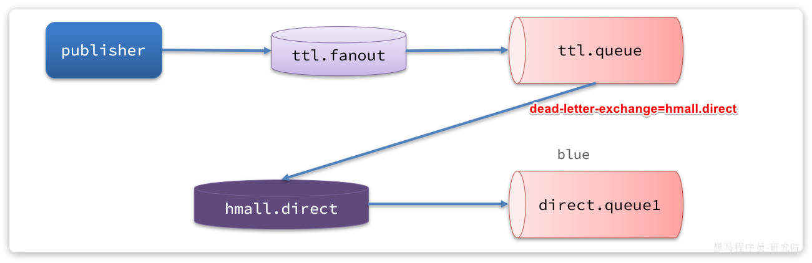
> 图注：图片展示了MQ延迟消息技术方案中死信交换机+TTL的流程。左侧“publisher”向“ttl.fanout”交换机发送消息，消息内容记录下单信息，TTL为30分钟。消息经“ttl.fanout”转发至“ttl.queue”队列，但因无消费程序监听，到达30分钟变为死信，自动发给死信交换机“hmall.direct”。列信交换机将消息转发到“direct.queue1”队列。图中“dead-letter - exchange = hmall.direct”标注了死信交换机的标识。

流程如下：

1. 创建订单成功向“ttl.fanout”交换机发送消息，消息内容记录下单的订单信息，消息的TTL为30分钟
2. 通过"ttl.fanout"将消息转发到"ttl.queue"队列
3. 由于该队列并没有消费程序去监听，当到达30分钟时该消息变为死信，自动发给死信交换机“hmall.direct”，由列信交换机将消息转发到"direct.queue1"队列。
4. 应用监听“direct.queue1”队列，收到未支付超时订单，执行取消订单并回滚库存。


#### 2.1.2 **延迟消息插件**

RabbitMQ社区提供了一个延迟消息插件来实现相同的效果。

此方案实现过程非常简单，安装延迟消息插件，发送消息时指定延迟时间，到达延迟时间消息被消费。

延迟消息插件内部会维护一个本地数据库表，同时使用Elang Timers功能实现计时。如果消息的延迟时间设置较长，可能会导致堆积的延迟消息非常多，会带来较大的CPU开销，同时延迟消息的时间会存在误差。

因此，**不建议设置延迟时间过长的延迟消息**。


对上述两个方案比较，实现延迟消息推荐使用延迟消息插件实现。


### 2.2.使用延迟消息插件

官方文档说明：

<bookmark name="Scheduling Messages with RabbitMQ | RabbitMQ - Blog" href="https://blog.rabbitmq.com/posts/2015/04/scheduling-messages-with-rabbitmq"></bookmark>


#### 2.2.1下载

插件下载地址：

<bookmark name="GitHub - rabbitmq/rabbitmq-delayed-message-exchange: Delayed Messaging for RabbitMQ" href="https://github.com/rabbitmq/rabbitmq-delayed-message-exchange"></bookmark>

由于我们安装的MQ是`3.8`版本，因此这里下载`3.8.17`版本：

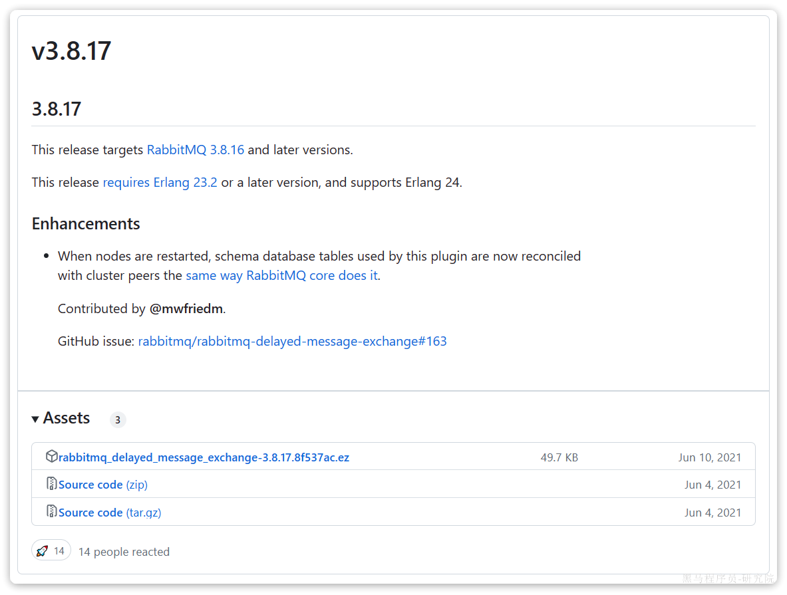
> 图注：这张图片展示了RabbitMQ延迟消息插件的版本相关信息，对应文档中需下载3.8.17版本插件的内容，版本v3.8.17说明该插件适用RabbitMQ 3.8.16及更高版本，要求Erlang 23.2或更高版本。图片还列出该版本的更新内容，提到节点重启时插件用到的schema数据库表会按RabbitMQ核心的规则同步更新，贡献者为@mfridm，关联GitHub issue为rabbitmq/rabbitmq-delayed-message-exchange#163。图片下方的Assets部分提供了可下载的插件包，文件名为rabbitmq_delayed_message_exchange-3.8.17.8f537ac.ez，另有两个源码压缩包，分别为zip和tar.gz格式，标注了对应的文件大小与更新时间。

当然，也可以直接使用课前资料提供好的插件：

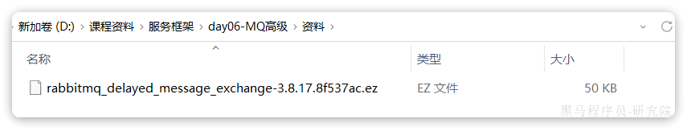
> 图注：图片展示的是一个文件夹内容界面，路径为“新加卷（D:）>课程资料>服务框架>day06 - MQ高级>资料”。界面中显示一个名为“rabbitmq_delayed_message_exchange - 3.8.17.8f537ac.ez”的文件，类型为EZ文件，大小为50KB。该图片与文档中“2.2.1下载”部分内容相关，用于说明在下载延迟消息插件时，找到并展示该插件文件，为后续安装插件做准备。


#### 2.2.2 安装

因为我们是基于Docker安装，所以需要先查看RabbitMQ的插件目录对应的数据卷。

```Shell
docker volume inspect mq-plugins
```

结果如下：

```JSON
[
    {
        "CreatedAt": "2024-06-19T09:22:59+08:00",
        "Driver": "local",
        "Labels": null,
        "Mountpoint": "/var/lib/docker/volumes/mq-plugins/_data",
        "Name": "mq-plugins",
        "Options": null,
        "Scope": "local"
    }
]
```

插件目录被挂载到了`/var/lib/docker/volumes/mq-plugins/_data`这个目录，我们上传插件到该目录下。


接下来执行命令，安装插件：

```Shell
docker exec -it mq rabbitmq-plugins enable rabbitmq_delayed_message_exchange
```

运行结果如下：

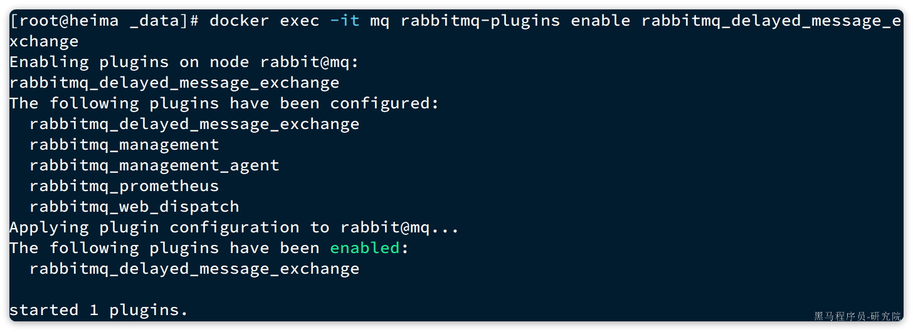
> 图注：这张图片展示了在服务器终端执行RabbitMQ延迟消息插件安装命令后的运行结果，执行的命令是docker exec -it mq rabbitmq-plugins enable rabbitmq_delayed_message_exchange，结果显示已成功启用rabbitmq_delayed_message_exchange插件，同时还显示了当前已配置的其他插件，包括rabbitmq_management、rabbitmq_management_agent等，最终确认已启用1个插件。该图片对应文档中安装延迟消息插件命令的运行结果说明部分，用于直观展示插件安装成功的状态。

#### 2.2.3 声明延迟交换机

控制台方式：

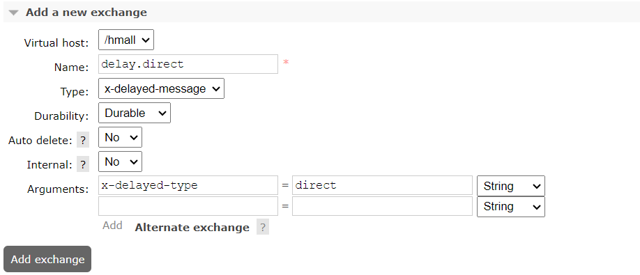
> 图注：图片展示的是RabbitMQ管理控制台中添加延迟交换机的界面。在“Add a new exchange”区域，Virtual host选择“/hmall”，Name输入“delay.direct”，Type下拉选“x-delayed-message”，Durability选“Durable”，Auto delete选“No”，Internal选“No”，Arguments中“x-delayed-type”设置为“direct”。该图片与文档中“2.2.3声明延迟交换机”部分对应，用于控制台方式声明延迟交换机，创建delay.queue队列并绑定到延迟交换机。

创建delay.queue队列，并绑定到延迟交换机

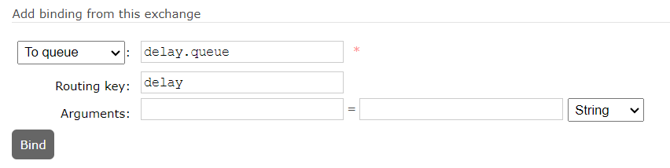
> 图注：这张图片展示的是RabbitMQ控制台中声明延迟交换机时，将队列绑定到延迟交换机的操作界面，对应文档中“创建delay.queue队列，并绑定到延迟交换机”的步骤。界面中可看到用于选择目标队列的下拉框已选定“To queue”，队列名称输入框内已填写“delay.queue”，路由键输入框内填写了“delay”，参数设置区域显示参数为空，最后有“Bind”绑定按钮，完成相关设置后点击该按钮即可完成延迟队列与延迟交换机的绑定操作。

基于注解方式：

```Java
@RabbitListener(bindings = @QueueBinding(
        value = @Queue(name = "delay.queue", durable = "true"),
        exchange = @Exchange(name = "delay.direct", delayed = "true",type = ExchangeTypes.DIRECT, durable = "true"),
        key = "delay"
))
public void listenDelayMessage(String msg){
    log.info("接收到delay.queue的延迟消息：{}", msg);
}
```


#### 2.2.4 发送延迟消息

发送消息时，必须通过x-delay属性设定延迟时间：

```Java
@Test
void testPublisherDelayMessage01() {
    // 1.创建消息
    String message = "hello, delayed message";
    // 2.发送消息，利用消息后置处理器添加消息头
    rabbitTemplate.convertAndSend("delay.direct", "delay", message, new MessagePostProcessor() {
        @Override
        public Message postProcessMessage(Message message) throws AmqpException {
            // 添加延迟消息属性
            message.getMessageProperties().setDelay(5000);
            log.info("发送消息"+new String(message.getBody(), StandardCharsets.UTF_8)+ LocalDateTime.now());
            return message;
        }
    });
}

@Test
void testPublisherDelayMessage02() {
    String messageStr = "hello rabbitmq advance ~";
    Message message = MessageBuilder.withBody(messageStr.getBytes(StandardCharsets.UTF_8))
            .setHeader("x-delay","20000") //消息延迟投递到队列的时间，单位是毫秒
            .setContentType(MessageProperties.CONTENT_TYPE_TEXT_PLAIN)//普通字符串，必须指定为文本格式
            .build();
    rabbitTemplate.convertAndSend("delay.direct", "delay", message);
}
```

#### 2.2.5 测试

测试流程：

1. 启动消费端监听程序。

在consumer模块添加监听方法。

1. 执行发送程序
2. 观察发送程序日志中发送的消息的时间，观察监听程序的日志中接收消息时间的，判断是否是按延迟时间发送消息。


注意：发送延迟消息会触发ReturnCallback，这是因为延迟消息并没有发送到队列，而是在延迟时间到达才发送到队列，所以会触发ReturnCallback，需要在ReturnCallback方法中判断，如果是延迟消息不要向失败消息表插入记录。


### 2.3.自动取消超时未支付订单(作业)

#### 2.3.1. 需求分析

接下来，我们就在交易服务中利用延迟消息实现订单超时取消功能，假设订单未支付超时时间为30分钟，下单后30内不支付将自动取消订单，其大概思路如下：

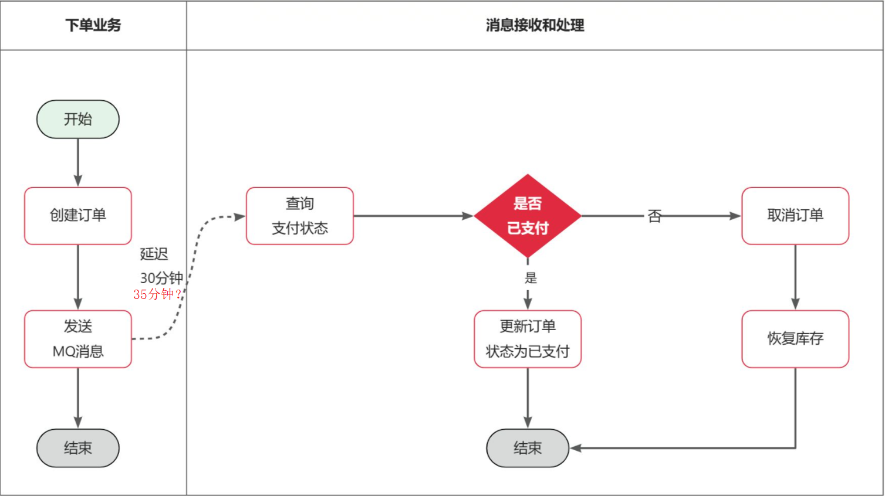
> 图注：这张图对应文档中延迟消息实现超时未支付订单自动取消的业务流程内容，左侧为下单业务流程，从开始到创建订单、发送延迟30分钟的MQ消息后结束；右侧为消息接收和处理流程，接收到MQ消息后会查询支付状态，若订单未支付则执行取消订单并恢复库存，若订单已支付则更新订单状态为已支付，两个流程的处理最终均以结束状态收尾，清晰呈现了该功能的完整逻辑。

理论上我们应该在下单时发送一条延迟消息，延迟时间为30分钟。这样就可以在接收到消息时检验订单支付状态，关闭未支付订单。

不过大家设想，极端情况如果用户在下单后正好30分钟去支付了，此时延迟消息发送到交易服务，交易服务收到延迟消息后取消订单，用户支付成功，问题出现。

我们可以把延迟消息的时间定为35分钟，当下单30分钟后用户无法支付，35分钟后自动取消订单避免取消订单后用户支付成功的问题。


交互流程如下：

<whiteboard token="PsgpwcFGKhf6ZDbm2XxcIHDtnwc"></whiteboard>


#### 2.3.2 基础配置

我们在常量类中配置交换机、队列、RoutingKey等常量，内容如下：

```Java
package com.hmall.common.constants;

public interface MqConstants{
    String DELAY_EXCHANGE_NAME = "trade.delay.direct";
    String DELAY_ORDER_QUEUE_NAME = "trade.delay.order.queue";
    String DELAY_ORDER_KEY = "delay.order.query";
}
```

在`trade-service`模块的`pom.xml`中引入amqp的依赖：

```XML
  <!--amqp-->
  <dependency>
      <groupId>org.springframework.boot</groupId>
      <artifactId>spring-boot-starter-amqp</artifactId>
  </dependency>
```


在`trade-service`的`application.yaml`中添加MQ的配置：

```YAML
spring:
  rabbitmq:
    host: 192.168.101.68
    port: 5672
    virtual-host: /hmall
    username: hmall
    password: 123
```


#### 2.3.3. 发送延迟消息

接下来，我们改造下单业务，在下单完成后，发送延迟消息。

修改`trade-service`模块的`com.hmall.trade.service.impl.OrderServiceImpl`类的`createOrder`方法，添加消息发送的代码：

```JavaScript
    @Override
//    @Transactional
    @GlobalTransactional
    public Long createOrder(OrderFormDTO orderFormDTO) {
    ....
    ....
    //todo 发送延迟消息
    
    return order.getId();
}
```

这里延迟消息的时间应该是35分钟，不过我们为了测试方便暂时设置为10秒。


#### 2.3.4. 接收延迟消息

接下来，我们在`trader-service`编写一个监听器，监听延迟消息，查询订单支付状态：

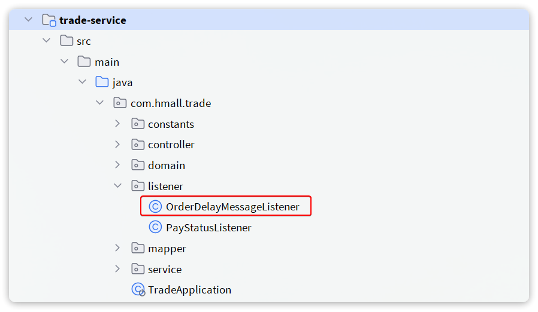
> 图注：这张图片展示了项目`trade-service`的Java代码目录结构，在`com.hmall.trade`包下的`listener`文件夹中，存在两个监听器类，分别是`OrderDelayMessageListener`和`PayStatusListener`，其中`OrderDelayMessageListener`被红色框突出标注。这一目录结构对应文档中接收延迟消息的步骤，文档提到需要在`trader-service`编写监听器监听延迟消息，该监听器正是后续用于监听延迟消息、处理超时未支付订单的关键组件。


代码如下：

```Java
package com.hmall.trade.listener;

import com.hmall.api.client.PayClient;
import com.hmall.api.dto.PayOrderDTO;
import com.hmall.common.constants.MqConstants;
import com.hmall.trade.domain.po.Order;
import com.hmall.trade.service.IOrderService;
import lombok.RequiredArgsConstructor;
import org.springframework.amqp.rabbit.annotation.Exchange;
import org.springframework.amqp.rabbit.annotation.Queue;
import org.springframework.amqp.rabbit.annotation.QueueBinding;
import org.springframework.amqp.rabbit.annotation.RabbitListener;
import org.springframework.stereotype.Component;

@Component
@RequiredArgsConstructor
public class OrderDelayMessageListener {

    private final IOrderService orderService;

        @RabbitListener(bindings = @QueueBinding(
        value = @Queue(name = MqConstants.DELAY_ORDER_QUEUE_NAME),
        exchange = @Exchange(name = MqConstants.DELAY_EXCHANGE_NAME, delayed = "true"),
        key = MqConstants.DELAY_ORDER_KEY
        ))
        public void listenOrderDelayMessage(Long orderId) {
            // 1.查询订单
            Order order = orderService.getById(orderId);
            // 2.检测订单状态，判断是否已支付
            if (order == null || order.getStatus() != 1) {
                // 订单不存在或者已经支付
                return;
            }
            // 3.todo 未支付，需要查询支付流水状态(远程调用支付服务，查询支付单状态)

            // 4.判断是否支付

            // 4.1.已支付，标记订单状态为已支付
            orderService.markOrderPaySuccess(orderId);

            // TODO 4.2.未支付，取消订单，回滚库存
                
        }
}
```

逻辑如下：

1、收到消息表示支付成功，查询支付系统最新的支付状态

2、如果已支付则标记订单为已支付

3、如果未支付则取消订单

取消订单需要完成两件事情：

- 将订单状态修改为已关闭
- 将订单中已经扣除的库存重新加回来


大家在`IOrderService`接口中定义`cancelOrder`方法，此方法为取消订单的service方法。

```Java
void cancelOrder(Long orderId);
```

并且在`OrderServiceImpl`中实现该方法，实现过程中要注意业务幂等性判断。


#### 2.3.5. 编写查询支付状态接口

由于MQ消息处理时需要查询当前最新的支付状态，因此我们要在`pay-service`模块定义查询支付状态的接口

在`pay-service`模块的`PayController`中实现该接口：

```Java
@ApiOperation("根据id查询支付单")
@GetMapping("/biz/{id}")
public PayOrderDTO queryPayOrderByBizOrderNo(@PathVariable("id") Long id){
    PayOrder payOrder = payOrderService.lambdaQuery().eq(PayOrder::getBizOrderNo, id).one();
    return BeanUtils.copyBean(payOrder, PayOrderDTO.class);
}
```

此接口会在api工程定义，所以将PayOrderDTO 在api工程定义，PayOrderDTO 的结果同PayOrder ，为防止返回数据有变这里定义为DTO类型，编写时可直接将PayOrder 拷贝至PayOrderDTO 中并进行微改。

`PayOrderDTO`代码如下：

```Java
package com.hmall.api.pay.dto;

import io.swagger.annotations.ApiModel;
import io.swagger.annotations.ApiModelProperty;
import lombok.Data;

import java.time.LocalDateTime;

/**
 * <p>
 * 支付订单
 * </p>
 */
@Data
@ApiModel(description = "支付单数据传输实体")
public class PayOrderDTO {
    @ApiModelProperty("id")
    private Long id;
    @ApiModelProperty("业务订单号")
    private Long bizOrderNo;
    @ApiModelProperty("支付单号")
    private Long payOrderNo;
    @ApiModelProperty("支付用户id")
    private Long bizUserId;
    @ApiModelProperty("支付渠道编码")
    private String payChannelCode;
    @ApiModelProperty("支付金额，单位分")
    private Integer amount;
    @ApiModelProperty("付类型，1：h5,2:小程序，3：公众号，4：扫码，5：余额支付")
    private Integer payType;
    @ApiModelProperty("付状态，0：待提交，1:待支付，2：支付超时或取消，3：支付成功")
    private Integer status;
    @ApiModelProperty("拓展字段，用于传递不同渠道单独处理的字段")
    private String expandJson;
    @ApiModelProperty("第三方返回业务码")
    private String resultCode;
    @ApiModelProperty("第三方返回提示信息")
    private String resultMsg;
    @ApiModelProperty("支付成功时间")
    private LocalDateTime paySuccessTime;
    @ApiModelProperty("支付超时时间")
    private LocalDateTime payOverTime;
    @ApiModelProperty("支付二维码链接")
    private String qrCodeUrl;
    @ApiModelProperty("创建时间")
    private LocalDateTime createTime;
    @ApiModelProperty("更新时间")
    private LocalDateTime updateTime;
}
```

接下来定义接口对应的`FeignClient`.

`PayClient`代码如下：

```Java
package com.hmall.api.client;

import com.hmall.api.client.fallback.PayClientFallback;
import com.hmall.api.dto.PayOrderDTO;
import org.springframework.cloud.openfeign.FeignClient;
import org.springframework.web.bind.annotation.GetMapping;
import org.springframework.web.bind.annotation.PathVariable;

@FeignClient(value = "pay-service", fallbackFactory = PayClientFallbackFactory .class)
public interface PayClient {
    /**
     * 根据交易订单id查询支付单
     * @param id 业务订单id
     * @return 支付单信息
     */
    @GetMapping("/pay-orders/biz/{id}")
    PayOrderDTO queryPayOrderByBizOrderNo(@PathVariable("id") Long id);
}
```

`PayClientFallbackFactory `代码如下：

```Java
package com.hmall.api.client.fallback;

import com.hmall.api.client.PayClient;
import com.hmall.api.dto.PayOrderDTO;
import lombok.extern.slf4j.Slf4j;
import org.springframework.cloud.openfeign.FallbackFactory;

@Slf4j
public class PayClientFallbackFactory implements FallbackFactory<PayClient> {
    @Override
    public PayClient create(Throwable cause) {
        return new PayClient() {
            @Override
            public PayOrderDTO queryPayOrderByBizOrderNo(Long id) {
                return null;
            }
        };
    }
}
```

最终在`hm-api`模块定义三个类：

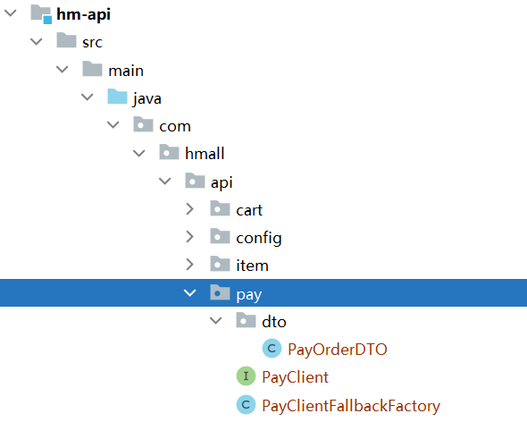
> 图注：图片展示了`hm-api`模块的目录结构。在`java`目录下，`com.hmall.api`包中包含`cart`、`config`、`item`和`pay`子包。`pay`子包下有`dto`、`payClient`和`payClientFallbackFactory`三个类，其中`PayOrderDTO`以蓝色高亮显示，`PayClient`以绿色高亮显示，`PayClientFallbackFactory`以蓝色高亮显示。该图片与文档中介绍在`hm-api`模块定义三个类的内容相关，直观呈现了类所在位置及标识。

说明：

- PayOrderDTO：支付单的数据传输实体
- PayClient：支付系统的Feign客户端
- PayClientFallback：支付系统的fallback逻辑


## 3.MQ集群

生产环境通常会搭建MQ集群，通常运维人员负责，如果工作中让Java工程师负责我们只需要参考部署文档进行部署即可。

参考：RabbitMQ集群部署

通过本节对MQ集群的演示理解集群方式不仅可以提高性能还可以实现高可用。


虚拟机中mq1、mq2、mq3镜像模式集群已搭建好。

首先通过文档理解非镜像模式的问题。

再演示镜像集群的优势。

演示仲裁队列。


## 作业

### 自动取消超时未支付订单

参考 2.3描述完成“自动取消超时未支付订单”功能。


### 总结以下面试内容到自己的笔记中

- 如何确保mq消息的可靠性
- 如何实现延迟消息
- rabbitmq有哪些集群，他们的特点是什么？

---
> 来源：飞书技术知识库（脱敏版） · 04 微服务与中间件 / 消息队列 MQ / 05 MQ高级 · [原文](https://ccn8v2zngwsm.feishu.cn/wiki/BIPrwyzAniByvmkPvJvcFJfonSf)
