# RabbitMQ集群部署

## 1 部署准备

### 1.1 需求

我们先来看普通模式集群，我们的计划部署3节点的mq集群：

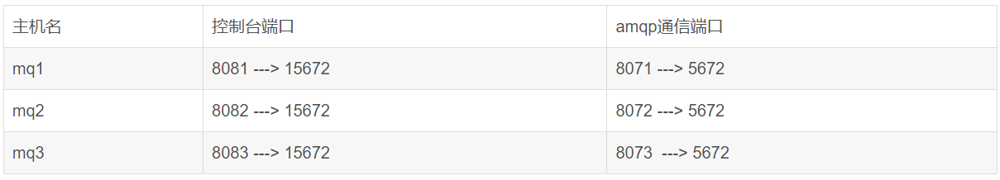


集群中的节点标识默认都是：rabbit@[hostname]，因此以上三个节点的名称分别为：

rabbit@mq1

rabbit@mq2

rabbit@mq3


### 1.2.获取cookie

RabbitMQ底层依赖于Erlang，而Erlang虚拟机就是一个面向分布式的语言，默认就支持集群模式。集群模式中的每个RabbitMQ 节点使用 cookie 来确定它们是否被允许相互通信。


要使两个节点能够通信，它们必须具有相同的共享密钥，称为Erlang cookie。cookie 只是一串最多 255 个字符的字母数字字符。


每个集群节点必须具有相同的 cookie。实例之间也需要它来相互通信。


我们先在之前启动的mq容器中获取一个cookie值，作为集群的cookie。执行下面的命令：


`docker exec -it mq cat /var/lib/rabbitmq/.erlang.cookie`

可以看到cookie值如下：

```JavaScript
FXZMCVGLBIXZCDEMMVZQ
```


### 1.3 准备配置文件

在/root/mq目录新建一个配置文件 rabbitmq.conf：


`cd /root/mq`

**创建文件**

`touch rabbitmq.conf`

文件内容如下：

```JavaScript
loopback_users.guest = false
listeners.tcp.default = 5672
cluster_formation.peer_discovery_backend = rabbit_peer_discovery_classic_config
cluster_formation.classic_config.nodes.1 = rabbit@mq1
cluster_formation.classic_config.nodes.2 = rabbit@mq2
cluster_formation.classic_config.nodes.3 = rabbit@mq3
```

这段配置定义了一个包含三个节点的RabbitMQ集群，节点名称分别为 `rabbit@mq1`、`rabbit@mq2` 和 `rabbit@mq3`。这些节点将通过静态配置的方式互相发现对方，并形成集群。同时，配置禁用了guest用户通过环回接口登录，确保了基本的安全性，并且设置了默认的AMQP端口为5672。

配置项的具体含义：

1. loopback_users.guest = false

这一行配置禁用了guest用户通过环回接口（localhost或127.0.0.1）登录RabbitMQ。默认情况下，guest用户只能通过环回接口登录。设置为 `false` 后，guest用户将不能通过环回接口登录，这有助于增强安全性。

1. listeners.tcp.default = 5672

这一行配置指定了RabbitMQ监听的默认AMQP端口。在这里设置为5672，这是RabbitMQ的标准AMQP端口。

1. cluster_formation.peer_discovery_backend = rabbit_peer_discovery_classic_config

这一行配置指定了集群节点之间如何发现彼此。`rabbit_peer_discovery_classic_config` 表示使用经典配置方式来发现集群中的其他节点。这是一种静态配置方式，需要显式地列出所有集群中的节点。

1. cluster_formation.classic_config.nodes.1 = rabbit@mq1

这一行配置指定了集群中的第一个节点，即mq1节点，其节点名称为 `rabbit@mq1`。这里使用了Erlang节点命名约定，`rabbit@` 后面跟着的是节点的主机名或别名。

1. cluster_formation.classic_config.nodes.2 = rabbit@mq2

这一行配置指定了集群中的第二个节点，即mq2节点，其节点名称为 `rabbit@mq2`。

1. cluster_formation.classic_config.nodes.3 = rabbit@mq3

这一行配置指定了集群中的第三个节点，即mq3节点，其节点名称为 `rabbit@mq3`。

再创建一个文件，记录cookie


cd /root/mq

**创建cookie文件**

`touch .erlang.cookie`

**写入cookie**

`echo "``CXPOZJRACSRBDVMMLICH``" > .erlang.cookie`

**修改cookie文件的权限**

`chmod 600 .erlang.cookie`

准备三个目录,mq1、mq2、mq3：


cd `/root/mq`

**创建目录**

`mkdir mq1 mq2 mq3`

然后拷贝rabbitmq.conf、cookie文件到mq1、mq2、mq3：

**进入`/root/mq`**

`cd /root/mq`

**拷贝**

```JavaScript
cp rabbitmq.conf mq1
cp rabbitmq.conf mq2
cp rabbitmq.conf mq3
cp .erlang.cookie mq1
cp .erlang.cookie mq2
cp .erlang.cookie mq3
```


## 2 部署集群

### 2.1 创建三个节点


创建一个网络：

docker network create mq-net


运行命令创建三个节点 ：

节点1

```JavaScript
docker run -d --net mq-net \
-v ${PWD}/mq1/rabbitmq.conf:/etc/rabbitmq/rabbitmq.conf \
-v ${PWD}/.erlang.cookie:/var/lib/rabbitmq/.erlang.cookie \
-e RABBITMQ_DEFAULT_USER=itcast \
-e RABBITMQ_DEFAULT_PASS=123321 \
--name mq1 \
--hostname mq1 \
-p 8071:5672 \
-p 8081:15672 \
rabbitmq:3.8-management
```

节点2：

```JavaScript

docker run -d --net mq-net \
-v ${PWD}/mq2/rabbitmq.conf:/etc/rabbitmq/rabbitmq.conf \
-v ${PWD}/.erlang.cookie:/var/lib/rabbitmq/.erlang.cookie \
-e RABBITMQ_DEFAULT_USER=itcast \
-e RABBITMQ_DEFAULT_PASS=123321 \
--name mq2 \
--hostname mq2 \
-p 8072:5672 \
-p 8082:15672 \
rabbitmq:3.8-management
```

节点3

```JavaScript
docker run -d --net mq-net \
-v ${PWD}/mq3/rabbitmq.conf:/etc/rabbitmq/rabbitmq.conf \
-v ${PWD}/.erlang.cookie:/var/lib/rabbitmq/.erlang.cookie \
-e RABBITMQ_DEFAULT_USER=itcast \
-e RABBITMQ_DEFAULT_PASS=123321 \
--name mq3 \
--hostname mq3 \
-p 8073:5672 \
-p 8083:15672 \
rabbitmq:3.8-management
```


苹果本在创建容器时注意添加：

```Java
-e RABBITMQ_CONFIG_FILE=/etc/rabbitmq/rabbitmq.conf 
```


### 2.2 测试

#### 2.2.1 创建队列

登录任意一个节点都会显示三个节点的情况。

节点 一：http://192.168.101.68:8081/#/，账号和密码：itcast/123321

节点 二 ：http://192.168.101.68:8082/#/，账号和密码：itcast/123321

节点 三：http://192.168.101.68:8083/#/，账号和密码：itcast/123321


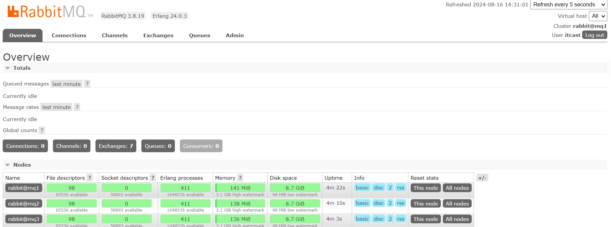


在mq1这个节点上添加一个队列：

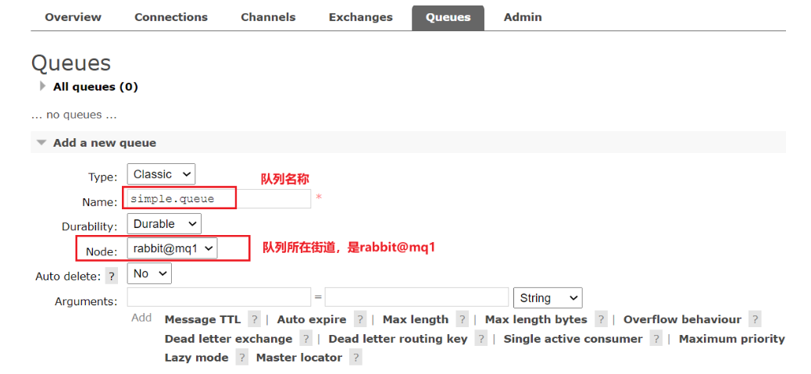

如图，在mq2和mq3两个控制台也都能看到：

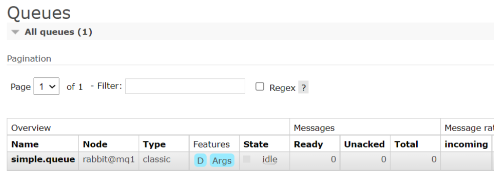

#### 2.2.2 数据共享

下边测试数据共享：

点击这个队列，进入管理页面：

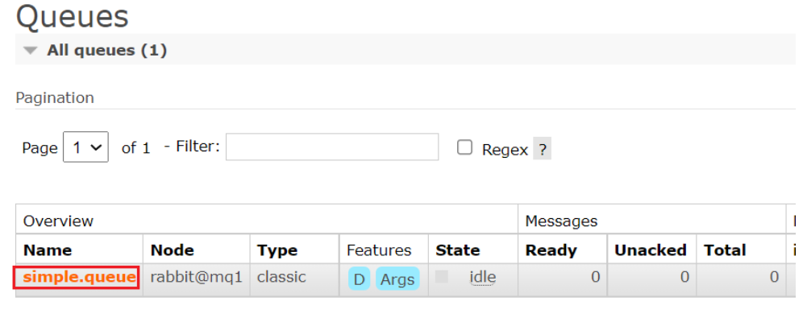

然后利用控制台发送一条消息到这个队列：

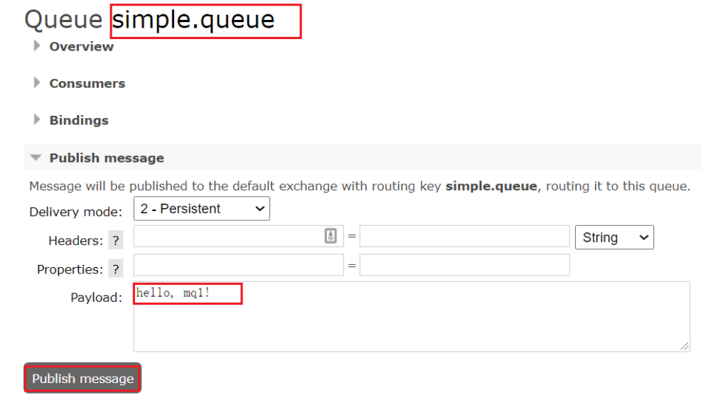

结果在mq2、mq3上都能看到这条消息：

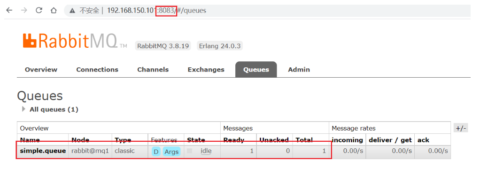

#### 2.2.3 可用性测试

我们让其中一台节点mq1宕机：

docker stop mq1

然后登录mq2或mq3的控制台，发现simple.queue也不可用了：

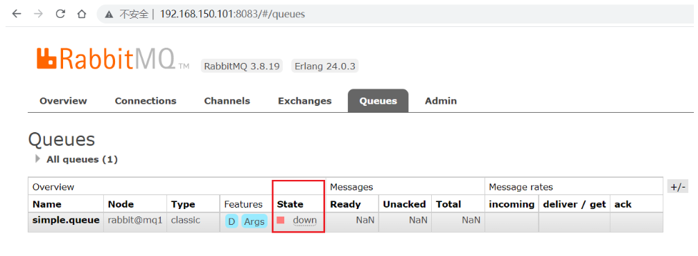

说明数据并没有拷贝到mq2和mq3。


#### 2.2.4 注意Java连接参数

Spring Boot应用连接RabbitMQ集群需要更改为如下配置，收发消息的程序和单机版一样。

```JavaScript
spring:
  rabbitmq:
    addresses: 192.168.101.68:8071,192.168.101.68:8072,192.168.101.68:8073 # 你的虚拟机IP
#    host: 192.168.101.68
#    port: 5672 # 端口
    virtual-host: /hmall # 虚拟主机
    username: hmall # 用户名
    password: 123 # 密码
```

#### 2.2.5 普通集群特点

- 节点之间能共享元数据
- 可以通过任意节点访问数据，间接通过主节点访问
- 节点之间是不能共享数据，队列所在的主节点如果宕机后，数据就丢失了

## 3.镜像模式

在刚刚的案例中，一旦创建队列的主机宕机，队列就会不可用。不具备高可用能力。如果要解决这个问题，必须使用官方提供的镜像集群方案。

官方文档地址：[https://www.rabbitmq.com/ha.html](https://www.rabbitmq.com/ha.html)


### 3.1.镜像模式的特征

默认情况下，队列只保存在创建该队列的节点上。而镜像模式下，创建队列的节点被称为该队列的**主节点**，队列还会拷贝到集群中的其它节点，也叫做该队列的**镜像**节点。

但是，不同队列可以在集群中的任意节点上创建，因此不同队列的主节点可以不同。甚至，**一个队列的主节点可能是另一个队列的镜像节点**。

用户发送给队列的一切请求，例如发送消息、消息回执默认都会在主节点完成，如果是从节点接收到请求，也会路由到主节点去完成。**镜像节点仅仅起到备份数据作用**。

当主节点接收到消费者的ACK时，所有镜像都会删除节点中的数据。

总结如下：

- 镜像队列结构是一主多从（从就是镜像）
- 所有操作都是主节点完成，然后同步给镜像节点
- 一个队列的主节点也可能是其他队列的镜像节点
- 主宕机后，镜像节点会替代成新的主（如果在主从同步完成前，主就已经宕机，可能出现数据丢失）
- 不具备负载均衡功能，因为所有操作都会有主节点完成（但是不同队列，其主节点可以不同，可以利用这个提高吞吐量）


### 3.2.镜像模式的配置

镜像模式的配置有3种模式：

<sheet sheet-id="A0zzOB" token="PCkNsMBl2hsTv3tBmR5c6eUXnog"></sheet>

精确模式：设定镜像数量

all模式：在所有节点镜像

nodes：指定镜像节点


#### 3.2.1.exactly模式

这里我们以rabbitmqctl命令作为案例来讲解配置语法。

下边是创建精确模式集群的语法。

```JavaScript
rabbitmqctl set_policy -p / ha-two "^two\." '{"ha-mode":"exactly","ha-params":2,"ha-sync-mode":"automatic"}'
```

- `rabbitmqctl set_policy`：固定写法
- `-p` 或 `--vhost`：指定虚拟主机的名称。
- `ha-two`：策略名称，自定义
- `"^two\."`：匹配队列的正则表达式，符合命名规则的队列才生效，这里是任何以`two.`开头的队列名称
- `'{"ha-mode":"exactly","ha-params":2,"ha-sync-mode":"automatic"}'`: 策略内容

  - `"ha-mode":"exactly"`：策略模式，此处是exactly模式，指定副本数量
  - `"ha-params":2`：策略参数，这里是2，就是副本数量为2，1主1镜像
  - `"ha-sync-mode":"automatic"`：同步策略，默认是manual，即新加入的镜像节点不会同步旧的消息。如果设置为automatic，则新加入的镜像节点会把主节点中所有消息都同步，会带来额外的网络开销

#### 3.2.2.all模式

```JavaScript
rabbitmqctl set_policy ha-all "^all\." '{"ha-mode":"all"}'
```

- `ha-all`：策略名称，自定义
- `"^all\."`：匹配所有以`all.`开头的队列名
- `'{"ha-mode":"all"}'`：策略内容

  - `"ha-mode":"all"`：策略模式，此处是all模式，即所有节点都会称为镜像节点

#### 3.2.3.nodes模式

```JavaScript
rabbitmqctl set_policy ha-nodes "^nodes\." '{"ha-mode":"nodes","ha-params":["rabbit@nodeA", "rabbit@nodeB"]}'
```

- `rabbitmqctl set_policy`：固定写法
- `ha-nodes`：策略名称，自定义
- `"^nodes\."`：匹配队列的正则表达式，符合命名规则的队列才生效，这里是任何以`nodes.`开头的队列名称
- `'{"ha-mode":"nodes","ha-params":["rabbit@nodeA", "rabbit@nodeB"]}'`: 策略内容

  - `"ha-mode":"nodes"`：策略模式，此处是nodes模式
  - `"ha-params":["rabbit@mq1", "rabbit@mq2"]`：策略参数，这里指定副本所在节点名称


### 3.3.测试

我们使用exactly模式的镜像，因为集群节点数量为3，因此镜像数量就设置为2.

运行下面的命令：

```JavaScript
docker exec -it mq1 rabbitmqctl set_policy -p / ha-two "^two\." '{"ha-mode":"exactly","ha-params":2,"ha-sync-mode":"automatic"}'
```

下面，我们创建一个新的队列：

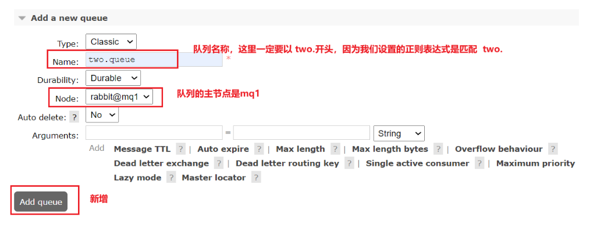

在任意一个mq控制台查看队列：

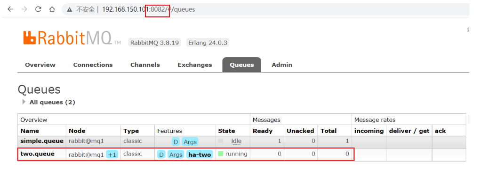

#### 3.3.1.测试数据共享

给two.queue发送一条消息：

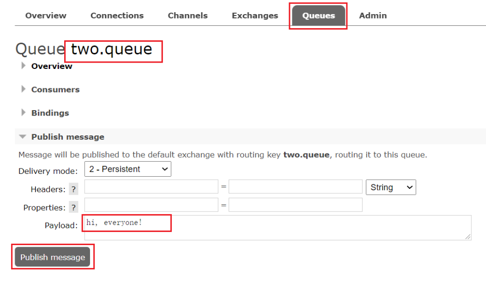


然后在mq1、mq2、mq3的任意控制台查看消息：

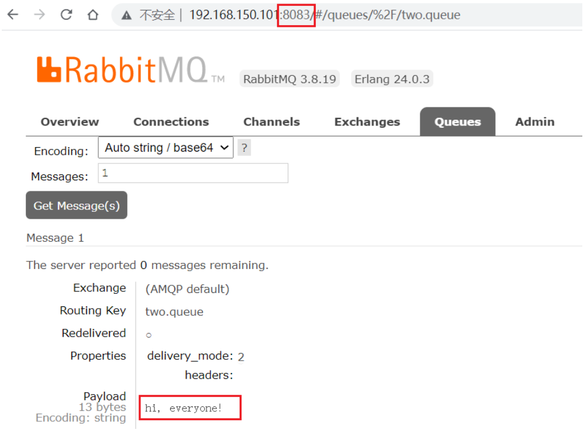

#### 3.3.2.测试高可用

现在，我们让two.queue的主节点mq1宕机：

`docker stop mq1`

在mq2节点查看集群状态：

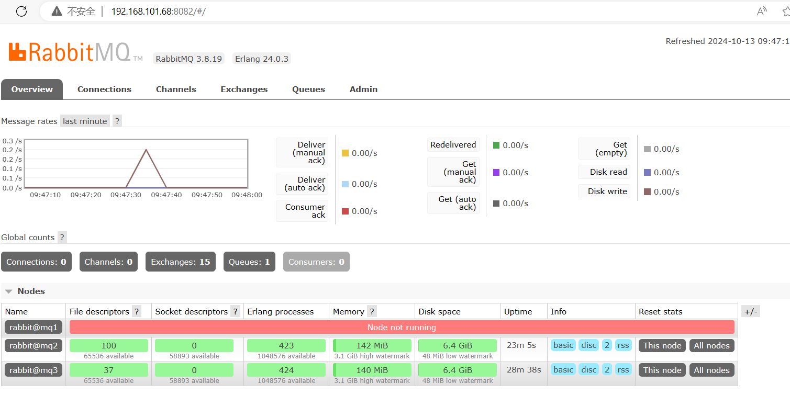

查看队列状态：

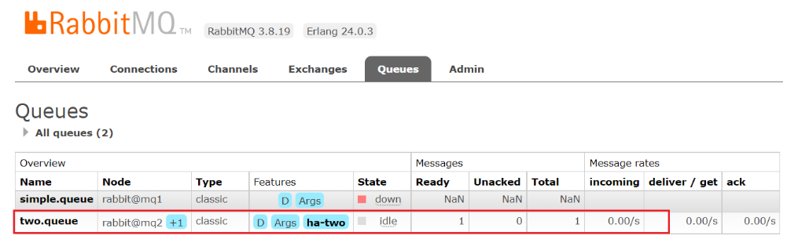

发现依然是健康的！并且其主节点切换到了rabbit@mq2上


## 4.仲裁队列

从RabbitMQ 3.8版本开始，引入了新的仲裁队列，他具备与镜像队列类似的功能，但使用更加方便。

### 4.1.添加仲裁队列

在任意控制台添加一个队列，一定要选择队列类型为Quorum类型。

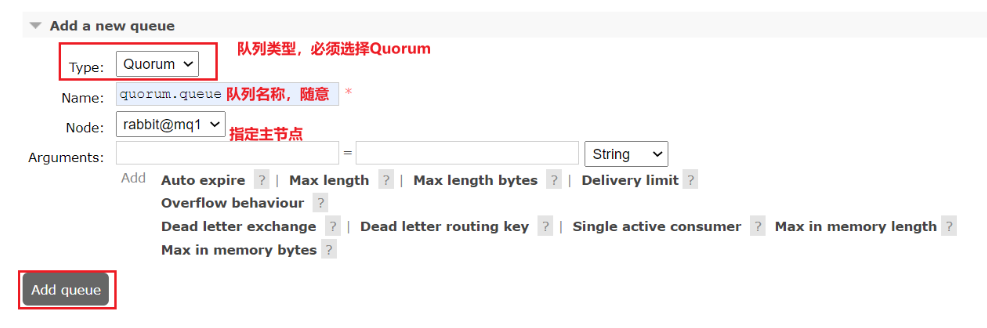

在任意控制台查看队列：

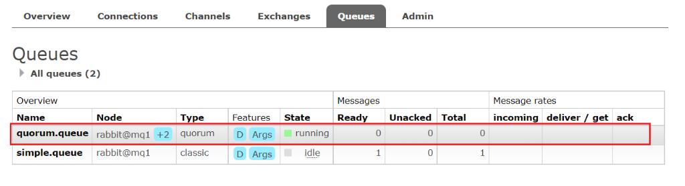

可以看到，仲裁队列的 + 2字样。代表这个队列有2个镜像节点。

因为仲裁队列默认的镜像数为5。如果你的集群有7个节点，那么镜像数肯定是5；而我们集群只有3个节点，因此镜像数量就是2.

### 4.2.测试

可以参考对镜像集群的测试，效果是一样的。


### 4.3 特征

- 基于 Raft 共识算法的强一致性

---
> 来源：飞书技术知识库（脱敏版） · 04 微服务与中间件 / 消息队列 MQ / 05 MQ高级 / RabbitMQ集群部署 · [原文](https://ccn8v2zngwsm.feishu.cn/wiki/ZqhCwxdZ3iBe8pkW7TMcPTmlnof)
