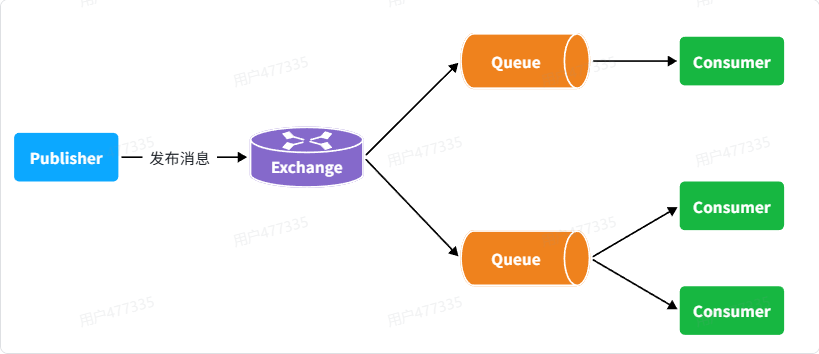
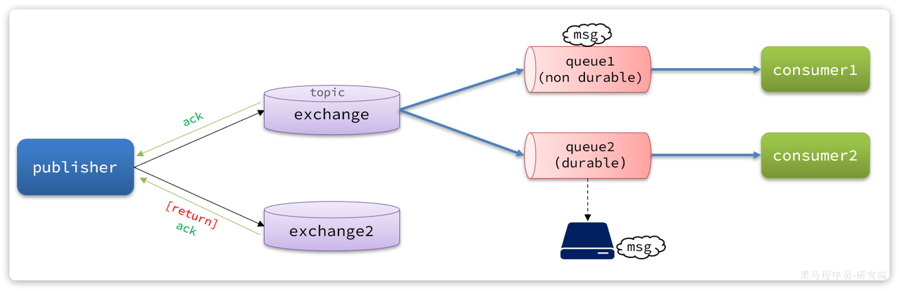
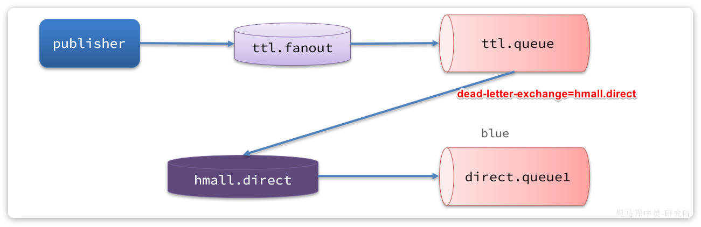
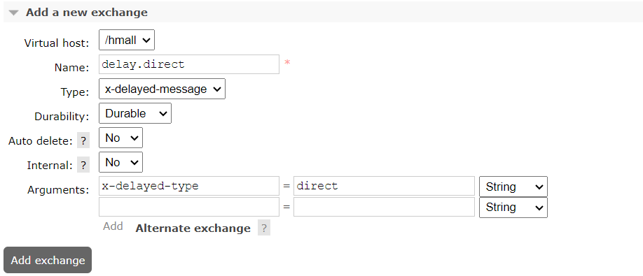
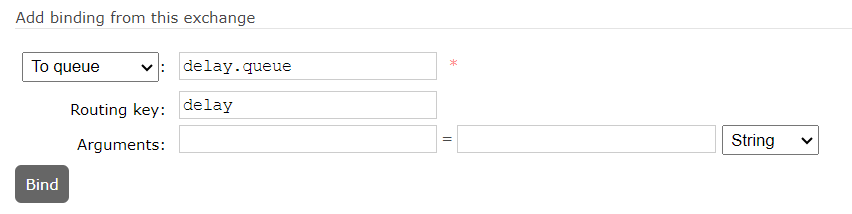
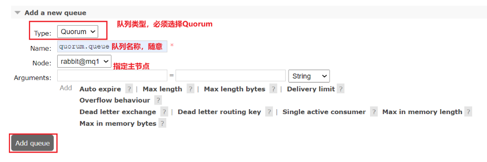
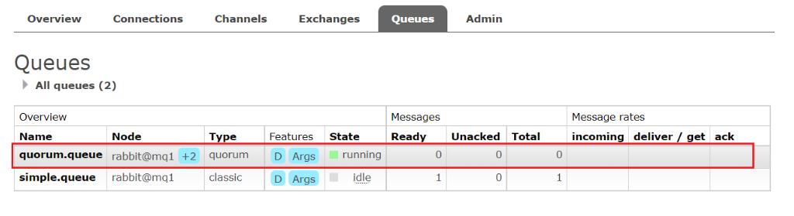

# MQ高级

## **如何确保MQ消息的可靠性**


> 图注：这张图展示了RabbitMQ的消息流转流程，从左到右依次是消息生产者Publisher，它负责向中间的交换机Exchange发布消息；Exchange接收到消息后，会将消息路由分配给两个不同的消息队列Queue，其中下方的Queue还会对应分发给两个消费者Consumer，上方的Queue对应一个消费者Consumer。这个流程和文档中提及的MQ消息可能因未找到合适Exchange或Queue导致丢失的内容相呼应，直观呈现了消息从生产到传递至消费端的路径。

消息从生产者到消费者的每一步都可能导致消息丢失，比如

- MQ内部处理消息的进程发生了异常
- 生产者发送消息到达MQ后未找到`Exchange`
- 生产者发送消息到达MQ的`Exchange`后，未找到合适的`Queue`，因此无法路由

要解决消息丢失问题，保证MQ的可靠性，必须从3个方面入手：

### **保证生产消息的可靠性**

#### **生产者重试机制** ：

当RabbitTemplate与MQ连接超时后，多次重试。可通过配置initial-interval（初始等待时间）、multiplier（倍增器）和max-attempts（最大重试次数）来实现。

`application.yaml`文件，添加下面的内容：

```YAML
spring:
  rabbitmq:
    connection-timeout: 1s # 设置MQ的连接超时时间
    template:
      retry:
        enabled: true # 开启超时重试机制
        initial-interval: 1000ms # 失败后的初始等待时间
        multiplier: 1 # 失败后下次的等待时长倍数，下次等待时长 = 上次等待时长 * multiplier
        max-attempts: 3 # 总共尝试次数
```

配置参数解释

`initial-interval`:  失败后的初始等待时间

`multiplier`: 倍增器，每次重试的等待时间是前一次几倍。  

失败后下次等待时长 =上次等待时长 \* multiplier

`max-attempts`: 最大重试次数（包括第一次尝试）

#### **生产者确认机制** ：

RabbitMQ提供了Publisher Confirm和Publisher Return两种确认机制：


> 图注：图片展示了RabbitMQ中Publisher Confirm和Publisher Return两种确认机制的示意图。左侧为publisher，中间有topic exchange和exchange2，右侧有queue1（non durable）和queue2（durable）。当消息投递成功时，通过Publisher Confirm返回ack；若路由失败，通过Publisher Return回调方法返回异常信息。

- Publisher Return：消息投递成功但路由失败时调用回调方法返回异常信息
- Publisher Confirm：消息投递成功返回ack，投递失败返回nack

> 注意：消息投递成功但可能路由失败了，此时会通过Publisher Confirm返回ack，通过Publisher Return回调方法返回异常信息。


#### **发送失败处理机制** ：

解决了在ConfirmCallback中收到nack表示消息投递失败，`ReturnCallback`异常表示路由失败，消息投递失败怎么处理的问题

可以将消息记录到失败消息表，由定时任务进行发布，每隔10秒钟(可设置)执行获取失败消息并重新发送，发送一次则在失败次的数字段加一，达到3次停止自动发送由人工处理。

### **确保MQ不会将消息弄丢**

#### **交换机持久化**

- 将交换机的定义信息(元数据)持久化到RabbitMQ的数据库中，RabbitMQ重启后交换机定义仍然存在。在控制台添加交换机时可配置Durability参数为Durable。

#### **队列持久化**

- 将队列的定义信息(元数据)持久化到RabbitMQ的数据库中，保证队列本身的元数据不会因异常情况而丢失。在控制台添加队列时可配置Durability参数为Durable。

#### **消息持久化**

- 要确保消息不会丢失需要将消息设置为持久化。在控制台发送消息时，可通过设置delivery_mode=2来实现消息持久化。

### **保证消费消息的可靠性**

#### **消费者手动确认机制** ：

要确保消息被成功处理后才会从队列中删除,MQ提供了消费者确认机制(Consumer Acknowledgement)。

当消费者处理消息结束后，会向MQ发送一个回执消息，告知MQ消息处理的状态。回执共有三种值：

ack：成功处理，MQ从队列删除消息

nack： 消息处理失败，需要MQ再发一遍消息

reject： 消息处理失败并拒绝该消息，MQ队列删除或丢弃消息

reject 方式使用场景较少，除非格式问题 一般不使用，大多数情况下消息处理的代码都是通过`try catch`机制捕捉异常，处理成功返回ack，失败返回nack

具体实现方法：

SpringAMQP可以帮我们实现消息确认，并可以通过文件设置消息确认的处理方式，共三种模式：

`none`： 不处理，消息发给消费者后消息会立即从MQ删除，不安全也不建议使用

`manal`：手动模式，需要手动在代码中调用api，编写发送ack或reject，存在业务入侵，但编码方式更灵活

`auto`：自动模式，业务正常执行自动返回ack （Spring 使用AOP实现的），业务出现异常，会自动根据业务异常类型返回不同的结果：

如果是业务异常，会自动返回nack，请求再发一遍消息

如果是消息处理或者是校验异常，自动返回reject，返回的异常包括：`MessageConversionException`、MethodArgumentTypeMismatchExpection等

通过下面的配置可以修改消息确认的处理方式为auto：

```YAML
spring:
  rabbitmq:
    listener:
      simple:
        acknowledge-mode: auto # 自动ack
```

返回ack：

```JavaScript
    //返回ack,每个参数的意义：1.消息的标记 2.是否确认之前所有消息
    channel.basicAck(message.getMessageProperties().getDeliveryTag(), false);
```

返回nack:

```JavaScript
 //每个参数的意义：1.消息的标记 2.是否确认之前所有消息 3.是否重新入队
channel.basicNack(message.getMessageProperties().getDeliveryTag(), false, false);
```

#### 失败消息加入新队列

消费者出现异常后，消息会不断地requeue（重新加入队列）入队，再发送给消费者。如果消费者依旧执行出错，消息会再次返回到队列，再次投递，直至成功。这样无限循环浪费系统资源明显是不合理的，面对这种小概率事件，Spring提供了消费者失败重试机制：

在消费者出现异常时利用本地重试，而不是无限制的投递到MQ队列。

可以修改consumer服务的application.yml文件，添加内容：

```YAML
spring:
  rabbitmq:
    listener:
      simple:
        retry:
          enabled: true # 开启消费者失败重试
          initial-interval: 1000ms # 初识的失败等待时长为1秒
          multiplier: 1 # 失败的等待时长倍数，下次等待时长 = 上次等待时长 * multiplier
          max-attempts: 3 # 最大重试次数
```

重启consumer服务，消费者如果出现MQ无限重新投递，只会在本地重试3次后MQ队列中删除，因为最后SpringAMQP返回的消息是reject。

当然在业务消息要求比较高的场景中，消息达到最大次数后直接删除是不合理的，Spring可以通过`MessageRecovery`接口来自定义重试次数耗尽后的处理策略，有三种实现方式;

`RejectAndDontRequeueRecoverer`： 重试次数耗尽后，返回reject，队列丢弃消息。默认是这种方式。

`ImmediateRequeueMessageRecoverer`：重试次数耗尽后，返回nack，消息重新入队

`RepublishMessageRecoverer`：重试次数耗尽后，将失败消息投递到指定的交换机

比较优雅的处理策略是`RepublishMessageRecoverer`，失败后将消息发送到固定的交换机，通过失败交换机发送到失败消息队列，再由程序存入失败消息表持久化，并通过定时任务，进行失败消息尝试处理，最后仍未能解决则通知程序员处理。

#### **消息幂等性处理** ：

确保同一个业务消息重复消费时不会产生多次作用,避免操作重复提交。

保证幂等性的方案一般有两种：

增加消息唯一id，确保不会重复执行消息

根据业务逻辑进行状态判断

实现消息唯一id的方式是

每一条消息都生成一个唯一id，发送时与消息一并发送给消费者

消费者处理完后会将消息id保存到redis或数据库中，下次再接受到消息，会验证redis和数据库中是否已经存在，存在则放弃处理。

在业务中，SpringAMQP的MessageConverter自带MessageID的功能，只需要开启功能即可。

也可以增加业务判断方式来补充完善消息唯一id方案，实现方式如，在修改订单业务场景中，在执行SQL语句时除了要判断id外，增加判断订单状态的条件，匹配不到的就不会执行。

注意看，上述代码等同于这样的SQL语句：

```SQL
UPDATE `order` SET status = ? , pay_time = ? WHERE id = ? AND status = 1
```

### 业务补偿

如果MQ通知消息失败了怎么办？有没有其它补偿方案，能够确保订单的支付状态一致呢？

如果MQ不能发送消息触发业务，则可以由我们自己主动查询并发送消息，来保证业务状态的一致性。

主动查询的时机一般是在用户在操作页面点击（完后之类的相关业务）后再次触发查询最新的结果，

也可以通过定时任务查询，在上一个业务执行完成后会加入对下一个业务的延迟定时任务，如果到时间后主动查询业务是否完成或者状态是否符合预期，根据结果指定对应的业务逻辑和消息通知。

定时任务通常作为兜底方案，来保障业务状态的一致性。

## **如何实现延迟消息**

在RabbitMQ中实现延迟消息有两种方案：

### **死信交换机+TTL**

- 死信交换机（Dead Letter Exchange, DLX）是一种处理消息队列中无法被消费的消息的方式
- 结合TTL（Time To Live），设定消息在队列中的存活时间，当消息在队列中停留的时间超过了设定的TTL后，消息就会成为死信
- 当消息变成死信时，会被发送到死信交换机中，通过死信交换机转发到指定的队列，由应用程序去消费
- 延迟消息处理流程如（图 1）所示

  

### **延迟消息插件**

- RabbitMQ社区提供了一个延迟消息插件来实现相同的效果
- 安装延迟消息插件，发送消息时指定延迟时间，到达延迟时间消息被消费
- 延迟消息插件内部会维护一个本地数据库表，同时使用Elang Timers功能实现计时
- 如果消息的延迟时间设置较长，可能会导致堆积的延迟消息非常多，会带来较大的CPU开销，同时延迟消息的时间会存在误差
- 不建议设置延迟时间过长的延迟消息

**推荐使用延迟消息插件实现** ，实现过程更简单直观。具体步骤如下：

1. 下载并安装延迟消息插件
2. 声明延迟交换机，类型为x-delayed-message，如（图 2）所示

   
3. 创建队列并绑定到延迟交换机，如（图 3）所示

   
4. 发送消息时，通过x-delay属性设定延迟时间

## **RabbitMQ有哪些集群，他们的特点是什么？**

RabbitMQ主要有以下几种集群模式：

### **普通集群模式**

- **特点** ：

  - 节点之间能共享元数据
  - 可以通过任意节点访问数据，间接通过主节点访问
  - 节点之间不能共享数据，队列所在的主节点如果宕机后，数据就丢失了
- **缺点** ：不具备高可用能力，一旦创建队列的主机宕机，队列就会不可用

### **镜像模式集群**

- **特征** ：

  - 镜像队列结构是一主多从（从就是镜像）
  - 所有操作都是主节点完成，然后同步给镜像节点
  - 一个队列的主节点也可能是其他队列的镜像节点
  - 主宕机后，镜像节点会替代成新的主（如果在主从同步完成前，主就已经宕机，可能出现数据丢失）
  - 不具备负载均衡功能，因为所有操作都会有主节点完成（但是不同队列，其主节点可以不同，可以利用这个提高吞吐量）
- **配置模式** ：

  - 精确模式(exactly)：设定镜像数量
  - all模式：在所有节点镜像
  - nodes：指定镜像节点

### **仲裁队列**

- **特征** ：

  - 具有基于Raft~~共识算法~~的强一致性
  - 从RabbitMQ 3.8版本开始引入的新功能
  - 仲裁队列默认的镜像数为5，如果集群节点数少于5，则镜像数为节点数-1
- **创建方式** ：在任意控制台添加队列时，选择队列类型为Quorum类型

相较于镜像集群 仲裁队列 简化了配置与使用，只需在创建时只需选择队列类型为 Quorum 即可自动实现副本同步与高可用能力

在实际应用中， **镜像模式集群** 和 **仲裁队列** 都能提供高可用性，但实现方式和特点有所不同，可根据具体场景选择合适的集群模式。

**在实际项目场景中，仲裁队列与传统镜像队列的适用差异主要体现在** 一致性机制、配置复杂度、默认镜像策略及适用场景 **等方面，具体分析如下：**

1. **一致性机制差异**

   - 传统镜像队列：采用 **主从同步模式** ，所有操作由主节点完成后同步至镜像节点；若主节点在同步完成前宕机，可能导致镜像节点数据丢失 。
   - 仲裁队列：基于 **Raft共识算法** 实现强一致性，确保所有镜像节点的数据完全一致，从根本上避免主从同步带来的数据不一致风险 。
2. **配置复杂度差异**

   - 传统镜像队列：需通过 `rabbitmqctl set_policy` 命令手动配置策略（如 `exactly` 模式指定1主1镜像、 `all` 模式全节点镜像），并设置同步模式（如 `automatic` 自动同步旧消息），配置步骤较繁琐 。
   - 仲裁队列：创建时仅需在控制台选择队列类型为 **Quorum** （如图（图 1）），默认镜像数为5（若集群节点数少于5，则镜像数为节点数-1），无需额外策略配置，操作更简单 。
   
     
3. **默认镜像策略差异**

   - 传统镜像队列：默认无镜像，需手动指定镜像数量和分布（如 `nodes` 模式指定镜像节点） 。
   - 仲裁队列：默认镜像数为5，集群节点数不足5时自动调整（如3节点集群会有2个镜像节点，如图（图 2）中“quorum.queue”队列的“+2”标识），镜像管理更自动化 。
   
     
4. **适用场景差异**

   - 传统镜像队列：适用于 **一致性要求一般、需灵活控制镜像数量** 的场景（如非核心业务的消息队列，希望手动指定1主1镜像以平衡性能与高可用） 。
   - 仲裁队列：适用于 **数据强一致性要求高** 的核心场景（如金融支付、订单交易），或 **集群节点数较多、希望自动管理镜像** 的场景，能更好保障数据可靠性 。

其中，（图 1）展示了仲裁队列的创建界面（需选择“Quorum”类型） ；（图 2）展示了仲裁队列的查看界面（“+2”表示2个镜像节点） 。

---
> 来源：飞书技术知识库（脱敏版） · 04 微服务与中间件 / 消息队列 MQ / MQ高级 · [原文](https://ccn8v2zngwsm.feishu.cn/wiki/WmaIwteFhiV3cykhQQEcHA6ZnKh)
