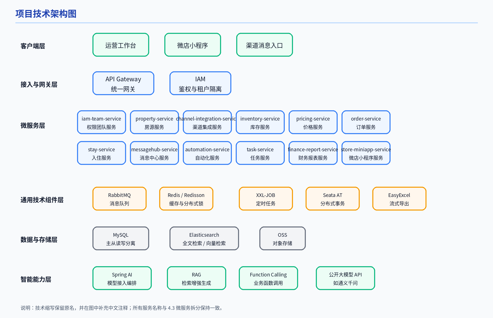
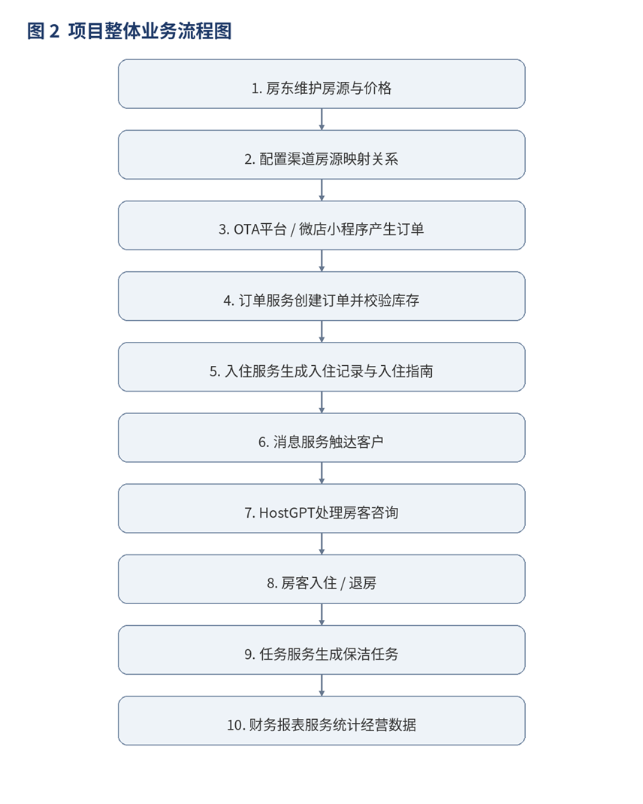

# 百居易PMS系统产品需求文档

## 一、文档基础配置（在线文档开篇必备）

在线文档的开篇需固定基础信息，保障版本可追溯、角色权责清晰、术语统一，飞书文档可直接用「表格 + 折叠面板」实现。

### 1.1 元信息

| 文档属性 | 详情说明 |
|-|-|
| **文档名称** | 百居易 PMS 系统产品需求文档 V1.0 |
| **产品版本** | V1.0（对应 2026 年 4 月上线版本） |
| **产品负责人** | - |
| **研发负责人** | - |
| **设计 / 测试 / 运营** | 对应负责人 |
| **文档状态** | 初稿 |
| **核心受众** | 产品团队、后端 / 前端研发、测试工程师、运营团队、民宿运营方 |
| **在线文档权限** | 编辑权限：核心项目组；查看权限：全公司相关人员 |

### 1.2 版本迭代记录

| 版本号 | 更新日期 | 核心更新内容 | 更新人 |
|-|-|-|-|
| V1.0 | 2026/4/7 | 初稿完成，涵盖所有核心模块需求。 | 产品经理 |

### 1.3 专有术语与名词解释

用折叠面板收纳，避免文档冗余，和项目技术文档保持统一，保障全团队术语一致：

- **房源（Property）** ：民宿/酒店的整体资源单位。
- **房型（Room Type）** ：房源下的分类，如大床房、双床房。
- **房间（Room）** ：实际可入住的具体房间。
- **库存（Inventory）** ：某房间在某日期的可售数量。
- **日历价（Pricing）** ：按日期维度配置的动态价格。
- **订单（Order）** ：用户完成预订后生成的交易记录。
- **入住单（Stay Order）** ：订单在履约阶段的具体执行实体。
- **房态（Room Status）** ：房间当前状态（可售/在住/待清洁等）。
- **履约（Fulfillment）** ：从下单到退房的完整执行过程。
- **账单明细（Bill Detail）** ：最细粒度的收入/成本记录。
- **报表（Statement）** ：按日期/房间/渠道聚合后的财务数据。
- **HostGPT** ：基于大模型的智能客服消息助手模块。

## 二、产品核心概述

### 2.1 产品定位

百居易（Hostex）是一款面向 **民宿/酒店运营方** 的多租户 PMS 系统，核心解决“多渠道、多房源”的集中管控与提效问题。系统围绕房源、订单、入住、客情、保洁、财务等核心业务，提供一体化运营能力，帮助房东完成从获客、接单、入住到复盘对账的全流程管理 。

### 2.2 目标用户画像

分三类核心用户，明确需求优先级，在线文档可配合「用户画像卡片」补充细节：

| 用户类型 | 核心用户群 | 核心需求 |
|-|-|-|
| **B 端企业用户** | 民宿职业房东、门店运营人员、客服人员、财务人员 | 多渠道集中管控、全流程运营提效、客情沟通自动化、财务报表高效核对 |
| **C 端个人用户** | 通过微店小程序下单的终端住客 | 便捷预订、清晰查看订单状态、获取入住指南与服务咨询 |
| **平台运营用户** | 保洁人员、内部运营团队 | 接收保洁任务并反馈状态、系统配置与监控 |

### 2.3 产品核心目标

短期目标（上线 6 个月）：实现入驻民宿房东 100+、管理房源 500+、日均订单 200+，搭建完整的房源管理、订单履约与财务统计闭环。

中期目标（上线 12 个月）：成为区域内头部民宿自动化运营平台，拓展企业服务客户 300+，实现盈利模型跑通。

长期目标：打通官方旅游数据，成为民宿职业房东数字化运营的标杆性平台。

### 2.4 盈利模式

- **订阅收费** ：提供不同功能套餐的 SaaS 订阅服务。
- **交易抽成** ：对通过微店小程序产生的订单收取服务费。
- **增值服务** ：提供企业级定制化报表、API 对接等付费增值服务 。

## 三、核心业务架构与业务流程

在线文档可通过「架构图 + Mermaid 流程图 + 步骤说明」的形式呈现，飞书支持直接嵌入 Mermaid 代码、流程图文件，可直接跳转查看详情。

### 3.1 整体业务架构

系统采用分层微服务架构，自上而下按照 **客户端层、接入与网关层、微服务层、通用技术组件层、数据与存储层、智能能力层** 进行分层展示，各层之间职责清晰，整体形成从用户访问到数据处理再到能力支撑的完整架构关系 。

**微服务**按业务域进行拆分。统一由 Gateway 作为请求入口，Nacos 负责服务注册与配置管理，Sentinel 负责限流和熔断，MySQL 负责核心业务数据存储，Redis 提供缓存、分布式锁与会话存储，RabbitMQ 用于异步解耦与延迟消息，Elasticsearch 负责 HostGPT 知识检索，Seata AT 模式保证关键业务链路的数据一致性。

核心技术栈包括：SpringBoot、SpringCloud、SpringAI Alibaba、MySQL、Redis、Elasticsearch、RabbitMQ、Nacos、Gateway、Sentinel、Seata AT模式、Redisson、Xxl-Job、阿里云OSS、EasyExcel等。

项目整体技术架构图如（图 1）所示 。

### 3.2 核心业务主流程

房东在运营端维护房源与价格 → 将房源映射到各渠道并同步售卖 → 客户在 OTA 平台或微店小程序提交预订 → 系统生成订单并占用对应日期库存 → 订单确认后生成入住信息与入住指南 → 房客在消息触达侧咨询入住、设施、押金等问题 → 系统自动应答并在入住前后推送关键提醒 → 退房后触发保洁任务与财务统计 → 房东在运营端查看经营报表并完成对账 。

整体业务流程图如（图 2）所示 。

## 四、核心功能需求详情（PRD 核心模块）

这是在线 PRD 的核心部分，按端拆分模块，每个模块包含「功能概述、用户故事、页面原型说明、业务规则、前置条件、后置条件、异常处理」，飞书文档可嵌入 Figma 原型链接、需求评审记录、测试用例链接，实现全链路协同。

### 第一部分：C 端小程序功能需求

#### 模块 1：微店小程序对接模块

| 需求项 | 详情说明 |
|-|-|
| **功能概述** | 该功能本质上是一个 **小程序预订下单与支付回调模块** ，用于将住客在小程序端的浏览与交易行为接入到后端 PMS 的订单与履约体系中，形成完整的交易闭环 。 |
| **用户故事** | 作为住客，我希望能在小程序上便捷地浏览房源、选择日期并完成支付，清晰看到我的订单状态和入住提醒。 |
| **核心功能点** | 1. 房源与房型列表展示；   2. 日期选择与价格/库存查询；   3. 订单提交与支付；   4. 订单详情页；   5. 入住提醒接收。 |
| **业务规则** | 1. 价格与库存校验需与后端实时同步，避免超售；   2. 支付成功后订单状态实时更新；   3. 入住前自动发送入住指南与提醒。 |
| **异常处理** | 1. 库存不足时提示用户更换日期或房型；   2. 支付失败引导用户重新支付；   3. 网络异常时支持页面刷新重试。 |

### 第二部分：管理后台功能需求

#### 模块 1：房源管理模块

| 需求项 | 详情说明 |
|-|-|
| **功能概述** | 管理房源基础信息、房型分类、设施规则及与外部渠道的映射关系。 |
| **用户故事** | 作为运营人员，我希望能方便地录入和维护房源信息，并将其映射到各销售渠道，实现统一管理。 |
| **核心功能点** | 1. 房源建档（基本信息、图片、设施、规则）；   2. 房型管理（分类、配置）；   3. 渠道映射（OTA 平台、微店小程序授权与同步规则） 。 |
| **业务规则** | 1. 房源信息需完整方可上线；   2. 渠道映射关系变更需同步更新房态与价格。 |
| **异常处理** | 1. 渠道授权失败提示失败原因与重新授权指引；   2. 图片上传失败支持重新上传。 |

#### 模块 2：订单与入住履约模块

| 需求项 | 详情说明 |
|-|-|
| **功能概述** | 处理全渠道订单，管理入住登记、退房流程，并协同保洁任务。 |
| **用户故事** | 作为运营人员，我希望能集中处理所有渠道的订单，高效办理入住和退房，并自动派发保洁任务。 |
| **核心功能点** | 1. 订单处理（接收、审核、改期、取消、换房）；   2. 入住管理（住客信息录入、确认、房态安排）；   3. 退房自动化（到达时间自动执行，释放资源）；   4. 任务调度（自动派发保洁任务并跟踪状态） 。 |
| **业务规则** | 1. 订单状态变更需同步更新房态与库存；   2. 退房后自动触发保洁任务。 |
| **异常处理** | 1. 订单冲突时提示人工介入；   2. 保洁任务派发失败自动重试并通知运营人员。 |

#### 模块 3：HostGPT AI 消息助手模块

| 需求项 | 详情说明 |
|-|-|
| **功能概述** | 将高频客情咨询沉淀为可会话、可检索、可调用业务数据的智能回复能力，降低人工客服压力 。 |
| **用户故事** | 作为客服，我希望房客的标准咨询能由系统自动准确回复，让我专注处理复杂问题。 |
| **核心功能点** | 1. 智能对话聊天界面；   2. 问题分类快捷入口；   3. 回答引用知识源展示；   4. 多轮对话上下文记忆；   5. 人工客服转接入口 。 |
| **业务规则** | 1. 基于 RAG 检索和 Function Calling 确保回答准确，避免模型“幻觉”；   2. 多租户知识隔离，避免混淆 。 |
| **异常处理** | 1. 大模型调用超时提示用户重试；   2. 知识库无相关内容时转接人工客服。 |

#### 模块 4：财务报表模块

| 需求项 | 详情说明 |
|-|-|
| **功能概述** | 按业务日期自动生成财务日报，提供多维度分析与导出能力。 |
| **用户故事** | 作为财务人员，我希望能快速获取准确的经营数据报表，用于对账和分析。 |
| **核心功能点** | 1. 报表生成（收入、渠道占比、收益、成本利润、入住率）；   2. 多维度分析（日期、房间、渠道）；   3. 报表导出（Excel/CSV） 。 |
| **业务规则** | 1. 报表数据 T+1 更新，确保准确性；   2. 支持按不同维度灵活筛选。 |
| **异常处理** | 1. 数据统计异常时提示重新生成；   2. 导出文件失败支持重新导出。 |

#### 模块 5：系统管理与权限控制

| 需求项 | 详情说明 |
|-|-|
| **功能概述** | 管理多租户配置、用户权限与系统参数，保障数据安全与操作可追溯。 |
| **用户故事** | 作为系统管理员，我希望能灵活配置租户与用户权限，确保系统安全稳定运行。 |
| **核心功能点** | 1. 租户管理（数据隔离、配置）；   2. 用户与权限（角色定义、分配、鉴权）；   3. 系统配置（全局参数、第三方服务接入） 。 |
| **业务规则** | 1. 权限配置遵循最小权限原则；   2. 所有敏感操作全程留痕。 |
| **异常处理** | 1. 权限配置冲突提示调整方案；   2. 系统参数变更需审批。 |

### 第三部分：B 端企业端独立功能需求

单独拆分企业端专属功能，和 C 端做隔离，包含企业认证、多租户数据隔离、定制化报表、API 对接等功能，业务规则与管理后台一一对应 。

## 五、开发团队任务分配（外包公司配置）

本项目由外包公司承接，技术团队（技术部）总共 **12人** ，具体配置为：1个技术经理、4个Java、其他各1人（产品经理、UI、前端、IOS、安卓、运维、测试）。

### 5.1 微服务拆分与团队分工

| 服务名称 | 负责团队/角色 | 核心职责 | 关键技术与挑战 |
|-|-|-|-|
| **property-service**   （房源与房型维护） | Java开发A | 负责房源建档、房型管理、设施规则维护。 | 多租户数据隔离、基础数据管理。 |
| **channel-integration-service**   （外部渠道授权与同步） | Java开发A | 负责与OTA平台的房源映射、订单同步、房态同步。 | 第三方API对接、数据同步一致性。 |
| **inventory-service**   （库存日历与管理） | Java开发B | 负责库存日历维护、库存占用与释放。 | **分布式锁（Redisson）** 、 **乐观锁** 解决库存超售问题。 |
| **pricing-service**   （价格策略） | Java开发B | 负责价格日历、费用项配置。 | 动态价格计算、规则引擎。 |
| **order-service**   （订单处理） | Java开发C | 负责订单接收、审核、改期、取消、换房。 | **分布式事务（Seata AT）** 协调订单、库存、入住服务。 |
| **stay-service**   （入住与退房管理） | Java开发C | 负责入住登记、退房登记、入住节点协同。 | **RabbitMQ 延迟队列** 实现入住/退房提醒， **事件驱动** 触发保洁任务。 |
| **messagehub-service**   （消息聚合） | Java开发D | 负责多渠道消息聚合、翻译、回复。 | 消息聚合、多渠道适配。 |
| **hostgpt-service**   （AI消息助手） | Java开发D | 负责RAG检索、FunctionCalling、模型调用。 | **RAG（Elasticsearch向量库）** 、 **FunctionCalling** 确保AI答复准确与实时性。 |
| **automation-service**   （自动化节点） | Java开发D | 负责入住和退房节点的自动化处理。 | 规则引擎、任务调度。 |
| **task-service**   （保洁任务） | Java开发D | 负责保洁任务派单与跟踪。 | 任务状态跟踪、通知机制。 |
| **finance-report-service**   （财务报表） | Java开发D | 负责财务统计、经营报表、导出。 | **EasyExcel** 高效导出、 **SpringCache** 缓存报表数据。 |
| **store-miniapp-service**   （微店小程序） | Java开发D | 负责小程序房源展示、下单与查询。 | 微信支付对接、 **异步消息（RabbitMQ）** 同步订单。 |
| **前端团队** | 前端开发1人 | 负责PC运营系统、微店小程序的UI开发与交互。 | 多端适配、复杂表单处理、数据可视化。 |
| **移动端团队** | IOS开发1人、安卓开发1人 | 负责房东APP的开发与适配。 | 跨平台兼容性、推送通知、性能优化。 |
| **测试团队** | 测试工程师1人 | 负责各模块的功能测试、集成测试、性能测试与安全测试。 | 测试用例设计、自动化测试脚本编写。 |
| **运维团队** | 运维工程师1人 | 负责项目部署、监控、日志管理与系统维护。 | 环境配置、持续集成、故障排查。 |
| **产品经理** | 产品经理1人 | 负责需求分析、PRD编写、需求评审与项目推进。 | 需求管理、跨部门沟通、项目协调。 |
| **UI设计师** | UI设计师1人 | 负责产品界面设计、交互设计与视觉规范制定。 | 视觉设计、用户体验、设计规范。 |

### 5.2 关键技术模块负责人及职责

- **HostGPT AI 客情模块** ：由Java开发D负责，基于 **Spring AI Alibaba** 对接通义千问大模型，构建 **RAG + FunctionCalling** 架构，解决多租户知识检索混淆和实时业务数据调用问题。
- **入住管理与退房自动化模块** ：由Java开发C负责，设计 **Redisson 分布式锁 + MySQL 乐观锁** 方案解决库存超售，并通过 **RabbitMQ 事件驱动 + Xxl-Job 补偿** 确保保洁任务可靠派发。
- **财务报表模块** ：由Java开发D负责，利用 **EasyExcel** 实现大数据量报表高效导出，并通过 **SpringCache 二级缓存** 优化高频查询性能。
- **微店小程序对接模块** ：由Java开发D负责，完成微信支付对接与订单异步同步，确保私域成交链路的稳定与可靠。

## 六、非功能需求

在线文档中可单独设置「研发需求」折叠面板，和技术文档的技术架构完全对齐，保障需求与技术落地一致。

### 6.1 性能需求

| 性能指标 | 要求标准 |
|-|-|
| **接口响应时间** | 常规业务接口响应时间 < 200ms，复杂查询接口 < 500ms，AI 咨询接口 < 2s |
| **并发承载能力** | 日常峰值 500 QPS 稳定运行，营销活动峰值 5000 QPS 无宕机、无数据异常 |
| **可用性** | 核心服务 SLA 99.95%，全年 downtime 不超过 4.38 小时 |
| **数据处理能力** | 支持千万级订单数据存储与查询，单用户订单查询响应 < 100ms |
| **页面加载速度** | PC 管理后台页面首屏加载时间 < 1.5s，小程序页面首屏加载时间 < 2s |

### 6.2 安全需求

- **数据安全** ：用户敏感信息加密存储，全链路 HTTPS 传输，数据库一主两从备份，防止数据丢失。
- **接口安全** ：接口身份认证、签名校验、防重放攻击，敏感接口限流熔断。
- **权限安全** ：多角色权限隔离，企业数据仅对本企业可见，运营人员数据按权限管控。
- **内容安全** ：AI 对话内容合规审核，用户上传图片涉黄涉政自动拦截。
- **幂等安全** ：订单创建、库存占用、支付回调等核心操作全链路幂等控制，防止重复提交。

### 6.3 兼容性需求

- **管理后台** ：兼容 Chrome、Edge、Firefox 主流浏览器，适配电脑端不同分辨率。
- **小程序端** ：兼容微信最新版本，覆盖 99% 以上微信用户设备。
- **移动端** ：兼容 Android 8.0 及以上版本，iOS 13.0 及以上版本，适配主流机型分辨率。

### 6.4 可用性需求

- **降级机制** ：核心服务异常时，有完善的降级兜底方案，保障基础功能可用。
- **容错机制** ：非核心功能异常，不影响主流程正常运行。
- **监控告警** ：全链路监控，异常情况 1 分钟内触发告警，5 分钟内响应处理。

## 七、数据埋点与运营需求

在线文档可对接飞书多维表格，实现埋点需求、数据报表的联动更新。

- **核心埋点需求** ：覆盖用户全生命周期，包括房源建档、价格设置、订单提交、入住办理、消息咨询、保洁任务完成、财务报表查看等核心行为，埋点字段包含租户 ID、用户 ID、行为类型、时间、页面、设备、渠道等。
- **运营需求** ：支持限时促销活动配置、会员权益管理、优惠券发放、分销推广、自动提醒规则配置、推送触达体系（短信、公众号）。
- **数据报表需求** ：每日 / 每周 / 每月运营数据报表自动生成，支持房源分析、订单分析、入住率分析、收益分析、渠道效果分析。

## 八、项目排期与上线计划

### 8.1 开发阶段关键节点

本项目开发周期为 **2025年11月至2026年4月** ，共计6个月。以下是各开发阶段的关键节点与里程碑。

| 项目阶段 | 周期 | 核心工作内容 | 交付物 |
|-|-|-|-|
| **需求分析与规划** | 2025.11 | 需求文档（PRD）评审通过 | 最终版产品需求文档（PRD） |
| **系统设计** | 2025.12 | 技术架构设计与数据库设计评审通过 | 技术架构文档、数据库设计文档 |
| **核心模块开发** | 2026.01 - 2026.02 | 1. 房源与订单核心服务开发完成   2. HostGPT AI 客情模块原型验证通过   3. 微店小程序对接模块完成支付链路 | 各模块开发完成的服务代码、单元测试报告 |
| **集成测试** | 2026.03 | 1. 核心业务流程端到端测试通过   2. 非功能需求（性能、安全）测试通过 | 集成测试报告、性能测试报告、安全测试报告 |
| **上线部署与维护** | 2026.04 | 1. 系统灰度发布成功   2. 全量上线后运行稳定（1 周无重大问题） | 上线部署报告、系统监控数据 |
| **迭代优化** | 2026.05 - 2026.06 | 根据用户反馈进行功能迭代与性能优化 | 迭代版本发布记录、优化方案文档 |

### 8.1 详细开发排期

- **2025年11月** ：项目启动，需求分析与PRD编写。
- **2025年12月** ：系统设计，包括技术架构、数据库设计、接口设计。
- **2026年1月** ：核心服务开发，包括房源、订单、库存、入住等基础模块。
- **2026年2月** ：高级功能开发，包括HostGPT AI助手、财务报表、微店小程序对接。
- **2026年3月** ：集成测试、性能优化、Bug修复。
- **2026年4月** ：系统部署、灰度发布、全量上线。
- **2026年5月-6月** ：上线后维护、用户反馈收集、功能迭代优化。

### 8.2 上线计划

1. **内测阶段** ：邀请部分种子用户进行内部测试，收集反馈并迭代。
2. **灰度发布** ：逐步向部分用户开放，监控系统稳定性。
3. **全量上线** ：正式向所有用户开放使用。
4. **最近一次上线时间** ：2.13（参考历史版本记录）。

## 九、风险评估与应对措施

<table><colgroup><col/><col/><col/></colgroup><thead><tr><th vertical-align="middle">风险类型</th><th vertical-align="middle">风险描述</th><th vertical-align="middle">应对措施</th></tr></thead><tbody><tr><td rowspan="2" vertical-align="middle"><b>技术风险</b></td><td vertical-align="middle"><b>库存超售</b> ：多渠道同步场景下，房态、价格、订单数据不一致，可能出现同一房间同一日期被重复预订，导致超售或漏单。</td><td>采用 <b>Redisson 分布式锁 + MySQL 乐观锁</b> 的组合方案。先用分布式锁控制并发占用，再用乐观锁字段 <code>lock_version</code> 进行数据库更新校验，双重保障避免超售。</td></tr><tr><td vertical-align="middle"><b>数据一致性</b> ：跨服务操作（如订单创建与库存占用）可能因网络或服务故障导致数据不一致。</td><td>使用 <b>Seata AT 模式</b> 的分布式事务进行协调，保证所有操作要么一起成功，要么一起回滚，确保关键业务链路的数据一致性。</td></tr><tr><td rowspan="3" vertical-align="middle"><b>业务风险</b></td><td vertical-align="middle"><b>AI答复混淆：</b>HostGPT AI 消息助手出现回答错误或知识混淆，影响用户体验。</td><td>1. 完善 RAG 检索机制，强制租户 ID 过滤； 2. 建立回答审核与人工复核机制； 3. 优化 Prompt 工程，约束回答边界 。</td></tr><tr><td vertical-align="middle"><b>AI回复准确性</b> ：HostGPT AI助手可能出现“模型幻觉”或错误引用旧知识。</td><td>通过 <b>RAG（检索增强生成）</b> 技术，将用户问题与Elasticsearch中的结构化知识片段进行检索匹配，确保回复基于已知事实；对于实时业务数据，通过 <b>FunctionCalling</b> 调用内部业务服务获取最新数据。</td></tr><tr><td vertical-align="middle"><b>多渠道同步异常</b> ：与OTA平台的房态、价格、订单同步可能出现异常或延迟。</td><td>建立同步异常监控与重试机制。对同步失败的任务进行记录和告警，并设置定时重试，及时发现并解决同步问题。</td></tr><tr><td vertical-align="middle"><b>运营风险</b></td><td vertical-align="middle"><b>用户学习成本过高：</b>民宿房东对系统操作不熟悉，导致使用意愿低、上手慢。</td><td>1. 提供详细的操作手册和视频教程； 2. 设计简洁易用的用户界面； 3. 建立客服支持与快速响应机制。</td></tr><tr><td><b>项目风险</b></td><td vertical-align="middle"><b>需求变更频繁</b> ：项目过程中可能出现业务需求的变更，影响开发进度。</td><td>采用敏捷开发方法，保持与业务方的紧密沟通，通过短迭代周期快速响应需求变化，并对变更进行评估和优先级排序。</td></tr><tr><td vertical-align="middle"><b>数据风险</b></td><td vertical-align="middle"><b>数据隔离失效：</b>多租户数据隔离失效，导致企业数据泄露。</td><td>1. 设计严格的多租户数据隔离架构； 2. 对敏感数据进行加密存储； 3. 实施细粒度的权限控制与审计日志。</td></tr></tbody></table>

## 十、在线文档设计的核心技巧

- **模块化拆分** ：飞书文档用「一级标题 + 二级标题 + 折叠面板」拆分大模块，避免单页面内容过长，不同角色可快速定位自己需要的内容。
- **多元素嵌入** ：直接嵌入 Figma 原型链接、Mermaid 流程图、测试用例链接、需求评审会议纪要、飞书多维表格，实现「一个文档管全流程」。
- **权限精细化** ：给不同角色设置不同权限，研发仅可查看编辑技术相关模块，运营仅可查看编辑运营相关模块，避免误修改。
- **变更留痕** ：开启文档历史版本记录，所有需求变更标注变更原因、变更时间、变更人，同步更新版本记录，避免需求变更无追溯。
- **评审闭环** ：每个需求模块下方嵌入「评审意见」评论区，相关角色可直接在文档内提意见，产品统一回复，实现需求评审全流程在文档内闭环。

---
> 来源：飞书技术知识库（脱敏版） · 07 业务组件方案集 / 百居易 PMS 参考资料 / 百居易PMS系统产品需求文档 · [原文](https://ccn8v2zngwsm.feishu.cn/wiki/QWvEwz8w5i7YdVkhRfwc4aQan3c)
