# 即刻体检-套餐管理

## 4.4体检组管理相关接口

### 4.4.1管理端--体检组相关接口

#### 1）新增检查组

接口名称：新增检查组

接口路径：POST   /health/admin/check-group

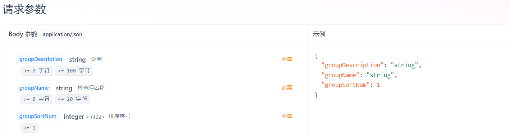

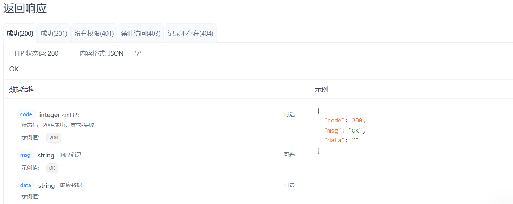

#### 2）分页查询检查组

接口名称：分页查询检查组

接口路径：GET   /health/admin/check-group/pageQuery

<callout emoji="🔮">
参数说明：本接口的排序参数，前端发起请求时固定为
- orderBy1：groupSortNum
- orderBy2：createTime
- isAsc1：true
- isAsc2：false
</callout>

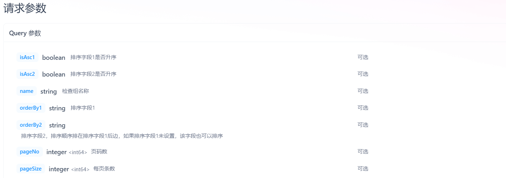

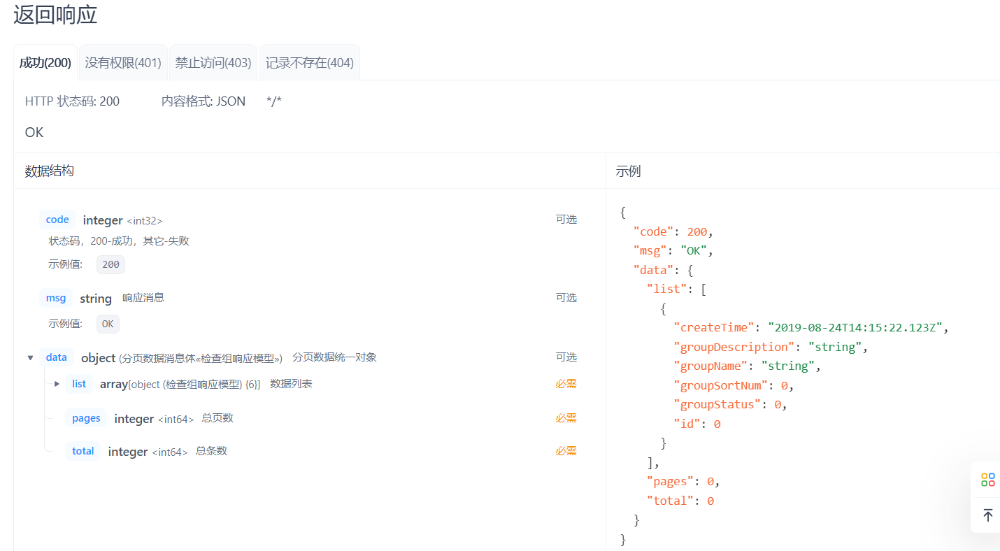

#### 3）根据id查询检查组

接口名称：根据id查询检查组

接口路径：GET   /health/admin/check-group/{id}

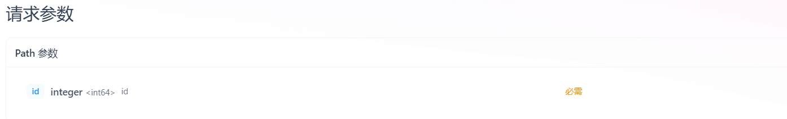

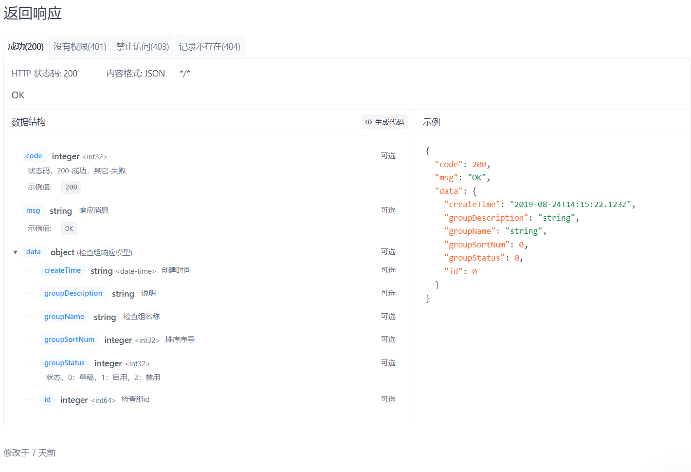

#### 4）修改检查组

接口名称：修改检查组

接口路径：PUT   /health/admin/check-group/{id}

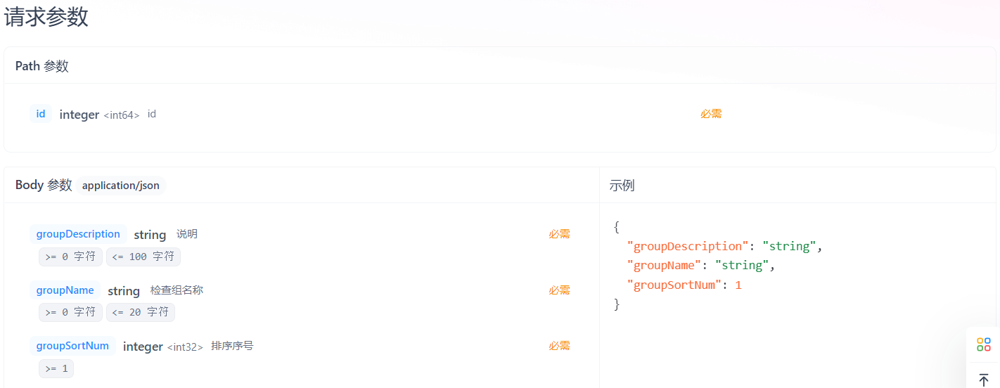

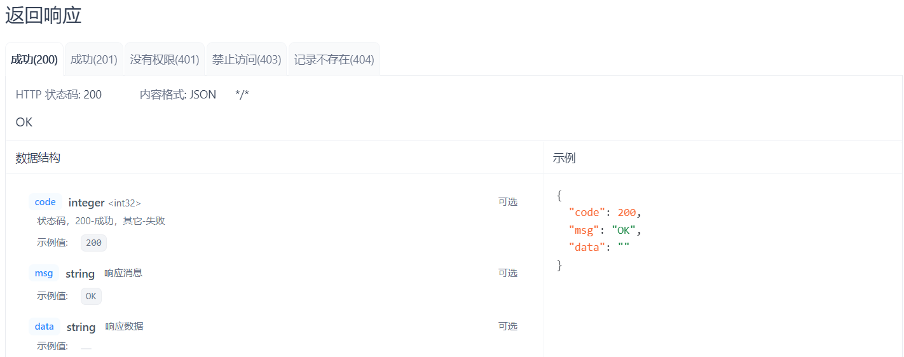

#### 5）根据id启用检查组

接口名称：根据id启用检查组

接口路径：PUT   /health/admin/check-group/enable/{id}

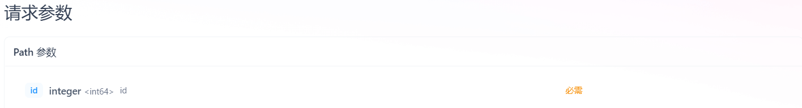

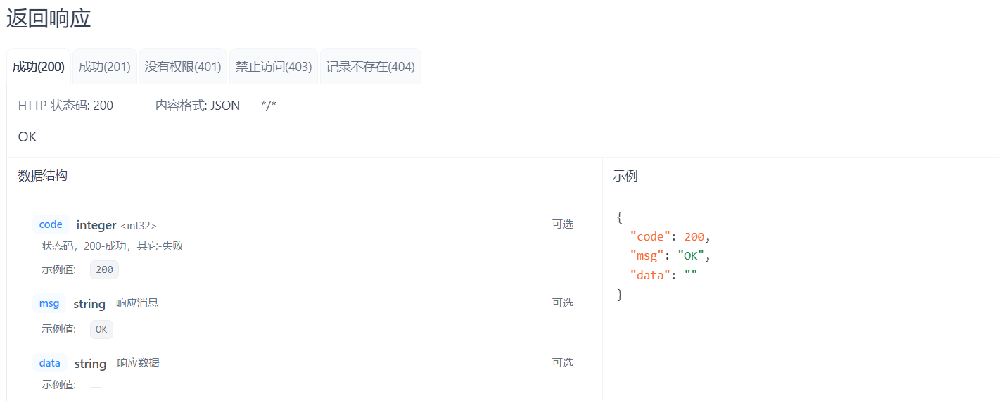

#### 6）校验检查组是否可以禁用

接口名称：校验检查组是否可以禁用

接口路径：GET   /health/admin/check-group/checkDisable/{id}

<callout emoji="🔮">
需求说明：本接口用于用户禁用体检组时，提前校验进行弹窗提示。
逻辑说明：需要校验该体检组关联的套餐有哪些，如果有关联的套餐，返回套餐名称列表，并将canDisable参数置为false；否则套餐名称列表为null，canDisable参数置为true；
</callout>

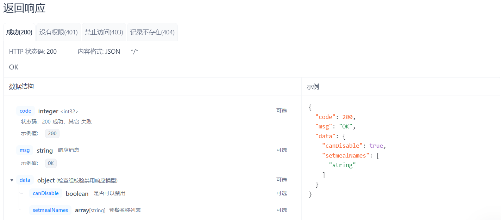

#### 7）根据id禁用检查组

接口名称：根据id禁用检查组

接口路径：PUT   /health/admin/check-group/disable/{id}

<callout emoji="🔮">
说明：业务逻辑请参考<cite doc-id="FevNwiL4lizEtWkGxd7cx8Snn7g" file-type="wiki" title="即刻体检需求文档" type="doc"></cite>
</callout>

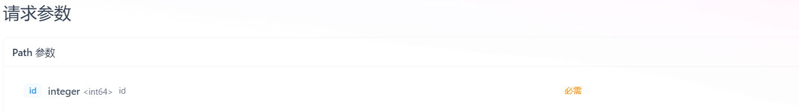

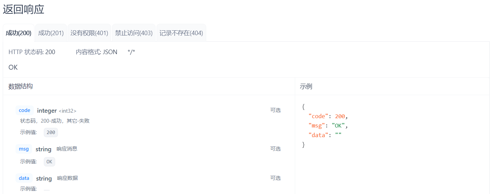

#### 8）根据id删除检查组

接口名称：根据id删除检查组

接口路径：DELETE   /health/admin/check-group/{id}

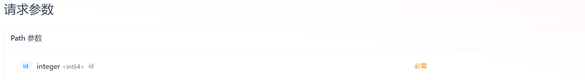

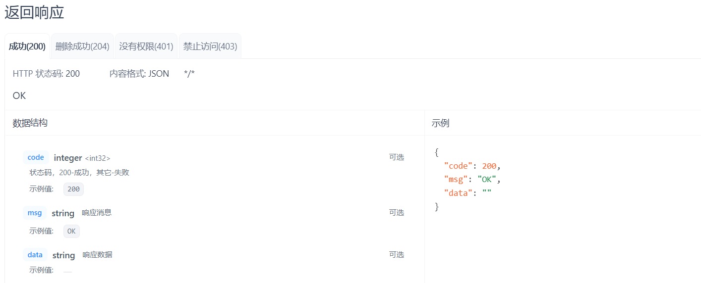

#### 9）体检组下拉列表

接口名称：体检组下拉列表

接口路径：GET   /health/admin/check-group/listForFilter

<callout emoji="🔮">
说明：本接口用于体检项新增页面，需要查询启用状态的体检组
</callout>

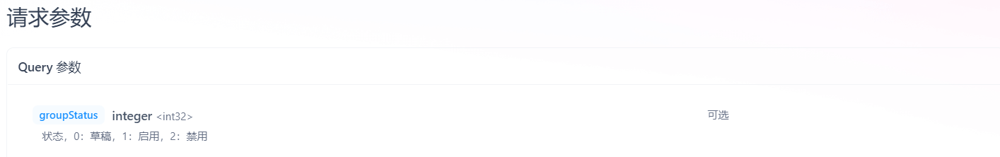

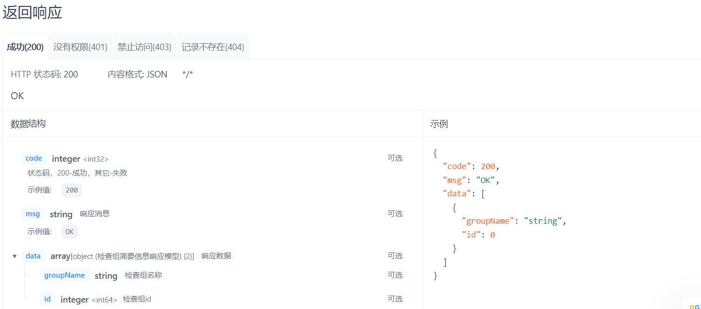

---
> 来源：飞书技术知识库（脱敏版） · 07 业务组件方案集 / 即刻体检-套餐管理 · [原文](https://ccn8v2zngwsm.feishu.cn/wiki/QWEcwAmGXi4DickPbI0cGuW6nag)
