# 第八章 支付模块

## 学习目标

1. 能够说出对接小程序支付接口的流程
2. 能够测试通过支付服务的支付和退款接口
3. 能够说出支付服务核心表设计
4. 能够说出如何防止重复支付
5. 能够说出对接支付服务接口有哪些及流程
6. 能够对接支付服务的支付接口
7. 能够对接支付服务查询支付结果接口
8. 能够开发支付结果通知功能
9. 能够说出取消订单模块的设计方案
10. 能够实现取消订单自动退款功能
11. 能够说出策略模式在取消订单模块的应用方案


## 1 支付服务

### 1.1 支付接口调研

通常项目的支付业务会开发独立的支付服务，由支付服务对接第三方支付平台，如：微信、支付宝、聚合支付平台等。

对于小程序支付需要对接微信的小程序支付接口，对于APP支付和PC网站支付可以对接微信、支付宝或第三方聚合支付平台。

目标：根据需求调研支付接口，确定本项目需要对接哪些接口。

#### 1）界面原型

用户下单成功提示用户支付，用户支付成功即下单成功，下单成功后家政服务人员才可以进行抢单，如下图：

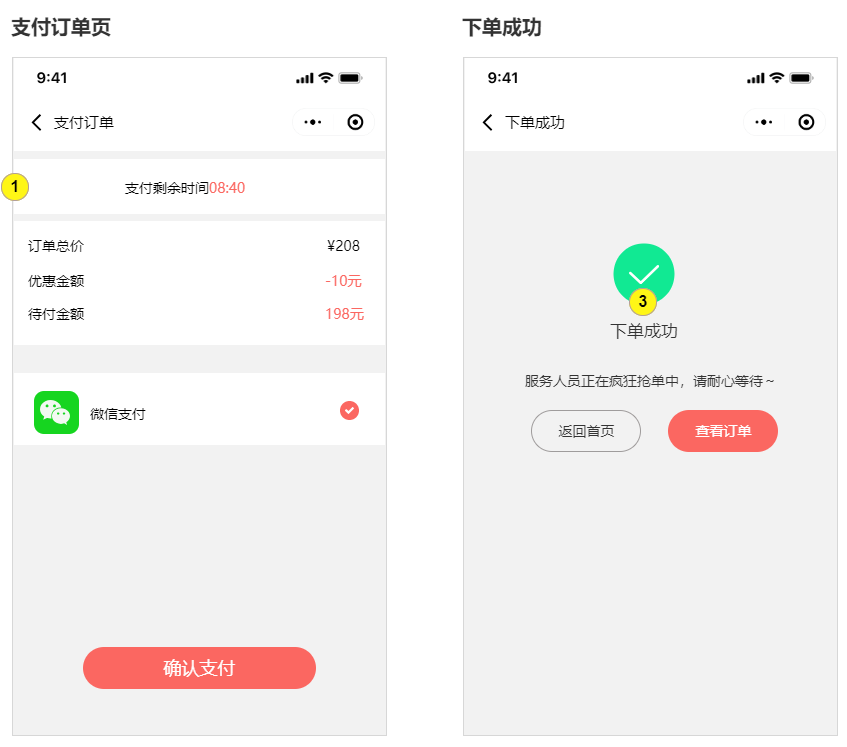
> 图注：这张图分为左右两部分，左侧是支付订单页，标注了“支付剩余时间08:40”，同时显示了订单总价208元、优惠金额10元、待付金额198元，支付方式选中了微信支付，底部设有“确认支付”按钮，对应小程序下单后的支付环节；右侧是下单成功页面，带有绿色对勾图标，标注“下单成功”，还提示服务人员正在抢单，页面设有“返回首页”和“查看订单”按钮，展示了支付成功后的状态，和文档里小程序微信支付的流程内容相匹配。

用户使用的是微信小程序，所以支付过程是使用微信支付，点击确认支付即弹出微信支付界面，输入支付密码确认支付，支付成功后显示下单成功。

#### 2) 小程序支付调研

参考“微信支付调研 v1.0”文档。

通过调研小程序支付，我们系统需要与小程序支付接口对接有：

**下单接口**：家政系统后端调用 微信支付的下单接口。

**支付通知**：微信支付调用家政系统后端接口。

**商户订单号查询**：家政系统后端调用 微信支付的商户订单号查询接口。


这里有一个问题不方便广大学生学习：

就是在小程序调起支付这里，微信会校验小程序的APPID与微信支付商户的ID是否绑定，微信支付商户的ID怎么获取呢？是需要注册商户上传企业资料及法人资料，微信审核通过后方可 注册成功，所以注册成为一个普通商户对大家有限制。

针对这些限制我们尝试调研其它的接口。

#### 3) 扫码支付调研

下边调研扫码支付支付，此接口不存在小程序端调起支付的限制，**要注意：开发小程序一定要对接微信小程序的支付接口，在小程序上使用 的扫码支付是不符合小程序支付的用户需求的，这里仅是用于学习。**

参考“微信支付调研 v1.0”文档。

#### 4）如何保证接口安全性？

第三方支付平台除了使用https协议进行加密传输以外，还通过接口签名以及敏感参数加密的方式保证接口的安全性。

拿 微信支付接口为例，请求任何微信支付接口都需要对请求参数进行签名，微信会进行验签，如果通过才会进行业务处理。

详细参见：https://pay.weixin.qq.com/docs/merchant/development/interface-rules/signature-generation.html

##### **什么是签名和验签**

**签名**是对原始数据通过签名算法生成的一段数据（签名串），用于证明数据的真实性和完整性。签名通常使用密钥进行生成，这个密钥可以是对称密钥或非对称密钥中的私钥。

**验签**是对签名串进行验证的过程，用于确认数据的真实性和完整性。验签的过程通常使用与签名过程中相对应的公钥进行解密。

**签名和验签是为了防止内容被篡改。**

参考微信支付的文档，签名方式如下：

第一步生成签名串：

签名串一共有五行，每一行为一个参数。结尾以`\n`（换行符，ASCII编码值为0x0A）结束，包括最后一行。如果参数本身以`\n`结束，也需要附加一个`\n`。

```Bash
HTTP请求方法\n
URL\n
请求时间戳\n
请求随机串\n
请求报文主体\n

示例：
GET\n 
2/v3/certificates\n 
31554208460\n 
4593BEC0C930BF1AFEB40B4A08C8FB242\n 
5\n
```

第二步计算签名值

使用商户私钥对待签名串进行SHA256 with RSA签名，并对签名结果进行Base64编码得到签名值。

第三步请求设置http头

通过HTTP Authorization头来传递签名信息，如下：

```JSON
Authorization: 认证类型 签名信息
```

示例：

```JSON
Authorization: WECHATPAY2-SHA256-RSA2048 mchid="1900009191",nonce_str="593BEC0C930BF1AFEB40B4A08C8FB242",signature="uOVRnA4qG/MNnYzdQxJanN+zU+lTgIcnU9BxGw5dKjK+VdEUz2FeIoC+D5sB/LN+nGzX3hfZg6r5wT1pl2ZobmIc6p0ldN7J6yDgUzbX8Uk3sD4a4eZVPTBvqNDoUqcYMlZ9uuDdCvNv4TM3c1WzsXUrExwVkI1XO5jCNbgDJ25nkT/c1gIFvqoogl7MdSFGc4W4xZsqCItnqbypR3RuGIlR9h9vlRsy7zJR9PBI83X8alLDIfR1ukt1P7tMnmogZ0cuDY8cZsd8ZlCgLadmvej58SLsIkVxFJ8XyUgx9FmutKSYTmYtWBZ0+tNvfGmbXU7cob8H/4nLBiCwIUFluw==",timestamp="1554208460",serial_no="1DDE55AD98ED71D6EDD4A4A16996DE7B47773A8C"

```

> - `WECHATPAY2-SHA256-RSA2048`：这是签名算法的标识，表明使用的是基于SHA-256和RSA-2048的签名方法。
> - `mchid="1900009191"`：商户ID（Merchant ID），这是微信支付分配给商户的唯一标识。
> - `nonce_str="593BEC0C930BF1AFEB40B4A08C8FB242"`：随机字符串（Nonce String），用于确保HTTP请求的不可重复性（non-replayability）。每次请求都应该不同。
> - `signature="... "`：签名（Signature），这是经过签名算法计算后得到的一串字符，用于验证请求的完整性和真实性。这里省略了一部分，因为签名太长了。签名是通过将其他参数与商户的私钥一起进行加密运算得出的。
> - `timestamp="1554208460"`：时间戳（Timestamp），表示请求的时间点，通常为Unix时间戳格式（从1970年1月1日00:00:00开始所经过的时间秒数）。这里的值对应于2019年4月2日 04:14:20 UTC。
> - `serial_no="1DDE55AD98ED71D6EDD4A4A16996DE7B47773A8C"`：证书序列号（Serial Number），用于标识微信支付颁发给商户的数字证书。


微信支付收到请求根据请求头Authorization的内容进行验签，验证信息是否被篡改。

同样，如果微信支付通知支付结果给业务系统，业务系统也需要使用SHA256 with RSA进行验签。

参考：https://pay.weixin.qq.com/docs/merchant/development/interface-rules/signature-verification.html

> - 获取证书
> -  检查平台证书序列号
> - 检查时间戳是否已过期
> - 获取应答时间戳、应答随机串、应答报文主体，组成验签串，行尾以 `\n` 结束，举例如下：
> 
> ```Bash
> 1554209980\n
> c5ac7061fccab6bf3e254dcf98995b8c\n
> {"data":[{"serial_no":"5157F09EFDC096DE15EBE81A47057A7232F1B8E1","effective_time":"2018-03-26T11:39:50+08:00","expire_time":"2023-03-25T11:39:50+08:00","encrypt_certificate":{"algorithm":"AEAD_AES_256_GCM","nonce":"4de73afd28b6","associated_data":"certificate","ciphertext":"..."}}]}\n
> ```
> 
> - 获取应答签名，
> 
> ```Bash
> Wechatpay-Signature: uOVRnA4qG/MNnYzdQxJanN+zU+lTgIcnU9BxGw5dKjK+VdEUz2FeIoC+D5sB/LN+nGzX3hfZg6r5wT1pl2ZobmIc6p0ldN7J6yDgUzbX8Uk3sD4a4eZVPTBvqNDoUqcYMlZ9uuDdCvNv4TM3c1WzsXUrExwVkI1XO5jCNbgDJ25nkT/c1gIFvqoogl7MdSFGc4W4xZsqCItnqbypR3RuGIlR9h9vlRsy7zJR9PBI83X8alLDIfR1ukt1P7tMnmogZ0cuDY8cZsd8ZlCgLadmvej58SLsIkVxFJ8XyUgx9FmutKSYTmYtWBZ0+tNvfGmbXU7cob8H/4nLBiCwIUFluw==
> ```
> 
> 使用 base64 解码 `Wechatpay-Signature` 字段值，将保存为文件`signature.txt`。
> 
> ```Java
> $openssl base64 -d -A <<< \ 'CtcbzwtQjN8rnOXItEBJ5aQFSnIXESeV28Pr2YEmf9wsDQ8Nx25ytW6FXBCAFdrr0mgqngX3AD9gNzjnNHzSGTPBSsaEkIfhPF4b8YRRTpny88tNLyprXA0GU5ID3DkZHpjFkX1hAp/D0fva2GKjGRLtvYbtUk/OLYqFuzbjt3yOBzJSKQqJsvbXILffgAmX4pKql+Ln+6UPvSCeKwznvtPaEx+9nMBmKu7Wpbqm/+2ksc0XwjD+xlvlECkCxfD/OJ4gN3IurE0fpjxIkvHDiinQmk51BI7zQD8k1znU7r/spPqB+vZjc5ep6DC5wZUpFu5vJ8MoNKjCu8wnzyCFdA==' > signature.txt
> 
> ```
> 
> - 最后，获取证书中的公钥，验证签名，得到验签结果。
> 
> ```Java
> $ openssl dgst -sha256 -verify 1900009191_wxp_pub.pem -signature signature.txt << EOF
> 1554209980
> c5ac7061fccab6bf3e254dcf98995b8c
> {"data":[{"serial_no":"5157F09EFDC096DE15EBE81A47057A7232F1B8E1","effective_time":"2018-03-26T11:39:50+08:00","expire_time":"2023-03-25T11:39:50+08:00","encrypt_certificate":{"algorithm":"AEAD_AES_256_GCM","nonce":"d215b0511e9c","associated_data":"certificate","ciphertext":"..."}}]}
> EOF
> Verified OK
> ```


##### **加密与解密**

**加密**是将原始的、可读的数据（称为明文）通过某种算法和密钥转换成不可读的数据（称为密文）。加密的目的是防止未经授权的访问者能够理解或识别被加密的信息。加密算法通常基于密钥，有对称加密和非对称加密两种主要类型。

**解密**是加密的逆过程，即将密文还原为明文。只有持有正确密钥的人或系统能够进行解密操作。解密的目的是还原加密前的原始信息，使其能够被理解和使用。

- **对称加密**：使用相同的密钥进行加密和解密。这种方法的优点是速度快，适合大量数据的加密处理。常见的对称加密算法包括AES（高级加密标准）、DES（数据加密标准）、3DES（三重数据加密算法）等。
- **非对称加密**：使用一对密钥，即公钥和私钥。公钥可以公开分发，而私钥则必须保密。公钥用于加密消息，私钥用于解密消息；或者反过来，在数字签名的情况下，私钥用于创建签名，而公钥用于验证签名。常见的非对称加密算法包括RSA（Rivest-Shamir-Adleman）、ECC（椭圆曲线密码术）等。

需要注意的是，在实际应用中，非对称加密主要用于密钥交换或数字签名，因为它的计算量大，速度相对较慢。对于大量的数据加密，通常会结合使用对称加密和非对称加密技术，即先用对称加密算法加密数据，再用非对称加密算法来保护对称密钥的安全传输。这种组合使用的方式称为混合加密系统。

**加密与解密是为了防止内容被泄露，保证内容的机密性。**

为了保证安全性，微信支付在回调通知和平台证书下载接口中，对关键信息进行了AES-256-GCM加密，商户收到报文后，要解密出明文，APIv3密钥是解密时使用的对称密钥。参考：https://pay.weixin.qq.com/docs/merchant/development/interface-rules/certificate-callback-decryption.html


<callout emoji="✍️">
非对称加密算法用于加解密上为什么采用公钥加密，岂不是更不安全？为什么签名验签过程是私钥签名公钥验签？
公私钥是一对儿，公钥加密只能私钥解密，只要保护好私钥就能保证安全性，没有私钥就无法解密。
签名验签是为了防止内容被篡改，是为了保证数据一定出自谁，持有私钥的人对内容进行签名就保证了此内容不能被篡改，此内容出自己我这里。
</callout>


#### 5）小结

本节调用了小程序支付接口与扫码支付（Native支付接口）。

由于学习的需要本项目使用Native支付接口。

但是要注意：**开发小程序一定要对接微信小程序的支付接口，我们使用 的扫码支付是不符合小程序支付的用户需求的，这里仅是用于学习。**


**你们对接的哪个支付接口？怎么对接的？**

提示：首先说明是对接的小程序支付接口，需要对接哪些接口及与第三方支付平台的交互流程。


如何保证一个外部接口的安全性？

对于登录、支付包含敏感信息的接口一定要使用https进行加密传输。

通过签名、验签防止内容篡改，我们对接第三方支付接口都会进行签名验签的过程，使用非对称加密算法 更安全，比如：SHA256 with RSA算法。

通过加密、解密防止内容暴露，通过非对称加密算法 更安全。


HTTPS协议加解密过程？

HTTPS协议结合了对称加密和非对称加密两种技术，以实现高效而安全的数据传输。下面详细解释这两种加密方式在HTTPS中的作用及工作原理：

**非对称加密**

非对称加密，也称为公钥加密，使用一对密钥：公钥和私钥。公钥可以公开分发，而私钥必须保密。非对称加密的主要优点是可以解决密钥分发的问题，即如何安全地将密钥从一方传递给另一方。然而，它的计算成本相对较高，不适合大量数据的加密。

在HTTPS中的应用

1. 密钥交换：在HTTPS握手过程中，客户端使用服务器的公钥（从服务器的数字证书中获取）来加密一个随机生成的预主密钥（Pre-Master Secret）。这个预主密钥随后被发送到服务器。
2. 密钥派生：服务器使用自己的私钥解密预主密钥。然后，客户端和服务器分别使用这个预主密钥以及握手过程中交换的随机数来独立地生成会话密钥（Session Key）。

**对称加密**

对称加密使用同一个密钥进行数据的加密和解密。与非对称加密相比，对称加密的计算效率更高，适合大量数据的加密。

**总结**

HTTPS协议巧妙地结合了对称加密和非对称加密的优点：

- 非对称加密用于安全地交换会话密钥，解决了密钥分发的问题。
- 对称加密则用于实际的数据传输，确保了高效率和高性能。

通过这种方式，HTTPS不仅能够提供数据的保密性和完整性，还能有效防止中间人攻击，确保通信双方的身份验证。这种方法在现代互联网安全中得到了广泛应用，是保护在线交易、个人隐私和其他敏感信息的重要手段。


### 1.2 测试支付接口

#### 1）认识支付服务

在我们项目中针对支付业务专门开发了支付服务，由支付服务与微信进行接口对接，家政平台的订单服务只需和支付服务对接即可。

本项目的支付服务支持微信和支付宝的Native、jsapi等常用支付方式。

用户发起支付请求订单管理服务，订单管理服务请求支付服务进行支付，项目所有支付业务统一由支付服务去实现。如下图：

<whiteboard token="Bjn1w1gvehwzIYbckS2ceWUunoF"></whiteboard>

<callout emoji="🎼">
为什么单独开发一个支付服务呢？
</callout>

一个项目或一个企业通常有很多系统，这些系统有很多都有支付的需求，如果每个系统都和微信、支付宝等这些第三方平台对接一遍很多工作是重复的，抽取了支付服务就是要把这个工作进行简化，简化开发支付业务，通常你到企业中一般都是和现成的支付系统进行对接。


#### 2）部署支付服务

课程提供支付服务jzo2o-trade的git仓库地址为： https://gitee.com/jzo2o-v2/jzo2o-trade.git

先fork到自己的仓库中，再从自己仓库拉取。

拉取成功 切换到jzo2o分支。

jzo2o-trade创建完成如下图：

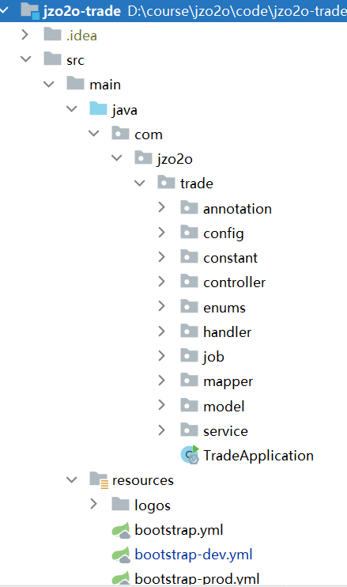
> 图注：图片展示了jzo2o-trade项目的文件结构。在src目录下，有main文件夹，其中包含java文件夹，内有com.jzo2o.trade下的多个子文件夹，如annotation、config、controller等，以及TradeApplication文件。resources文件夹下有logos、bootstrap.yml、bootstrap-dev.yml、bootstrap-prod.yml等文件。该图片与上文创建jzo2o-trade项目及配置bootstrap-dev.yml中nacos地址的内容相关，直观呈现了项目结构。

需要注意配置bootstrap-dev.yml中的nacos地址。

创建nacos配置文件jzo2o-trade.yaml，内容如下：

```JSON
jzo2o:
  job:
    refund:
      count: 100
    trading:
      count: 100
  qrcode:
    back-color: '#ffffff'
    error-correction-level: M
    fore-color: '#000000'
    height: 300
    margin: 2
    width: 300
xxl-job:
  port: 11604
rabbit-mq:
    enable: true

```

示例图：

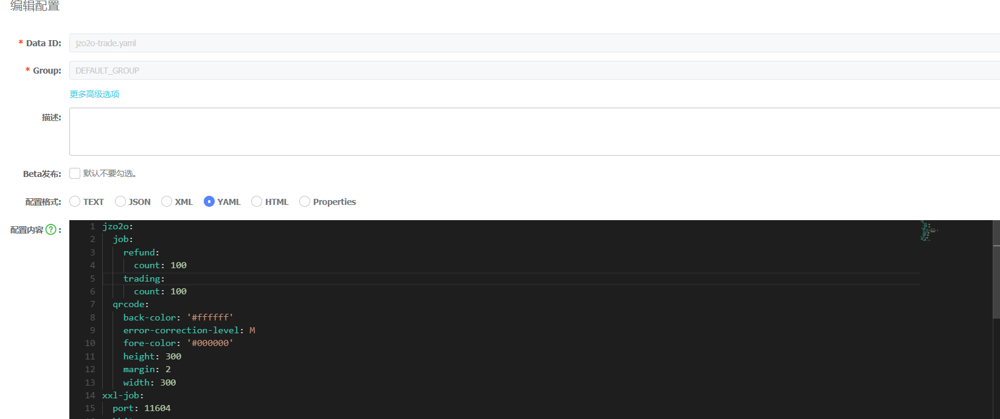
> 图注：该图为支付服务配置页面，是创建jzo2o-trade的nacos配置文件jzo2o-trade.yaml的示例界面，页面上方可设置Data ID为jzo2o-trade.yaml、Group为DEFAULT_GROUP，还能选择配置格式，当前选中的格式为YAML；页面下方展示了配置内容示例，包含jzo2o、jforder、queue等多个字段的配置项，以及如color、width等布局相关配置，该页面用于配置支付模块的对应服务参数，是测试支付接口前完成支付服务配置的关键示例参考。

创建jzo2o-trade数据库，从课程资料中获取jzo2o-trade.sql并导入此脚本。

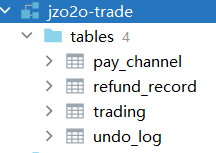
> 图注：这张图片展示了名为jzo2o-trade的项目结构，展开的“tables 4”目录下包含四个数据库表，分别为pay_channel、refund_record、trading以及undo_log。该图片位于文档“1.2测试支付接口”环节中，对应支付服务搭建过程里创建jzo2o-trade数据库的相关操作步骤，直观呈现了该项目需创建的数据库表情况，与文档中导入jzo2o-trade.sql脚本建库的内容相呼应，是支付模块搭建时数据库准备环节的可视化呈现。


下边启动支付服务，启动成功访问接口文档：http://localhost:11505/trade/doc.html#/home


#### 3）测试支付接口

1. **交互流程**

下边我们测试支付接口，用户点击支付按钮，前端请求订单服务，订单服务请求支付服务，最后支付服务请求微信的下单接口。

流程如下：

<whiteboard token="TYqXwFaRzhJIH2bqcvNcl9Y8nve"></whiteboard>

1. **接口定义**

下边我们测试支付服务的统一收单线下交易接口。

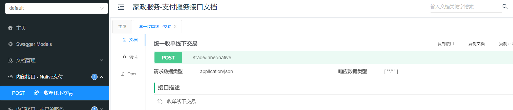
> 图注：该图片是家政服务的支付服务接口文档页面，左侧菜单选中“内部接口 - Native支付”下的“统一收单线下交易”选项，右侧展示该接口的核心信息：名称为统一收单线下交易，请求方法为POST，接口路径为/trade/inner/native，请求数据类型是application/json，同时标注有接口描述，页面还设有复制接口、复制文档等功能按钮，与文档中提及的测试支付接口及对应接口信息相匹配。

接口定义如下：

接口文档地址：http://localhost:11505/trade/doc.html#/default/%E5%86%85%E9%83%A8%E6%8E%A5%E5%8F%A3%20-%20Native%E6%94%AF%E4%BB%98/createDownLineTradingUsingPOST


接口路径：**POST**/trade/inner/native

**请求数据类型** application/json

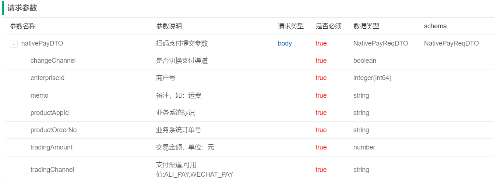
> 图注：图片展示了支付接口的请求参数说明。参数名称包括nativePayDTO、changeChannel、enterpriseId等，其中nativePayDTO为扫码支付提交参数，changeChannel表示是否切换支付渠道，为true且类型为boolean。enterpriseId为商户号，也为true且类型为integer。memo、productAppId、productOrderNo、tradingAmount、tradingChannel等参数也均有说明，如memo为备注，tradingAmount为交易金额，单位为元，tradingChannel支付渠道可用值为ALI_PAY、WECHAT_PAY。该图片与上文接口定义及请求参数说明的内容紧密相关，是对接口请求参数的详细展示。

请求参数说明：

changeChannel：当用户先微信支付，然后又进行支付宝支付表示切换了支付渠道，此时传入true

enterpriseId：商户号，进入微信或支付宝商户平台获取。

memo: 备注信息

productAppId        业务系统标识

productOrderNo 是业务系统的订单号，本项目就是家政服务的订单号。

tradingAmount：支付金额

tradingChannel        支付渠道,可用值:ALI_PAY,WECHAT_PAY


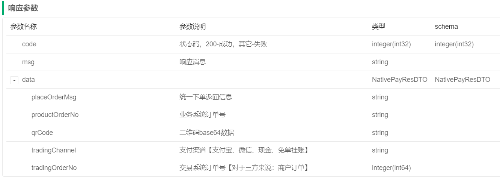
> 图注：图片展示了支付接口测试的响应参数说明。包含code、msg、data等参数，其中data下有placeOrderMsg、productOrderNo、qrCode、tradingChannel、tradingOrderNo等具体参数，如placeOrderMsg为统一下单返回信息，productOrderNo为业务系统订单号，tradingChannel为支付渠道，tradingOrderNo为交易系统订单号。该图片与上文测试支付接口中响应参数说明的内容相呼应，是对响应参数的详细展示。


响应参数说明：

placeOrderMsg        统一下单返回信息

tradingChannel：微信或支付宝

tradingOrderNo：支付服务生成的交易号

productOrderNo：业务系统的订单号，本项目就是家政服务的订单号。

qrCode：二维码base64


1. **接口测试**

下边我们使用接口文档的调试功能进行接口测试

请求下边的参数：

注意：保证每次请求支付下单传入productOrderNo不一致，productOrderNo表示商品的订单，同一个订单不能重复支付

```Java
{
  "changeChannel": false,
  "tradingChannel": "WECHAT_PAY",
  "memo": "日常保洁",
  "productOrderNo": 104,
  "productAppId": "jzo2o.orders",
  "enterpriseId": 1561414331,
  "tradingAmount": 0.1
}
```


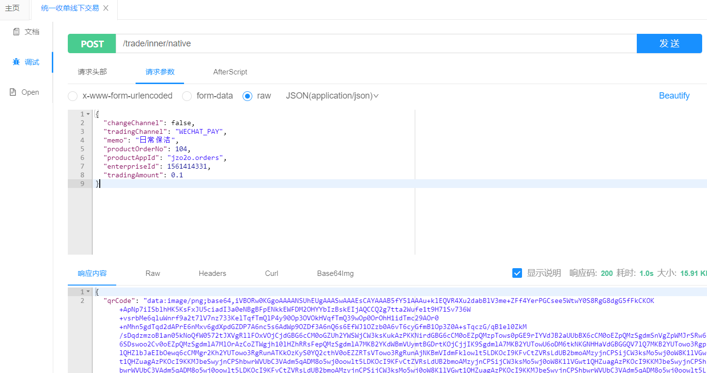
> 图注：图片展示的是支付接口测试时的调试界面。上方有“POST”标识及“/trade/inner/native”路径，下方是请求参数区域，包括“changeChannel”“tradingChannel”等字段，部分字段有具体值。下方还有响应内容区域，显示了“qrCode”“tradeUrl”等字段及对应值。该图片与上下文紧密相关，上下文提到使用接口文档调试功能进行接口测试，此图直观呈现了测试时的请求与响应情况，帮助理解测试操作。

响应结果如下：

```Java
{
  "qrCode": "",
  "productOrderNo": "104",
  "tradingOrderNo": "1836674158562390017",
  "tradingChannel": "WECHAT_PAY",
  "placeOrderMsg": "weixin://wxpay/bizpayurl?pr=N0WkUfuz1"
}
```

注意：这里要记住支付服务生成的交易单号tradingOrderNo，稍后查询交易结果使用。

复制qrCode粘贴到浏览器，出现二维码，如下图：


> 图注：图片展示的是支付接口测试中复制的二维码。在文档中，作者提到使用接口文档的调试功能进行接口测试，需将qrCode复制粘贴到浏览器，出现二维码。此图即为复制后的二维码，中间有一个绿色的对勾图案，周围由黑色方块组成，是扫码支付的标识，用于后续扫码支付操作。

下边进行扫码支付。


#### 4）支付结果查询

支付成功，下边测试  “根据交易单号查询交易单的交易结果”接口

接口文档URL：http://localhost:11505/trade/doc.html#/default/%E5%86%85%E9%83%A8%E6%8E%A5%E5%8F%A3%20-%20%E4%BA%A4%E6%98%93%E5%8D%95%E6%9C%8D%E5%8A%A1/findTradResultByTradingOrderNoUsingGET

接口定义如下：


交易单号是支付服务生成的，在下单接口响应中存在。

下边的结果，我们主要关注：

productOrderNo        业务系统订单号

tradingOrderNo        支付服务交易单号

tradingState 交易状态 （4表示已付款）


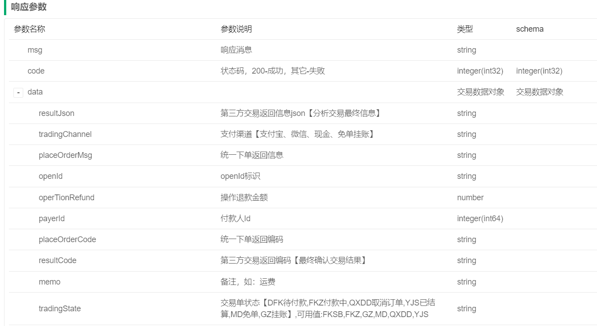
> 图注：图片展示了支付结果查询接口的响应参数。参数包括msg（响应消息）、code（状态码）、data（交易数据对象）、resultJson（第三方交易返回信息）、tradingChannel（支付渠道）、placeOrderMsg（统一下单返回信息）、openid（openid标识）、operationRefund（操作退款金额）、payerId（付款人Id）、placeOrderCode（统一下单返回编码）、resultCode（第三方交易返回编码）、memo（备注）、tradingState（交易单状态）。该图片与上文介绍的支付结果查询接口相关，是对接口响应参数的说明，帮助理解接口返回数据结构。

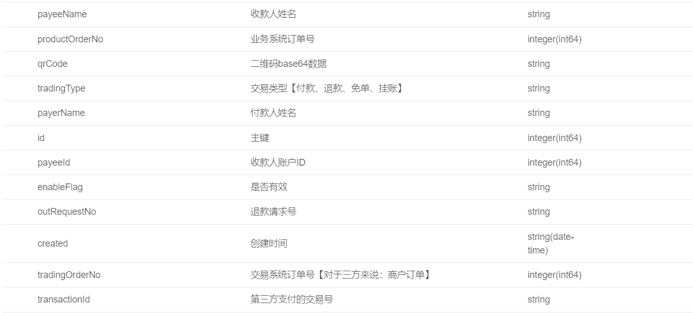
> 图注：这是一张接口返回数据的字段说明表格，呈现了交易相关接口的响应字段信息。表格每行对应一个字段，从左到右依次为字段名、字段含义、字段类型，涵盖收款人姓名、业务系统订单号、二维码base64数据、交易类型、付款人姓名、主键、收款人账户ID、是否有效、退款请求号、创建时间、交易系统订单号、第三方支付的交易号等内容，其中交易系统订单号字段补充说明“对于三方来说：商户订单”，该表格用于明确测试支付结果查询接口时需关注的字段信息，是支付模块测试环节的相关文档内容。

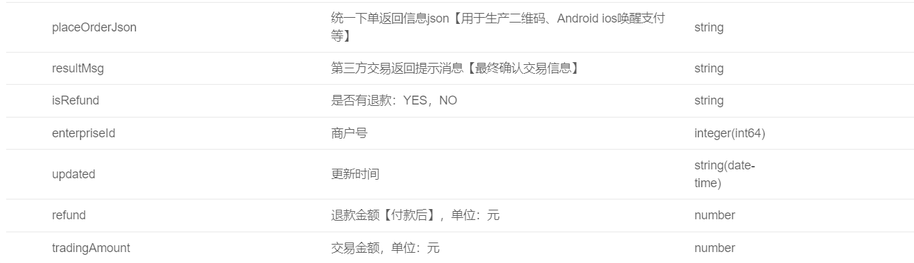
> 图注：这张图片是支付结果查询接口返回参数的详情表，呈现了该接口响应结果的各关键参数及对应说明、数据类型。表中包含placeOrderJson，说明其为统一下单返回信息json，用于生成二维码或唤醒支付，数据类型为string；resultMsg是第三方交易返回提示消息，即最终确认交易信息，数据类型为string；isRefund标识是否有退款，可选值为YES或NO，数据类型为string；还包含商户号、更新时间、退款金额、交易金额等参数，分别对应各自的说明及integer(int64)、string(datetime)、number等数据类型，该表是测试“根据交易单号查询交易单的交易结果”接口时，需要关注的响应结果参数的明确说明。

下边进行测试，传入交易单号：

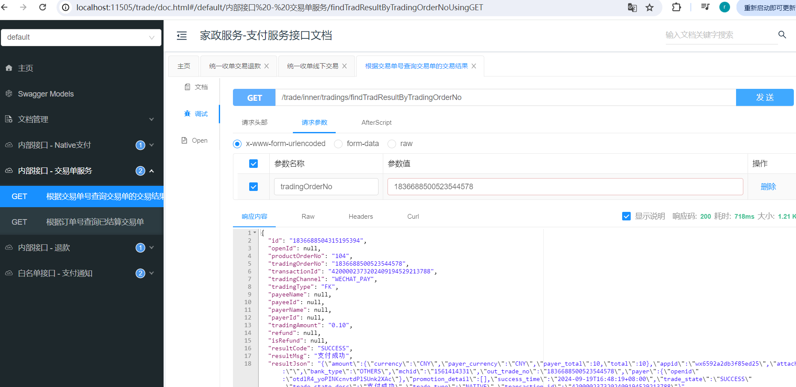
> 图注：这张图是支付服务接口文档的测试页面，对应文档中支付结果查询环节的接口测试内容，页面标题为家政服务-支付服务接口文档，展示的是GET请求“findTradResultByTradingOrderNoUsingGET”的调试界面。左侧是接口列表，高亮显示的正是本次测试的“根据交易单号查询交易结果”接口；右侧的参数区域中，已勾选并填写交易单号参数，数值为1836665005235644578，下方显示了该接口的响应结果信息，能看到交易相关的业务订单号、支付服务交易单号等内容，符合文档中需通过交易单号查询交易结果的测试要求。

响应结果：

```Java
{
  "id": "1836688504315195394",
  "openId": null,
  "productOrderNo": "104",
  "tradingOrderNo": "1836688500523544578",
  "transactionId": "4200002373202409194529213788",
  "tradingChannel": "WECHAT_PAY",
  "tradingType": "FK",
  "payeeName": null,
  "payeeId": null,
  "payerName": null,
  "payerId": null,
  "tradingAmount": "0.10",
  "refund": null,
  "isRefund": null,
  "resultCode": "SUCCESS",
  "resultMsg": "支付成功",
  "resultJson": "{\"amount\":{\"currency\":\"CNY\",\"payer_currency\":\"CNY\",\"payer_total\":10,\"total\":10},\"appid\":\"wx6592a2db3f85ed25\",\"attach\":\"\",\"bank_type\":\"OTHERS\",\"mchid\":\"1561414331\",\"out_trade_no\":\"1836688500523544578\",\"payer\":{\"openid\":\"otdlR4_yoPINKcnvtdPlSUnk2XAc\"},\"promotion_detail\":[],\"success_time\":\"2024-09-19T16:48:19+08:00\",\"trade_state\":\"SUCCESS\",\"trade_state_desc\":\"支付成功\",\"trade_type\":\"NATIVE\",\"transaction_id\":\"4200002373202409194529213788\"}",
  "placeOrderCode": "200",
  "placeOrderMsg": "weixin://wxpay/bizpayurl?pr=ZFqPYkxz3",
  "placeOrderJson": "{\"status\":200,\"body\":\"{\\\"code_url\\\":\\\"weixin://wxpay/bizpayurl?pr=ZFqPYkxz3\\\"}\"}",
  "enterpriseId": "1561414331",
  "memo": "日常保洁",
  "qrCode": "",
  "enableFlag": "YES",
  "outRequestNo": null,
  "operTionRefund": null,
  "created": null,
  "updated": null,
  "tradingState": 4
}
```


#### 5）测试退款接口

退款接口定义：

接口文档URL：http://localhost:11505/trade/doc.html#/default/%E5%86%85%E9%83%A8%E6%8E%A5%E5%8F%A3%20-%20%E9%80%80%E6%AC%BE/refundTradingUsingPOST

接口路径：**POST**/trade/inner/refund-record/refund

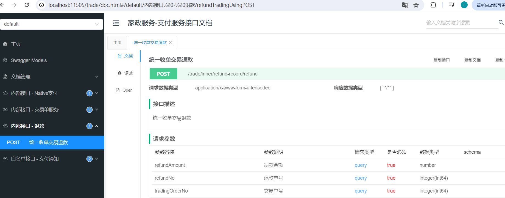
> 图注：这张图片展示的是家政服务支付服务的统一收单退款接口文档页面，对应测试退款接口的相关内容。页面显示该接口请求方式为POST，接口路径为/trade/inner/refund-record/refund，请求数据类型为application/x-www-form-urlencoded。接口描述为统一收单交易退款，标注的请求参数有3项，分别是参数名称refundAmount（退款金额）、refundNo（退款单号）、tradeOrderNo（交易单号），这三项参数均为必填的Number/Integer类型。


请求参数中：交易单号还是下单时支付服务生成的交易单号，在生成二维码接口中响应。

退款金额：小于等于支付金额。

退款单号：每次退款的退款单号必须唯一，多次退款总和不能大于支付金额。

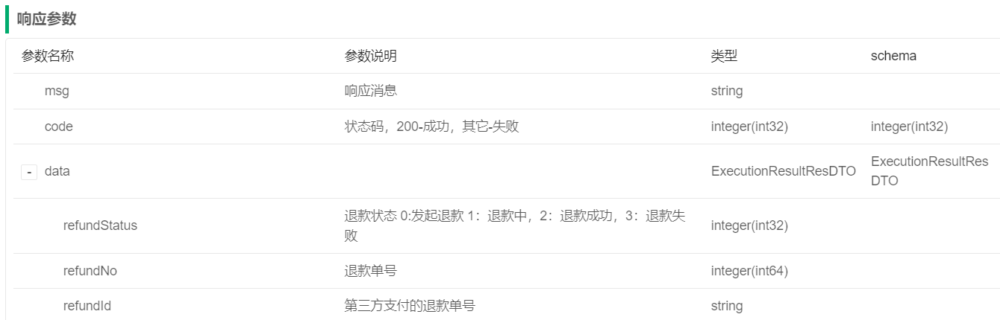
> 图注：这张图片展示的是测试退款接口的响应参数说明，包含参数名称、参数说明、类型与schema信息。其中明确标注了核心的退款状态参数refundStatus的含义，即0表示发起退款，1表示退款中，2表示退款成功，3表示退款失败，还列出了退款单号refundNo、第三方支付生成的退款单号refundId等关键参数，这些内容与上下文提到的测试退款接口需关注退款状态的要求对应，便于开发者查看和验证退款接口的响应数据。

响应结果中有退款状态，还有支付服务添的退款单号以及第三方支付（微信、支付宝）生成的退款单号。

我们主要关注退款状态：1表示退款中，2表示退款成功 3表示退款失败。

测试接口：

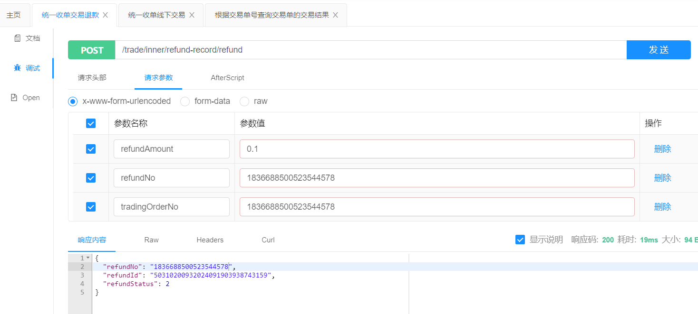
> 图注：图片展示的是测试退款接口的API请求界面。请求方式为POST，目标URL为“/trade/inner/refund-record/refund”。请求参数中，参数名称分别为refundAmount、refundNo、tradingOrderNo，参数值分别为0.1、1836688500523544578、1836688500523544578。下方显示了响应内容，包含refundId、refundId2、refundStatus等信息，其中refundStatus为2，表示退款成功。该图片与文档中测试退款接口的内容相关，直观呈现了接口测试时的请求参数及响应结果。


#### 6）小结

项目的支付服务有哪些接口？


### 1.3 理解支付服务的设计

#### 1）表设计

首先熟悉支付服务的数据库表

1. 支付渠道表

支付渠道表存储了第三方支付（微信、支付宝）的支付参数，如：商户号、证书序列号、api私钥等信息。

```Java
create table `jzo2o-trade`.pay_channel
(
    id                   bigint                             not null comment '主键'
        constraint `PRIMARY`
        primary key,
    channel_name         varchar(32)                        null comment '通道名称',
    channel_label        varchar(32)                        null comment '通道唯一标记',
    domain               varchar(255)                       null comment '域名',
    app_id               varchar(32) collate utf8_bin       not null comment '商户appid',
    public_key           varchar(2000) collate utf8_bin     not null comment '支付公钥',
    merchant_private_key varchar(2000) collate utf8_bin     not null comment '商户私钥',
    other_config         varchar(1000)                      null comment '其他配置',
    encrypt_key          varchar(255) charset utf8mb4       null comment 'AES混淆密钥',
    remark               varchar(400)                       null comment '说明',
    notify_url           varchar(255)                       null comment '回调地址',
    enable_flag          varchar(10)                        null comment '是否有效',
    enterprise_id        bigint                             null comment '商户ID【系统内部识别使用】',
    create_time          datetime default CURRENT_TIMESTAMP null comment '创建时间',
    update_time          datetime default CURRENT_TIMESTAMP null on update CURRENT_TIMESTAMP comment '更新时间'
)
    comment '交易渠道表' collate = utf8mb4_unicode_ci;
```

1. 交易单表

支付服务请求第三方支付下单成功向交易表写入一条记录

家政服务的一个订单可能对应支付服务的多条交易单，比如：用户用微信支付在交易单表生成一条交易单，如果微信支付失败再用支付宝支付时也会在交易单表中生成一条记录。

用户支付成功后支付服务更新交易单表的支付状态。

```Java
create table `jzo2o-trade`.trading
(
    id               bigint                                 not null comment '主键'
        constraint `PRIMARY`
        primary key,
    product_order_no bigint                                 not null comment '业务系统订单号',
    trading_order_no bigint                                 not null comment '交易系统订单号【对于三方来说：商户订单】',
    transaction_id   varchar(50)                            null comment '第三方支付交易号',
    trading_channel  varchar(32) charset utf8mb4            not null comment '支付渠道【支付宝、微信、现金、免单挂账】',
    trading_type     varchar(22)                            not null comment '交易类型【付款、退款、免单、挂账】',
    trading_state    int                                    not null comment '交易单状态【2-付款中,3-付款失败,4-已结算,5-取消订单,6-免单,7-挂账】',
    payee_name       varchar(50)                            null comment '收款人姓名',
    payee_id         bigint                                 null comment '收款人账户ID',
    payer_name       varchar(50)                            null comment '付款人姓名',
    payer_id         bigint                                 null comment '付款人Id',
    trading_amount   decimal(22, 2)                         not null comment '交易金额，单位：元',
    refund           decimal(12, 2)                         null comment '退款金额【付款后，单位：元',
    is_refund        varchar(32) charset utf8mb4            null comment '是否有退款：YES，NO',
    result_code      varchar(80)                            null comment '第三方交易返回编码【最终确认交易结果】',
    result_msg       varchar(255)                           null comment '第三方交易返回提示消息【最终确认交易信息】',
    result_json      varchar(2000)                          null comment '第三方交易返回信息json【分析交易最终信息】',
    place_order_code varchar(80)                            null comment '统一下单返回编码',
    place_order_msg  varchar(255)                           null comment '统一下单返回信息',
    place_order_json text                                   null comment '统一下单返回信息json【用于生产二维码、Android ios唤醒支付等】',
    enterprise_id    bigint                                 not null comment '商户号',
    memo             varchar(150)                           null comment '备注【订单门店，桌台信息】',
    qr_code          text                                   null comment '二维码base64数据',
    open_id          varchar(36) collate utf8mb4_unicode_ci null comment 'open_id标识',
    enable_flag      varchar(10)                            null comment '是否有效',
    create_time      datetime default CURRENT_TIMESTAMP     null comment '创建时间',
    update_time      datetime default CURRENT_TIMESTAMP     null on update CURRENT_TIMESTAMP comment '更新时间',
    constraint trading_order_no
        unique (trading_order_no) comment '支付订单号'
)
    comment '交易订单表' charset = utf8;

```

1. 退款记录表

用户申请退款在退款记录表写一条记录。

退款成功后支付服务更新退款状态。

```Java
create table `jzo2o-trade`.refund_record
(
    id               bigint                             not null comment '主键'
        constraint `PRIMARY`
        primary key,
    trading_order_no bigint                             not null comment '交易系统订单号【对于三方来说：商户订单】',
    product_order_no bigint                             not null comment '业务系统订单号',
    refund_no        bigint                             not null comment '本次退款订单号',
    refund_id        varchar(50)                        null comment '第三方支付的退款单号',
    enterprise_id    bigint                             not null comment '商户号',
    trading_channel  varchar(32) charset utf8mb4        not null comment '退款渠道【支付宝、微信、现金】',
    refund_status    int                                not null comment '退款状态：0-发起退款,1-退款中，2-成功, 3-失败',
    refund_code      varchar(80) charset utf8           null comment '返回编码',
    refund_msg       text charset utf8                  null comment '返回信息',
    memo             varchar(150) charset utf8          null comment '备注【订单门店，桌台信息】',
    refund_amount    decimal(12, 2)                     not null comment '本次退款金额',
    total            decimal(12, 2)                     not null comment '原订单金额',
    create_time      datetime default CURRENT_TIMESTAMP null comment '创建时间',
    update_time      datetime default CURRENT_TIMESTAMP null on update CURRENT_TIMESTAMP comment '更新时间',
    constraint refund_no
        unique (refund_no)
)
    comment '退款记录表' collate = utf8mb4_unicode_ci;


```

#### 2）数据流


黄色：业务系统

绿色：支付系统

粉色：第三方支付平台（微信、支付宝）

<whiteboard token="AdSbw4Na6h7BFdbI0tJcrWumnsb"></whiteboard>

支付服务的四个接口：

**支付接口：**

收到支付请求后请求第三方支付的下单接口，并向交易单表新增记录。

**查询交易结果接口：**

请求第三方支付的查询支付结果并更新交易单表的支付状态。

**接收第三方通知支付结果：**

更新交易单表的支付状态。

**退款接口：**

新增退款记录

请求第三方退款结果查询接口查询退款状态，并更新退款状态。

**支付结果通知任务：**

通过MQ通知业务支付结果。


#### 3）阅读代码

下边阅读支付接口与退款接口的核心代码：

##### 支付接口（生成二维码）

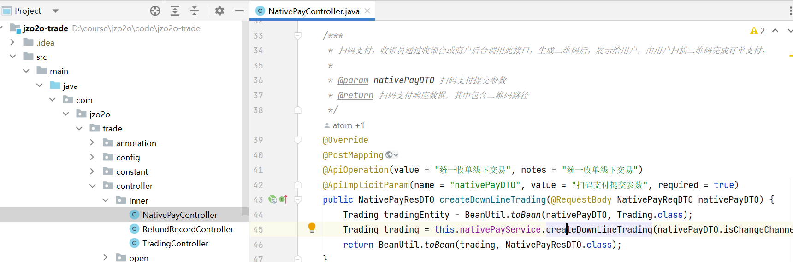
> 图注：这张图片展示的是支付模块相关代码，具体为NativePayController.java文件中的核心方法代码，该方法对应生成支付二维码的支付接口，作用是实现收银台或商户后台的扫码支付接口功能。代码中定义了createDownLineTrading方法，通过@PostMapping注解配置路径，接收NativePayReqDTO类型的参数，调用NativePayService的createDownLineTrading方法处理交易单相关逻辑，返回包含二维码路径的支付响应对象，相关参数注解标注了接口的用途和参数要求。


首先查询交易单是否生成交易单，如果已生成直接返回

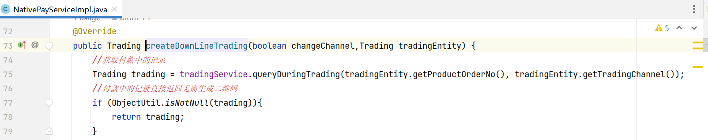
> 图注：图片展示的是NativePayServiceImpl.java文件中createDownLineTrading方法的代码。该方法首先查询交易单，若已生成直接返回；若切换支付渠道且存在原有支付渠道交易单，则先关闭原交易单；使用分布式锁防止重复支付；根据支付渠道调用不同bean请求第三方支付，获取第三方返回支付URL，支付服务生成支付二维码，插入交易单记录。此代码与上文介绍的支付接口生成二维码流程紧密相关，是其核心实现部分。

如果切换支付渠道且已存在原有支付渠道的交易单，则先关闭原支付渠道的交易单，避免重复支付。

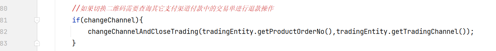
> 图注：这张图片展示的是支付接口生成二维码核心代码中的关键逻辑，代码位置对应文档中“如果切换支付渠道且已存在原有支付渠道的交易单，则先关闭原支付渠道的交易单，避免重复支付”的说明内容。代码使用if判断来处理渠道切换场景，当changeChannel条件满足时，会调用changeChannelAndCloseTrading方法，传入交易单号与交易渠道参数，实现切换支付渠道时关闭原有交易单的操作，以此避免重复支付，是支付服务设计中防止重复交易的具体实现代码片段。

使用分布式锁防止同一个交易单重复支付：

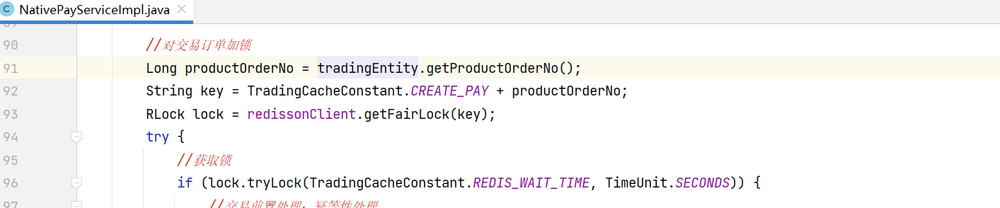
> 图注：图片展示的是NativePayServiceImpl.java文件中关于交易订单加锁的代码。首先获取交易订单编号，然后构建Redis锁的key，接着通过RedissonClient获取公平锁。代码中使用try - catch结构，尝试获取锁，若获取成功则执行后续交易前置处理等操作。该图片与上文提到的使用分布式锁防止同一个交易单重复支付的内容相关，直观呈现了加锁操作的代码实现。

根据支付渠道调用不同的bean请求第三方支付

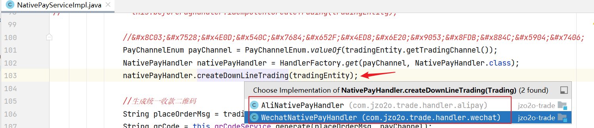
> 图注：这张图片展示了代码编辑页面的内容，来自NativePayServiceImpl.java文件，显示代码中根据交易渠道获取对应的原生支付处理器的过程。代码中先通过交易实体的交易渠道值获取支付渠道枚举类型，再调用HandlerFactory获取对应类型的原生支付处理器，最后执行创建在线交易的方法。画面右侧弹出了两个实现了对应方法的选项，分别是AliNativePayHandler和WechatNativePayHandler，分别对应支付宝和微信渠道的支付处理器，该代码是支付服务生成二维码流程中，根据不同支付渠道调用对应bean实现请求第三方支付的具体体现。

获取第三方返回的支付URL，支付服务生成支付二维码，插入交易单记录。

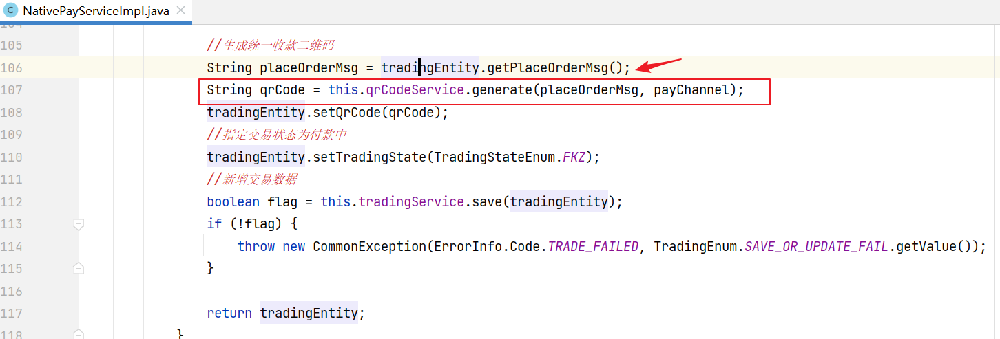
> 图注：图片展示了NativePayServiceImpl.java文件中生成二维码的相关代码。关键部分是第106行，调用this.qrCodeService.generate方法生成二维码，参数为placeOrderMsg和payChannel。此代码与上下文紧密相关，上下文提到支付服务生成支付二维码，插入交易单记录，此图片正是生成支付二维码的代码实现，体现了支付服务生成支付二维码这一功能。

##### 退款接口

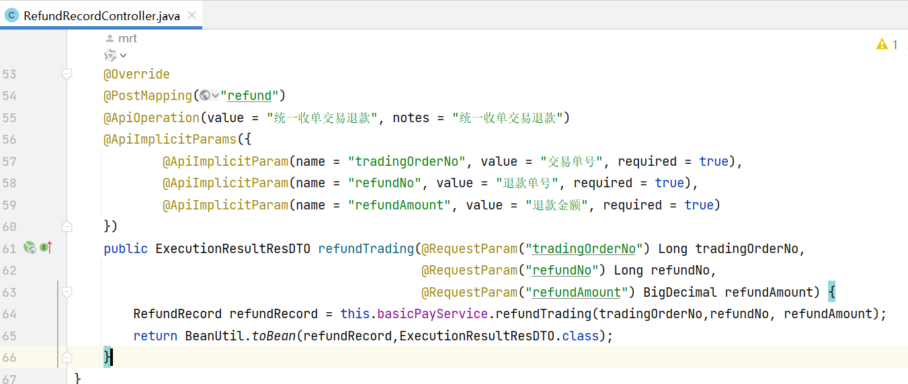
> 图注：图片展示的是RefundRecordController.java文件中的refund方法代码。该方法为统一收单交易退款接口，接收交易单号、退款单号、退款金额等参数。关键部分是调用basicPayService的refundTrading方法，传入交易单号、退款单号、退款金额，返回结果转换为ExecutionResultResDTO类型。此图片与文档中介绍退款接口的内容相关，直观呈现了退款接口的代码实现。

没有退款记录时插入退款记录

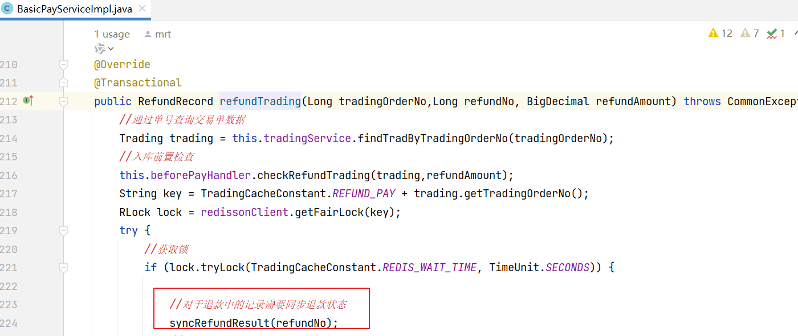
> 图注：图片展示的是BasicPayServiceImpl.java文件中refundTrading方法的部分代码。代码通过单号查询交易单数据，入前置检查，获取交易订单号，获取Redisson客户端的公平锁，尝试获取锁。若获取成功，对退款中的记录同步退款状态。该图片与上下文“退款接口”相关，具体呈现了退款接口中使用分布式锁防止同一个交易单重复退款的操作代码，是支付服务退款流程中的一环。

请求第三方退款接口

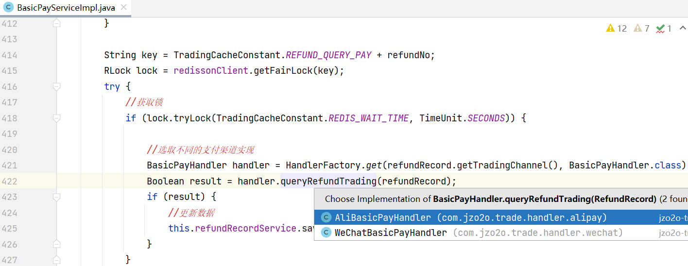
> 图注：这张图片展示了支付模块退款相关的Java代码实现，代码位于BasicPayServiceImpl.java文件中。代码通过分布式锁防止重复退款，指定了与退款单号绑定的Redis锁键，获取FairLock锁后按交易渠道调用不同的Handler类处理退款，当获取第三方返回的退款结果为真时，会更新退款记录。光标悬停的提示框显示，当前的退款处理类选择中包含了针对支付宝渠道的AliBasicPayHandler和针对微信渠道的WeChatBasicPayHandler两类实现，对应不同的第三方支付渠道退款请求逻辑。

##### 支付通知任务


```Java
@Component
public class TradeJob {

    @Value("${jzo2o.job.trading.count:100}")
    private Integer tradingCount;
    @Value("${jzo2o.job.refund.count:100}")
    private Integer refundCount;
    @Resource
    private TradingService tradingService;
    @Resource
    private RefundRecordService refundRecordService;
    @Resource
    private BasicPayService basicPayService;
    @Resource
    private RabbitClient rabbitClient;

    /**
     * 分片广播方式查询支付状态
     * 逻辑：每次最多查询{tradingCount}个未完成的交易单，交易单id与shardTotal取模，值等于shardIndex进行处理
     */
    @XxlJob("tradingJob")
public void tradingJob() {
    // 分片参数
    int shardIndex = NumberUtil.max(XxlJobHelper.getShardIndex(), 0);
    int shardTotal = NumberUtil.max(XxlJobHelper.getShardTotal(), 1);

    List<Trading> list = this.tradingService.findListByTradingState(TradingStateEnum.FKZ, tradingCount);
    if (CollUtil.isEmpty(list)) {
        XxlJobHelper.log("查询到交易单列表为空！shardIndex = {}, shardTotal = {}", shardIndex, shardTotal);
        return;
    }

    //定义消息通知列表，只要是状态不为【付款中】就需要通知其他系统
    List<TradeStatusMsg> tradeMsgList = new ArrayList<>();
    for (Trading trading : list) {
        if (trading.getTradingOrderNo() % shardTotal != shardIndex) {
            continue;
        }
        try {
            //查询交易单
            TradingDTO tradingDTO = this.basicPayService.queryTradingResult(trading.getTradingOrderNo());
            if (TradingStateEnum.FKZ != tradingDTO.getTradingState()) {
                TradeStatusMsg tradeStatusMsg = TradeStatusMsg.builder()
                        .tradingOrderNo(trading.getTradingOrderNo())
                        .productOrderNo(trading.getProductOrderNo())
                        .productAppId(trading.getProductAppId())
                        .transactionId(tradingDTO.getTransactionId())
                        .tradingChannel(tradingDTO.getTradingChannel())
                        .statusCode(tradingDTO.getTradingState().getCode())
                        .statusName(tradingDTO.getTradingState().name())
                        .info(tradingDTO.getMemo())//备注信息
                        .build();
                tradeMsgList.add(tradeStatusMsg);
            }else{
                //如果是未支付，需要判断下时间，超过20分钟未支付的订单需要关闭订单以及设置状态为QXDD
               long between = LocalDateTimeUtil.between(trading.getCreateTime(), LocalDateTimeUtil.now(), ChronoUnit.MINUTES);
                if (between >= 20) {
                    try {
                        basicPayService.closeTrading(trading.getTradingOrderNo());
                    } catch (Exception e) {
                        log.error("超过20分钟未支付自动关单出现异常,交易单号:{}",trading.getTradingOrderNo());
                    }
                }
            }
        } catch (Exception e) {
            XxlJobHelper.log("查询交易单出错！shardIndex = {}, shardTotal = {}, trading = {}", shardIndex, shardTotal, trading, e);
        }
    }

    if (CollUtil.isEmpty(tradeMsgList)) {
        return;
    }

    //发送消息通知其他系统
    String msg = JSONUtil.toJsonStr(tradeMsgList);
    rabbitClient.sendMsg(MqConstants.Exchanges.TRADE, MqConstants.RoutingKeys.TRADE_UPDATE_STATUS, msg);
}
```


#### 4）小结

支付服务的核心表有哪些？


如何防止重复支付？


## 2 家政订单支付功能

### 2.1 对接支付接口

#### 2.1.1 支付接口定义

##### 1）交互流程

用户点击支付按钮，前端请求订单服务，订单服务请求支付服务，最后支付服务请求微信的下单接口。

流程如下：

<whiteboard token="BGYSwf47ihToTubgTJzcYJdonSb"></whiteboard>

通过交互流程可知：

订单管理服务携带订单号等信息请求支付服务生成支付二维码，拿到交易单号将其和支付渠道更新到订单表。

最后订单管理服务将交易单信息及二维码返回给前端。


##### 2）支付接口分析

下边我们实现订单管理服务的发起支付接口，接口位置如下图：

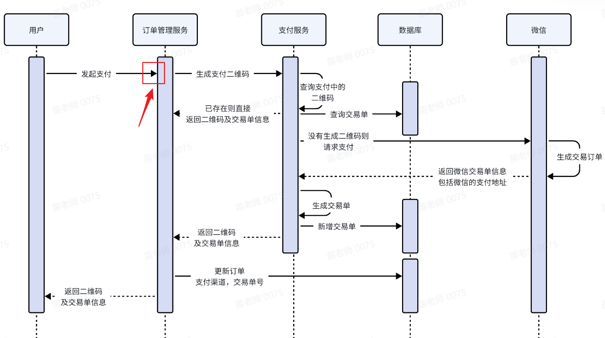
> 图注：这是一张展示家政订单支付功能对接支付接口的时序流程图，呈现了用户发起支付后，各系统间的交互逻辑：用户发起支付请求后，订单管理服务生成支付二维码，若支付服务已存在对应二维码则直接返回二维码及交易单信息，若不存在则向微信请求支付，微信生成交易单后返回包含支付地址的信息；支付服务据此新增交易单、生成二维码，再向订单管理服务返回二维码及交易单信息，最终订单管理服务更新订单的支付渠道与交易单号，并将二维码及交易单信息返回给用户，完成支付流程的核心交互。

1. **请求参数分析**

用户在支付界面点击“确定支付”，弹出支付二维码，用户扫码支付。


> 图注：这张图展示了家政订单支付流程的两个界面：左侧为支付订单页，显示剩余支付时间38分40秒，标注①，列出订单总价208元、优惠金额-10元、待付金额198元，提供微信支付选项并勾选，底部有“确认支付”按钮；右侧为下单成功页，标注③，显示绿色对勾图标，提示“服务人员正在疯狂抢单中，请耐心等待～”，设有“返回首页”和“查看订单”两个操作按钮，整体对应文档中支付订单生成二维码及后续订单状态的流程，与支付接口对接的内容相呼应。

要生成二维码需要由订单管理服务请求支付服务的支付接口，支付服务的支付接口如下：

接口路径：**POST**/trade/inner/native

**请求数据类型** application/json

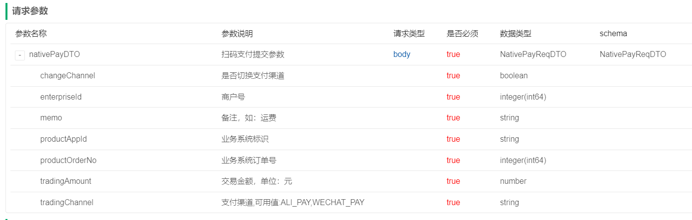
> 图注：图片展示了支付服务的支付接口请求参数。参数包括nativePayDTO（扫码支付提交参数，必填，类型为NativePayReqDTO）、changeChannel（是否切换支付渠道，必填，类型为boolean）、enterpriseId（商户号，必填，类型为integer(int64)）、memo（备注，如：运费，必填，类型为string）、productAppId（业务系统标识，必填，类型为string）、productOrderNo（业务系统订单号，必填，类型为integer(int64)）、tradingAmount（交易金额，单位：元，必填，类型为number）、tradingChannel（支付渠道，可用值ALI_PAY,WECHAT_PAY，必填，类型为string）。这些参数对应支付服务支付接口的参数需求，用于生成二维码时由订单管理服务请求支付服务。

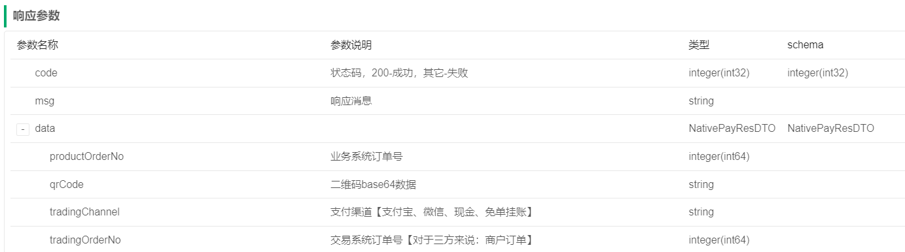
> 图注：图片展示了支付服务的支付接口响应参数。包含code、msg、data等字段，其中data下有productOrderNo、qrCode、tradingChannel、tradingOrderNo等具体参数，如productOrderNo为业务系统订单号，类型为integer(int64)；qrCode为二维码base64数据，类型为string；tradingChannel为支付渠道，类型为string；tradingOrderNo为交易系统订单号，类型为integer(int64)。该图片与上文支付接口分析内容相关，用于说明支付服务支付接口的响应参数情况。


支付服务的支付接口需要以下参数：

```Java
productAppId业务系统标识
productOrderNo是业务系统的订单号，本项目就是家政服务的订单号。
tradingAmount：支付金额
enterpriseId：商户号，进入微信或支付宝商户平台获取。
memo: 备注信息
tradingChannel：微信支付传入WECHAT_PAY，支付宝支付传入ALI_PAY
changeChannel：当用户先微信支付，然后又进行支付宝支付表示切换了支付渠道，此时传入true

```

我们需要根据支付服务的支付接口的参数分析这些参数的数据来源

productOrderNo：订单号，由前端传入

tradingAmount：根据订单号查询订单信息即可拿到金额

enterpriseId：在nacos配置好

memo：程序拼装

tradingChannel：支付渠道，前端传入

changeChannel：根据订单号查询订单表的trading_channel字段来判断。第一次支付后将第一次支付的支付渠道更新至订单表，第二次如果切换了支付渠道通过trading_channel字段可以知道是否切换支付渠道。


所以综上分析，前端请求订单管理服务提供的支付接口需要传入：

productOrderNo: 订单id

tradingChannel:支付渠道。


1. **分析响应参数**

支付服务的支付接口的响应参数如下：

tradingChannel：微信或支付宝

tradingOrderNo：支付服务生成的交易号

productOrderNo：业务系统的订单号，本项目就是家政服务的订单号。

qrCode：二维码base64


要在前端展示二维码所以一定要响应支付二维码。

如果用户已经支付成功了，此时去点击“完成支付”要能够给前端返回支付结果为成功。


订单管理服务提供的支付接口响应结果如下：

支付二维码

支付状态（待支付、支付成功）

业务系统订单号

支付服务交易单号

支付渠道信息


##### 3) 接口定义如下

下边定义订单管理服务提供的支付接口：


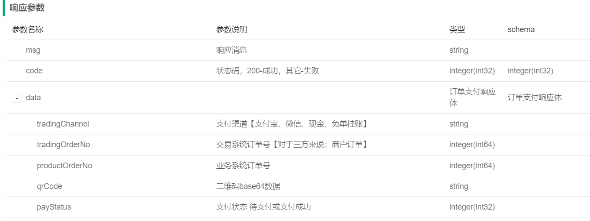
> 图注：该图片是支付接口定义中的响应参数说明表，对应文档中支付接口响应结果的相关内容，详细列出了各类响应参数信息。表格标注“响应参数”，包含参数名称、参数说明、类型及schema四列，具体参数包括msg，为响应消息，类型是string；code为状态码，200代表成功，其他值为失败，类型为integer(int32)；还有"data"分组下的tradingChannel、tradingOrderNo、productOrderNo、qrCode、payStatus等参数，分别对应支付渠道、交易系统订单号、业务系统订单号、二维码base64数据、支付状态等内容，类型涵盖string与integer(int32)。

编写controller:

```Java
@RestController("consumerOrdersController")
@Api(tags = "用户端-订单相关接口")
@RequestMapping("/consumer/orders")
public class ConsumerOrdersController {

    @Resource
    private IOrdersCreateService ordersCreateService;
    @Resource
    private IOrdersManagerService ordersManagerService;


    @PutMapping("/pay/{id}")
    @ApiOperation("订单支付")
    @ApiImplicitParams({
            @ApiImplicitParam(name = "id", value = "订单id", required = true, dataTypeClass = Long.class)
    })
    public OrdersPayResDTO pay(@PathVariable("id") Long id, @RequestBody OrdersPayReqDTO ordersPayReqDTO) {
        return null;
    }
```

##### 4）小结

订单管理服务的支付接口是怎么定义的？

根据调用的支付服务的支付接口去定义：

由于教学需要此支付接口通过支付服务请求微信生成支付二维码。

**传入参数：**

订单id

支付渠道

**响应结果：**

支付二维码

支付状态（待支付、支付成功）

业务系统订单号

支付服务交易单号

支付渠道信息


#### 2.1.2 支付接口实现

下边实现支付接口。

##### 1）配置支付参数

根据支付接口的分析，首先在jzo2o-orders-manager.yaml中配置支付参数

```JSON
jzo2o:
  trade:
    aliEnterpriseId: 2088241317544335
    wechatEnterpriseId: 1561414331
  job:
    autoEvaluateCount: 100
  openPay: false
```

示例如下：

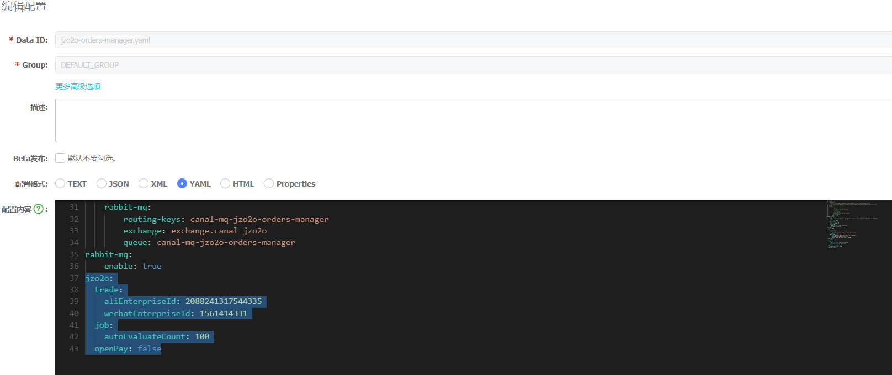
> 图注：图片展示的是jzo2o-orders-manager.yaml文件中配置支付参数的界面。界面中Data ID为jzo2o-orders-manager - yaml，Groups为DEFAULT_GROUP。配置模式下，rabbitmq - mq1的rabbitmq - mq1配置被突出显示，其中alipayEnterpriseId为2088241317544335，weChatEnterpriseId为1561414331。该图片与文档中“2.1.2支付接口实现”部分的“1）配置支付参数”内容对应，直观呈现了配置参数的具体位置和内容。

##### 2）mapper

根据接口分析，请求支付服务生成支付二维码成功将交易单号和支付渠道更新到订单表中。

##### 3) service

在service定义支付接口：

```Java
public interface IOrdersCreateService extends IService<Orders> {
   ....

    /**
     * 订单支付
     *
     * @param id              订单id
     * @param ordersPayReqDTO 订单支付请求体
     * @return 订单支付响应体
     */
    OrdersPayResDTO pay(Long id, OrdersPayReqDTO ordersPayReqDTO);
```

首先在service类注入下边两个bean

tradeProperties：读取支付参数

nativePayApi: 远程调用支付服务的feign接口

```Java
@Resource
private TradeProperties tradeProperties;
@Resource
private NativePayApi nativePayApi;
```

支付方法实现如下：

```Java
/**
 * 订单支付
 *
 * @param id              订单id
 * @param ordersPayReqDTO 订单支付请求体
 * @return 订单支付响应体
 */
@Override
public OrdersPayResDTO pay(Long id, OrdersPayReqDTO ordersPayReqDTO) {
    Orders orders =  baseMapper.selectById(id);
    if (ObjectUtil.isNull(orders)) {
        throw new CommonException(TRADE_FAILED, "订单不存在");
    }
    //订单的支付状态为成功直接返回
    if (OrderPayStatusEnum.PAY_SUCCESS.getStatus() == orders.getPayStatus()
            && ObjectUtil.isNotEmpty(orders.getTradingOrderNo())) {
        OrdersPayResDTO ordersPayResDTO = new OrdersPayResDTO();
        ordersPayResDTO.setPayStatus(orders.getPayStatus());
        ordersPayResDTO.setProductOrderNo(orders.getId());
        ordersPayResDTO.setTradingOrderNo(orders.getTradingOrderNo());
        ordersPayResDTO.setTradingChannel(orders.getTradingChannel());
        return ordersPayResDTO;
    } else {
        //生成二维码
        NativePayResDTO nativePayResDTO = generateQrCode(orders, ordersPayReqDTO.getTradingChannel());
        OrdersPayResDTO ordersPayResDTO = BeanUtil.toBean(nativePayResDTO, OrdersPayResDTO.class);
        return ordersPayResDTO;
    }

}

//生成二维码
private NativePayResDTO generateQrCode(Orders orders, PayChannelEnum tradingChannel) {

    //判断支付渠道
    Long enterpriseId = ObjectUtil.equal(PayChannelEnum.ALI_PAY, tradingChannel) ?
            tradeProperties.getAliEnterpriseId() : tradeProperties.getWechatEnterpriseId();

    //构建支付请求参数
    NativePayReqDTO nativePayReqDTO = new NativePayReqDTO();
    //商户号
    nativePayReqDTO.setEnterpriseId(enterpriseId);
    //业务系统标识
    nativePayReqDTO.setProductAppId("jzo2o.orders");
    //家政订单号
    nativePayReqDTO.setProductOrderNo(orders.getId());
    //支付渠道
    nativePayReqDTO.setTradingChannel(tradingChannel);
    //支付金额
    nativePayReqDTO.setTradingAmount(orders.getRealPayAmount());
    //备注信息
    nativePayReqDTO.setMemo(orders.getServeItemName());
    //判断是否切换支付渠道
    if (ObjectUtil.isNotEmpty(orders.getTradingChannel())
            && ObjectUtil.notEqual(orders.getTradingChannel(), tradingChannel.toString())) {
        nativePayReqDTO.setChangeChannel(true);
    }
    //生成支付二维码
    NativePayResDTO downLineTrading = nativePayApi.createDownLineTrading(nativePayReqDTO);
    if(ObjectUtils.isNotNull(downLineTrading)){
        log.info("订单:{}请求支付,生成二维码:{}",orders.getId(),downLineTrading.toString());
        //将二维码更新到交易订单中
        boolean update = lambdaUpdate()
                .eq(Orders::getId, downLineTrading.getProductOrderNo())
                .set(Orders::getTradingOrderNo, downLineTrading.getTradingOrderNo())
                .set(Orders::getTradingChannel, downLineTrading.getTradingChannel())
                .update();
        if(!update){
            throw new CommonException("订单:"+orders.getId()+"请求支付更新交易单号失败");
        }
    }
    return downLineTrading;
}
```

##### 4） controller

```Java
@PutMapping("/pay/{id}")
@ApiOperation("订单支付")
@ApiImplicitParams({
        @ApiImplicitParam(name = "id", value = "订单id", required = true, dataTypeClass = Long.class)
})
public OrdersPayResDTO pay(@PathVariable("id") Long id, @RequestBody OrdersPayReqDTO ordersPayReqDTO) {
    OrdersPayResDTO pay = ordersCreateService.pay(id, ordersPayReqDTO);
    return pay;
}
```

##### 5）接口测试

测试流程：

打开小程序，进入首页，点击一个服务进行预约下单，点击“确定支付”

预期结果：

是生成支付二维码，如下图：


> 图注：这张图片展示的是家政订单支付测试预期的支付成功状态界面，处于小程序的支付订单页面中。页面上方显示支付剩余时间，订单总价1元，待付金1.00元，还需支付1.00元。页面中间是带绿色对勾标识的支付二维码，下方有红色的“支付完成”按钮，左侧标注了微信、支付宝两种支付渠道选项，右侧有对应的单选按钮，底部还有“确认支付”的按钮，该界面对应文档中接口测试步骤里生成支付二维码且支付完成的预期结果场景。


向支付服务的交易单表插入一条记录，注意观察记录内容的准确性。


下边进行测试：

启动jzo2o-foundations服务

启动jzo2o-customer服务

启动jzo2o-publics服务

启动jzo2o-gateway服务

启动jzo2o-orders-manager服务

启动jzo2o-trade服务

打开小程序进行测试。


##### 6）小结

支付接口是怎么开发的？


### 2.2 对接查询支付结果

#### 2.2.1 接口定义

##### 1）交互流程

在用户支付后用户点击“完成支付”此时前端请求订单服务的查询支付结果接口，如果支付成功则跳转到支付成功界面。

交互流程如下：

<whiteboard token="HMgCwlNTQhdcxRb0zZQchAzxnJf"></whiteboard>

此接口对于支付中的订单最终由支付服务调用微信查询支付结果。

订单管理服务查询到支付结果后更新订单的支付状态。

##### 2） 接口分析

1. 传入参数 

本接口要调用支付服务的支付结果查询接口，根据支付服务的支付结果查询接口的传入参数分析本接口的传入参数。 

支付服务的支付结果查询接口需要传入交易单号。交易单号在订单表已经保存所以前端传入订单号即可拿到交易单号。

所以传入参数：订单号

1. 响应结果

本接口的目的是查询支付结果，所以响应结果中要有支付结果，其它的参数就是订单号、交易单号等相关参数。

##### 3）接口定义

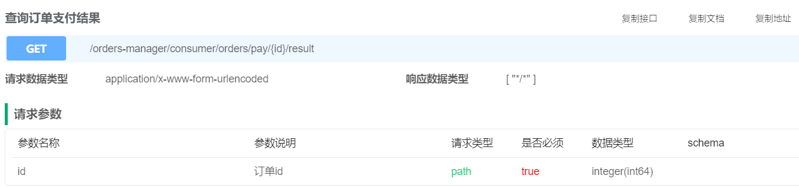
> 图注：这张图展示了查询订单支付结果的接口定义，该接口为GET请求类型，接口路径为/orders-manager/consumer/orders/pay/{id}/result。其请求数据类型为application/x-www-form-urlencoded，响应数据类型为*/*。图中的请求参数区域清晰显示，请求所需的参数是id，该参数为订单id，请求类型为path，是必填项，对应的数据类型为integer(int64)。该接口对应文档中对接查询支付结果的接口定义部分，用于查询支付结果相关信息。

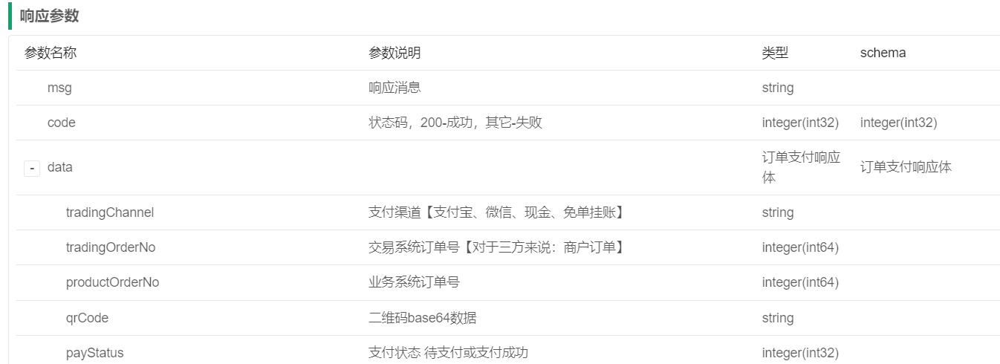
> 图注：这是支付模块家政订单支付功能下，对接查询支付结果接口的响应参数说明表。表格清晰列出了该接口的响应参数相关信息，包含参数名称、参数说明、类型及schema四个维度。其中核心参数可重点关注：状态码code为integer(int32)类型，200代表成功、其他数值代表失败；响应消息msg为string类型；data为订单支付响应体，其包含的子参数有支付渠道tradingChannel、交易系统订单号tradingOrderNo、业务系统订单号productOrderNo、二维码base64数据qrCode、支付状态payStatus，各子参数分别对应不同的业务含义与数据类型。

controller方法定义：

```Java
@GetMapping("/pay/{id}/result")
@ApiOperation("查询订单支付结果")
@ApiImplicitParams({
        @ApiImplicitParam(name = "id", value = "订单id", required = true, dataTypeClass = Long.class)
})
public OrdersPayResDTO payResult(@PathVariable("id") Long id) {
    return null;
}
```

#### 2.2.2 接口实现

##### 1) mapper

拿到支付结果更新订单表的支付结果。

##### 2) service

根据接口分析，查询支付结果需要做两部分的工作：

调用支付服务的查询支付结果接口获取支付结果。

将支付结果更新至订单表的支付状态字段。

定义接口方法如下：

```Java
public interface IOrdersCreateService extends IService<Orders> {

/**
 * 请求支付服务查询支付结果
 *
 * @param id 订单id
 * @return 订单支付结果
 */
OrdersPayResDTO getPayResultFromTradServer(Long id);

...
```


在OrdersCreateServiceImpl中注入tradingApi（远程查询交易单feign接口）：

```Java
@Resource
private TradingApi tradingApi;
```

方法实现如下：

```Java
@Override
public OrdersPayResDTO getPayResultFromTradServer(Long id) {
    //查询订单表
    Orders orders = baseMapper.selectById(id);
    if (ObjectUtil.isNull(orders)) {
        throw new CommonException(TRADE_FAILED, "订单不存在");
    }
    //支付结果
    Integer payStatus = orders.getPayStatus();
    //未支付且已存在支付服务的交易单号此时远程调用支付服务查询支付结果
    if (OrderPayStatusEnum.NO_PAY.getStatus() == payStatus
            && ObjectUtil.isNotEmpty(orders.getTradingOrderNo())) {
        //远程调用支付服务查询支付结果
        TradingResDTO tradingResDTO = tradingApi.findTradResultByTradingOrderNo(orders.getTradingOrderNo());
        //如果支付成功这里更新订单状态
        if (ObjectUtil.isNotNull(tradingResDTO)
                && ObjectUtil.equals(tradingResDTO.getTradingState(), TradingStateEnum.YJS)) {
            //设置订单的支付状态成功
            TradeStatusMsg msg = TradeStatusMsg.builder()
                    .productOrderNo(String.valueOf(orders.getId()))
                    .tradingChannel(tradingResDTO.getTradingChannel())
                    .statusCode(TradingStateEnum.YJS.getCode())
                    .tradingOrderNo(tradingResDTO.getTradingOrderNo())
                    .transactionId(tradingResDTO.getTransactionId())
                    .build();
            owner.paySuccess(msg);
            //构造返回数据
            OrdersPayResDTO ordersPayResDTO = BeanUtils.toBean(msg , OrdersPayResDTO.class);
            ordersPayResDTO.setPayStatus(OrderPayStatusEnum.PAY_SUCCESS.getStatus());
            return ordersPayResDTO;
        }
    }
    OrdersPayResDTO ordersPayResDTO = new OrdersPayResDTO();
    ordersPayResDTO.setPayStatus(payStatus);
    ordersPayResDTO.setProductOrderNo(orders.getId());
    ordersPayResDTO.setTradingOrderNo(orders.getTradingOrderNo());
    ordersPayResDTO.setTradingChannel(orders.getTradingChannel());
    return ordersPayResDTO;
}
/**
 * 支付成功， 其他信息暂且不填
 *
 * @param tradeStatusMsg 交易状态消息
 */
@Override
@Transactional(rollbackFor = Exception.class)
public void paySuccess(TradeStatusMsg tradeStatusMsg) {
    //查询订单
    Orders orders = baseMapper.selectById(Long.parseLong(tradeStatusMsg.getProductOrderNo()));
    if (ObjectUtil.isNull(orders)) {
        throw new CommonException(TRADE_FAILED, "订单不存在");
    }
    //校验支付状态如果不是待支付状态则不作处理
    if (ObjectUtil.notEqual(OrderPayStatusEnum.NO_PAY.getStatus(), orders.getPayStatus())) {
        log.info("更新订单支付成功，当前订单:{}支付状态不是待支付状态", orders.getId());
        return;
    }
    //校验订单状态如果不是待支付状态则不作处理
    if (ObjectUtils.notEqual(OrderStatusEnum.NO_PAY.getStatus(),orders.getOrdersStatus())) {
        log.info("更新订单支付成功，当前订单:{}状态不是待支付状态", orders.getId());
        return;
    }

    //第三方支付单号校验
    if (ObjectUtil.isEmpty(tradeStatusMsg.getTransactionId())) {
        log.error("支付成功事件处理失败，缺少第三方支付单号，订单号：{}", orders.getId());
        return;
    }
    //更新订单的支付状态及第三方交易单号等信息
    boolean update = lambdaUpdate()
            .eq(Orders::getId, orders.getId())//订单号
            .eq(Orders::getPayStatus, OrderPayStatusEnum.NO_PAY.getStatus())//原支付状态
            .eq(Orders::getOrdersStatus, OrderStatusEnum.NO_PAY.getStatus())//原订单状态
            .set(Orders::getPayTime, LocalDateTime.now())//支付时间
            .set(Orders::getTradingOrderNo, tradeStatusMsg.getTradingOrderNo())//交易单号
            .set(Orders::getTradingChannel, tradeStatusMsg.getTradingChannel())//支付渠道
            .set(Orders::getTransactionId, tradeStatusMsg.getTransactionId())//第三方支付交易号
            .set(Orders::getPayStatus, OrderPayStatusEnum.PAY_SUCCESS.getStatus())//支付状态
            .set(Orders::getOrdersStatus, OrderStatusEnum.DISPATCHING.getStatus())//订单状态更新为派单中
            .update();
    if(!update){
        log.info("更新订单:{}支付成功失败", orders.getId());
        throw new CommonException("更新订单"+orders.getId()+"支付成功失败");
    }


}
```

##### 3) controller

```Java
@GetMapping("/pay/{id}/result")
@ApiOperation("查询订单支付结果")
@ApiImplicitParams({
        @ApiImplicitParam(name = "id", value = "订单id", required = true, dataTypeClass = Long.class)
})
public OrdersPayResDTO payResult(@PathVariable("id") Long id) {
    //支付结果
    OrdersPayResDTO ordersPayResDTO = ordersCreateService.getPayResultFromTradServer(id);
    return ordersPayResDTO;
}
```


##### 4）前后端联调

测试流程如下：

打开小程序，进入首页，点击一个服务进行预约下单，点击“确定支付”，用户扫码支付后点击“支付完成”。

预期结果：

如下图，显示支付成功：


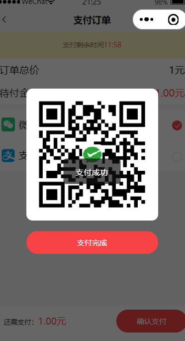
> 图注：图片展示的是家政订单支付成功界面。上方显示“支付订单”及“支付剩余时间11:58”，下方有订单总价、待付金额等信息。中间突出显示“支付成功”字样，下方有一个红色的“支付完成”按钮。该图片与文档中测试流程及预期结果部分对应，用于展示用户扫码支付后点击“支付完成”时的支付成功界面，是前后端联调测试流程中的一个关键展示环节。

然后界面跳转到下单成功界面。

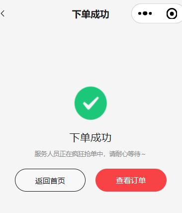
> 图注：图片展示的是家政订单支付成功后的“下单成功”界面。界面上方显示“下单成功”，并有提示“服务人员正在疯狂抢单中，请耐心等待~”。中间有一个绿色的对勾图标。下方有两个按钮，左侧是“返回首页”，右侧是红色的“查看订单”按钮。该图片与文档中测试流程相关，对应用户扫码支付后点击“支付完成”后的预期结果，显示支付成功后界面跳转到的下单成功界面。


下边开始测试：

启动jzo2o-foundations服务

启动jzo2o-customer服务。

启动jzo2o-publics服务。

启动jzo2o-gateway服务。

启动jzo2o-orders-manager服务。

启动jzo2o-trade服务。

进入小程序进行下单、支付、点击支付完成

预期结果：

查询orders表的对应记录，成功更新为：支付状态pay_status为4表示支付成功，orders_status状态为100表示派单中、支付服务交易单号trading_order_no、第三方交易单号transaction_id。

支付服务的交易单表对应记录的支付结果字段trading_state为4表示成功，并且记录了第三方的交易号transaction_id字段。


### 2.3 接收支付通知

#### 2.3.1 代码实现

用户支付成功后支付服务 获取支付结果后会通知业务系统，业务系统收到支付结果只处理属于自己的支付通知，根据支付结果更新订单表的支付状态，本节实现订单管理服务接收支付通知更新支付状态功能。

##### 1）交互流程

订单管理服务接收支付通知的交互流程如下：

支付服务将支付结果发送到MQ，订单管理服务监听MQ，收到支付结果，更新订单表的支付状态。

<whiteboard token="QNEIwwlu8h4jdWbwfrUc2giGn6b"></whiteboard>

这里有个问题是：支付服务作为项目的公共支付服务，对接支付服务的可能不止家政服务订单还可能有其它收费订单，比如：体检项目订单服务等等，支付服务如何将属于每个收费订单的支付结果通知给它们呢？

1. 首先在请求支付服务支付接口中需要传入product_app_id，它表示请求支付业务系统的应用标识，此应用标识会存储到支付服务的交易单表

<whiteboard token="XZNlwMSpthH4uybtTotcbK0fnfW"></whiteboard>


1. 支付服务通知支付结果时将交易单中的product_app_id一起发给各个监听MQ的微服务。

具体的方法是：

支付服务向jzo2o.exchange.topic.trade交换机发送消息，Routing Key=UPDATE_STATUS

绑定此交换机的有多个队列，每个队列是不同的收费订单支付通知队列，如下图：

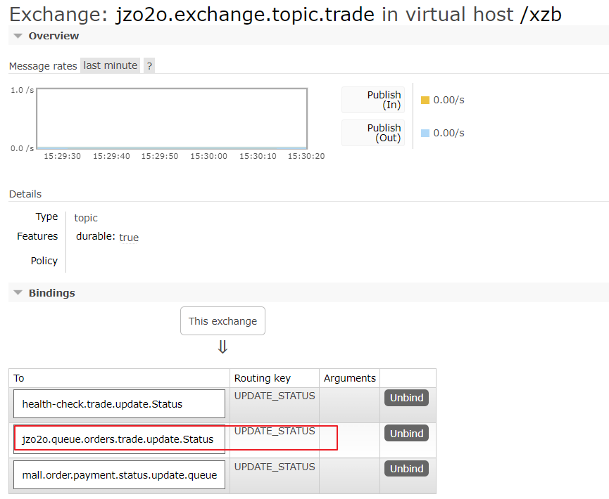
> 图注：图片展示了jzo2o.exchange.topic.trade交换机在虚拟主机/xzb下的详细信息。其类型为topic，durability为true。Bindings部分列出了多个队列，其中红框突出显示的“jzo2o.queue.orders.trade.update.Status”队列，其Routing key为UPDATE_STATUS。该图片与上下文紧密相关，上下文提到支付服务向此交换机发送消息，所有绑定此交换机且Routing Key=UPDATE_STATUS的队列都会收到支付通知，此图直观呈现了相关队列信息。

当支付服务向jzo2o.exchange.topic.trade交换机发送一条支付通知消息，所有绑定此交换机的队列且Routing Key=UPDATE_STATUS都会收到支付通知。

业务系统收到支付结果后解析出product_app_id，判断是否属于自己的支付结果通知，如果是则进行处理。

整体交互流程如下：

<whiteboard token="Dr65w2DGeh58RMbMogMcNMtHnxc"></whiteboard>


##### 2) 编写代码

编写代码监听MQ支付通知，首先需要知道支付服务发送到MQ的消息格式是什么，查看源代码：

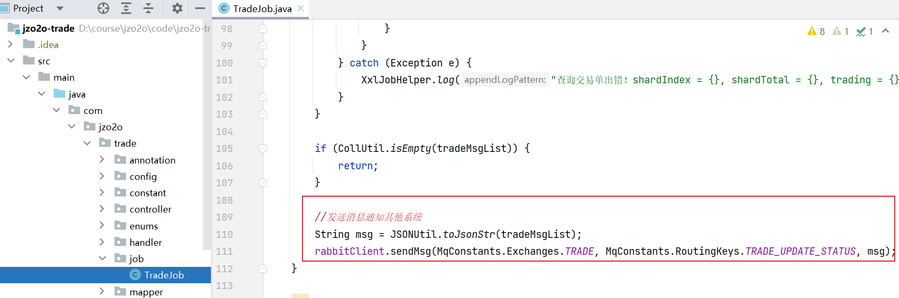
> 图注：这张图片展示了Java项目中TradeJob.java文件的部分代码，对应订单管理服务监听MQ支付通知的代码实现部分。代码中有一个用红色框标注的核心代码段，功能是将TradeMsgList转换为JSON格式，然后通过rabbitClient发送消息，发送的交换器为MQConstants.Exchanges.TRADE，路由键为MQConstants.RoutingKeys.TRADE_UPDATE_STATUS。这部分代码是文档中提及的编写监听MQ支付通知代码的具体实现内容，对应监听jzo2o.queue.orders.trade.update.Status队列、routing Key为UPDATE_STATUS的相关逻辑。

通过查阅源代码，支付服务发送的支付通知数据格式是JSON，具体内容是TradeStatusMsg列表（List<TradeStatusMsg>）。

下边编写订单管理服务监听MQ支付通知的代码，监听jzo2o.queue.orders.trade.update.Status队列，routing Key为UPDATE_STATUS。

代码如下：

```Java
package com.jzo2o.orders.manager.listener;

import cn.hutool.core.collection.CollUtil;
import cn.hutool.core.lang.TypeReference;
import cn.hutool.json.JSONUtil;
import com.jzo2o.api.trade.enums.TradingStateEnum;
import com.jzo2o.common.constants.MqConstants;
import com.jzo2o.common.model.msg.TradeStatusMsg;
import com.jzo2o.orders.manager.service.IOrdersCreateService;
import lombok.extern.slf4j.Slf4j;
import org.springframework.amqp.core.ExchangeTypes;
import org.springframework.amqp.rabbit.annotation.Exchange;
import org.springframework.amqp.rabbit.annotation.Queue;
import org.springframework.amqp.rabbit.annotation.QueueBinding;
import org.springframework.amqp.rabbit.annotation.RabbitListener;
import org.springframework.stereotype.Component;

import javax.annotation.Resource;
import java.util.List;
import java.util.stream.Collectors;


/**
 * 监听mq消息，接收支付结果
 *
 * @author itcast
 **/
@Slf4j
@Component
public class TradeStatusListener {
    @Resource
    private IOrdersCreateService ordersCreateService;

    /**
     * 更新支付结果
     * 支付成功
     *
     * @param msg 消息
     */
    @RabbitListener(bindings = @QueueBinding(
            value = @Queue(name = MqConstants.Queues.ORDERS_TRADE_UPDATE_STATUS),
            exchange = @Exchange(name = MqConstants.Exchanges.TRADE, type = ExchangeTypes.TOPIC),
            key = MqConstants.RoutingKeys.TRADE_UPDATE_STATUS
    ))
    public void listenTradeUpdatePayStatusMsg(String msg) {
        log.info("接收到支付结果状态的消息 ({})-> {}", MqConstants.Queues.ORDERS_TRADE_UPDATE_STATUS, msg);
        //将msg转为java对象
        List<TradeStatusMsg> tradeStatusMsgList= JSON.parseArray(msg, TradeStatusMsg.class);

        // 只处理家政服务的订单且是支付成功的
        List<TradeStatusMsg> msgList = tradeStatusMsgList.stream().filter(v -> v.getStatusCode().equals(TradingStateEnum.YJS.getCode()) && "jzo2o.orders".equals(v.getProductAppId())).collect(Collectors.toList());
        if (CollUtil.isEmpty(msgList)) {
            return;
        }

        //修改订单状态
        msgList.forEach(m -> ordersCreateService.paySuccess(m));
    }
}
```


##### 3）小结

项目中有用到MQ吗？怎么用的？


用户支付成功，订单状态因为网络波动-修改订单状态失败。这个咋样解决

首先在用户端有一个支付完成的按钮，如果用户支付成功但是显示未支付此时用户会点击“支付完成”按钮，用户点击“支付完成”按钮后程序会主动请求支付服务查询支付结果，最终会请求微信拿到最新的支付结果。

即使用户没有点击“支付完成”也没事，支付服务通过MQ将支付结果通知给家政订单服务，如果订单服务没有正常消费成功此时消息仍然在MQ，会继续发给订单服务，订单服务获取了支付结果就会更新订单的支付状态。


#### 2.3.2 测试

##### 1）支付通知定时任务

在xxl-job中配置为支付服务配置支付通知的定时任务

首先配置执行器：

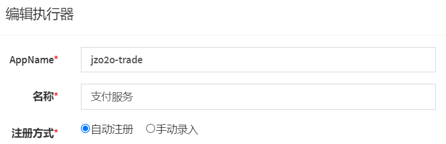
> 图注：图片展示的是在xxl-job中配置执行器的界面。界面上方显示“编辑执行器”，下方有“AppName”输入框，已输入“jzo2o-trade”，“名称”输入框内显示“支付服务”，“注册方式”处选中“自动注册”。该图片与文档中“2）前后端测试”部分的“1）支付通知定时任务”内容相关，是配置执行器步骤中对执行器基本信息设置的展示，为后续添加任务及启动任务做准备。

添加任务：

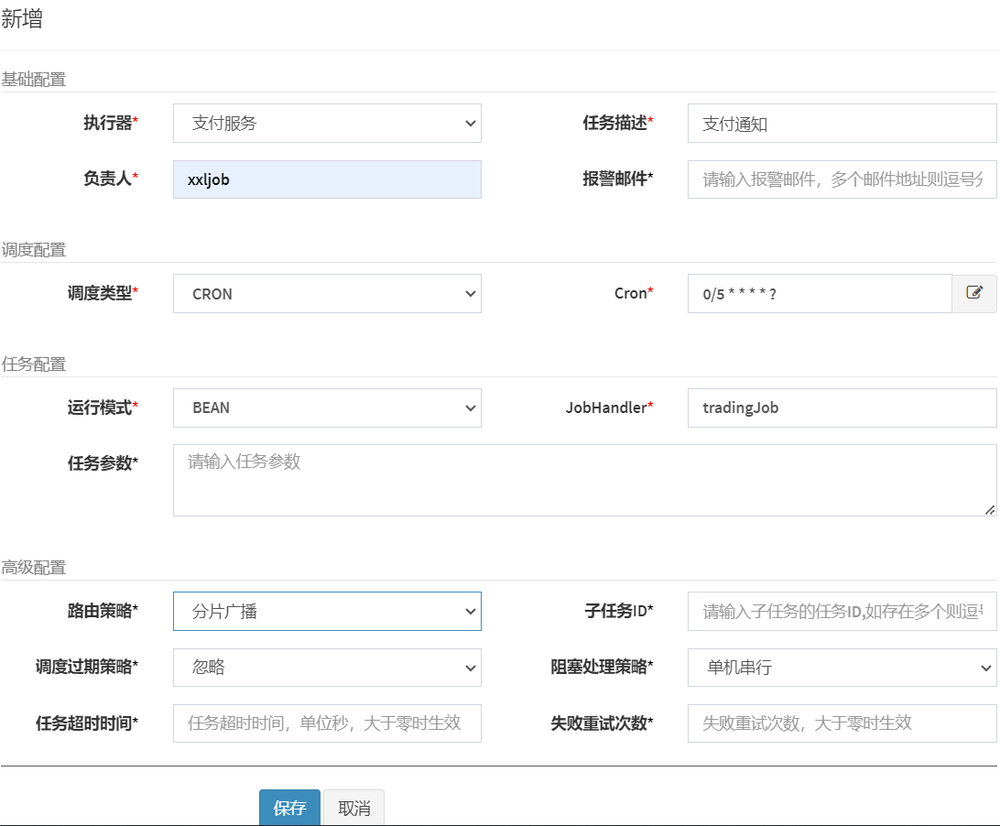
> 图注：图片展示的是在xxl-job中配置支付服务支付通知定时任务的界面。执行器选择“支付服务”，任务描述为“支付通知”，调度类型为CRON，Cron设置为“0/5 * * * * ?”，运行模式为BEAN，JobHandler为“tradingJob”，任务参数为空。高级配置中路由策略为“分片广播”，调度过期策略为“忽略”，任务超时时间为“任务超时时间，单位秒，大于零时生效”，子任务ID和暗塞处理策略、失败重试次数等字段为空。

启动任务：

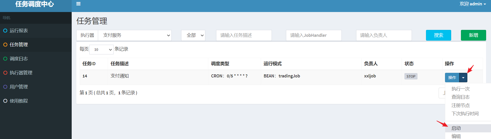
> 图注：图片展示的是xxl-job任务调度中心的任务管理界面。界面左侧有导航栏，选中“任务管理”。右侧显示任务ID为14，任务描述为“支付通知”，调度类型为CRON，运行模式为BEAN，负责人是xxljob，状态为STOP。右侧操作栏有“操作”下拉菜单，其中“启动”选项被红色箭头指向。该图片与文档中“支付通知定时任务”配置内容相关，用于说明在xxl-job中配置支付通知定时任务的操作步骤。


##### 2）前后端测试

本次测试流程如下：

打开小程序，进入首页，点击一个服务进行预约下单，点击“确定支付”，生成支付二维码，用户扫码支付。

如下图，注意支付完成不要点击“支付完成”，等待程序自动接收支付通知。


> 图注：图片展示的是小程序支付订单页面。页面上方显示“支付订单”，下方有“支付剩余时间14:49”提示。订单总价为1元，待付金额也是1.00元。支付方式有微信和支付宝，当前选中微信。页面中央有一个二维码，下方有红色的“支付完成”按钮。该图片与文档中“2.3.2测试”部分内容相关，用于说明在小程序中进行家政订单支付时，生成支付二维码后用户扫码支付的场景，需注意支付完成不要点击“支付完成”，等待程序自动接收支付通知。


下边进行测试：

启动jzo2o-foundations服务

启动jzo2o-customer服务。

启动jzo2o-publics服务。

启动jzo2o-gateway服务。

启动jzo2o-orders-manager服务。

启动jzo2o-trade服务。

打开小程序下单、支付。

注意支付完成不要点击“支付完成”，等待程序自动接收支付通知。

预期结果：

支付服务正常发送消息到MQ，发到 jzo2o.queue.orders.trade.update.Status队列。

订单管理服务正常接收到MQ的消息，在TradeStatusListener类中打断点可正常解析消息。

处理完成观察数据库的数据是否正确：

查询orders表的对应记录，成功更新为：支付状态pay_status为4表示支付成功，orders_status状态为100表示派单中、支付服务交易单号trading_order_no、第三方交易单号transaction_id。

支付服务的交易单表对应记录的支付结果字段trading_state为4表示成功，并且记录了第三方的交易号transaction_id字段。

示例：

订单服务收到支付结果

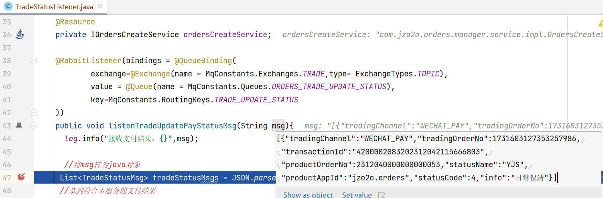
> 图注：图片展示的是TradeStatusListener.java文件代码，重点是第47行代码。该代码将JSON字符串msg转换为Java对象List<TradeStatusMsgs> tradeStatusMsgs = JSON.parseObject(msg, List.class)。上下文提到支付通知定时任务处理完成后，需观察数据库数据是否正确，此代码是接收支付结果后，将接收到的支付结果JSON字符串转换为Java对象，以便后续处理，是接收支付通知测试流程中的一部分。


## 3 家政项目取消订单

### 3.1 取消订单功能分析设计

目标：

设计取消订单接口。

退款流程设计。


#### 1）需求分析

下边我们分析在订单的不同状态下去取消订单其执行的逻辑，如下图：

<whiteboard token="F7itwJGhVhomStb1hkdcJeOdnAf"></whiteboard>

订单在不同状态下执行取消订单操作的需求：

待支付：

支付超时系统自动取消。

用户取消订单，订单状态改为已取消。

派单中：

用户和运营人员都可以取消订单，订单状态改为已关闭。

到达服务时间还没有派单成功系统自动取消。

取消订单后自动退款。

删除抢单池记录。（抢单模块用到）

待服务：

用户和运营人员都可以取消订单，订单状态改为已关闭。

取消订单后自动退款。

服务中：

只有运营人员可以取消，订单状态改为已关闭。

取消订单后自动退款。

订单完成：

只有运营人员可以取消，订单状态改为已关闭。

取消订单后自动退款。

#### 2）退款流程设计

根据需求分析，当订单为已支付状态时，取消订单后进行自动退款，此时需要调用支付服务的申请退款接口。

流程如下：

<whiteboard token="Wk8nw6xsLhGAo2bd2L4cNlHcnYg"></whiteboard>

取消订单执行如下操作：

1、更新订单状态

待支付状态下取消订单后更新订单状态为“已取消”

派单中状态下取消订单后更新订单状态为“已关闭”

2、保存取消订单记录，记录取消的原因等信息。

3、远程调用支付服务的退款接口申请退款。

取消派单中的订单存在如下问题：

远程调用退款接口操作不放在事务方法中，避免影响数据库性能。

如果远程调用退款接口失败了将无法退款，这个怎么处理？

以上问题**采用异步退款的方式来解决**：

如下图：

<whiteboard token="TFSNwGwDzhOFFYb6xVLc3cCvnMb"></whiteboard>

取消订单执行如下操作：

1、使用数据库事务控制，保存以下数据

更新订单状态。

保存取消订单记录表，记录取消订单的原因等信息。

保存退款记录表。

2、定时任务扫描退款记录表，对未退款的记录请求支付服务进行退款，退款成功更新订单的退款状态，并删除退款记录。

说明：

由定时任务去更新退款的状态，因为调用了退款接口只是申请退款了，退款结果可能还没有拿到，通过定时任务再次请求支付服务的退款接口，拿到退款结果。


#### 3) 表结构

订单取消记录表：

```JSON
create table `jzo2o-orders`.orders_canceled
(
    id             bigint                             not null comment '订单id'
        primary key,
    canceller_id   bigint                             null comment '取消人',
    canceler_name  varchar(50)                        null comment '取消人名称',
    canceller_type int                                null comment '取消人类型，1：普通用户，4：运营人员',
    cancel_reason  varchar(50)                        null comment '取消原因',
    cancel_time    datetime                           null comment '取消时间',
    create_time    datetime default CURRENT_TIMESTAMP not null comment '创建时间',
    update_time    datetime default CURRENT_TIMESTAMP not null on update CURRENT_TIMESTAMP comment '更新时间'
)
    comment '订单取消表' charset = utf8mb4;
```

订单退款记录表：存储 了待退款的记录

```JSON
create table `jzo2o-orders`.orders_refund
(
    id               bigint                             not null comment '订单id'
        primary key,
    trading_order_no bigint                             null comment '支付服务交易单号',
    real_pay_amount  decimal(10, 2)                     null comment '实付金额',
    create_time      datetime default CURRENT_TIMESTAMP null comment '创建时间'
)
    comment '订单退款表' charset = utf8mb4;
```


#### 4）小结

项目的退款功能怎么实现的？


### 3.2 取消派单中订单实现

#### 1）分析

前边我们实现了取消待支付的订单方法，下边我们再定义取消派单中订单的方法。

取消派单中的订单需要进行退款操作。

#### 2）定义取消派单中的订单service

当订单状态为派单中，取消此类订单需要进行退款操作，根据退款流程，需要做以下操作：

1. 添加取消订单记录。
2. 更新订单状态为“已关闭”。
3. 更新订单退款状态为退款中。
4. 添加退款记录。

定义service方法实现上边3个操作，并且进行事务控制。

代码如下：

```Java
public class OrdersManagerServiceImpl extends ServiceImpl<OrdersMapper, Orders> implements IOrdersManagerService {

@Resource
private IOrdersRefundService ordersRefundService;

//派单中状态取消订单
@Transactional(rollbackFor = Exception.class)
public void cancelByDispatching(OrderCancelDTO orderCancelDTO) {
    //保存取消订单记录
    OrdersCanceled ordersCanceled = BeanUtil.toBean(orderCancelDTO, OrdersCanceled.class);
    ordersCanceled.setCancellerId(orderCancelDTO.getCurrentUserId());
    ordersCanceled.setCancelerName(orderCancelDTO.getCurrentUserName());
    ordersCanceled.setCancellerType(orderCancelDTO.getCurrentUserType());
    ordersCanceled.setCancelTime(LocalDateTime.now());
    ordersCanceledService.save(ordersCanceled);
    //更新订单状态为关闭订单
    OrderUpdateStatusDTO orderUpdateStatusDTO = OrderUpdateStatusDTO.builder().id(orderCancelDTO.getId())
            .originStatus(OrderStatusEnum.DISPATCHING.getStatus())
            .targetStatus(OrderStatusEnum.CLOSED.getStatus())
            .refundStatus(OrderRefundStatusEnum.REFUNDING.getStatus())//退款状态为退款中
            .build();
    int result = ordersCommonService.updateStatus(orderUpdateStatusDTO);
    if (result <= 0) {
        throw new DbRuntimeException("取消待服务订单处理失败");
    }
    //添加退款记录
    OrdersRefund ordersRefund = new OrdersRefund();
    ordersRefund.setId(orderCancelDTO.getId());
    ordersRefund.setTradingOrderNo(orderCancelDTO.getTradingOrderNo());
    ordersRefund.setRealPayAmount(orderCancelDTO.getRealPayAmount());
    ordersRefundService.save(ordersRefund);
    //更新订单表中的退款状态为退款中
    boolean update = lambdaUpdate().eq(Orders::getId, orderCancelDTO.getId())
            .set(Orders::getRefundStatus, OrderRefundStatusEnum.REFUNDING.getStatus())
            .update();
    if (!update) {
        //抛出异常
        log.error("订单退款失败");
        throw new CommonException("订单退款失败");
    }
}
...
```

完善取消订单service方法

```Java
/**
 * 取消订单
 *
 * @param orderCancelDTO 取消订单模型
 */
@Override
public void cancel(OrderCancelDTO orderCancelDTO) {
    //订单id
    Long id = orderCancelDTO.getId();
    //查询订单
    Orders orders = queryById(id);
    //如果订单为空则抛出异常
    if (ObjectUtils.isNull(orders)) {
        throw new CommonException("订单不存在");
    }
    //订单状态
    Integer ordersStatus = orders.getOrdersStatus();
    //填充数据
    orderCancelDTO.setTradingOrderNo(orders.getTradingOrderNo());
    orderCancelDTO.setRealPayAmount(orders.getRealPayAmount());
    //订单状态为待支付时
    if (OrderStatusEnum.NO_PAY.getStatus().equals(ordersStatus)) {
       //取消待支付订单
       //如果订单存在优惠金额并且优惠金额大于0
        if (ObjectUtils.isNotNull(orders.getDiscountAmount()) && orders.getDiscountAmount().compareTo(new BigDecimal(0)) > 0) {
            owner.cancelWithCoupon(orderCancelDTO);
        }else{
            //取消待支付订单
            owner.cancelNoPayOrder(orderCancelDTO);
        }
    }else if(OrderStatusEnum.DISPATCHING.getStatus().equals(ordersStatus)){//派单中
        if (ObjectUtils.isNotNull(orders.getDiscountAmount()) && orders.getDiscountAmount().compareTo(new BigDecimal(0)) > 0) {
            owner.cancelWithCoupon(orderCancelDTO);
        }else{
            //取消派单中的订单
            owner.cancelByDispatching(orderCancelDTO);
        }
    }else{
        throw new CommonException("订单状态异常");
    }
}
//存在优惠券的情况取消订单，本方法是分布式事务
@GlobalTransactional
public void cancelWithCoupon(OrderCancelDTO orderCancelDTO) {
    //查询订单信息
    Orders orders = getById(orderCancelDTO.getId());
    //退回优惠券
    CouponUseBackReqDTO couponUseBackReqDTO = new CouponUseBackReqDTO();
    couponUseBackReqDTO.setUserId(orderCancelDTO.getCurrentUserId());
    couponUseBackReqDTO.setOrdersId(orderCancelDTO.getId());
    couponApi.useBack(couponUseBackReqDTO);
    //如果订单状态为待支付
    if (OrderStatusEnum.NO_PAY.getStatus()==orders.getOrdersStatus()) {
        //取消待支付订单
        owner.cancelNoPayOrder(orderCancelDTO);
    }else if(OrderStatusEnum.DISPATCHING.getStatus()==orders.getOrdersStatus()){
        owner.cancelByDispatching(orderCancelDTO);
    }else{
        throw new CommonException("订单状态异常");
    }
}
```


#### 3）测试

测试流程：

1.创建订单

2.支付成功

3.取消派单中的订单

预期结果：

保存取消订单记录

修改订单状态为关闭

添加退款记录


### 3.3 定时任务请求退款接口

#### 1）代码实现

取消派单中的订单进行自动退款，这里通过定时任务请求退款接口：

在OrdersHandler 类中定义定时任务方法。

定时任务根据退款记录去请求第三方支付服务的退款接口，根据退款结果进行处理，如果退款成功将更新订单的退款状态、删除退款记录。

```Java

package com.jzo2o.orders.manager.handler;

@Slf4j
@Component
public class OrdersHandler {
    @Resource
    private RefundRecordApi refundRecordApi;
    //解决同级方法调用，事务失效问题
    @Resource
    private OrdersHandler ordersHandler;
    @Resource
    private IOrdersRefundService ordersRefundService;

    @Resource
    private OrdersMapper ordersMapper;

    /**
     * 订单退款异步任务
     */
    @XxlJob(value = "handleRefundOrders")
    public void handleRefundOrders() {
        //查询退款中订单
        List<OrdersRefund> ordersRefundList = ordersRefundService.queryRefundOrderListByCount(100);
        for (OrdersRefund ordersRefund : ordersRefundList) {
             //调用支付服务进行退款
                ExecutionResultResDTO executionResultResDTO = null;
                try {
                    executionResultResDTO = refundRecordApi.refundTrading(ordersRefund.getTradingOrderNo(),ordersRefund.getId(), ordersRefund.getRealPayAmount());
                } catch (Exception e) {
                    e.printStackTrace();
                }
                if(executionResultResDTO!=null){
                    //退款后处理订单相关信息
                    ordersHandler.refundOrder(ordersRefund, executionResultResDTO);
                }
        }
    }


    /**
     * 更新退款状态
     * @param ordersRefund
     * @param executionResultResDTO
     */
    @Transactional(rollbackFor = Exception.class)
    public void refundOrder(OrdersRefund ordersRefund, ExecutionResultResDTO executionResultResDTO) {
        //根据响应结果更新退款状态
        int refundStatus = OrderRefundStatusEnum.REFUNDING.getStatus();//退款中
        if (ObjectUtil.equal(RefundStatusEnum.SUCCESS.getCode(), executionResultResDTO.getRefundStatus())) {
            //退款成功
            refundStatus = OrderRefundStatusEnum.REFUND_SUCCESS.getStatus();
        } else if (ObjectUtil.equal(RefundStatusEnum.FAIL.getCode(), executionResultResDTO.getRefundStatus())) {
            //退款失败
            refundStatus = OrderRefundStatusEnum.REFUND_FAIL.getStatus();
        }

        //如果是退款中状态，程序结束
        if (ObjectUtil.equal(refundStatus, OrderRefundStatusEnum.REFUNDING.getStatus())) {
            return;
        }

        //非退款中状态，更新订单的退款状态
       LambdaUpdateWrapper<Orders> updateWrapper = new LambdaUpdateWrapper<Orders>()
        .eq(Orders::getId, ordersRefund.getId())
        .eq(Orders::getRefundStatus, OrderRefundStatusEnum.REFUNDING.getStatus())
        .set(Orders::getRefundStatus, refundStatus)
        .set(ObjectUtil.isNotEmpty(executionResultResDTO.getRefundId()), Orders::getRefundId, executionResultResDTO.getRefundId())
        .set(ObjectUtil.isNotEmpty(executionResultResDTO.getRefundNo()), Orders::getRefundNo, executionResultResDTO.getRefundNo());
        int update = ordersMapper.update(null,updateWrapper);
        //非退款中状态，删除申请退款记录，删除后定时任务不再扫描
        if(update>0){
            //非退款中状态，删除申请退款记录，删除后定时任务不再扫描
            ordersRefundService.removeById(ordersRefund.getId());
        }
    }

...
    
```

#### 2) 测试

配置xxl-job

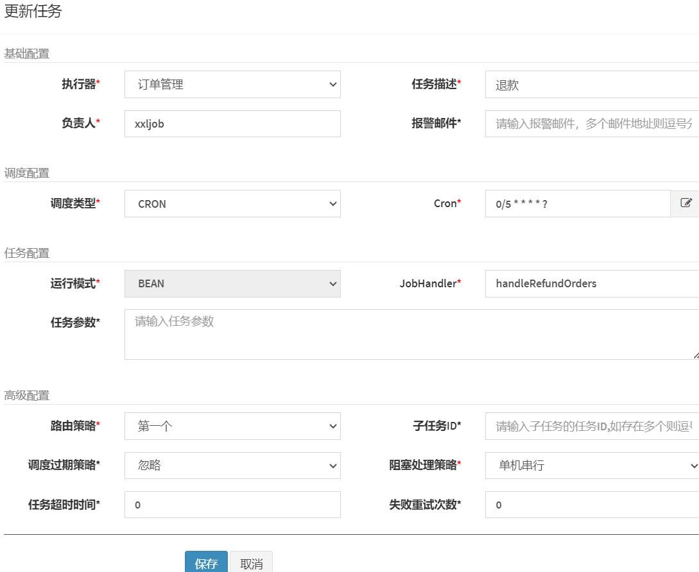
> 图注：这是一张“更新任务”的配置界面截图，对应文档中定时任务相关的配置内容。界面包含基础配置、调度配置、任务参数、高级配置等模块，核心配置项清晰明确：基础配置中执行器设为“订单管理”，负责人为“xxljob”，任务描述为“退款”；调度类型选择CRON，CRON表达式为“0/5 * * * * ?”；任务模式为BEAN，对应JobHandler为“handleRefundOrders”；高级配置中路由策略为“第一个”，阻塞处理策略为“单机串行”，其余配置项按默认或要求设置，界面底部设有“保存”和“取消”按钮，该界面是文档中定时任务请求退款接口相关配置的直观呈现。

测试流程：

新创建一个订单，并支付成功。

进入订单列表，点击订单信息进入订单详情页面，点击“取消订单”

点击取消订单预期结果：

订单取消记录表orders_canceled是否成功插入一条记录。

退款记录表orders_refund中是否成功插入一条记录

更新订单状态为已关闭（已关闭），退款状态为退款中。


定时任务执行后预期结果：

请求支付服务的退款接口成功，微信退款成功。

退款成功后删除orders_refund中记录。

更新订单表中的退款状态（退款成功或退款失败）、支付服务的退款单号、微信的退款单号。


### 3.4 取消订单优化

#### 3.4.1 策略模式入门

由于订单的状态非常多，不同订单状态下取消订单的逻辑也不相同，稍后我们使用策略模式实现取消订单的逻辑。

##### 1）技术分析

1. **根据上边的需求，下边分析订单取消功能。**

**订单的状态不同则取消订单执行的逻辑可能不同**

取消待支付的订单：

最终的结果是更改订单状态为已取消，因为没有支付所以不涉及退款。

消派单中的订单：

用户和运营人员都可以取消订单，订单状态改为已关闭。

到达服务时间还没有派单成功系统自动取消。

取消订单后自动退款。

删除抢单池记录。

**操作用户不同其权限也不同**

普通用户：可取消待支付、派单中、待服务的订单。

运营人员：可取消除待支付状态下的所有订单。

根据需求下边这样写是否合适？

根据用户类型进行判断，并且根据订单状态进行判断。

根据上边的需求可写下边的代码，思考有什么问题？

```JSON
@Override
public void cancel(OrderCancelDTO orderCancelDTO) {
    //查询订单信息
    Orders orders = getById(orderCancelDTO.getId());
    if (ObjectUtil.isNull(orders)) {
        throw new DbRuntimeException("找不到要取消的订单,订单号：{}",orderCancelDTO.getId());
    }
    //将订单中的交易单号信息拷贝到orderCancelDTO
    orderCancelDTO.setTradingOrderNo(orders.getTradingOrderNo());
    orderCancelDTO.setRealPayAmount(orders.getRealPayAmount());
    //订单状态
    Integer ordersStatus = orders.getOrdersStatus();
    //获取当前用户
    CurrentUserInfo currentUserInfo = UserContext.currentUser();
    //用户类型
    Integer userType = currentUserInfo.getUserType();
    if(UserType.C_USER==userType){
        //普通用户取消订单
        if(OrderStatusEnum.NO_PAY.getStatus()==ordersStatus){ //订单状态为待支付
            owner.cancelByNoPay(orderCancelDTO);
        }else if(OrderStatusEnum.DISPATCHING.getStatus()==ordersStatus){ //订单状态为派单中
            owner.cancelByDispatching(orderCancelDTO);
            //新启动一个线程请求退款
            ordersHandler.requestRefundNewThread(orders.getId());
        }else if(OrderStatusEnum.NO_SERVE.getStatus()==ordersStatus){ //订单状态为待服务
            //...
        }else{
            throw new CommonException("当前订单状态不支持取消");
        }
    }else if(UserType.OPERATION==userType){
        if(OrderStatusEnum.DISPATCHING.getStatus()==ordersStatus) { //订单状态为派单中
            //...
        }else if(OrderStatusEnum.NO_SERVE.getStatus()==ordersStatus){//订单状态为待服务

        }
        //else if(){}
        //....
    }


}
```

虽然这样写代码也能实现需求但是扩展性很差，任意状态下取消订单的需求有变更都需要更改此方法，或者用户取消订单的权限有变更也需要更改此方法。

##### 2）策略模式入门

针对上边这种因为不同的场景执行取消订单的逻辑不同可以使用策略模式实现。

策略模式作为一种软件设计模式，指对象有某个行为，但是在不同的场景中，该行为有不同的实现算法。

策略模式以下部分组成：

抽象策略角色： 策略类，通常由一个接口或者抽象类实现。

具体策略角色：包装了相关的算法和行为。

环境角色：持有一个策略类的引用，最终给客户端调用。

下边是一个例子：

<whiteboard token="PncCwdllEhYQDnbOBsncRFR2nHf"></whiteboard>


**策略接口**

```Java

package com.jzo2o.orders.manager.strategy;
// 定义策略接口
public interface PaymentStrategy {
    void pay(BigDecimal amount);
}
```

**具体策略类**

```JSON
package com.jzo2o.orders.manager.strategy;

/**
 * @author Mr.M
 * @version 1.0
 * @description 信用卡支付策略类
 * @date 2023/11/18 18:58
 */
public class CreditCardPayment implements PaymentStrategy {
 private String cardNumber;

 public CreditCardPayment(String cardNumber) {
  this.cardNumber = cardNumber;
 }

 @Override
 public void pay(BigDecimal amount) {
     System.out.println("信用卡:"+cardNumber+"支付金额:"+amount);
 }
}


/**
 * @author Mr.M
 * @version 1.0
 * @description 微信支付策略类
 * @date 2023/11/18 18:58
 */
public class WeixinPayment implements PaymentStrategy {

 private String account;

 public WeixinPayment(String account) {
  this.account = account;
 }

 @Override
 public void pay(BigDecimal amount) {
  System.out.println("微信:"+account+"支付金额:"+amount);
 }
}
```

**环境类**

```JSON
// 环境类，负责维护策略接口
class ShoppingCart {
    private PaymentStrategy paymentStrategy;

    public void setPaymentStrategy(PaymentStrategy paymentStrategy) {
        this.paymentStrategy = paymentStrategy;
    }

    public void checkout(BigDecimal amount) {
        paymentStrategy.pay(amount);
    }
}

```

**客户端代码**

```JSON
package com.jzo2o.orders.manager.strategy;

/**
 * @author Mr.M
 * @version 1.0
 * @description 使用策略模式的例子
 * @date 2023/11/18 19:03
 */
public class StrategyPatternExample {
    public static void main(String[] args) {
        // 创建环境类
        ShoppingCart shoppingCart = new ShoppingCart();

        // 选择支付策略--信用卡支付
        PaymentStrategy creditCardPayment = new CreditCardPayment("1234-5678-9876-5432");
        shoppingCart.setPaymentStrategy(creditCardPayment);

        // 进行支付
        shoppingCart.checkout(new BigDecimal(100));
        
        // 切换支付策略，使用微信支付
        PaymentStrategy weixinPayment = new WeixinPayment("example@example.com");
        shoppingCart.setPaymentStrategy(weixinPayment);
        
        // 进行支付
        shoppingCart.checkout(new BigDecimal(50));
    }
}
```

#### 3.4.2 编写取消订单策略类

##### 1）类结构

学习了策略模式我们可以将取消订单定义为策略接口，针对不同场景下取消订单的逻辑定义为一个一个的策略类，如果哪个场景下的策略有变化只需要修改该策略类即可，如果增加场景也只需要增加策略类。

如下图：

<whiteboard token="A0ODwAHtfhgQiUbzfKKcldpUnFc"></whiteboard>


##### 2) 定义取消订单策略接口

取消策略接口需要指定用户类型、订单状态及取消信息，根据用户类型和订单状态决定取消订单的逻辑。

```JSON
package com.jzo2o.orders.manager.strategy;

import com.jzo2o.orders.manager.model.dto.OrderCancelDTO;

/**
 * 订单取消策略类
 *
 * @author itcast
 * @create 2023/8/7 17:05
 **/
public interface OrderCancelStrategy {
    /**
     * 订单取消
     *
     * @param orderCancelDTO 订单取消模型
     */
    void cancel(OrderCancelDTO orderCancelDTO);
}
```


##### 3) 编写策略类

每个策略类定义的bean名称为“用户类型：订单状态”。

举例：

下边定义策略类是普通用户针对待支付的订单进行取消。

@Component("1:NO_PAY")：定义bean的名称为1:NO_PAY，1表示普通用户，NO_PAY表示待支付订单。

取消待支付的订单执行的动作有：更改订单的状态为已取消，添加取消订单记录。

```JSON
package com.jzo2o.orders.manager.strategy.impl;

import cn.hutool.core.bean.BeanUtil;
import cn.hutool.core.util.ObjectUtil;
import cn.hutool.db.DbRuntimeException;
import com.jzo2o.common.expcetions.ForbiddenOperationException;
import com.jzo2o.orders.base.config.OrderStateMachine;
import com.jzo2o.orders.base.enums.OrderRefundStatusEnum;
import com.jzo2o.orders.base.enums.OrderStatusChangeEventEnum;
import com.jzo2o.orders.base.enums.OrderStatusEnum;
import com.jzo2o.orders.base.model.domain.OrdersCanceled;
import com.jzo2o.orders.base.model.dto.OrderSnapshotDTO;
import com.jzo2o.orders.base.model.dto.OrderUpdateStatusDTO;
import com.jzo2o.orders.base.service.IOrdersCommonService;
import com.jzo2o.orders.manager.model.dto.OrderCancelDTO;
import com.jzo2o.orders.manager.service.IOrdersCanceledService;
import com.jzo2o.orders.manager.strategy.OrderCancelStrategy;
import org.springframework.stereotype.Component;

import javax.annotation.Resource;
import java.time.LocalDateTime;

/**
 * 普通用户对待支付状态订单取消
 *
 * @author itcast
 * @create 2023/8/7 17:10
 **/
@Component("1:NO_PAY")
public class CommonUserNoPayOrderCancelStrategy implements OrderCancelStrategy {
    @Resource
    private IOrdersCanceledService ordersCanceledService;
    @Resource
    private IOrdersCommonService ordersCommonService;

    /**
     * 订单取消
     *
     * @param orderCancelDTO 订单取消模型
     */
    @Override
    public void cancel(OrderCancelDTO orderCancelDTO) {
        //保存取消订单记录
        OrdersCanceled ordersCanceled = BeanUtil.toBean(orderCancelDTO, OrdersCanceled.class);
        ordersCanceled.setCancellerId(orderCancelDTO.getCurrentUserId());
        ordersCanceled.setCancelerName(orderCancelDTO.getCurrentUserName());
        ordersCanceled.setCancellerType(orderCancelDTO.getCurrentUserType());
        ordersCanceled.setCancelTime(LocalDateTime.now());
        ordersCanceledService.save(ordersCanceled);
        //更新订单状态为取消订单
        OrderUpdateStatusDTO orderUpdateStatusDTO = OrderUpdateStatusDTO.builder()
                .id(orderCancelDTO.getId())
                .originStatus(OrderStatusEnum.NO_PAY.getStatus())
                .targetStatus(OrderStatusEnum.CANCELED.getStatus())
                .build();
        int result = ordersCommonService.updateStatus(orderUpdateStatusDTO);
        if (result <= 0) {
            throw new DbRuntimeException("订单取消事件处理失败");
        }
    }
}
```


取消派单中订单策略类：

```Java
package com.jzo2o.orders.manager.strategy.impl;

import cn.hutool.core.bean.BeanUtil;
import cn.hutool.core.util.ObjectUtil;
import cn.hutool.db.DbRuntimeException;
import com.jzo2o.api.trade.enums.RefundStatusEnum;
import com.jzo2o.common.expcetions.ForbiddenOperationException;
import com.jzo2o.orders.base.config.OrderStateMachine;
import com.jzo2o.orders.base.enums.OrderRefundStatusEnum;
import com.jzo2o.orders.base.enums.OrderStatusChangeEventEnum;
import com.jzo2o.orders.base.enums.OrderStatusEnum;
import com.jzo2o.orders.base.model.domain.OrdersCanceled;
import com.jzo2o.orders.base.model.domain.OrdersRefund;
import com.jzo2o.orders.base.model.dto.OrderSnapshotDTO;
import com.jzo2o.orders.base.model.dto.OrderUpdateStatusDTO;
import com.jzo2o.orders.base.service.IOrdersCommonService;
import com.jzo2o.orders.manager.model.dto.OrderCancelDTO;
import com.jzo2o.orders.manager.service.IOrdersCanceledService;
import com.jzo2o.orders.manager.service.IOrdersRefundService;
//import com.jzo2o.orders.manager.service.ISeizeDispatchService;
import com.jzo2o.orders.manager.strategy.OrderCancelStrategy;
import org.springframework.stereotype.Component;

import javax.annotation.Resource;
import java.time.LocalDateTime;

/**
 * 普通用户派单状态取消订单
 *
 * @author itcast
 * @create 2023/8/7 17:10
 **/
@Component("1:DISPATCHING")
public class CommonUserDispatchingOrderCancelStrategy implements OrderCancelStrategy {
    @Resource
    private IOrdersCanceledService ordersCanceledService;

    @Resource
    private IOrdersRefundService ordersRefundService;

    @Resource
    private IOrdersCommonService ordersCommonService;

    /**
     * 订单取消
     *
     * @param orderCancelDTO 订单取消模型
     */
    @Override
    public void cancel(OrderCancelDTO orderCancelDTO) {
        //保存取消订单记录
        OrdersCanceled ordersCanceled = BeanUtil.toBean(orderCancelDTO, OrdersCanceled.class);
        ordersCanceled.setCancellerId(orderCancelDTO.getCurrentUserId());
        ordersCanceled.setCancelerName(orderCancelDTO.getCurrentUserName());
        ordersCanceled.setCancellerType(orderCancelDTO.getCurrentUserType());
        ordersCanceled.setCancelTime(LocalDateTime.now());
        ordersCanceledService.save(ordersCanceled);
        //更新订单状态为关闭订单
        OrderUpdateStatusDTO orderUpdateStatusDTO = OrderUpdateStatusDTO.builder().id(orderCancelDTO.getId())
                .originStatus(OrderStatusEnum.DISPATCHING.getStatus())
                .targetStatus(OrderStatusEnum.CLOSED.getStatus())
                .refundStatus(OrderRefundStatusEnum.REFUNDING.getStatus())//退款状态为退款中
                .build();
        int result = ordersCommonService.updateStatus(orderUpdateStatusDTO);
        if (result <= 0) {
            throw new DbRuntimeException("待服务订单关闭事件处理失败");
        }
        //添加退款记录
        OrdersRefund ordersRefund = new OrdersRefund();
        ordersRefund.setId(orderCancelDTO.getId());
        ordersRefund.setTradingOrderNo(orderCancelDTO.getTradingOrderNo());
        ordersRefund.setRealPayAmount(orderCancelDTO.getRealPayAmount());
        ordersRefundService.save(ordersRefund);
    }
}
```


##### 4）编写策略的环境类

在环境类中管理了策略接口

```JSON
package com.jzo2o.orders.manager.strategy;

import cn.hutool.core.util.ObjectUtil;
import cn.hutool.extra.spring.SpringUtil;
import com.jzo2o.common.expcetions.ForbiddenOperationException;
import com.jzo2o.orders.base.enums.OrderStatusEnum;
import com.jzo2o.orders.base.model.domain.Orders;
import com.jzo2o.orders.manager.service.IOrdersManagerService;
import com.jzo2o.orders.manager.model.dto.OrderCancelDTO;
import com.jzo2o.orders.manager.strategy.OrderCancelStrategy;
import lombok.extern.slf4j.Slf4j;
import org.springframework.stereotype.Component;

import javax.annotation.PostConstruct;
import javax.annotation.Resource;
import java.util.HashMap;
import java.util.Map;

/**
 * @author itcast
 */
@Slf4j
@Component
public class OrderCancelStrategyManager{
    @Resource
    private IOrdersManagerService ordersManagerService;

    //key格式：userType+":"+orderStatusEnum，例：1：NO_PAY
    private final Map<String, OrderCancelStrategy> strategyMap = new HashMap<>();

    @PostConstruct
    public void init() {
        Map<String, OrderCancelStrategy> strategies = SpringUtil.getBeansOfType(OrderCancelStrategy.class);
        strategyMap.putAll(strategies);
        log.debug("订单取消策略类初始化到map完成！");
    }

    /**
     * 获取策略实现
     *
     * @param userType    用户类型
     * @param orderStatus 订单状态
     * @return 策略实现类
     */
    public OrderCancelStrategy getStrategy(Integer userType, Integer orderStatus) {
        String key = userType + ":" + OrderStatusEnum.codeOf(orderStatus).toString();
        return strategyMap.get(key);
    }

    /**
     * 订单取消
     *
     * @param orderCancelDTO 订单取消模型
     */
    public void cancel(OrderCancelDTO orderCancelDTO) {
        Orders orders = ordersManagerService.queryById(orderCancelDTO.getId());
        OrderCancelStrategy strategy = getStrategy(orderCancelDTO.getCurrentUserType(), orders.getOrdersStatus());
        if (ObjectUtil.isEmpty(strategy)) {
            throw new ForbiddenOperationException("不被许可的操作");
        }
        orderCancelDTO.setId(orders.getId());
        orderCancelDTO.setCurrentUserId(orders.getUserId());
        orderCancelDTO.setServeStartTime(orders.getServeStartTime());
        orderCancelDTO.setCityCode(orders.getCityCode());
        orderCancelDTO.setRealPayAmount(orders.getRealPayAmount());
        orderCancelDTO.setTradingOrderNo(orders.getTradingOrderNo());
        strategy.cancel(orderCancelDTO);
    }

}
```

@PostConstruct 是java自带的注解，此注解标记的方法用于在对象创建后依赖注入完成后执行一些初始化操作。

和@PostConstruct对应的还有一个@PreDestroy，是在bean销毁时调用，通常需要做一些释放资源的操作。

在init()方法中取出所有的策略接口实现对象放入strategyMap 中，key为：userType+":"+orderStatusEnum，即bean的名称，value为对象本身。

查阅 cancel(OrderCancelDTO orderCancelDTO) 取消订单方法：

1、根据用户类型和订单状态取出策略类的对象

2、执行策略对象的cancel(OrderCancelDTO orderCancelDTO) 方法即执行取消订单操作。


##### 5）了解其它策略类

在课程资料中的源码目录中“取消订单策略类”里放在所有取消订单的策略。

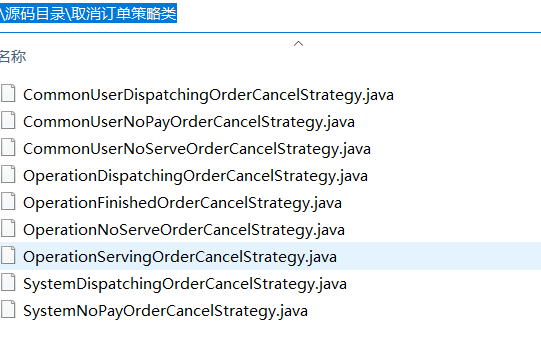
> 图注：这张图片展示的是源码目录中取消订单策略类的文件列表，界面顶部清晰标注该目录路径为“源码目录\\取消订单策略类”。列表中包含8个取消订单策略类文件，具体为CommonUserDispatchingOrderCancelStrategy.java、CommonUserNoPayOrderCancelStrategy.java、CommonUserNoServeOrderCancelStrategy.java、OperationDispatchingOrderCancelStrategy.java、OperationFinishedOrderCancelStrategy.java、OperationNoServeOrderCancelStrategy.java、OperationServingOrderCancelStrategy.java、SystemDispatchingOrderCancelStrategy.java、SystemNoPayOrderCancelStrategy.java。这些文件对应不同场景下的取消订单策略，正是文档中提及的取消订单策略类，后续操作是将这些策略类拷贝至指定的项目目录下。

在讲完系统优化将其它策略类拷贝至com.jzo2o.orders.manager.strategy.impl下。


#### 3.4.3 取消订单使用策略模式

##### 1) 修改取消订单方法

由于取消优惠券核销需要使用分布式事务控制，分布式事务控制影响性能，这里将本地事务提交与分布式事务提交分开编写代码。

```JSON

@Slf4j
@Service
public class OrdersManagerServiceImpl extends ServiceImpl<OrdersMapper, Orders> implements IOrdersManagerService {
...
/**
 * 取消订单
 *
 * @param orderCancelDTO 取消订单模型
 */
@Override
public void cancel(OrderCancelDTO orderCancelDTO) {
    //订单id
    Long id = orderCancelDTO.getId();
    //查询订单
    Orders orders = queryById(id);
    //如果订单为空则抛出异常
    if (ObjectUtils.isNull(orders)) {
        throw new CommonException("订单不存在");
    }
    //填充数据
    orderCancelDTO.setTradingOrderNo(orders.getTradingOrderNo());
    orderCancelDTO.setRealPayAmount(orders.getRealPayAmount());
    if (ObjectUtils.isNotNull(orders.getDiscountAmount()) && orders.getDiscountAmount().compareTo(new BigDecimal(0)) > 0) {
        owner.cancelWithCoupon(orderCancelDTO);
    }else{
        //取消待支付订单
        owner.cancelWithoutCoupon(orderCancelDTO);
    }
}


@GlobalTransactional
public void cancelWithCoupon(OrderCancelDTO orderCancelDTO) {
    //退回优惠券
    CouponUseBackReqDTO couponUseBackReqDTO = new CouponUseBackReqDTO();
    couponUseBackReqDTO.setUserId(orderCancelDTO.getCurrentUserId());
    couponUseBackReqDTO.setOrdersId(orderCancelDTO.getId());
    couponApi.useBack(couponUseBackReqDTO);
    //使用策略模式取消订单
    orderCancelStrategyManager.cancel(orderCancelDTO);
}


@Transactional
public void cancelWithoutCoupon(OrderCancelDTO orderCancelDTO) {
    orderCancelStrategyManager.cancel(orderCancelDTO);
}
...
```

##### 2）测试

启动网关

启动jzo2o-orders-manager

启动jzo2o-foundations

启动jzo2o-customer

启动小程序

测试流程：

下单

取消订单


断点跟踪：

在策略环境对象中包括了所有策略实现对象。

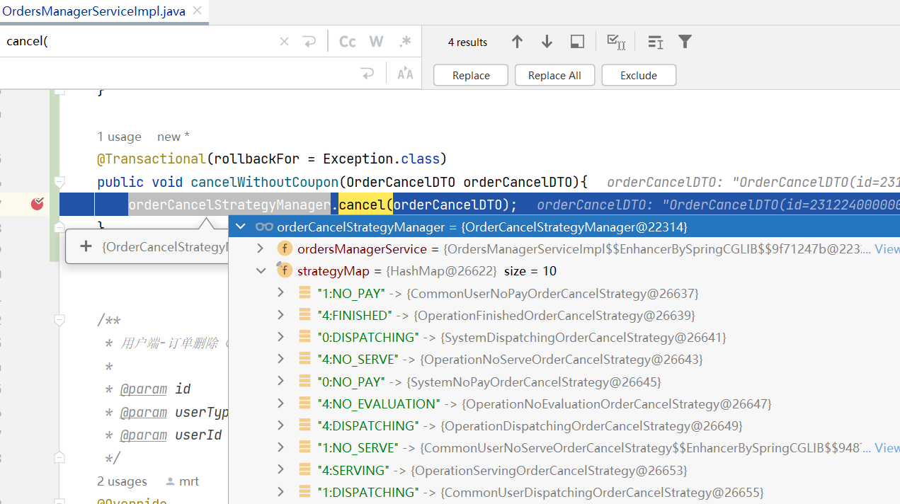
> 图注：这张图片展示了Java代码开发界面，具体是OrdersManagerServiceImpl.java文件中取消订单相关方法的调试断点场景。界面中显示了已加断点的cancel方法，调用了OrderCancelStrategyManager类的cancel方法，展开该类的strategyMap属性后，能看到其中包含了10个取消订单策略的实现对象，分别对应NO_PAY、FINISHED、NO_DISPATCHING等不同状态的订单取消策略，直观呈现了策略环境对象包含所有策略实现对象的内容，和文档中取消订单使用策略模式的相关测试流程内容相呼应，用于辅助理解策略模式在订单取消场景中的应用逻辑。


继续执行，根据订单状态和用户类型找到符合的策略对象：

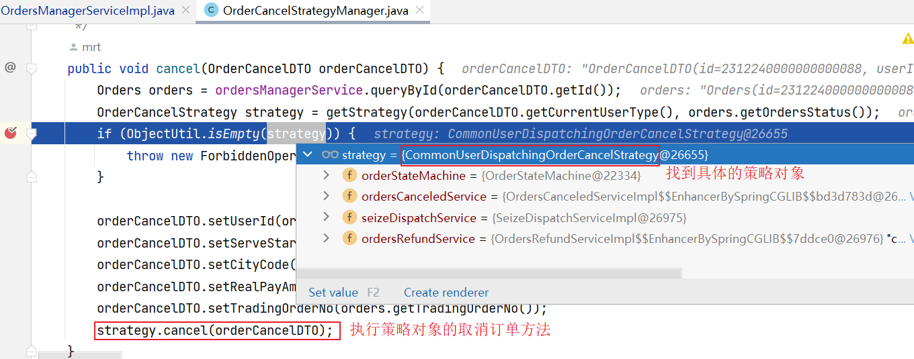
> 图注：图片展示了取消订单流程中策略对象的查找与执行。在策略环境对象中，通过订单状态和用户类型找到符合的策略对象，如图中显示的“CommonUserDispatchingOrderCancelStrategy@26655”。接着执行该策略对象的取消订单方法，代码为“strategy.cancel(orderCancelDTO);”。该图片与上下文紧密相关，直观呈现了取消订单优化中使用策略模式的执行过程，帮助理解项目中策略模式的应用。


##### 3 ) 小结

项目中用到设计模式了吗，具体说说？

---
> 来源：飞书技术知识库（脱敏版） · 07 业务组件方案集 / 云岚到家项目 / 第八章 支付模块 · [原文](https://ccn8v2zngwsm.feishu.cn/wiki/HN3Ywn2tli8vGxkoh7ucOmALnlh)
