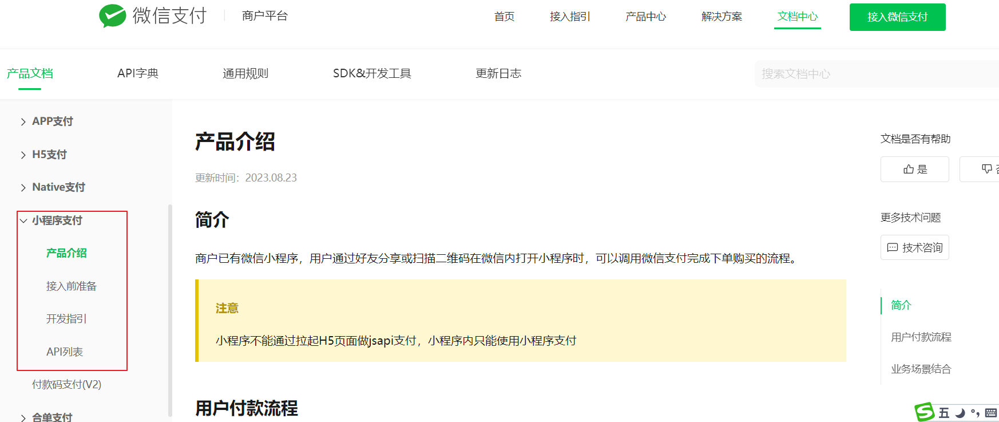
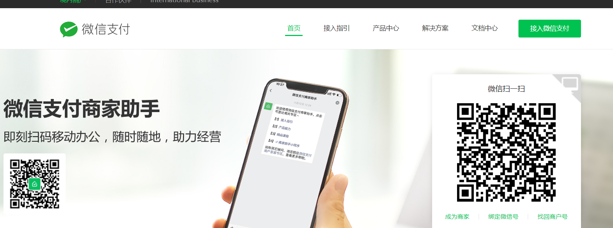
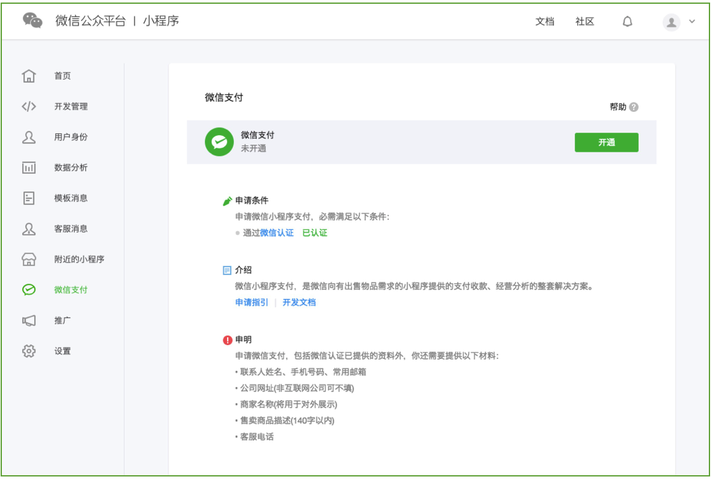

<title>微信支付调研 v1.0</title>


 

# 1 **查阅微信的产品文档** 

如何使用小程序进行支付？

下边通过调研小程序支付接口梳理交互流程。

打开微信小程序支付的产品文档：https://pay.weixin.qq.com/docs/merchant/products/mini-program-payment/introduction.html



# 2 **前期准备**

## 2.1 注册商户

首先参照接入前的准备进行申请：

进行小程序运营的企业需要申请成为微信的普通商户，为企业提供支付服务的需要注册成为普通服务商户。

本项目作为公司的自研项目并进行运营需要申请成为普通商户，地址：https://pay.weixin.qq.com/index.php/core/home/login?return_url=%2F 



步骤：

1、申请成为商户

点击“成为商户”填写法人、公司等信息等待审核。

2、申请AppID

对于普通商户，该社交载体可以是公众号（[什么是公众号 (opens new window)](https://mp.weixin.qq.com/mp/opshowpage?action=newoplaw)），小程序（[什么是小程序 (opens new window)](https://mp.weixin.qq.com/cgi-bin/wx?token=&lang=zh_CN)）或App。

本项目需要申请一个小程序账号，拿到AppID。

3、申请mchid（商户号）

进入商户平台申请：https://pay.weixin.qq.com/index.php/core/info 

4、绑定AppID及mchid

AppID和mchid全部申请完毕后，需要建立两者之间的绑定关系。


## 2.2 开通微信支付

- 申请小程序开发者账号，进行微信认证，获取AppID登录[《微信公众平台》 (opens new window)](https://mp.weixin.qq.com/)，注册一个小程序的开发者账号。[小程序账号申请指引(opens new window)](https://developers.weixin.qq.com/miniprogram/introduction/)
- 小程序开通微信支付，即申请或复用微信支付商户号，申请完小程序后，登录[小程序后台 (opens new window)](https://mp.weixin.qq.com/)。点击左侧导航栏的微信支付，在页面中进行开通。



点击开通按钮后，有2种方式可以获取微信支付能力，新申请微信支付商户号或绑定一个已有的微信支付商户号，请根据你的业务需要和具体情况选择，只能二选一。


# 3 **小程序支付接口**

## 3.1 总体流程

前期准备工作完毕下边调研小程序支付接口。

接口地址：https://pay.weixin.qq.com/docs/merchant/products/mini-program-payment/apilist.html

**API列表**

<sheet sheet-id="RKZfd7" token="RmftsgdMOhun7It9UdQcsjAfngh"></sheet>

上边表格加粗的表示必须对接的接口。

下边的流程是业务系统（凡是和微信支付对接的系统统称为业务系统）与微信支付接口的交互流程，列出了支付、支付结果查询、退款三个接口的交互流程。 

业务系统请求微信支付下单要将业务系统自己的订单号和订单金额告诉微信支付，只要这样在支付完成后才可以根据业务系统的订单号去查询支付结果。

比如：用户在家政平台下单，然后进行支付，家政平台服务端程序需要调用 微信支付的下单接口，将家政平台的订单号与订单金额传给微信下单接口。

<whiteboard token="M9Trw8ioXhjWW1bO2hKckIvIn2c"></whiteboard>


## 3.2 **小程序下单**

当点击支付时，业务系统向微信发起下单请求。

**请求方式：**【POST】/v3/pay/transactions/jsapi

**请求域名：**【主域名】https://api.mch.weixin.qq.com

**请求方向**：业务系统--->微信

### **请求参数**

除了appid、mchid商户id等必要参数以外，与业务相关的最重要的就是**out_trade_no和amount，**它是业务系统中的订单号及订单金额。

业务系统请求微信支付下单要将业务系统自己的订单号和订单金额告诉微信支付，只要这样在支付完成后才可以根据业务系统的订单号去查询支付结果。

比如：用户在家政平台下单，然后进行支付，家政平台服务端程序需要调用 微信支付的下单接口，将家政平台的订单号与订单金额传给微信下单接口。


- Header**HTTP头参数**
- **Authorization**必填string

请参考 [签名认证](https://pay.wechatpay.cn/wiki/doc/apiv3/wechatpay/wechatpay4_0.shtml) 生成认证信息

- **Accept**必填string

请设置为 `application/json`

- **Content-Type**必填string

请设置为 `application/json`


- Body**包体参数**
- **appid**必填string(32)

**【公众号ID】** 公众号ID/小程序ID

- **mchid**必填string(32)

**【直连商户号】** 直连商户号

- **description**必填string(127)

**【商品描述】** 商品描述

- **out_trade_no**必填string(32)

**【商户订单号】** 商户系统内部订单号，只能是数字、大小写字母\_-\*且在同一个商户号下唯一。

- **amount**必填CommReqAmountInfo

**【订单金额】** 订单金额信息

.....

### **应答参数**

200OK

- **prepay_id**必填string(64)

**【预支付交易会话标识】** 预支付交易会话标识。用于后续接口调用中使用，该值有效期为2小时


### 签名认证

在head参数中有一个**Authorization，**它表示请求接口的签名认证信息，是按照微信要求生成的加密串和一些基本信息。

**签名**是对原始数据通过签名算法生成的一段数据（签名串），用于证明数据的真实性和完整性。签名通常使用密钥进行生成，这个密钥可以是对称密钥或非对称密钥。

**验签**是对签名串进行验证的过程，用于确认数据的真实性和完整性。验签的过程通常使用与签名过程中相对应的公钥进行解密。

**签名和验签是为了防止内容被篡改。**

如何生成请求签名：https://pay.wechatpay.cn/wiki/doc/apiv3/wechatpay/wechatpay4_0.shtml

过程如下：

按照规则生成原始信息

使用签名算法（SHA256 with RSA）、私钥对原始信息生成签名串


如何验证签名：https://pay.weixin.qq.com/docs/merchant/development/interface-rules/signature-verification.html

过程如下：

获取原始信息和签名串

使用签名算法（SHA256 with RSA ）、公钥对验证原始信息与签名串是否一致，如果一致则验证通过。

签名和验签是为了防止内容被篡改。


> "SHA256 with RSA" 是一种常见的数字签名算法组合，它结合了SHA-256哈希函数与RSA公钥加密算法。这种组合广泛应用于安全通信协议（如TLS/SSL）、文件验证、软件发布等多个领域，以确保数据的完整性和真实性。
> 
> 工作原理
> 
> 消息哈希：首先，使用SHA-256算法对原始消息进行哈希处理，生成一个固定长度（256位）的消息摘要。这个过程可以显著减少需要加密的数据量，同时保证任何微小的变化都能产生完全不同的哈希值，从而提高安全性。
> 
> 签名生成：接着，发送方利用自己的私钥对上述消息摘要进行加密，生成数字签名。这一过程基于RSA算法，确保只有持有对应公钥的一方才能解密并验证签名的有效性。
> 
> 签名验证：接收方收到消息及其数字签名后，先用相同的SHA-256算法计算接收到的消息的哈希值，然后使用发送方的公钥解密数字签名，恢复出原始的消息摘要。如果两个哈希值相同，则说明消息未被篡改，且确实来自声称的发送者。


在微信提供的SDK程序中此部分由SDK处理了无需程序员手动编码。

地址：https://pay.wechatpay.cn/wiki/doc/apiv3/wechatpay/wechatpay6_0.shtml


## 3.3 **小程序调起支付**

小程序下单成功后微信返回一个prepay_id即预支付会话标识，小程序使用微信支付提供的api方法调起小程序支付。

**调用wx.requestPayment(OBJECT)发起微信支付**

**接口名称**： wx.requestPayment，详见[小程序API文档(opens new window)](https://developers.weixin.qq.com/miniprogram/dev/api/payment/wx.requestPayment.html)

Object请求参数说明：

- **timeStamp**必填string(32)
- 时间戳，标准北京时间，时区为东八区，自1970年1月1日 0点0分0秒以来的秒数。注意：部分系统取到的值为毫秒级，需要转换成秒(10位数字)。
- **nonceStr**必填string(32)
- 随机字符串，不长于32位。
- **package**必填string(128)
- 小程序下单接口返回的`prepay_id`参数值，提交格式如：`prepay_id=***`
- **signType**必填string(32)
- 签名类型，默认为RSA，仅支持RSA。
- **paySign**必填string(512)
- 签名，使用字段`appid`、`timeStamp`、`nonceStr`、`package`计算得出的签名值  
签名所使用的`appid`，为【小程序下单】时传入的`appid`，微信支付会校验下单与调起支付所使用的`appid`的一致性。


## 3.4 **支付通知**

微信支付通过支付通知接口将用户支付成功消息通知给商户的业务系统。

这里要注意的是最终业务系统要根据支付结果更新订单的支付状态，所以带着这个需求去查阅接口。

**请求方式：** 【POST】

**请求方向**：微信----》业务系统

**回调URL：** 即业务系统接收支付结果的URL，在请求微信支付下单时传给微信的，通过下单接口中的请求参数“notify_url”来设置的。

支付结果通知是以POST 方法访问商户设置的通知URL，通知的数据以JSON 格式通过请求主体（BODY）传输。

通过内容如下：


Body**包体参数**

- **id**必填string(36)

通知的唯一ID。

- **create_time**必填string(32)

通知创建的时间，遵循[rfc3339](https://datatracker.ietf.org/doc/html/rfc3339)标准格式，格式为yyyy-MM-DDTHH:mm:ss+TIMEZONE，yyyy-MM-DD表示年月日，T出现在字符串中，表示time元素的开头，HH:mm:ss.表示时分秒，TIMEZONE表示时区（+08:00表示东八区时间，领先UTC 8小时，即北京时间）。例如：2015-05-20T13:29:35+08:00表示北京时间2015年05月20日13点29分35秒。

- **event_type**必填string(32)

通知的类型，支付成功通知的类型为TRANSACTION.SUCCESS。

- **resource_type**必填string(32)

通知的资源数据类型，支付成功通知为encrypt-resource。

- **resource**必填object

通知资源数据。

- **summary**必填string(64)

回调摘要


**resource解密后字段**

Body**包体参数**

在resource字段中有一个**out_trade_no，**正是业务系统的订单号**，trade_state**是支付结果**，**我们可以根据这两个参数去更新订单的支付结果。


- **appid**必填string(32)

直连商户申请的公众号或移动应用AppID。

- **mchid**必填string(32)

商户的商户号，由微信支付生成并下发。

- **out_trade_no**必填string(32)

商户系统内部订单号，可以是数字、大小写字母\_-\*的任意组合且在同一个商户号下唯一。

- **transaction_id**必填string(32)

微信支付系统生成的订单号。

- **trade_type**必填string(16)

交易类型，枚举值：  
JSAPI：公众号支付  
NATIVE：扫码支付  
App：App支付  
MICROPAY：付款码支付  
MWEB：H5支付  
FACEPAY：刷脸支付

- **trade_state**必填string(32)

交易状态，枚举值：  
SUCCESS：支付成功  
REFUND：转入退款  
NOTPAY：未支付  
CLOSED：已关闭  
REVOKED：已撤销（付款码支付）  
USERPAYING：用户支付中（付款码支付）  
PAYERROR：支付失败(其他原因，如银行返回失败)

- **trade_state_desc**必填string(256)

交易状态描述。

- **bank_type**必填string(32)

银行类型，采用字符串类型的银行标识。银行标识请参考[《银行类型对照表》](https://pay.weixin.qq.com/docs/merchant/development/chart/bank-type.html)。

- **attach**选填string(128)

附加数据，在查询API和支付通知中原样返回，可作为自定义参数使用，实际情况下只有支付完成状态才会返回该字段。

- **success_time**必填string(64)

支付完成时间，遵循[rfc3339](https://datatracker.ietf.org/doc/html/rfc3339)标准格式，格式为yyyy-MM-DDTHH:mm:ss+TIMEZONE，yyyy-MM-DD表示年月日，T出现在字符串中，表示time元素的开头，HH:mm:ss表示时分秒，TIMEZONE表示时区（+08:00表示东八区时间，领先UTC 8小时，即北京时间）。例如：2015-05-20T13:29:35+08:00表示，北京时间2015年5月20日 13点29分35秒。

- **payer**必填object

支付者信息

- **amount**必填object

订单金额信息


## 3.5 **商户通过订单号查询订单**

商户可以通过查询订单接口主动查询订单状态

这里要注意的是最终业务系统要根据支付结果更新订单的支付状态，所以带着这个需求去查阅接口。

**支持商户：**【普通商户】

**请求方式：**【GET】/v3/pay/transactions/out-trade-no/{out_trade_no}

**请求域名：**【主域名】https://api.mch.weixin.qq.com

**请求方向**：业务系统--->微信

### **请求参数**

Header**HTTP头参数**

- **Authorization**必填string

请参考 [签名认证](https://pay.wechatpay.cn/wiki/doc/apiv3/wechatpay/wechatpay4_0.shtml) 生成认证信息

- **Accept**必填string

请设置为 `application/json`

Path**路径参数**

- **out_trade_no**必填string(32)

**【商户订单号】** 商户系统内部订单号，只能是数字、大小写字母\_-\*且在同一个商户号下唯一。

Query**查询参数**

- **mchid**必填string(32)

**【直连商户号】** 直连商户的商户号，由微信支付生成并下发。

### **应答参数**

在应答参数中有一个**out_trade_no，**正是业务系统的订单号**，trade_state**是支付结果**，**我们可以根据这两个参数去更新订单的支付结果。

200OK

- **appid**选填string(32)

**【公众号ID】** 公众号ID

- **mchid**必填string(32)

**【直连商户号】** 直连商户号

- **out_trade_no**必填string(32)

**【商户订单号】** 商户系统内部订单号，只能是数字、大小写字母\_-\*且在同一个商户号下唯一，详见【商户订单号】。

- **transaction_id**选填string(32)

**【微信支付订单号】** 微信支付系统生成的订单号。

- **trade_type**选填string(16)

**【交易类型】** 交易类型，枚举值：  
\* JSAPI：公众号支付  
\* NATIVE：扫码支付  
\* APP：APP支付  
\* MICROPAY：付款码支付  
\* MWEB：H5支付  
\* FACEPAY：刷脸支付

- **trade_state**必填string(32)

**【交易状态】** 交易状态，枚举值：  
\* SUCCESS：支付成功  
\* REFUND：转入退款  
\* NOTPAY：未支付  
\* CLOSED：已关闭  
\* REVOKED：已撤销（仅付款码支付会返回）  
\* USERPAYING：用户支付中（仅付款码支付会返回）  
\* PAYERROR：支付失败（仅付款码支付会返回）

- **trade_state_desc**必填string(256)

**【交易状态描述】** 交易状态描述


# 4 **Native**支付接口

打开**Native下单接口：** 

https://pay.weixin.qq.com/docs/merchant/apis/native-payment/direct-jsons/native-prepay.html


## 4.1 总体流程

扫码支付的流程与小程序支付基本类似，只是小程序支付改为了用户扫码支付，流程如下：

<whiteboard token="Oln5wEipAhbKgzbIVe5czQCEn3c"></whiteboard>


## 4.2 下单

**支持商户：**【普通商户】

**请求方式：**【POST】/v3/pay/transactions/native

**请求域名：**【主域名】https://api.mch.weixin.qq.com 

**请求方向**：业务系统--->微信

### **请求参数**

Header**HTTP头参数**

- **Authorization**必填string

请参考 [签名认证](https://pay.wechatpay.cn/wiki/doc/apiv3/wechatpay/wechatpay4_0.shtml) 生成认证信息

- **Accept**必填string

请设置为 `application/json`

- **Content-Type**必填string

请设置为 `application/json`

Body**包体参数**

- **appid**必填string(32)

**【公众号ID】** 公众号ID

- **mchid**必填string(32)

**【直连商户号】** 直连商户号

- **description**必填string(127)

**【商品描述】** 商品描述

- **out_trade_no**必填string(32)

**【商户订单号】** 商户系统内部订单号，只能是数字、大小写字母\_-\*且在同一个商户号下唯一

- **amount**必填CommReqAmountInfo

**【订单金额】** 订单金额

### **应答参数**

200OK

- **code_url**必填string(64)

**【二维码链接】** 此URL用于生成支付二维码，然后提供给用户扫码支付。

使用时按照URL格式转成二维码即可


## 4.3 支付通知

同小程序支付通知。

## 4.4 **商户订单号查询订单**

除了接口地址不同其它与小程序支付相同。

**支持商户：**【普通商户】

**请求方式：**【GET】/v3/pay/transactions/out-trade-no/{out_trade_no}

**请求域名：**【主域名】https://api.mch.weixin.qq.com

**请求方向：业务系统--->微信**

### **请求参数**

Header**HTTP头参数**

- **Authorization**必填string

请参考 [签名认证](https://pay.wechatpay.cn/wiki/doc/apiv3/wechatpay/wechatpay4_0.shtml) 生成认证信息

- **Accept**必填string

请设置为 `application/json`

Path**路径参数**

- **out_trade_no**必填string(32)

**【商户订单号】** 商户系统内部订单号，只能是数字、大小写字母\_-\*且在同一个商户号下唯一。

Query**查询参数**

- **mchid**必填string(32)

**【直连商户号】** 直连商户的商户号，由微信支付生成并下发。

### **应答参数**

200OK

- **appid**选填string(32)

**【公众号ID】** 公众号ID

- **mchid**必填string(32)

**【直连商户号】** 直连商户号

- **out_trade_no**必填string(32)

**【商户订单号】** 商户系统内部订单号，只能是数字、大小写字母\_-\*且在同一个商户号下唯一，详见【商户订单号】。

- **transaction_id**选填string(32)

**【微信支付订单号】** 微信支付系统生成的订单号。

- **trade_type**选填string(16)

**【交易类型】** 交易类型，枚举值：  
\* JSAPI：公众号支付  
\* NATIVE：扫码支付  
\* APP：APP支付  
\* MICROPAY：付款码支付  
\* MWEB：H5支付  
\* FACEPAY：刷脸支付

- **trade_state**必填string(32)

**【交易状态】** 交易状态，枚举值：  
\* SUCCESS：支付成功  
\* REFUND：转入退款  
\* NOTPAY：未支付  
\* CLOSED：已关闭  
\* REVOKED：已撤销（仅付款码支付会返回）  
\* USERPAYING：用户支付中（仅付款码支付会返回）  
\* PAYERROR：支付失败（仅付款码支付会返回）

- **trade_state_desc**必填string(256)

**【交易状态描述】** 交易状态描述


# 5 SDK调研

## 介绍

为了方便进行支付接口对接，可通过SDK程序快速进行开发。

SDK介绍地址：https://pay.wechatpay.cn/wiki/doc/apiv3/wechatpay/wechatpay6_0.shtml

开发者可以根据自己的需要，选择对应的库。

- [wechatpay-java](https://github.com/wechatpay-apiv3/wechatpay-java)（推荐）[wechatpay-apache-httpclient](https://github.com/wechatpay-apiv3/wechatpay-apache-httpclient)，适用于Java开发者。
- [wechatpay-php](https://github.com/wechatpay-apiv3/wechatpay-php)（推荐）、[wechatpay-guzzle-middleware](https://github.com/wechatpay-apiv3/wechatpay-guzzle-middleware)，适用于PHP开发者。
- [wechatpay-go](https://github.com/wechatpay-apiv3/wechatpay-go)，适用于Go开发者

本项目使用[wechatpay-apache-httpclient](https://github.com/wechatpay-apiv3/wechatpay-apache-httpclient)

## 使用示例

### 加入以下依赖

```Java
<dependency>
    <groupId>com.github.wechatpay-apiv3</groupId>
    <artifactId>wechatpay-apache-httpclient</artifactId>
    <version>0.4.9</version>
</dependency>
```

### 名词解释

- 商户API证书，是用来证实商户身份的。证书中包含商户号、证书序列号、证书有效期等信息，由证书授权机构(Certificate Authority ，简称CA)签发，以防证书被伪造或篡改。如何获取请见[商户API证书](https://wechatpay-api.gitbook.io/wechatpay-api-v3/ren-zheng/zheng-shu#shang-hu-api-zheng-shu)。
- 商户API私钥。商户申请商户API证书时，会生成商户私钥，并保存在本地证书文件夹的文件apiclient_key.pem中。注：不要把私钥文件暴露在公共场合，如上传到Github，写在客户端代码等。
- 微信支付平台证书。平台证书是指由微信支付负责申请的，包含微信支付平台标识、公钥信息的证书。商户可以使用平台证书中的公钥进行应答签名的验证。获取平台证书需通过[获取平台证书列表](https://wechatpay-api.gitbook.io/wechatpay-api-v3/ren-zheng/zheng-shu#ping-tai-zheng-shu)接口下载。
- 证书序列号。每个证书都有一个由CA颁发的唯一编号，即证书序列号。如何查看证书序列号请看[这里](https://wechatpay-api.gitbook.io/wechatpay-api-v3/chang-jian-wen-ti/zheng-shu-xiang-guan#ru-he-cha-kan-zheng-shu-xu-lie-hao)。
- API v3密钥。为了保证安全性，微信支付在回调通知和平台证书下载接口中，对关键信息进行了AES-256-GCM加密。API v3密钥是加密时使用的对称密钥。商户可以在【商户平台】->【API安全】的页面设置该密钥。

### 开始

如果你使用的是`HttpClientBuilder`或者`HttpClients#custom()`来构造`HttpClient`，你可以直接替换为`WechatPayHttpClientBuilder`。

```Java
import com.wechat.pay.contrib.apache.httpclient.WechatPayHttpClientBuilder;

//...
WechatPayHttpClientBuilder builder = WechatPayHttpClientBuilder.create()
        .withMerchant(merchantId, merchantSerialNumber, merchantPrivateKey)
        .withWechatPay(wechatPayCertificates);
// ... 接下来，你仍然可以通过builder设置各种参数，来配置你的HttpClient

// 通过WechatPayHttpClientBuilder构造的HttpClient，会自动的处理签名和验签
CloseableHttpClient httpClient = builder.build();

// 后面跟使用Apache HttpClient一样
CloseableHttpResponse response = httpClient.execute(...);
```

参数说明（前三个必须）：

- `merchantId`商户号。 
- `merchantSerialNumber`商户API证书的证书序列号。 
- `merchantPrivateKey`商户API私钥，如何加载商户API私钥请看[常见问题](https://github.com/wechatpay-apiv3/wechatpay-apache-httpclient#%E5%A6%82%E4%BD%95%E5%8A%A0%E8%BD%BD%E5%95%86%E6%88%B7%E7%A7%81%E9%92%A5)。
- `wechatPayCertificates`微信支付平台证书列表。你也可以使用后面章节提到的“[定时更新平台证书功能](https://github.com/wechatpay-apiv3/wechatpay-apache-httpclient#%E5%AE%9A%E6%97%B6%E6%9B%B4%E6%96%B0%E5%B9%B3%E5%8F%B0%E8%AF%81%E4%B9%A6%E5%8A%9F%E8%83%BD)”，而不需要关心平台证书的来龙去脉。

### 示例：**获取平台证书**

你可以使用`WechatPayHttpClientBuilder`构造的`HttpClient`发送请求和应答了。

```Java
URIBuilder uriBuilder = new URIBuilder("https://api.mch.weixin.qq.com/v3/certificates");
HttpGet httpGet = new HttpGet(uriBuilder.build());
httpGet.addHeader("Accept", "application/json");

CloseableHttpResponse response = httpClient.execute(httpGet);

String bodyAsString = EntityUtils.toString(response.getEntity());
System.out.println(bodyAsString);
```

### [**示例：JSAPI下单**](https://github.com/wechatpay-apiv3/wechatpay-apache-httpclient#%E7%A4%BA%E4%BE%8Bjsapi%E4%B8%8B%E5%8D%95)

注：

- 我们使用了 jackson-databind 演示拼装 Json，你也可以使用自己熟悉的 Json 库
- 请使用你自己的测试商户号、appid 以及对应的 openid

```Java
HttpPost httpPost = new HttpPost("https://api.mch.weixin.qq.com/v3/pay/transactions/jsapi");
httpPost.addHeader("Accept", "application/json");
httpPost.addHeader("Content-type","application/json; charset=utf-8");

ByteArrayOutputStream bos = new ByteArrayOutputStream();
ObjectMapper objectMapper = new ObjectMapper();

ObjectNode rootNode = objectMapper.createObjectNode();
rootNode.put("mchid","1900009191")
        .put("appid", "wxd678efh567hg6787")
        .put("description", "Image形象店-深圳腾大-QQ公仔")
        .put("notify_url", "https://www.weixin.qq.com/wxpay/pay.php")
        .put("out_trade_no", "1217752501201407033233368018");
rootNode.putObject("amount")
        .put("total", 1);
rootNode.putObject("payer")
        .put("openid", "oUpF8uMuAJO_M2pxb1Q9zNjWeS6o");

objectMapper.writeValue(bos, rootNode);

httpPost.setEntity(new StringEntity(bos.toString("UTF-8"), "UTF-8"));
CloseableHttpResponse response = httpClient.execute(httpPost);

String bodyAsString = EntityUtils.toString(response.getEntity());
System.out.println(bodyAsString);
```

### [**示例：查单**](https://github.com/wechatpay-apiv3/wechatpay-apache-httpclient#%E7%A4%BA%E4%BE%8B%E6%9F%A5%E5%8D%95)

```Java
URIBuilder uriBuilder = new URIBuilder("https://api.mch.weixin.qq.com/v3/pay/transactions/id/4200000889202103303311396384?mchid=1230000109");
HttpGet httpGet = new HttpGet(uriBuilder.build());
httpGet.addHeader("Accept", "application/json");

CloseableHttpResponse response = httpClient.execute(httpGet);

String bodyAsString = EntityUtils.toString(response.getEntity());
System.out.println(bodyAsString);
```

### [**示例：关单**](https://github.com/wechatpay-apiv3/wechatpay-apache-httpclient#%E7%A4%BA%E4%BE%8B%E5%85%B3%E5%8D%95)    

```Java
HttpPost httpPost = new HttpPost("https://api.mch.weixin.qq.com/v3/pay/transactions/out-trade-no/1217752501201407033233368018/close");
httpPost.addHeader("Accept", "application/json");
httpPost.addHeader("Content-type","application/json; charset=utf-8");

ByteArrayOutputStream bos = new ByteArrayOutputStream();
ObjectMapper objectMapper = new ObjectMapper();

ObjectNode rootNode = objectMapper.createObjectNode();
rootNode.put("mchid","1900009191");

objectMapper.writeValue(bos, rootNode);

httpPost.setEntity(new StringEntity(bos.toString("UTF-8"), "UTF-8"));
CloseableHttpResponse response = httpClient.execute(httpPost);

String bodyAsString = EntityUtils.toString(response.getEntity());
System.out.println(bodyAsString);
```

---
> 来源：飞书技术知识库（脱敏版） · 07 业务组件方案集 / 云岚到家项目 / 第八章 支付模块 / 微信支付调研 v1.0 · [原文](https://ccn8v2zngwsm.feishu.cn/wiki/N5SLwQdWPi88wUk7Y9tcOWapnti)
