<title>第二章 运营服务管理模块</title>

# 学习目标

运营服务管理模块是我们在本项目学习的第一个模块，运营服务管理模块相当于商品管理，商品管理功能很通用，最典型的就是电商项目中的商品管理，家政项目中的家政服务项目相当于商品，凡是涉及消费用户的项目都包括商品管理模块，通过本章节的学习掌握商品管理模块的设计、开发细节。

能够对运营服务管理模块进行需求分析

能够说出运营服务管理模块的设计内容

能够设计开发区域服务子模块的接口

能够设计开发运营服务管理模块的其它接口


学习目标如下：

1. 能够说出服务上架的流程
2. 能够说出家政项目服务管理涉及的表有哪些
3. 能够设计并开发区域服务查询接口
4. 能够说出前后端联调步骤
5. 能够设计并开发添加区域服务接口
6. 能够设计并开发修改价格接口
7. 能够设计并开发服务上架接口
8. 能够设计并开发家政项目实战功能
9. 能够说出电商项目商品管理涉及的表有哪些
10. 能够说出电商项目商品发布的流程
11. 能够设计并开发电商项目实战功能


家政项目实战：

删除区域服务

服务下架

设置热门服务

取消热门服务

启用区域功能完善

禁用区域功能完善

禁用服务项功能完善


# 代码环境

jzo2o-foundations：dev_01


# 1 前置知识

## 1.1 如何进行需求分析

### 1）如何进行需求分析？

在系统设计之前需要进行需求分析，需求分析就是根据用户所提的需求进行理解，它是软件开发周期中的关键环节，它直接影响到后续的设计、开发和测试阶段。需求分析阶段做好了能够减少后期修改的成本，提高系统的质量和用户的满意度。因此，在需求分析阶段投入足够的时间和资源是非常必要的。

需求分析通常从以下方面进行：

- 理解业务需求：与客户或产品经理沟通，确保你对业务流程有清晰的理解。

产品经理会召集我们一起开会讨论确定产品原型，我会根据产品原型去对每个功能进行分析。

- 梳理功能需求：将业务需求转化为具体的软件功能，划分模块，明确哪些是核心功能，哪些是辅助功能。
- 梳理用户操作事件流：在功能需求的基础上去梳理用户的操作流程。
- 分析对象属性：根据业务流程分析涉及到的对象有哪些及对象属性。
- 分析非功能性需求：比如性能要求、安全性、可维护性等。

### 2）产品原型

与客户沟通最好的方式就是通过界面原型进行沟通，因为界面原型客户看的懂，它是需求阶段最接近软件成品产物。

在使用界面原型进行沟通时，也需要确保技术术语和设计细节能够被非专业人士所理解。此外，应该保持原型的简洁性和易用性，避免过度复杂化导致信息传递失效。

除了通过界面原型进行沟通，还要与其他沟通方法（如会议讨论、文档说明等）相结合，以确保所有方面的需求都被准确无误地传达给项目团队。

产品原型网：https://www.axureshop.com/ 


### 3）**分析功能列表**

通常按不同的端进行分析，例如下表是云岚到家项目消费端的功能列表（部分功能）：

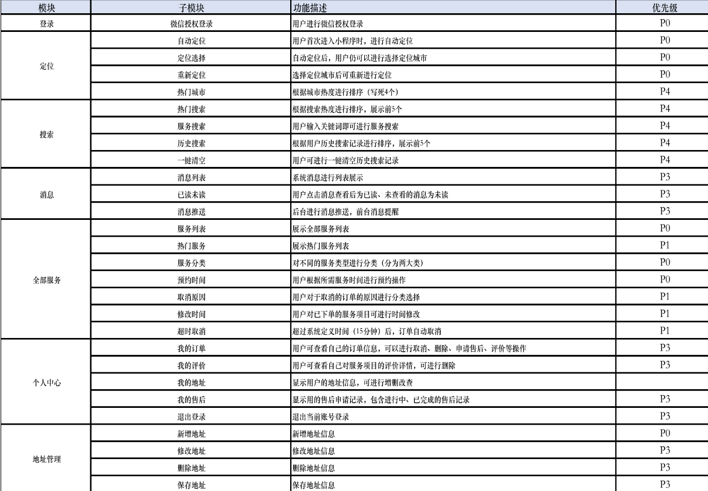


### 4）**模块化设计**

模块化设计是在需求分析阶段对功能需求划分模块：

将相关的需求划分到一个模块中，模块下可以有子模块。

举例：

运营服务管理模块的定位是为对平台运营的服务进行管理，功能包括：服务分类管理、服务管理、区域管理等子模块。

运营服务管理是一个模块，其下又分为服务管理、区域管理等子模块，服务管理模块又包括了服务类型管理模块、服务项管理模块等多个子模块。

产品经理根据需求梳理模块清单：

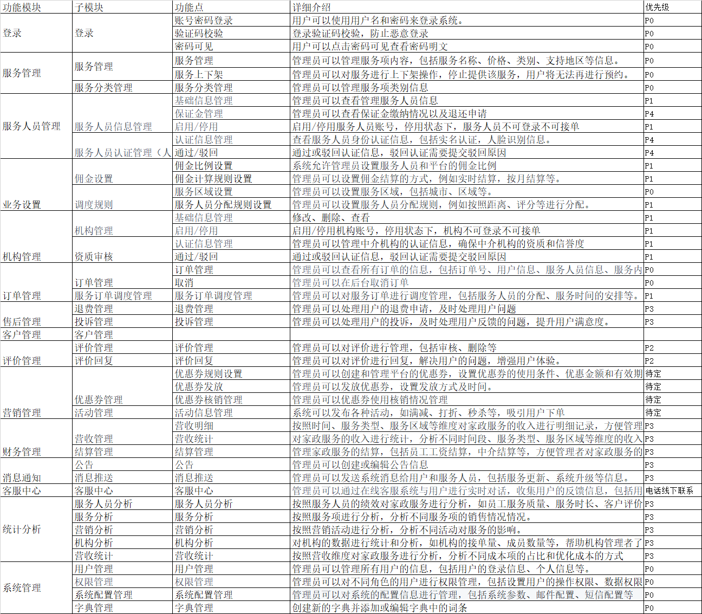

根据每个端去细化模块，项目业务模块图如下：

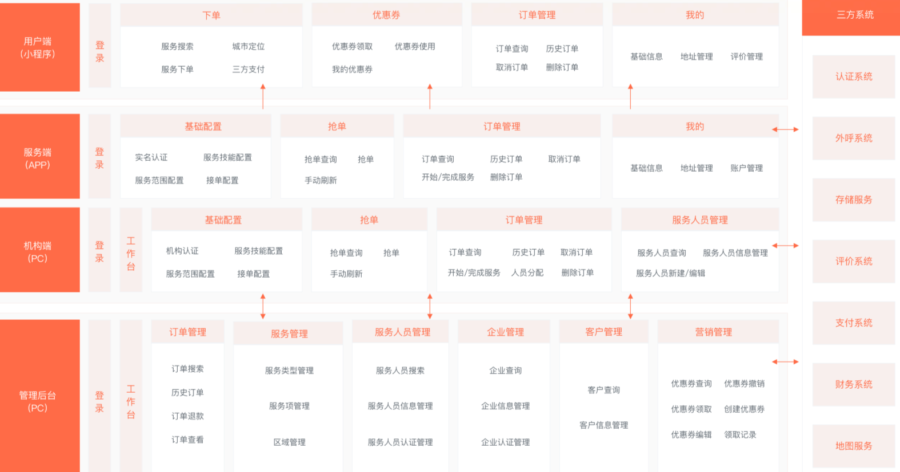


### 5）细化需求

#### 完善界面原型

和用户确定了项目范围，下一步就正式进入需求分析阶段，产品经理对界面原型进行完善，细化原型中的参数说明、对象属性、规则、约束、分析用户操作流程等。

举例：

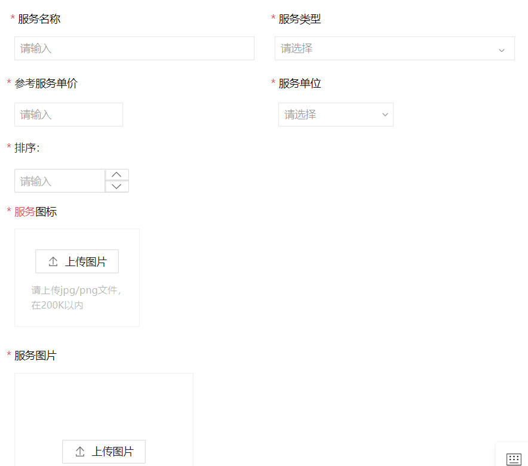


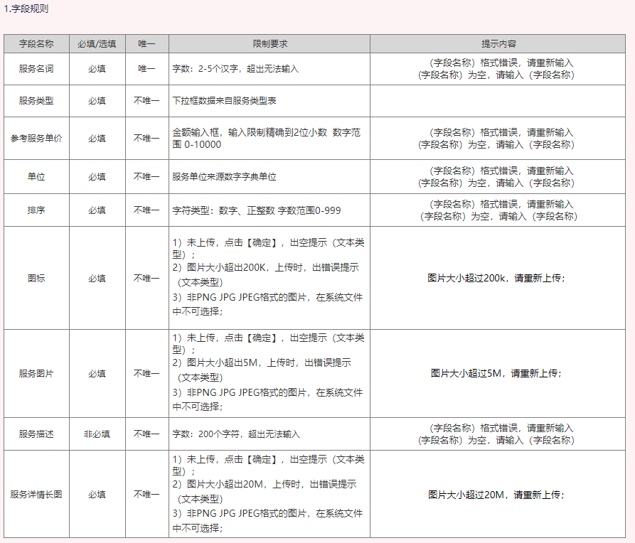

#### 用户操作流程

还需要细化用户的操作流程。

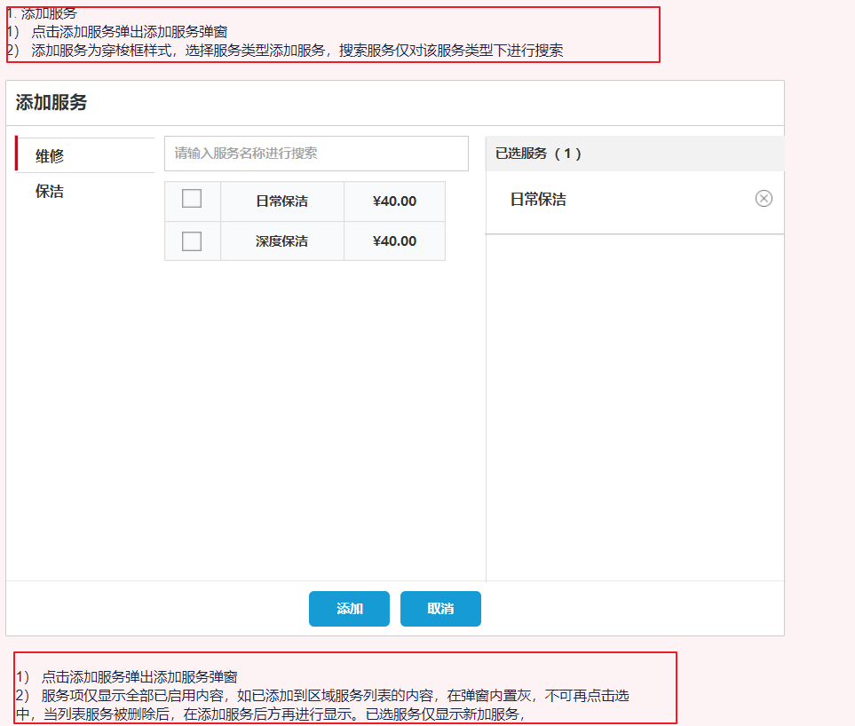


### 6）非功能性需求

除了功能需求还有非功能需求，比如性能要求、安全性、可维护性等这些也需要在需求阶段进行分析。

举例：

用户登录功能，为了保证安全性对密码加密传输、加密保存。

app首页为了提高动态数据的加载速度，保证首页3秒内加载完毕。


### 7）需求阶段产物

需求分析阶段的产物：

产品原型。

需求规格说明书。


AI: 给我一份需求规格说明书的例子，内容要足够详细


### 8）实战

阅读“运营服务管理模块用户需求文档v1.0”，进行区域服务管理子模块进行需求分析，要求如下：

1. 列出功能列表，划分子模块
2. 分析每个功能用户的操作流程，并写下来
3. 分析对象属性，并写下来

举例：

功能：服务类型列表：

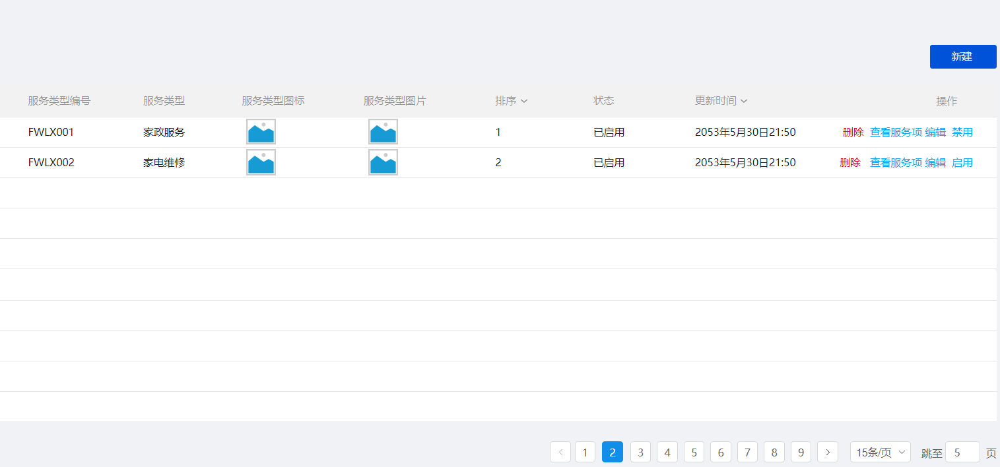

操作流程：

点击菜单进入服务类型列表

默认查询全部服务类型列表

通过上一页、下一页进行分页查询

对象属性：

查询列表字段包括：服务类型编号、服务类型名称 、服务类型图标、服务类型图片、排序、状态、更新时间。


举例：

功能：新建服务类型

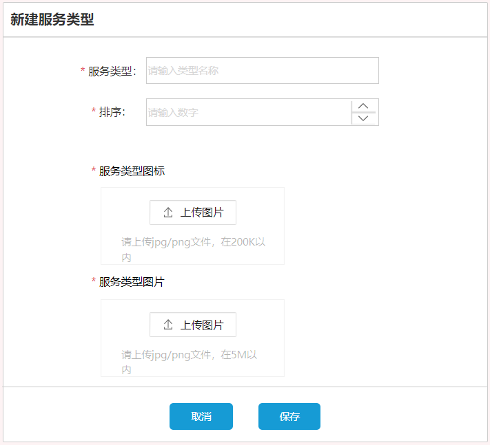

操作流程：

点击菜单进入服务类型列表

点击“新建”打开新建服务类型窗口

填写“服务类型”、"排序" 信息。

上传服务类型图标、服务类型图片。

点击“保存”提交新建的服务类型信息

点击“取消”关闭窗口。


对象属性：

服务类型名称、排序、服务类型图标、服务类型图片。


### 9) 小结

你参与需求分析了吗？如何进行需求分析？


## 1.2 如何进行系统设计

### 1) 如何进行系统设计？

需求分析阶段完成是系统设计阶段，系统设计分为概要设计和详细设计。

AI:

软件的概要设计和详细设计分别要设计哪些内容

使用SpringBoot开发软件，在概要设计和详细设计阶段分别要设计哪些内容


**概要设计**是对系统模块、架构、数据库表、系统间的交互接口、外部接口等宏观层面进行设计。

**详细设计**是对具体类、方法、接口等微观层面的实现细节进行设计。

通常项目都会进行概要设计，详细设计阶段的设计内容根据公司的项目管理水平而不同。

我们在教学过程中将概要设计和详细设计统称为系统设计。

系统设计的核心通常包括以下几个方面：

1. 系统模块设计

根据需求划分系统功能模块。

1. 系统架构设计

确定基础框架、中间件等技术选型、外部接口和内部接口、工程结构等。

1. 数据库设计

划分数据库，设计表，这项是中高级程序员的主要工作。

1. 接口设计

在概要设计阶段主要设计外部接口及模块间的部分内部接口。

系统外部接口，比如：调用云平台提供的文件上传接口、微信小程序认证接口、用户定位接口等。

系统模块之间的内部接口，比如：订单模块如何获取商品管理模块的商品信息，订单模块如何获取支付结果。

在详细设计阶段根据需求设计具体的业务接口及模块间的内部接口，这项是中高级程序员的主要工作。


### 2) **系统架构设计**

系统的业务模块划分好后就可以根据业务模块的划分进行系统架构设计：

- 定义应用架构：确定应用的结构（如单体应用、微服务架构）。
- 技术选型：选择合适的框架和技术栈，Spring Boot本身已经提供了很多开箱即用的功能，但你需要选择适合的数据库、缓存机制、消息队列等。
- 模块化：根据业务模块的划分将系统划分为不同的模块或服务，每个模块负责一部分功能，这有助于未来的扩展和维护。
- 设计内外部接口：分析所依赖的外部接口，分析系统内模块之间的交互接口。

举例：

云岚到家是微服务项目，根据业务模块去划分微服务。

技术选型：使用Spring Cloud Alibaba框架，数据库使用MySQL，还使用RabbitMQ、Redis、Sentinel、XXL-JOB、ShardingSphere-JDBC等中间件和框架。

单独设立第三方集成模块，用于和外部平台进行接口对接。

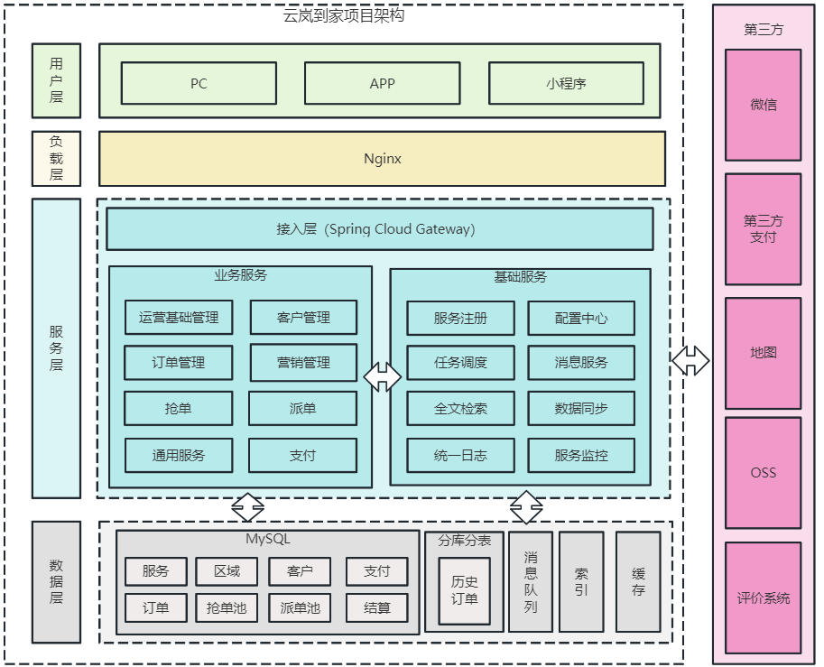


### 3) **数据库设计**

根据需求分析及模块设计进行数据库设计：

- 微服务项目不同的模块设计不同的数据库
- 根据业务需求设计数据库表、及表结构。
- 考虑到数据的一致性和完整性，设计适当的约束条件。
- 性能优化：考虑索引、分区等技术以提高查询效率。

举例：

云岚到家是微服务项目，每个模块有自己独立的数据库

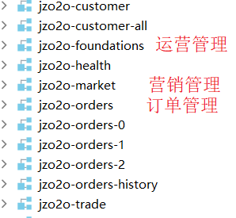

运营服务管理模块核心表如下：

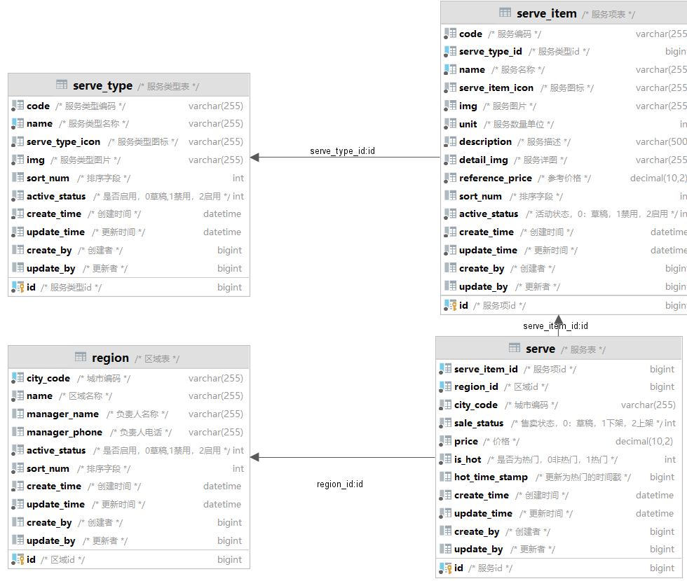

**serve_type**：服务类型表

**serve_item**:  服务项表，存储了本平台的家政服务项目

每个服务项都有一个服务类型，一个服务类型下有多个服务项，服务类型与服务项是一对多关系。

**region**：区域表，存储运营地区信息，一般情况区域表行政级别是市。

**serve**:  服务表，存储了各个区域运营的服务及相关信息。

**注意：这里不要把serve表简单理解为只是区域表和服务项表的中间关系表，因为如果是简单的关联关系表只需记录区域表和服务项表各自的主键Id即可，serve记录的是平台运营服务的信息，凡是与运营相关的信息都要记录在serve表，比如：运营价格。后期也可能会增加其它运营相关的字段。**

region与serve_item是什么关系？

一个区域下可以设置多个服务项，一个服务项可以被多个区域设置，region与serve_item是多对多关系。


### 4) **接口设计**

根据需求分析梳理功能列表、分析用户操作流程，然后再去设计外部接口及功能接口。

包括以下几个方面：

**外部接口：是本项目与第三方系统之间的接口。**

举例：在上传服务项图片时涉及外部接口，下图上传图片功能如果将图片保存到云平台则需要调用云平台的上传图片接口。

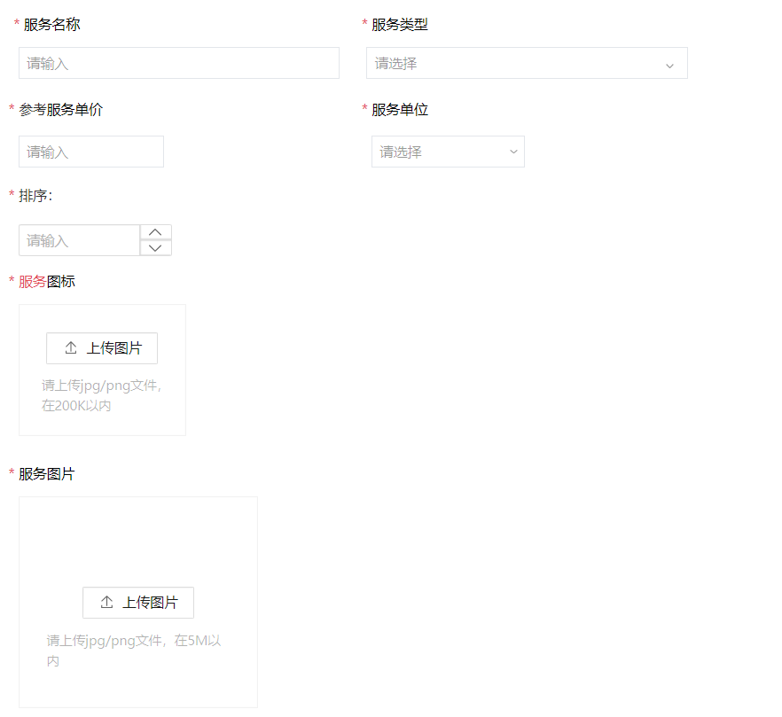

**内部接口：是本项目模块与模块之间的接口定义**

在概要设计阶段通常是根据业务流程和系统架构设计去分析，在详细设计（比如接口设计）时还会对内部接口进行分析、细化。

举例：

通用服务jzo2o-publics提供上传文件、微信认证、用户定位接口，其它微服务与jzo2o-publics服务交互，jzo2o-publics与外部系统交互。

<whiteboard token="TiunwTH5ZhO1RpbRup1ctjxpnEc"></whiteboard>

**功能接口：根据需求定义HTTP 功能接口。**

设计RESTful API：用户操作一般伴随着接口请求，一般是根据用户操作事件流去设计接口，定义接口的URL、HTTP方法、请求参数和响应格式。

举例：根据新建服务类型的需求设计接口如下图：


### 5) 小结

你在进行设计时都设计哪些内容？


能够说出运营服务管理模块的设计内容？


# 2 运营服务管理

通过本模块的学习掌握家政项目运营服务管理模块的数据库、接口等设计内容，以及基于本项目架构进行开发的流程。

通过本模块的学习掌握针对一个新模块如何进行设计、开发的流程和方法，在拿到一个项目时知道如何下手。


## 2.1 区域服务管理子模块设计

### 1）模块定位

区域服务管理模块是运营服务管理的子模块，它是以城市区域为单位，对本区域运营的服务项进行管理。

只在区域上架服务后该区域的用户才可以在小程序对该家政服务下单。


### 2）数据表

区域服务管理模块最基本的是区域表和服务项表，然后是区域与服务项的关系表，此关系表存储了区域内所运营家政服务项目的信息。

数据表如下：


**serve_type**：服务类型表

**serve_item**:  服务项表，存储了本平台的家政服务项目

每个服务项都有一个服务类型，一个服务类型下有多个服务项，服务类型与服务项是一对多关系。

**region**：区域表，存储运营地区信息，一般情况区域表行政级别是市。

**serve**:  服务表，存储了各个区域运营的服务及相关信息。

**注意：这里不要把serve表简单理解为只是区域表和服务项表的中间关系表，因为如果是简单的关联关系表只需记录区域表和服务项表各自的主键Id即可，serve记录的是平台运营服务的信息，凡是与运营相关的信息都要记录在serve表，比如：运营价格。后期也可能会增加其它运营相关的字段。**

region与serve_item是什么关系？

一个区域下可以设置多个服务项，一个服务项可以被多个区域运营，region与serve_item是多对多关系。


### 3）生成模型类

数据库表设计完成就可以使用工具生成模型类、mapper接口、mapper映射文件等。

生成模型类的工具有很多：AI、MyBatis逆向工程、IDEA插件等。

下边是使用MybatisPlus插件自动生成代码的过程。


**1、安装插件**

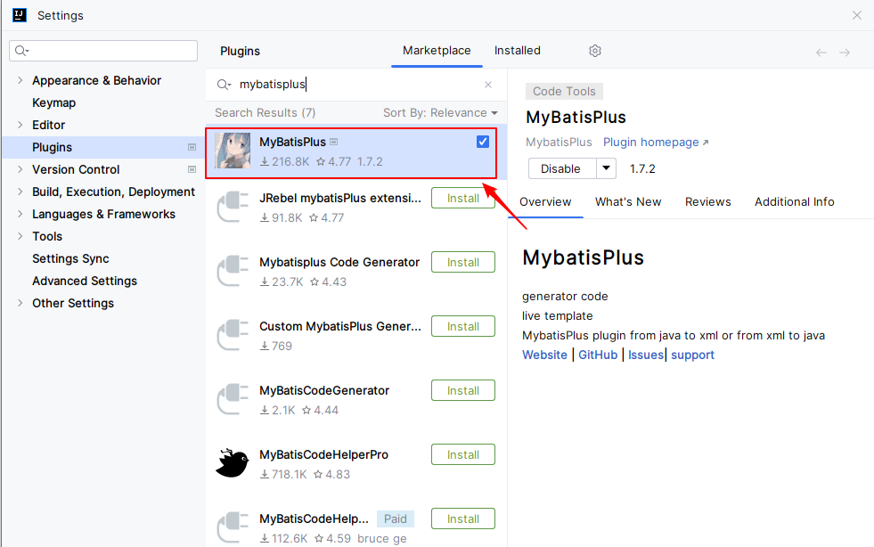

**2.重启IDEA，连接mysql**

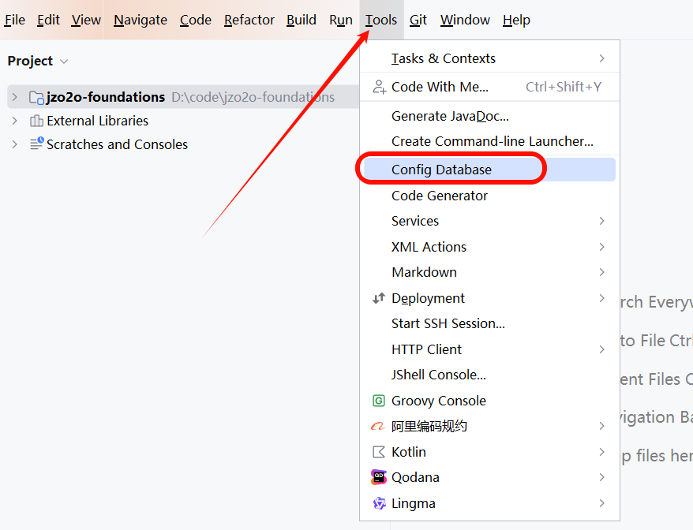

配置连接的数据库

输入连接字符串：jdbc:mysql://192.168.101.68:3306/jzo2o-foundations?useSSL=false&serverTimezone=UTC 

账号和密码

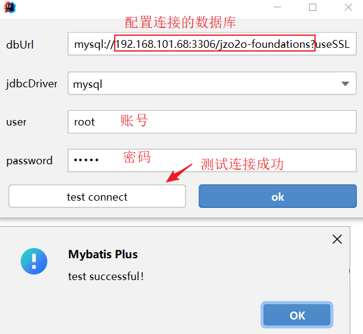


3、配置代码生成规则

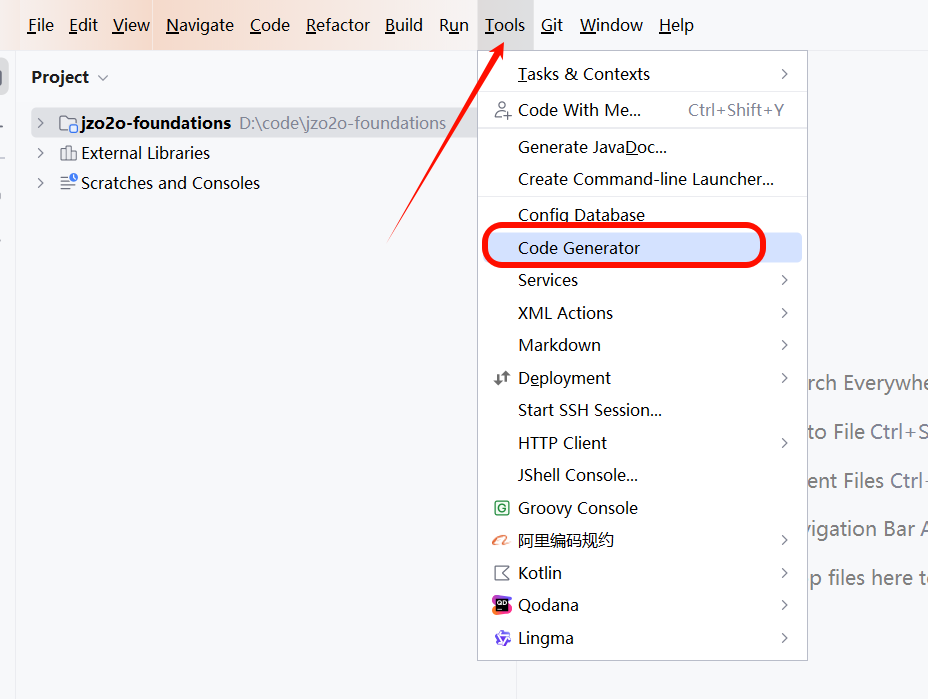


1）选择表：上图选择serve_type表。

2）设置生成代码的根目录：上图设置generator

3）设置包路径：上图设置为com.jzo2o.foundations

4）主键生成策略：根据表中主键的生成策略进行选择，支持的主键生成策略如下图：

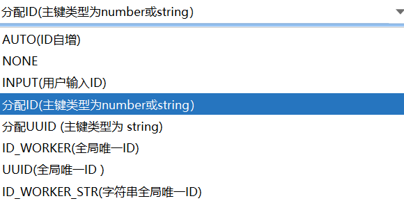

本项目使用的MyBatisPlus版本支持前5个，对应MyBatisPlus源码如下：

```Java
public enum IdType {
    AUTO(0),
    NONE(1),
    INPUT(2),
    ASSIGN_ID(3),
    ASSIGN_UUID(4);
```

> - AUTO：基于数据库的自增主键
> - NONE: 不设置id生成策略
> - INPUT:用户手工输入id
> - ASSIGN_ID:雪花算法生成id(可兼容数值型与字符串型)
> - ASSIGN_UUID:以UUID生成算法作为id生成策略

本项目使用ASSIGN_ID方式，雪花算法生成id。

5）勾选要生成的类及包路径（Entity、Mapper、Controller、Service、ServiceImpl）。

6）勾选是否生成lombok注解、restController注解、swagger注解等。


点击“check field”选择表中的字段。

点击“code generatro”生成代码。

生成成功在项目工程根目录有一个generator目录，里边为生成的代码，如下图：

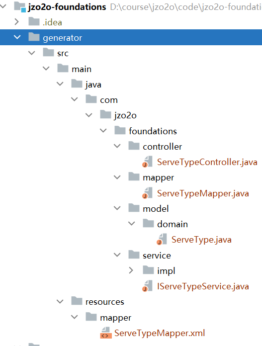

对生成的代码根据自己的需求稍加修改，修改后拷贝到工程相应的包下即可。


### 4)  外部接口

在上传服务项图片时涉及外部接口，下图上传图片功能如果将图片保存到云平台则需要调用云平台的上传图片接口。


### 5）内部接口

根据本模块的定位，本模块去管理区域下运营的服务项目，那么本模块就要提供以下接口供其它模块调用：

查询某区域下运营的服务项目

查询服务项目的详细信息等


本模块有没有需要调用其它模块的接口呢？

在添加服务项界面中，上传服务项的图片会通过一个通用模块jzo2o-publics去将图片上传到OSS中，这里本模块与通用模块jzo2o-publics交互也是一个内部接口。


总之：分析内部接口要根据系统架构和业务流程去分析一些核心重要的接口，从两个方面去分析：

本模块提供接口供外部模块调用。

本模块调用外部模块的接口。


### 6）功能接口

根据用户的操作流程分析功能列表，区域服务管理子模块功能列表如下：

1. 区域服务查询
2. 添加区域服务
3. 设置运营价格
4. 删除区域下的服务项
5. 设置热门服务
6. 取消热门服务
7. 上架服务
8. 下架服务

根据以上功能列表结合界面原型设计 HTTP 功能接口。


### 7）小结

用自己的话介绍一下区域服务管理模块的设计内容？


## 1.2 查询区域服务

下边我们根据模块功能列表进行开发，首先进行接口设计，然后进行开发。

### 1.2.1 梳理接口

设计接口前先梳理本模块涉及哪些接口，根据梳理出的接口制定工作计划。

根据用户操作流程及功能列表，区域服务管理包括以下接口：

1. 区域服务分页查询接口
2. 区域服务新增接口
3. 区域服务删除接口
4. 区域服务价格修改接口
5. 区域服务设置热门接口
6. 区域服务取消热门接口
7. 区域服务上架接口
8. 区域服务下架接口


### 1.2.1 接口设计

下边设计区域服务分页查询接口，企业中前后分离开发通常由java程序员设计接口，设计完成提供接口文档给前端工程师。

如何设计一个接口？

首先明确该接口是一个前后端交互接口，该接口由前端通过HTTP协议进行调用，前端去调用接口需要知道以下内容：

1. HTTP请求方法
2. 接口路径
3. 请求参数类型
4. 请求参数内容
5. 响应结果类型
6. 响应结果状态码
7. 响应结果内容

所以我们设计接口需要设计这些内容。

##### **HTTP请求方法**

根据RESTful规范:

查询方法一般用GET，请求参数比较多可用POST

新增方法用POST

修改方法用PUT

删除方法用DELETE

**本接口是一个分页查询接口，对查询请求通常我们用GET作为HTTP方法。**

由于我们用的swagger去生成接口文档，所以在接口设计时需要定义Controller类和方法。

具体的代码实现可以找一些现有的类参考，参考com.jzo2o.foundations.controller.operation.ServeTypeController类，下边定义ServeController 类

代码如下：

```Java
package com.jzo2o.foundations.controller.operation;


import com.jzo2o.common.model.PageResult;
import com.jzo2o.foundations.model.dto.request.ServePageQueryReqDTO;
import com.jzo2o.foundations.model.dto.response.ServeResDTO;
import io.swagger.annotations.Api;
import io.swagger.annotations.ApiOperation;
import org.springframework.validation.annotation.Validated;
import org.springframework.web.bind.annotation.GetMapping;
import org.springframework.web.bind.annotation.RequestMapping;
import org.springframework.web.bind.annotation.RestController;

/**
 * <p>
 * 前端控制器
 * </p>
 *
 * @author itcast
 * @since 2023-07-03
 */
@RestController("operationServeController")
@RequestMapping
@Api(tags = "运营端 - 区域服务相关接口")
public class ServeController {

    @ApiOperation("区域服务分页查询")
    public void page() {
        
    }
}
```

@RestController("operationServeController")  指定名称operationServeController防止同类名的bean名称相同。


##### **接口路径**

定义为RESTful风格的路径。

**接口路径为：/foundations/operation/serve/page** 

可以在类上边使用@RequestMapping指定该类中接口的路径的基础路径。

在方法中指定具体的路径。

完善controller如下：

如下：

```Java
package com.jzo2o.foundations.controller.operation;


import com.jzo2o.common.model.PageResult;
import com.jzo2o.foundations.model.dto.request.ServePageQueryReqDTO;
import com.jzo2o.foundations.model.dto.response.ServeResDTO;
import io.swagger.annotations.Api;
import io.swagger.annotations.ApiOperation;
import org.springframework.validation.annotation.Validated;
import org.springframework.web.bind.annotation.GetMapping;
import org.springframework.web.bind.annotation.RequestMapping;
import org.springframework.web.bind.annotation.RestController;

/**
 * <p>
 * 前端控制器
 * </p>
 *
 * @author itcast
 * @since 2023-07-03
 */
@RestController("operationServeController")
@RequestMapping("/operation/serve")
@Api(tags = "运营端 - 区域服务相关接口")
public class ServeController {

    @GetMapping("/page")
    @ApiOperation("区域服务分页查询")
    public void page() {
        
    }
}
```

@RequestMapping("/operation/serve") 指定本controller的根路径。

@GetMapping("/page")  Get请求。


##### **请求参数类型**

常用的有：

**json格式**：

application/json，传递json格式字符串，当传递的参数是属于一个对象的属性时可用此格式，比如：新增、修改时通常传递的数据是某个对象的信息就可以使用此格式。

**表单格式**：

application/x-www-form-urlencoded，传递key/value串，就是在url后通过？和&进行拼接的参数，比如：

/foundations/operation/serve/page?pageNo=1&pageSize=10

当传递的参数比较杂且不属于某个特定的对象时使用此格式，**本接口使用application/x-www-form-urlencoded格式。**


##### **请求参数内容**

请求参数的内容根据需求文档和界面原型去识别。

对于查询类的接口常用的参数有：排序方式、排序字段、当前页码和每页显示记录数。

查询某个区域下的服务需要传递一个区域id。

对于分页查询的参数可以定义一个通用的类，如下是部分核心 代码：

```Java
//
// Source code recreated from a .class file by IntelliJ IDEA
// (powered by FernFlower decompiler)
//

package com.jzo2o.common.model.dto;

import io.swagger.annotations.ApiModel;
import io.swagger.annotations.ApiModelProperty;

@ApiModel("分页查询数据")
public class PageQueryDTO {
    @ApiModelProperty("页码数")
    private Long pageNo = 1L;
    @ApiModelProperty("每页条数")
    private Long pageSize = 10L;
    @ApiModelProperty("排序字段1")
    private String orderBy1;
    @ApiModelProperty("排序字段1是否升序")
    private Boolean isAsc1 = false;
    @ApiModelProperty("排序字段2，排序顺序排在排序字段1后边，如果排序字段1未设置，该字段也可以排序")
    private String orderBy2;
    @ApiModelProperty("排序字段2是否升序")
    private Boolean isAsc2 = false;
    ....
}
```

定义ServePageQueryReqDTO 类，继承PageQueryDTO 类，代码如下：

```Java
package com.jzo2o.foundations.model.dto.request;

import com.jzo2o.common.model.dto.PageQueryDTO;
import io.swagger.annotations.ApiModel;
import io.swagger.annotations.ApiModelProperty;
import lombok.Data;

/**
 * 服务分页查询类
 *
 * @author itcast
 * @create 2023/7/4 12:43
 **/
@Data
@ApiModel("服务分页查询类")
public class ServePageQueryReqDTO extends PageQueryDTO {
    @ApiModelProperty(value = "区域id", required = true)
    private Long regionId;
}
```

我们发现ServePageQueryReqDTO 类中定义了分页查询区域下服务的参数。

完善controller方法：

```Java
package com.jzo2o.foundations.controller.operation;


import com.jzo2o.common.model.PageResult;
import com.jzo2o.foundations.model.dto.request.ServePageQueryReqDTO;
import com.jzo2o.foundations.model.dto.response.ServeResDTO;
import io.swagger.annotations.Api;
import io.swagger.annotations.ApiOperation;
import org.springframework.validation.annotation.Validated;
import org.springframework.web.bind.annotation.GetMapping;
import org.springframework.web.bind.annotation.RequestMapping;
import org.springframework.web.bind.annotation.RestController;

/**
 * <p>
 * 前端控制器
 * </p>
 *
 * @author itcast
 * @since 2023-07-03
 */
@RestController("operationServeController")
@RequestMapping("/operation/serve")
@Api(tags = "运营端 - 区域服务相关接口")
public class ServeController {

    @GetMapping("/page")
    @ApiOperation("区域服务分页查询")
    public void pagee(ServePageQueryReqDTO servePageQueryReqDTO) {
        
    }
}
```

注意：当请求参数格式为json需要在方法参数前加@RequestBody注解，这里请求参数类型为from表单格式不用添加此注解。


##### **响应结果类型**

常见的类型有：text/html、text/plain、application/json等。

**本项目统一使用application/json**

响应结果状态码

HTTP状态码是服务器返回给客户端的数字代码（三位数字），共分为五类：

1xx: 表示服务器接收到了客户端请求并正在处理

2xx: 表示成功状态码

3xx：表示重向定状态码

4xx：表示客户端错误状态码

5xx: 表示服务端错误状态码

当服务端处理成功返回200，其它表示失败。


##### **响应结果内容**

分页查询通用的响应内容有：数据列表、总页数、总记录数

数据列表中需要分析显示的具体字段，根据界面原型进行分析：

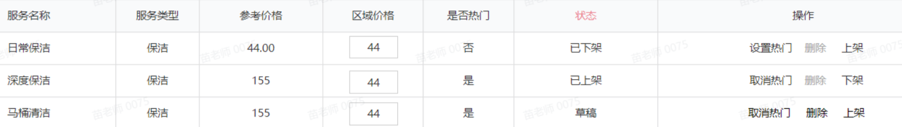

分页查询通用的响应内容如下：

pages 、total、 list 等是固定的。

list 中存储的是具体查询的数据（List结构)。

对于分页查询显示的通用信息用一个通用的类PageResult表示，如下是部分核心 代码：

```Java
package com.jzo2o.common.model;
....
@ApiModel(
    value = "分页数据消息体",
    description = "分页数据统一对象"
)
public class PageResult<T> {
    @ApiModelProperty(
        value = "总页数",
        required = true
    )
    private Long pages = 0L;
    @ApiModelProperty(
        value = "总条数",
        required = true
    )
    private Long total;
    @ApiModelProperty(
        value = "数据列表",
        required = true
    )
    private List<T> list;
    
    .....
```

具体的List数据需要定义ServeResDTO类，我们可以参考PO去定义ServeResDTO。

注意：有些信息在界面原型上是可以看的见的，比如：服务项名称，还有些在界面原型上看不见但是也需要作为结果响应给前端 ，比如：服务项的ID，当进行删除时就需要将此ID传入后端，但是界面 上却不显示。

```Java
package com.jzo2o.foundations.model.dto.response;

import io.swagger.annotations.ApiModel;
import io.swagger.annotations.ApiModelProperty;
import lombok.Data;

import java.math.BigDecimal;
import java.time.LocalDateTime;

/**
 * 服务响应值
 *
 * @author itcast
 * @create 2023/7/4 11:53
 **/
@Data
@ApiModel("服务响应值")
public class ServeResDTO {
    /**
     * 主键
     */
    @ApiModelProperty("主键")
    private Long id;

    /**
     * 售卖状态，0：草稿，1下架，2上架
     */
    @ApiModelProperty("售卖状态，0：草稿，1下架，2上架")
    private Integer saleStatus;

    /**
     * 服务id
     */
    @ApiModelProperty("服务项id")
    private Long serveItemId;

    /**
     * 服务名称
     */
    @ApiModelProperty("服务项名称")
    private String serveItemName;

    /**
     * 服务类型id
     */
    @ApiModelProperty("服务类型id")
    private Long serveTypeId;

    /**
     * 服务名称
     */
    @ApiModelProperty("服务类型名称")
    private String serveTypeName;

    /**
     * 区域id
     */
    @ApiModelProperty("区域id")
    private Long regionId;

    /**
     * 参考价格
     */
    @ApiModelProperty("参考价格")
    private BigDecimal referencePrice;

    /**
     * 价格
     */
    @ApiModelProperty("价格")
    private BigDecimal price;

    /**
     * 是否为热门，0非热门，1热门
     */
    @ApiModelProperty("是否为热门，0非热门，1热门")
    private Integer isHot;

    /**
     * 创建时间
     */
    @ApiModelProperty("创建时间")
    private LocalDateTime createTime;

    /**
     * 更新时间
     */
    @ApiModelProperty("更新时间")
    private LocalDateTime updateTime;
}
```


##### 接口设计完成

将Controller类中对应接口的方法编写完成就代表接口设计完成。

代码如下：

```Java
package com.jzo2o.foundations.controller.operation;


import com.jzo2o.common.model.PageResult;
import com.jzo2o.foundations.model.dto.request.ServePageQueryReqDTO;
import com.jzo2o.foundations.model.dto.response.ServeResDTO;
import io.swagger.annotations.Api;
import io.swagger.annotations.ApiOperation;
import org.springframework.validation.annotation.Validated;
import org.springframework.web.bind.annotation.GetMapping;
import org.springframework.web.bind.annotation.RequestMapping;
import org.springframework.web.bind.annotation.RestController;

/**
 * <p>
 * 前端控制器
 * </p>
 *
 * @author itcast
 * @since 2023-07-03
 */
@RestController("operationServeController")
@RequestMapping("/operation/serve")
@Api(tags = "运营端 - 区域服务相关接口")
public class ServeController {

    @GetMapping("/page")
    @ApiOperation("区域服务分页查询")
    public PageResult<ServeResDTO> page(ServePageQueryReqDTO servePageQueryReqDTO) {
        return null;
    }
}
```


##### 生成接口文档

我们通过swagger根据controller类最终生成接口文档，接口设计信息如下：

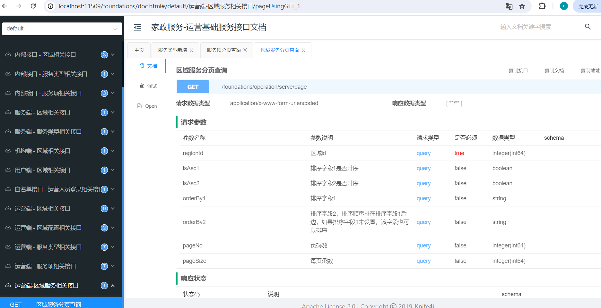


Java程序员可以使用接口文档测试接口，下边说明测试方法。

首先在controller方法打断点：

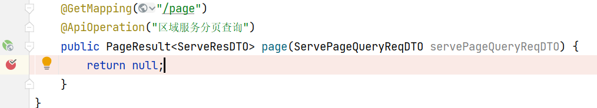

进入接口调试界面

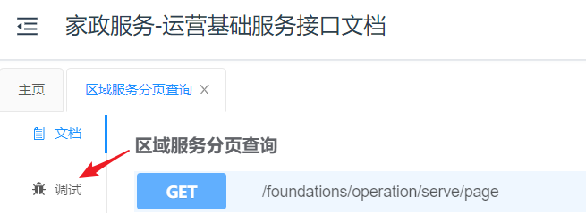

输入请求参数：

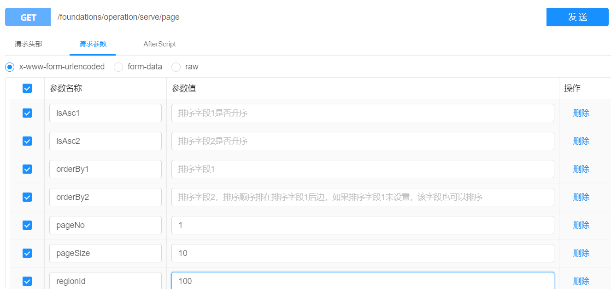

点击“发送”，跟踪断点请求参数是否正确


跟踪响应内容


明明page(ServePageQueryReqDTO servePageQueryReqDTO)方法返回了null， 这里为什么会响应如下内容呢？

```Java
{
  "code": 200,
  "message": "OK",
  "msg": "OK",
  "success": true,
  "result": null,
  "data": null
}
```

在jzo2o-mvc工程中有一个过滤器负责对接口的响应结构进行封装

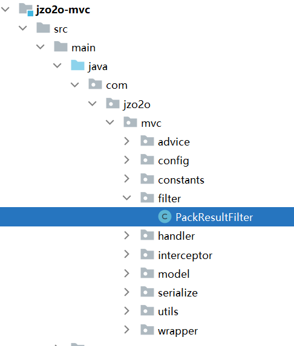

封装的方法是在原有响应内容基础上加上msg、code、result、success等固定属性。


#### 3) 小结

如何设计一个RESTful接口？


### 1.1.2 Mapper开发

目标：掌握开发持久层接口的过程。


#### 1）生成基础代码

通常一个接口需求明确后从持久层开始开发。

对于一个新模块在设计完表会使用工具生成模型类、mapper接口、mapper映射文件等持久层文件，本项目使用MybatisPlus插件自动生成代码。

前边已介绍过MybatisPlus插件，在此不再赘述。


#### 2）mapper开发

持久层基础代码生成完毕下边开发mapper接口，对于通用的CRUD接口由MybatisPlus提供。

对于需要自定义mapper接口的需求则需要自定义mapper接口及mapper映射文件，根据需求本接口要返回的数据包括多张表的数据，而MybatisPlus提供的CRUD是针对单表的，下边定义mapper实现多表关联查询。

先定义mapper接口：

mapper接口讲究通用性，根据数据处理最底层的需求去定义接口，本需求是根据区域查询服务列表，参数为区域id，方法返回值为服务列表。

```Java
package com.jzo2o.foundations.mapper;

import com.baomidou.mybatisplus.core.mapper.BaseMapper;
import com.jzo2o.api.foundations.dto.response.ServeAggregationResDTO;
import com.jzo2o.foundations.model.domain.Serve;
import com.jzo2o.foundations.model.dto.response.ServeAggregationSimpleResDTO;
import com.jzo2o.foundations.model.dto.response.ServeAggregationTypeSimpleResDTO;
import com.jzo2o.foundations.model.dto.response.ServeCategoryResDTO;
import com.jzo2o.foundations.model.dto.response.ServeResDTO;
import org.apache.ibatis.annotations.Param;

import java.util.List;

/**
 * <p>
 * Mapper 接口
 * </p>
 *
 * @author itcast
 * @since 2023-07-03
 */
public interface ServeMapper extends BaseMapper<Serve> {
    /**
     * 根据区域查询服务列表
     * @param regionId
     * @return
     */
    List<ServeResDTO> queryServeListByRegionId(@Param("regionId") Long regionId);
}
```

再定义mapper映射：

```Java
<?xml version="1.0" encoding="UTF-8"?>
<!DOCTYPE mapper PUBLIC "-//mybatis.org//DTD Mapper 3.0//EN" "http://mybatis.org/dtd/mybatis-3-mapper.dtd">
<mapper namespace="com.jzo2o.foundations.mapper.ServeMapper">

    <select id="queryServeListByRegionId" resultType="com.jzo2o.foundations.model.dto.response.ServeResDTO">
        SELECT
            serve.id,
            serve.sale_status,
            serve.serve_item_id,
            item.name AS serve_item_name,
            item.serve_type_id,
            serve.region_id,
            item.reference_price,
            serve.price,
            serve.is_hot,
            serve.create_time,
            serve.update_time,
            type.id serve_type_id,
            type.name serve_type_name
        FROM
            serve
                inner JOIN serve_item AS item ON serve.serve_item_id = item.id
                inner JOIN serve_type AS type ON item.serve_type_id = type.id
        WHERE
            serve.region_id = #{regionId}
    </select>

</mapper>
```

#### 3）单元测试

对mapper接口进行测试

```Java
package com.jzo2o.foundations.mapper;

import com.jzo2o.foundations.model.dto.response.ServeResDTO;
import lombok.extern.slf4j.Slf4j;
import org.junit.jupiter.api.Test;
import org.springframework.boot.test.context.SpringBootTest;
import org.springframework.util.Assert;

import javax.annotation.Resource;
import java.util.List;

@SpringBootTest
@Slf4j
class ServeMapperTest {
    @Resource
    private ServeMapper serveMapper;

    @Test
    void testQueryServeListByRegionId() {
        List<ServeResDTO> serveResDTOS = serveMapper.queryServeListByRegionId(1686303222843662337L);
        Assert.notEmpty(serveResDTOS,"列表为空");
    }

}
```

断点调试：


#### 4）小结

Mybatis-Plus有几种主键生成策略？


如何开发一个接口的持久层？


@Resource 和 @Autowired有什么区别? 


### 1.1.3 Service开发

#### **1) 定义service接口**

service接口是提供controller调用，service接口的参数由controller传入通常controller方法将它的形参直接传入service方法，对于通用的service方法则需要定义更通用的参数，service方法的返回值类型通常可以直接定义为controller方法的返回值类型。

定义如下：

```Java
package com.jzo2o.foundations.service;

import com.baomidou.mybatisplus.extension.service.IService;
import com.jzo2o.common.model.PageResult;
import com.jzo2o.foundations.model.domain.Serve;
import com.jzo2o.foundations.model.dto.request.ServePageQueryReqDTO;
import com.jzo2o.foundations.model.dto.response.ServeResDTO;

/**
 * <p>
 * 服务类
 * </p>
 *
 * @author itcast
 * @since 2023-07-03
 */
public interface IServeService extends IService<Serve> {

    /**
     * 分页查询服务列表
     * @param servePageQueryReqDTO 查询条件
     * @return 分页结果
     */
    PageResult<ServeResDTO> page(ServePageQueryReqDTO servePageQueryReqDTO);
}
```

#### 2）定义service实现类

这里我们使用的Mybatis-Plus提供的ServiceImpl类，如下代码，在此类中有baseMapper，baseMapper即是ServeMapper实例。

```Java
package com.jzo2o.foundations.service.impl;

import com.baomidou.mybatisplus.extension.service.impl.ServiceImpl;
import com.jzo2o.common.model.PageResult;
import com.jzo2o.foundations.mapper.ServeMapper;
import com.jzo2o.foundations.model.domain.Serve;
import com.jzo2o.foundations.model.dto.request.ServePageQueryReqDTO;
import com.jzo2o.foundations.model.dto.response.ServeResDTO;
import com.jzo2o.foundations.service.IServeService;
import com.jzo2o.mysql.utils.PageHelperUtils;
import org.springframework.stereotype.Service;

import java.util.List;

/**
 * <p>
 * 服务实现类
 * </p>
 *
 * @author itcast
 * @since 2023-07-03
 */
@Service
public class ServeServiceImpl extends ServiceImpl<ServeMapper, Serve> implements IServeService {

    /**
     * 分页查询
     *
     * @param servePageQueryReqDTO 查询条件
     * @return 分页结果
     */
    @Override
    public PageResult<ServeResDTO> page(ServePageQueryReqDTO servePageQueryReqDTO) {
        //通过baseMapper调用queryServeListByRegionId方法
        
    }

}
```

#### 3）实现分页查询

如何实现分页查询？

我们可以参考现有service类实现方法。

分别阅读ServeTypeServiceImpl中的分页查询方法和ServeItemServiceImpl中的分页查询方法。

我们发现两个类中的分页查询方法不一样

ServeTypeServiceImpl的方法如下：

```Java
public PageResult<ServeTypeResDTO> page(ServeTypePageQueryReqDTO serveTypePageQueryReqDTO) {
    Page<ServeType> page = PageUtils.parsePageQuery(serveTypePageQueryReqDTO, ServeType.class);
    Page<ServeType> serveTypePage = baseMapper.selectPage(page, new QueryWrapper<>());
    return PageUtils.toPage(serveTypePage, ServeTypeResDTO.class);
}
```

ServeTypeServiceImpl中的分页方法使用的是mybatis-plus自带的分页方法，通过selectPage方法实现分页。

ServeItemServiceImpl中的分页方法如下：

```Java
public PageResult<ServeItemResDTO> page(ServeItemPageQueryReqDTO serveItemPageQueryReqDTO) {
    return PageHelperUtils.selectPage(serveItemPageQueryReqDTO,
            () -> baseMapper.queryList(serveItemPageQueryReqDTO.getServeTypeId(), serveItemPageQueryReqDTO.getName(), serveItemPageQueryReqDTO.getActiveStatus()));
}
```

ServeItemServiceImpl中的分页方法使用的是com.github.pagehelper分页组件。

我们应该使用哪种方法呢？

**第一种：mybatis-plus自带的分页方法，通过调用selectPage方法实现分页，适用于通过QueryWrapper拼装SQL。**

**第二种：pagehelper分页组件适用于自定义sql的分页查询。**

这里我们自定义了查询当前区域服务的sql，所以适用第二种分页方法。

我们先照葫芦画瓢实现service：

```Java

/**
 * 分页查询服务列表
 * @param servePageQueryReqDTO 查询条件
 * @return 分页列表
 */
@Override
public PageResult<ServeResDTO> page(ServePageQueryReqDTO servePageQueryReqDTO) {
    //调用mapper查询数据，这里由于继承了ServiceImpl<ServeMapper, Serve>，使用baseMapper相当于使用ServeMapper
    PageResult<ServeResDTO> serveResDTOPageResult = PageHelperUtils.selectPage(servePageQueryReqDTO, () -> baseMapper.queryServeListByRegionId(servePageQueryReqDTO.getRegionId()));
    return serveResDTOPageResult;
}
```


#### 4）单元测试

```Java
package com.jzo2o.foundations.service;

import com.jzo2o.common.model.PageResult;
import com.jzo2o.foundations.model.dto.request.ServePageQueryReqDTO;
import com.jzo2o.foundations.model.dto.response.*;
import lombok.extern.slf4j.Slf4j;
import org.junit.jupiter.api.Test;
import org.springframework.boot.test.context.SpringBootTest;
import org.springframework.util.Assert;

import javax.annotation.Resource;
import java.math.BigDecimal;
import java.util.List;

@SpringBootTest
@Slf4j
class IServeServiceTest {
    @Resource
    private IServeService serveService;

    //分页测试
    @Test
    public void test_page(){
        ServePageQueryReqDTO servePageQueryReqDTO = new ServePageQueryReqDTO();
        servePageQueryReqDTO.setRegionId(1686303222843662337L);
        servePageQueryReqDTO.setPageNo(1L);
        servePageQueryReqDTO.setPageSize(3L);
        PageResult<ServeResDTO> page = serveService.page(servePageQueryReqDTO);
        log.info("page : {}", page);
        Assert.notEmpty(page.getList(),"列表为空");
    }
}
```

#### 5）分页原理

使用com.github.pagehelper分页插件实现分页功能，下边介绍它的执行原理。

PageHelperUtils是项目封装的一个工具类，进入selectPage方法，调用PageHelper.startPage方法设置分页参数，通过一层一层进入源码，最终将分页参数设置到ThreadLocal<Page>*LOCAL_PAGE*=newThreadLocal(); 中。

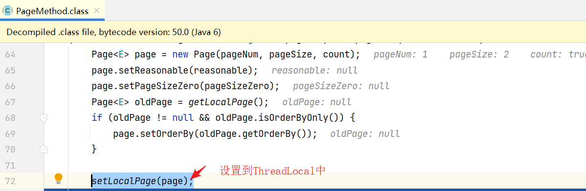

通过PageInterceptor拦截器拦截 MyBatis的Executor 的 query() 方法得到原始的sql语句，首先得到count总数，然后从newThreadLocal中取出分页参数，在原始sql语句中添加分页参数查询分页数据。

部分源码截图如下：

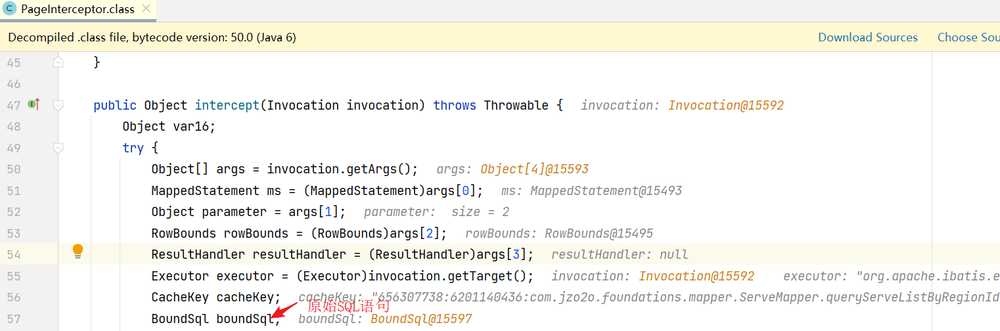

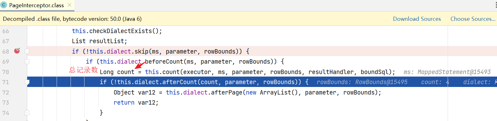


#### 5）小结

项目的分页查询是怎么实现的？


### 1.1.4 Controller开发

#### 1）完善controller方法

在controller方法中调用service方法进行业务处理。

得到service方法的返回值封装与客户端要的数据格式进行返回。

```Java
package com.jzo2o.foundations.controller.operation;


import com.jzo2o.common.model.PageResult;
import com.jzo2o.foundations.model.dto.request.ServePageQueryReqDTO;
import com.jzo2o.foundations.model.dto.response.ServeResDTO;
import com.jzo2o.foundations.service.IServeService;
import io.swagger.annotations.Api;
import io.swagger.annotations.ApiOperation;
import org.springframework.validation.annotation.Validated;
import org.springframework.web.bind.annotation.GetMapping;
import org.springframework.web.bind.annotation.RequestMapping;
import org.springframework.web.bind.annotation.RestController;

import javax.annotation.Resource;

/**
 * <p>
 * 前端控制器
 * </p>
 *
 * @author itcast
 * @since 2023-07-03
 */
@RestController("operationServeController")
@RequestMapping("/operation/serve")
@Api(tags = "运营端 - 区域服务相关接口")
public class ServeController {
    @Resource
    private IServeService serveService;

    @GetMapping("/page")
    @ApiOperation("区域服务分页查询")
    public PageResult<ServeResDTO> page(ServePageQueryReqDTO servePageQueryReqDTO) {
        PageResult<ServeResDTO> page = serveService.page(servePageQueryReqDTO);
        return page;
    }
}
```

#### 2）接口测试

重启服务，通过接口文档工具进行测试。

遇到问题在controller、service中打断点进行调试。

测试时注意请求参数填写是否正确，下边是测试结果


返回结果：

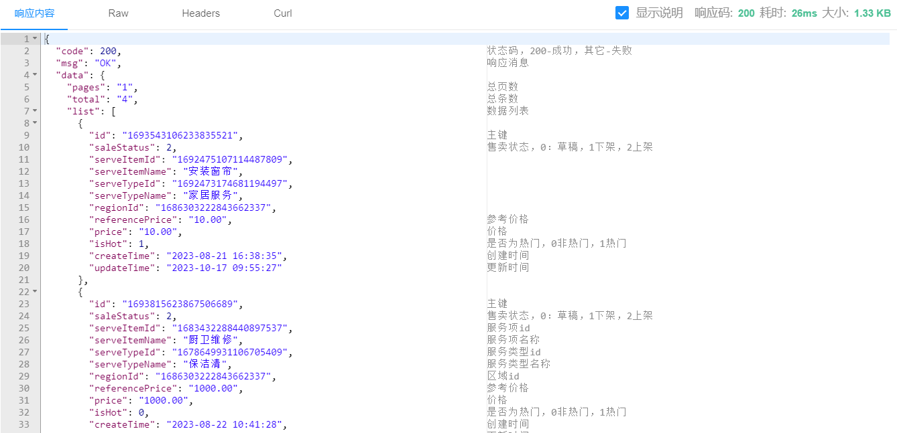

通过修改分页条件测试分页查询结果：

修改为一页显示2条记录，下边查询第一页：

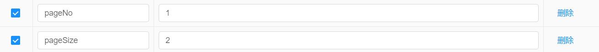


再查询第二页：


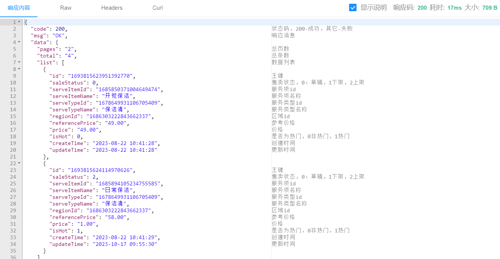


#### 3）单元测试

有些公司要求需要对三层bean进行单元测试，针对controller方法如何单元测试？

例用AI生成单元测试方法中我们发现有一个org.springframework.test.web.servlet.MockMvc的类，正是使用MockMvc实现对controller方法的单元测试。

上网查阅使用MockMvc对Spring Boot项目controller方法的测试方法，写出例子代码如下：

```Java
package com.jzo2o.foundations.web;

import org.junit.jupiter.api.Test;
import org.springframework.beans.factory.annotation.Autowired;
import org.springframework.boot.test.autoconfigure.web.servlet.AutoConfigureMockMvc;
import org.springframework.boot.test.context.SpringBootTest;
import org.springframework.http.MediaType;
import org.springframework.test.web.servlet.MockMvc;

import static org.springframework.test.web.servlet.request.MockMvcRequestBuilders.get;
import static org.springframework.test.web.servlet.result.MockMvcResultMatchers.status;


/**
 * @author Mr.M
 * @version 1.0
 * @description ServeController单元测试类
 * @date 2024/9/14 11:07
 */

@SpringBootTest
@AutoConfigureMockMvc
public class ServeControllerTest {

    @Autowired
    MockMvc mockMvc;

    @Test
    public void doTest() throws Exception {
        mockMvc.perform(get("/operation/serve/page")
                .param("regionId", "1693814923234189313")
        ).andExpect(status().isOk()).andDo(result -> {
            //解析响应结果
            String contentAsString = result.getResponse().getContentAsString();
            System.out.println(contentAsString);
        });
    }
}
```

注意：本项目不要求对Controller方法进行单元测试，请自行学习MockMvc 。


#### 4）小结

如何开发conroller方法？


### 1.1.5 前后端联调

前后端联调是一种类似生产环境的测试，通过前端请求后端接口测试业务功能。

#### 1）启动前后端

启动foundations服务。


启动前端工程，在项目开发环境配置中我们已经将前端环境配置完成。


#### 2）前后端联调

根据业务操作流程进行测试。

进入运营管理端，点击“区域管理”菜单，点击“设置服务”

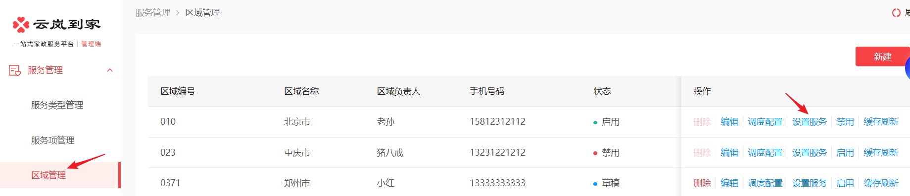

区域服务列表如下图：

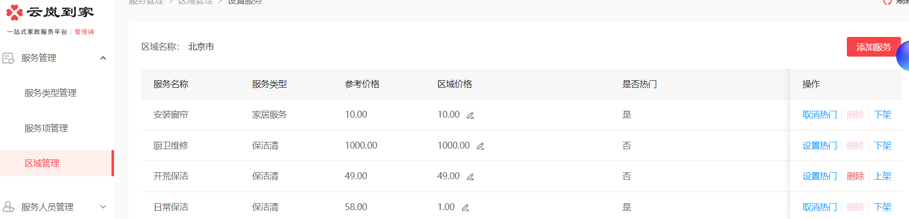

程序员在前后端测试时需要跟踪前后端交互数据判断精确判断测试结果及测试问题。

通过浏览器网络记录进行跟踪：

请求参数：


响应结果：

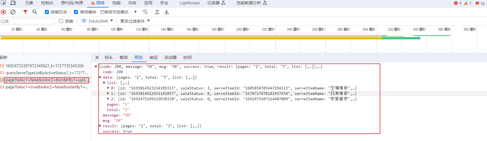


#### 3) 小结

前后端联调都调些什么，怎么进行前后端联调？


## 1.2 添加区域服务

### 1.2.1 接口设计

#### 1）接口分析

下边设计添加区域服务接口，重点设计：传入参数类型、参数内容、响应结果内容。

根据界面原型梳理操作流程：

首先进入某个区域的服务列表:


点击添加服务,如下图：

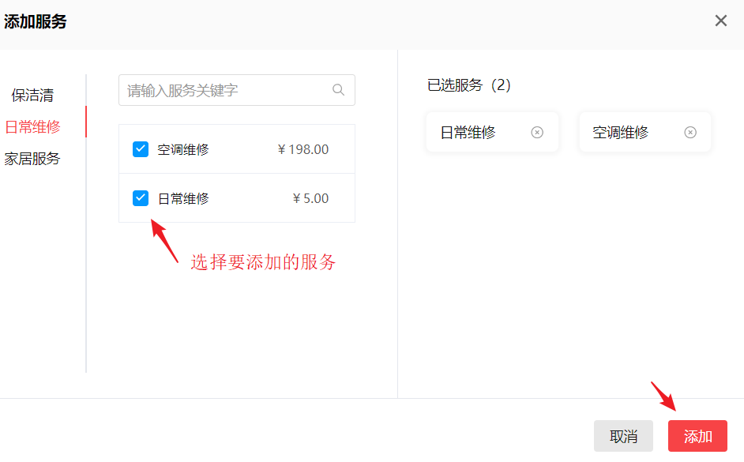

选择要添加到区域中的服务，点击“添加”按钮。

最终向serve表添加数据，表结构如下：

```Java
create table serve
(
    id             bigint                             not null comment '服务id'
        primary key,
    serve_item_id  bigint                             not null comment '服务项id',
    region_id      bigint                             not null comment '区域id',
    city_code      varchar(255)                       not null comment '城市编码',
    sale_status    int      default 0                 not null comment '售卖状态，0：草稿，1下架，2上架',
    price          decimal(10, 2)                     not null comment '价格',
    is_hot         int      default 0                 not null comment '是否为热门，0非热门，1热门',
    hot_time_stamp bigint                             null comment '更新为热门的时间戳',
    create_time    datetime default CURRENT_TIMESTAMP not null comment '创建时间',
    update_time    datetime default CURRENT_TIMESTAMP not null on update CURRENT_TIMESTAMP comment '更新时间',
    create_by      bigint                             null comment '创建者',
    update_by      bigint                             null comment '更新者'
)
```

serve表存储了区域中开通的服务，根据字段信息思考数据来源：

| 字段名 | 含义 | 数据来源 |
|-|-|-|
| id | 服务id | 主键，自动生成 |
| serve_item_id   | 服务项id | 接口传入 |
| region_id       | 区域id | 接口传入 |
| city_code       | 城市编码 | 根据区域id查询region表得到 |
| sale_status     | 售卖状态 | 默认为草稿状态,数据库设置了默认值 |
| price           | 价格 | 默认为服务项的价格，用户可修改 |
| is_hot          | 是否为热门 | 默认为非热门,数据库设置了默认值 |
| hot_time_stamp  | 更新为热门的时间戳 | 默认空 |
| create_time     | 创建时间 | 数据库设置了默认值 |
| update_time     | 更新时间 | 数据库设置了默认值 |
| create_by       | 创建人 | 由framework的MyBatisAutoFillInterceptor自动处理 |
| update_by       | 更新人 | 由framework的MyBatisAutoFillInterceptor自动处理 |

**根据上边的分析，通过接口传入服务项id、区域id，支持多个服务传入，实现批量添加。**

传入参数内容为数组，所以使用json格式。

传入参数内容包括：服务项id、区域id。

响应结果内容可为空，前端根据状态码判断是否添加成功。

**接口设计信息：**

接口路径：**POST**/foundations/operation/serve/batch

**请求数据类型**  application/json

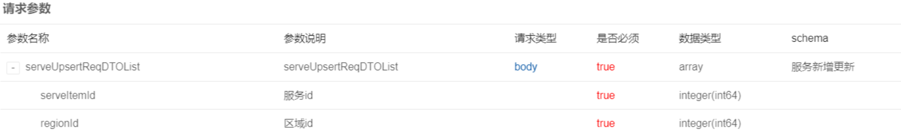

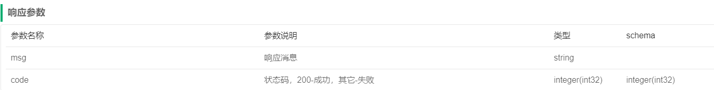


#### 2）接口定义

1. 首先定义接收传入参数的模型类ServeUpsertReqDTO

```Java
package com.jzo2o.foundations.model.dto.request;

import io.swagger.annotations.ApiModel;
import io.swagger.annotations.ApiModelProperty;
import lombok.Data;

import java.math.BigDecimal;

/**
 * 服务新增更新
 *
 * @author itcast
 * @create 2023/7/3 14:43
 **/
@Data
@ApiModel("服务新增更新")
public class ServeUpsertReqDTO {

    /**
     * 服务id
     */
    @ApiModelProperty(value = "服务id", required = true)
    private Long serveItemId;

    /**
     * 区域id
     */
    @ApiModelProperty(value = "区域id", required = true)
    private Long regionId;


}
```

1. 编写controller方法，HTTP方法使用POST方式，代码如下：

```Java
@RestController("operationServeController")
@RequestMapping("/operation/serve")
@Api(tags = "运营端 - 区域服务相关接口")
public class ServeController {

    @PostMapping("/batch")
    @ApiOperation("区域服务批量新增")
    public void add(@RequestBody List<ServeUpsertReqDTO> serveUpsertReqDTOList) {

    }
```


1. 重启服务，查看swagger文档如下：


#### 3）小结

如何设计添加接口？

添加接口最终向数据库提交数据，根据界面原型结合表结构进行设计，先分析表中每个字段的数据来源，再分析接口传入参数内容，通常添加接口没有特殊要求可根据状态码判断是否添加成功。


### 1.2.2 接口开发

#### 1）mapper

添加接口只向serve表添加数据所以使用mybatisplus提供的单表CRUD方法即可无需自定义mapper接口。

#### 2）service

定义service接口：

```Java
public interface IServeService extends IService<Serve> {

/**
 * 批量新增
 *
 * @param serveUpsertReqDTOList 批量新增数据
 */
void batchAdd(List<ServeUpsertReqDTO> serveUpsertReqDTOList);
...
```

定义service实现方法：

```Java
@Override
@Transactional
public void batchAdd(List<ServeUpsertReqDTO> serveUpsertReqDTOList) {
    for (ServeUpsertReqDTO serveUpsertReqDTO : serveUpsertReqDTOList) {
        //1.校验服务项是否为启用状态，不是启用状态不能新增
        ServeItem serveItem = serveItemMapper.selectById(serveUpsertReqDTO.getServeItemId());
        //如果服务项信息不存在或未启用
        if (ObjectUtil.isNull(serveItem) || serveItem.getActiveStatus() != FoundationStatusEnum.ENABLE.getStatus()) {
            throw new ForbiddenOperationException("该服务未启用无法添加到区域下使用");
        }

        //2.校验是否重复新增
        Long count = lambdaQuery()
                .eq(Serve::getRegionId, serveUpsertReqDTO.getRegionId())
                .eq(Serve::getServeItemId, serveUpsertReqDTO.getServeItemId())
                .count();
        if (count > 0) {
            throw new ForbiddenOperationException(serveItem.getName() + "服务已存在");
        }

        //3.新增服务
        Serve serve = BeanUtil.toBean(serveUpsertReqDTO, Serve.class);
        //默认为服务项的价格
        serve.setPrice(serveItem.getReferencePrice());
        Region region = regionMapper.selectById(serveUpsertReqDTO.getRegionId());
        serve.setCityCode(region.getCityCode());
        baseMapper.insert(serve);
    }
}
```

说明：

对于增、删、改类的接口通常会先进行入参校验，校验失败抛出异常，由异常处理器统一对异常进行处理。

我们抛出的异常是自定义异常类型，自定义的异常类型都继承了CommonException类型，在异常处理器中对此类型的异常进行处理。

异常处理器的源码在jzo2o-framework中，如下图：

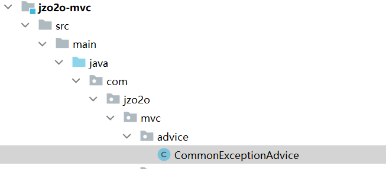

通过@RestControllerAdvice注解加@ExceptionHandler注解实现，具体的原理是当controller抛出异常由DispatcherServlet统一拦截处理，再根据异常类型找到@ExceptionHandler标识方法去执行该方法进行异常处理。


#### 3) controller

在controller方法中调用service接口添加区域服务。

```Java
@PostMapping("/batch")
@ApiOperation("区域服务批量新增")
public void add(@RequestBody List<ServeUpsertReqDTO> serveUpsertReqDTOList) {
    serveService.batchAdd(serveUpsertReqDTOList);
}
```

#### 4）小结

如何开发一个添加接口？

如何开发一个接口的service方法？

接口的异常处理怎么实现的？


### 1.2.3 测试

我们通过前后端联调测试添加区域服务接口。

#### 1）启动前后端

启动foundations服务。

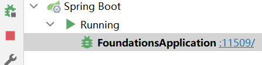

启动前端工程，在项目开发环境配置中我们已经将前端环境配置完成。

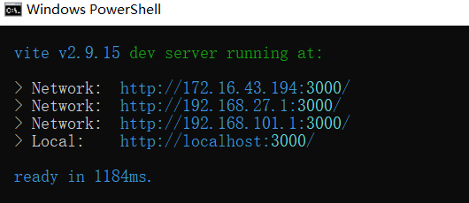

#### 2）前后端联调

因为代码是我们写的，我们在前后端联调时除了测试成功结果还要测试失败结果。

**下边我们先测试正常流程：**

进入运营管理端，点击“区域管理”菜单，点击“设置服务”


区域服务列表如下图：


点击添加服务


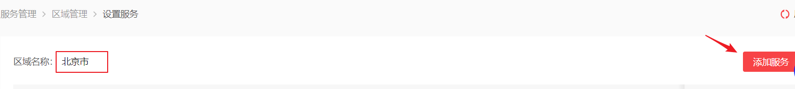

点击添加服务,如下图：


添加成功查询区域服务列表是否存在已添加的服务。

如果列表没有显示已添加的服务则需要进行排查，可以进入数据库直接查询serve表查看是否添加成功，如果后台有错误日志需要根据错误日志进行排查。

**下边测试异常流程：**

我们测试服务重复添加的异常，由于前端控制无法选择已经添加的服务，我们可以开两个窗口，都停留在添加服务页面：

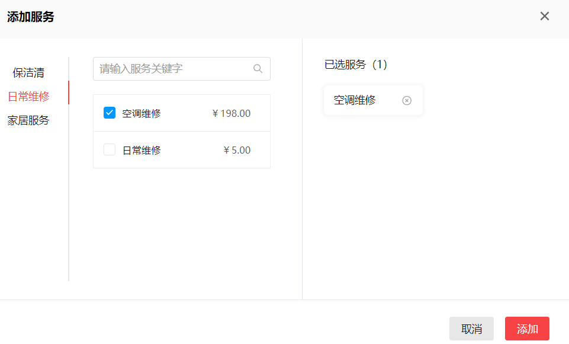

其中一个窗口添加成功后，另一个窗口也进行提交，此时跟踪前端拿到的响应如下：

```Java
{"code":604,"msg":"空调维修服务已存在","data":null,"requestId":"1715263501921951744"}
```

此测试结果符合我们的预期。


## 1.3 修改价格

### 1.3.1 接口设计

#### 1) 接口分析

根据界面原型设计传入参数类型、参数内容、响应结果内容。

进入修改界面

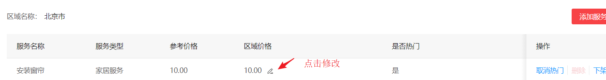

输入价格进行修改


传入参数内容：价格、区域服务ID（serve表主键）  ，区域服务ID简称为服务ID

根据id更新serve表的价格字段。

传入参数类型：form表单格式

响应结果内容可为空，前端根据状态码判断是否添加成功。

接口设计信息如下：

接口路径：**PUT**/foundations/operation/serve/{id}

**请求数据类型** application/x-www-form-urlencoded

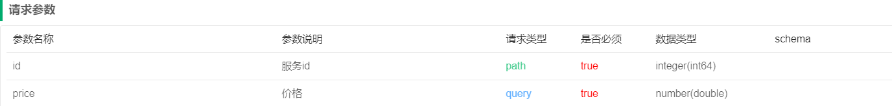

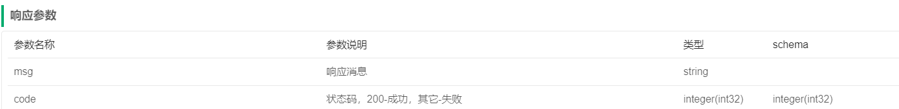


#### 2) 接口定义

编写controller方法，HTTP方法使用PUT方式，代码如下：

```Java
@PutMapping("/{id}")
@ApiOperation("区域服务价格修改")
@ApiImplicitParams({
        @ApiImplicitParam(name = "id", value = "服务id", required = true, dataTypeClass = Long.class),
        @ApiImplicitParam(name = "price", value = "价格", required = true, dataTypeClass = BigDecimal.class)
})
public void update( @PathVariable("id") Long id,
                    @RequestParam("price") BigDecimal price) {
    
}
```


查看接口文档：

重启服务，查看swagger文档如下：


#### 3）mapper

修改接口只向serve表更新数据所以使用mybatisplus提供的单表CRUD方法即可无需自定义mapper接口。

#### 4）service

定义service接口：

```Java
public interface IServeService extends IService<Serve> {

/**
 * 服务价格修改
 *
 * @param id    服务id
 * @param price 价格
 * @return 服务
 */
Serve update(Long id, BigDecimal price);
...
```

定义service实现方法：

```Java
@Override
@Transactional
public Serve update(Long id, BigDecimal price) {
    //1.更新服务价格
    boolean update = lambdaUpdate()
            .eq(Serve::getId, id)
            .set(Serve::getPrice, price)
            .update();
    if(!update){
        throw new CommonException("修改服务价格失败");
    }
    return baseMapper.selectById(id);
}
```


#### 5) controller

在controller方法中调用service接口价格修改。

```Java
@PutMapping("/{id}")
@ApiOperation("区域服务价格修改")
@ApiImplicitParams({
        @ApiImplicitParam(name = "id", value = "服务id", required = true, dataTypeClass = Long.class),
        @ApiImplicitParam(name = "price", value = "价格", required = true, dataTypeClass = BigDecimal.class)
})
public void update(@PathVariable("id") Long id,
                   @RequestParam("price") BigDecimal price) {
    serveService.update(id, price);
}
```

#### 6）测试

略


#### 7) 小结

如何设计修改接口？

修改接口最终向数据库提交数据，根据界面原型结合表结构进行设计，分析更新的数据有哪些，再分析更新数据的依据是什么，本接口是根据serve表的主键修改价格字段。

如果传入的要修改的参数比较多此时可用json格式，如果比较少可用form表单格式即可。通常添加、修改、删除接口没有特殊要求可根据状态码判断是否添加成功，有特殊要求则需要返回json数据。


## 1.4 服务上架

### 1.4.1 接口设计

#### 1）接口分析

根据业务流程、界面原型进行设计。

在区域服务列表中点击“上架”，此服务在该区域将生效，用户即可对该服务进行下单。


业务流程如下：

<readonly-block type="diagram"></readonly-block>

在serve表有一个售卖状态sale_status，服务上架后将状态更改为“上架”，代码为2。

下边分析接口的传入参数类型、参数内容、响应结果内容。

传入参数内容：服务Id(serve表的主键)，

传入参数类型：form表单格式

响应结果内容: 内容可为空，前端根据状态码判断是否添加成功。

**注意：区分 服务id和服务项id，服务id即serve表的主键，服务项id即serve_item表的主键。**


接口信息如下：

接口路径：**PUT**/foundations/operation/serve/onSale/{id}

**请求数据类型**  application/x-www-form-urlencoded

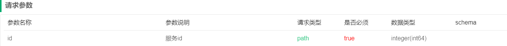

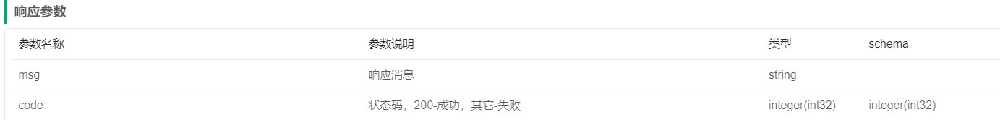


#### 2) 接口定义

编写controller方法，HTTP方法使用PUT方式，代码如下：

```Java
@PutMapping("/onSale/{id}")
@ApiOperation("区域服务上架")
@ApiImplicitParams({
        @ApiImplicitParam(name = "id", value = "服务id", required = true, dataTypeClass = Long.class),
})
public void onSale(@PathVariable("id") Long id) {

}
```

查看接口文档：

重启服务，查看swagger文档如下：


### 1.4.2 接口开发

#### 1）mapper

服务上架最终修改serve表的状态，所以使用mybatisplus提供的单表CRUD方法即可无需自定义mapper接口。

#### 2）service

定义service接口： 

```Java
public interface IServeService extends IService<Serve> {


/**
 * 上架
 *
 * @param id         服务id
 */
Serve onSale(Long id);
...
```

定义service实现方法：

```Java
@Override
@Transactional
public Serve onSale(Long id){
    Serve serve = baseMapper.selectById(id);
    if(ObjectUtil.isNull(serve)){
        throw new ForbiddenOperationException("区域服务不存在");
    }
    //上架状态
    Integer saleStatus = serve.getSaleStatus();
    //草稿或下架状态方可上架
    if (!(saleStatus==FoundationStatusEnum.INIT.getStatus() || saleStatus==FoundationStatusEnum.DISABLE.getStatus())) {
        throw new ForbiddenOperationException("草稿或下架状态方可上架");
    }
    //服务项id
    Long serveItemId = serve.getServeItemId();
    ServeItem serveItem = serveItemMapper.selectById(serveItemId);
    if(ObjectUtil.isNull(serveItem)){
        throw new ForbiddenOperationException("所属服务项不存在");
    }
    //服务项的启用状态
    Integer activeStatus = serveItem.getActiveStatus();
    //服务项为启用状态方可上架
    if (!(FoundationStatusEnum.ENABLE.getStatus()==activeStatus)) {
        throw new ForbiddenOperationException("服务项为启用状态方可上架");
    }

    //更新上架状态
    boolean update = lambdaUpdate()
            .eq(Serve::getId, id)
            .set(Serve::getSaleStatus, FoundationStatusEnum.ENABLE.getStatus())
            .update();
    if(!update){
        throw new CommonException("启动服务失败");
    }
    return baseMapper.selectById(id);

}
```


#### 3) controller

在controller方法中调用service接口上架区域服务。

```Java
@PutMapping("/onSale/{id}")
@ApiOperation("区域服务上架")
@ApiImplicitParams({
        @ApiImplicitParam(name = "id", value = "服务id", required = true, dataTypeClass = Long.class),
})
public void onSale(@PathVariable("id") Long id) {
    serveService.onSale(id);
}
```

#### 4）测试

略


## 1.5 运营服务管理模块其它接口

### 1.5.1 删除区域服务开发

参考需求文档开发区域服务删除接口。

接口文档如下：


### 1.5.2 服务下架开发

参考需求文档开发服务下架接口。

![图片展示了区域服务下架的接口文档。方法为PUT，URL为/foundations/operation/serve/offSale/{id}，请求数据类型为application/x - www - form - urlencoded，响应数据类型为\[“*”\]。请求参数中id为服务id，是必填的path参数，数据类型为integer(int64)。响应状态包括200、201、401、403、404等状态码及说明。响应参数有msg和code，msg为响应消息，code为状态码，200为成功，其他为失败。该图片与文档中“服务下架开发”内容相关，是开发服务下架接口的参考文档。](https://feishu.cn/file/Fry9bYnxbof750xbGxGcuB9tnee)


### 1.5.3 设置热门服务开发

要求：实现更新serve表的是否热门字段。

接口文档：


### 1.5.4 取消热门服务开发

要求：实现更新serve表的是否热门字段。

接口文档：


### 1.5.5 启用区域功能完善

参考业务流程图进行功能完善，如下图：

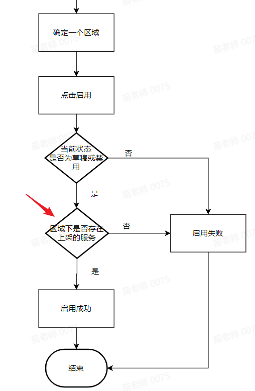

增加校验：区域下存在上架的服务方可启用。


### 1.5.6 禁用区域功能完善

参考业务流程图进行功能完善，如下图：


增加校验：区域下不存在上架的服务方可禁用。


### 1.5.7 禁用服务项功能完善

参考业务流程图进行功能完善，如下图：

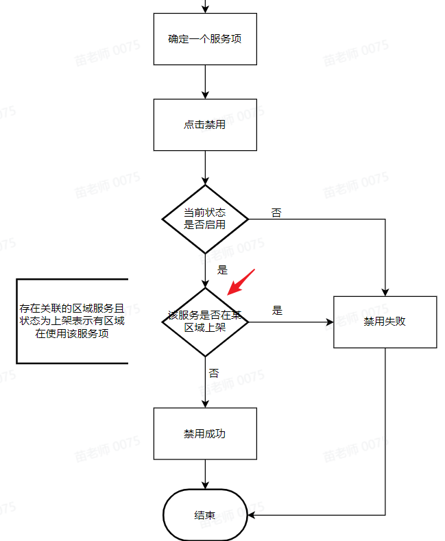

增加校验：该服务没有在任何区域上架方可禁用。

---
> 来源：飞书技术知识库（脱敏版） · 07 业务组件方案集 / 云岚到家项目 / 第二章 运营服务管理模块 · [原文](https://ccn8v2zngwsm.feishu.cn/wiki/Jl6iwk6heihnK9kU4ITcI4Sjnff)
