# 第六章 优惠券模块

## 学习目标：

1. 能够说出优惠券模块的功能列表
2. 能够说出优惠券模块的表设计及数据流
3. 能够说出发放优惠券模块的设计方案
4. 能够实现发放优惠券模块的功能


代码环境

jzo2o-market: dev_02


## 1 模块介绍

### 1）**业务流程**

优惠券是最常用的一种营销活动，优惠券模块涉及到优惠券活动管理、发券、抢券、优惠券核销等几部分，涉及到的用户角色有运营人员和用户，下图是优惠券模块的整体业务流程。

**优惠券活动管理**：

运营人员在后台添加优惠券活动，包括：新增优惠券活动、修改优惠券活动、撤销优惠券活动等操作。

**发券**：

按照某规则向指定用户自动发放优惠券。

**抢券**：

优惠券到达发放时间用户领取优惠券，因为优惠券的数量有限，当到达发放时间后平台所有用户都可以抢券，先到先得。

**优惠券核销**：

用户抢到优惠券即可在下单时使用优惠券，享受优惠，如果取消订单将退回优惠券，优惠券退回后可用于其它订单。

**优惠券核销是指**：顾客在购买商品使用优惠券，当此次消费符合优惠券的条件时提交订单后将优惠券的折扣应用到顾客的订单中，最后将优惠券标记为已使用或作废。

优惠券核销后还可以取消核销，如果用户取消订单会将优惠券取消核销即退回优惠券，退回优惠券后可以继续使用。


<whiteboard token="FYNjwounGhQTEIb6NGacYQyynoc"></whiteboard>

### 2）**界面原型**

#### 优惠券活动管理

**查询优惠券活动信息：**

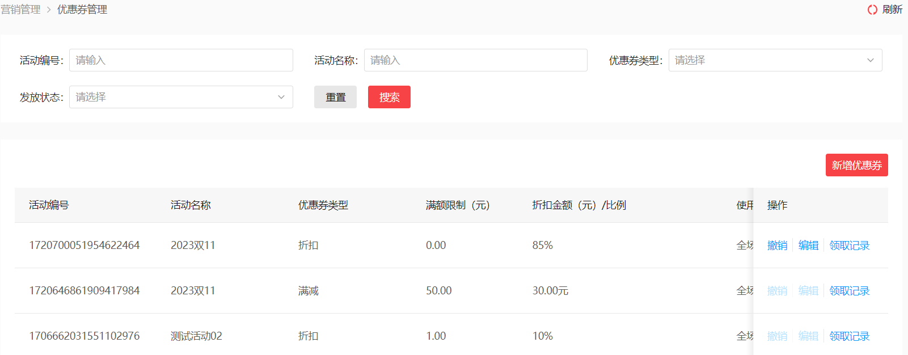

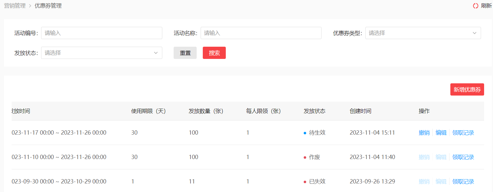

**新增优惠券活动：**

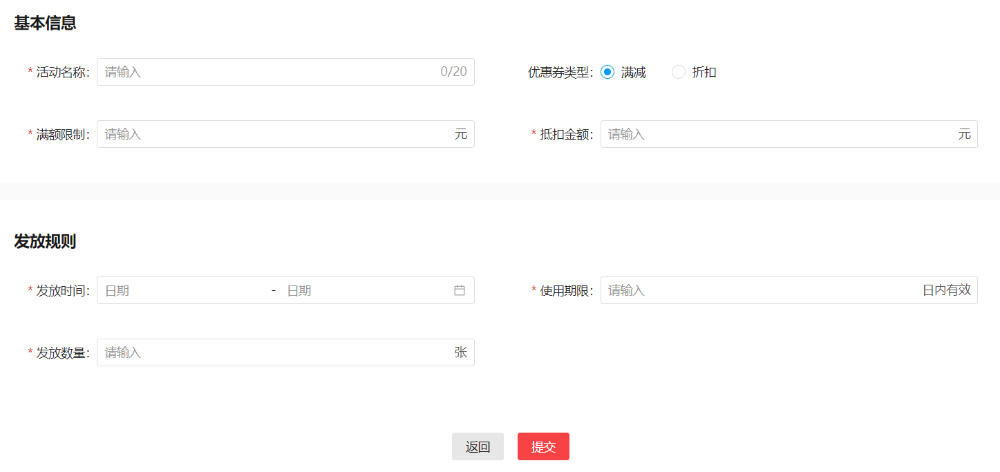

#### **抢券**

到达优惠券发放时间用户开始抢券，在抢券界面列出了进行中的活动和即将开始的活动。

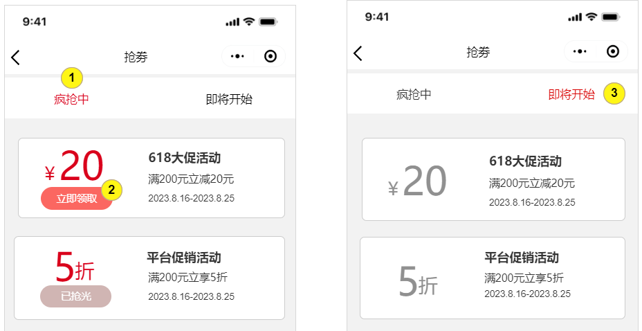

#### **用券**

在下单时选择优惠券进行核销。

优惠券核销是指：顾客在购买商品时使用优惠券，当此次订单的消费符合优惠券的条件时在下单会使用该优惠券在原有订单金额基础上进行优惠，优惠券使用后标记为“已使用”。

优惠券核销后还可以取消核销，如果用户取消订单会将优惠券的状态改为“未使用”  退回的优惠券可以继续使用。


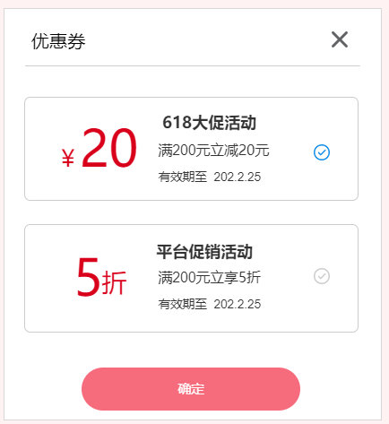

**支付金额减去优惠金额：**


### 3） **业务模块**

根据流程分析，优惠券模块可分为四个小模块，如下：

<whiteboard token="NbnOwYwF1hUNU0bmBH3c38vJnTb"></whiteboard>

**优惠券活动管理**：

对优惠券活动进行管理，运营人员新增优惠券活动、修改优惠券活动、撤销优惠券活动及优惠券统计等。

**发券：**

使用任务调度技术按照某规则向指定用户自动发放优惠券。

**抢券**：

到了优惠券发放时间用户进行抢券，抢券过程对优惠券库存、对用户领取优惠券数量等进行校验，抢券成功记录用户领取优惠券的记录。

**核销**：

用户在下单时使用优惠券得到优惠金额，实付金额等于订单金额减去优惠金额，下单成功优惠券核销成功。


### 4） **小节**

优惠券包括几个模块？口述业务流程。


## 2 模块设计

### 1）数据流

优惠券模块涉及到的数据表如下：

**优惠券活动表（MySQL）**：

优惠券活动管理模块主要操作优惠券活动表。

优惠券活动记录优惠券活动信息，运营人员新增优惠券活动将写入此表，此表是优惠券管理主要维护的表。

关键字段：活动id、活动名称、优惠券类型、折扣、发放时间等。

**优惠券活动表（Redis）**：

Redis中对应优惠券活动表MySQL中的数据，由抢券界面读取，为了提高查询效率。

**待发券用户表：**

存储了待发优惠券的用户信息。

**优惠券表**：

抢券模块主要操作优惠券表。

优惠券表记录用户领取的优惠券，用户抢券存在限制，每种优惠券一个用户只允许领取一张，优惠券的总数有限制。

关键字段：用户id、活动id、折扣、优惠券类型、有效期等。

举例：一个优惠券活动发放100张优惠券最多有100个用户去领取，每人领取一张，每个用户领取的一张优惠券会记录在优惠券表中，该优惠券活动对应优惠券表中最多100条记录。

**优惠券核销表:** 

在使用优惠券模块时当用户成功使用一张优惠券会在优惠券核销表记录一条记录，记录是哪个用户的哪个订单使用了哪个优惠券。

关键字段 ：用户id、优惠券id、订单id，核销时间。

**优惠券退回表**：

如果用户取消订单，则会退回优惠券，具体操作是向优惠券退回表添加一条记录（记录用户退回优惠券的信息），并向优惠券核销表删除一条对应的记录，表示取消优惠券的核销。

关键字段：用户id、优惠券id、退回时间。

根据需求分析优惠券模块的数据流如下：

<whiteboard token="C678wJCUAhJb9TbVlwxcAGxRn5W"></whiteboard>

### 2) 表结构设计

#### **优惠券活动表**

记录优惠券活动信息，运营人员新增优惠券活动将写入此表，此表是优惠券管理主要维护的表。

结构如下：

```Java
create table `jzo2o-market`.activity
(
    id                    bigint                                 not null comment '活动id'
        constraint `PRIMARY`
        primary key,
    name                  varchar(100) default '0'               not null comment '活动名称',
    type                  int                                    not null comment '优惠券类型，1：满减，2：折扣',
    amount_condition      decimal(10, 2)                         not null comment '使用条件，0：表示无门槛，其他值：最低消费金额',
    discount_rate         int          default 0                 not null comment '折扣率，折扣类型的折扣率，8折就是存80',
    discount_amount       decimal(10, 2)                         null comment '优惠金额，满减或无门槛的优惠金额',
    validity_days         int          default 0                 not null comment '优惠券有效期天数，0：表示有效期是指定有效期的',
    distribute_start_time datetime                               not null comment '发放开始时间',
    distribute_end_time   datetime                               not null comment '发放结束时间',
    status                int                                    not null comment '活动状态，1：待生效，2：进行中，3：已失效 4：作废',
    total_num             int          default 0                 not null comment '发放数量，0：表示无限量，其他正数表示最大发放量',
    stock_num             int          default 0                 not null comment '库存',
    create_time           datetime     default CURRENT_TIMESTAMP not null comment '创建时间',
    update_time           datetime     default CURRENT_TIMESTAMP not null on update CURRENT_TIMESTAMP comment '更新时间',
    create_by             bigint                                 null comment '创建人',
    update_by             bigint                                 null comment '更新人',
    is_deleted            tinyint      default 0                 not null comment '逻辑删除'
)
    charset = utf8mb4;
```

说明：

**amount_condition**：0表示无门槛，其它值表示最低消费金额，比如：满100减20，这里存储100。

**discount_rate**：当优惠券类型为2，在此字段中存储折扣率，比如：八折优惠时这里存储80。

**discount_amount**：当优惠券类型为1，在此字段中存储优惠券金额，比如：满100减20，这里存储20。

**status**：活动状态字段值包括：1：待生效，2：进行中，3：已失效 4：作废 几种，优惠券活动的初始状态是待生效，当到达优惠券发放时间时状态将改为进行中，当到达结束时间时状态改为已失效，当撤销活动后状态为作废。

**validity_days**：优惠券有效期，用户领取优惠券后的有效期，比如：有效期30天，这里存储30

distribute_start_time：发放开始时间，到达发放开始时间用户方可领取优惠券

 distribute_end_time：发放结束时间，到达发放结束时间用户不可领取该活动有优惠券

total_num：发放优惠券数量，比如：本活动共发1万张优惠券这里存储10000

stock_num：库存数量，库存数等于发放优惠券数量减去已领取数量


#### **优惠券表**

记录用户领取的优惠券，将来核销优惠券是核销此表的记录，结构如下：

```Java
create table `jzo2o-market`.coupon
(
    id               bigint                             not null comment '优惠券id'
        constraint `PRIMARY`
        primary key,
    name             varchar(255)                       not null comment '优惠券名称',
    user_id          bigint                             not null comment '优惠券的拥有者',
    user_name        varchar(50)                        null comment '用户姓名',
    user_phone       varchar(20)                        null comment '用户手机号',
    activity_id      bigint                             not null comment '活动id',
    type             int                                not null comment '使用类型，1：满减，2：折扣',
    discount_rate    int      default 0                 null comment '折扣',
    discount_amount  decimal(10, 2)                     null comment '优惠金额',
    amount_condition decimal(10, 2)                     not null comment '满减金额',
    validity_time    datetime                           null comment '有效期',
    use_time         datetime                           null comment '使用时间',
    status           tinyint                            not null comment '优惠券状态，1:未使用，2:已使用，3:已失效',
    orders_id        varchar(50)                        null comment '订单id',
    create_time      datetime default CURRENT_TIMESTAMP not null comment '创建时间',
    update_time      datetime default CURRENT_TIMESTAMP not null on update CURRENT_TIMESTAMP comment '更新时间',
    is_deleted       tinyint  default 0                 not null comment '逻辑删除'
)
    charset = utf8mb4;

create index user_my_query_index
    on `jzo2o-market`.coupon (user_id, status)
    comment '用户查询我的优惠券快捷索引';
```

activity_id：活动id,对应activity表的主键

 status：优惠券状态，1:未使用，2:已使用，3:已失效，用户领取成功初始状态为1未使用，用户在下单时核销该优惠券后状态为2已使用，优惠券已过有效期状态为3已失效。


#### **优惠券核销表**

用户成功使用优惠券的记录，记录是哪个用户的哪个订单使用了哪个优惠券。

结构如下：

```Java
create table `jzo2o-market`.coupon_write_off
(
    id                  bigint      not null
        constraint `PRIMARY`
        primary key,
    coupon_id           bigint      not null comment '优惠券id',
    user_id             bigint      not null comment '用户id',
    orders_id           bigint      not null comment '核销时使用的订单号',
    activity_id         bigint      not null comment '活动id',
    write_off_time      datetime    not null comment '核销时间',
    write_off_man_phone varchar(20) not null comment '核销人手机号',
    write_off_man_name  varchar(50) not null comment '核销人姓名'
)
    comment '优惠券核销表' charset = utf8mb4;
```


#### **优惠券退回表**

用户取消订单后成功退回优惠券的记录，记录哪个用户退回了哪个优惠券。

结构如下：

```Java
create table `jzo2o-market`.coupon_use_back
(
    id             bigint   not null comment '回退记录id'
        constraint `PRIMARY`
        primary key,
    coupon_id      bigint   not null comment '优惠券id',
    user_id        bigint   not null comment '用户id',
    use_back_time  datetime not null comment '回退时间',
    write_off_time datetime null comment '核销时间'
)
    comment '优惠券使用回退记录' charset = utf8mb4;
```

### 3）小结

优惠券模块的核心表的哪些，是怎么设计的？


## 3 搭建环境

### 1）创建数据库

创建数据库：jzo2o-market

导入：jzo2o-market-init.sql


### 2）创建工程

拉取 jzo2o-market工程，提供Git仓库地址：https://gitee.com/lee_a/jzo2o-market.git

请先fork到自己仓库再从自己仓库拉取，**拉取成功切换到dev_02分支**。

jzo2o-market工程如下：


下边在nacos创建配置jzo2o-market.yaml文件

进入nacos创建jzo2o-market.yaml

**注意：选择namespace为“75a593f5-33e6-4c65-b2a0-18c403d20f63”的命名空间添加配置文件 。**


配置文件内容如下：

```JSON
rabbit-mq:
    enable: true
xxl-job:
  executor:
    port: 11610
```


如果没有以下账号，需要 参考《微服务框架》-> MQ基础  -> 2.4章节

创建rabbitMQ用户和虚拟主机

用户名: xzb

密码: xzb

虚拟主机: /xzb


确保启动以下服务

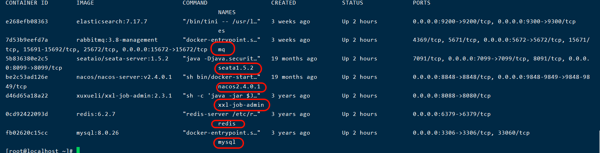


## 4 优惠券活动管理（已实现）

### 4.1 **新增优惠券活动**

#### 1）界面原型

运营人员进入优惠券活动管理界面，点击“新增优惠券”进入如下界面。

优惠券新增页包括两部分内容：配置优惠券活动的基本信息和发放规则。

##### **选择满减**


###### **优惠券类型说明**

| 优惠券类型 | 说明 | 逻辑规则 | 举例 |
|-|-|-|-|
| 满减 | 满x元减y元，例如满100元减20元；其中，x为满额限制，可为0；y为抵扣金额。  <br/>满额限制为0时即为无满额要求的优惠券，通常称为立减券或无门槛优惠券。 | 满额限制为订单金额需满足多少钱后，方可使用优惠；  <br/>若满额限制=0时，订单金额>0就可参加；  <br/>抵扣金额为优惠券的金额；  <br/>若抵扣金额 > 订单金额，则实际抵扣金额 = 订单金额；  <br/>注意：该满减 不等于 每满减，优惠金额不叠加 | 满0元减10元：订单金额20元，实付金额=20-10=10元；  <br/>满0元减10元：订单金额5元，实付金额=5-5=0元；  <br/>满100元减10元：订单金额500元，实付金额=500-10=490元； |
| 折扣 | 规则结构为：满x元享y%折扣，其中，x为满额限制，可为0；y为折扣，百分比格式。 | 满额限制同上，当满足条件后，优惠金额=订单金额\*折扣% | 满10元打8折：订单金额10元，实付金额=10\*80%=8元  <br/>满0元打8折：订单金额1元，实付金额=1\*80%=0.8元 |

###### **表单内容如下：**

| 属性 | 含义 | 举例 |
|-|-|-|
| 活动名称 | 营销活动的名称 | 双12五折大促，尊享双十一活动 |
| 优惠券类型 | 包括：满减和折扣 | 满减：满x元减y元，例如满100元减20元；  <br/>折扣：满x元享y%折扣，例如满100元享10%折扣 |
| 满额限制 | 设置满多少钱享受优惠，0表示无门槛  <br/>金额格式：整数，单位：元  <br/>金额大小：0=<满额限制 | 200.00：表示满200元 |
| 抵扣金额 | 用于满减类型  <br/>金额格式：整数，单位：元  <br/>金额大小：0<折扣满额限制 | 20元 |
| 抵扣比例 | 用于折扣类型  <br/>金额格式：整数，单位：无  <br/>金额大小：0<折扣满额限制<100 | 85表示85%，即85折 |
| 发放方式 | 线上领取：用户自行领取，抢券  <br/>自动发放：由系统自动将优惠券发放到用户账户中 |  |
| 发放时间 | 优惠券活动创建成功后到达发放时间将会在前台进行展示，用户即可进行抢券。  <br/>发放结束时间：即活动结束，活动结束后不可以领券。  <br/>格式：年月日时分秒～年月日时分秒  <br/>发放时间开始时间至少设置在距离当前时间的1个小时之后 | 2023-09-22 00:00 \~ 2023-09-29 00:00 |
| 使用期限 | 单位：天  <br/>从领取优惠时间加上使用期限是该优惠券的有效期限  <br/>比如：2023-09-01 07:00:00领取的优惠券，使用期限为7天，2023-09-08 07:00:00后优惠券无法使用 | 7天 |
| 发放数量 | 整数，规则：0<发放数量，单位：张  <br/>1）发放数量= 发放数量为优惠券的总数量，当领取数量=发放数量时，优惠券将在前台显示已抢光；  <br/>2）每人限领= 每个人最多领取1张优惠券； | 40张 |
| 活动状态 | 活动状态包括：1：待生效，2：进行中，3：已失效 4: 作废' | 新增后的状态为：待生效  <br/>到达发放开始时间状态改为“进行中”。  <br/>到达发放结束时间状态改为“已失效”  <br/>撤销后状态为“作废” |

###### **数据校验**

本项目优惠券只支持满减与折扣两种类型。

优惠券类型，1：满减，2：折扣

如果满减：

1、折扣金额必须输入

2、折扣金额必须大于0的整数

如果是折扣：

1、折扣比例必须输入

2、折扣比例必须大于0，小于100的整数


发放时间开始时间不能小于当前时间

发放结束时间不能早于发放开始时间

##### **选择折扣**

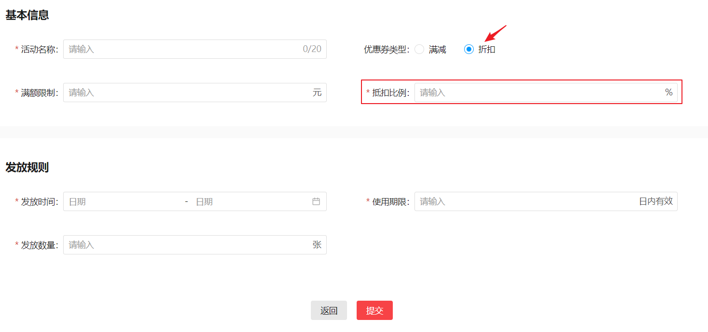

#### 2）运营端接口设计

##### 保存优惠券活动接口

接口名称：保存优惠券活动

接口功能：新增或修改一个优惠券活动信息，本接口支持新增和修改。

接口地址：**POST**/market/operation/activity/save

**请求数据类型：** application/json


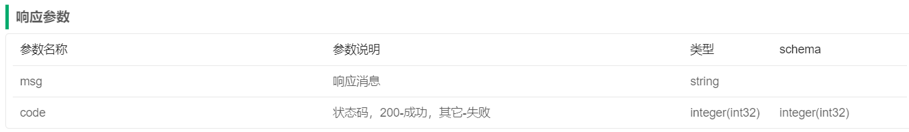


### 4.2 **查询优惠券活动**

#### 1）界面原型

登录运营端进入“优惠券管理”界面，如下图：

按条件查询优惠券活动信息。


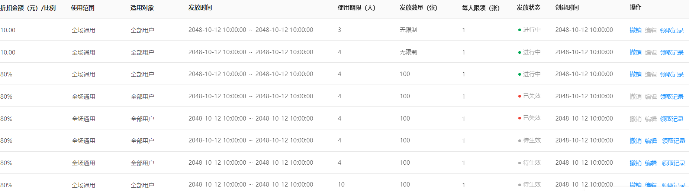

#### 2）运营端接口设计

##### 分页查询优惠券活动接口

接口名称：分页查询优惠券活动

接口功能：运营端分页查询优惠券活动

接口地址：**GET**/market/operation/activity/page

**请求数据类型：** application/x-www-form-urlencoded

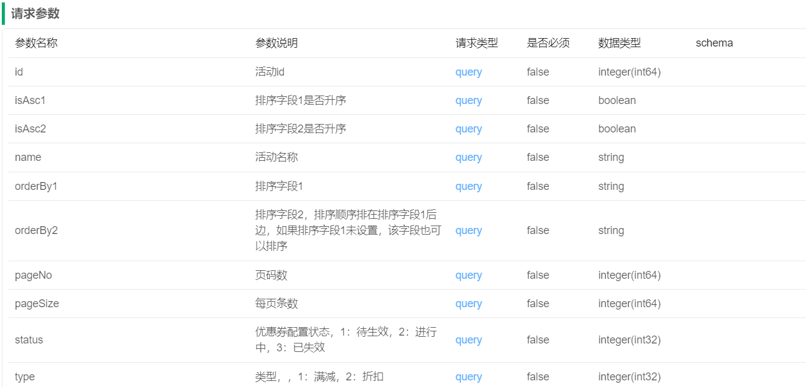

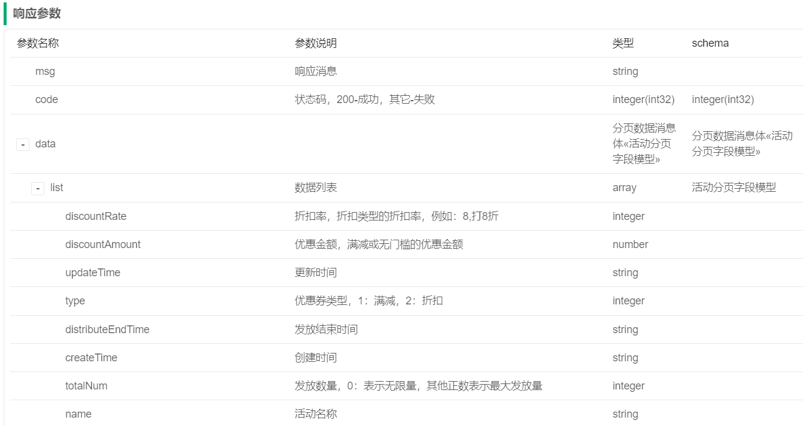

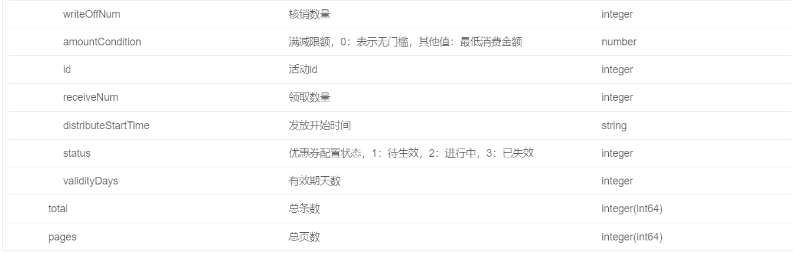


### 4.3 **修改优惠券活动**

#### 1) 界面原型

待生效的活动信息可以进行修改。

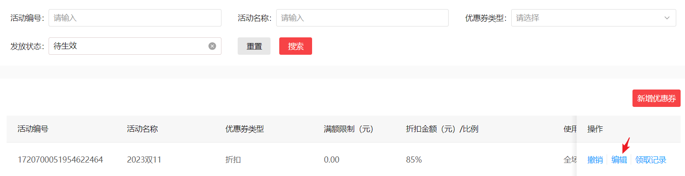

进入修改页面进行修改：

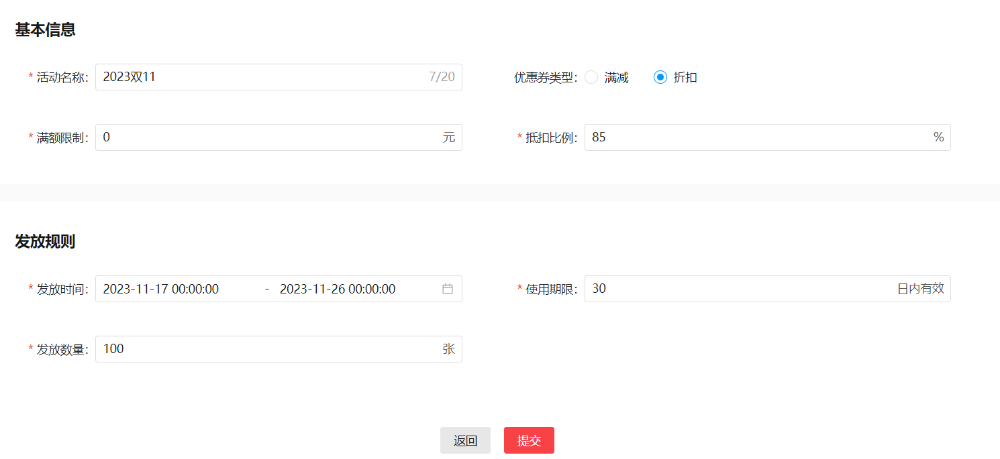

##### 数据校验

注意：只允许对待生效的活动进行修改，且发放开始时间不能早于当前时间。

本项目优惠券只支持满减与折扣两种类型。

优惠券类型，1：满减，2：折扣

如果满减：

1、折扣金额必须输入

2、折扣金额必须大于0的整数

如果是折扣：

1、折扣比例必须输入

2、折扣比例必须大于0，小于100的整数


发放时间开始时间不能小于当前时间

发放结束时间不能早于发放开始时间


#### 2) 运营端接口设计

##### 查询优惠券活动详情接口

接口名称：查询优惠券活动详情

接口功能：进入修改页面首先调用此接口根据活动id查询优惠券活动详情在页面显示

接口地址：**GET**/market/operation/activity/{id}

**请求数据类型** application/x-www-form-urlencoded

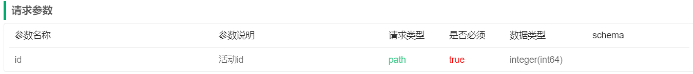


##### 保存优惠券活动接口

修改优惠券活动信息后请求保存优惠券活动接口。

修改优惠券活动与新增优惠券活动调用同一个接口：保存优惠券活动接口，参考新增优惠券活动章节的描述。


### 4.4 查询**领取记录**

#### 1) 界面原型

运营人员进入优惠券活动查询界面，点击“领取记录”可查看用户领取优惠券的记录，如下图：

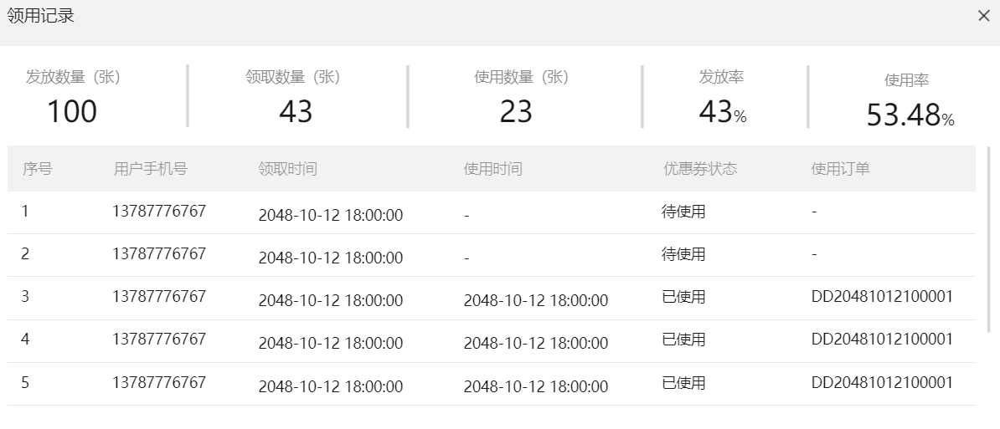

##### 数据分析

1）发放数量 = 新增优惠券时指定的发放总数

2）领取数量 = 领取该优惠券的数量，领取数量<=发放数量

3）使用数量 = 用户领取优惠券后使用数量，使用数量<=领取数量

4）发放率= 领取数量/发放数量\*100%；

5）使用率=使用数量/领取数量\*100%；

6）用户手机号：领取优惠券的用户手机号

7）领取时间：领取优惠券的时间

8）使用时间：使用优惠券的时间

9）优惠券状态：待使用，已使用

10）使用订单：使用优惠券的订单号

显示规则：

1）列表内数据倒序进行展示；

2）发放率、使用率最多显示两位小数；

3）单页最多显示5条，没有分页，超过5条出滚动条，无限向下滚；


#### 2) 接口设计

在查询领取记录页面共有两部分信息需要调用两个接口获取：优惠券活动信息，领取记录。


##### 查询优惠券活动详情接口

接口名称：查询优惠券活动详情

接口功能：进入修改页面首先调用此接口根据活动id查询优惠券活动详情在页面显示

接口地址：**GET**/market/operation/activity/{id}

**请求数据类型** application/x-www-form-urlencoded


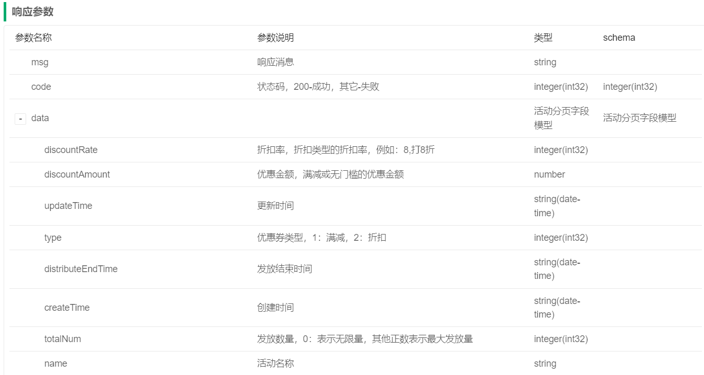

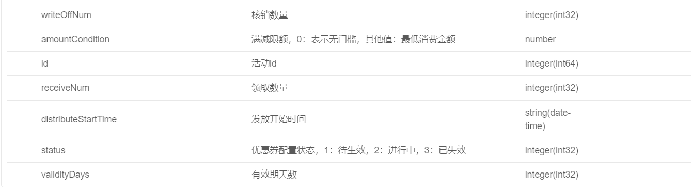


#####  查询领取记录

接口名称：根据活动ID查询优惠券领取记录

接口功能：根据活动ID查询优惠券领取记录

接口地址：**GET**/market/operation/coupon/page

**请求数据类型** application/x-www-form-urlencoded

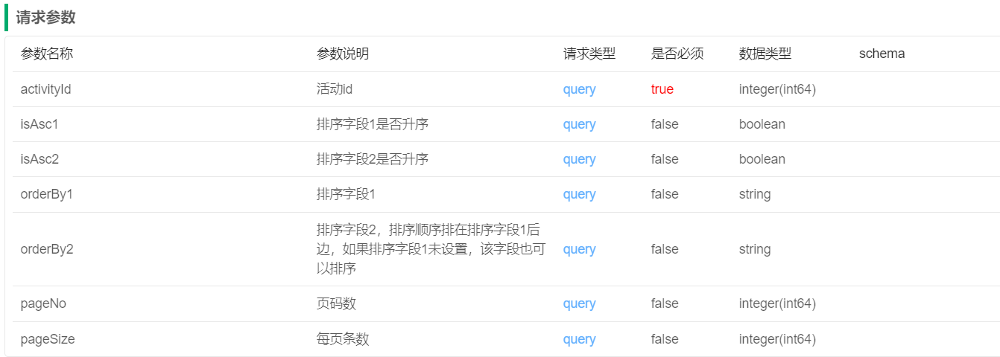


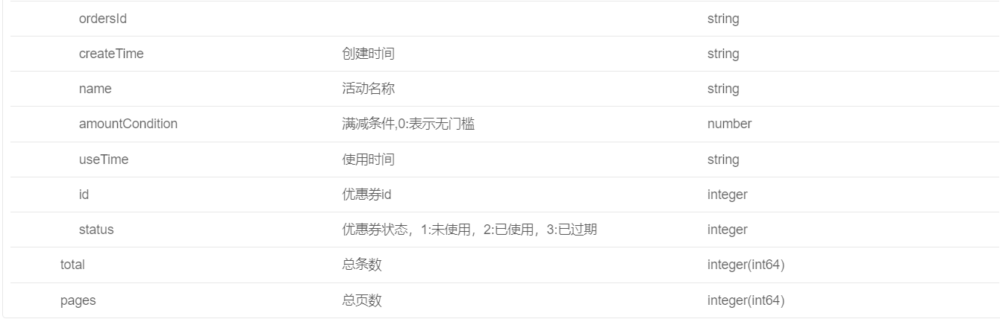


### 4.5 **撤销活动**

对于待生效及进行中的活动如果要进行终止可以执行撤销操作，执行后活动状态改为作废，用户已抢到还未使用的优惠券将作废。

#### 1）界面原型

对于待生效及进行中的活动如果要进行终止可以执行撤销操作，执行后此活动将终止，用户已抢到还未使用的优惠券将作废。

点击【撤销】，出现【确认撤销】弹窗，如下：

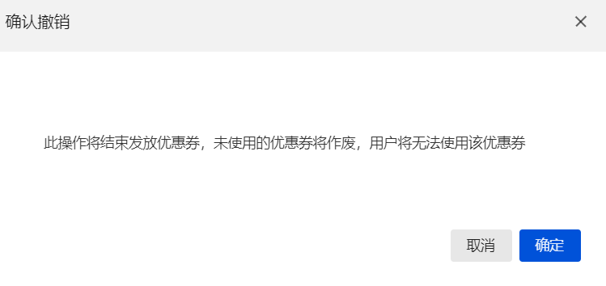

撤销的活动可以选择发放状态：作废，进行查询

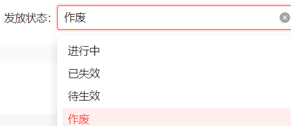

##### 数据校验

只允许对待生效及进行中的活动进行撤销。


#### 2) 运营端接口设计

接口名称：撤销活动

接口功能：撤销一个优惠券活动，对于待生效及进行中的活动如果要进行终止可以执行撤销操作，执行后活动状态改为作废，用户已抢到还未使用的优惠券将作废。

接口地址：**POST**/market/operation/activity/revoke/{id}

**请求数据类型** application/x-www-form-urlencoded


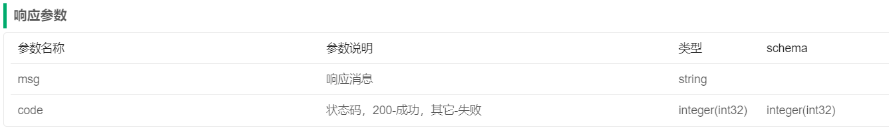

**注意：本接口除了更新活动状态为作废，还需要将所有抢到本活动优惠券的状态为未使用的记录的状态更改为“已失效” 。**


### 4.6 定时任务

#### 4.6.1 自动变更活动状态

##### 1) 需求

状态变更的需求如下：

优惠券活动表的状态字段值包括：1：待生效，2：进行中，3：已失效 4：作废 几种，优惠券活动的初始状态是待生效，当到达优惠券发放时间状态将改为进行中，当到达结束时间状态改为已失效，当撤销活动后状态为作废。

状态变更不需要依赖人工操作，可由定时任务实现，每分钟更新一次状态：

1）对待生效的活动更新为进行中

到达发放开始时间状态改为“进行中”。

2）对待生效及进行中的活动更新为已失效

到达发放结束时间状态改为“已失效”

##### 2) 活动状态变更定时任务

活动状态包括：1：待生效，2：进行中，3：已失效 4: 作废'

对于待生效的活动：到达发放开始时间状态改为“进行中”。

对于待生效及进行中的活动：到达发放结束时间状态改为“已失效”

使用xxl-job定义定时任务，每分钟执行一次。


#### 4.6.2 已领取优惠券自动过期

用户领取的优惠券如果到达有效期仍然没有使用自动改为“已失效”

使用xxl-job定义定时任务，每小时执行一次。


## 5 我的优惠券(已实现)

### 5.1 需求分析

#### 1）界面原型

用户领取优惠券后进入“我的”-->"我的优惠券"查询已领取的优惠券，按领取优惠券的时间降序显示。

本查询为滚动查询，向上拖屏幕查询下一屏，一屏显示10条。

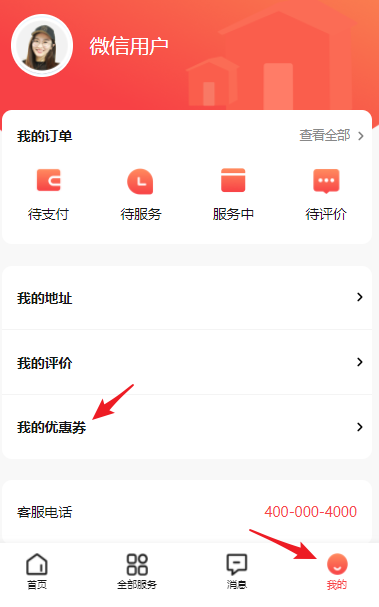

用户领取到优惠券有三个状态：

**未使用**：未过有效期的优惠券。

优惠券的有效期：从领取优惠券的时间加上优惠券的使用期限（“使用期限”在优惠券活动管理界面进行设置）。

**已使用**：已经在订单中使用的优惠券。

**已过期**：未使用且已过有效期的优惠券，已过期的优惠券将无法使用。

查询未使用的优惠券

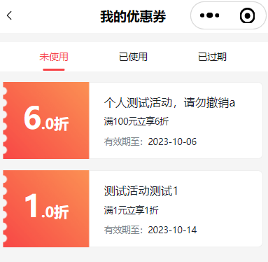

查询已使用的优惠券：

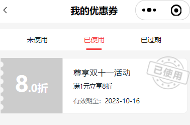

查询已过期的优惠券：

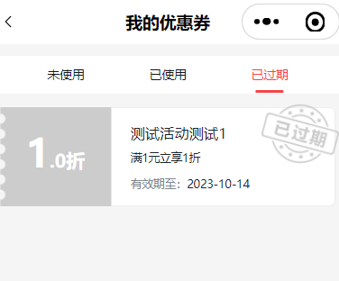


#### 2）用户端接口设计

##### 我的优惠券列表接口

接口名称：我的优惠券列表

接口功能：用户查询自己领取的优惠券

接口地址：**GET**/market/consumer/coupon/my

**请求数据类型** application/x-www-form-urlencoded

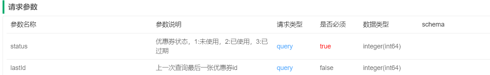

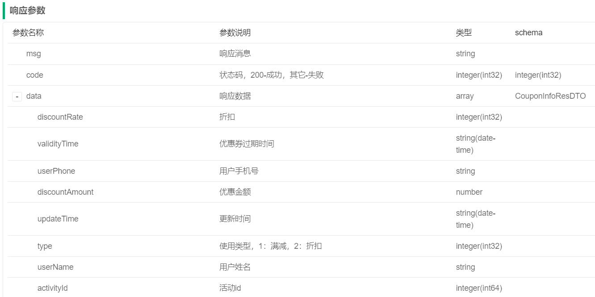

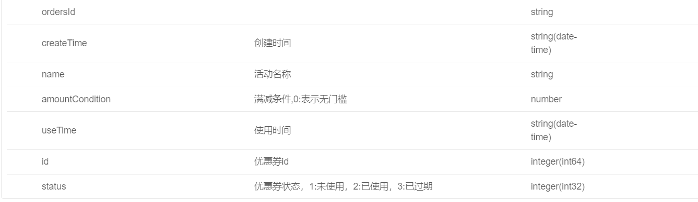


### 5.2 设计提示

本功能是c端用户查询自己领取的优惠券，由于c端用户量大所以要保证此查询接口的性能。

实现思路类似Elasticsearch的深度分页思路（search_after）。

需要在表中找一个唯一的且有序的键作为排序字段，接口传入lastId，用排序字段和lastId比较，类似下边的SQL:

降序：Select \* from 表名  where 排序字段<lastId order by id desc  limit 10


最后完成开发后通过小程序测试我的优惠券界面，测试前向优惠券表人工添加一些测试数据模拟用户领取的优惠券。


## 6 获取可用优惠券(已实现)

### 1）需求分析

#### **界面原型**

用户在下单时使用优惠券得到优惠金额，实付金额等于订单金额减去优惠金额，下单成功优惠券核销成功。

下边通过界面原型进行分析。

在下单时选择可用的优惠券：

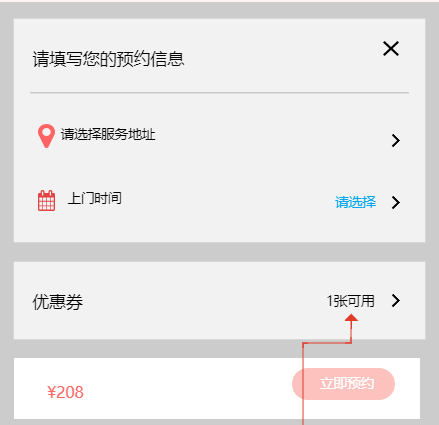

可用优惠券列表：是用户领取到的优惠券且符合满减规则的优惠券，如：满200减20元优惠券只能用在订单金额大于200元的订单。


用户选择一张优惠券，界面显示优惠金额，订单金额减去优惠金额为实际支付金额：


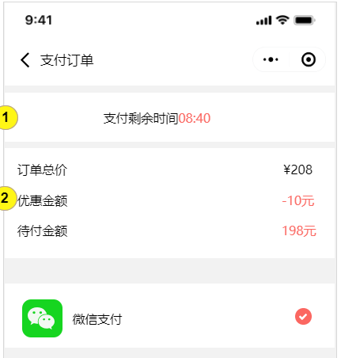

一张优惠券使用完毕将不能用在其它订单。 

当订单取消后已使用的优惠券会重新退回到我的优惠券，此时用户又可以使用该优惠券。


#### 数据分析

可用优惠券列表根据以下条件对用户的优惠券进行筛选：

- 属于当前用户的优惠券
- 符合下边条件的优惠券：

订单金额大于等于满减金额

优惠金额小于订单金额

优惠券还没有过期

优惠券还没有使用

可用优惠券列表的信息包括：

- 活动名称
- 优惠券类型
- 满减金额
- 折扣率
- 针对该订单的优惠金额（需要根据订单金额和优惠券去计算得出，前端需要此数据）
- 优惠券过期时间（已过期的优惠券无法使用）

在可用优惠券列表中前端需要拿到优惠金额，从而计算出订单实付金额。

订单的实付金额=订单金额-优惠金额。

根据订单金额和优惠券的优惠金额可以计算该订单的优惠金额：

- 针对满减：优惠券的优惠金额
- 针对折扣：订单金额乘以（1-折扣率）

### 2) 接口设计

#### 交互流程

根据需求，查询可用的优惠券列表从优惠券表（coupon）中进行查询，筛选规则如下：

- 属于当前用户的优惠券
- 符合下边条件的优惠券：

订单金额大于等于满减金额

优惠金额小于订单金额（因为最终的支付金额必须大于0）

优惠券还没有过期

优惠券还没有使用

要筛选到用户可用的优惠券列表需要根据订单金额和用户ID进行筛选，现在有一个问题是：

是前端直接请求优惠券服务查询可用的优惠券列表还是请求订单管理服务再由订单管理服务通过内部接口调用服务拿结果，下图中是用左边的方案还是右边的方案？

<whiteboard token="Qbmsw7hAMhFwXnbfzQBcUCl8n7f"></whiteboard>

本项目用右边的方案。

因为订单管理服务和优惠券服务的基本职责不同，订单管理服务属于业务方，优惠券服务为业务方提供优惠券服务。

虽然优惠券服务中管理了优惠券，但是最终决定是否给用户优惠的是订单服务，比如：用户购买VIP会员，用户是否可以用优惠券是由会员系统去决定而不是由优惠券服务决定。


所以前端请求查询可用优惠券列表的交互流程如下：

<whiteboard token="SQb5wmFm0hrK7kbXQIWcY7sGnae"></whiteboard>

用户端进入下单页面，请求订单管理服务获取可用优惠券，订单管理服务远程请求优惠券服务的获取可用优惠券内部接口。

#### 接口定义

根据交互流程，先在优惠券服务定义“查询可用优惠券接口” 内部接口。

根据刚才分析的需求，要筛选到用户可用的优惠券列表需要根据订单金额和用户ID。


订单金额通过参数传入。

接口定义如下：

接口名称：获取可用优惠券（内部接口）

接口功能：根据用户ID和订单金额查询可用优惠券列表

接口路径：**GET**/market/inner/coupon/getAvailable

**请求数据类型** application/x-www-form-urlencoded

![该图片是第六章优惠券模块中获取可用优惠券接口的定义内容，位于接口定义相关文档的对应位置。图片明确展示了接口路径为GET /market/inner/coupon/getAvailable，请求数据类型为application/x-www-form-urlencoded，还列出了必须的请求参数：totalAmount为总金额（单位分，类型为number），userId为用户ID（类型为integer(int64)），二者的请求类型均为query，响应数据类型标注为\["/*"\]。该图片与文档中关于此内部接口的功能、路径、数据类型及请求参数的描述完全对应，清晰呈现了该内部接口的核心定义信息。](https://feishu.cn/file/EDjDbYhJsoHZWQxa5xncC7sQncg)


下边在优惠券服务进行实现：

修改jzo2o-api中的CouponApi：

```Java
@FeignClient(contextId = "jzo2o-market", value = "jzo2o-market", path = "/market/inner/coupon")
public interface CouponApi {

    /**
     * 获取可用优惠券列表，并按照优惠金额从大到小排序
     * @param totalAmount 总金额，单位分
     */
    @GetMapping("/getAvailable")
    List<AvailableCouponsResDTO> getAvailable(@RequestParam("userId") Long userId,@RequestParam("totalAmount") BigDecimal totalAmount);
    ...
```

修改完成CouponApi重新install到本地仓库。

编写controller：

```JSON
package com.jzo2o.market.controller.inner;

import com.jzo2o.api.market.CouponApi;
import com.jzo2o.api.market.dto.response.AvailableCouponsResDTO;
import io.seata.spring.annotation.GlobalTransactional;
import io.swagger.annotations.Api;
import io.swagger.annotations.ApiImplicitParam;
import io.swagger.annotations.ApiOperation;
import org.springframework.web.bind.annotation.GetMapping;
import org.springframework.web.bind.annotation.RequestMapping;
import org.springframework.web.bind.annotation.RequestParam;
import org.springframework.web.bind.annotation.RestController;

import java.math.BigDecimal;
import java.util.List;

@RestController("innerCouponController")
@RequestMapping("/inner/coupon")
@Api(tags = "内部接口-优惠券相关接口")
public class CouponController implements CouponApi {


    @Override
    @GetMapping("/getAvailable")
    @ApiOperation("获取可用优惠券列表")
    @ApiImplicitParams({
            @ApiImplicitParam(name = "totalAmount", value = "总金额，单位分", required = true, dataTypeClass = BigDecimal.class),
            @ApiImplicitParam(name = "userId", value = "用户id", required = true, dataTypeClass = BigDecimal.class)
    })
    public List<AvailableCouponsResDTO> getAvailable(@RequestParam("userId") Long userId,@RequestParam("totalAmount") BigDecimal totalAmount) {
        return null;
    }
}
```


重启优惠券服务查看接口文档是否正确。

#### **定义service接口**

下边定义service接口，查询可用优惠券列表：

```Java

package com.jzo2o.market.service;

import com.jzo2o.api.market.dto.request.CouponUseBackReqDTO;
import com.jzo2o.api.market.dto.request.CouponUseReqDTO;
import com.jzo2o.api.market.dto.response.AvailableCouponsResDTO;
import com.jzo2o.api.market.dto.response.CouponUseResDTO;
import com.jzo2o.common.model.PageResult;
import com.jzo2o.market.model.domain.Coupon;
import com.baomidou.mybatisplus.extension.service.IService;
import com.jzo2o.market.model.dto.request.CouponOperationPageQueryReqDTO;
import com.jzo2o.market.model.dto.request.SeizeCouponReqDTO;
import com.jzo2o.market.model.dto.response.CouponInfoResDTO;

import java.math.BigDecimal;
import java.util.List;

/**
 * <p>
 *  服务类
 * </p>
 *
 * @author itcast
 * @since 2023-09-16
 */
public interface ICouponService extends IService<Coupon> {
/**
 * 获取可用优惠券列表
 * @param totalAmount
 * @return
 */
List<AvailableCouponsResDTO> getAvailable(BigDecimal totalAmount);
...
```

service接口实现类请自行实现。


#### 小结

下单时如何拿到可用的优惠券列表？


## 7 优惠券核销接口(已实现)

### 7.1 接口设计

#### 1）**系统交互流程**

<whiteboard token="VcGhwd4XFho6Erb3hRfcHkyCnng"></whiteboard>

说明如下：

1. **优惠券核销**

用户端请求订单管理服务创建订单信息，订单管理服务远程调用优惠券服务核销优惠券，下单成功且优惠券核销成功。

优惠券核销执行以下操作：

- 限制：订单金额大于等于满减金额。
- 限制：优惠券有效
- 根据优惠券id标记优惠券表中该优惠券已使用、使用时间、订单id等。
- 向优惠券核销表添加记录。

核销成功返回最终优惠的金额。


1. **优惠券退回**

用户端取消订单，订单管理服务执行取消订单逻辑，如果该订单使用了优惠券则请求优惠券服务退回优惠券。

优惠券退回执行以下操作：

- 添加优惠券退回记录。
- 更新优惠券，如果优惠券已过期则标记该优惠券已作废
- 更新优惠券，如果优惠券未过期，标记该优惠券未使用，清空订单id字段及使用时间字段。
- 删除核销记录。


#### 2）**优惠券核销接口定义**

核销接口定义如下：

接口名称：核销优惠券（内部接口）

接口功能：下单时调用此接口核销优惠券

接口路径：**POST**/market/inner/coupon/use

**请求数据类型** application/json

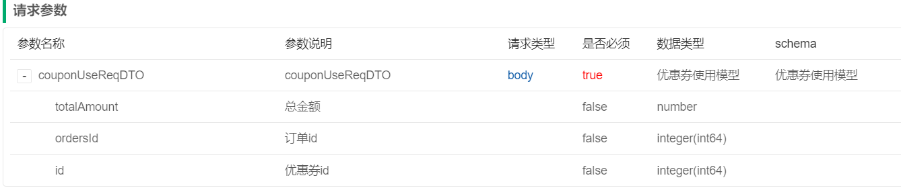

请求参数：

订单总金额：根据订单总金额判断是否符合优惠券规则。

优惠券ID: 核销接口核销优惠券需要传入优惠券ID（对应优惠券表的主键）。

订单ID：核销表需要记录具体的订单ID。

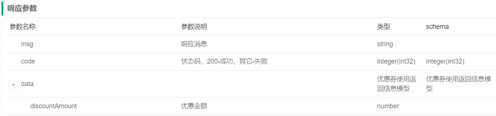

响应结果：

核销后返回优惠金额。


在jzo2o-api工程下定义接口：

```JSON
package com.jzo2o.api.market;

import com.jzo2o.api.market.dto.request.CouponUseBackReqDTO;
import com.jzo2o.api.market.dto.request.CouponUseReqDTO;
import com.jzo2o.api.market.dto.response.AvailableCouponsResDTO;
import com.jzo2o.api.market.dto.response.CouponUseResDTO;
import io.swagger.annotations.ApiOperation;
import org.springframework.cloud.openfeign.FeignClient;
import org.springframework.web.bind.annotation.GetMapping;
import org.springframework.web.bind.annotation.PostMapping;
import org.springframework.web.bind.annotation.RequestBody;
import org.springframework.web.bind.annotation.RequestParam;

import java.math.BigDecimal;
import java.util.List;

@FeignClient(contextId = "jzo2o-market", value = "jzo2o-market", path = "/market/inner/coupon")
public interface CouponApi {

    /**
     * 优惠券使用,并返回优惠金额
     * @param couponUseReqDTO
     */
    @PostMapping("/use")
    CouponUseResDTO use(@RequestBody CouponUseReqDTO couponUseReqDTO);
    ...
```

编写controller方法：

```JSON
@RestController("innerCouponController")
@RequestMapping("/inner/coupon")
@Api(tags = "内部接口-优惠券相关接口")
public class CouponController implements CouponApi {

    @Override
    @PostMapping("/use")
    @ApiOperation("使用优惠券，并返回优惠金额")
    public CouponUseResDTO use(@RequestBody CouponUseReqDTO couponUseReqDTO) {
        return null;
    }

 }
```


#### 3）**优惠券退回接口定义**

请求参数：

优惠券ID（对应优惠券表的主键）

传入用户ID：需要记录退回优惠券用户的信息

传入订单ID：需要记录退回优惠券的订单ID

响应结果：无

退回优惠券接口定义如下：

接口名称：退回优惠券（内部接口）

接口功能：取消订单调用此接口退回优惠券

接口路径：**POST**/market/inner/coupon/useBack

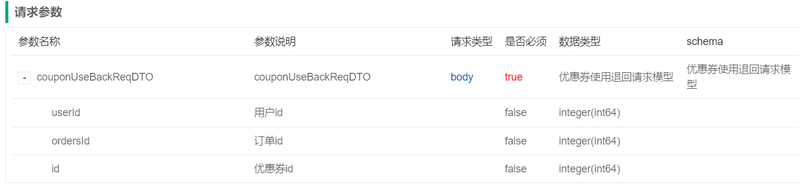

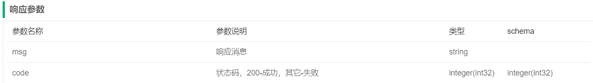


这些内部接口定义在jzo2o-api下

```JSON
package com.jzo2o.api.market;

import com.jzo2o.api.market.dto.request.CouponUseBackReqDTO;
import com.jzo2o.api.market.dto.request.CouponUseReqDTO;
import com.jzo2o.api.market.dto.response.AvailableCouponsResDTO;
import com.jzo2o.api.market.dto.response.CouponUseResDTO;
import io.swagger.annotations.ApiOperation;
import org.springframework.cloud.openfeign.FeignClient;
import org.springframework.web.bind.annotation.GetMapping;
import org.springframework.web.bind.annotation.PostMapping;
import org.springframework.web.bind.annotation.RequestBody;
import org.springframework.web.bind.annotation.RequestParam;

import java.math.BigDecimal;
import java.util.List;

@FeignClient(contextId = "jzo2o-market", value = "jzo2o-market", path = "/market/inner/coupon")
public interface CouponApi {

    /**
     * 优惠券退款回退
     */
    @PostMapping("/useBack")
    void useBack(@RequestBody CouponUseBackReqDTO couponUseBackReqDTO);

...
```

编写controller方法：

```JSON
@RestController("innerCouponController")
@RequestMapping("/inner/coupon")
@Api(tags = "内部接口-优惠券相关接口")
public class CouponController implements CouponApi {

    
    @Override
    @PostMapping("/useBack")
    @ApiOperation("优惠券退回接口")
    public void useBack(@RequestBody CouponUseBackReqDTO couponUseBackReqDTO) {
    
    }
 }
```


#### 4）小结

优惠券核销的交互流程是什么？


### 7.2 接口实现（已实现）

请根据需求和设计实现优惠券核销接口、优惠券退回接口，并参考下边的测试流程进行测试。


测试流程：

重启优惠券服务

启动网关服务

使用swagger文档进行接口测试。

示例：

手动在优惠券表添加测试数据。

下边是一个优惠券测试数据：

```JSON
{
  "id": 1722556410543214592,
  "name": "全场七折",
  "user_id": 1716346406098296832,
  "user_name": "普通用户72135",
  "user_phone": null,
  "activity_id": 1722555839446781952,
  "type": 2,
  "discount_rate": 70,
  "discount_amount": null,
  "amount_condition": 0.00,
  "validity_time": "2023-12-09 18:07:06",
  "use_time": null,
  "status": 1,
  "orders_id": null,
  "create_time": "2023-11-09 18:08:00",
  "update_time": "2023-11-09 18:08:00",
  "is_deleted": 0
}
```

打开swagger文档，输入测试数据：

id：将上边优惠券ID填入

totalAmount：填写一个满足优惠规则的金额

ordersId：随便填写一个订单id

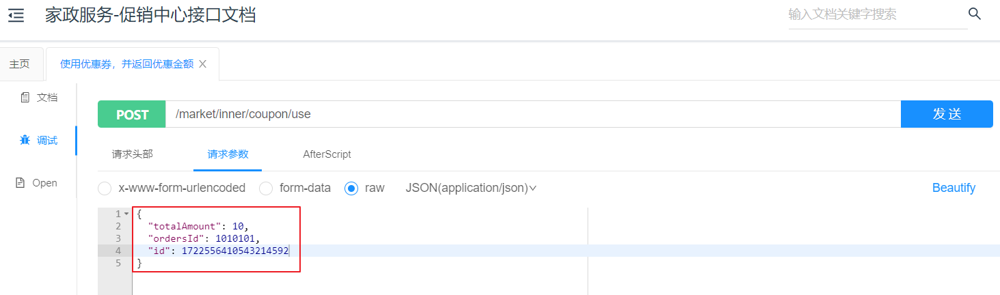


下边开始测试

在核销优惠券service中打断点。

执行成功返回优惠金额：


## 9 发放优惠券

### 9.1 需求分析

#### 1) **定时发放**

按照某种规则找到符合发放优惠券资格的用户，系统自动将指定优惠券发放到符合资格的用户账户中。

首先在添加优惠券活动时指定发放方式为：自动发放

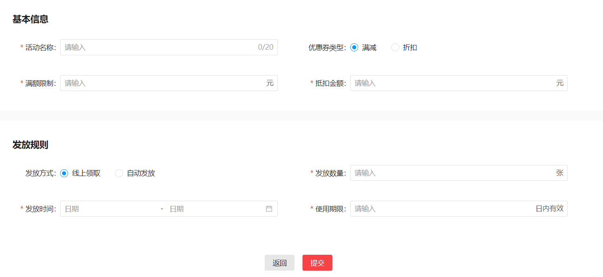

按照什么规则来确定符合发放优惠券资格的用户呢？

这个由业务系统去决定，优惠券服务作为一个通用的管理优惠券的服务它没有业务数据，判断用户是否有获取优惠券的资格是由业务系统去决定的。

举例：用户连续登录5天可获取一张优惠券，这个需求需要由用户认证系统根据用户的登录记录决定哪些用户可以获取优惠券，用户认证系统通过与优惠券服务交互将要发放优惠券的用户名单 告诉优惠券服务，优惠券服务按照名单去发放优惠券。


#### 2) **立即发放**

系统提供立即发放优惠券功能，指定优惠券、指定用户ID（多个）将优惠券立即发放到用户的账户中。

举例：客服针对具体的用户判断是否具有发放优惠券资格，具有发放资格将优惠券立即发放到用户的账户中。

此功能也是由业务系统去决定什么时候给用户发优惠券。比如客户投诉后给用户补偿发券


### 9.2 系统设计

#### 1）数据流

<whiteboard token="I1pIwljeph4GgJbmYbTcxrpnnhi"></whiteboard>

**表说明：**

优惠券活动表：存储运营端管理的优惠券活动。

待发放优惠券表：存储了待发放的优惠券信息，包括：活动id、用户id、发放状态。

优惠券表：存储了用户领取的优惠券信息，发放优惠券会将待发放优惠券表中的记录拷贝到优惠券表中，发放成功需要更新待发放优惠券表的状态为“已发放”。


**提交待发放用户名单 ：**

由业务系统调用优惠券服务，将待发放优惠券记录存入“待发放优惠券表”，同时更新优惠券活动表的库存（原库存减去待发放数量），存入待发放表的记录一定会发放，提前将库存更新，更新了库存表示锁定了这个优惠券。

**立即发放接口：**

向一个及多个用户立即发放优惠券，指定优惠券活动ID、用户ID（多个）向用户发放优惠券。

上图中之所以先将发放记录存储到待发放记录表是为了保证一个优惠券活动一个用户只发放一次，这里是通过数据库的约束去控制，避免重复给一个用户发放相同的优惠券。

**自动发放优惠券任务：**

通过任务调度在凌晨执行自动发放任务，先去优惠券活动表查询需要自动发放的活动，每个活动的优惠券发放任务由一个线程去执行，首先去待发放优惠券表查询待发放记录，然后将其插入优惠券发放记录表（即优惠券表，插入时将待发放优惠券表的主键作为优惠券表的主键），发放成功需要更新待发放记录的状态为已发放。


#### 2）表结构

```Java
create table `jzo2o-market`.coupon_issue
(
    id          bigint  not null comment '主键',
    activity_id bigint  not null comment '优惠券活动id',
    user_id     bigint  not null comment '用户id',
    status      tinyint not null comment '发放状态 0:待发放，1：已发放',
    constraint coupon_issue_activity_id_user_id_uindex
        unique (activity_id, user_id)
)
    comment '优惠券待发放表' charset = utf8mb4;
```

注意：activity_id, user_id是唯一索引，表示一个优惠券活动向同一个用户只发放一张优惠券。


#### 3）接口设计

##### 提交待发放优惠券接口

此接口支持批量向多个用户发优惠券。


响应提交成功的待发放记录：


##### 立即发放优惠券接口

此接口支持批量向多个用户发优惠券。


响应发放成功的记录：

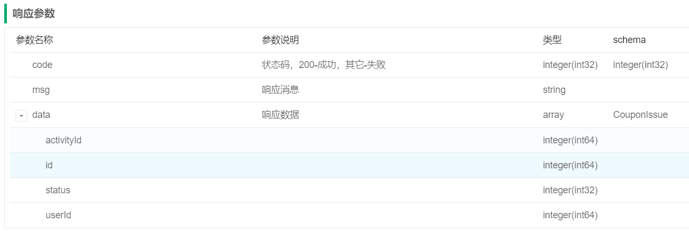


### 9.3 开发

#### 9.3.1 切换分支

基于jzo2o-market工程的dev_01创建dev_02分支并切换到dev_02，使用下发的jzo2o-market_dev02.zip的代码覆盖dev_02分支的代码。


#### 9.3.2 提交待发放优惠券接口

##### 1) 模型类

定义提交待发放优惠券接口请求参数的数据模型：

```Java
package com.jzo2o.market.model.dto.request;

import io.swagger.annotations.ApiModelProperty;
import lombok.Data;
import lombok.EqualsAndHashCode;
import lombok.experimental.Accessors;

import java.io.Serializable;
import java.time.LocalDateTime;

/**
 * <p>
 * 发放优惠券
 * </p>
 *
 * @author mrt
 * @since 2024-09-23
 */
@Data
public class CouponIssueReqDTO implements Serializable {

    private static final long serialVersionUID = 1L;

    /**
     * 优惠券活动id
     */
    @ApiModelProperty(value = "优惠券活动id",required = true)
    private Long activityId;

    /**
     * 用户id，多个用户用逗号隔开
     */
    @ApiModelProperty(value = "用户id，多个用户用逗号隔开",required = true)
    private String userIds;


}
```

##### 2）定义接口

```Java
package com.jzo2o.market.controller.inner;

import com.jzo2o.market.model.domain.CouponIssue;
import com.jzo2o.market.model.dto.request.CouponIssueReqDTO;
import com.jzo2o.market.service.ICouponIssueService;
import io.swagger.annotations.Api;
import io.swagger.annotations.ApiOperation;
import org.springframework.web.bind.annotation.*;

import javax.annotation.Resource;
import java.util.List;

@RestController("innerIssuedCouponController")
@RequestMapping("/inner/issuedcoupon")
@Api(tags = "内部接口-发放优惠券相关接口")
public class IssuedCouponController {


    @ApiOperation("提交待发放优惠券数据")
    @PostMapping("/save")
    public List<CouponIssue> save(@RequestBody CouponIssueReqDTO couponIssueReqDTO) {

        return null;
    }

}
```

##### 3）定义service

定义service用于批量向待发放优惠券表保存记录。

注意：在向待发放优惠券表插入记录时需要更新优惠券活动的库存，假如向10个用户发放优惠券则需要将对应的优惠券活动表的库存减去10。

```Java
package com.jzo2o.market.service.impl;

import com.baomidou.mybatisplus.core.conditions.query.LambdaQueryWrapper;
import com.baomidou.mybatisplus.core.conditions.update.LambdaUpdateWrapper;
import com.baomidou.mybatisplus.extension.service.impl.ServiceImpl;
import com.jzo2o.common.expcetions.CommonException;
import com.jzo2o.common.utils.DateUtils;
import com.jzo2o.common.utils.IdUtils;
import com.jzo2o.common.utils.StringUtils;
import com.jzo2o.market.enums.CouponStatusEnum;
import com.jzo2o.market.mapper.CouponIssueMapper;
import com.jzo2o.market.model.domain.Activity;
import com.jzo2o.market.model.domain.Coupon;
import com.jzo2o.market.model.domain.CouponIssue;
import com.jzo2o.market.model.dto.request.CouponIssueReqDTO;
import com.jzo2o.market.service.IActivityService;
import com.jzo2o.market.service.ICouponIssueService;
import com.jzo2o.market.service.ICouponService;
import lombok.extern.slf4j.Slf4j;
import org.springframework.beans.BeanUtils;
import org.springframework.stereotype.Service;
import org.springframework.transaction.annotation.Transactional;
import org.springframework.util.CollectionUtils;

import javax.annotation.Resource;
import java.time.LocalDateTime;
import java.util.ArrayList;
import java.util.Arrays;
import java.util.List;
import java.util.Map;
import java.util.stream.Collectors;

/**
 * @author Mr.M
 * @version 1.0
 * @description 发放优惠券服务类
 * @date 2024/9/23 16:33
 */
@Service
@Slf4j
public class CouponIssueServiceImpl extends ServiceImpl<CouponIssueMapper, CouponIssue> implements ICouponIssueService {

    //批量处理记录数
    private static final int BATCH_SIZE = 1000;

    //注入优惠券service
    @Resource
    private ICouponService couponService;

    //注入优惠券活动service
    @Resource
    private IActivityService activityService;

    @Resource
    private CouponIssueServiceImpl owner;

    

    @Override
    @Transactional
    public List<CouponIssue> save(CouponIssueReqDTO couponIssueReqDTO) {

        if (couponIssueReqDTO == null) {
            log.info("待发放优惠券数据为空，无需处理");
            throw new CommonException("待发放优惠券数据为空，无需处理");
        }
        //校验活动id
        if (couponIssueReqDTO.getActivityId() == null) {
            throw new CommonException("活动id不能为空");
        }
        //查询活动
        Activity activity = activityService.getById(couponIssueReqDTO.getActivityId());
        if (activity == null) {
            log.info("优惠券活动不存在，id:{}", activity.getId());
            //抛出异常
            throw new CommonException("优惠券活动不存在");
        }
        //校验优惠券活动是否过期
        if (activity.getDistributeEndTime().isBefore(LocalDateTime.now())) {
            throw new CommonException("活动已结束");
        }
        //校验用户ids
        if (StringUtils.isBlank(couponIssueReqDTO.getUserIds())) {
            throw new CommonException("用户id不能为空");
        }

        //解析userIds
        List<Long> userIds = Arrays.stream(couponIssueReqDTO.getUserIds().split(","))
                .map(Long::parseLong).collect(Collectors.toList());
        //根据活动id和用户ids查询待发放优惠券表中存在的记录
        List<CouponIssue> couponIssueList = baseMapper.selectList(new LambdaQueryWrapper<CouponIssue>()
                .eq(CouponIssue::getActivityId, couponIssueReqDTO.getActivityId())
                .in(CouponIssue::getUserId, userIds));
        //从couponIssueList中提取出用户id
        List<Long> existUserIds = couponIssueList.stream().map(CouponIssue::getUserId).collect(Collectors.toList());
        //找到userIds不在existUserIds中的用户id
        List<Long> newUserIds = userIds.stream().filter(userId -> !existUserIds.contains(userId)).collect(Collectors.toList());
        if (newUserIds.size() == 0) {
           return  new ArrayList<CouponIssue>();
        }
        //newUserIds的数量
        Integer size = newUserIds.size();
        //执行sql更新activity中的库存字段，拿到扣减库存结果
        boolean b= activityService.lambdaUpdate()
                .setSql("stock_num= stock_num - " + size)
                .eq(Activity::getId, activity.getId())
                .ge(Activity::getStockNum, size)
                .update();
        if (!b) {
            throw new CommonException("优惠券活动库存不足");
        }
        List<CouponIssue> couponIssueListNew = new ArrayList<>();
        for (Long userId : newUserIds) {
            CouponIssue couponIssue = new CouponIssue();
            couponIssue.setId(IdUtils.getSnowflakeNextId());
            couponIssue.setActivityId(couponIssueReqDTO.getActivityId());
            couponIssue.setUserId(userId);
            //发放状态为0
            couponIssue.setStatus(0);
            couponIssueListNew.add(couponIssue);
        }

        //插入待发放优惠券表
        boolean b1 = saveBatch(couponIssueListNew);
        if (!b1) {
            throw new CommonException("提交待发放优惠券失败");
        }
        return couponIssueListNew;
    }

    

}
```

##### 4）完善controller

```Java
package com.jzo2o.market.controller.inner;

import com.jzo2o.market.model.domain.CouponIssue;
import com.jzo2o.market.model.dto.request.CouponIssueReqDTO;
import com.jzo2o.market.service.ICouponIssueService;
import io.swagger.annotations.Api;
import io.swagger.annotations.ApiOperation;
import org.springframework.web.bind.annotation.*;

import javax.annotation.Resource;
import java.util.List;

@RestController("innerIssuedCouponController")
@RequestMapping("/inner/issuedcoupon")
@Api(tags = "内部接口-发放优惠券相关接口")
public class IssuedCouponController {

    @Resource
    private ICouponIssueService couponIssueService;

    @ApiOperation("提交待发放优惠券数据")
    @PostMapping("/save")
    public List<CouponIssue> save(@RequestBody CouponIssueReqDTO couponIssueReqDTO) {
        List<CouponIssue> save = couponIssueService.save(couponIssueReqDTO);
        return save;
    }

}
```


##### 5) 测试

测试向待发放优惠券表批量插入数据。

观察库存更新、向待发放优惠券表批量插入数据  是否保证事务一致性。

测试同一个优惠券活动向重复的用户提交待发放记录不会重复添加。


#### 9.3.3 立即发放优惠券接口

##### 1）定义接口

```Java
@RestController("innerIssuedCouponController")
@RequestMapping("/inner/issuedcoupon")
@Api(tags = "内部接口-发放优惠券相关接口")
public class IssuedCouponController {

    @Resource
    private ICouponIssueService couponIssueService;

    @ApiOperation("立即发放优惠券")
    @PostMapping("/issue")
    public List<CouponIssue> issue(@RequestBody  CouponIssueReqDTO couponIssueReqDTO) {
        
    }
    ....
```

##### 2）service方法

```Java
@Service
@Slf4j
public class CouponIssueServiceImpl extends ServiceImpl<CouponIssueMapper, CouponIssue> implements ICouponIssueService {

    //批量处理记录数
    private static final int BATCH_SIZE = 1000;

    //注入优惠券service
    @Resource
    private ICouponService couponService;

    //注入优惠券活动service
    @Resource
    private IActivityService activityService;

    @Resource
    private CouponIssueServiceImpl owner;

    @Override
    @Transactional
    public List<CouponIssue> issue(CouponIssueReqDTO couponIssueReqDTO) {
        //活动id
        Long activityId = couponIssueReqDTO.getActivityId();
        //查询活动信息
        Activity activity = activityService.getById(activityId);
        if (activity == null) {
            throw new CommonException("活动不存在");
        }
       //如果活动已结束不进行发放
        if (activity.getDistributeEndTime().isBefore(LocalDateTime.now())) {
    
            throw new CommonException("活动已结束");
        }
        //先插入到待发放优惠券表
         save(couponIssueReqDTO);
        //从couponIssueList中提取用户id
        List<Long> userIds = Arrays.asList(couponIssueReqDTO.getUserIds().split(",")).stream().map(Long::valueOf).collect(Collectors.toList());
        //根据活动id和userIds查询CouponIssue中状态为0的记录
        List<CouponIssue> couponIssues = baseMapper.selectList(
                new LambdaQueryWrapper<CouponIssue>()
                        .eq(CouponIssue::getActivityId, activityId)
                        .in(CouponIssue::getUserId, userIds)
                        .eq(CouponIssue::getStatus, 0));
        //如果couponIssues为空则不进行后续操作
        if (couponIssues.isEmpty()) {
            return couponIssues;
        }
        //更新couponIssues中的状态为1
        couponIssues.forEach(couponIssue -> couponIssue.setStatus(1));
        boolean updateBatchById = updateBatchById(couponIssues);
        if (!updateBatchById) {
            throw new DBException("优惠券发放失败");
        }
        //根据couponIssues生成List<Coupon>
        List<Coupon> couponList = couponIssues.stream().map(couponIssue -> {
                    Coupon coupon = new Coupon();
                    coupon.setId(couponIssue.getId());
                    coupon.setUserId(couponIssue.getUserId());
                    coupon.setActivityId(couponIssue.getActivityId());
                    coupon.setName(activity.getName());
                    coupon.setType(activity.getType());
                    coupon.setDiscountAmount(activity.getDiscountAmount());
                    coupon.setDiscountRate(activity.getDiscountRate());
                    coupon.setAmountCondition(activity.getAmountCondition());
                    coupon.setValidityTime(DateUtils.now().plusDays(activity.getValidityDays()));
                    coupon.setStatus(CouponStatusEnum.NO_USE.getStatus());
                    coupon.setCreateTime(DateUtils.now());
                    coupon.setUpdateTime(DateUtils.now());
                    return coupon;
                }
        ).collect(Collectors.toList());
        //将待发放优惠券数据批量插入优惠券表
        boolean b1 = couponService.saveBatch(couponList);
        if (!b1) {
            throw new CommonException("优惠券批量发放失败");
        }
        return couponIssues;
    
    }
...
```

##### 3) controller方法

```Java
@RestController("innerIssuedCouponController")
@RequestMapping("/inner/issuedcoupon")
@Api(tags = "内部接口-发放优惠券相关接口")
public class IssuedCouponController {

    @Resource
    private ICouponIssueService couponIssueService;

    @ApiOperation("立即发放优惠券")
    @PostMapping("/issue")
    public List<CouponIssue> issue(@RequestBody  CouponIssueReqDTO couponIssueReqDTO) {
        List<CouponIssue> issue = couponIssueService.issue(couponIssueReqDTO);
        return issue;
    }
    ....
```


##### 4）测试

测试发放成功后：

是否正确保证待发放优惠券记录，且发放成功后待发放优惠券记录的状态为已发放。

是否正确向优惠券表插入记录。


#### 9.3.4 自动发放优惠券任务

##### 1）整理逻辑

<whiteboard token="PvSvwqmSmhbay2bgSOacC1bYnPc"></whiteboard>

##### 2）线程执行器

每个线程负责对一个活动的发放记录进行处理。

这里使用分布式锁任务重复调度。

```Java
package com.jzo2o.market.handler;

import com.baomidou.mybatisplus.core.conditions.query.LambdaQueryWrapper;
import com.jzo2o.market.model.domain.CouponIssue;
import com.jzo2o.market.model.dto.request.CouponIssueReqDTO;
import com.jzo2o.market.service.ICouponIssueService;
import lombok.extern.slf4j.Slf4j;
import org.redisson.api.RedissonClient;
import org.springframework.util.CollectionUtils;

import java.util.List;

/**
 * @author Mr.M
 * @version 1.0
 * @description 自动发放优惠券处理器
 * 根据活动id从待发放记录表查找该活动的待发放记录，然后批量进行发放，一次拿出1000条进行发放。
 * @date 2024/9/23 18:43
 */
@Slf4j
public class IssuedCouponHandler implements Runnable {


    //优惠券发放service
    private ICouponIssueService couponIssueService;

    //分布式锁
    private RedissonClient redissonClient;

    //活动id
    private Long activityId;

    //构造方法
    public IssuedCouponHandler(Long activityId,ICouponIssueService couponIssueService,RedissonClient redissonClient) {
        this.activityId = activityId;
        this.couponIssueService = couponIssueService;
        this.redissonClient = redissonClient;
    }

    public void run() {
        //获取锁
        String lockKey = "activity:issued:lock:" + activityId;
        log.info("获取锁：{}", lockKey);
        RLock lock = redissonClient.getLock(lockKey);
        //尝试获取锁
        try {
            boolean tryLock = lock.tryLock(1,-1, TimeUnit.SECONDS);
            if(!tryLock){
                log.info("获取锁失败：{}", lockKey);
                return;
            }
            try {
                //开始发放优惠券
                log.info("开始发放优惠券：{}", activityId);
                //批量发放优惠券
                couponIssueService.autoIssue(activityId);
            } catch (Exception e) {
                log.error("发放优惠券失败：{}", e.getMessage());
            }finally {
                lock.unlock();
            }
    
        } catch (InterruptedException e) {
            throw new RuntimeException(e);
        }


    }
}
```


##### 3）自动发放

定义自动发放service

```Java
public interface ICouponIssueService extends IService<CouponIssue> {

    ......
    /**
     * 自动发放优惠券
     */
    void autoIssue(Long activityId);
    .......
```

实现类：

```Java
@Service
@Slf4j
public class CouponIssueServiceImpl extends ServiceImpl<CouponIssueMapper, CouponIssue> implements ICouponIssueService {

    //批量处理记录数
    private static final int BATCH_SIZE = 1000;

    //注入优惠券service
    @Resource
    private ICouponService couponService;

    //注入优惠券活动service
    @Resource
    private IActivityService activityService;

    @Resource
    private CouponIssueServiceImpl owner;
    
    @Override
    @Transactional
    public void autoIssue(Long activityId) {
        while (true){
            //获取待发放记录
            List<CouponIssue> couponIssueList = list(new LambdaQueryWrapper<CouponIssue>()
                    .eq(CouponIssue::getActivityId, activityId)
                    .eq(CouponIssue::getStatus, 0)
                    .last("limit " + BATCH_SIZE));
            //如果待发放记录为空，则退出
            if (CollectionUtils.isEmpty(couponIssueList)) {
                break;
            }
            log.info("待发放记录：{}", couponIssueList);
            //准备发放优惠券,创建CouponIssueReqDTO对象
            CouponIssueReqDTO couponIssueReqDTO = new CouponIssueReqDTO();
            couponIssueReqDTO.setActivityId(activityId);
            List<Long> userIds = couponIssueList.stream().map(CouponIssue::getUserId).collect(Collectors.toList());
            //将userIds转成字符串，中间用逗号分隔
            String userIds = StringUtils.join(",",userIds);
            couponIssueReqDTO.setUserIds(userIds);
            log.info("准备发放优惠券：{}", couponIssueReqDTO);
            try {
                owner.issue(couponIssueReqDTO);
            } catch (Exception e) {
                log.info("发放优惠券：{}异常", couponIssueReqDTO);
                e.printStackTrace();
                throw e;
            }
            //休眠1秒
            try {
                Thread.sleep(1000);
            } catch (InterruptedException e) {
                e.printStackTrace();
            }
        }
    
    }
    
    .......
```


##### 4）定时任务

```Java
package com.jzo2o.market.handler;

import com.baomidou.mybatisplus.core.conditions.query.LambdaQueryWrapper;
import com.jzo2o.market.model.domain.Activity;
import com.jzo2o.market.model.domain.CouponIssue;
import com.jzo2o.market.service.IActivityService;
import com.jzo2o.market.service.ICouponIssueService;
import lombok.extern.slf4j.Slf4j;
import org.redisson.api.RedissonClient;
import org.springframework.stereotype.Component;

import javax.annotation.Resource;
import java.time.LocalDateTime;
import java.util.List;
import java.util.Map;
import java.util.concurrent.ArrayBlockingQueue;
import java.util.concurrent.ThreadPoolExecutor;
import java.util.concurrent.TimeUnit;
import java.util.stream.Collectors;

/**
 * @author Mr.M
 * @version 1.0
 * @description 自动发放优惠券任务
 * @date 2024/9/23 19:49
 */
@Slf4j
@Component
public class IssuedCouponHandlerJob {
    //定义线程池
    private static ThreadPoolExecutor threadPoolExecutor;

    @Resource
    private ICouponIssueService couponIssueService;

    @Resource
    private IActivityService activityService;

    @Resource
    private RedissonClient redissonClient;

    static {
        threadPoolExecutor = new ThreadPoolExecutor(0, 20, 60, TimeUnit.SECONDS, new ArrayBlockingQueue<>(100));
    }


    public void start() {
        log.info("自动发放优惠券任务开始");
        //从活动表查询还未结束的活动。
        List<Activity> activityList = activityService.list(new LambdaQueryWrapper<Activity>()
                .in(Activity::getStatus, List.of(0,1)));
        //以活动id为单位创建优惠券发放任务，并加入线程池
        activityList.stream().forEach(activity -> {
           //创建IssuedCouponHandler对象
           IssuedCouponHandler issuedCouponHandler = new IssuedCouponHandler(activity.getId(), couponIssueService,redissonClient);
           //将任务加入线程池
           threadPoolExecutor.execute(issuedCouponHandler);
        });

    }
}


```

xxl-job调度：

```Java
package com.jzo2o.market.handler;

import com.jzo2o.market.service.IActivityService;
import com.jzo2o.market.service.ICouponService;
import com.jzo2o.redis.annotations.Lock;
import com.jzo2o.redis.constants.RedisSyncQueueConstants;
import com.jzo2o.redis.sync.SyncManager;
import com.xxl.job.core.handler.annotation.XxlJob;
import org.springframework.stereotype.Component;

import javax.annotation.Resource;

import static com.jzo2o.market.constants.RedisConstants.Formatter.*;
import static com.jzo2o.market.constants.RedisConstants.RedisKey.COUPON_SEIZE_SYNC_QUEUE_NAME;

@Component
public class XxlJobHandler {

    @Resource
    private SyncManager syncManager;

    @Resource
    private IActivityService activityService;

    @Resource
    private ICouponService couponService;

    @Resource
    private IssuedCouponHandlerJob issuedCouponHandlerJob;

     ....

    /**
     * 自动发放优惠券
     */
    @XxlJob("issueCouponJob")
    public void issueCouponJob() {
        issuedCouponHandlerJob.start();
    }


}
```


##### 5）测试

1. 制造数据

通过提交待发放优惠券接口  提交待发放数据。

1. 进入xxl-job配置任务，并启动任务
2. 观察线程执行过程
3. 观察是否成功将待发放优惠券表的记录插入到优惠券表，同时更新待发放优惠券记录的状态为已发放。

---
> 来源：飞书技术知识库（脱敏版） · 07 业务组件方案集 / 云岚到家项目 / 第六章 优惠券模块 · [原文](https://ccn8v2zngwsm.feishu.cn/wiki/RLUiwIGFOi9waUk1XjYcT400nUc)
