# 第七章 订单模块

## 学习目标


1. 能够说出家政项目订单表的设计方案
2. 能说出家政项目订单的状态有哪些
3. 能够说出常用的订单号生成方案
4. 能够完成家政项目下单接口开发与调试
5. 能够进行下单方法的优化
6. 能说出Service方法事务失效的原因
7. 能说出Spring 如何解决循环依赖
8. 能够说出防止订单重复提交的方案
9. 能够说出优惠券核销设计方案
10. 能够开发优惠券核销功能
11. 能够说出取消超时未支付订单的设计方案


## 代码环境

jzo2o-foundations：dev_03

jzo2o-customer：dev_02

jzo2o-market：dev_02

jzo2o-orders：dev_01


## 1 需求调研

### 1）订单管理管什么？

AI：订单模块管什么？

> 订单模块通常是电子商务系统或企业资源规划（ERP）系统中的一个重要组成部分。它负责处理与客户订单相关的所有活动，包括但不限于以下几个方面：
> 
> 1. 订单创建与接收：当客户下单时，订单模块会记录下所有的订单信息，包括产品或服务的种类、数量、价格、客户的联系信息等。
> 2. 订单确认与通知：确认订单细节是否正确，并且向客户发送订单确认信息。
> 3. 库存管理：检查库存水平以确保可以满足订单需求。如果库存不足，则需要启动补货流程或者调整订单状态。
> 4. 订单履行：协调仓库拣货、包装以及发货等物流环节，确保产品能够准时准确地送达客户手中。
> 5. 支付处理：与支付网关集成来处理客户的付款，并确认款项已经到账。
> 6. 订单跟踪：提供订单状态查询功能，允许客户追踪他们订单的最新进展。
> 7. 退换货管理：处理客户的退货请求，并按照公司的政策进行退款或更换商品。
> 8. 客户服务支持：提供客户服务支持，解决在订单过程中遇到的问题。
> 9. 数据分析与报告：收集订单数据用于分析销售趋势、优化库存管理和提高客户满意度等目的。
> 
> 通过这些功能，订单模块帮助商家更好地管理他们的订单流程，提升运营效率和服务质量。


订单模块的功能列表：

1. 创建订单：选择商品和数量，提交订单。
2. 订单确认与通知：审核订单的完整性，确认订单并生成订单号，下单成功通知客户，订单状态变更通知客户
3. 订单查询：个人查询自己创建的订单，店铺查询本店铺的订单，运营端查询平台的所有订单
4. 库存管理：实时检查库存，确保有足够库存来满足订单需求，下单扣减库存，扣减库存失败则取消订单
5. 订单履行：创建拣货清单和出库单，对接物流系统
6. 支付：订单付款，对接支付系统。
7. 退换货管理：处理客户的退换货申请，更新订单状态，处理退款，取消订单。
8. 数据分析与报告：订单数据分析、报表
9. 客服系统：提供订单相关的客户服务支持，记录客户服务请求及解决方案。


在以上内容中有一些属于订单管理本身的业务，有一些属于外部分系统与订单管理交互的业务，我们的重点放在订单管理本身的业务，如下图：

<whiteboard token="O66bwvaGshe0nDbZSYkcU7tnnCf"></whiteboard>


### 2）创建订单需求分析

AI: 电商项目中创建订单需要考虑哪些因素

> 以下是创建电商订单时需要考虑的主要因素：
> 
> 1. 客户信息：
> 
>    - 客户的基本信息，包括姓名、联系方式、收货地址等。
>    - 账号信息，如用户名、密码等，用于登录和验证身份。
> 2. 商品信息：
> 
>    - 商品的详细描述，包括名称、规格、图片、属性等。
>    - 商品的数量、单价、总价等信息。
> 3. 促销与优惠：
> 
>    - 是否使用了优惠券、积分、折扣码等。
>    - 计算优惠后的最终价格。
> 4. 支付方式：
> 
>    - 选择支付方式，如信用卡、借记卡、第三方支付（支付宝、微信支付等）、货到付款等。
>    - 确认支付安全，如采用SSL加密技术保护支付信息。
> 5. 库存校验：
> 
>    - 在提交订单前检查商品是否有足够的库存。
>    - 如库存不足，需要提示用户或调整订单。
> 6. 物流与配送：
> 
>    - 选择配送方式，如快递、平邮、自提等。
>    - 计算运费，并告知预计的送达时间。
> 7. 订单状态跟踪：
> 
>    - 提供订单状态的实时跟踪功能，让用户随时了解订单进度。
>    - 订单状态包括待支付、已支付、已发货、已签收等。
> 8. 发票信息：
> 
>    - 用户是否需要发票，发票抬头、税号等信息。
>    - 电子发票或纸质发票的选择。
> 9. 退换货政策：
> 
>    - 说明退换货的条件和流程。
>    - 用户可以在一定时间内申请退换货。
> 10. 系统集成与数据同步：
> 
>     - 订单信息需要与仓库管理系统（WMS）、物流信息系统（TMS）等进行同步。
>     - 数据的一致性和完整性，避免信息孤岛。
> 11. 用户体验：
> 
>     - 订单创建流程要简洁明了，避免过多步骤造成用户流失。
>     - 用户界面友好，易于理解和操作。
> 12. 安全性与隐私保护：
> 
>     - 确保用户个人信息的安全，遵守GDPR等隐私保护法规。
>     - 使用加密技术保护用户的支付信息和个人资料。
> 13. 多渠道支持：
> 
>     - 支持PC端、移动端等多种设备上的订单创建。
>     - 确保跨平台体验一致。
> 
> 创建电商订单时，上述因素都需要综合考虑，以确保订单的顺利生成和执行。同时，也要注意持续优化订单流程，提升用户体验，促进转化率。


根据调研内容在开发创建订单功能时需要实现以下需求：

1. 获取创建订单的客户信息，姓名、联系方式、收货地址等
2. 获取下单商品的信息，名称、规格、图片、属性、价格
3. 获取下单选择的优惠券及优惠金额
4. 价格计算，计算订单金额（应付金额，实付金额，优惠金额）
5. 校验库存
6. 选择支付方式
7. 选择物流方式
8. 填写发票信息
9. 确定订单状态，初始状态？
10. 生成订单号


### 3）小结

能够说出订单模块的功能列表？

下单接口需要考虑哪些因素？


## 2 家政项目服务预约

### 1.1 需求分析

完成了后台服务管理、服务上架的开发，接下来进入预约下单模块，用户通过小程序进行服务预约。

在预约下单模块我们需要完成下单接口的设计与开发。

首先分析预约下单模块的需求。

#### 1）核心业务流程

首先明确本模块在核心业务流程的位置，下图是项目的核心业务流程：

服务上架后用户端即可在小程序搜索到区域下的服务，点击服务进行预约下单和支付。

<whiteboard token="UW3EwMC4nhdYEkbpQUwce6QSndh"></whiteboard>

#### 2) 界面原型

在首页服务列表区域、热门服务列表区域以及全部服务界面，点击服务项名称进入服务详情页面，如下图：

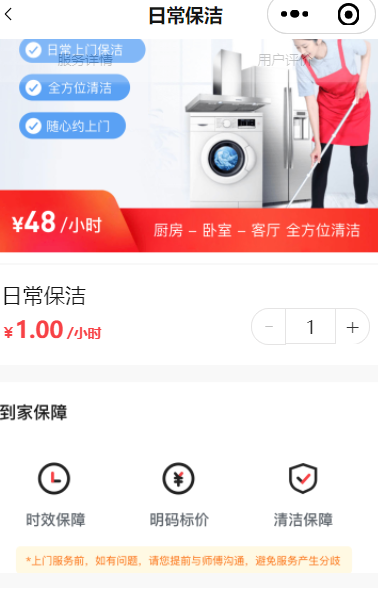

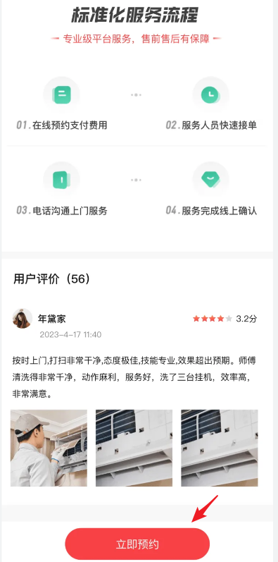

##### 填写预约信息

点击立即预约填写预约信息：

选择上门服务地址，此地址从我的地址簿中选择。

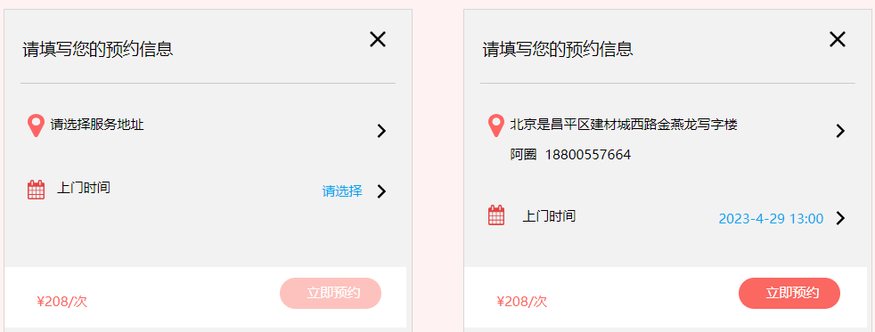

选择上门时间

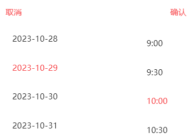

填写完成点击“立即预约”

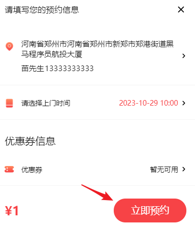

预约信息包括如下内容：

服务项

预约人信息（预约人、电话等）

服务地址

服务时间


##### 结算页面

进入支付页面（结算页面）：

结算页面主要是计算订单价格，显示支付信息等内容。

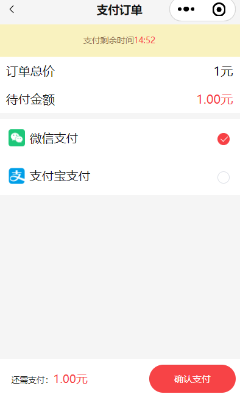

结算页面显示如下信息：

订单总价

实付金额

支付方式


##### 下单成功

支付成功下单完成。

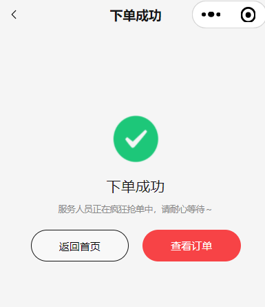


#### 3）订单状态

订单数据中有一个属性关系到订单的整个流程，就是订单状态。  

本项目订单状态共有7种，如下图：

<whiteboard token="CSVGwRwrJhpEVFbIwvHcIWsen5g"></whiteboard>


待支付：订单的初始状态。

派单中：用户支付成功后订单的状态由待支付变为派单中。

待服务：服务人员或机构抢单成功订单的状态由派单中变为待服务。

服务中：服务人员开始服务，订单状态变为服务中。

订单完成：服务人员完成服务订单状态变为订单完成。

已取消：订单是待支付状态时用户取消订单，订单状态变为已取消。

已关闭：订单已支付状态下取消订单后订单状态变为已关闭。

#### 4）小结

下单业务流程是什么？


订单的状态有哪些？


### 1.2 系统设计

#### 1.2.1 订单表设计

目标：能说出订单表的设计方法


##### 1）订单表设计方案

在设计订单表时通常采用的结构是订单主表与订单明细表一对多关系结构，比如：在电商系统中，一个订单购买的多件不同的商品，设计订单表和订单明细表：

订单表：记录订单号、订单金额、下单人、订单状态等信息。

订单明细表：记录该订单购买商品的信息，包括：商品名称、商品价格、交易价格、购买商品数量等。

如下图：

<whiteboard token="ZJ8xwN9v3hp9kFbCbWwcbEv3n5c"></whiteboard>

如果系统需求是一个订单只包括一种商品，此时无须记录订单明细，将购买商品的详细信息记录在订单表即可，设计字段包括：订单号、订单金额、下单人、订单状态、商品名称、购买商品数量等。                                                                                                                                                                                                                                                                                                                                                                                                       

下边根据需求设计本项目的订单表，本项目用户购买服务没有购物车，选择一个服务开始下单，所以本项目不设计订单明细表只设计订单表。

##### 2）表结构设计

下边设计本项目订单表的表结构。

除了订单号、订单金额、订单状态、下单人ID等字段外，订单表还存储哪些信息？

根据需求梳理预约下单提交的数据如下：

| 属性 | 含义 |
|-|-|
| 订单所属人 | 创建订单的用户id |
| 服务项 | 用户选择服务项 |
| 城市编码 | 用户定位的城市编码 |
| 单价 | 服务的单位 |
| 购买数量 | 购买服务的数量 |
| 订单总金额 | 单价乘以购买数量 |
| 优惠金额 | 根据优惠券计算的优惠金额 |
| 实际支付金额 | 订单总金额减去优惠金额 |
| 服务详细地址 | 家政服务的具体地址 |
| 服务开始时间 | 服务预约时间 |
| 联系人手机号 | 购买家政服务联系人的手机号 |
| 联系人姓名 | 购买家政服务联系人的姓名 |
| 经度 | 家政服务具体地址的经度，来源于我的地址 |
| 纬度 | 家政服务具体地址的纬度，来源于我的地址 |
| 订单状态 | 订单状态代码，下单后状态是未支付状态 |

通过分析，订单表包括以下几部分：

订单基础信息：订单号、订单状态、排序字段、是否显示标记等。

价格信息：单价、购买数量、优惠金额、订单总金额等。

下单人信息：下单人ID、联系方式、位置信息（相当于收货地址）等。

服务(商品)相关信息：服务类型名称、服务项名称、服务单价、价格单位、购买数量等。

服务信息相当于商品，如果有订单明细表要在订单明细表中存储，本项目将服务相关信息存储在订单表。


表结构如下

```Java
create table `jzo2o-orders`.orders
(
    id               bigint                             not null comment '订单id'
        constraint `PRIMARY`
        primary key,
    user_id          bigint                             not null comment '订单所属人',
    serve_type_id    bigint                             null comment '服务类型id',
    serve_type_name  varchar(50)                        null comment '服务类型名称',
    serve_item_id    bigint                             not null comment '服务项id',
    serve_item_name  varchar(50)                        null comment '服务项名称',
    serve_item_img   varchar(255)                       null comment '服务项图片',
    unit             int                                null comment '服务单位',
    serve_id         bigint                             not null comment '服务id',
    orders_status    int                                not null comment '订单状态，0：待支付，100：派单中，200：待服务，300：服务中，400：待评价，500：订单完成，600：已取消，700：已关闭',
    pay_status       int                                null comment '支付状态，2：待支付，4：支付成功',
    refund_status    int                                null comment '退款状态 1退款中 2退款成功 3退款失败',
    price            decimal(10, 2)                     not null comment '单价',
    pur_num          int      default 1                 not null comment '购买数量',
    total_amount     decimal(10, 2)                     not null comment '订单总金额',
    real_pay_amount  decimal(10, 2)                     not null comment '实际支付金额',
    discount_amount  decimal(10, 2)                     not null comment '优惠金额',
    city_code        varchar(20)                        not null comment '城市编码',
    serve_address    varchar(255)                       not null comment '服务详细地址',
    contacts_phone   varchar(20)                        not null comment '联系人手机号',
    contacts_name    varchar(255)                       not null comment '联系人姓名',
    serve_start_time datetime                           not null comment '服务开始时间',
    lon              double(10, 5)                      null comment '经度',
    lat              double(10, 5)                      null comment '纬度',
    pay_time         datetime                           null comment '支付时间',
    evaluation_time  datetime                           null comment '评价时间',
    trading_order_no bigint                             null comment '支付服务交易单号',
    transaction_id   varchar(50)                        null comment '第三方支付的交易号',
    refund_no        bigint                             null comment '支付服务退款单号',
    refund_id        varchar(50)                        null comment '第三方支付的退款单号',
    trading_channel  varchar(50)                        null comment '支付渠道',
    display          int      default 1                 null comment '用户端是否展示，1：展示，0：隐藏',
    sort_by          bigint                             null comment '排序字段，serve_start_time毫秒级时间戳+订单id后六位',
    create_time      datetime default CURRENT_TIMESTAMP not null,
    update_time      datetime default CURRENT_TIMESTAMP not null on update CURRENT_TIMESTAMP
)
    comment '订单表' charset = utf8mb4;
```


数据来源分析

| 字段名称 | 中文含义 | 来源 |
|-|-|-|
| id | 订单id | 自动生成  <br/>19位：2位年+2位月+2位日+13位序号 |
| user_id           | 订单所属人id | 从token中获取 |
| serve_id          | 服务id | 前端请求 |
| serve_type_id     | 服务类型id | 根据服务id远程调用运营基础服务查询 |
| serve_type_name   | 服务类型名称 | 根据服务id远程调用运营基础服务查询 |
| serve_item_id     | 服务项id | 根据服务id远程调用运营基础服务查询 |
| serve_item_name   | 服务项名称 | 根据服务id远程调用运营基础服务查询 |
| serve_item_img    | 服务项图片 | 根据服务id远程调用运营基础服务查询 |
| unit              | 服务单位 | 根据服务id远程调用运营基础服务查询 |
| orders_status     | 订单状态 | 设置为 未支付 |
| pay_status        | 支付状态 | 设置为 未支付 |
| price             | 单价 | 根据服务id远程调用运营基础服务查询 |
| pur_num           | 购买数量 | 前端请求 |
| total_amount      | 订单总金额 | 订单总金额 价格 \* 购买数量 |
| real_pay_amount   | 实际支付金额 | 实付金额 订单总金额 - 优惠金额 |
| discount_amount   | 优惠金额 | 根据优惠券和订单总金额计算优惠金额，暂时为0 |
| city_code         | 城市编码 | 根据服务id远程调用运营基础服务查询 |
| serve_address     | 服务详细地址 | 远程调用客户中心服务查询我的地址获得 |
| contacts_phone    | 联系人手机号 | 远程调用客户中心服务查询我的地址获得 |
| contacts_name     | 联系人姓名 | 远程调用客户中心服务查询我的地址获得 |
| serve_start_time  | 服务开始时间 | 前端请求 |
| lon               | 经度 | 远程调用客户中心服务查询我的地址获得 |
| lat               | 纬度 | 远程调用客户中心服务查询我的地址获得 |
| pay_time          | 支付时间 | 对接支付服务获取 |
| evaluation_time   | 评价时间 | 用户评价的时间，预留 |
| trading_order_no | 支付服务交易单号 | 对接支付服务，支付服务生成的交易单号，支付完成填充 |
| transaction_id | 第三方支付的交易号 | 微信支付的交易号，支付完成填充 |
| refund_no | 支付服务退款单号 | 对接支付服务，支付服务生成的退款单号，退款完成填充 |
| refund_id | 第三方支付的退款单号 | 微信支付的退款单号，退款完成填充 |
| trading_channel | 支付渠道 | 微信、支付等，支付完成填充 |
| display           | 用户端是否展示，1：展示，0：隐藏 | 默认为1 |
| sort_by | 排序字段 | *根据服务开始时间转为毫秒时间戳+订单后5位* |
| create_time       | 创建时间 | 数据库控制，默认当前时间 |
| update_time       | 更新时间 | 数据库控制，更新时默认当前时间 |

##### 3）小结

订单表是怎么设计的？


#### 1.2.2 搭建订单工程

目标：搭建订单工程。


##### 1）搭建订单工程

1. **搭建订单工程**

整个订单模块包括：订单管理、抢单、派单、历史订单四个小模块，对应的工程如下：

| **工程名** | **服务名** | **职责** |
|-|-|-|
| jzo2o-orders-base | 订单模块基础工程 | 提供数据模型、数据访问基础mapper，供其它工程通过maven依赖。 |
| jzo2o-orders-manager | 订单管理服务 | 预约下单、服务管理、取消订单等订单管理相关的接口。 |
| jzo2o-orders-seize | 抢单服务 | 为服务人员和机构抢单提供服务。 |
| jzo2o-orders-dispatch | 派单服务 | 根据派单规则自动为服务人员、机构派送订单。 |
| jzo2o-orders-history | 历史订单服务 | 订单冷热分离，历史订单查询接口。 |

jzo2o-orders-base作为其它四个工程的公共工程，提供订单模块基础的mapper接口、数据模型等内容。

课程提供的仓库地址：https://gitee.com/jzo2o-v2/jzo2o-orders.git

先fork再从自己仓库拉取代码，jzo2o-orders工程结构如下：

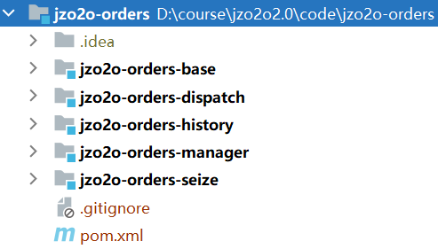

切换到dev_01分支，预约下单功能在dev_01分支下开发。


1. **创建订单数据库：jzo2o-orders**

从课程资料下SQL脚本目录获取jzo2o-orders-alone.sql,导入数据，如下：

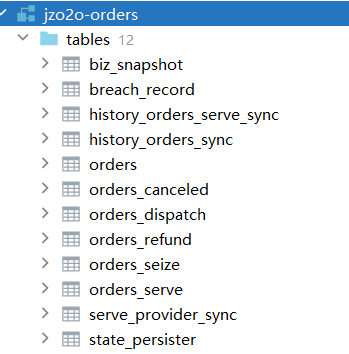

修改nacos中jzo2o-orders-manager.yaml：

屏蔽下边红框中的配置信息。

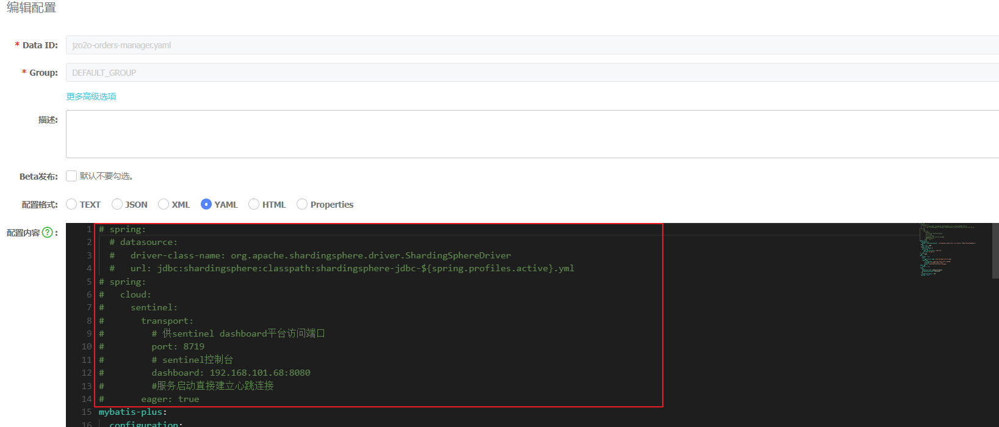

修改nacos中jzo2o-orders-seize.yaml：

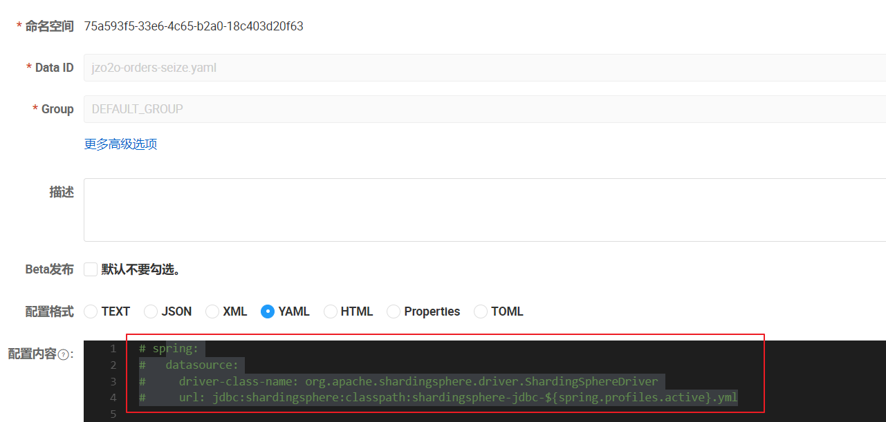

修改nacos中jzo2o-orders-dispatch.yaml：

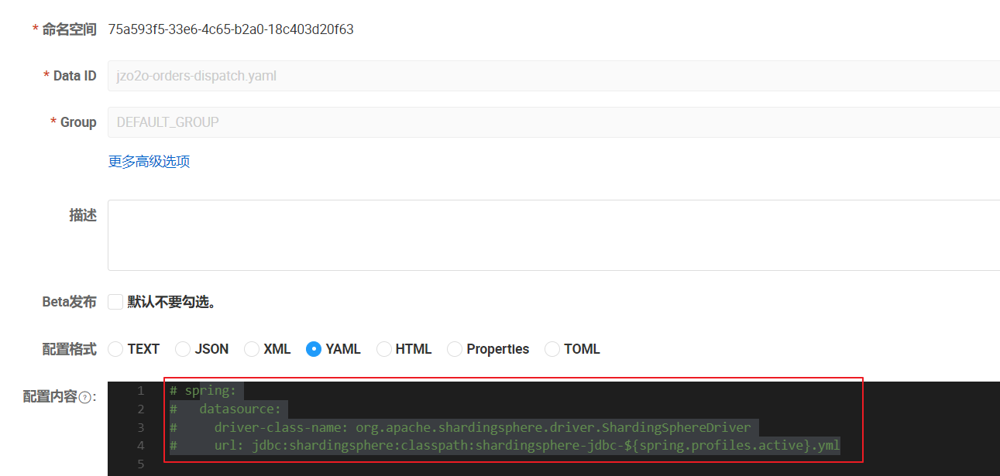


##### 2) 切换分支

基于jzo2o-customer工程的dev_01分支创建dev_02分支，然后使用下发的jzo2o-customer_dev02.zip覆盖dev_02下的代码。

创建数据库jzo2o-customer-all作为jzo2o-customer工程dev_02使用的数据库。

使用下发的jzo2o-customer-all.sql脚本导入jzo2o-customer-all数据库。

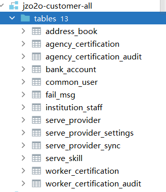


在jzo2o-foundations工程创建dev_03分支，然后使用jzo2o-foundations_dev03.zip覆盖dev_03下的代码。


##### 3) 小结

整个订单工程包括哪几部分？


#### 1.2.3 接口设计

目标：设计下单接口。

##### 1）设计接口

根据需求分析及订单表的设计进行接口分析：

除了serve_id、pur_num、serve_start_time 由前端传入以外还需要传入以下参数：

**优惠券ID**：用户选择优惠券，系统根据优惠券的信息计算优惠金额，需要前端传入优惠券的Id。

**我的地址簿ID**：用户从我的地址簿中选择地址，前端传入我的地址簿Id，系统从我的地址簿中查询服务地址及具体的经纬度坐标。

接口定义如下：

**接口名称**：下单接口

**接口功能**：普通用户创建订单

**接口路径**：**POST**/orders-manager/consumer/orders/place

**请求数据类型** application/json

**请求参数**

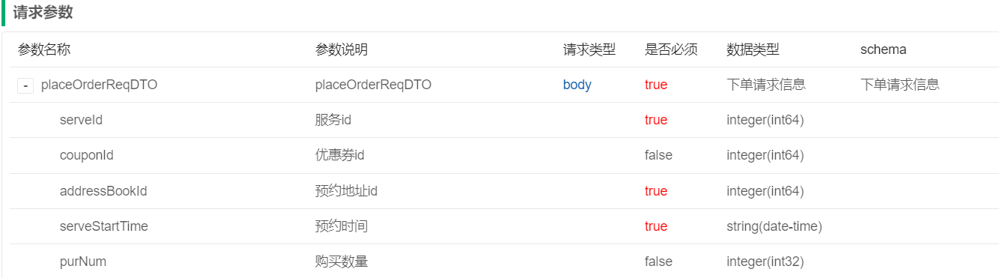

请求示例：

```Java
{
  "serveId": 0,
  "couponId": 0,
  "addressBookId": 0,
  "serveStartTime": "",
  "purNum": 0
}
```


**响应参数**

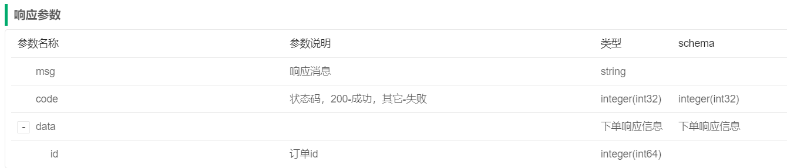

响应示例：

```Java
{
        "msg": "OK",
        "code": 200,
        "data": {
                "id": 0
        }
}
```

编写Controller方法：

```Java
package com.jzo2o.orders.manager.controller.consumer;

import com.jzo2o.orders.manager.model.dto.request.PlaceOrderReqDTO;
import com.jzo2o.orders.manager.model.dto.response.PlaceOrderResDTO;
import io.swagger.annotations.Api;
import io.swagger.annotations.ApiOperation;
import org.springframework.web.bind.annotation.PostMapping;
import org.springframework.web.bind.annotation.RequestBody;
import org.springframework.web.bind.annotation.RequestMapping;
import org.springframework.web.bind.annotation.RestController;

/**
 * @author itcast
 */
@RestController("consumerOrdersController")
@Api(tags = "用户端-订单相关接口")
@RequestMapping("/consumer/orders")
public class ConsumerOrdersController {
    @ApiOperation("下单接口")
    @PostMapping("/place")
    public PlaceOrderResDTO place(@RequestBody PlaceOrderReqDTO placeOrderReqDTO) {
        return null;
    }
}

```

##### 2) service实现思路

下边分析service实现思路，首先在IOrdersCreateService中定义下单方法

```Java
public interface IOrdersCreateService extends IService<Orders> {

    /**
     * 下单方法
     */
    PlaceOrderResDTO placeOrder(PlaceOrderReqDTO placeOrderReqDTO);

}
```

在实现类实现方法：

```JSON
package com.jzo2o.orders.manager.service.impl;

import com.baomidou.mybatisplus.extension.service.impl.ServiceImpl;
import com.jzo2o.orders.base.mapper.OrdersMapper;
import com.jzo2o.orders.base.model.domain.Orders;
import com.jzo2o.orders.manager.model.dto.response.PlaceOrderResDTO;
import com.jzo2o.orders.manager.service.IOrdersCreateService;
import lombok.extern.slf4j.Slf4j;
import org.springframework.stereotype.Service;

/**
 * <p>
 * 下单服务类
 * </p>
 *
 * @author itcast
 * @since 2023-07-10
 */
@Slf4j
@Service
public class OrdersCreateServiceImpl extends ServiceImpl<OrdersMapper, Orders> implements IOrdersCreateService {

    @Override
    public PlaceOrderResDTO placeOrder(PlaceOrderReqDTO placeOrderReqDTO) {

        //下单人信息，获取地址簿，调用jzo2o-customer服务获取

        //服务相关信息,调用jzo2o-foundations获取

        //生成订单号

        //计算价格

        //组装订单信息，插入数据库订单表，订单状态为待支付

        return null;
    }
}
```


##### 3）小结


下单接口的执行流程？


#### 1.2.4 订单号生成规则

##### 1）常见的订单号生成规则

1. **自增数字序列**

使用数据库的自增主键或者其他递增的数字序列（比如redis的INCR命令）作为订单号的一部分。例如，订单号可以是"202310280001"，其中"20231028"表示日期，"0001"是自增的订单序号。

1. **时间戳+随机数**

将年月日时分秒和一定范围内的随机数组合起来。例如，订单号可以是"20181028124523" + "1234"，其中"20181028124523"表示日期和时间，"1234"是随机生成的数字。

使用时间戳+随机数作为主键有重复的风险。

1. **订单类型+日期+序号**

将订单类型（例如"01"表示普通订单，"02"表示VIP订单等）、日期和序号组合起来。例如，订单号可以是"0101028100001"，其中"01"表示订单类型，"20181028"表示日期，"00001"是序号。

加上订单类型的好处是方便客户服务，根据订单号就可以知道订单的类型。

1. **分布式唯一ID生成器**

使用分布式唯一ID生成器（例如Snowflake雪花算法）生成全局唯一的ID作为订单号。这种方法保证了在分布式系统中生成的订单号的唯一性和有序性。 

Snowflake 算法根据机器ID、时间戳、序号等因素生成，保证全局唯一性，它的优势在于生成的 ID 具有趋势递增、唯一性、高效性等特点.

Snowflake 算法对系统时钟的依赖性较强，如果系统时钟发生回拨，可能会导致 ID 生成出现问题。因此，在使用 Snowflake 算法时，需要定时进行时钟同步，确保系统时钟的稳定性。


##### 2）本项目订单号生成规则

19位：2位年+2位月+2位日+13位序号

例如：2311011000000000001

实现方案：

1、前6位通过当前时间获取。

2、后13位通过Redis的INCR 命令实现。

```Java
INCR key

INCRBY key increment
```

##### 3）代码实现

定义订单管理的接口

```Java
@Slf4j
@Service
public class OrdersCreateServiceImpl extends ServiceImpl<OrdersMapper, Orders> implements IOrdersCreateService {

    @Resource
    private RedisTemplate<String, Long> redisTemplate;
    /**
     * 生成订单id 格式：{yyMMdd}{13位id}
     *
     * @return
     */
    private Long generateOrderId() {
        //通过Redis自增序列得到序号
        Long id = redisTemplate.opsForValue().increment(ORDERS_SHARD_KEY_ID_GENERATOR, 1);
        //生成订单号   2位年+2位月+2位日+13位序号
        long orderId = DateUtils.getFormatDate(LocalDateTime.now(), "yyMMdd") * 10000000000000L + id;
        return orderId;
    }
    ...
```


##### 4) 小结

常见的订单号生成规则有哪些？


### 1.3 系统开发


#### 1.3.1 下单接口实现

##### 1) Mapper实现

下单接口向orders表插入一条记录，使用Mybatis-Plus生成的Service类或Mapper接口即可实现，不用单独定义Mapper接口。

##### 2）熟悉远程接口

###### 查询地址簿远程接口

微服务之间远程调用的接口统一定义在jzo2o-api工程。

地址簿远程接口是根据地址簿ID查询地址簿信息，接口定义如下：

**接口路径**：**GET**/customer/inner/address-book/{id}

**请求数据类型** application/x-www-form-urlencoded

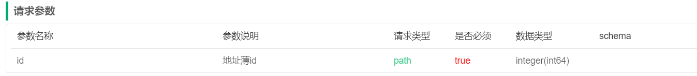

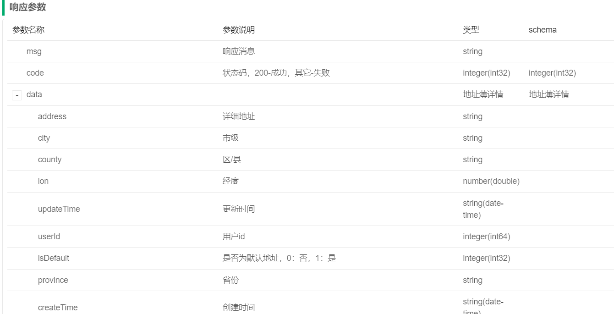

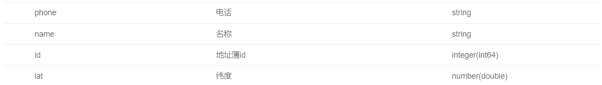

Feign接口如下：

```Java
package com.jzo2o.api.customer;

import com.jzo2o.api.customer.dto.response.AddressBookResDTO;
import com.jzo2o.api.customer.fallback.AddressBookApiFallbackFactory;
import io.swagger.annotations.ApiOperation;
import org.springframework.cloud.openfeign.FeignClient;
import org.springframework.web.bind.annotation.GetMapping;
import org.springframework.web.bind.annotation.PathVariable;
import org.springframework.web.bind.annotation.RequestParam;

import java.util.List;

/**
 * 内部接口 - 地址薄相关接口
 *
 * @author itcast
 */
//contextId 指定FeignClient实例的上下文id，如果不设置默认为类名，value指定微服务的名称，path:指定接口地址
@FeignClient(contextId = "jzo2o-customer", value = "jzo2o-customer", path = "/customer/inner/address-book")
public interface AddressBookApi {

    @GetMapping("/{id}")
    AddressBookResDTO detail(@PathVariable("id") Long id);
   
}
```


###### 查询服务信息远程接口

查询服务信息的Feign接口如下：

```Java
package com.jzo2o.api.foundations;

import com.jzo2o.api.foundations.dto.response.ServeAggregationResDTO;
import org.springframework.cloud.openfeign.FeignClient;
import org.springframework.web.bind.annotation.GetMapping;
import org.springframework.web.bind.annotation.PathVariable;
import org.springframework.web.bind.annotation.RequestParam;

import java.util.List;

@FeignClient(contextId = "jzo2o-foundations", value = "jzo2o-foundations", path = "/foundations/inner/serve")
public interface ServeApi {

    @GetMapping("/{id}")
    ServeAggregationResDTO findById(@PathVariable("id") Long id);

}
```

##### 2）Service实现

```Java
package com.jzo2o.orders.manager.service.impl;

import cn.hutool.db.DbRuntimeException;
import com.baomidou.mybatisplus.extension.service.impl.ServiceImpl;
import com.jzo2o.api.customer.AddressBookApi;
import com.jzo2o.api.customer.dto.response.AddressBookResDTO;
import com.jzo2o.api.foundations.ServeApi;
import com.jzo2o.api.foundations.dto.response.ServeAggregationResDTO;
import com.jzo2o.common.expcetions.BadRequestException;
import com.jzo2o.common.utils.DateUtils;
import com.jzo2o.common.utils.NumberUtils;
import com.jzo2o.common.utils.UserContext;
import com.jzo2o.orders.base.enums.OrderPayStatusEnum;
import com.jzo2o.orders.base.mapper.OrdersMapper;
import com.jzo2o.orders.base.model.domain.Orders;
import com.jzo2o.orders.manager.model.dto.request.PlaceOrderReqDTO;
import com.jzo2o.orders.manager.model.dto.response.PlaceOrderResDTO;
import com.jzo2o.orders.manager.service.IOrdersCreateService;
import lombok.extern.slf4j.Slf4j;
import org.springframework.data.redis.core.RedisTemplate;
import org.springframework.stereotype.Service;
import org.springframework.transaction.annotation.Transactional;

import javax.annotation.Resource;
import java.math.BigDecimal;
import java.time.LocalDateTime;

import static com.jzo2o.orders.base.constants.RedisConstants.Lock.ORDERS_SHARD_KEY_ID_GENERATOR;

/**
 * <p>
 * 下单服务类
 * </p>
 *
 * @author itcast
 * @since 2023-07-10
 */
@Slf4j
@Service
public class OrdersCreateServiceImpl extends ServiceImpl<OrdersMapper, Orders> implements IOrdersCreateService {

    @Resource
    private ServeApi serveApi;


    @Resource
    private AddressBookApi addressBookApi;
    
    @Resource
    private RedisTemplate<String, Long> redisTemplate;
    /**
     * 生成订单id 格式：{yyMMdd}{13位id}
     *
     * @return
     */
    private Long generateOrderId() {
        //通过Redis自增序列得到序号
        Long id = redisTemplate.opsForValue().increment(ORDERS_SHARD_KEY_ID_GENERATOR, 1);
        //生成订单号   2位年+2位月+2位日+13位序号
        long orderId = DateUtils.getFormatDate(LocalDateTime.now(), "yyMMdd") * 10000000000000L + id;
        return orderId;
    }
    @Override
    @Transactional(rollbackFor = Exception.class)
    public PlaceOrderResDTO placeOrder(PlaceOrderReqDTO placeOrderReqDTO) {
        // 1.数据校验
        // 校验服务地址
        AddressBookResDTO detail = addressBookApi.detail(placeOrderReqDTO.getAddressBookId());
        if (detail == null) {
            throw new BadRequestException("预约地址异常，无法下单");
        }
        // 服务
        ServeAggregationResDTO serveResDTO = serveApi.findById(placeOrderReqDTO.getServeId());
        //服务下架不可下单
        if (serveResDTO == null || serveResDTO.getSaleStatus() != 2) {
            throw new BadRequestException("服务不可用");
        }
    
    
        // 2.下单前数据准备
        Orders orders = new Orders();
        // id 订单id
        orders.setId(generateOrderId());
        // userId，从threadLocal获取当前登录用户的id，通过UserContextInteceptor拦截进行设置
        Long userId = UserContext.currentUserId();
        if(userId == null){
            throw new BadRequestException("用户信息异常，无法下单");
        }
        orders.setUserId(userId);
        // 服务id
        orders.setServeId(placeOrderReqDTO.getServeId());
        // 服务项id
        orders.setServeItemId(serveResDTO.getServeItemId());
        orders.setServeItemName(serveResDTO.getServeItemName());
        orders.setServeItemImg(serveResDTO.getServeItemImg());
        orders.setUnit(serveResDTO.getUnit());
        //服务类型信息
        orders.setServeTypeId(serveResDTO.getServeTypeId());
        orders.setServeTypeName(serveResDTO.getServeTypeName());
        // 订单状态
        orders.setOrdersStatus(OrderStatusEnum.NO_PAY.getStatus());
        // 支付状态，暂不支持，初始化一个空状态
        orders.setPayStatus(OrderPayStatusEnum.NO_PAY.getStatus());
        // 服务时间
        orders.setServeStartTime(placeOrderReqDTO.getServeStartTime());
        // 城市编码
        orders.setCityCode(serveResDTO.getCityCode());
        // 地理位置
        orders.setLon(detail.getLon());
        orders.setLat(detail.getLat());
    
        String serveAddress = new StringBuffer(detail.getProvince())
                .append(detail.getCity())
                .append(detail.getCounty())
                .append(detail.getAddress())
                .toString();
        orders.setServeAddress(serveAddress);
        // 联系人
        orders.setContactsName(detail.getName());
        orders.setContactsPhone(detail.getPhone());
    
        // 价格
        orders.setPrice(serveResDTO.getPrice());
        // 购买数量
        orders.setPurNum(NumberUtils.null2Default(placeOrderReqDTO.getPurNum(), 1));
        // 订单总金额 价格 * 购买数量
        orders.setTotalAmount(orders.getPrice().multiply(new BigDecimal(orders.getPurNum())));
    
        // 优惠金额 当前默认0
        orders.setDiscountAmount(BigDecimal.ZERO);
        // 实付金额 订单总金额 - 优惠金额
        orders.setRealPayAmount(NumberUtils.sub(orders.getTotalAmount(), orders.getDiscountAmount()));
        //排序字段,根据服务开始时间转为毫秒时间戳+订单后5位
        long sortBy = DateUtils.toEpochMilli(orders.getServeStartTime()) + orders.getId() % 100000;
        orders.setSortBy(sortBy);
        //支付超时时间 定为30分钟后，极端情况下可能在到达超时用户进行支付，这里超时时间多出5分钟，定时任务根据此时间查询超时订单并进行取消
        orders.setOverTime(LocalDateTime.now().plusMinutes(35));
        //保存订单
        boolean save = this.save(orders);
        if (!save) {
            throw new DbRuntimeException("下单失败");
        }
    
        return new PlaceOrderResDTO(orders.getId());
    }


}
```


##### 3) Controller实现

```Java
package com.jzo2o.orders.manager.controller.consumer;

import com.jzo2o.orders.manager.model.dto.request.PlaceOrderReqDTO;
import com.jzo2o.orders.manager.model.dto.response.PlaceOrderResDTO;
import com.jzo2o.orders.manager.service.IOrdersCreateService;
import io.swagger.annotations.Api;
import io.swagger.annotations.ApiOperation;
import org.springframework.web.bind.annotation.PostMapping;
import org.springframework.web.bind.annotation.RequestBody;
import org.springframework.web.bind.annotation.RequestMapping;
import org.springframework.web.bind.annotation.RestController;

import javax.annotation.Resource;

/**
 * @author itcast
 */
@RestController("consumerOrdersController")
@Api(tags = "用户端-订单相关接口")
@RequestMapping("/consumer/orders")
public class ConsumerOrdersController {

    @Resource
    private IOrdersCreateService ordersCreateService;

    @ApiOperation("下单接口")
    @PostMapping("/place")
    public PlaceOrderResDTO place(@RequestBody PlaceOrderReqDTO placeOrderReqDTO) {
        PlaceOrderResDTO placeOrderResDTO = ordersCreateService.placeOrder(placeOrderReqDTO);
        return placeOrderResDTO;
    }
}
```

##### 4) 测试

测试流程：

启动jzo2o-foundations服务

启动jzo2o-customer服务。

启动jzo2o-publics服务。

启动jzo2o-gateway服务。

启动jzo2o-orders-manager服务。

打开小程序进行下单。

打开小程序，进入首页，点击一个服务进行预约下单。

预期结果：下单成功向orders表写入一条记录，注意观察数据的正确性。


#### 1.3.3 下单代码优化

##### 1)  事务方法优化

在事务方法中存在远程调用是否有问题？

下单方法中远程调用查询地址簿信息和服务信息，远程调用涉及网络传输，如果网络传输时间过长会增加数据库事务的时长，如果并发高会把数据库的链接消耗殆尽，导致系统不能正常工作。

将保存订单的代码移动add方法中，add方法只保存订单，去掉placeOrder方法上的@Transactional注解，在add方法上添加@Transactional注解，优化如下：

首先增加add方法用于保存订单：

```JSON
public interface IOrdersCreateService extends IService<Orders> {


    /**
     * 生成订单
     *
     * @param orders
     */
    void add(Orders orders);
}
```


编写方法实现：

```Java
package com.jzo2o.orders.manager.service.impl;

import cn.hutool.db.DbRuntimeException;
import com.baomidou.mybatisplus.extension.service.impl.ServiceImpl;
import com.jzo2o.api.customer.AddressBookApi;
import com.jzo2o.api.customer.dto.response.AddressBookResDTO;
import com.jzo2o.api.foundations.ServeApi;
import com.jzo2o.api.foundations.dto.response.ServeAggregationResDTO;
import com.jzo2o.common.expcetions.BadRequestException;
import com.jzo2o.common.utils.DateUtils;
import com.jzo2o.common.utils.NumberUtils;
import com.jzo2o.common.utils.UserContext;
import com.jzo2o.orders.base.enums.OrderPayStatusEnum;
import com.jzo2o.orders.base.mapper.OrdersMapper;
import com.jzo2o.orders.base.model.domain.Orders;
import com.jzo2o.orders.manager.model.dto.request.PlaceOrderReqDTO;
import com.jzo2o.orders.manager.model.dto.response.PlaceOrderResDTO;
import com.jzo2o.orders.manager.service.IOrdersCreateService;
import lombok.extern.slf4j.Slf4j;
import org.springframework.data.redis.core.RedisTemplate;
import org.springframework.stereotype.Service;
import org.springframework.transaction.annotation.Transactional;

import javax.annotation.Resource;
import java.math.BigDecimal;
import java.time.LocalDateTime;

import static com.jzo2o.orders.base.constants.RedisConstants.Lock.ORDERS_SHARD_KEY_ID_GENERATOR;

/**
 * <p>
 * 下单服务类
 * </p>
 *
 * @author itcast
 * @since 2023-07-10
 */
@Slf4j
@Service
public class OrdersCreateServiceImpl extends ServiceImpl<OrdersMapper, Orders> implements IOrdersCreateService {

    @Resource
    private ServeApi serveApi;


    @Resource
    private AddressBookApi addressBookApi;

    @Resource
    private IOrdersCreateService owner;

    @Resource
    private RedisTemplate<String, Long> redisTemplate;
    /**
     * 生成订单id 格式：{yyMMdd}{13位id}
     *
     * @return
     */
    private Long generateOrderId() {
        //通过Redis自增序列得到序号
        Long id = redisTemplate.opsForValue().increment(ORDERS_SHARD_KEY_ID_GENERATOR, 1);
        long orderId = DateUtils.getFormatDate(LocalDateTime.now(), "yyMMdd") * 10000000000000L + id;
        return orderId;
    }
    @Override
    public PlaceOrderResDTO placeOrder(PlaceOrderReqDTO placeOrderReqDTO) {
        // 1.数据校验
        // 校验服务地址
        AddressBookResDTO detail = addressBookApi.detail(placeOrderReqDTO.getAddressBookId());
        if (detail == null) {
            throw new BadRequestException("预约地址异常，无法下单");
        }
        // 服务
        ServeAggregationResDTO serveResDTO = serveApi.findById(placeOrderReqDTO.getServeId());
        //服务下架不可下单
        if (serveResDTO == null || serveResDTO.getSaleStatus() != 2) {
            throw new BadRequestException("服务不可用");
        }


        // 2.下单前数据准备
        Orders orders = new Orders();
        // id 订单id
        orders.setId(generateOrderId());
        // userId
        orders.setUserId(UserContext.currentUserId());
        // 订单状态
        orders.setOrdersStatus(0);
        // 支付状态，暂不支持，初始化一个空状态
        orders.setPayStatus(OrderPayStatusEnum.NO_PAY.getStatus());
        // 服务时间
        orders.setServeStartTime(placeOrderReqDTO.getServeStartTime());
        // 购买数量
        orders.setPurNum(NumberUtils.null2Default(placeOrderReqDTO.getPurNum(), 1));
        // 地理位置
        orders.setLon(detail.getLon());
        orders.setLat(detail.getLat());

        String serveAddress = new StringBuffer(detail.getProvince())
                .append(detail.getCity())
                .append(detail.getCounty())
                .append(detail.getAddress())
                .toString();
        orders.setServeAddress(serveAddress);
        // 联系人
        orders.setContactsName(detail.getName());
        orders.setContactsPhone(detail.getPhone());

        //服务类型信息
        orders.setServeTypeId(serveResDTO.getServeTypeId());
        orders.setServeTypeName(serveResDTO.getServeTypeName());
        // 服务id
        orders.setServeId(placeOrderReqDTO.getServeId());
        // 服务项id
        orders.setServeItemId(serveResDTO.getServeItemId());
        orders.setServeItemName(serveResDTO.getServeItemName());
        orders.setServeItemImg(serveResDTO.getServeItemImg());
        orders.setUnit(serveResDTO.getUnit());
        // 价格
        orders.setPrice(serveResDTO.getPrice());
        // 城市编码
        orders.setCityCode(serveResDTO.getCityCode());
        // 计算
        // 订单总金额 价格 * 购买数量
        orders.setTotalAmount(orders.getPrice().multiply(new BigDecimal(orders.getPurNum())));
        // 优惠金额 当前默认0
        orders.setDiscountAmount(BigDecimal.ZERO);
        // 实付金额 订单总金额 - 优惠金额
        orders.setRealPayAmount(NumberUtils.sub(orders.getTotalAmount(), orders.getDiscountAmount()));
        //排序字段,根据服务开始时间转为毫秒时间戳+订单后5位
        long sortBy = DateUtils.toEpochMilli(orders.getServeStartTime()) + orders.getId() % 100000;
        orders.setSortBy(sortBy);
        //保存订单
        this.add(orders);

        return new PlaceOrderResDTO(orders.getId());
    }

    @Transactional(rollbackFor = Exception.class)
    public void add(Orders orders) {
        boolean save = this.save(orders);
        if (!save) {
            throw new DbRuntimeException("下单失败");
        }
    }
}
```


##### 2）事务失效问题

1. **测试事务失效问题**

现在对优化后的代码进行测试，测试add方法是否可以进行事务控制，在add方法中添加异常代码：

```Java
@Transactional(rollbackFor = Exception.class)
public void add(Orders orders) {
    boolean save = this.save(orders);
    if (!save) {
        throw new DbRuntimeException("下单失败");
    }
    //测试事务失效
    int i=1/0;
}
```

如果事务可以被控制，当抛出异常数据库事务进行回滚，最终保存订单失败。

经过测试发现事务控制失败，当add方法抛出异常数据库事务并没有回滚，订单信息保存成功。

1. **解决事务失效问题**

这里为什么会事务失效呢？

首先要明白Spring进行事务控制是通过代理对象进行的，在调用add方法之前开启事务，方法执行结束提交事务。

跟踪add方法调用代码，如下图：

并不是通过代理对象执行的add方法。

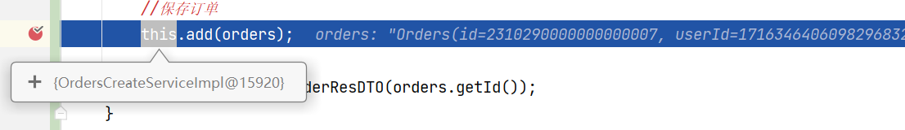

如果是在placeOrder方法上加@Transactional就可以进行事务控制，暂时先在placeOrder方法上添加@Transactional注解，我们跟踪placeOrder方法调用处的代码，在controller方法中调用的placeOrder方法，打断点，如下图：

的确是通过CGLIB代理对象调用的placeOrder方法。

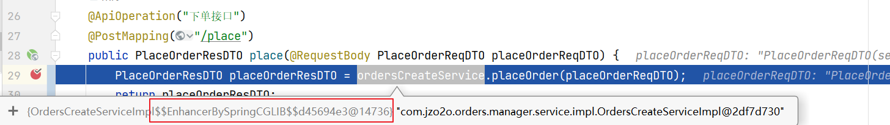

执行完成后控制台抛出了异常，事务被控制，订单数据没有保存成功。

执行原理如下图：

<whiteboard token="CyXEw1rc9hDdB3bX8gNcKXnUnhc"></whiteboard>

为什么placeOrder方法上没有加事务注解，add方法上添加事务注解不能控制事务呢？

首先placeOrder方法上没有加事务注解是不会在执行此方法之前开启事务的。

其次add方法上虽然上了事务注解，但是代理对象调用原始对象的placeOrder方法，在placeOrder方法中通过this.add()调用add方法，this就是原始对象本身并不是代理对象，所以并不是通过代理对象调用的add()，执行前并没有开启事务。

执行原理如下图：

<whiteboard token="LVXOwYEhBhp6zHbTFIgcvudmnth"></whiteboard>


如何解决呢？

在OrdersCreateServiceImpl注入OrdersCreateServiceImpl的代理对象，通过代理对象去调用add方法.

首先在IOrdersCreateService 接口中增加add方法，如下：

```Java
public interface IOrdersCreateService extends IService<Orders> {
    void add(Orders orders);
   ......
```

然后修改下单方法：

通过owner去调用add方法。

```Java
public class OrdersCreateServiceImpl extends ServiceImpl<OrdersMapper, Orders> implements IOrdersCreateService {

    //将自己的代理对象注入
    @Resource
    private IOrdersCreateService owner;
    
    ...
    
    @Override
    public PlaceOrderResDTO placeOrder(PlaceOrderReqDTO placeOrderReqDTO) {
        ...
        //保存订单
        owner.add(orders);
    
        return new PlaceOrderResDTO(orders.getId());
    }
```

重启订单管理服务继续进行测试，在owner.add(orders);打断点：

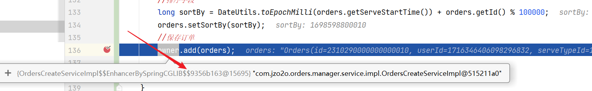

从上图可以看出这次是通过代理对象调用的add方法，并且add方法上添加事务注解，所以在执行add方法之前开启事务，执行add方法后提交事务。

方法执行完成事务控制成功，add方法抛出异常，事务回滚，订单保存失败，符合预期结果。


##### 3)  循环依赖问题

通过将自己注入自己，使用代理对象调用add方法解决了事务失效问题，但是有些同学有疑问，这样不会产生循环依赖吗？


1. **什么是循环依赖**

在 Spring 中，如果一个 bean 尝试将自身引用注入到自身中，通常会引发循环依赖。

首先搞清楚什么是循环依赖：

两个Bean，A依赖B，B依赖A就构成了循环依赖，如下图：

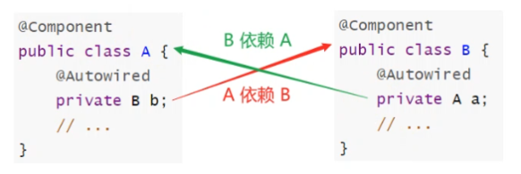

同样的道理，如果在A中注入A表示A依赖A，也就构成了循环依赖。

1. **Spring 如何解决循环依赖**

以上图为例说明Spring是如何处理循环依赖问题的？

首先按照常规的流程是：

创建A实例--》初始化A--》注入B--》创建B实例--》初始化B--》注入A

在初始化A时需要注入B，要注入B就需要创建B实例再初始化B，而在初始B时需要注入A，此时A还没有创建完成就陷入死循环。

针对循环依赖的问题Spring会上边的过程调整为下边的流程：

创建A实例--》创建B实例--》在B中注入A--》B初始化---》在A中注入B--》A初始化。

Spring是如何做到呢？

**Spring会延迟初始化**，B需要注入A,此时Spring会先实例化A，把一个半成品A注入给B，延迟A的初始化。

**循环依赖的底层原理是Spring通过三级缓存实现**：

1）**singletonObjects缓存**：这是 Spring 容器**用来缓存完全初始化好的单例 bean 实例的缓存**。当一个 bean 初始化完成后，它会被放入singletonObjects缓存中。这个缓存是单例 bean 的最终缓存，也是 BeanFactory 中保存 bean 的主要缓存。

2）**earlySingletonObjects缓存**：这个缓存是**用来保存被实例化但还未完全初始化的 bean 的引用**。当一个 bean 已经被实例化（但还未初始化）时，它会被放入earlySingletonObjects缓存中。

3）**singletonFactories缓存**：这个缓存保存的是用于创建 bean 实例的 ObjectFactory，用于支持循环依赖的延迟初始化。当一个 bean 被实例化，但尚未完全初始化时，Spring 会在singletonFactories缓存中查找该 bean 的ObjectFactory。这个ObjectFactory会在需要时被调用来完成 bean 的初始化。

Spring 通过这三级缓存的组合，来确保在循环依赖情况下，能够正常初始化 bean。当两个或多个 bean 之间存在循环依赖时，Spring  使用 singletonFactories 缓存来存储 bean 的对应工厂（ObjectFactory）。当一个 bean  在初始化过程中需要依赖另一个还未初始化的 bean 时，Spring 会调用相应的 ObjectFactory 来获取对应的 bean  实例，这样就实现了循环依赖的延迟初始化。一旦 bean 初始化完成，它就会被移动到singletonObjects缓存中。

举例：

创建A实例--》创建B实例--》在B中注入A--》B初始化---》在A中注入B--》A初始化。

创建A实例（半成品），在earlySingletonObjects放入A半成品。

创建B实例（半成品），在earlySingletonObjects放入B半成品。

在B中注入A，通过singletonFactories拿到A的对象工厂，通过对象工厂拿到A的半成品注入到B中。

B初始化完成，将B从earlySingletonObjects移动到singletonObjects**。**

A初始化完成，将A从earlySingletonObjects移动到singletonObjects**。**


1. **构造参数注入解决循环依赖问题**

虽然Spring可以解决上边通过成员变量注入引发的循环依赖问题，但是**通过构造参数注入引发的循环依赖问题是会报错。**

如下图：

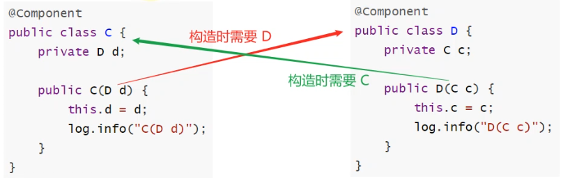

为什么上图中的循环依赖会报错呢？

因为创建C需要调用构造方法，而构造方法需要依赖D，此时C是无法实例化的，上边分析Spring解决循环依赖是通过延迟初始化，当出现循环依赖问题可以注入一个半成品，而这里连半成品都无法创建成功。

如何解决这种通过构造参数注入导致的循环依赖问题呢？

可以在C或D的任意一方注入另一方的代理对象而不是注入原始对象，如下：

假设在C的构造方法中注入D的代理对象可以写为：

在构造参数前加@Lazy注解，表示注入D的代理对象。

```Java
public C(@Lazy D d){
...
}
```


1. 分析本项目自已注入自己没有循环依赖的原因

我们在OrdersCreateServiceImpl 中注入的是OrdersCreateServiceImpl 的代理对象，并不是OrdersCreateServiceImpl 本身实例，构不成循环依赖。


即使向OrdersCreateServiceImpl 注入的是本身实例也不会报错，Spring通过三级缓存解决循环依赖，会先向成员变量注入一个半成品实例，而后再完成初始化，过程如下：

创建A实例-->向A注入自己-->完成A初始化


##### 4) 小结

下单代码怎么优化的？

在数据库事务方法中不要加入网络请求的代码，这样会延长事务时间，占用数据库资源。

将数据库事务方法单独提到一个独立的方法中，这里存在非事务方法调用事务方法，要通过代理对象去调用事务方法，才能保证事务控制有效。


service方法事务失效的原因是什么？


Spring 如何解决循环依赖？


#### 1.3.4 防止重复提交订单

##### 1）什么情况下会重复提交订单？

以下情况会导致重复提交相同的订单：

网络延迟或不稳定： 当用户点击提交按钮后，由于网络延迟或不稳定，前端可能在等待服务端响应时，用户误以为操作未成功，多次点击提交按钮。

重复点击按钮： 用户可能会因为页面加载缓慢或其他原因感到不耐烦，多次点击提交按钮，导致重复提交订单。

页面刷新后的再次提交： 用户在订单提交后，如果刷新页面，浏览器可能会重新发送上一次的表单提交请求，导致订单的重复提交。

##### 2）如何防止重复提交相同的订单？

防止重复提交相同的订单就是保证创建订单方法的幂等性。

通常需要在前端和后端共同去完成：

###### **前端防重复提交**

**禁用提交按钮：** 在用户点击提交按钮后，立即将按钮禁用，防止用户多次点击。

**显示加载中状态：** 提交按钮点击后，显示加载中状态，防止用户再次点击。


1. **后端防重复提交**

###### 利用Token机制

- 生成Token：用户每次进入下单页面，前端会向服务器请求一个唯一的Token。
- 验证Token：用户提交订单时，需要携带这个Token一起发送。服务器接收到订单请求后，验证Token的有效性和唯一性，一旦Token被使用过就失效。
- 存储Token：可以将Token存放在Redis等缓存数据库中，并设置一定的过期时间。

<whiteboard token="Kc6dwMXJzh7KsqbMdTScghQ6n4b"></whiteboard>

###### **使用分布式锁**

以用户id+服务id作为分布式锁锁定下单接口10秒，10秒内该用户不能再次下同一个服务的订单。


<whiteboard token="WPEswhNmihX3subPueZcflfinZb"></whiteboard>


##### 3）使用分布锁实现

下边用分布式锁实现，修改下单方法，执行下单方法前获取分布式锁，锁的过期时间设置为30秒，30秒内同一个用户不允许重复购买同一个服务。

我们使用项目封装的Lock注解实现。

```Java
package com.jzo2o.redis.annotations;

import java.lang.annotation.ElementType;
import java.lang.annotation.Retention;
import java.lang.annotation.RetentionPolicy;
import java.lang.annotation.Target;
import java.util.concurrent.TimeUnit;


/**
 * @author Mr.M
 * @version 1.0
 * @description 分布式锁工具类
 * @date 2023/7/23 22:48
 */
@Retention(RetentionPolicy.RUNTIME)
@Target(ElementType.METHOD)
public @interface Lock {


    /**
     * 加锁key的表达式，支持表达式
     */
    String formatter();

    /**
     * 加锁时长
     */
    long time() default 5;

    /**
     * 阻塞超时时间，默认2分钟,当block为true的时候生效
     */
    long waitTime() default 120;

    /**
     * 加锁时间单位
     */
    TimeUnit unit() default TimeUnit.SECONDS;

    /**
     * 方法访问完后要不要解锁，默认自动解锁
     */
    boolean unlock() default true;

    /**
     * 如果设定了true将在获取锁时阻塞等待waitTime时间
     */
    boolean block() default false;

    /**
     * 是否启用自动续期,如果使用自动续期则unlock必须设置为true
     */
    boolean startDog() default false;

}
```

基于此注解编写AOP切面类LockAspect，通过代理对象实现加锁与释放锁功能。

LockAspect核心 代码如下：

```Java
@Around("@annotation(lock)")
public Object handleLock(ProceedingJoinPoint pjp, Lock lock) throws Throwable {
    //锁key的格式化字符，此字符串中有spEL表达式
    String formatter = lock.formatter();
    Method method = AspectUtils.getMethod(pjp);
    Object[] args = pjp.getArgs();
    //得到锁的key
    String redisKey = AspectUtils.parse(formatter, method, args);
    //获取锁阻塞等待的时间,如果是0表示去尝试获取锁，如果获取不到则结束
    long waitTime = 0;
    //阻塞等待获取锁
    if (lock.block()) {
        //根据时间单位转换成ms
        waitTime = lock.waitTime();
    }
    //加锁时长
    long time = lock.time();
    //启动看门狗自动续期
    if(lock.startDog()){
        time = -1;
        //如果设置自动续期必须在方法执行后释放锁
        if(!lock.unlock()){
            throw new BadRequestException(ErrorInfo.Msg.REQUEST_PARAM_ILLEGAL);
        }
    }
    //得到锁对象
    RLock rLock = redissonClient.getLock(redisKey);
    //尝试加锁
    boolean success = rLock.tryLock(waitTime,time, lock.unit());
    if (!success && !lock.block()) {
        //未阻塞要求的情况下未得到锁
        throw new BadRequestException(ErrorInfo.Msg.REQUEST_OPERATE_FREQUENTLY);
    }
    if (!success) {
        //阻塞情况下未得到锁，请求超时
        throw new RequestTimeoutException(ErrorInfo.Msg.REQUEST_TIME_OUT);
    }

    try {
        return pjp.proceed();
    } finally {
        if (lock.unlock()) {
            rLock.unlock();
        }
    }

}
```

锁名称：ORDERS:CREATE:LOCK:用户id:服务id

代码如下：

```Java
@Override
    public PlaceOrderResDTO placeOrder(PlaceOrderReqDTO placeOrderReqDTO) {
        Long userId = UserContext.currentUserId();
        return owner.placeOrder(userId,placeOrderReqDTO);
    }
    
    @Lock(formatter = "ORDERS:CREATE:LOCK:#{userId}:#{placeOrderReqDTO.serveId}", time = 30, waitTime = 1,unlock=false)
    public PlaceOrderResDTO placeOrder(Long userId,PlaceOrderReqDTO placeOrderReqDTO) {
        // 1.数据校验
        // 校验服务地址
        AddressBookResDTO detail = addressBookApi.detail(placeOrderReqDTO.getAddressBookId());
        if (detail == null) {
            throw new BadRequestException("预约地址异常，无法下单");
        }
        // 服务
        ServeAggregationResDTO serveResDTO = serveApi.findById(placeOrderReqDTO.getServeId());
        //服务下架不可下单
        if (serveResDTO == null || serveResDTO.getSaleStatus() != 2) {
            throw new BadRequestException("服务不可用");
        }
    
    
        // 2.下单前数据准备
        Orders orders = new Orders();
        // id 订单id
        orders.setId(generateOrderId());
        // userId，从threadLocal获取当前登录用户的id，通过UserContextInteceptor拦截进行设置
        Long userId = UserContext.currentUserId();
        if(userId == null){
            throw new BadRequestException("用户信息异常，无法下单");
        }
        orders.setUserId(userId);
        // 服务id
        orders.setServeId(placeOrderReqDTO.getServeId());
        // 服务项id
        orders.setServeItemId(serveResDTO.getServeItemId());
        orders.setServeItemName(serveResDTO.getServeItemName());
        orders.setServeItemImg(serveResDTO.getServeItemImg());
        orders.setUnit(serveResDTO.getUnit());
        //服务类型信息
        orders.setServeTypeId(serveResDTO.getServeTypeId());
        orders.setServeTypeName(serveResDTO.getServeTypeName());
        // 订单状态
        orders.setOrdersStatus(OrderStatusEnum.NO_PAY.getStatus());
        // 支付状态，暂不支持，初始化一个空状态
        orders.setPayStatus(OrderPayStatusEnum.NO_PAY.getStatus());
        // 服务时间
        orders.setServeStartTime(placeOrderReqDTO.getServeStartTime());
        // 城市编码
        orders.setCityCode(serveResDTO.getCityCode());
        // 地理位置
        orders.setLon(detail.getLon());
        orders.setLat(detail.getLat());
    
        String serveAddress = new StringBuffer(detail.getProvince())
                .append(detail.getCity())
                .append(detail.getCounty())
                .append(detail.getAddress())
                .toString();
        orders.setServeAddress(serveAddress);
        // 联系人
        orders.setContactsName(detail.getName());
        orders.setContactsPhone(detail.getPhone());
    
        // 价格
        orders.setPrice(serveResDTO.getPrice());
        // 购买数量
        orders.setPurNum(NumberUtils.null2Default(placeOrderReqDTO.getPurNum(), 1));
        // 订单总金额 价格 * 购买数量
        orders.setTotalAmount(orders.getPrice().multiply(new BigDecimal(orders.getPurNum())));
    
        // 优惠金额 当前默认0
        orders.setDiscountAmount(BigDecimal.ZERO);
        // 实付金额 订单总金额 - 优惠金额
        orders.setRealPayAmount(NumberUtils.sub(orders.getTotalAmount(), orders.getDiscountAmount()));
        //排序字段,根据服务开始时间转为毫秒时间戳+订单后5位
        long sortBy = DateUtils.toEpochMilli(orders.getServeStartTime()) + orders.getId() % 100000;
        orders.setSortBy(sortBy);
        //保存订单
        owner.add(orders);
        return new PlaceOrderResDTO(orderId);
    
    }
    
    @Transactional(rollbackFor = Exception.class)
    public void add(Orders orders) {
        boolean save = this.save(orders);
        if (!save) {
            throw new DbRuntimeException("下单失败");
        }
    }
```

##### 4) 测试

使用小程序针对同一个服务提交两次订单，两次提交的时间间隔小于30秒。

第一次提交成功

在30秒内针对同一个服务再次下单提示“请勿重复下单”

效果如下：

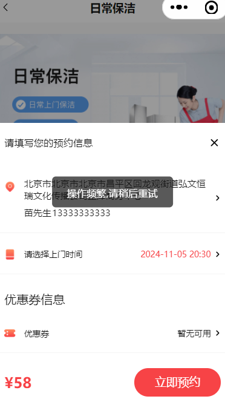

##### 5）小结

如何防止重复订单提交？


AOP在项目中有用吗？怎么用的？

- 日志
- 缓存
- 事务
- 分布式锁

#### 1.3.5 优惠券核销

##### 1.3.5.1 查询可用优惠券接口

###### 1) 交互流程

用户在下单界面可以选择可用的优惠券，订单管理服务调用优惠券服务查询可用的优惠券列表。

选择优惠券，提交订单，进行优惠券核销。

首先要实现订单管理服务远程调用优惠券服务查询可用优惠券。

<whiteboard token="ANeUwRgVXhtjP5bQ32vclV6Bnug"></whiteboard>

###### 2）接口定义

订单管理需要调用优惠券服务，传入订单金额。

用户还没有下单，订单金额需要根据服务ID和数量获取。

如下图，购买1台空调维护的订单金额是17元。

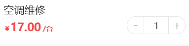

前端需要将服务ID和数量传给订单管理服务，计算出订单金额，再调用优惠券服务获取可用优惠券列表。

接口定义如下：

接口名称：获取可用优惠券

接口功能：用户下单，小程序请求订单管理服务接口查询可用的优惠券

接口路径：**GET** /orders-manager/consumer/orders/getAvailableCoupons

**请求数据类型** application/x-www-form-urlencoded

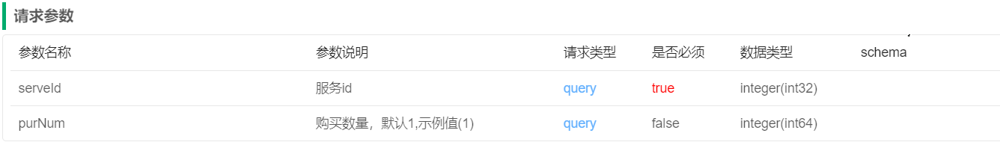

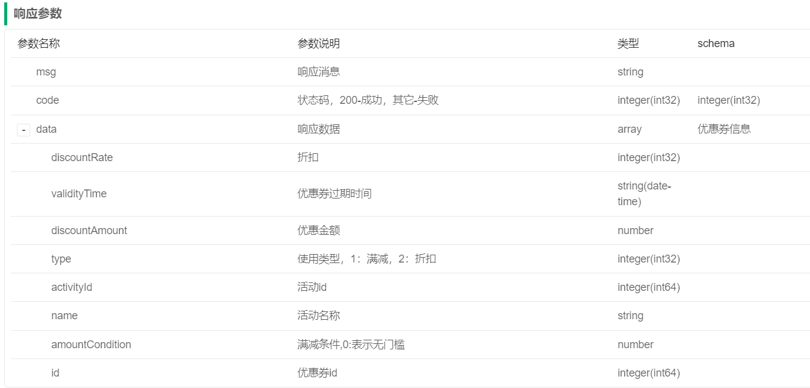

在订单管理服务编写controller定义可用优惠券查询接口：

```JSON
@RestController("consumerOrdersController")
@Api(tags = "用户端-订单相关接口")
@RequestMapping("/consumer/orders")
public class ConsumerOrdersController {

@GetMapping("/getAvailableCoupons")
@ApiOperation("获取可用优惠券")
@ApiImplicitParams({
        @ApiImplicitParam(name = "serveId", value = "服务id", required = true, dataTypeClass = Integer.class),
        @ApiImplicitParam(name = "purNum", value = "购买数量，默认1", required = false, dataTypeClass = Long.class)
})
public List<AvailableCouponsResDTO> getCoupons(@RequestParam(value = "serveId", required = true) Long serveId,
                                               @RequestParam(value = "purNum", required = false, defaultValue = "1") Integer purNum) {
    return null;
}
```

重启订单管理服务查看接口文档是否正确。


###### 3）**定义service接口**

```Java
package com.jzo2o.orders.manager.service;

import com.baomidou.mybatisplus.extension.plugins.pagination.Page;
import com.baomidou.mybatisplus.extension.service.IService;
import com.jzo2o.api.market.dto.request.CouponUseBackReqDTO;
import com.jzo2o.api.market.dto.response.AvailableCouponsResDTO;
import com.jzo2o.api.orders.dto.response.OrderResDTO;
import com.jzo2o.api.orders.dto.response.OrderSimpleResDTO;
import com.jzo2o.common.model.PageResult;
import com.jzo2o.common.model.msg.TradeStatusMsg;
import com.jzo2o.orders.base.model.domain.Orders;
import com.jzo2o.orders.manager.model.dto.OrderCancelDTO;
import com.jzo2o.orders.manager.model.dto.request.OrderPageQueryReqDTO;
import com.jzo2o.orders.manager.model.dto.request.OrdersPayReqDTO;
import com.jzo2o.orders.manager.model.dto.request.PlaceOrderReqDTO;
import com.jzo2o.orders.manager.model.dto.response.OperationOrdersDetailResDTO;
import com.jzo2o.orders.manager.model.dto.response.OrdersPayResDTO;
import com.jzo2o.orders.manager.model.dto.response.PlaceOrderResDTO;

import java.util.List;

/**
 * <p>
 * 订单表 服务类
 * </p>
 *
 * @author itcast
 * @since 2023-07-10
 */
public interface IOrdersCreateService extends IService<Orders> {

    /**
     * 获取可用优惠券
     *
     * @param serveId 服务id
     * @param purNum  购买数量
     * @return 可用优惠券列表
     */
    List<AvailableCouponsResDTO> getAvailableCoupons(Long serveId, Integer purNum);
    ...
```


**定义service接口实现**

```Java
@Service
public class OrdersCreateServiceImpl extends ServiceImpl<OrdersMapper, Orders> implements IOrdersCreateService {
...
@Resource
private ServeApi serveApi;

@Resource
private CouponApi couponApi;

@Override
public List<AvailableCouponsResDTO> getAvailableCoupons(Long serveId, Integer purNum) {
    // 1.获取服务
    ServeAggregationResDTO serveResDTO = serveApi.findById(serveId);
    if (serveResDTO == null || serveResDTO.getSaleStatus() != 2) {
        throw new BadRequestException("服务不可用");
    }
    CurrentUser currentUser = UserContext.currentUser();
    Long userId = currentUser.getId();
    // 2.计算订单总金额
    BigDecimal totalAmount = serveResDTO.getPrice().multiply(new BigDecimal(purNum));
    // 3.获取可用优惠券,并返回优惠券列表
    List<AvailableCouponsResDTO> available = couponApi.getAvailable(userId,totalAmount);
    return available;
}
```


###### 4) **定义controller方法**

```Java
package com.jzo2o.orders.manager.controller.consumer;

import cn.hutool.core.bean.BeanUtil;
import com.jzo2o.api.market.dto.response.AvailableCouponsResDTO;
import com.jzo2o.api.orders.dto.request.OrderCancelReqDTO;
import com.jzo2o.api.orders.dto.response.OrderResDTO;
import com.jzo2o.api.orders.dto.response.OrderSimpleResDTO;
import com.jzo2o.common.model.CurrentUserInfo;
import com.jzo2o.common.utils.UserContext;
import com.jzo2o.orders.manager.model.dto.OrderCancelDTO;
import com.jzo2o.orders.manager.model.dto.request.OrdersPayReqDTO;
import com.jzo2o.orders.manager.model.dto.request.PlaceOrderReqDTO;
import com.jzo2o.orders.manager.model.dto.response.OrdersPayResDTO;
import com.jzo2o.orders.manager.model.dto.response.PlaceOrderResDTO;
import com.jzo2o.orders.manager.service.IOrdersManagerService;
import io.swagger.annotations.Api;
import io.swagger.annotations.ApiImplicitParam;
import io.swagger.annotations.ApiImplicitParams;
import io.swagger.annotations.ApiOperation;
import org.springframework.web.bind.annotation.*;

import javax.annotation.Resource;
import java.util.List;

/**
 * @author itcast
 */
@RestController("consumerOrdersController")
@Api(tags = "用户端-订单相关接口")
@RequestMapping("/consumer/orders")
public class ConsumerOrdersController {
    @Resource
    private IOrdersCreateService  ordersCreateService;

    @GetMapping("/getAvailableCoupons")
    @ApiOperation("获取可用优惠券")
    @ApiImplicitParams({
            @ApiImplicitParam(name = "serveId", value = "服务id", required = true, dataTypeClass = Integer.class),
            @ApiImplicitParam(name = "purNum", value = "购买数量，默认1", required = false, dataTypeClass = Long.class)
    })
    public List<AvailableCouponsResDTO> getCoupons(@RequestParam(value = "serveId", required = true) Long serveId,
                                                   @RequestParam(value = "purNum", required = false, defaultValue = "1") Integer purNum) {
        return ordersCreateService.getAvailableCoupons(serveId, purNum);
    }
    ...
```

###### 5）接口测试

测试流程：

启动优惠券服务

启动客户管理服务

启动订单服务

启动网关

启动运营管理前端

创建优惠券活动，设置门槛比较低或者创建折扣类的优惠券。

通过立即发券接口向用户发放优惠券

打开小程序进行下单，在选择优惠券界面跟踪“查询可用优惠券”接口。

预期：

查到可用的优惠券。


示例：

创建两个优惠券活动：全场八折、全场七折，注意活动开始时间设置和当前时间很近。

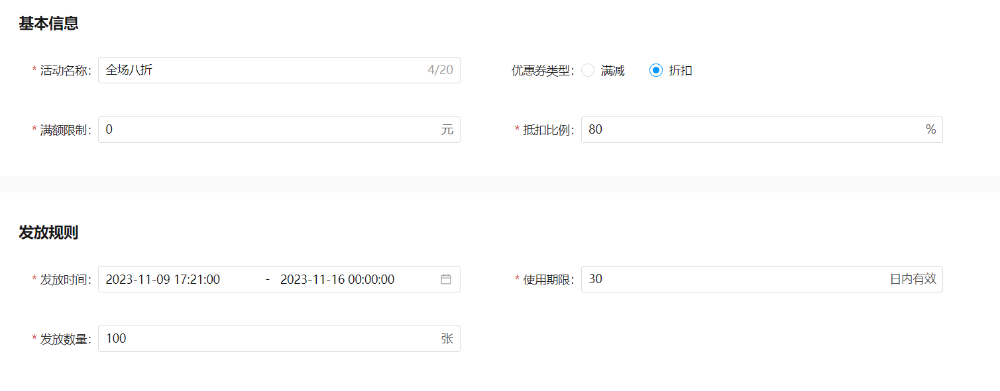

修改数据库表中的活动发放开始时间（改成当前之前）

启动定时任务，修改活动状态（改成进行中）

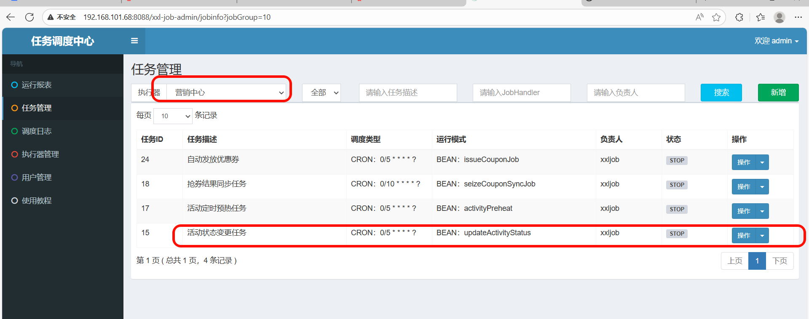

使用立即发放优惠券接口向指定用户发放优惠券。

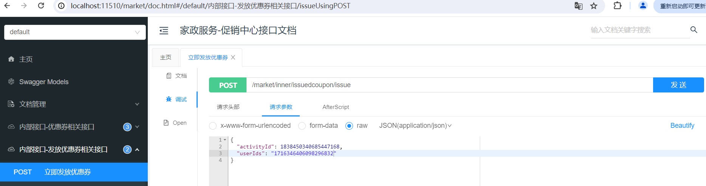

在下单界面查看可用的优惠券

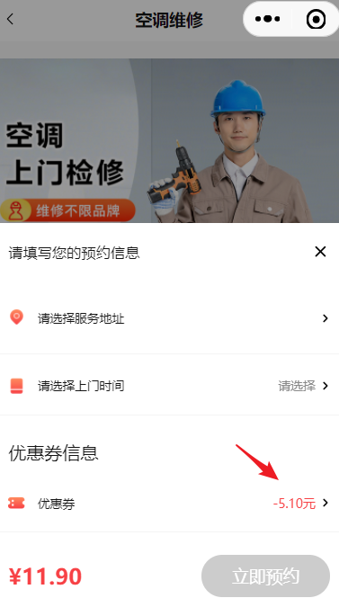

优惠金额最大的排在最上边：

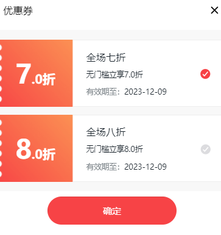


##### 1.3.5.2 优惠券核销

###### 1）交互流程

下单时核销优惠券，创建订单和核销优惠券需要保证事务一致性，要么两者都成功，要么两者都失败。

这里存在分布式事务，如下图：

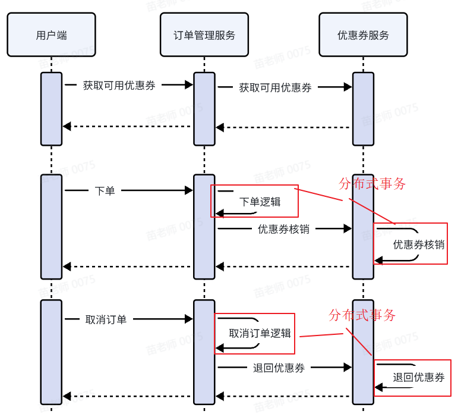

所以首先我们要实现分布式事务控制，这里使用Seata控制分布式事务。


###### 2）启动seata 的事务协调器

启动seata容器(TC)： docker start seata-server 

测试,登录地址http://192.168.101.68:7099,账号和密码均为seata/seata，首次登录可能会慢

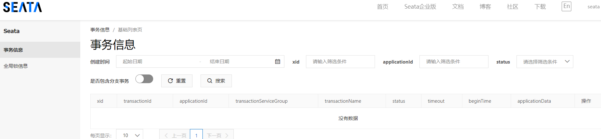


###### 3) 配置seata环境

修改订单管理服务的bootstrap.yml，添加seata配置文件

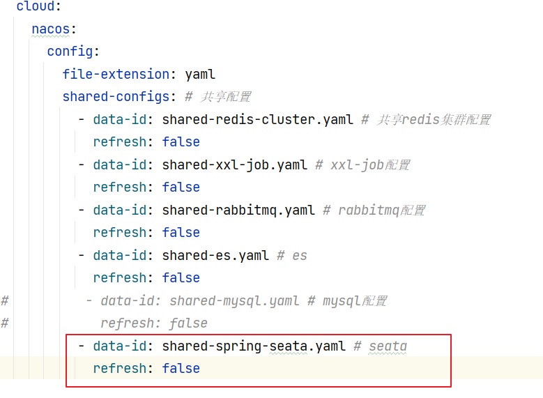

在订单基础工程jzo2o-orders-base和优惠券工程jzo2o-market中添加seata依赖

```JSON
<dependency>
    <groupId>com.jzo2o</groupId>
    <artifactId>jzo2o-seata</artifactId>
</dependency>
```


在订单的数据库和优惠券数据库中创建undo_log表，此表记录每个分支事务的undo_log信息。

```JSON
create table `数据库名`.undo_log
(
    id            bigint auto_increment
        primary key,
    branch_id     bigint       not null,
    xid           varchar(100) not null,
    context       varchar(128) not null,
    rollback_info longblob     not null,
    log_status    int          not null,
    log_created   datetime     not null,
    log_modified  datetime     not null,
    ext           varchar(100) null,
    constraint ux_undo_log
        unique (xid, branch_id)
)
    charset = utf8;
```


###### 2) 修改下单方法

根据需求，下边在下单接口中调用优惠券核销接口，在核销优惠券方法中开启全局事务。

定义使用优惠券下单的接口

```JSON
public interface IOrdersCreateService extends IService<Orders> {
    /**
     * 使用优惠券下单
     * @param orders 订单信息
     * @param couponId 优惠券id
     */
    public void addWithCoupon(Orders orders, Long couponId);
    ...
```

service实现方法：

```JSON
@Service
@Slf4j
public class OrdersCreateServiceImpl extends ServiceImpl<OrdersMapper, Orders> implements IOrdersCreateService {

@Resource
private CouponApi couponApi;

@GlobalTransactional
public void addWithCoupon(Orders orders, Long couponId) {
    CouponUseReqDTO couponUseReqDTO = new CouponUseReqDTO();
    couponUseReqDTO.setOrdersId(orders.getId());
    couponUseReqDTO.setId(couponId);
    couponUseReqDTO.setTotalAmount(orders.getTotalAmount());
    //优惠券核销
    CouponUseResDTO couponUseResDTO = couponApi.use(couponUseReqDTO);
    // 设置优惠金额
    orders.setDiscountAmount(couponUseResDTO.getDiscountAmount());
    // 计算实付金额
    BigDecimal realPayAmount = orders.getTotalAmount().subtract(orders.getDiscountAmount());
    orders.setRealPayAmount(realPayAmount);
    //保存订单
    owner.add(orders);
}

```

修改原有下单方法：

```JSON

@Override
public PlaceOrderResDTO placeOrder(PlaceOrderReqDTO placeOrderReqDTO) {
   ...
        //保存订单
//        owner.add(orders);
        // 使用优惠券下单
        if (ObjectUtils.isNotNull(placeOrderReqDTO.getCouponId())) {
            // 使用优惠券
            owner.addWithCoupon(orders, placeOrderReqDTO.getCouponId());
        } else {
            // 无优惠券下单，走本地事务
            owner.add(orders);
        }

        return new PlaceOrderResDTO(orders.getId());
}
```


###### 4) 测试

首先保证用户当前有未使用的优惠券。

通过立即发券接口向用户发放优惠券


测试流程：

启动jzo2o-foundations服务

启动jzo2o-customer服务。

启动jzo2o-publics服务。

启动jzo2o-gateway服务。

启动jzo2o-orders-manager服务。

启动jzo2o-market服务。

打开小程序进行下单。

打开小程序，进入首页，点击一个服务进行预约下单。


用户在下单界面选择一个优惠券

提交订单


启动：


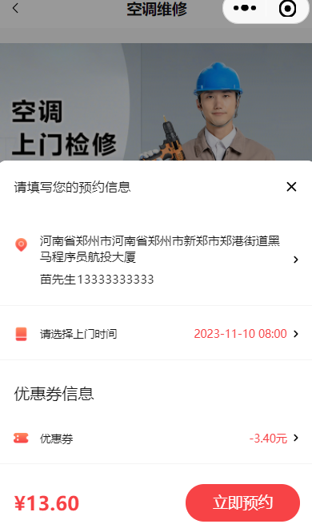

选择一张优惠券：

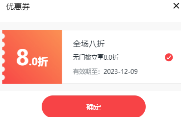

提交订单：

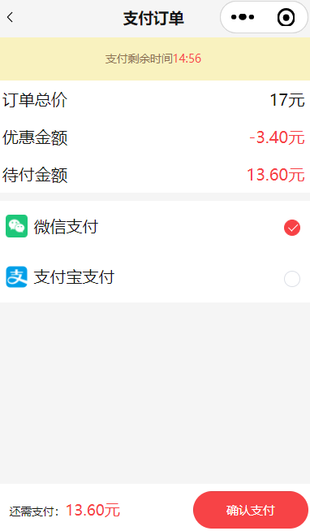

提交成功查看优惠券信息：

status：状态改为已使用

orders_id：使用优惠券的订单id

use_time：使用优惠券时间

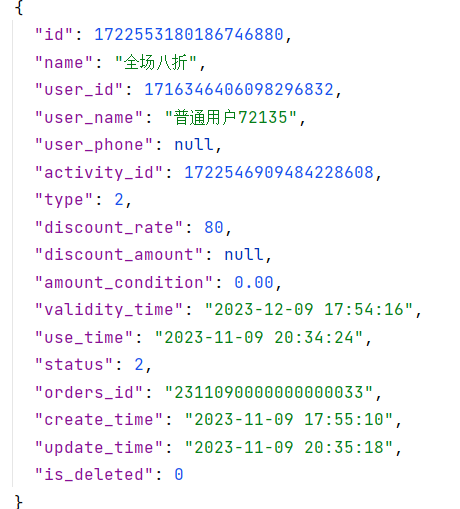


查看优惠券核销表：

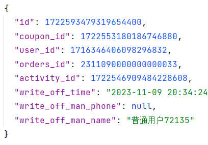


###### 5) 分布式事务控制测试

修改下单方法，在核销优惠券方法中模拟异常的代码：

```JSON
@GlobalTransactional
public void addWithCoupon(Orders orders, Long couponId) {
    CouponUseReqDTO couponUseReqDTO = new CouponUseReqDTO();
    couponUseReqDTO.setOrdersId(orders.getId());
    couponUseReqDTO.setId(couponId);
    couponUseReqDTO.setTotalAmount(orders.getTotalAmount());
    //优惠券核销
    CouponUseResDTO couponUseResDTO = couponApi.use(couponUseReqDTO);
    // 设置优惠金额
    orders.setDiscountAmount(couponUseResDTO.getDiscountAmount());
    // 计算实付金额
    BigDecimal realPayAmount = orders.getTotalAmount().subtract(orders.getDiscountAmount());
    orders.setRealPayAmount(realPayAmount);
    //保存订单
    owner.add(orders);
    //模拟异常
    int i=1/0;
}
```


重启订单管理服务和优惠券服务

重新下单，选择一个优惠券提交订单

预期结果：

下单异常，优惠券核销回滚


进入优惠券控制台查看关于seata事务回滚的日志：

```JSON
2023-11-09 21:23:08.472  INFO 9288 --- [h_RMROLE_1_5_16] i.s.c.r.p.c.RmBranchRollbackProcessor    : rm handle branch rollback process:xid=192.168.101.68:8091:27476477017228330,branchId=27476477017228332,branchType=AT,resourceId=jdbc:mysql://192.168.101.68:3306/jzo2o-market,applicationData={"autoCommit":false}
2023-11-09 21:23:08.472  INFO 9288 --- [h_RMROLE_1_5_16] io.seata.rm.AbstractRMHandler            : Branch Rollbacking: 192.168.101.68:8091:27476477017228330 27476477017228332 jdbc:mysql://192.168.101.68:3306/jzo2o-market
2023-11-09 21:23:08.494  INFO 9288 --- [h_RMROLE_1_5_16] i.s.r.d.undo.AbstractUndoLogManager      : xid 192.168.101.68:8091:27476477017228330 branch 27476477017228332, undo_log deleted with GlobalFinished
2023-11-09 21:23:08.495  INFO 9288 --- [h_RMROLE_1_5_16] io.seata.rm.AbstractRMHandler            : Branch Rollbacked result: PhaseTwo_Rollbacked
```

通过日志Branch Rollbacked result: PhaseTwo_Rollbacked可以看出分布式事务回滚完成。


## 3 取消未支付订单

### 3.1 技术方案

通常未支付订单在一定时间内如果不支付将会自动取消，这做的原因是为了释放资源，比如：库存资源。

#### 1）MQ延迟消息

创建订单并发送延迟消息，收到延迟时间判断订单是否支付，如果未支付则取消订单。

<whiteboard token="CxZgw95kJh67LNb07NMcCRM7nyg"></whiteboard>

- 死信交换机(DLX)+过期时间(TTL)
- 延迟插件

#### 2）定时任务加懒加载方式

**定时任务方式**：

创建订单成功在订单表记录支付超时时间，如果超时时间为15分钟则超时时间为下单时间加15分钟。

在数据库对支付超时时间字段和订单状态字段加索引。

定时任务每分钟扫描订单表中未支付状态且到达超时时间的订单，执行取消操作。

**懒加载方式：**

定时任务方式不能准时做到超时取消订单，这里可以通过懒加载方式实现，当用户查看订单详情时判断如果订单未支付且支付超时，此时触发订单取消操作**。**


#### 3）用户支付成功订单却自动取消怎么办？

举例说明：

用户在下单后14分钟59秒去支付订单，在用户打开支付窗口去支付时订单达到超时时间，此时自动取消订单，用户支付成功。

怎么解决此问题？

给用户留足够的时间进行支付即可，一般支付二维码失效时间在5分钟内失效，当用户开始支付时以支付时间为起点加上5分钟作为支付结束时间，如果支付结束时间超过了订单超时时间则更新订单的超时时间为此时间，否则不更新。

订单到达超时时间将不能进行支付。

如果万一有漏网之鱼，订单取消后过一段时间订单服务才收到用户支付成功的消息，此时系统要记录该支付记录并给用户退款。


#### 4）取消订单退回优惠券

订单取消后需要调用优惠券退回接口退回优惠券，这里需要进行分布式事务控制。


#### 5）本项目方案

前边我们使用了延迟消息取消订单的方案，本项目使用定时任务加懒加载的方式自动取消支付超时的订单。

### 3.2 定义取消订单方法

#### 1）需求分析

我们先实现手动取消订单，再由定时任务调用取消订单的方法。

用户在订单列表点击订单信息进入订单详情页面，点击“取消订单”

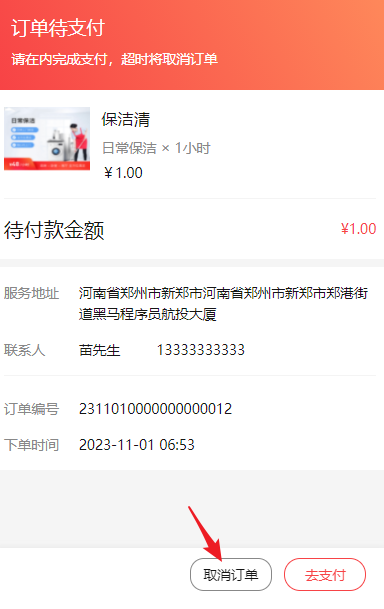

进入取消订单界面：

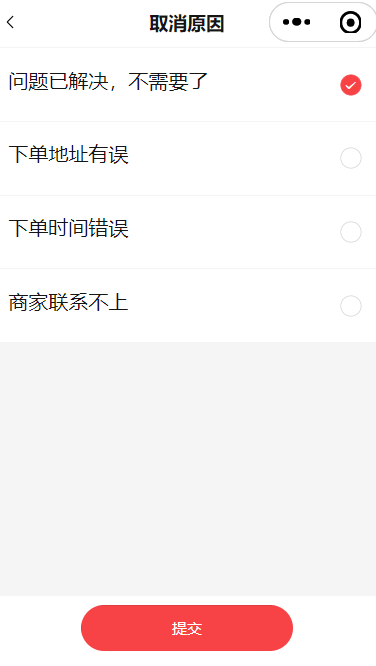

选择取消原因，点击“提交”。

在订单的不同状态下去取消订单其执行的逻辑是不同的，如下图：

<whiteboard token="OqsPwszadhTUDpbW465cGdEtnQd"></whiteboard>

本章先处理待支付状态取消订单，待支付状态取消订单后将订单状态改为已取消，并且在订单取消记录表保存取消订单的记录信息。

订单取消记录表结构如下：

```JSON
create table `jzo2o-orders`.orders_canceled
(
    id             bigint                             not null comment '订单id'
        constraint `PRIMARY`
        primary key,
    canceller_id   bigint                             null comment '取消人',
    canceler_name  varchar(50)                        null comment '取消人名称',
    canceller_type int                                null comment '取消人类型，1：普通用户，4：运营人员',
    cancel_reason  varchar(50)                        null comment '取消原因',
    cancel_time    datetime                           null comment '取消时间',
    create_time    datetime default CURRENT_TIMESTAMP not null comment '创建时间',
    update_time    datetime default CURRENT_TIMESTAMP not null on update CURRENT_TIMESTAMP comment '更新时间'
)
    comment '订单取消表' charset = utf8mb4;
```

#### 2）service方法

代码如下：

```JSON
public interface IOrdersManagerService extends IService<Orders> {

/**
 * 取消订单
 *
 * @param orderCancelDTO 取消订单模型
 */
void cancel(OrderCancelDTO orderCancelDTO);


...
```


方法实现：

```Java
@Service
public class OrdersManagerServiceImpl extends ServiceImpl<OrdersMapper, Orders> implements IOrdersManagerService {

//注入自己
@Resource
private OrdersManagerServiceImpl owner;

//注入ordersCanceledService
@Resource
private OrdersCanceledServiceImpl ordersCanceledService;


//注入ordersCommonService
@Resource
private OrdersCommonServiceImpl ordersCommonService;

/**
 * 取消订单
 *
 * @param orderCancelDTO 取消订单模型
 */
@Override
public void cancel(OrderCancelDTO orderCancelDTO) {
    //查询订单信息
    Orders orders = getById(orderCancelDTO.getId());

    if (ObjectUtil.isNull(orders)) {
        throw new DbRuntimeException("找不到要取消的订单,订单号：{}",orderCancelDTO.getId());
    }
    //订单状态
    Integer ordersStatus = orders.getOrdersStatus();
    //根据订单状态执行取消逻辑
    if(OrderStatusEnum.NO_PAY.getStatus()==ordersStatus){ //订单状态为待支付
        if (orders.getDiscountAmount().compareTo(BigDecimal.ZERO) > 0){
            
            owner.cancelWithCoupon(orderCancelDTO);
        }else{
            owner.cancelByNoPay(orderCancelDTO);
        }

    }else if(OrderStatusEnum.DISPATCHING.getStatus()==ordersStatus){ //订单状态为派单中
        //todo待完善
    }else{
        throw new CommonException("当前订单状态不支持取消");
    }

}

@GlobalTransactional
public void cancelWithCoupon(OrderCancelDTO orderCancelDTO) {
    //退回优惠券
    CouponUseBackReqDTO couponUseBackReqDTO = new CouponUseBackReqDTO();
    couponUseBackReqDTO.setUserId(orderCancelDTO.getCurrentUserId());
    couponUseBackReqDTO.setOrdersId(orderCancelDTO.getId());
    couponApi.useBack(couponUseBackReqDTO);
    //取消待支付订单
    owner.cancelNoPayOrder(orderCancelDTO);
}

//未支付状态取消订单
@Transactional(rollbackFor = Exception.class)
public void cancelByNoPay(OrderCancelDTO orderCancelDTO) {
    //保存取消订单记录
    OrdersCanceled ordersCanceled = BeanUtil.toBean(orderCancelDTO, OrdersCanceled.class);
    ordersCanceled.setCancellerId(orderCancelDTO.getCurrentUserId());
    ordersCanceled.setCancelerName(orderCancelDTO.getCurrentUserName());
    ordersCanceled.setCancellerType(orderCancelDTO.getCurrentUserType());
    ordersCanceled.setCancelTime(LocalDateTime.now());
    ordersCanceledService.save(ordersCanceled);
    //更新订单状态为取消订单
    OrderUpdateStatusDTO orderUpdateStatusDTO = new OrderUpdateStatusDTO();
    //订单id
    orderUpdateStatusDTO.setId(orderCancelDTO.getId());
    //原始订单状态
    orderUpdateStatusDTO.setOriginStatus(OrderStatusEnum.NO_PAY.getStatus());
    //目标状态
    orderUpdateStatusDTO.setTargetStatus(OrderStatusEnum.CANCELED.getStatus());
    int result = ordersCommonService.updateStatus(orderUpdateStatusDTO);
    if (result <= 0) {
        throw new DbRuntimeException("订单取消事件处理失败");
    }

}
```


#### 3）controller方法

```Java
@RestController("consumerOrdersController")
@Api(tags = "用户端-订单相关接口")
@RequestMapping("/consumer/orders")
public class ConsumerOrdersController {
...
    @PutMapping("/cancel")
    @ApiOperation("取消订单")
    public void cancel(@RequestBody OrderCancelReqDTO orderCancelReqDTO) {
        OrderCancelDTO orderCancelDTO = BeanUtil.toBean(orderCancelReqDTO, OrderCancelDTO.class);
        CurrentUserInfo currentUserInfo = UserContext.currentUser();
        orderCancelDTO.setCurrentUserId(currentUserInfo.getId());
        orderCancelDTO.setCurrentUserName(currentUserInfo.getName());
        orderCancelDTO.setCurrentUserType(currentUserInfo.getUserType());
        ordersManagerService.cancel(orderCancelDTO);
    }
    ...
```


#### 4）测试

测试流程：

新创建一个订单，不进行支付。

进入订单列表，点击订单信息进入订单详情页面，点击“取消订单”


预期结果：

查看订单表中订单状态改为600（已取消）

订单取消记录表orders_canceled是否成功插入一条记录。

优惠券表状态改为1（未使用）

删除优惠券核销表中的记录

给优惠券回退记录表中添加记录


### 3.3 实现定时任务取消订单

#### 1）查询超时订单

1. 定义service查询支付超时订单

```Java
public interface IOrdersCreateService extends IService<Orders> {

/**
 * 查询超时订单id列表
 *
 * @param count 数量
 * @return 订单id列表
 */
public List<Orders> queryOverTimePayOrdersListByCount(Integer count);
...
```

实现方法：

```Java
/**
 * 查询超时订单id列表
 *
 * @param count 数量
 * @return 订单id列表
 */
@Override
public List<Orders> queryOverTimePayOrdersListByCount(Integer count) {
    //查询订单状态为待支付，超时时间在当前时间之后的订单，查询count条，且只查询订单id和用户id字段
    List<Orders> list = lambdaQuery()
        //查询待支付状态的订单
        .eq(Orders::getOrdersStatus, OrderStatusEnum.NO_PAY.getStatus())
        //超时时间小于当前时间
        .lt(Orders::getOverTime, LocalDateTime.now())
        .last("limit " + count)
        .select(Orders::getId, Orders::getUserId)
        .list();
    return list;
}
```


#### 2）定义定时任务

```Java
package com.jzo2o.orders.manager.handler;

@Component
public class OrdersHandler {

//注入ordersCreateService
@Resource
private IOrdersCreateService ordersCreateService;

//注入ordersManagerService
@Resource
private IOrdersManagerService ordersManagerService;

/**
 * 支付超时取消订单
 * 每分钟执行一次
 */
@XxlJob(value = "cancelOverTimePayOrder")
public void cancelOverTimePayOrder() {

    //查询支付超时状态订单
    List<Orders> ordersList = ordersCreateService.queryOverTimePayOrdersListByCount(100);
    if (CollUtil.isEmpty(ordersList)) {
        XxlJobHelper.log("查询超时订单列表为空！");
        return;
    }

    for (Orders orders : ordersList) {
        //取消订单
        OrderCancelDTO orderCancelDTO = BeanUtil.toBean(orders, OrderCancelDTO.class);
        orderCancelDTO.setCurrentUserType(UserType.SYSTEM);
        orderCancelDTO.setCancelReason("订单超时支付，自动取消");
        ordersManagerService.cancel(orderCancelDTO);

    }
}
```

#### 3）测试

定时测试流程：

找一个超过30分钟未支付的订单，如果没有符合条件的订单可以修改订单表的over_time时间为当前时间之前。

在xxl-job中创建定时任务（每分钟执行一次），并启动任务。

在定时任务方法中打断点进行调试。

预期结果：

订单到达未支付超时时间由定时任务进行取消。

#### 4) 小结

自动取消支付超时订单怎么实现的？

1. 定时任务扫描支付超时的订单进行取消。
2. 懒加载方式取消订单

通过以上两种方式结合实现自动取消未支付订单。


### 3.4 懒加载方式取消订单

#### 1）定义懒加载方法

在订单详情service中添加

```Java
package com.jzo2o.orders.manager.service.impl;

@Slf4j
@Service
public class OrdersManagerServiceImpl extends ServiceImpl<OrdersMapper, Orders> implements IOrdersManagerService {

/**
 * 根据订单id查询
 *
 * @param id 订单id
 * @return 订单详情
 */
@Override
public OrderResDTO getDetail(Long id) {
    //查询订单
    Orders orders = queryById(id);
    //如果支付过期则取消订单
    orders = canalIfPayOvertime(orders);
    OrderResDTO orderResDTO = BeanUtil.toBean(orders, OrderResDTO.class);
    
    return orderResDTO;
}

/**
 * 如果支付过期则取消订单
 * @param orders
 */
private Orders canalIfPayOvertime(Orders orders){
    //订单到达超时时间则自动取消
    if(orders.getOrdersStatus()==OrderStatusEnum.NO_PAY.getStatus() && orders.getOverTime().isBefore(LocalDateTime.now())){
        //todo 查询最新支付状态，如果仍是未支付进行取消订单
        //取消订单
        OrderCancelDTO orderCancelDTO = new OrderCancelDTO();
        orderCancelDTO.setId(orders.getId());
        orderCancelDTO.setCurrentUserId(orders.getUserId());
        orderCancelDTO.setCurrentUserType(UserType.SYSTEM);
        orderCancelDTO.setCancelReason("订单超时支付，自动取消");
        cancel(orderCancelDTO);
        orders = getById(orders.getId());
    }
    return orders;
}

}
```

#### 2）测试


懒加载方式取消订单测试流程：

首先关闭支付超时取消订单的定时任务，以免影响被动取消功能。

找一个超过30分钟未支付的订单，如果没有符合条件的订单可以修改订单表的超时时间在当前时间之前。

在代码canalIfPayOvertime方法中打断点。

打开小程序，进入该订单的详情页面，跟踪代码执行过程。

预期结果：

超时订单打开变为已取消。

示例：

在未什么中找到该订单，点击订单名称打开订单详情界面

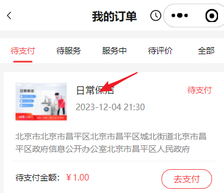


订单自动取消后进入订单详情页面显示“订单已取消”

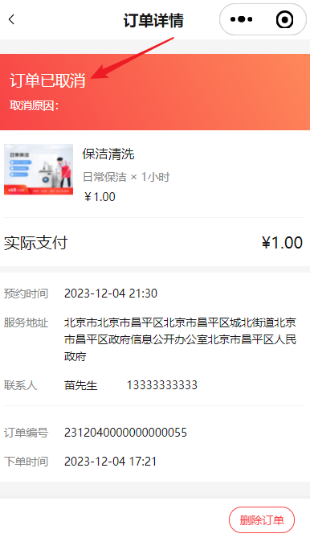


## 4 删除订单(自学)

### 1）需求分析

删除订单和取消订单不同，取消订单的目的是终止订单，删除订单是不希望订单信息出现订单列表中。

此需求通常是针对普通用户提供。

用户删除订单后订单信息将不在订单列表显示。

也有平台提供订单回收站查询功能，即查询已经删除的订单。

### 2）技术方案分析

根据需求，我们在订单表添加逻辑删除标记，删除订单相当于隐藏订单。

在订单表添加字段：display （*1：展示，0：隐藏*）

删除订单将此字段设置为0。

在订单列表中只查询display 为1的订单信息。

### 3）阅读代码

1. 接口定义

```JSON
@RestController("consumerOrdersController")
@Api(tags = "用户端-订单相关接口")
@RequestMapping("/consumer/orders")
public class ConsumerOrdersController {
    ...    
    @PutMapping("/hide/{id}")
    @ApiOperation("订单删除（隐藏）")
    @ApiImplicitParams({
            @ApiImplicitParam(name = "id", value = "订单id", required = true, dataTypeClass = Long.class)
    })
    public void hide(@PathVariable("id") Long id) {
        CurrentUserInfo currentUserInfo = UserContext.currentUser();
        ordersManagerService.hide(id, currentUserInfo.getUserType(), currentUserInfo.getId());
    }
    ...
```

1. service方法实现 

```JSON
/**
 * 用户端-订单删除（隐藏）
 *
 * @param id       订单id
 * @param userType 用户类型
 * @param userId   用户id
 */
@Override
@Transactional
public void hide(Long id, Integer userType, Long userId) {
    //1.校验用户类型是否为普通用户
    if (ObjectUtil.notEqual(userType, UserType.C_USER)) {
        throw new ForbiddenOperationException("非普通用户不可操作");
    }

    //2.校验该操作是否为本人
    Orders orders = queryById(id);
    if (ObjectUtil.notEqual(userId, orders.getUserId())) {
        throw new ForbiddenOperationException("非本人不可操作");
    }

    //3.校验订单状态，只能取消状态、关闭状态才能删除
    if (ObjectUtil.notEqual(OrderStatusEnum.CANCELED.getStatus(), orders.getOrdersStatus()) && ObjectUtil.notEqual(OrderStatusEnum.CLOSED.getStatus(), orders.getOrdersStatus())) {
        throw new ForbiddenOperationException("订单非取消、关闭状态不可操作");
    }

    //4.更新订单显示状态为隐藏
    displaySetting(id, EnableStatusEnum.DISABLE.getStatus());
}

@Override
public void displaySetting(Long id, Integer displayStatus) {
    LambdaUpdateWrapper<Orders> updateWrapper = Wrappers.<Orders>lambdaUpdate()
            .eq(Orders::getId, id)
            .set(Orders::getDisplay, displayStatus);
    super.update(updateWrapper);
}
```

---
> 来源：飞书技术知识库（脱敏版） · 07 业务组件方案集 / 云岚到家项目 / 第七章 订单模块 · [原文](https://ccn8v2zngwsm.feishu.cn/wiki/DpsXwsNiniqU9RkwwjAcqRJdnVM)
