# 第十二章 项目总结&部署

## 1 项目总结

参考：项目梳理思维导图。


## 2 项目部署

### 2.1 名词解释

#### 什么是DevOps

一个软件的生命周期包括：需求分析阶、设计、开发、测试、上线、维护、升级、废弃。

通过示例说明如下：

1、产品人员进行需求分析

2、设计人员进行软件架构设计和模块设计。

3、每个模块的开发人员并行开发，设计接口、进行编码，并进行单元测试

4、开发完毕，将代码集成部署到测试服务器，测试人员进行测试。

5、测试人员发现bug，提交bug、开发人员修改bug

6、bug修改完毕再次集成、测试。

7、测试完毕，项目上线。

8、运维人员进行安装部署、培训。

9、用户提出问题，返回给运维人员。

10、运维人员反馈给开发人员，开发人员进行问题处理。

11、再次提交测试。

12、测试完毕再次部署升级。

....

最后软件下线。

所以，在整体生命周期中比较核心的两个阶段是：开发阶段、维护阶段，开发阶段的成果是软件开发完成并成功上线，运维阶段则负责对软件进行维护和升级，而运维阶段通常在一个软件 的生命周期中占比最多。

提高开发阶段、运维阶段的工作效率是企业在进行软件项目管理的重点。

因此，专家提出了DevOps，DevOps是什么呢？

下边是摘自百度百科的定义：

DevOps（Development和Operations的组合词）是一组过程、方法与系统的统称，用于促进开发（[应用程序](https://baike.baidu.com/item/%E5%BA%94%E7%94%A8%E7%A8%8B%E5%BA%8F/5985445?fromModule=lemma_inlink)/软件工程）、技术运营和质量保障（[QA](https://baike.baidu.com/item/QA/476016?fromModule=lemma_inlink)）部门之间的沟通、协作与整合。

它是一种重视“[软件开发](https://baike.baidu.com/item/%E8%BD%AF%E4%BB%B6%E5%BC%80%E5%8F%91/3448966?fromModule=lemma_inlink)人员（Dev）”和“[IT运维](https://baike.baidu.com/item/IT%E8%BF%90%E7%BB%B4/5727814?fromModule=lemma_inlink)技术人员（Ops）”之间沟通合作的文化、运动或惯例。透过自动化“[软件交付](https://baike.baidu.com/item/%E8%BD%AF%E4%BB%B6%E4%BA%A4%E4%BB%98/638479?fromModule=lemma_inlink)”和“架构变更”的流程，来使得构建、测试、发布软件能够更加地快捷、频繁和可靠。

它的出现是由于软件行业日益清晰地认识到：为了按时交付[软件产品](https://baike.baidu.com/item/%E8%BD%AF%E4%BB%B6%E4%BA%A7%E5%93%81/6800028?fromModule=lemma_inlink)和服务，开发和运维工作必须紧密合作。

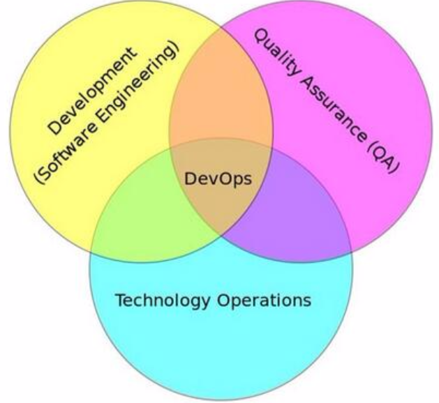

DevOps是一个工具吗？

DevOps是一个工作职位吗？

都不是。

DevOps是一种思想理念，它涵盖开发、测试、运维的整个过程。DevOps追求的目标是提高软件开发、测试、运维、运营等各部门的沟通与协作质量，DevOps强调软件开发人员与软件测试、软件运维、质量保障（QA）部门之间有效的沟通与协作，强调通过自动化的方法去管理软件变更、软件集成，使软件从构建到测试、发布更加快捷、可靠，最终按时交付软件。

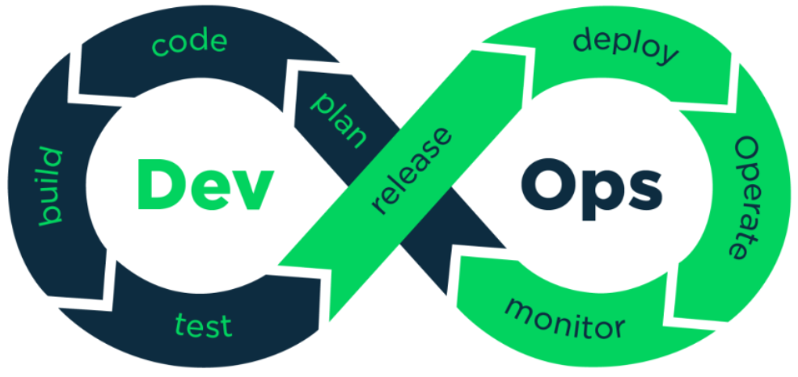

#### 什么是CI/CD

如何来落地实现DevOps呢？

DevOps兴起于2009年，近年来由于云计算、互联网的发展，促进了DevOps的基础设施及工具链的发展，涌现了一大批优秀的工具，这些工具包括开发、测试、运维的各各领域，例如：GitHub、Docker、Jenkins、Hudson、K8S、Ant/Maven/Gradle、Selenium、QUnit、JMeter等。下图是DevOps相关的工具集：

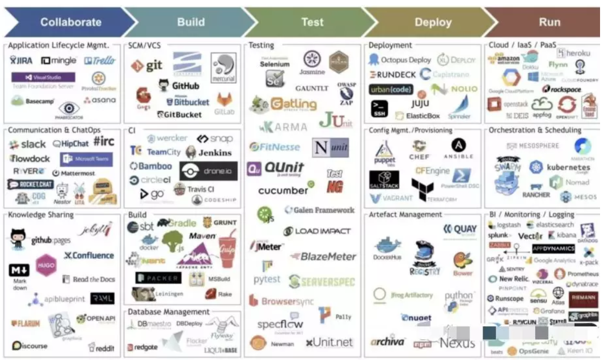

好的工具有利于DevOps的实施，但并不代表实施DevOps就一定需要去引入一堆工具。

问题的关键：如何解决问题，而不是具体应用工具。

CI/CD 是近年来企业有效实施DevOps的具体方案。

CI/CD 包含了一个 CI 和两个 CD，CI全称 Continuous Integration，表示持续集成，CD包含 Continuous Delivery和 Continuous Deployment，分别是持续交付和持续部署，三者具有前后依赖关系。

CI 持续集成：

持续集成倡导团队成员需要频繁的集成他们的工作，将开发分支合并到主分支，每次集成都通过自动化构建（包括编译、构建、自动化测试）来验证，从而尽快地发现集成中的错误，让产品可以快速迭代，同时还能保持高质量。

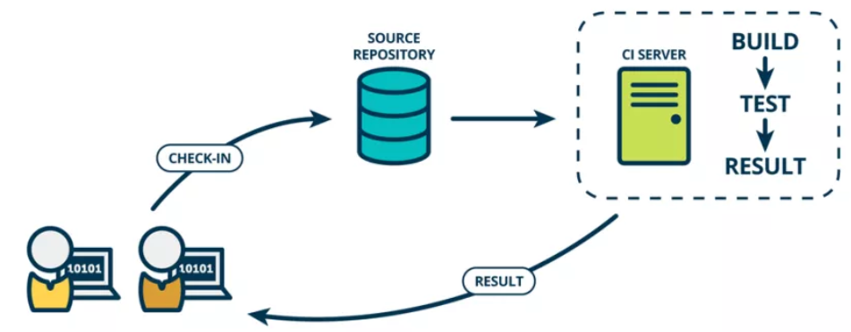

CD持续交付:

持续交付将集成后的代码部署到类生产环境(预发布)，除了交付到类生产环境之外，还会执行一些集成测试、API测试。持续交付强调的是“交付”，交付给测试、产品验收，不管怎么更新，软件是随时随地可以交付的。

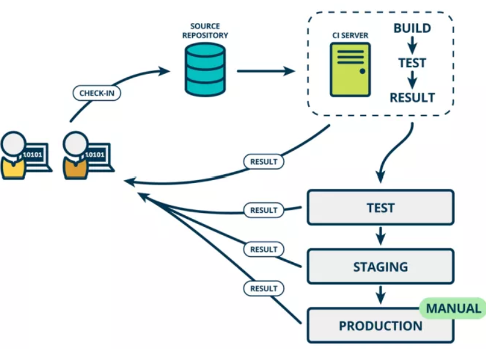

CD持续部署：

在持续交付的基础上由开发人员或运维人员自助式的定期向生产环境部署稳定的构建版本，持续部署的目标是代码在任何时刻都是可部署的，并可自动进入到生产环境。

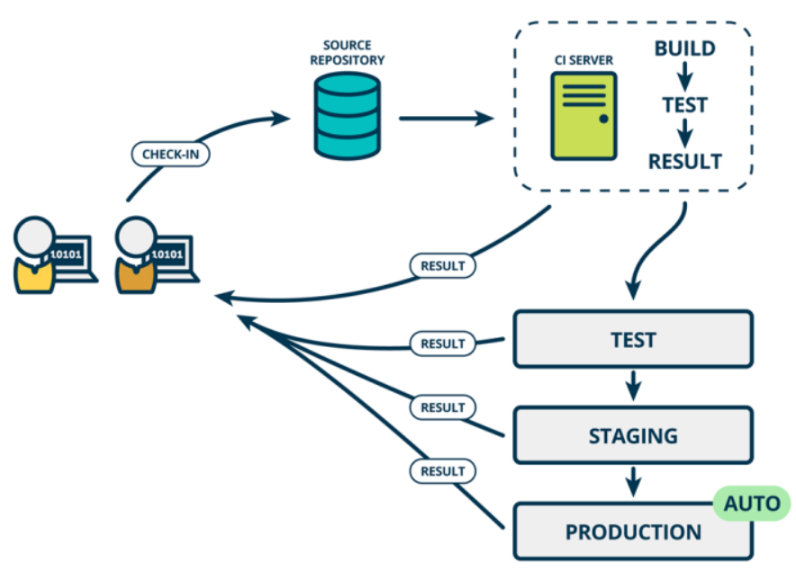


完整的CI/CD方案：

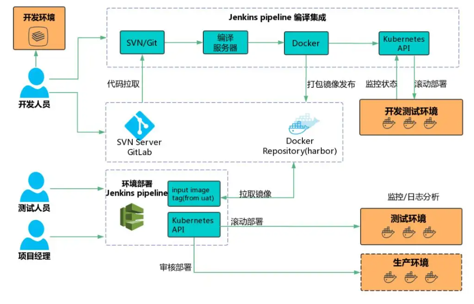

### 2.2 使用Kubernetes部署

#### 2.2.1 K8s介绍

##### K8s介绍

[Kubernetes](https://kubernetes.io/zh-cn/docs/concepts/overview/) 也称为 K8s（k和s中间有8个字母），**是用于自动部署、扩缩和管理容器化应用程序的开源系统**。它将组成应用程序的容器组合成逻辑单元，以便于管理和服务发现。Kubernetes 源自[Google 15 年生产环境的运维经验](http://queue.acm.org/detail.cfm?id=2898444)，同时凝聚了社区的最佳创意和实践。

简单的说k8s就是用来管理Docker的，当Docker容器过多如果手工部署增加了运维成本，用k8s它解决了许多复杂的问题。如自动部署，限制资源，自动重启、迁移故障，简化应用的访问等。

官网地址：https://kubernetes.io/zh-cn/


##### 组成结构

k8s是主从结构，`master`管理节点，与`node`工作节点相对。node干活master管理。

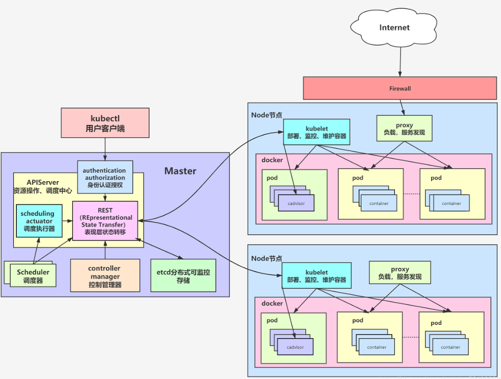

**其中master包含组件：**

`api server` 操作入口。Kubernetes的所有操作指令由对此下达。

`etcd` 集群内部用键值数据库。

`scheduler`调度器。调度工作的。

`controller`控制器。发布实际的指令。

**node 中包含组件：**

`pod `几个相关容器（docker),它们被统一管理。Kubernetes的基本管理单位。

`kubelet`代理。master节点命令的实际执行者。

`kube-proxy`网络代理，网络入口和出口。

`kubectl `命令行管理工具。

`volume `数据卷，保存数据。

基本概念：

`deployment `部署。指在节点部署的pod。

`service`服务，组合多个部署的pod,提供对外访问。

`label `标签，`selector `选择器，如给节点打上某标签，可以在部署应用时，只部署在包含标签的节点上。

`namespace `命名空间，做逻辑隔离。

`kubeadm `集群部署工具。

`Ingress`应用网关，统一出口、负载均衡。


#### 2.2.2 K8s部署流程

##### 选型

[KubeSphere](https://kubesphere.io/) 是在 [Kubernetes](https://kubernetes.io/) 之上构建的面向云原生应用的**分布式操作系统**，完全开源，支持多云与多集群管理，提供全栈的 IT 自动化运维能力，简化企业的 DevOps 工作流。它的架构可以非常方便地使第三方应用与云原生生态组件进行即插即用 (plug-and-play) 的集成。https://kubesphere.io/zh/ 

KubeSphere 作为开源的企业级全栈化容器平台，为用户提供了一个健壮、安全、功能丰富、具备极致体验的 Web 控制台。拥有企业级 Kubernetes 所需的最常见的功能，如工作负载管理，网络策略配置，微服务治理（基于 Istio），DevOps 项目 (CI/CD) ，安全管理，Source to Image/Binary to Image，多租户管理，多维度监控，日志查询和收集，告警通知，审计，应用程序管理和镜像管理、应用配置密钥管理等功能模块。

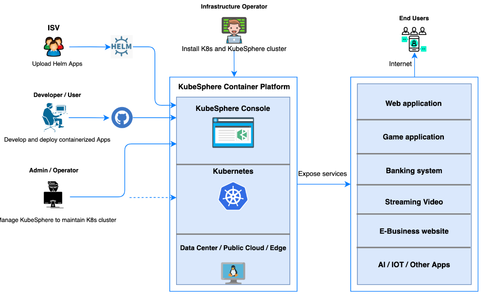

KubeSphere 提供了基于 Jenkins 的可视化 CI/CD 流水线编辑，无需对 Jenkins 进行配置，同时内置丰富的 CI/CD 流水线插件，包括Binary-to-Image (B2I) 和Source-to-Image (S2I)，用于将源代码或二进制文件打包到准备运行的容器映像中。

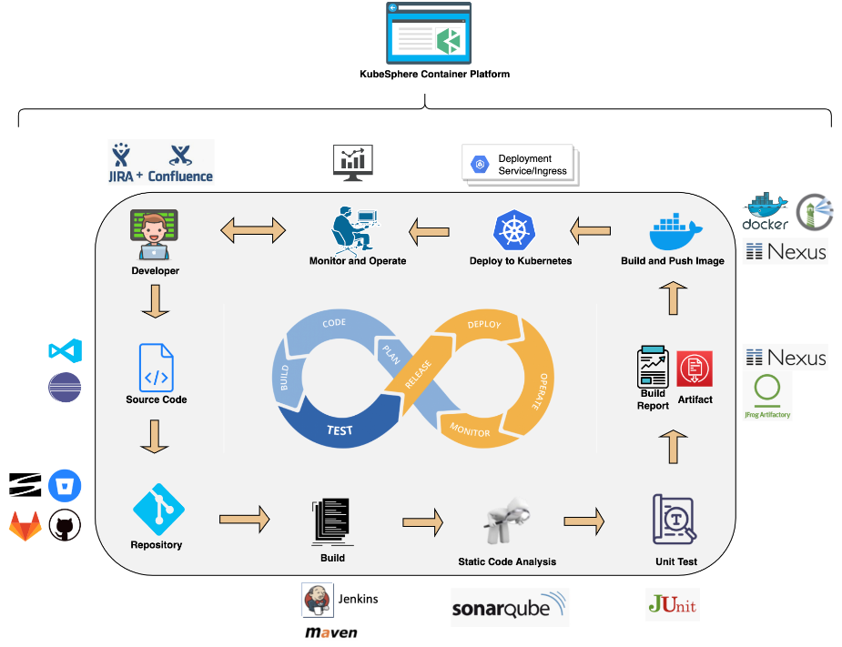

##### 简图

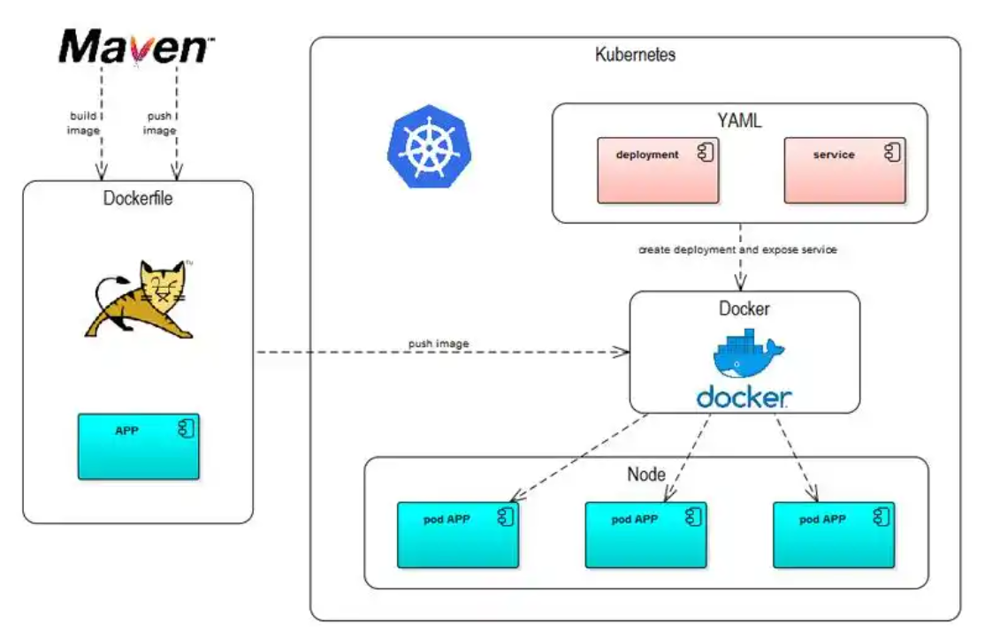

##### 部署KubeSphere

每个节点(最少三个节点，一主两从)安装Docker

安装K8s

再安装KubeSphere 


##### 创建项目

**首先创建企业空间**

KubeSphere 的多租户系统分**三个**层级，即集群、企业空间和项目。KubeSphere 中的项目等同于 Kubernetes 的[命名空间](https://kubernetes.io/zh/docs/concepts/overview/working-with-objects/namespaces/)。

创建一个新的[企业空间](https://kubesphere.io/zh/docs/v3.3/workspace-administration/what-is-workspace/)进行操作，而不是使用系统企业空间，系统企业空间中运行着系统资源，绝大部分仅供查看。出于安全考虑，强烈建议给不同的租户授予不同的权限在企业空间中进行协作。

参考：https://kubesphere.io/zh/docs/v3.3/quick-start/create-workspace-and-project/

**点击企业空间，创建一个项目**

KubeSphere 中的项目与 Kubernetes 中的命名空间相同，为资源提供了虚拟隔离。

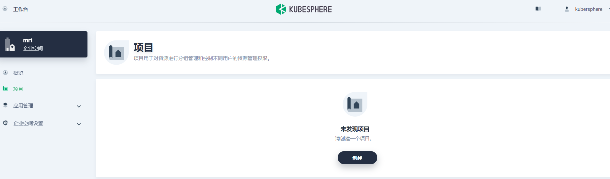

创建成功

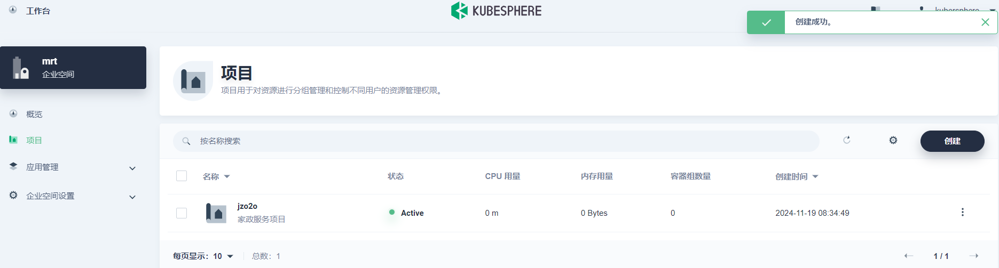


##### 启用devops

KubeSphere DevOps 系统

基于 [Jenkins](https://jenkins.io/) 的 KubeSphere DevOps 系统是专为 Kubernetes 中的 CI/CD 工作流设计的，它提供了一站式的解决方案，帮助开发和运维团队用非常简单的方式构建、测试和发布应用到 Kubernetes。

DevOps 系统为用户提供了一个自动化的环境，应用可以自动发布到同一个平台。它还兼容第三方私有镜像仓库（如 Harbor）和代码库（如 GitLab/GitHub/SVN/BitBucket）。它为用户提供了全面的、可视化的 CI/CD 流水线，打造了极佳的用户体验，而且这种兼容性强的流水线能力在离线环境中非常有用。

用户指南https://kubesphere.io/zh/docs/v3.3/devops-user-guide/

启用 DevOps：https://kubesphere.io/zh/docs/v3.3/pluggable-components/devops/

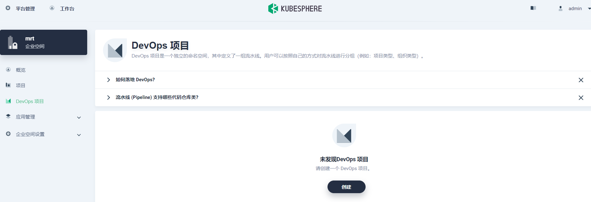


#### 2.2.3 准备工作

##### Git仓库

使用gitee


##### 阿里云maven仓库

开启阿里云“云效”

将项目中的共享库发布到阿里云maven仓库

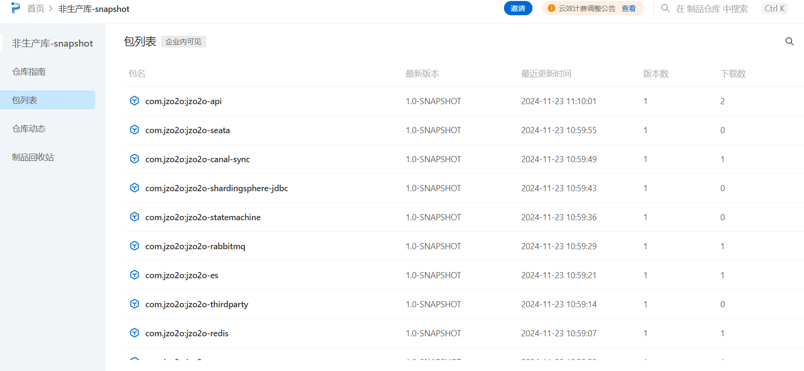


##### 开启阿里docker镜像服务

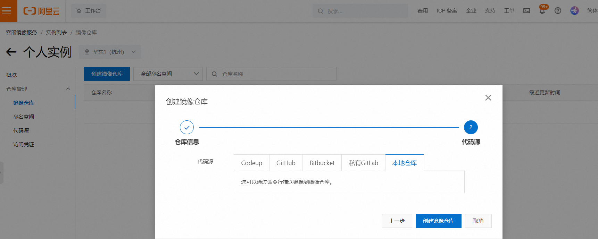

k8s在进行CI/CD时将镜像发布到阿里镜像服务中

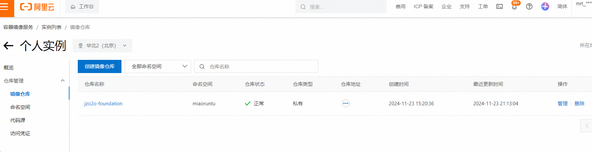


#### 2.2.3 项目配置

##### 打包配置

在pom.xml添加：

```Java
<build>
    <finalName>${project.artifactId}</finalName>
    <plugins>
        <plugin>
            <groupId>org.springframework.boot</groupId>
            <artifactId>spring-boot-maven-plugin</artifactId>
            <executions>
                <execution>
                    <goals>
                        <goal>build-info</goal>
                    </goals>
                </execution>
            </executions>
            <configuration>
                <mainClass>com.jzo2o.foundations.FoundationsApplication</mainClass>
            </configuration>
        </plugin>
    </plugins>
</build>
```

##### 生产环境配置

每个服务通过容器部署，容器内部为8080端口，容器暴露的端口由k8s自动生成。

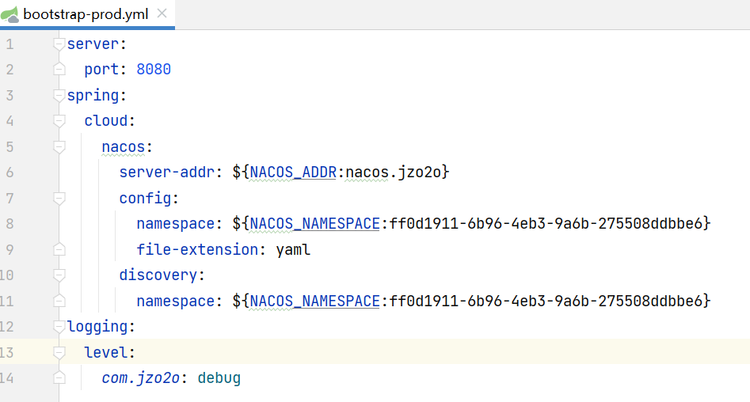

##### 配置Dockerfile


##### 配置deploy.yml

kubersphere通过deploy.yml自动创建部署、服务。

示例：

```Java
apiVersion: apps/v1
kind: Deployment
metadata:
  labels:
    app: jzo2o-foundation
  name: jzo2o-foundation
  namespace: jzo2o   # 就是项目名
spec:
  progressDeadlineSeconds: 600
  replicas: 1
  selector:
    matchLabels:
      app: jzo2o-foundation #匹配metadata中定义的app
  strategy:
    rollingUpdate:
      maxSurge: 50%
      maxUnavailable: 50%
    type: RollingUpdate
  template:
    metadata:
      labels:
        app: jzo2o-foundation
    spec:
      imagePullSecrets:
        - name: my-aliyun-docker  #提前在项目下配置访问阿里云的账号密码
      containers:
        - name: jzo2o-foundation
          image: registry.cn-beijing.aliyuncs.com/miaoruntu/jzo2o-foundation:SNAPSHOT-1.0
#        - image: $REGISTRY/$DOCKERHUB_NAMESPACE/$APP_NAME:SNAPSHOT-$BUILD_NUMBER
#          readinessProbe:
#            httpGet:
#              path: /actuator/health
#              port: 8080
#            timeoutSeconds: 10
#            failureThreshold: 30
#            periodSeconds: 5
#          imagePullPolicy: Always
          ports:
            - name: tcp-8080
              containerPort: 8080
              protocol: TCP
          resources:
            limits:
              cpu: 300m
              memory: 600Mi
          terminationMessagePath: /dev/termination-log
          terminationMessagePolicy: File
          imagePullPolicy: IfNotPresent
#      dnsPolicy: ClusterFirst
#      restartPolicy: Always
#      terminationGracePeriodSeconds: 30
---
apiVersion: v1
kind: Service
metadata:
  labels:
    app: jzo2o-foundation
  name: jzo2o-foundation
  namespace: jzo2o
spec:
  ports:
    - name: http-8080
      port: 8080
      protocol: TCP
      targetPort: 8080
      nodePort: 32607
  selector:
    app: jzo2o-foundation
  sessionAffinity: None
  type: NodePort
```


##### 修改数据库地址

将数据库地址、redis地址改为k8s服务的域名，举例：

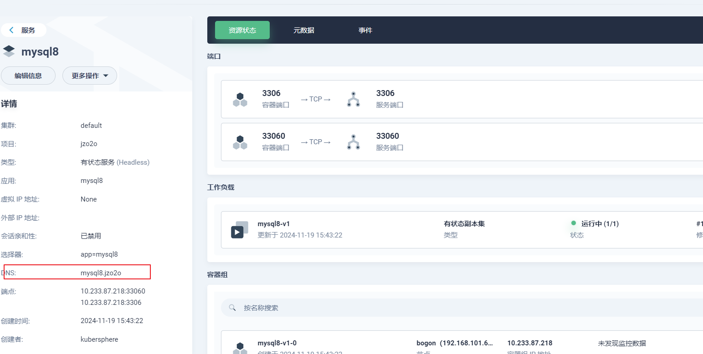

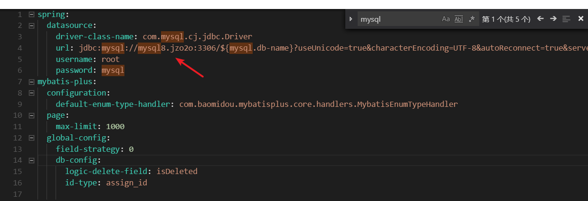


#### 2.2.4 创建流水线

在Devops中创建流水线：

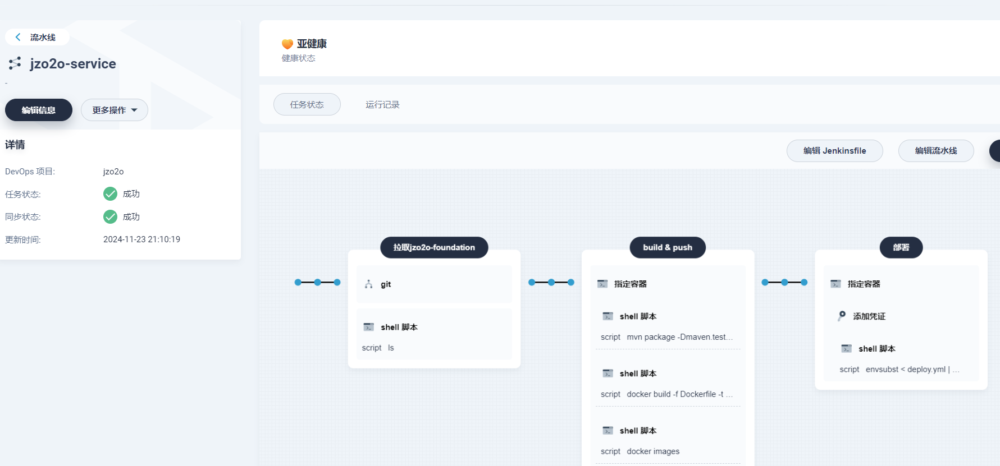

运行流水线，部署项目。

部署完成后的效果

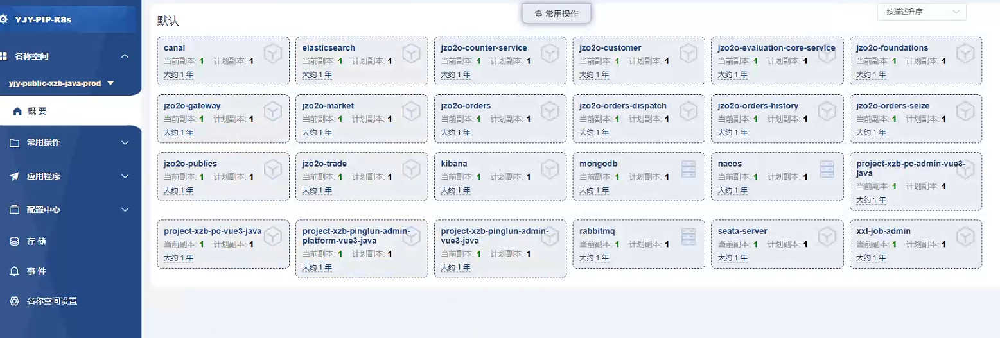

#### 2.2.5 运维

运维人员通过监控工具（Prometheus （普罗米修斯）+ Grafana）监控项目

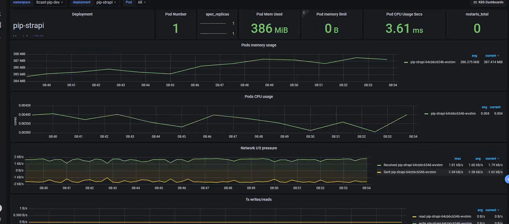

运维人员监控项目，收到告警会通知开发人员。

开发通过查看日志定位问题。

通过ELK或查看容器的日志

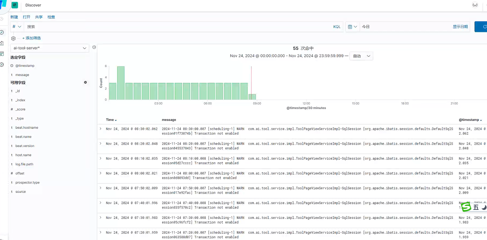

运维流程如下：

- **监控系统**：使用监控工具（如Prometheus、Grafana等）实时监控系统的健康状况。
- **日志系统**：配置日志收集和分析工具（如ELK ）。
- **用户反馈**：通过用户反馈渠道（如客服、邮件、社交媒体等）收集问题报告。

 然后通过查看日志初步诊断

- **查看日志**：检查应用日志、服务器日志、数据库日志等，寻找异常信息。
- **监控指标**：查看CPU、内存、磁盘I/O、网络带宽等系统资源的使用情况。
- **告警信息**：查看监控系统中的告警信息，了解问题发生的时机和频率。

 然后去进行问题定位

- **复现问题**：尝试在测试环境或本地环境中复现问题，验证问题是否可重现。
- **分析堆栈**：查看异常堆栈信息，确定问题发生的代码位置。
- **调试代码**：使用调试工具（如IntelliJ IDEA）逐步调试代码，找出问题根源。
- **性能分析**：使用性能分析工具（如VisualVM）分析系统的性能瓶颈。

定位到问题开始解决问题

- **临时措施**：如果问题严重影响系统运行，可以采取临时措施（如重启应用、回滚版本、关闭某些功能等）。
- **修复代码**：找到问题的根本原因后，修改代码并进行单元测试和集成测试。
- **部署更新**：将修复后的代码部署到生产环境，确保问题得到解决。
- **验证效果**：通过监控系统和日志系统验证问题是否完全解决。

---
> 来源：飞书技术知识库（脱敏版） · 07 业务组件方案集 / 云岚到家项目 / 第十二章 项目总结&部署 · [原文](https://ccn8v2zngwsm.feishu.cn/wiki/ZQD9woYWPiibASk3zUscnZVPnhz)
