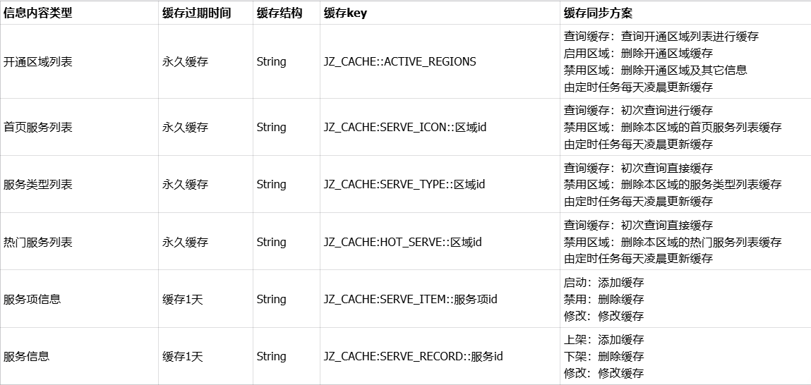
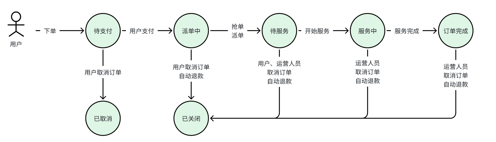
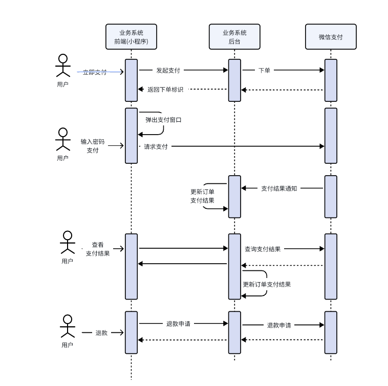
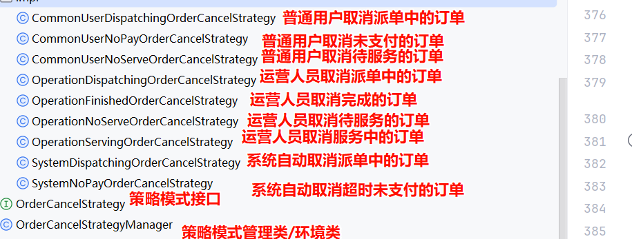
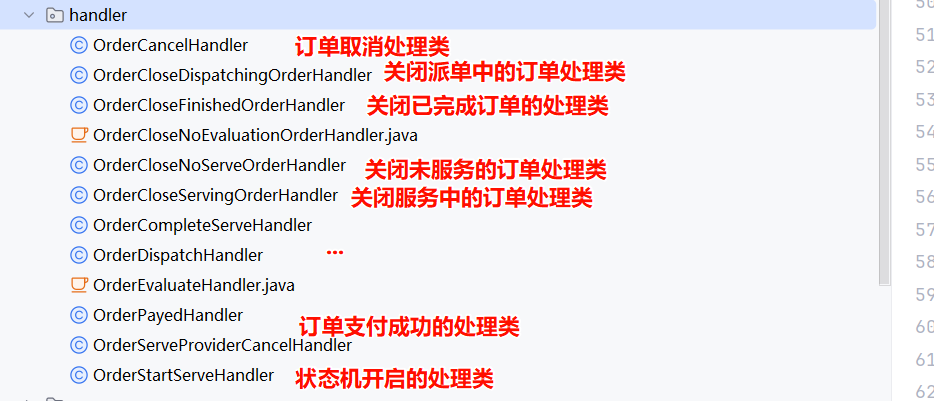
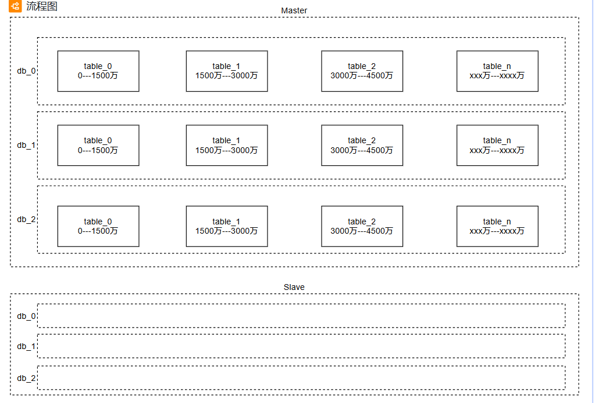
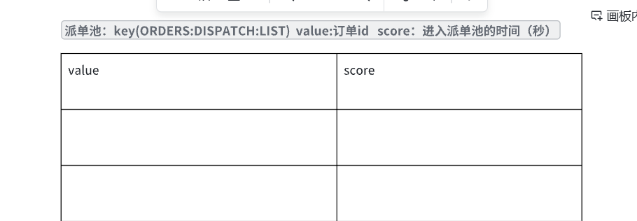

**项目梳理**

> 阅读视图即大纲，可折叠逐层展开；切换到导图视图看整体骨架。节点正文与图片只在阅读视图显示。

# 项目介绍

## 最近我负责的项目是一个综合性家政服务平台，项目有四类用户：面向消费者的用户端（小程序）、面向服务人员的服务端（APP）、面向合作企业的机构端（PC）以及平台内部使用的运营管理端（PC）。我们这个项目既支持家政服务人员直接入驻接单，也支持家政公司以机构身份入驻并承接平台派发的服务订单。

## 四个端大致功能有

### 用户端（小程序）：帮助家政需求方实现在线预约、下单、支付、评价、投诉及退款等全流程操作；

### 服务端（APP）：供家政服务人员使用，支持接单、服务执行、费用结算等功能；

### 机构端（PC）：面向家政服务公司，提供接单、派单、投诉处理及财务结算等管理能力；

### 运营管理端（PC）：为平台运营团队提供人员管理、机构管理、订单跟踪、财务数据及抽成配置等后台支持。

## 我们这个项目的整体流程是这样的

### 运营管理端会维护一些基础信息，像服务类型、服务项目、区域、以及区域和服务项目的关联。比如有厨卫维修、日常保洁等可以跟区域管理

### 用户在小程序端就可以查看到这个区域的服务，然后就可以进行预约下单、支付

### 服务人员在app端或者机构人员在PC端就可以进行抢单，抢完单之后服务人员就可以按照预约的时间进行上门服务

#### 当然如果每人抢单也会进行派单

### 服务完成后，用户就可以在小程序端对服务进行评价

## 我们这个项目使用的技术大致有这些

### 我们项目整体使用的是SpringCloud alibaba这套体系

### 其中包含的微服务有

#### 客户关系管理系统

#### 网关

#### 公共服务，这里主要是实现一些公共功能，比如图片上传、跟微信对接等底层服务都是在这完成的

#### 运营基础服务，管理基础功能

#### 优惠券服务

#### 支付服务

#### 订单服务

##### 订单管理服务

##### 历史订单服务

##### 抢单服务

##### 派单服务

### 挑一部分讲

#### SSM

##### MybatisPlus

#### Redis

##### Redisson

#### SpringCache

#### ES

#### RabbitMQ

#### Canal

#### XXL-Job

#### Seata

#### Sentinel

#### 微信登录、微信支付

#### 阿里云OSS

#### 高德地图地理定位

#### 分库分表ShardingSphere-JDBC

##### 冷热分离

#### 设计模式

##### 策略模式

##### 责任链模式

#### 状态机

## 我在这个项目中主要负责

### 小程序首页功能

### 优惠券功能

### 订单功能

### ...

### 建议适当提一下亮点功能

# 后台管理类模块

## 熟悉负责的功能在整个项目中的定位

### 刚开始的时候，熟悉相关文档，大大方方的去问同事

## 依据业务流程去设计表

### 表与表之间的联系

### 业务流程是通过什么控制

#### 通过工作流技术

#### 通过数据库中的状态字段去控制

## 设计接口

## 完成功能

## 测试

# 认证模块

## 用户端-小程序认证

### 前端调用wx.login()获取临时登陆凭证code,前端发送code请求用户管理服务jzo2o-customer，

### 后端调用publics公共服务携带code,appid和secret调用微信接口获取openid 。

### 拿到openid后去查询数据库的用户表，如果查询到了获取用户信息直接生成token返回，如果没查到进行自动注册，将openid写入用户表。

### 然后根据用户信息生成token（用户id,用户昵称，用户头像）。将token返回给前端，认证通过。

### 前端去访问系统时，先携带token 访问网关，在网关中进行token校验，校验通过后将用户信息存入请求头路由转发给对应的微服务，微服务中使用拦截器获取请求头的用户id，再将用户id写入threadLocal本地线程变量中。

## 服务端-手机验证码认证

### 输入手机号发送验证码

#### 用户输入手机号，点击发送验证码

#### 请求public公共服务

##### 生成随机验证码

##### 调用阿里云SMS平台发送短信

##### 将验证码存入Redis，有效期5分钟

### 输入验证码进行登录

#### 用户手机上收到验证码之后，输入验证码

#### 点击登录，请求用户管理系统 jzo2o-customer服务

#### 远程调用public公共服务校验验证码

##### 如果校验通过，会删除验证码

#### 判断用户是否存在，如果不存在注册

#### 判断用户是否冻结，如果已经冻结不允许登录

#### 生成token返回

#### 如果是新用户登录的话，还需要进行实名认证，由运营人员进行审核

## 机构端-用户名密码认证

## 运营端-用户名密码认证

# 用户定位模块

## 业务流程

### 小程序用户登录成功后提示要获取地理位置

### 用户授权通过后，就能获取到当前用户所在的城市

## 具体的实现流程

### 我们使用的是高德地图的地理位置的定位

### 首选我们会参考官方文档下载全国所有的城市及编码，导入到我们的数据库表中

### 接下来小程序获取当前用户的经纬度

### 携带经纬度坐标调用我们后台的public公共服务

### 在public公共服务中就会发起远程调用，请求高德地图逆地理编码接口，传入经纬度坐标，获取到地理位置的详细信息（包含城市名称、城市编码等）

### 有了城市编码，我们就可以获取到对应的城市名称，进而查询到区域id

### 就可以根据区域id查询到该区域是否开通，以及该区域下的服务列表

# 小程序门户模块（首页）

## 业务流程

### 用户登录成功，进入首页

### 获取所有开通区域

### 获取当前区域下的数据

#### 首页服务列表

#### 热门服务列表

#### 全部服务列表

## 实现流程

### 首页用户访问量是比较高的

#### 提前准备好

#### 用户数量

#### 请求数量QPS、TPS

#### 服务器规模

##### 说一个大概数字

##### tomcat最大的线程数200

##### 根据rt进行计算qps

###### 假如RT时间是200ms

###### 1一个线程1秒内处理5个请求

###### 所以qps1000

### 技术方案

#### CDN

##### 缓存静态资源

#### nginx负载均衡

#### 缓存

#### 模版技术

### 我们这里使用的就是缓存技术

### 主要缓存了以下内容

#### 开通区域列表

#### 首页服务列表

#### 热门服务列表

#### 全部服务列表

### 具体利用SpringCache实现

#### 为了防止出现缓存雪崩，我们设置了过期时间是30分钟+随机值

#### 缓存一致性问题

##### 禁用其余时候，删除该区域下的服务列表缓存

#### 我们利用xxl-job开启定时任务，每隔一个小时执行一次，删除区域列表，重新查询区域列表（重新缓存），查询每个区域下的服务列表（重新缓存）。

##### 保证缓存一致性

##### 缓存预热

# 搜索模块

## 业务流程

### 用户在首页上方输入框输入关键字可以进行搜索服务

### 支持自动补全和拼音自动补全

### 支持搜索历史记录

## 技术实现流程

### 全量同步

#### 编写程序

##### 查询数据库

###### 分批查询

##### 写入ES中

###### bulk操作写入ES

### 增量同步

#### 使用canal+MQ实现同步

#### 运营服务管理中对Mysql进行增删改的时候，会将数据记录到binlog日志

#### canal监听Mysql对应的数据库表的binlog日志，会将监听到的数据写入MQ

#### 接着我们的搜索服务监听到MQ消息，将数据存入ES中

### 具体搜索

#### 拼音分词器结合自动补全实现自动补全功能

##### 在索引库中需要配置自定义分词器

###### 拼音分词器+ik分词器

##### 使用completion进行自动补全的查询

#### 我们使用的是bool查询

##### 根据城市代码term查询

##### 根据用户输入的条件match搜索服务类型和服务项目

##### 根据指定的排序字段进行排序

##### 搜索完成后将搜到的结果存入历史记录

# 优惠券模块（活动管理模块）

## 业务流程

### 运营人员在运营管理端可以对营销活动进行管理

### 新增活动

#### 活动的名称

#### 优惠券类型

##### 满减

##### 折扣

#### 满减限制

#### 抵扣金额

#### 发放时间

#### 发放数量（库存校验）

### 查询活动

### 撤销活动

### 查看领取记录

## 具体实现方案

### 优惠券是一个独立通用的服务

### 涉及到以下表结构，优惠券活动表(activity)、待发券用户表(coupon_issue)、优惠券领取记录表(coupon)、优惠券核销表(coupon_write_off)、优惠券回退表(coupon_use_back)

### 优惠券新建完后是待发放状态，发放时间到了，由xxl-job定时任务自动更新状态为进行中

### 提供了优惠券发放的功能

#### 包括提交待发放记录（内部接口）

##### 首页要做用户的过滤，防止用户重复领取优惠券

##### 更新活动表的库存数量

##### 批量插入待发放优惠券表

###### 存入待发放表的记录一定会发放，提前将库存更新，更新了库存表示锁定了这个优惠券

#### 立即发放接口（内部接口）

##### 首先会调用提交待方法记录

##### 更新待发放表的状态为已发放

##### 保存数据到优惠券表，主要记录哪个用户领取了哪个优惠券

#### 定时发放

##### 待发券名单表，提供内部接口由业务系统将发放优惠券名单提交到待发券名单表

##### 首页利用xxl-job开启定时任务

##### 使用线程池的方式进行自动发券，查询正在进行中的活动，每个活动开启一个线程

##### 针对每个活动加一把分布式锁，并且开启了看门狗机制

###### 避免同一个活动由多个线程去共同发券

##### 获取待发券记录，更改状态为已发放

##### 将数据再存入优惠券表

### 提供了优惠券的核销功能（内部接口）

#### 更新优惠券的状态改为已使用

#### 添加核销记录

#### 计算优惠金额返回

### 提供了优惠券的退回功能（内部接口）

#### 更新优惠券状态为未使用

#### 添加退回记录

#### 删除核销记录

# 订单模块

## 下单功能

### 业务流程

#### 用户在首页选择一个服务，点到服务详情，进行预约，填写预约信息

##### 选择的服务id

##### 数量

##### 地址信息

##### 上门时间

##### 使用的优惠券

#### 提交订单

#### 进行支付

#### 订单状态

### 实现流程

#### 核心业务流程

##### 首先接收到小程序提交的数据

###### 服务id

###### 地址id

###### 数量

###### 优惠券的id

###### 预约上门的时间

##### 远程调用用户管理服务，根据地址id查询地址信息

##### 远程调用运营基础服务，查询服务项目的名称价格等

##### 拼接数据保存订单

###### 如果有优惠券，还要核销优惠券

##### 开启状态机

#### 具体技术点

##### 循环依赖问题

###### 因为自己注入自己，Spring通过三级缓存解决了循环依赖问题

##### 订单id

###### 年月日拼接自增序列号

- 自增序列号由redis生成

##### 利用分布式锁解决重复提交订单的问题

###### 锁的key是用户id拼接服务id

###### 过期时间是20秒，并且不会手动释放锁，只有时间到了之后自动释放锁

###### 我们是利用Redisson实现

###### 由自定义注解+AOP实现通用的分布式锁

##### 事务边界问题

###### 首先我们下单功能一开始涉及到很多的远程调用

###### 所以事务的注解不建议加到下单方法的入口处，否则的会导致事务时间过长

###### 所以我们单独加到数据库操作的方法上，对于数据库操作的方法，我们单独抽取的了一个方法，在该方法上添加事务注解

##### 事务失效问题

###### 因为解决事务边界问题，碰到非事务方法调用了本类中的事务方法，导致事务失效

###### 我们在当前类中注入当前类对象的代理对象，通过调用代理对象的方法解决了事务失效问题

##### 分布式事务问题

###### 如果有优惠券的话，我们还有远程调用优惠券服务进行核销优惠券

###### 为了保证事务的一致性，我们使用Seata解决分布式事务问题，使用的是AT事务模型

## 手动取消未支付订单功能

### 在订单取消表中添加取消记录

### 使用策略模式取消订单

#### 利用状态机更改订单状态

## 定时任务+懒加载取消超时未支付订单功能

### 开启xxl-job定时任务

#### 查询超时未支付的订单

#### 调用取消订单的功能进行取消

### 懒加载

#### 用户在查询订单详情的时候，判断状态和超时时间，如果超时未支付，则进行取消

## 面试点后续优化模块

### 策略模式取消订单

### 状态机更改订单状态

# 独立的支付服务

## 我们有一个独立的支付服务jzo2o-trade实现微信支付的

## 支付流程

### 用户在下单完成后，在小程序端发起支付，请求后台服务

### 后台系统调用微信的下单接口

#### 在调用微信时需要传递参数

##### 支付人的openid

##### 商户id

##### 金额

##### 回调地址

##### 订单id

#### 并且对参数进行加密 sha256+RSA

##### 非对称加密

#### 将加密后的信息base64编码放在请求头

### 微信返回预支付标识

### 将预支付标识返回小程序进行支付（小程序直接调用微信）

#### 后台将预支付标识及加密信息返回给小程序端

#### 小程序弹出支付窗口

#### 用户进行扫脸、指纹、密码支付

### 支付完成后，微信方调用回调地址通知支付结果

#### 调用状态机更新支付结果

### 用户在支付完成后再小程序页面点击完成支付，也会请求后台，查询支付结果，进行状态同步

### 定时任务查询未支付的订单，去调用微信方查询支付结果

# 订单对接支付模块

## 将来用户下单支付的时候，是跟支付服务对接的

## 在支付服务中已经封装好跟微信支付的对接

## 另外在支付服务中还集成了支付宝支付、微信二维码支付

# 取消已支付订单模块

## 业务状态流转及操作

### 待支付：

#### 支付超时系统自动取消。

#### 用户取消订单，订单状态改为已取消。

### 派单中：

#### 用户和运营人员都可以取消订单，订单状态改为已关闭。

#### 到达服务时间还没有派单成功系统自动取消。

#### 取消订单后自动退款。

#### 删除抢单池记录。（抢单模块用到）

### 待服务：

#### 用户和运营人员都可以取消订单，订单状态改为已关闭。

#### 取消订单后自动退款。

### 服务中：

#### 只有运营人员可以取消，订单状态改为已关闭。

#### 取消订单后自动退款。

### 订单完成：

#### 只有运营人员可以取消，订单状态改为已关闭。

#### 取消订单后自动退款。

### 如果说下单时使用了优惠券，那么取消订单时都要退回优惠券

## 实现流程

### 发起取消订单的申请

#### 保存取消记录

#### 更改订单状态已关闭

#### 往待退款记录表中添加退款记录

#### 远程调用优惠券服务退回优惠券

##### 涉及到远程调用分布式事务问题

##### 使用seata解决

### 定时任务扫描待退款记录表调用支付服务退款

#### 利用xxljob定时扫描待退款表

#### 远程调用支付服务进行退款

##### 支付服务会调用微信服务进行退款

#### 根据返回结果判断退款成功还是失败，更新订单退款状态

#### 删除待退款记录表

## 利用策略模式对取消订单功能进行优化

### 为什么要使用策略模式进行优化

#### 我们订单状态不用，将来取消订单的逻辑也不同

##### 比如待支付，将来需要更改订单的状态为已取消

##### 派单中更改订单状态为已关闭、还涉及到退款、删除抢单池记录等

##### ...

#### 同时取消订单的校验人员也不同，比如

##### 普通用户只能取消待支付、派单中、待服务的订单

##### 运营人员能取消派单中、待服务、服务中、服务完成的订单

### 优化方案

#### 定义取消订单策略接口

##### 提供了取消订单的方法

#### 接着根据不同的人不同的订单状态分别写一个策略实现类

##### 每种策略类都是实现同一个接口，为了方便获取对应的策略类，我们给每个策略类的Bean名称起了个名字 ${用户类型:订单状态}

###### 1代表普通用户

###### 4代表运营人员

###### 0代表系统

#### 策略管理类/环境类

##### 提供init方法，在项目启动时执行（在方法上加注解@PostConstruct）

###### 从ioc容器中获取所有的OrderCancelStrategy的类型的Bean

###### 将这些策略类放到map中

##### 提供取消订单入口方法

###### 获取用户类型，查询订单，获取订单状态。根据用户类型拼接订单状态就能获取到对应的策略类执行取消订单逻辑

# 订单优化

## 状态机

### 为什么要使用状态机

#### 在业务代码中对订单状态进行硬编码如果有一天更改了业务逻辑就需要更改代码，不方便进行系统扩展和维护。

#### 另外对订单状态的管理是散落在很多地方不方便对订单状态进行统一管理和维护。

### 状态机的使用方式

#### 我们在框架服务中定义好了状态机，微服务使用的话直接注入使用

#### 按照规范实现StatusDefine 接口定义订单状态的枚举类

#### 按照规范实现StatusChangeEvent 接口定义状态变更事件枚举

##### 源状态

##### 目标状态

##### 事件描述

##### 事件code

#### 按照规范继承StateMachineSnapshot类定义订单快照类（将来状态流转过程中状态机会帮我们记录订单快照）

#### 按照规范实现StatusChangeHandler定义各种事件处理类

##### 比如

#### 按照规范定义状态机类（核心），指定初始状态

#### 定义两张状态机相关的表

##### state_persister状态机持久化表

##### biz_snapshot订单快照表

#### 将来在使用时，需要更改订单状态的时候，直接使用状态机类，更改状态即可

### 使用状态机的好处

#### 1. 我们在业务代码中无需关注状态的变更，只需要给状态机传入当前的事件即可

##### 比如正常情况，用户支付完成后需要更改订单状态，由原状态待支付更改为派单中，并且在更新的时候还需要判断状态

##### 现在只需要给状态机传入事件即可，这些判断和状态的更改状态机自动实现。把业务和状态变更解耦

#### 2.状态机还能帮我们记录快照，而且还能实现缓存

## 分库分表

### 分库分表的原因

#### 之前我们在开会讨论的时候，我听到过

#### 我们这个家政项目全国大概有100万用户

#### 这一百万有百分之20是活跃用户

#### 假设每个用户每月至少下一次订单，那么每个月的订单数据量20万

#### 一年就是240万的数据量

#### 一个订单大概需要1k的空间，一年7G的数据

#### 单表的压力就会比较大，所以我们考虑分库分表

### 具体的实现流程

#### 我们按照五年期来算，分了三个库

##### 按照用户id对3取模，计算最终存入的库

##### 如果到了五年以后，需要新增数据库，要做数据迁移

#### 每个库下面的表按照范围方式进行分表

##### 每500万存一张表，如果满了，那么就到新的一张表里

#### 我们使用的框架是shardingsphere-jdbc

#### 在shardingsphere-jdbc中配置了分库分表的规则

## 订单查询优化

### 业务场景

#### 用户端需要查询订单， 而且订单数据量比较大，同时用户的访问量也比较大

#### 涉及到用户端订单列表的查询

##### 用户可以根据订单状态（待支付、待服务、服务中、待评价）

##### 也可以查询全部订单

##### 排序方式我们使用自定义的排序字段（服务时间转为毫秒值+订单后四位）

#### 订单详情

### 具体实现方案

#### 我们对订单表建了两个联合索引

##### 订单状态、用户id、逻辑删除字段、排序字段倒序

##### 用户id、逻辑删除字段、排序字段倒序

#### 在查询的时候，我们使用的是滚动查询方式

##### 在查询下一页的时候，需要传入上一页最后一条数据的排序字段

##### 根据排序字段进行查询

#### 我们只查询主键id，防止回表

#### 然后再根据主键id列表查询订单

#### 订单详情我们利用状态的快照实现查询，状态机已经实现缓存功能

## 冷热分离

### 为什么要做冷热分离

#### 随着时间的推移，订单数据会逐渐增加，虽然对订单数据库进行分库分表，但是考虑用户对已完成的历史订单的操作热度远远低于未完成订单，为了提高系统的性能我们对订单数据进行冷热分离。

### 实现方案

#### 单独开发了一个历史订单服务

#### 订单服务如果完成、取消、关闭订单的时候，状态机有个后处理器，在这里我们会将数据写入同步表

#### canal会监听同步表，将数据发送给MQ

#### 历史订单服务会监听MQ消息，将数据写入待迁移表

#### 定时任务会每天扫描超过15天的数据，将其迁移到历史订单表，删除已迁移的数据

# 统计分析模块

## 业务需求

### 在运营端首页，可以对订单根据时间范围做统计

### 如果时间范围大于1天，按天进行统计

### 如果等于1天，按照小时进行统计

### 统计这段时间的订单数据

#### 有效订单数

#### 取消订单数

#### 关闭订单数

#### 实付平均金额

#### 有效订单的总额

#### 还要统计每天/每个小时的订单总量，显示为折线图

## 具体实现方案

### 开启定时任务进行统计

### 采用滚动时间的方式，统计15天之前的待同步历史订单

#### 统计这个表的原因是这个表的数据量只保存15天，15天之后就会迁移到历史订单表

#### 15天之后的订单不会再发生变化了

### 统计完之后将数据存入日统计表和小时统计表

#### 我们可以基于这个统计的表进行二次统计

### 将来首页查询的时候，直接基于这个表查询即可

# 抢券模块

## 业务逻辑

### 运营人员在后台创建一个活动

### 普通用户在小程序端，就可以进入活动页面，分为疯抢中和待开始两个页面

### 用户在疯抢页面就可以抢优惠券

### 每个用户只能抢一个优惠券

## 实现流程

### 活动预热

#### 首先用户需要进入首页查询活动，用户量比较大，所以我们先对活动做了预热，提前将这个活动存入Redis

#### 利用xxl-job定时任务，查询待开始和进行中的活动

#### 我们使用的是String结构，将多个活动转换为JSON字符串存入redis

### 活动查询

#### 首先查询Redis中，将所有活动都查询出来

#### 反序列化为Java集对象

#### 先根据活动开始时间和结束时间计算活动状态

##### 因为活动的状态是由定时任务同步更新的，可能会有延迟

##### 所以我们在查询的时候需要重新计算当前状态

#### 然后进行过滤，过滤出符合条件的活动

### 抢券

#### 用户查询活动之后就可以进行抢券了，我们首先考的是解决超卖问题

##### 每个用户只能领一个券

##### 优惠券的数量也是有限制的

#### 我们为了解决这个问题，我们考虑了以下几种方案

##### 乐观锁

###### 使用Mysql中的Version字段实现

###### CAS

##### 悲观锁

###### 用Mysql中的行锁,select .... for update

###### 使用分布式锁Redisson实现

#### 综合考虑下来，我们没有使用锁，我们利用了Redis+lua脚本实现了原子性操作

#### 具体方案是这样的

##### 我们整个的抢券过程都是基于Reis+lua脚本在redis中实现的，redis中使用了三个，Hash结构

###### 优惠券的库存，提前在预热的时候存入redis的

###### 抢券成功的队列，这个队列是用来判断用户是否抢券成功的

###### 还有一个同步队列，这个队列是用来同步抢券结果的

###### 这三个Hash结构，他们的Key最后都会{活动id%10}

- 原因1：将来同一个订单存入同一个Redis的分片节点

- 原因2：lua脚本为了保证原子性，只能操作一个节点的数据，否则会报错

##### 用户在发起抢券的时候，先查询缓存中的活动，进行状态的校验

##### 调用lua脚本执行抢券

###### 判断用户是否抢过这个券

- 利用Redis中的抢券成功的队列判断

###### 判断库存是否充足

- 利用redis中的库存结构判断的

###### 接着扣减库存

###### 写入抢券成功队列，记录用户的抢券信息

###### 写入同步队列，将来需要基于这个队列将抢券的结果同步给Mysql数据库

##### 最后利用xxl-job开始对抢券的结果的进行同步

###### 查询redis中的同步队列

###### 将数据同步到Mysql中，优惠券表

###### 删除redis中的同步队列的数据

###### 技术点

- 线程池：固定10个线程，因为Redis中就10个队列

- 分布式锁：针对每个队列加锁

- 查询redis时候我们使用的redis中提供的游标scan，批量查询

# 抢单模块

## 业务场景

### 用户下单完成并支付成功后，订单状态就变成派单中

### 这个时候就由服务人员/机构进行抢单

#### 如果是机构的话，抢到单之后，还需要分配给对应的服务人员

### 或者服务时间距离现在小于两个小时，这个时候，系统自动派单

## 实现流程

### 抢单池同步流程

#### 用户下单支付完成后调用订单管理的服务进行订单分流

##### 首先我们将数据存入抢单池表

##### 如果服务时间小于两个小时，还会存入派单池表

#### 因为服务人员在抢单的时候，需要判断位置（服务人员周边的订单位置），所以我们还需要将抢单池的数据存入ES中

##### 由Canal监听Mysql中的抢单池的表，将数据变更发送给MQ

##### 抢单服务监听这个消息，将其存入ES中，方便根据位置查询

##### 同步库存到Redis中，库存数量是1，防止多个服务人员抢到同一个单子

### 抢单查询

#### 服务人员进入APP，在首页的抢单大厅，就可以搜到对应的单子

##### 根据当前服务人员的服务技能

##### 距离，附近50km的订单

##### 城市编码

### 抢单

#### 抢单逻辑同抢券逻辑，也是基于redis+lua脚本实现的

##### 执行lua脚本

###### 判断库存，判断是否有人抢过这个单子

###### 扣减库存，将1减为0

###### 写入抢单同步队列

### 同步抢单结果

#### 基于XXL-job实现

#### 创建服务单

#### 更新订单状态为待服务

##### 利用状态机进行更改

#### 删除抢单池表（同步给ES中）

##### 其他人无法查询到订单

#### 删除redis中的同步队列

#### 删除redis中的库存记录

# 派单模块

## 业务场景

### 用户下单完成并支付成功后，订单状态就变成派单中

### 这个时候就由服务人员/机构进行抢单

#### 如果是机构的话，抢到单之后，还需要分配给对应的服务人员

### 或者服务时间距离现在小于两个小时，这个时候，系统自动派单

## 实现流程

### 整体流程

#### 定时任务进行自动派单

#### 从派单池中获取订单数据

##### redis，zset结构

###### key

###### value：订单id

###### score：进入派单池的时间

#### 获取到订单的属性

##### 订单的服务内容

##### 服务时间

##### 地址等

#### 到ES中查询当前订单所匹配的服务人员（初筛）

##### 服务技能

##### 服务时间

###### 防止服务人员时间冲突

##### 地址

#### 接下来使用策略模式+责任链模式进行过滤匹配

##### 距离优先

##### 接单数优先

##### 评分优先

#### 最后随机找到一个服务人员，匹配成功，进行派单

#### 如果说没有找到合适的人员，将派单池中的时间推迟3分钟

##### 3分钟后重新尝试派单

### 技术点

#### 派单池同步

##### 用户下单支付完成后，会根据订单分流写入派单池

##### 由canal+MQ同步到Redis中

##### redis使用的数据结构是Zset结构

#### 服务人员的同步

##### 将服务人员的信息同步到ES中

#### xxl-job定时任务执行派单

#### 查询redis中的派单池的数据，利用线程池对每个订单进行派单

#### 从es中搜索服务人员

#### 获取派单规则

##### 每个规则中定义责任链

##### 距离优先

###### 先判断每个服务人员最近距离

###### 再判断接单数量

##### 评分优先策略

##### 最少接单策略

> 来源：飞书技术知识库（脱敏版）· 思维笔记。原文语义与层级已完整保留，阅读视图即大纲，切换到导图视图（Light Mindmap）看骨架。
