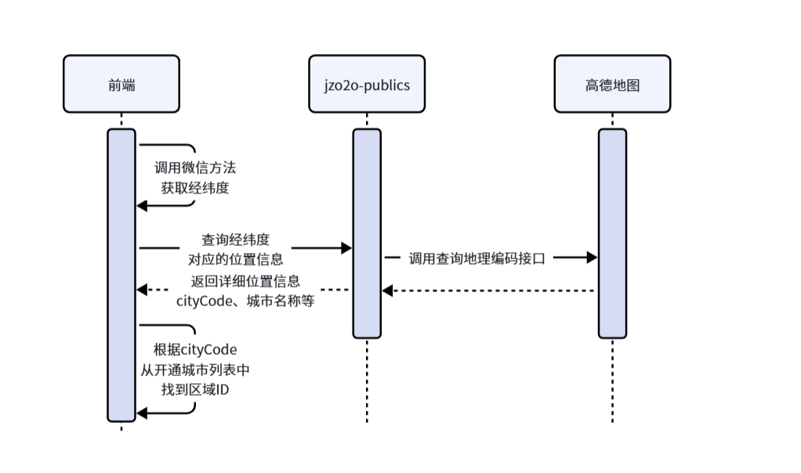
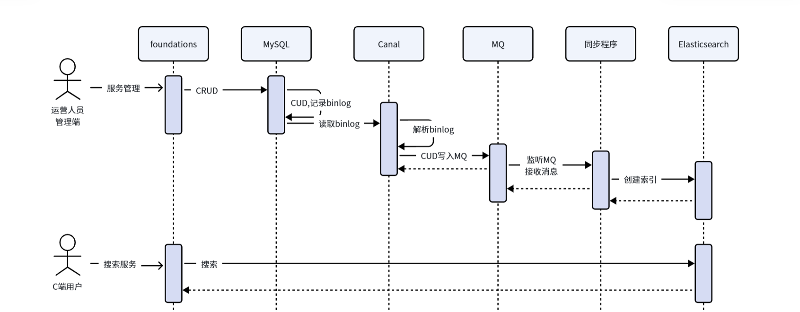
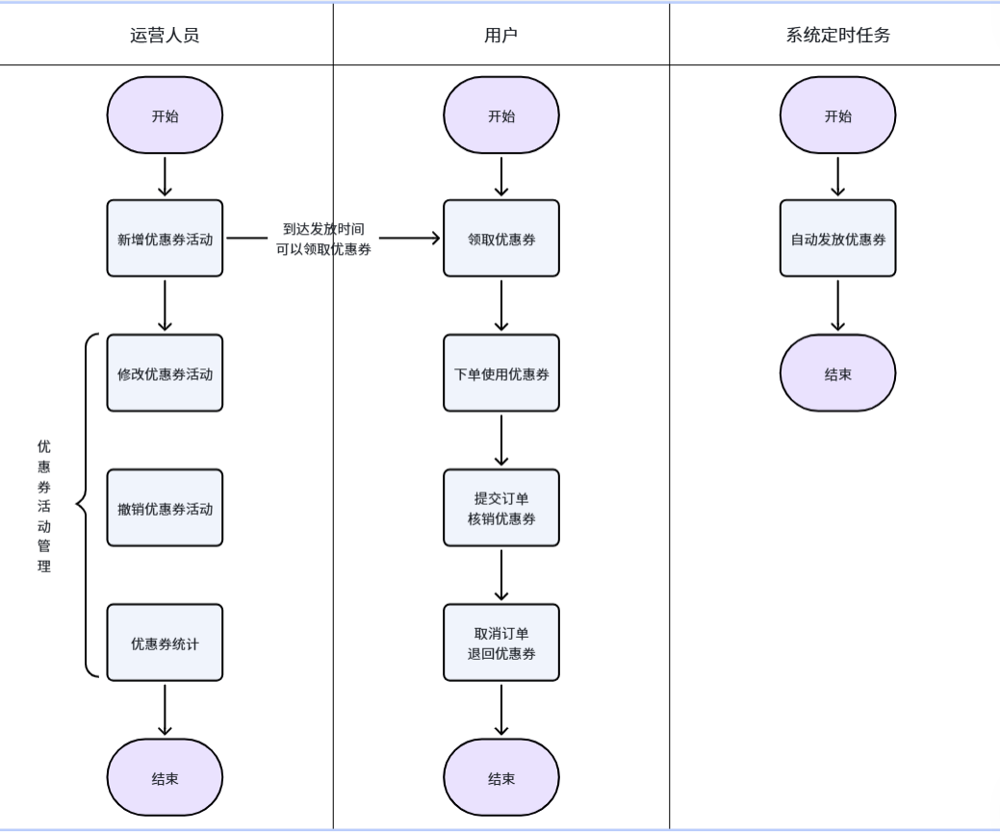
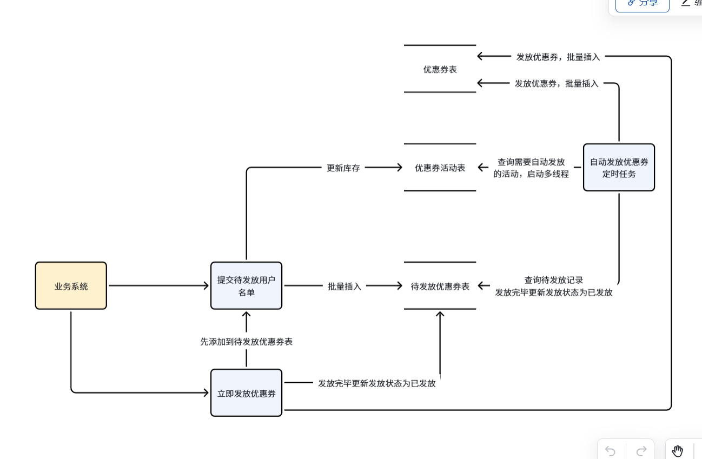
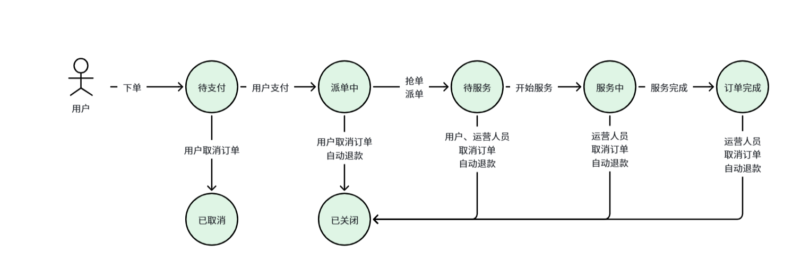
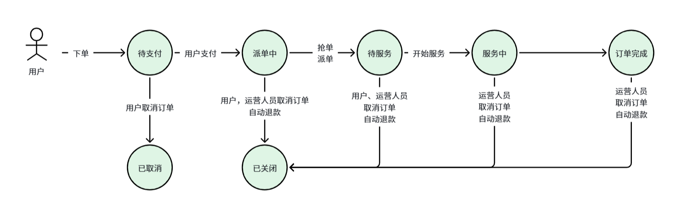
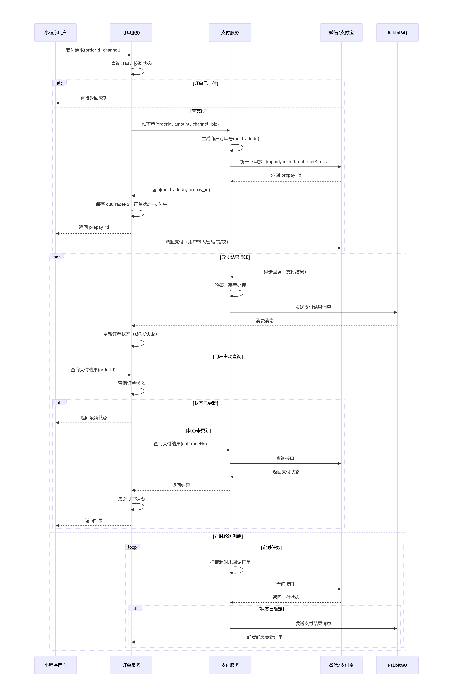
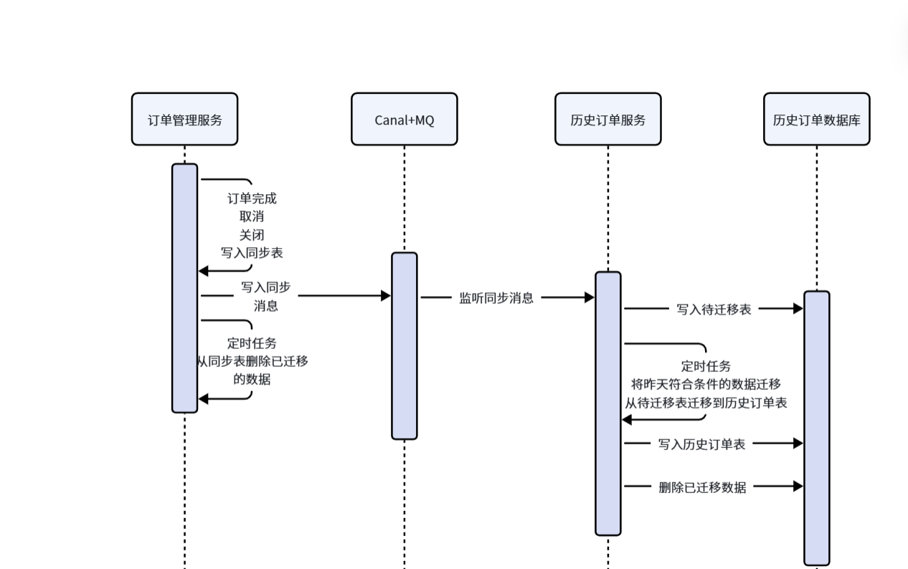
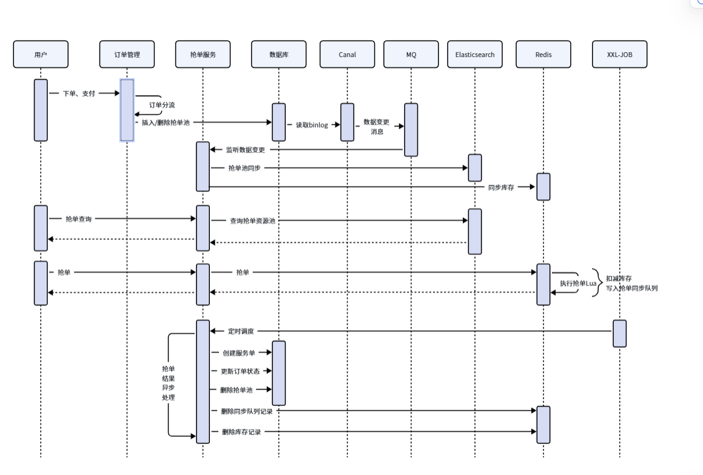

<title>云岚到家项目总结</title>

# 项目介绍

这个项目叫云岚到家，是一个家政的o2o的项目。

这个项目一共有四个端：运营管理pc端、机构pc端、服务人员的app端、用户的微信小程序端

- 业务介绍写法1： 运营端有...功能（大致罗列四五个功能）、机构端端有...功能、服务人员的app端...功能、小程序有...功能
- 业务介绍写法2：核心业务流程是运营人员负责维护区域下的服务项目，进行上线、接下来用户下单预约服务、机构人员或者服务人员就可以进行抢单，接下来就可以进行上门服务、完成服务后普通用户还可以对这个订单进行评价

这个项目整体是基于SpringCloud Alibaba微服务架构开发的，注册中心使用的是nacos、服务远程调用使用的是openFeign、异步调用使用的RabbitMQ。另外还使用到了Elasticsearch进行全文检索、利用SpringAI实现智能客服、还使用到微信支付以及 redis+lua进行抢券抢单功能，还使用了xxl-job

我在这个项目中主要负责优惠券模块、订单模块、派单功能...

其中我觉得比较有亮点的功能是抢券功能，这里我们使用到了redis+lua脚本实现原子性抢券功能。

# 用户认证-微信小程序认证

1. 小程序端获取到临时**登录凭证 ~~和 手机号凭证~~**
2. 请求后端网关，网关将请求路由到**客户中心系统微服务**
3. 客户中心系统会调用我们的**公共的微服务（这个服务是专门负责处理跟第三方交互的，比如微信登录、支付、oss、高德地图等）、公共微服务**携带**code、appid、secret**调用**微信服务**，获取到**openid,**客户中心系统微服务根据openid查询数据，如果数据库中不存在，需要自动进行注册
4. 先根据**appid和secret**调用微信服务获取token
5. ~~根据手机号临时凭证结合token获取用户的手机号，将手机号更新到数据库表中~~
6. 利用**Jwt生成token**，返回给小程序端
7. 后续用户请求时携带token请求网关，在网关中统一拦截校验**token**，获取到用户id
8. 网关会将用户id放入请求头，路由到具体的业务微服务
9. 在微服务中的拦截器，会获取到请求头中的用户id，将用户放入**ThreadLocal**

# 小程序首页-高德地图定位

- 首先我们从高德地图提前下载到**所有的城市**以及对应的**城市编码cityCode**，将数据提前给到前端（包括运营端和小程序端）
- 在进入小程序的时候，查询所有已开通区域城市列表（城市名称、城市编码、区域id）。接着获取用户的地理位置的权限，如果用户同意，获取到当前用户的**经纬度坐标**
- 携带经纬度坐标调用**公共服务、**公共服务调用高德地图的地理编码接口，获取到对应的**城市**和城**市编码cityCode，**返回给小程序。小程序端就能知道当前城市是否开通服务
- 如果当前城市开通服务，根据城市编码从已开通城市列表中获取到区域id。根据区域id获取到当前城市下的所有服务项

# 小程序首页-缓存

- 首先小程序首页会展示 **开通区域列表、首页服务列表、热门服务列表、全部服务**
- 这些内容是非常经典读多写少的场景，非常适合用缓存来优化，这里使用的是**SpringCache+Redis**实现的
- 针对开通区域列表的查询，使用**@Cacheable**注解实现的，查询的时候会查询redis缓存，如果命中了，直接返回开通区域列表即可，如果未命中，查询数据库，并将返回值缓存到redis。这里我们过期时间是永久的
- 首页服务项列表也是使用@Cacheable注解实现的。流程跟区域列表一样，不同的是如果查询到的是空，会缓存空值，过期时间设置为30分钟，主要是为了解决**缓存穿透**问题，如果不为空，才会存入真正服务列表数据
- 将来如果对服务项目进行修改，或者启用禁用等操作，会使用@CacheEvict删除缓存。如果开区域发生变化，也会删除开通区域的缓存，同时还会删除当前区域下的服务项
- 另外还使用**XXL-job**分布式定时任务，定时同步缓存，保证**最终一致性**。定时任务一般每天凌晨执行一次，先查询所有开通区域，删除区域，并重新查询，建立缓存，并删除每个区域下的服务项热门服务等，重新查询建立缓存
- 针对服务项和热门服务，这两个修改可能会稍微频繁一些，所以这两个建立了缓存的过期时间，两个小时+随机数，防止**缓存雪崩**

# 小程序首页-搜索

## 索引同步

- 全量同步

  - 全量同步的目的是将Mysql中所有的服务项目数据保存到ES中
  - 这里是写了一个**xxl-job的分片广播**实现的
  - 对于搜索服务来说，有三个实例。每个实例都能获取到当前的实例的**分片序号**和**总分片数量**
  - 根据当前实例的分片序号分页查询数据库的数据，每个实例查到的数据都不一样
  - 查询到数据之后，将数据写入ES索引库
  - ES索引库基本上跟Mysql中的字段是一致的，其中服务项目的名称和服务类型的名称都是text类型，分词器使用的**ik分词器**。在简历倒排索引时使用的**ik_max_word**,在搜索时对用户输入的内容使用**ik_smart**进行分词
- 增量同步

  

  - 增量同步使用的是**canal+MQ**
  - 当运营任务在操作服务类型或者服务项目的时候，写入到Mysql数据库。Mysql数据库是开通了**binlog日志**功能
  - 在canal中主要就配置了我们要监听的mysql的表，以及要推送的目的地，这里目的地是**RabbitMQ**。一旦数据库发生变化canal就能**监听到Mysql的binlog**日志。将数据推送到**RabbitMQ**，交换机类型使用的topic类型
  - 在搜索服务就会监听MQ消息，这里我们还使用了**模板设计模式**，数据处理格式化等都在模板里实现的，模板里抽象了两个方法，分别是新增、删除。将数据同步到ES中即可

## 搜索

1. 在搜索会传入城市编码、服务类型的id、搜索关键词
2. 在搜索之前会先将搜索的关键词存入搜索历史表，支持**历史记录查询**
3. 使用ES中的**bool查询**，城市编码和服务类型的id都是使用**term查询**（不会对搜索条件进行分词）、关键词搜索使用的**multiMatch**分别查询服务项目的名称和服务类型的名称。这些查询都是使用**bool查询关联**的，其中城市编码和服务类型使用**filter关联**，关键词搜索使用**must关联**的，因为**filter是不参与算分的，而must参与算分**
4. 另外我们还支持**拼音自动补全**功能，输入关键词或者输入拼音，能自动联想
5. 关于拼音分词器，需要使用**自定义分词器**，在定义索引映射的时候进行配置，先用**tokenizer进行细粒度分词**，这里使用的ik_max_word。再用**tokenizer_filter转成拼音**，存入**倒排索引库**
6. 自动补全查询我们使用**`completion`** **前缀查询**，能够非常高效的进行自动补全

# 优惠券模块-发券

## 优惠券整体业务流程

## 优惠券发放

- 优惠券系统的是一个通用的微服务，这里**只负责优惠券的管理发放等功能**，**不负责具体的业务**（不关注优惠券给谁发），只是对业务服务提供openFeign接口，供业务服务进行调用
- 提供了两个**openFeign接口**，一个是**提交待发放用户的名单**、**立即发放优惠**
- 另外还提供的**自动发券的定时任务**
- **首先提交待发放用户名单的功能**。接收**用户id**和**优惠券活动id**。首先会做一系列的校验，比如活动的时间状态是否过期、用户id非空校验等。因为系统规定一个用户只能领取一张优惠券，所以根据用户id和优惠券活动id查询待发放优惠券表，看是否已经给这个用户发过了，**过滤出来未发放的用户id进行发放**。接下来更新**优惠券活动表**的库存数量，进行**扣库存**，这里使用的**乐观锁机制**进行扣除的。最后将用户id和优惠券活动id存入**待发放优惠券表**即可
- **如果是立即发放，**首先会走待发放的逻辑，进行**预扣库存**，并且**插入待发放表。**同时还会更新待发放表的状态，改成已发放，存入优惠券领取记录表中
- **定时发券。**利用**xxl-job+线程池+分布式锁**实现的。定时任务每隔1分钟执行一次，首先查询到所有的正在进行的活动。遍历每个优惠券的活动，每个活动开启线程，这里使用的**ThreadPoolExecutor线程池**实现的，**每个活动一个线程**。开始发券时首先会利用**redisson进行加锁**，**锁的粒度就是当前的活动**。然后根据活动id查询到所有待发放的用户名单，调用立即发券的方法进行发券即可

# 订单模块-下单

## 订单的状态

## 下单功能

- 用户在页面选择对应的服务、数量、填写地址、上门的时间、优惠券。提交请求到订单管理服务
- 创建订单时，首先要**远程调用客户中心系统**，查询用户地址簿的信息（手机号、地址详细信息）
- 接着**远程调用运营基础服务**，查询服务信息（服务名称、价格等）
- 生成订单的**唯一id（年月日+13位自增序列）**，自增序列基于redis的incr生成。自增序列在分库分表的时候要用到，如果单表的数据量超过500万，就需要**分表**
- 如果用户在提交订单时有选择优惠券，那么就需要先**远程调用优惠券服务**核销优惠券，将**优惠券领取记录表**状态改为已使用，在**优惠券核销记录**表中添加一条记录
- 接下来就可以组装订单信息，包含地址信息、服务信息、价格信息等保存到**订单表**
- 如果用户没有选择优惠券，直接保存订单即可。
- 这里需要将事务操作**单独抽取方法**。针对有使用优惠券的情况，使用**seata的AT模式**进行事务管理。如果没有使用优惠券，使用**本地事务**。这样就会造成**事务失效**，原因**非事务方法调用了本类中的事务方法**。解决方案就是将当前对象的**代理对象**注入进来就可以解决了（自己注入自己）。循环依赖问题，这里**spring依靠三级缓存**解决
- 针对**重复提交订单**问题，使用**分布式锁**解决。因为项目中有很多地方都用到redisson分布式锁，所以对分布式锁利用了**aop+自定义注解进行了封装**，使用分布式锁的时候，只需要在对应方法上加注解就可以了。订单的开始方法就加了@Lock注解，锁的**key是用户id+服务项id**，并且过期时间设置成30秒，这样的话**看门狗机制watchDog就会失效**，并且代码执行完后**不会主动释放锁**，等30秒之后过期时间到了自动释放锁
- 最后**开启状态机**

# 订单模块-取消订单

- 在取消订单时，根据订单的不同状态以及不同的人取消，逻辑也是不同的

  - **待支付**，用户取消、超时自动取消
  
    - 用户取消：校验订单状态，
    
      - 判断当前订单是否使用了优惠券，如果有，则**退回优惠券，使用seata分布式事务**
      
        - **退回优惠券**：更新优惠券领取记录表的状态为未使用、删除优惠券核销表记录、添加优惠券退回记录
        - 添加数据到**取消记录表**
        - 更新订单表的状态为**已取消**（乐观锁机制）
      - 如果未使用优惠券，使用本地事务
      
        - 添加数据到**取消记录表**
        - 更新订单表的**状态为已取消**（乐观锁机制）
    - 超时自动取消
    
      - **xxl-job定时任务**：每分钟执行一次，查询超时未支付的订单，进行取消
      - **懒加载**：用户在订单详情时，判断是否超时未支付，如果是进行取消
  - **派单中**，用户取消、运营人员取消
  
    - 也需要跟优惠券使用与否，进行退回优惠券
    - 保存取消订单记录
    - 更新订单状态为关闭订单
    - 添加退款记录
    - 更新订单表中的退款状态为退款中
    - xxl-job定时任务定时查询退款记录表，调用支付服务进行退款。更新退款状态
  - 待服务，用户和运营人员取消
  - 服务中，运营人员取消
  - 订单完成，运营人员取消
- 由于订单的状态非常多，不同订单状态下取消订单的逻辑也不相同，使用策略模式实现取消订单的逻辑。

  - 定义取消订单的策略接口，提供一个方法，取消订单方法
  - 定义9个策略类：**普通用户取消派单中订单、普通用户取消待支付订单，普通用户取消待服务订单、运营人员取消派单中的订单、运营人员取消完成的订单、运营人员取消待服务的订单，运营人员取消服务中的订单、系统自动取消派单中的订单、系统自动取消超时未支付的订单**
  - 策略类都是实现策略接口，并且规定了bean的名字为**`用户类型:订单状态`**
  - 定义环境类：利用@PostConstruct注解定义初始化方法，项目启动时通过SpringUtil工具从Ioc容器中根据策略接口获取所有的策略实现类存入HashMap中
  - 将来如果要取消订单，不需要在业务代码中写取消逻辑了，直接使用环境类调用取消方法，在环境类的取消方法中根据用户类型和订单状态拼接起来，获取策略类，执行取消方法即可

# 支付模块

- 支付流程

  - **支付模块**是一个通用的微服务，集成了微信支付和支付宝支付的**统一支付的平台**
  - 首先用户在小程序端进行下单支付的时候，这个请求**订单管理服务**进行支付，携带**订单id**和**支付渠道**（微信、支付宝）。注意：如果是微信小程序，统一使用微信支付
  - 订单服务首先会根据订单id查询订单信息（包括订单金额等等），进行状态的判断，如果已支付，直接返回
  - 如果未支付，**订单服务**就会携带**订单id、金额、支付的渠道、业务系统的标识** 这些参数调用**支付服务**进行预下单
  
    - 支付服务会获取到**openid、appid、商户号、金额、币种、回调地址、订单id，**组装参数，利用sha256 with RSA算法对参数进行加密，利用base64进行编码得到签名信息。调用微信服务
    - 微信服务返回**预支付id**
  - 订单服务会接收到**预支付id**和**交易单号，**会将交易单号存入订单表
  - 将预支付id返回给小程序，**小程序会拉起支付台**由用户输入密码或者指纹人脸等**直接调用微信服务进行支付**
- 查询支付结果

  - 支付完成后，**微信**主动通过**回调地址通知支付服务**，同步支付结果
  - 用户支付完成后会点击完成按钮，请求后端查询支付结果，订单服务就会根据订单id查询订单信息，其中就包含交易单号，根据交易单号调用支付服务查询支付的结果。
  - 如果支付成功，更新订单表的 **状态、支付状态、支付时间、交易单号**等
- 接收支付通过

  - 用户如果没有主动点击支付完成按钮
  - 支付服务会主动轮询查询微信服务，获取支付结果。
  - 并将支付结果通过RabbitMQ的方式同步给订单服务

# 系统优化-状态机

- 订单系统的状态比较多，每次更新状态都需要在业务代码中进行更新，逻辑比较通用，先判断原始状态，再更新成目标状态。另一个问题是希望每次订单状态更新时能留下快照，记录订单状态的流转痕迹
- 使用状态机对订单状态进行优化
- 在项目的通用模块中实现了通用的状态机，订单就需要接入状态机，进行统一管理
- 按照状态机规范，定义订单状态的枚举实现规定接口
- 按照状态机规范，定义状态变更的事件枚举类，包含源状态、目标状态、动作
- 按照状态机规范，定义订单快照类（订单的当前状态）
- 按照状态机规范，定义了10个动作类，针对每个订单状态变更定义的动作类
- 按照状态机规范，定义状态机类，指定初始状态以及状态机名称
- 接下来就可以使用状态机，在下单时开启状态机，在触发支付、开始服务、完成服务、取消订单等事件的时候会调用状态更改状态，只需要描述事件即可。状态机会自动判断源状态与目标状态，会记录快照，而且提供了缓存功能

# 系统优化-订单分库分表

- 项目的用户量大致有两百多万用户，假设有百分之20的活跃用户，每个用户一个月至少下一次订单。通过计算，每年会产生480万订单，这只是一张订单表的数据，快照表的数据一般完整流程乘以5。随着时间的推移，数据量会越来越大
- 所以最终利用ShardingSphereJDBC进行了分库分表
- 首先Mysql使用的是主从结构
- **分库**：分为3个库，按照用户id % 3 获得将来要存储的数据库
- **分表**：按照范围进行分表，订单id取后13位的序列号，除以500万向下取整。这样每张表最多五百万，满了之后新建一张表存储。
- 公共表：取消表、退款表等 每个库都是一样的，不进行分库分表
- 这样算下来，结合增长用户，系统应该是能支撑4-5年左右，到时候再进一步扩容，需要重新导数据

# 系统优化-查询订单优化

- 订单详情的查询：在查询直接调用状态机的接口进行查询，状态提供快照查询的功能，而且是基于redis进行缓存的
- 查询订单列：根据业务需求**创建两个联合索引**：

  - **用户id**、**滚动id**（服务开始时间+订单id的后5位），也就是说先根据服务开始时间进行排序，相同的情况下再订单号（自增序列）排序
  - **用户id**、**滚动id**、**订单状态**
- 在查询时，**只查询订单id**，动态拼接查询条件、要设置滚动id，并且按照滚动id进行降序排序。这样做的目的基于**索引覆盖**优化分页查询，滚动id将来由前端传递上一页的最后一个id，**无需使用limit进行分页**，提高分页的性能
- 接下来就可以根据订单id直接查询订单列表进行返回即可

# 系统优化-冷热分离

随着时间的推移，订单数据越来越多，虽然做了分库分表，但是对于一些历史的订单数据，用户查询操作的频率就非常低了，对于订单完成15日之后的订单，几乎不会再发生变化了，可以使用冷热分离进行优化。另外冷库中的数据将来还可以进行统计分析报表

**订单管理服务：**

- 当订单完成，取消、关闭时将订单信息写入同步表。在订单状态机后置处理器中统一判断执行
- 定时任务删除同步表已迁移的数据。

**Canal+MQ:** 

- 通过Canal+MQ将同步表的订单数据同步到历史订单数据库的同步表中，具体过程如下：     Canal读取binlog将写入同步表的数据写入MQ。

  历史订单服务监听MQ，获得同步的订单数据，写入历史订单数据库的同步表中。

**历史订单服务：**

- 启动xxl-job定时任务，每天凌晨将昨天从0点到昨天24点之间完成15日后的订单信息从同步表迁移到历史订单表。
- 每次迁移完成将已经迁移完成的历史订单从同步表删除。

# 系统优化-数据统计

要统计的数据如下：

- 有效订单数：在统计时间内，订单状态为已完成的订单数。（订单被取消、退款、关闭状态均不属于有效订单）
- 取消订单数：在统计时间内，提交订单后被取消订总量
- 关闭订单数：在统计时间内，提交订单后被关闭订总量
- 有效订单总额：在统计时间内，有效订单的总订单交易总额
- 实付单均价：在统计时间内，平均每单实际支付额（不包含失效订单）

实付单均价=有效订单总额/有效订单数

实现流程

- 首先启动xxl-job定时任务，每天凌晨执行一次。统计历史服务待同步表的数据，这张表中的数据都是最近15天的数据。计算到要统计的数据，分别存入按天统计表、按小时统计表
- 统计查询...
- 报表导出使用easyExcel进行导出

# 抢券

- 活动和库存的预热

  - 首选定义xxl-job定时任务，每5秒执行一次
  - 将进行中和待开始的活动从数据库中查询出来，存入redis。将来在查询活动页面的时候可以直接从redis中查询
  - 预热活动的库存，也是存入redis中，使用**Hash结构**。key：**前缀+活动id%10** ,hashKey:**活动id**，value：优惠券**库存。**这样设计的目的：redis使用的分片集群，将来在进行抢券时使用的redis+lua脚本，需要保证在同一个节点上。在预热时使用的`HSETNX key field value`命令，保证只同步一次
- 抢券

  - 从redis缓存中，查询对应的活动，并且校验活动的状态和时间
  - 接下来就利用**redis+lua脚本执行抢券**
  
    - 在redis中还提供了额外的两个Hash数据结构，分别记录抢券成功队列（防止用户重复抢券），抢券同步队列（将来同步到mysql中）
    
      - 抢券成功队列Hash结构。key: **前缀_活动id\_{活动id%10},** hashKey:用户id，value:1
      - 抢券同步队列Hash结构。key:前缀\_{活动id%10},hashKey:用户id, value:活动id
    - hget命令获取根据用户id查询抢券成功队列，判断用户是否抢过券
    - hget命令查询库存缓存，判断库存是否充足
    - hset命令存入抢券成功队列
    - hincrby命令扣减库存
    - hset命令将抢券结果写入同步队列
- 抢券结果同步

  - 利用xxl-job定时任务进行同步数据，每隔5秒执行一次
  - 定义线程池，核心线程数和最大线程数固定为10（因为同步队列key的设计方案就是 活动id%10，最多有十个同步队列）。每个同步队列一个线程
  - 接下来利用redisson分布式锁对当前这个同步队列加锁
  - 利用redis的scan游标从同步队列中获取用户抢券数据，每次最多取1000条
  - 同步抢券结果：查询当前活动、新增优惠券领取记录、扣减库存（乐观锁机制）
  - 删除同步表的记录

# 抢单

- 用户下单完成，支付后。服务人员和机构就可以进行抢单，首先需要进行**技能的配置**和**接单范围距离的配置**
- **订单分流**

  - 用户支付完成后，需要将订单写入**抢单池**的Mysql表中，如果开始服务的时间距离当前时间<2小时，还需要进行订单分流，写入**派单池**表中
  - 订单进入到抢单池的数据库中，由canal+mq监听抢单池的表，将数据同步到ES中（方便按照距离位置查询），同时将库存存入redis（库存数量为1），Hash结构：key:前缀+城市编码%10
- **抢单大厅抢单池的查询**

  - 利用ES搜索功能进行查询，使用bool关联
  - 用filter关联term查询所在城市
  - 用filter关联term查询服务类型
  - 用filter关联term查询服务项
  - 用filter关联geo_idstance查询距离范围
  - 使用must关联match查询关键字匹配
  - 进行滚动分页查询
  - 查询到结果后按照距离进行排序
- **抢单**

  - 查询服务单，判断是否可以抢单
  - 查询抢单池资源是否存在
  - 获取到城市编码，拼接rediskey
  - 执行lua脚本进行抢单
  
    - hget命令查询抢单成功队列，判断这个服务单是否已经抢过了
    - hget命令查询库存资源，判断库存是否充足
    - 将抢单结果写入成功队列，Hash结构，key:前缀+城市id%10 ，hashKey：订单id，value：对应的服务人员的id（人员类型，人员id）
- **同步抢单结果（同抢券）**

  - 利用xxl-job定时任务，每隔5秒执行一次
  - 定义线程池。启动10个线程
  - 利用redisson分布式锁对当前队列加锁
  - 创建服务单
  - 利用状态机更新订单状态为待服务
  - 删除抢单池记录
  - 删除同步队列记录
  - 删除库存记录

# 派单

- 如果用户支付完成后，服务开始时间距离现在<2小时。订单分流，除将订单写入抢单池之外，还要订单写入派单池，将来就由系统根据订单匹配服务人员。使用责任链模式+策略模式实现
- 同步服务提供者信息

  - 首先利用canal+mq的方式将服务人员的技能和当前位置、接单数量等同步至ES中，方便将来按照距离查询
- 同步派单池

  - 需要将数据库中派单池的数据同步到redis中。使用zset结构。key:固定的派单池列表,value:订单id,score：当前时间（进入派单池的时间），如果派单失败，会增加时间5分钟，5分钟后会尝试再次派单
- 派单

  - 首先利用xxl-job定时任务执行
  - 先利用rangeByScore根据当前时间查询派单池数据，遍历数据，启动线程进行派单
  - 获取到当前订单的数据，拿到服务开始时间，区域、派单规则等信息
  - 根据服务id、服务时间、距离等信息去ES中查询服务人员
  - 先根据策略模式获取到对应派单策略：距离优先、接单数优先、评分优先
  - 接下来就基于责任链模式筛选出唯一的服务人员
  
    - 距离优先：先判断距离（距离最近的优先） -> 接单数（接单数越少越优先） ->评分（评分越高越优先）- > 随机取一个服务人员
    - 接单数优先：接单数（接单数越少越优先） ->先判断距离（距离最近的优先） -> 评分（评分越高越优先）- > 随机取一个服务人员
    - 评分优先：评分（评分越高越优先）- > 接单数（接单数越少越优先） ->先判断距离（距离最近的优先） -> 随机取一个服务人员
  - 选出唯一的服务人员之后，走抢单逻辑进行派单

---
> 来源：飞书技术知识库（脱敏版） · 07 业务组件方案集 / 云岚到家项目 / 第十二章 项目总结&部署 / 云岚到家项目总结 · [原文](https://ccn8v2zngwsm.feishu.cn/wiki/WtjZwOZRQieigFkKH1PcbsOUnlf)
