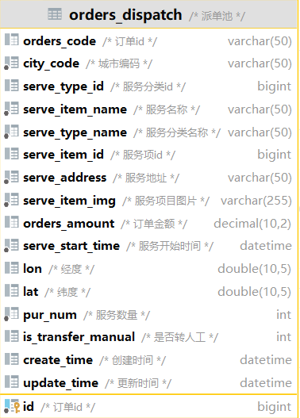
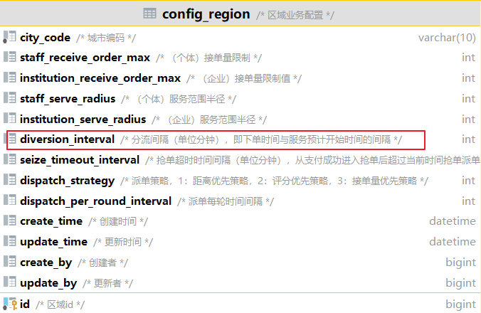
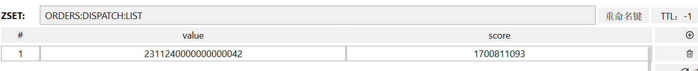
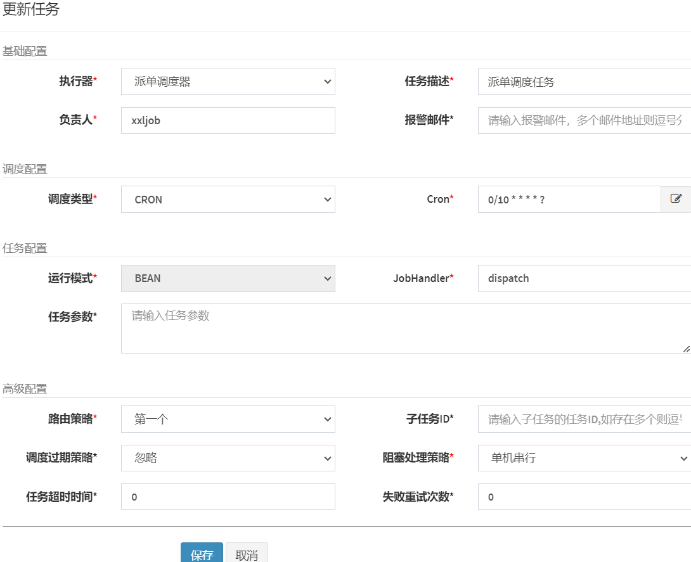
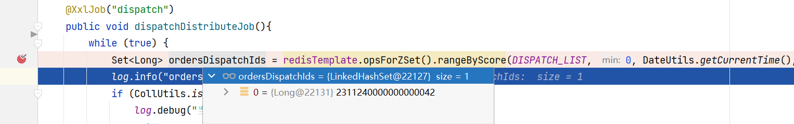
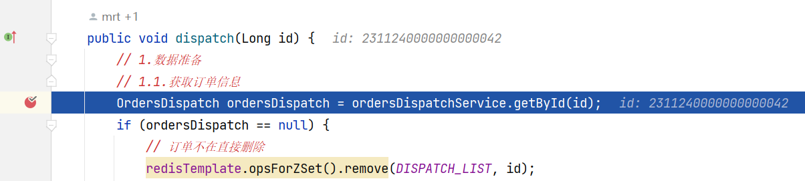
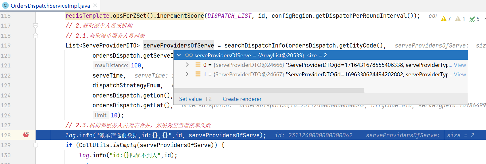
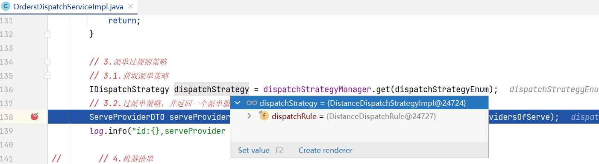
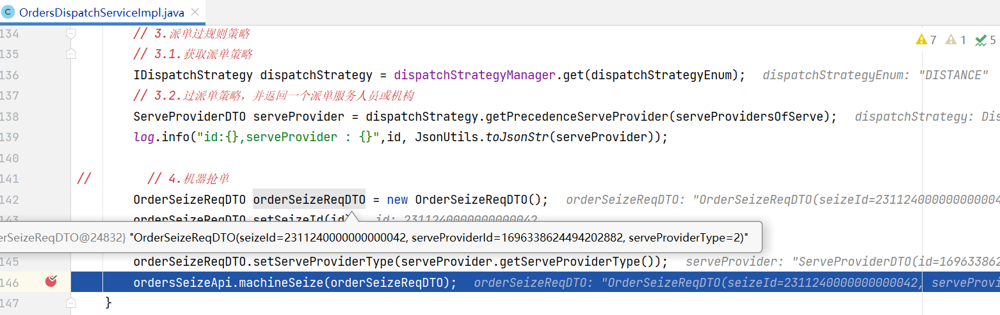
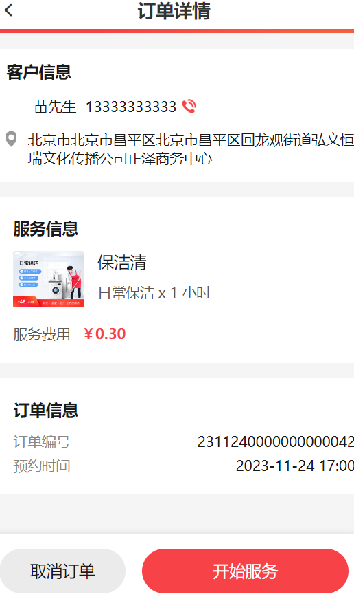

<title>第十一章 派单调度</title>

代码环境：

jzo2o-orders： dev_02分支


# 学习目标：


# 1 需求分析

## 1）派单调度流程

在抢单业务中，用户下单成功由服务人员或机构进行抢单，抢单成功服务人员上门服务，除了抢单业务系统还设计了派单业务，由系统根据用户订单的特点自动派给合适的服务人员。

系统派单的目的是什么？

根据订单的特点及服务人员的特点进行撮合，提高交易成功率。

<whiteboard token="QrKkwWx83hqp1CbKibRc0IIHnlc"></whiteboard>

系统如何派单？

<whiteboard token="T21bwwvzShQhkmbm5uzclIw4nxb"></whiteboard>


## 2）调度系统的应用场景

调度系统的应用场景广泛（如下）：

**即时配送服务：** 将用户提交的订单派发给最近且可用的配送员，以确保订单在最短时间内送达。

**服务行业派单：** 将用户的服务请求分配给合适的服务人员，考虑到距离、技能、时间等因素。

**出租车调度：** 将用户的打车请求派发给附近空闲的出租车，以最快速度响应用户需求。

**餐饮外卖配送：** 将用户的订单分派给附近的餐馆，并将已经制作好的食物分派给配送员，以保证食品的新鲜度和送达时间。

**快递中心派单：** 将到达的包裹分派给不同的快递员，根据各自的配送区域和计划。

**工程项目任务分配：** 在建筑、工程项目中，需要将不同的任务分配给相应的工程师、技术人员或施工队，以确保项目按计划进行。


通过项目中派单调度的学习有能力迁移到类似场景，比如：工单调度。

另外尝试去理解其它领域的调度业务，从而对调度系统的开发有深刻的理解，有能力迁移到其它的场景。


## 3) 小结

本项目派单调度的业务流程是什么？

为了提高交易成功率，派单调度模块会自动匹配订单与服务提供者，进行撮合匹配，流程如下：

1. 首先获取待分配的订单。
2. 根据订单的属性，包括：地理位置、服务项目等去服务提供池中匹配服务提供者。
3. 根据派单策略对符合条件的服务提供者进行规则匹配，每个派单策略通常有多个规则，从第一个规则逐个匹配其它规则。
4. 最后获取匹配成功的服务提供者，系统进行机器抢单。
5. 机器抢单成功，派单成功。


# 2 系统设计

## 2.1 总体设计

### 1）总体设计

根据需求分析，从以下几个问题出发进行设计。

1. 涉及到距离搜索，参考抢单业务需要借助Elasticsearch搜索服务人员，所以需要将服务人员同步到Elasticsearch。根据搜索匹配的条件：服务技能，服务时间、接单范围，需要将服务人员和机构的相关信息同步到Elasticsearch。

同步的方式使用Canal+MQ实现。 

1. 如果为订单派单失败每隔3分钟再次对订单进行派单，考虑性能问题在redis创建派单池，调度程序扫描派单池获取订单，所以需要将MySQL中派单池的数据同步到Redis。
2. 根据需求，派单策略有三种，后期还可能扩展，这里使用策略模式实现，提高系统扩展性。
3. 根据需求，每个派单策略有多个规则，按规则逐个去匹配，只要匹配成功或规则使用完成，这里使用责任链儿模式，提高系统扩展性。
4. 派单程序将订单和服务人员匹配成功，接下来调用抢单接口进行机器抢单，这样也体现公平性，因为派单的同步有服务人员也在抢单，这里是机器（平台）和人工（服务人员）在共同抢单。

整体交互流程如下：

<whiteboard token="Dze0wYdhahV17jbommJc1SkinFe"></whiteboard>

说明：

1. 使用Canal+MQ将服务提供者（服务人员和机构）信息（经纬度坐标、接单状态、当前接单数等）同步Elasticsearch中。
2. 将派单池同步到Redis，派单池中是待派单的订单信息。
3. 通过定时任务定时派单，从派单池查询多个订单，使用线程池对多个订单进行派单，每个线程负责一个订单。
4. 派单过程首先根据订单信息（服务地址、服务项目）从Elasticsearch中的服务提供者索引中搜索。
5. 找到多个服务提供者，根据派单策略去匹配服务提供者，通过责任链模式分别匹配每个规则，最终找到一个服务提供者。
6. 系统调用抢单接口为服务提供者派单。


### 2）服务提供池索引结构

根据设计，第一步需要向Elasticsearch中同步服务提供者的数据。

将customer数据库的serve_provider_sync表和orders数据库的serve_provider_sync表同步到ES的服务提供池。

<whiteboard token="SwCxwmjC0hQcwxbkhoWcEloYnVg"></whiteboard>

customer数据库的serve_provider_sync表中除了evaluation_score字段以外，其它字段是由服务人员设置服务技能、接单开关、接单范围保存的信息。

evaluation_score字段存储服务人员的评分，用户通过评价系统评分，由评价系统同步到此字段中。

orders数据库的serve_provider_sync表中记录了服务人员接单数统计，当服务人员或机构抢单成功后进行统计得到。


创建服务提供者索引结构，索引字段对应上图中两个表的字段。

先删除serve_provider_info，再创建serve_provider_info索引。

```JSON
DELETE serve_provider_info
PUT /serve_provider_info
{
  "mappings" : {
      "properties" : {
        "acceptance_num" : {
          "type" : "integer"
        },
        "city_code" : {
          "type" : "keyword"
        },
        "evaluation_score" : {
          "type" : "double"
        },
        "id" : {
          "type" : "long"
        },
        "location" : {
          "type" : "geo_point"
        },
        "pick_up" : {
          "type" : "integer"
        },
        "serve_item_ids" : {
          "type" : "long"
        },
        "serve_provider_type" : {
          "type" : "integer"
        },
        "serve_times" : {
          "type" : "integer"
        },
        "setting_status" : {
          "type" : "long"
        },
        "status" : {
          "type" : "long"
        }
      }
    }
  
}
```


### 3）Redis派单池

两种情况进入派单池：

1. 订单分流处理

在订单分流中对于距离服务开始时间在120分钟（默认值可修改）以内时将订单写入orders数据库的派单池表。

1. 定时任务处理

抢单池的订单没有人抢，距离服务开始时间在120分钟以内时将订单写入orders数据库的派单池表。

派单池表的结构如下：



120分钟的配置在foundations数据库的config_region表中，如下图：

此表配置了一些业务参数。



根据设计第二条将orders数据库的派单池表数据同步到Redis的派单池中。

Redis的派单池用什么数据结构呢？

根据需求，订单派单失败每隔3分钟再次对失败的订单进行派单，有什么办法可以在查询订单时将失败的订单过滤掉，并且还能根据时间对早进入派单池的订单进行优先派单，这里涉及到排序，很自然我们想到了Redis的ZSet结构。

Redis中派单池使用ZSet结构，value为是订单id、score为进入派单池的时间，当派单失败我们score加3分钟，第一次查询SortedSet查询score小于当前时间的订单。

<whiteboard token="L7wXwrJaShwz9SbHdPycAoO3nBc"></whiteboard>

### 4) ZSet测试

下边测试向ZSet添加元素、查询元素的方法。

```JSON
package com.jzo2o.orders.dispatch.service;

import com.jzo2o.api.foundations.RegionApi;
import com.jzo2o.api.foundations.dto.response.RegionServeInfoResDTO;
import com.jzo2o.common.constants.UserType;
import com.jzo2o.common.model.CurrentUserInfo;
import com.jzo2o.mvc.utils.UserContext;
import com.jzo2o.orders.base.model.domain.OrdersDispatch;
import lombok.extern.slf4j.Slf4j;
import org.junit.jupiter.api.AfterEach;
import org.junit.jupiter.api.BeforeEach;
import org.junit.jupiter.api.Test;
import org.springframework.boot.test.context.SpringBootTest;
import org.springframework.data.redis.core.RedisTemplate;

import javax.annotation.Resource;

import java.util.List;
import java.util.Set;

@SpringBootTest
@Slf4j
class IDispatchServiceTest {


    @Resource
    private RedisTemplate redisTemplate;


    @Test
    public void testSortedSet_add(){
        for (int i = 0; i < 10; i++) {
            //向key为：test_sortedset的sortedset中添加10个元素，value为i，socre为当前时间(秒)
            redisTemplate.opsForZSet().add("test_sortedset",i, DateUtils.getCurrentTime()*1d);
        }

    }
    @Test
    public void testSortedSet_rang(){
        //使用rangeByScore查询score范围从0到当前时间
        Set test_sortedset = redisTemplate.opsForZSet().rangeByScore("test_sortedset", 0, DateUtils.getCurrentTime(),0,5);
        //降序
//        Set test_sortedset = redisTemplate.opsForZSet().reverseRangeByScore("test_sortedset", 0, DateUtils.getCurrentTime(),0,5);
        test_sortedset.stream().forEach(System.out::println);
        //将key为test_sortedset中的vlaue为0的元素的socre加180秒
        redisTemplate.opsForZSet().incrementScore("test_sortedset", 0, 180);

    }


}
```

testSortedSet_add方法：向ZSet写入10个元素，value从0到9，socre为当前时间。

testSortedSet_rang方法：取出socre为0到当前时间的元素。

通过incrementScore方法对ZSet的第0个元素增加socre的值为180秒，对派单失败的订单就实现了3分钟之后继续派单。


### 5）小结

派单调度的整体交互是什么？


## 2.2 责任链模式

### 1）什么是责任链模式

责任链模式是一种行为型设计模式，它允许你将请求沿着处理者链进行传递，直到有一个处理者处理请求为止。每个处理者都可以决定是否将请求传递给下一个处理者。

根据派单的需求，根据订单信息从服务提供池中获取师傅及机构的信息，通过距离优先规则、评分优先规则等最终获取一个要派单的服务或机构。

下图描述了按距离优先派单的过程：

<whiteboard token="GonfwN0nYherBxb2VbIcLOtMncc"></whiteboard>

下边用责任链模式实现。

UML图示如下：

<whiteboard token="YxGMwxmODhHLV0bqqQZczfHxnWh"></whiteboard>

首先，阅读下边的数据处理规则的接口：

```JSON
package com.jzo2o.orders.dispatch.strategys;

import com.jzo2o.orders.dispatch.model.dto.ServeProviderDTO;
import com.jzo2o.orders.dispatch.rules.IDispatchRule;
import lombok.Builder;
import lombok.ToString;

import java.util.List;

/**
 * @author Mr.M
 * @version 1.0
 * @description TODO
 * @date 2023/11/24 5:56
 */
public interface IProcessRule {

    /**
     * 根据派单规则过滤服务人员
     * @param serveProviderDTOS
     * @return
     */
    List<ServeProviderDTO> filter(List<ServeProviderDTO> serveProviderDTOS);

    /**
     * 获取下一级规则
     *
     * @return
     */
    IProcessRule next();
}
```

根据需求定义距离优先规则。

```JSON
package com.jzo2o.orders.dispatch.strategys;

import com.jzo2o.common.utils.CollUtils;
import com.jzo2o.orders.dispatch.model.dto.ServeProviderDTO;
import com.jzo2o.orders.dispatch.rules.IDispatchRule;

import java.util.Comparator;
import java.util.List;
import java.util.stream.Collectors;

/**
 * @author Mr.M
 * @version 1.0
 * @description 按距离排序
 * @date 2023/11/24 5:58
 */
public class DistanceRule implements IProcessRule {
    private IProcessRule next;

    public DistanceRule(IProcessRule next) {
        this.next = next;
    }

    public List<ServeProviderDTO> doFilter(List<ServeProviderDTO> serveProviderDTOS) {
        System.out.println("按距离排序，拿到距离最近的服务提供者");
       //如果serveProviderDTOS元素个数小于2则直接返回
        if(CollUtils.size(serveProviderDTOS) < 2) {
            return serveProviderDTOS;
        }
        //按serveProviderDTOS中的距离升序排序
        serveProviderDTOS.sort((o1, o2) -> o1.getAcceptanceDistance() - o2.getAcceptanceDistance());
        //取出第一个元素
        ServeProviderDTO serveProviderDTO = serveProviderDTOS.get(0);
        //获取相同级别的对象
        List<ServeProviderDTO> sameLevelServeProviderDTOS = serveProviderDTOS.stream().filter(serveProviderDTO1 -> serveProviderDTO1.getAcceptanceDistance() == serveProviderDTO.getAcceptanceDistance()).collect(Collectors.toList());
        return sameLevelServeProviderDTOS;
    }

    @Override
    public List<ServeProviderDTO> filter(List<ServeProviderDTO> serveProviderDTOS) {
        List<ServeProviderDTO> result = this.doFilter(serveProviderDTOS);
        if(CollUtils.size(result) > 1 && next != null) {
            return next.filter(result);
        }else {
            return result;
        }
    }

    @Override
    public IProcessRule next() {
        return next;
    }


}
```

再定义最少接单数规则：

```JSON
package com.jzo2o.orders.dispatch.strategys;

import com.jzo2o.common.utils.CollUtils;
import com.jzo2o.orders.dispatch.model.dto.ServeProviderDTO;

import java.util.Comparator;
import java.util.List;
import java.util.stream.Collectors;

/**
 * @author Mr.M
 * @version 1.0
 * @description 按接单数
 * @date 2023/11/24 5:58
 */
public class AcceptNumRule implements IProcessRule {
    private IProcessRule next;

    public AcceptNumRule(IProcessRule next) {
        this.next = next;
    }

    public List<ServeProviderDTO> doFilter(List<ServeProviderDTO> serveProviderDTOS) {
        System.out.println("按接单数排序，拿到最少接单少的服务提供者");
        if(CollUtils.size(serveProviderDTOS) < 2) {
            return serveProviderDTOS;
        }
        //按serveProviderDTOS中的接单数升序排序
        serveProviderDTOS.sort((o1, o2) -> o1.getAcceptanceNum() - o2.getAcceptanceNum());
        //取出第一个元素
        ServeProviderDTO serveProviderDTO = serveProviderDTOS.get(0);
        //获取相同级别的对象
        List<ServeProviderDTO> sameLevelServeProviderDTOS = serveProviderDTOS.stream().filter(serveProviderDTO1 -> serveProviderDTO1.getAcceptanceNum() == serveProviderDTO.getAcceptanceNum()).collect(Collectors.toList());
        
        return sameLevelServeProviderDTOS;
    }

    @Override
    public List<ServeProviderDTO> filter(List<ServeProviderDTO> serveProviderDTOS) {
        List<ServeProviderDTO> result = this.doFilter(serveProviderDTOS);
        if(CollUtils.size(result) > 1 && next != null) {
            return next.filter(result);
        }else {
            return result;
        }
    }

    @Override
    public IProcessRule next() {
        return next;
    }
}
```

下边将规则组成一个链儿，调用链儿中第一个规则的filter方法，最终获取处理后的结果，如果处理结果的数量大于1则随机选择一个，否则取出唯一的结果。

注意：上边的规则类还未实现，下边的代码暂时不运行，当前目的是去理解责任链模式。

```JSON
package com.jzo2o.orders.dispatch.strategys;

import com.jzo2o.common.utils.CollUtils;
import com.jzo2o.orders.dispatch.model.dto.ServeProviderDTO;

import java.util.Arrays;
import java.util.List;

/**
 * @author Mr.M
 * @version 1.0
 * @description TODO
 * @date 2023/11/24 6:05
 */
public class RuleHandlerTest {

    public static void main(String[] args) {

        // 策略1：构建责任链,先距离优先，距离相同再判断接单数
        IProcessRule rule = new AcceptNumRule(null);
        IProcessRule ruleChain = new DistanceRule(rule);
        // 策略2：构建责任链,先评分优先，评分相同再判断接单数
//        IProcessRule rule = new AcceptNumRule(null);
//        IProcessRule ruleChain = new ScoreRule(rule);
        // 策略3：构建责任链,先接单数优先，接单数相同再判断评分
//        IProcessRule rule = new ScoreRule(null);
//        IProcessRule ruleChain = new AcceptNumRule(rule);

        // 创建数据
        List<ServeProviderDTO> serveProviderDTOS = Arrays.asList(
                //1号 接单数最少
                ServeProviderDTO.builder().id(1L).acceptanceNum(0).acceptanceDistance(30).evaluationScore(50).build(),
                //2号 得分最高
                ServeProviderDTO.builder().id(2L).acceptanceNum(1).acceptanceDistance(10).evaluationScore(100).build(),
                //3号 得分最高
                ServeProviderDTO.builder().id(3L).acceptanceNum(2).acceptanceDistance(10).evaluationScore(100).build(),
                //4号 距离最近
                ServeProviderDTO.builder().id(4L).acceptanceNum(2).acceptanceDistance(5).evaluationScore(50).build(),
                //4号 距离最近
                ServeProviderDTO.builder().id(5L).acceptanceNum(1).acceptanceDistance(5).evaluationScore(50).build()
        );

        // 发起处理请求
        List<ServeProviderDTO> list = ruleChain.filter(serveProviderDTOS);
        //处理结果
        ServeProviderDTO result = null;
        // 3.1.唯一高优先级直接返回
        int size = 1;
        if((size = CollUtils.size(list)) == 1) {
            result = list.get(0);
        }
        // 3.2.多个高优先级随机返回,生成0到size之间的随机整数
        int randomIndex = (int) (Math.random() * size);
        result = list.get(randomIndex);
        System.out.println(result);
    }
}
```


下边进行测试

```JSON
package com.jzo2o.orders.dispatch.strategys;

import com.jzo2o.common.utils.CollUtils;
import com.jzo2o.orders.dispatch.model.dto.ServeProviderDTO;

import java.util.Arrays;
import java.util.List;

/**
 * @author Mr.M
 * @version 1.0
 * @description TODO
 * @date 2023/11/24 6:05
 */
public class RuleHandlerTest {

    public static void main(String[] args) {

        // 策略1：构建责任链,先距离优先，距离相同再判断接单数
        IProcessRule rule = new AcceptNumRule(null);
        IProcessRule ruleChain = new DistanceRule(rule);
        // 策略2：构建责任链,先评分优先，评分相同再判断接单数
//        IProcessRule rule = new AcceptNumRule(null);
//        IProcessRule ruleChain = new ScoreRule(rule);
        // 策略3：构建责任链,先接单数优先，接单数相同再判断评分
//        IProcessRule rule = new ScoreRule(null);
//        IProcessRule ruleChain = new AcceptNumRule(rule);

        // 创建数据
        List<ServeProviderDTO> serveProviderDTOS = Arrays.asList(
                //1号 接单数最少
                ServeProviderDTO.builder().id(1L).acceptanceNum(0).acceptanceDistance(30).evaluationScore(50).build(),
                //2号 得分最高
                ServeProviderDTO.builder().id(2L).acceptanceNum(1).acceptanceDistance(10).evaluationScore(100).build(),
                //3号 得分最高
                ServeProviderDTO.builder().id(3L).acceptanceNum(2).acceptanceDistance(10).evaluationScore(100).build(),
                //4号 距离最近
                ServeProviderDTO.builder().id(4L).acceptanceNum(2).acceptanceDistance(5).evaluationScore(50).build(),
                //4号 距离最近
                ServeProviderDTO.builder().id(5L).acceptanceNum(1).acceptanceDistance(5).evaluationScore(50).build()
        );

        // 发起处理请求
        List<ServeProviderDTO> list = ruleChain.filter(serveProviderDTOS);
        //处理结果
        ServeProviderDTO result = null;
        // 3.1.唯一高优先级直接返回
        int size = 1;
        if((size = CollUtils.size(list)) == 1) {
            result = list.get(0);
        }
        // 3.2.多个高优先级随机返回
        int randomIndex = (int) (Math.random() * size);
        result = list.get(randomIndex);
        System.out.println(result);
    }
}
```

### 2）责任链模式优化

上边的代码每个规则中filter方法和next方法都是重复一样的，我们创建抽象类提取

```JSON
package com.jzo2o.orders.dispatch.strategys;

import com.jzo2o.common.utils.CollUtils;
import com.jzo2o.orders.dispatch.model.dto.ServeProviderDTO;

import java.util.Comparator;
import java.util.List;
import java.util.stream.Collectors;

/**
 * @author Mr.M
 * @version 1.0
 * @description 规则抽象类
 * @date 2023/11/24 11:00
 */
public abstract class AbstractProcessRule implements IProcessRule{

    private IProcessRule next;

    public AbstractProcessRule(IProcessRule next) {
        this.next = next;
    }

    public abstract List<ServeProviderDTO> doFilter(List<ServeProviderDTO> serveProviderDTOS);

    @Override
    public List<ServeProviderDTO> filter(List<ServeProviderDTO> serveProviderDTOS) {
        List<ServeProviderDTO> result = this.doFilter(serveProviderDTOS);
        if(CollUtils.size(result) > 1 && next != null) {
            return next.filter(result);
        }else {
            return result;
        }
    }

    @Override
    public IProcessRule next() {
        return next;
    }
}
```

修改每个规则类：

下边以DistanceRule举例，其它的规则类自行修改。

```JSON
package com.jzo2o.orders.dispatch.strategys;

import com.jzo2o.common.utils.CollUtils;
import com.jzo2o.orders.dispatch.model.dto.ServeProviderDTO;

import java.util.Comparator;
import java.util.List;
import java.util.stream.Collectors;

/**
 * @author Mr.M
 * @version 1.0
 * @description 按距离排序
 * @date 2023/11/24 5:58
 */
public class DistanceRule extends AbstractProcessRule  {
//    private IProcessRule next;

    public DistanceRule(IProcessRule next) {
        super(next);
//        this.next = next;
    }

    public List<ServeProviderDTO> doFilter(List<ServeProviderDTO> serveProviderDTOS) {
        System.out.println("按距离排序");
        //如果serveProviderDTOS元素个数小于2则直接返回
        if(CollUtils.size(serveProviderDTOS) < 2) {
            return serveProviderDTOS;
        }
        //按serveProviderDTOS中的距离升序排序
        serveProviderDTOS.sort((o1, o2) -> o1.getAcceptanceDistance() - o2.getAcceptanceDistance());
        //取出第一个元素
        ServeProviderDTO serveProviderDTO = serveProviderDTOS.get(0);
        //获取相同级别的对象
        List<ServeProviderDTO> sameLevelServeProviderDTOS = serveProviderDTOS.stream().filter(serveProviderDTO1 -> serveProviderDTO1.getAcceptanceDistance() == serveProviderDTO.getAcceptanceDistance()).collect(Collectors.toList());
        return sameLevelServeProviderDTOS;
    }

//    @Override
//    public List<ServeProviderDTO> filter(List<ServeProviderDTO> serveProviderDTOS) {
//        List<ServeProviderDTO> result = this.doFilter(serveProviderDTOS);
//        if(CollUtils.size(result) > 1 && next != null) {
//            return next.filter(result);
//        }else {
//            return result;
//        }
//    }
//
//    @Override
//    public IProcessRule next() {
//        return next;
//    }

}
```

重新 进行测试。

### 3）小结

责任链模式用在哪里？怎么使用？在开发中注意什么？


## 2.3 定义派单策略

### 1）技术方案

在前边我们测试责任链模式，如下代码怎么优化：

```JSON
        // 策略1：构建责任链,先距离优先，距离相同再判断评分
       IProcessRule rule = new AcceptNumRule(null);
        IProcessRule ruleChain = new DistanceRule(rule);
        // 策略2：构建责任链,先评分优先，评分相同再判断接单数
//        IProcessRule rule = new AcceptNumRule(null);
//        IProcessRule ruleChain = new ScoreRule(rule);
        // 策略3：构建责任链,先接单数优先，接单数相同再判断评分
//        IProcessRule rule = new ScoreRule(null);
//        IProcessRule ruleChain = new AcceptNumRule(rule);
```

根据需求我们平台支持距离优先策略、评分优先策略、最少接单优先策略，针对上边的代码我们可以基于策略模式定义不同的策略去优化。

首先阅读下边的策略接口：

```JSON
package com.jzo2o.orders.dispatch.strategys;

import com.jzo2o.orders.dispatch.model.dto.ServeProviderDTO;

import java.util.List;

/**
 * @author Mr.M
 * @version 1.0
 * @description 策略接口
 * @date 2023/11/24 10:56
 */
public interface IProcessStrategy {
    /**
     * 从服务人员/机构列表中获取高优先级别的一个，如果出现多个相同优先级随机获取一个
     *
     * @param serveProviderDTOS 服务人员/机构列表
     * @return
     */
    ServeProviderDTO getPrecedenceServeProvider(List<ServeProviderDTO> serveProviderDTOS);
}
```

根据策略接口实现不同的策略类，

<whiteboard token="WmkswqDu5hrb5FbQWCxcnKX8nkd"></whiteboard>

### 2) 编码实现

每个策略类都需要实现getPrecedenceServeProvider(List<ServeProviderDTO> serveProviderDTOS)方法，其逻辑是一样的，每个策略类组装的责任链是不同的，我们定义抽象类将共同的方法写在抽象类中。

阅读抽象策略类：

```JSON
package com.jzo2o.orders.dispatch.strategys;

import com.jzo2o.common.utils.CollUtils;
import com.jzo2o.orders.dispatch.model.dto.ServeProviderDTO;
import com.jzo2o.orders.dispatch.rules.IDispatchRule;

import java.util.List;
import java.util.Objects;

/**
 * @author Mr.M
 * @version 1.0
 * @description 抽象策略类
 * @date 2023/11/24 11:53
 */
public abstract class AbstractStrategyImpl implements IProcessStrategy {

    private final IProcessRule processRule;

    public AbstractStrategyImpl() {
        this.processRule = getRules();
    }

    /**
     * 设置派单规则
     *
     * @return
     */
    protected abstract IProcessRule getRules();

    @Override
    public ServeProviderDTO getPrecedenceServeProvider(List<ServeProviderDTO> serveProviderDTOS) {
        // 1.判空
        if (CollUtils.isEmpty(serveProviderDTOS)) {
            return null;
        }

        // 2.根据优先级获取高优先级别的
        serveProviderDTOS = processRule.filter(serveProviderDTOS);

        // 3.数据返回
        // 3.1.唯一高优先级直接返回
        int size = 1;
        if ((size = CollUtils.size(serveProviderDTOS)) == 1) {
            return serveProviderDTOS.get(0);
        }
        // 3.2.多个高优先级随即将返回
        int randomIndex = (int) (Math.random() * size);
        return serveProviderDTOS.get(randomIndex);
    }
}
```

定义各个策略类：

定义距离优先策略类

```JSON
package com.jzo2o.orders.dispatch.strategys;

/**
 * @author Mr.M
 * @version 1.0
 * @description 先距离优先，距离相同再判断评分
 * @date 2023/11/24 11:56
 */
public class DistanceStrategyImpl extends AbstractStrategyImpl  {
    @Override
    protected IProcessRule getRules() {
        //构建责任链,先距离优先，距离相同再判断接单数
        IProcessRule rule= new AcceptNumRule(null);
        IProcessRule ruleChain = new DistanceRule(rule);
        return ruleChain;
    }
}
```


定义最少接单优先策略：

```JSON
package com.jzo2o.orders.dispatch.strategys;

/**
 * @author Mr.M
 * @version 1.0
 * @description 最少接单优先
 * @date 2023/11/24 11:59
 */
public class LeastAcceptOrderStrategyImpl extends AbstractStrategyImpl {
    @Override
    protected IProcessRule getRules() {
        // 构建责任链,先接单数优先，接单数相同再判断评分
        IProcessRule rule = new DistanceRule(null);
        IProcessRule ruleChain = new AcceptNumRule(rule);
        return ruleChain;
    }
}
```


### 3) 测试

```JSON
package com.jzo2o.orders.dispatch.strategys;

import com.jzo2o.common.utils.CollUtils;
import com.jzo2o.orders.dispatch.model.dto.ServeProviderDTO;

import java.util.Arrays;
import java.util.List;

/**
 * @author Mr.M
 * @version 1.0
 * @description TODO
 * @date 2023/11/24 6:05
 */
public class StrategyTest {

    public static void main(String[] args) {
        // 创建数据
        List<ServeProviderDTO> serveProviderDTOS = Arrays.asList(
                //1号 接单数最少
                ServeProviderDTO.builder().id(1L).acceptanceNum(0).acceptanceDistance(30).evaluationScore(50).build(),
                //2号 得分最高
                ServeProviderDTO.builder().id(2L).acceptanceNum(1).acceptanceDistance(10).evaluationScore(100).build(),
                //3号 得分最高
                ServeProviderDTO.builder().id(3L).acceptanceNum(2).acceptanceDistance(10).evaluationScore(100).build(),
                //4号 距离最近
                ServeProviderDTO.builder().id(4L).acceptanceNum(2).acceptanceDistance(5).evaluationScore(50).build(),
                //4号 距离最近
                ServeProviderDTO.builder().id(5L).acceptanceNum(1).acceptanceDistance(5).evaluationScore(50).build()
        );
        //获取距离优先策略
        IProcessStrategy processStrategy = new DistanceStrategyImpl();
        //通过策略bean进行匹配处理
        ServeProviderDTO precedenceServeProvider = processStrategy.getPrecedenceServeProvider(serveProviderDTOS);
        System.out.println(precedenceServeProvider);
    }
}
```


### 4）小结

基于策略模式如何灵活定义派单调度策略？


# 3 系统开发

## 3.1 同步服务提供者

### 1) 数据结构

1. **ES中服务提供者**

作用：涉及到距离搜索，所以将数据库中服务提供者的信息及服务提供者的接单数据同步到 ES中的服务提供池中。

索引结构如下：

```Java
DELETE serve_provider_info
PUT /serve_provider_info
{
  "mappings" : {
      "properties" : {
        "acceptance_num" : {
          "type" : "integer"
        },
        "city_code" : {
          "type" : "keyword"
        },
        "evaluation_score" : {
          "type" : "double"
        },
        "id" : {
          "type" : "long"
        },
        "location" : {
          "type" : "geo_point"
        },
        "pick_up" : {
          "type" : "integer"
        },
        "serve_item_ids" : {
          "type" : "long"
        },
        "serve_provider_type" : {
          "type" : "integer"
        },
        "serve_times" : {
          "type" : "integer"
        },
        "setting_status" : {
          "type" : "long"
        },
        "status" : {
          "type" : "long"
        }
      }
    }
  
}
```


1. **Redis中服务提供者接单数统计表**

为了方便派单进行判断服务提供者是否达到接单数限制，及接单时间冲突，将服务提供者的接单数统计信息及接单时间信息同步到Redis中。

<whiteboard token="XnfLweCpThu8jcbRWwlctc5pnOf"></whiteboard>


### 2）阅读代码

同步服务提供者的代码有两处：

1. customer服务
2. orders-dispatch派单服务


1. **customer服务:**

```JSON
package com.jzo2o.customer.handler;

import com.jzo2o.canal.listeners.AbstractCanalRabbitMqMsgListener;
import com.jzo2o.common.expcetions.BadRequestException;
import com.jzo2o.common.expcetions.CommonException;
import com.jzo2o.common.model.Location;
import com.jzo2o.common.utils.BeanUtils;
import com.jzo2o.common.utils.CollUtils;
import com.jzo2o.customer.constants.EsIndexConstants;
import com.jzo2o.customer.model.domain.ServeProviderInfo;
import com.jzo2o.customer.model.domain.ServeProviderSync;
import com.jzo2o.es.core.ElasticSearchTemplate;
import lombok.Data;
import lombok.extern.slf4j.Slf4j;
import org.springframework.amqp.core.ExchangeTypes;
import org.springframework.amqp.core.Message;
import org.springframework.amqp.rabbit.annotation.Exchange;
import org.springframework.amqp.rabbit.annotation.Queue;
import org.springframework.amqp.rabbit.annotation.QueueBinding;
import org.springframework.amqp.rabbit.annotation.RabbitListener;
import org.springframework.stereotype.Component;

import javax.annotation.Resource;
import java.util.List;

/**
 * @author 86188
 */
@Data
@Component
@Slf4j
public class ServeProviderHandler extends AbstractCanalRabbitMqMsgListener<ServeProviderSync> {
    @Resource
    private ElasticSearchTemplate elasticSearchTemplate;

    @RabbitListener(bindings = @QueueBinding(
            value = @Queue(name = "canal-mq-jzo2o-customer-provider"),
            exchange = @Exchange(name = "exchange.canal-jzo2o", type = ExchangeTypes.TOPIC),
            key = "canal-mq-jzo2o-customer-provider"),
            concurrency = "1"
    )
    public void onMessage(Message message) throws Exception {
        parseMsg(message);
    }

    @Override
    public void batchSave(List<ServeProviderSync> data) {
        List<ServeProviderInfo> serveProviderInfos = BeanUtils.copyToList(data, ServeProviderInfo.class, (sync, info) -> {
            info.setLocation(new Location(sync.getLon(), sync.getLat()));
        });
        log.debug("serveProviderInfos : {}", serveProviderInfos);

        if(!elasticSearchTemplate.opsForDoc().batchUpsert(EsIndexConstants.SERVE_PROVIDER_INFO, serveProviderInfos)){
            throw new CommonException("服务人员或机构信息同步异常");
        }
    }

    @Override
    public void batchDelete(List<Long> ids) {
        elasticSearchTemplate.opsForDoc().batchDelete(EsIndexConstants.SERVE_PROVIDER_INFO, ids);
    }
}
```


1. **orders-dispatch服务**

```JSON
package com.jzo2o.orders.dispatch.handler;

import com.jzo2o.api.customer.ServeProviderApi;
import com.jzo2o.canal.listeners.AbstractCanalRabbitMqMsgListener;
import com.jzo2o.common.utils.BeanUtils;
import com.jzo2o.es.core.ElasticSearchTemplate;
import com.jzo2o.orders.base.model.domain.ServeProviderInfo;
import com.jzo2o.orders.base.model.domain.ServeProviderSync;
import com.jzo2o.orders.base.utils.RedisUtils;
import org.springframework.amqp.core.ExchangeTypes;
import org.springframework.amqp.core.Message;
import org.springframework.amqp.rabbit.annotation.Exchange;
import org.springframework.amqp.rabbit.annotation.Queue;
import org.springframework.amqp.rabbit.annotation.QueueBinding;
import org.springframework.amqp.rabbit.annotation.RabbitListener;
import org.springframework.data.redis.core.RedisTemplate;
import org.springframework.stereotype.Component;

import javax.annotation.Resource;
import java.util.HashMap;
import java.util.List;
import java.util.Map;
import java.util.stream.Collectors;

import static com.jzo2o.orders.base.constants.RedisConstants.RedisKey.SERVE_PROVIDER_STATE;

/**
 *
 * 服务提供者服务状态同步类
 * @author 86188
 */
@Component
public class ServeProviderStateSyncHandler extends AbstractCanalRabbitMqMsgListener<ServeProviderSync> {

    @Resource
    private ElasticSearchTemplate elasticSearchTemplate;

    @Resource
    private ServeProviderApi serveProviderApi;

    @Resource
    private RedisTemplate redisTemplate;

    @RabbitListener(bindings = @QueueBinding(
            value = @Queue(name = "canal-mq-jzo2o-orders-provider"),
            exchange = @Exchange(name = "exchange.canal-jzo2o", type = ExchangeTypes.TOPIC),
            key = "canal-mq-jzo2o-orders-provider"),
            concurrency = "1"
    )
    public void onMessage(Message message) throws Exception {
        parseMsg(message);
    }

    @Override
    public void batchSave(List<ServeProviderSync> data) {
        List<ServeProviderInfo> serveProviderInfos = BeanUtils.copyToList(data, ServeProviderInfo.class);
        // 1.同步es
        elasticSearchTemplate.opsForDoc().batchUpsert("serve_provider_info", serveProviderInfos);
        // 2.同步redis
        //服务提供者id
        List<Long> serveProviderIds = data.stream().map(ServeProviderSync::getId).collect(Collectors.toList());
        //获取服务提供者的城市编码
        Map<Long, String> serveProviderIdAndCityCodeMap = serveProviderApi.batchCityCode(serveProviderIds);

        data.stream().forEach(serveProviderSync -> {
            //获取服务提供者的城市编码
            String cityCode = serveProviderIdAndCityCodeMap.get(serveProviderSync.getId());
            int index = RedisUtils.getCityIndex(cityCode);
            // 服务时间状态redisKey
            String serveProviderStateRedisKey = String.format(SERVE_PROVIDER_STATE, index);
            Map<String, Object> map = new HashMap<>();
            // 服务时间列表
            map.put(serveProviderSync.getId() + "_times", serveProviderSync.getServeTimes());
            // 服务数量
            map.put(serveProviderSync.getId() + "_num", serveProviderSync.getAcceptanceNum());
            //写入redis
            redisTemplate.opsForHash().putAll(serveProviderStateRedisKey, map);
        });
    }

    @Override
    public void batchDelete(List<Long> ids) {
    }
}
```


### 3）测试

测试流程：

启动Elasticsearch、Kibana

通过Kibana清除serve_provider_info中的文档

可以通过DELETE命令删除文档：

```JSON
DELETE /serve_provider_info/_doc/1696338624494202882
```

也可以删除整个索引再创建索引：


启动customer服务

启动orders-dispatch派单服务

启动canal、rabbitMQ服务

注意：如果canal读取binlog日志失败需要参考“配置搜索及数据同步环境v1.0”进行处理。

启动网关

启动publics服务

启动服务端（前端）

服务人员登录，设置接单范围、开启接单、服务技能。


预期结果：

将customer数据库的serve_provider_sync表和orders数据库的serve_provider_sync表的记录向Elasticsearch的serve_provider_info同步数据成功。


## 3.2 同步派单池

### 1）数据结构

为了快速获取派单信息，使用redis的SortedSet存储派单信息。

详细见前边讲解的“Redis派单池”

<whiteboard token="RnwNwZ8fDh3POObhvOPckByCnd7"></whiteboard>


### 2）阅读代码

两种情况进入派单池表：

1. **订单分流处理**

在订单分流中对于距离服务开始时间在120分钟（可配置）以内时将订单写入orders数据库的派单池表。

订单分流代码如下：

```JSON
package com.jzo2o.orders.base.service;

import com.jzo2o.orders.base.model.domain.Orders;

/**
 * 订单分流
 */
public interface IOrdersDiversionCommonService {

    /**
     * 订单分流,所有订单均可抢单
     *
     * @param orders
     */
    void diversion(Orders orders);

}
```

1. **定时任务处理写入派单池**

抢单池的订单没有人抢，距离服务开始时间在120分钟以内时将订单写入orders数据库的派单池表。

进入抢单工程

```JSON
package com.jzo2o.orders.seize.handler;

import com.jzo2o.api.foundations.RegionApi;
import com.jzo2o.api.foundations.dto.response.ConfigRegionInnerResDTO;
import com.jzo2o.common.utils.BeanUtils;
import com.jzo2o.common.utils.CollUtils;
import com.jzo2o.common.utils.ObjectUtils;
import com.jzo2o.es.core.ElasticSearchTemplate;
import com.jzo2o.orders.base.constants.EsIndexConstants;
import com.jzo2o.orders.base.model.domain.OrdersDispatch;
import com.jzo2o.orders.base.model.domain.OrdersSeize;
import com.jzo2o.orders.base.utils.RedisUtils;
import com.jzo2o.orders.seize.model.dto.response.OrdersSeizeListResDTO;
import com.jzo2o.orders.seize.service.IOrdersDispatchService;
import com.jzo2o.orders.seize.service.IOrdersSeizeService;
import com.jzo2o.redis.annotations.Lock;
import com.jzo2o.redis.constants.RedisSyncQueueConstants;
import com.jzo2o.redis.sync.SyncManager;
import com.xxl.job.core.handler.annotation.XxlJob;
import io.seata.spring.annotation.GlobalTransactional;
import lombok.extern.slf4j.Slf4j;
import org.redisson.api.RedissonClient;
import org.springframework.data.redis.core.RedisTemplate;
import org.springframework.stereotype.Component;
import org.springframework.transaction.annotation.Transactional;

import javax.annotation.Resource;
import java.util.List;
import java.util.concurrent.Executor;
import java.util.stream.Collectors;

import static com.jzo2o.orders.base.constants.RedisConstants.RedisFormatter.SEIZE_TIME_OUT;
import static com.jzo2o.orders.base.constants.RedisConstants.RedisKey.ORDERS_RESOURCE_STOCK;
import static com.jzo2o.orders.base.constants.RedisConstants.RedisKey.ORERS_SEIZE_SYNC_QUEUE_NAME;

/**
 * 抢单xxl-job任务
 */
@Component
@Slf4j
public class SeizeJobHandler {

/**
 * 当前时间距离服务预约时间间隔小于配置值时进入派单池
 */
@XxlJob("seizeTimeoutIntoDispatchPoolJob")
public void seizeTimeoutIntoDispatchPoolJob() {
    List<ConfigRegionInnerResDTO> configRegionInnerResDTOS = regionApi.findAll();
    for (ConfigRegionInnerResDTO configRegionInnerResDTO : configRegionInnerResDTOS) {
        try {
            //传入配置的下单时间距离服务预约时间间隔
            owner.seizeTimeoutIntoDispatchPool(configRegionInnerResDTO.getCityCode(), configRegionInnerResDTO.getDiversionInterval());

        } catch (Exception e) {
            log.error("抢单订单超时处理异常，e:", e);
        }
    }
}
...
```

1. **由派单池表到Redis派单池：**

```JSON
package com.jzo2o.orders.dispatch.handler;

import com.jzo2o.canal.listeners.AbstractCanalRabbitMqMsgListener;
import com.jzo2o.common.utils.DateUtils;
import com.jzo2o.orders.base.constants.RedisConstants;
import com.jzo2o.orders.base.model.domain.OrdersDispatch;
import com.jzo2o.orders.base.utils.RedisUtils;
import org.springframework.amqp.core.ExchangeTypes;
import org.springframework.amqp.core.Message;
import org.springframework.amqp.rabbit.annotation.Exchange;
import org.springframework.amqp.rabbit.annotation.Queue;
import org.springframework.amqp.rabbit.annotation.QueueBinding;
import org.springframework.amqp.rabbit.annotation.RabbitListener;
import org.springframework.data.redis.core.RedisTemplate;
import org.springframework.data.redis.core.ZSetOperations;
import org.springframework.stereotype.Component;

import javax.annotation.Resource;
import java.util.List;
import java.util.Set;
import java.util.stream.Collectors;

import static com.jzo2o.orders.base.constants.RedisConstants.RedisKey.DISPATCH_LIST;

/**
 * @author 86188
 */
@Component
public class OrdersDispatchSyncHandler extends AbstractCanalRabbitMqMsgListener<OrdersDispatch> {

    @Resource
    private RedisTemplate redisTemplate;


    @RabbitListener(bindings = @QueueBinding(
            value = @Queue(name = "canal-mq-jzo2o-orders-dispatch"),
            exchange = @Exchange(name = "exchange.canal-jzo2o", type = ExchangeTypes.TOPIC),
            key = "canal-mq-jzo2o-orders-dispatch"),
            concurrency = "1"
    )
    public void onMessage(Message message) throws Exception {
        parseMsg(message);
    }

    @Override
    public void batchSave(List<OrdersDispatch> data) {
        // 1.同步派单列表
        // 1.1.派单列表过滤（人工派单的不进入派单列表）
        //ZSetOperations.TypedTuple表示Sorted Set有序集合的元素，包括：value和分数
        Set<ZSetOperations.TypedTuple> ordersDispatchIdTypedTupleSet = data.stream()
                .filter(ordersDispatch -> ordersDispatch.getIsTransferManual() == 0 || DateUtils.now().compareTo(ordersDispatch.getServeStartTime()) < 0)
                .map(ordersDispatch -> ZSetOperations.TypedTuple.of(ordersDispatch.getId(), DateUtils.getCurrentTime() * 1d))
                .collect(Collectors.toSet());
        // 1.2.同步派单列表
        redisTemplate.opsForZSet().addIfAbsent(DISPATCH_LIST, ordersDispatchIdTypedTupleSet);


    }

    @Override
    public void batchDelete(List<Long> ids) {
        // 清空派单列表
        redisTemplate.opsForZSet().remove(DISPATCH_LIST, ids);
    }

}
```


### 3）测试

下边我们测试通过订单分流进入派单池的流程。


测试流程：

启动redis

启动orders-manager订单管理服务

启动orders-dispatch派单服务

启动网关

启动customer服务

启动publics服务

启动用户端（前端）

用户登录小程序，进行下单，开始服务时间选择最近的时间

由于前端对时间进行限制，选择的最近的开始服务时间距离当前时间会大于2小时，需要修改foundations数据库的config_region表的diversion_interval字段值，这里统一改为180（表示180分钟）

注意：在下单时选择的家政服务和测试的服务人员的服务技能及地理范围保持一致。

这里服务技能选择：日常 保洁。

地理范围：选择北京黑马程序员附近


预期结果：

向派单池表orders_dispatch写成功

向redis派单池“ORDERS:DISPATCH:LIST” 同步成功

示例：

查看orders_dispatch表：  

```JSON
[
  {
    "id": 2311240000000000042,
    "orders_code": null,
    "city_code": "010",
    "serve_type_id": 1678649931106705409,
    "serve_item_name": "日常保洁",
    "serve_type_name": "保洁清",
    "serve_item_id": 1685894105234755585,
    "serve_address": "北京市北京市昌平区北京市昌平区回龙观街道弘文恒瑞文化传播公司正泽商务中心",
    "serve_item_img": "https://yjy-xzbjzfw-oss.oss-cn-hangzhou.aliyuncs.com/aa6489e5-cd92-42f0-837a-952c99653b8b.png",
    "orders_amount": 1.00,
    "serve_start_time": "2023-11-24 17:00:00",
    "lon": 116.34351,
    "lat": 40.06024,
    "pur_num": 1,
    "is_transfer_manual": 0,
    "create_time": "2023-11-24 15:28:08",
    "update_time": "2023-11-24 15:28:08"
  }
]
```

查看redis派单池：




## 3.3 派单

### 1）阅读代码

进入orders-diapatch工程。

根据系统设计：

1. 通过定时任务，每分钟执行一次dispatchDistributeJob()方法，代码如下：

```JSON
package com.jzo2o.orders.dispatch.handler;

import com.baomidou.mybatisplus.core.conditions.query.LambdaQueryWrapper;
import com.jzo2o.common.utils.CollUtils;
import com.jzo2o.common.utils.DateUtils;
import com.jzo2o.orders.base.constants.RedisConstants;
import com.jzo2o.orders.base.mapper.OrdersDispatchMapper;
import com.jzo2o.orders.base.model.domain.OrdersDispatch;
import com.jzo2o.orders.dispatch.service.IOrdersDispatchService;
import com.jzo2o.redis.annotations.Lock;
import com.xxl.job.core.handler.annotation.XxlJob;
import io.seata.spring.annotation.GlobalTransactional;
import lombok.extern.slf4j.Slf4j;
import org.springframework.data.redis.core.RedisTemplate;
import org.springframework.stereotype.Component;

import javax.annotation.Resource;
import java.util.Set;
import java.util.concurrent.Executor;

import static com.jzo2o.orders.base.constants.RedisConstants.RedisKey.DISPATCH_LIST;

/**
 * 派单分发xxl-job定时任务
 */
@Component
@Slf4j
public class DispatchJobHandler {


    @Resource
    private RedisTemplate redisTemplate;

    @Resource(name = "dispatchExecutor")
    private Executor dispatchExecutor;


//    @Resource
//    private DispatchDistributeServiceImpl owner;

    @Resource
    private IOrdersDispatchService ordersDispatchService;

    @Resource
    private OrdersDispatchMapper ordersDispatchMapper;
    /**
     * 派单分发任务
     */
    @XxlJob("dispatch")
    public void dispatchDistributeJob(){
        while (true) {
            Set<Long> ordersDispatchIds = redisTemplate.opsForZSet().rangeByScore(DISPATCH_LIST, 0, DateUtils.getCurrentTime(), 0, 100);
            log.info("ordersDispatchIds:{}", ordersDispatchIds);
            if (CollUtils.isEmpty(ordersDispatchIds)) {
                log.debug("当前没有可以派单数据");
                return;
            }

            for (Long ordersDispatchId : ordersDispatchIds) {
                dispatch(ordersDispatchId);
            }
            try {
                Thread.sleep(1000);
            } catch (InterruptedException e) {
                throw new RuntimeException(e);
            }
        }
    }

    //由于一个订单3分钟处理一次，所以加锁控制3分钟内只加入线程池一次
    @Lock(formatter = RedisConstants.RedisFormatter.JSONDISPATCHLIST,time = 180)
    public void dispatch(Long id) {
        dispatchExecutor.execute(() -> {
            ordersDispatchService.dispatch(id);
        });
    }


}
```

1. 首先通过redisTemplate.opsForZSet().rangeByScore()方法取出派单池中的一批订单
2. 调用 dispatch(Long id)方法通过线程池执行

进入ordersDispatchService.dispatch(id)方法：

代码如下：

注意阅读策略模式和责任链模式的代码。

```JSON
public void dispatch(Long id) {
        // 1.数据准备
        // 1.1.获取订单信息
        OrdersDispatch ordersDispatch = ordersDispatchService.getById(id);
        if (ordersDispatch == null) {
            // 订单不在直接删除
            redisTemplate.opsForZSet().remove(DISPATCH_LIST, id);
            return;
        }

        // 1.3.服务时间,格式yyyyMMddHH
        int serveTime = ServeTimeUtils.getServeTimeInt(ordersDispatch.getServeStartTime());
        // 1.4.区域调度配置
        ConfigRegionInnerResDTO configRegionInnerResDTO = regionApi.findConfigRegionByCityCode(ordersDispatch.getCityCode());
        // 1.5.获取派单规则
        DispatchStrategyEnum dispatchStrategyEnum = DispatchStrategyEnum.of(configRegionInnerResDTO.getDispatchStrategy());


        // 2.修改下次执行时间(默认3分钟)，防止重复执行
        ConfigRegionInnerResDTO configRegion = regionApi.findConfigRegionByCityCode(ordersDispatch.getCityCode());
        redisTemplate.opsForZSet().incrementScore(DISPATCH_LIST, id, configRegion.getDispatchPerRoundInterval());
        // 2.获取派单人员或机构
        // 2.1.获取派单服务人员列表
        List<ServeProviderDTO> serveProvidersOfServe = searchDispatchInfo(ordersDispatch.getCityCode(),
                ordersDispatch.getServeItemId(),
                100,
                serveTime,
                dispatchStrategyEnum,
                ordersDispatch.getLon(),
                ordersDispatch.getLat(),
                10);
        // 2.3.机构和服务人员列表合并，如果为空当前派单失败
        log.info("派单筛选前数据,id:{},{}",id, serveProvidersOfServe);
        if (CollUtils.isEmpty(serveProvidersOfServe)) {
            log.info("id:{}匹配不到人",id);
            return;
        }

        // 3.派单过规则策略
        // 3.1.获取派单策略
        IDispatchStrategy dispatchStrategy = dispatchStrategyManager.get(dispatchStrategyEnum);
        // 3.2.过派单策略，并返回一个派单服务人员或机构
        ServeProviderDTO serveProvider = dispatchStrategy.getPrecedenceServeProvider(serveProvidersOfServe);
        log.info("id:{},serveProvider : {}",id, JsonUtils.toJsonStr(serveProvider));

//        // 4.机器抢单
        OrderSeizeReqDTO orderSeizeReqDTO = new OrderSeizeReqDTO();
        orderSeizeReqDTO.setSeizeId(id);
        orderSeizeReqDTO.setServeProviderId(serveProvider.getId());
        orderSeizeReqDTO.setServeProviderType(serveProvider.getServeProviderType());
        ordersSeizeApi.machineSeize(orderSeizeReqDTO);
    }
```


### 2）测试

测试流程：

启动orders-dispatch派单服务

启动orders-seize抢单服务

启动xxl-job

在xxl-job中添加派单任务




断点跟踪程序运行：

示例：

1. 从redis派单池查询订单



1. 将派单任务放入线程池


1. 执行派单任务



从服务提供者池找到符合条件的服务人员



获取派单策略：距离优先策略



通过责任链模式匹配规则，匹配一个服务人员：


匹配成功调用抢单接口进行机器抢单



派单成功，相应的服务人员登录查看订单，并自动删除redis派单池中的订单。





无法派单的情况：

1. 订单与师傅的服务范围、服务技能不匹配。
2. 订单的预约服务时间与师傅的服务时间冲突，比如：订单的预约是8点而师傅在上午8点已有单子。

---
> 来源：飞书技术知识库（脱敏版） · 07 业务组件方案集 / 云岚到家项目 / 第十一章 派单调度 · [原文](https://ccn8v2zngwsm.feishu.cn/wiki/FgtgwfX47iUEkVkPbnrcAbn0nDf)
