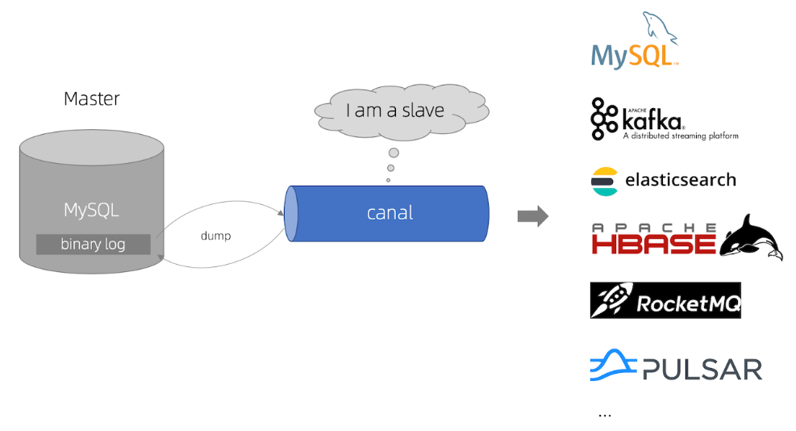
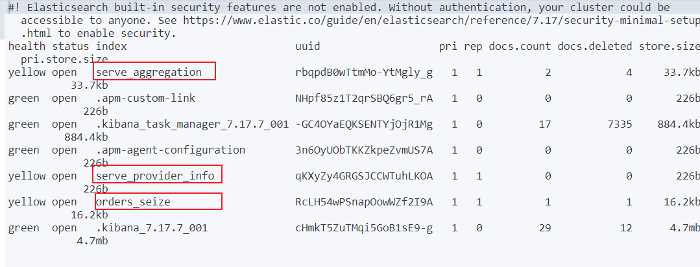
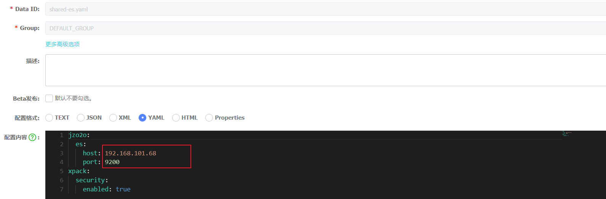
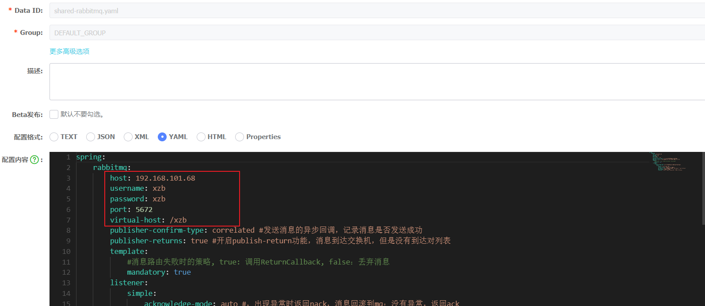
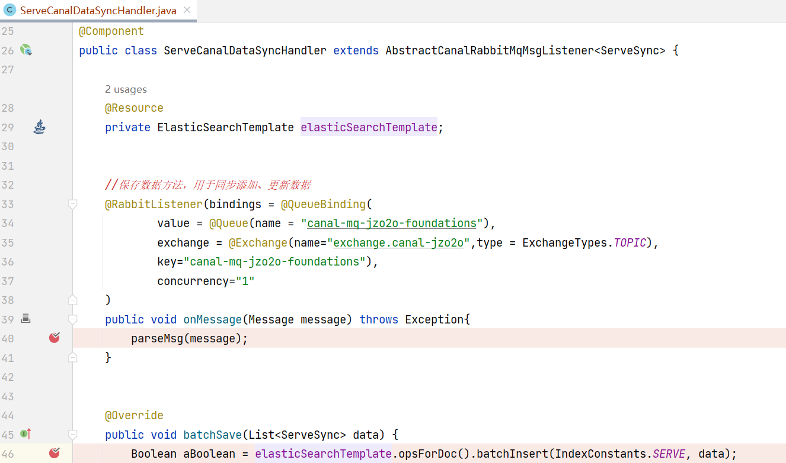
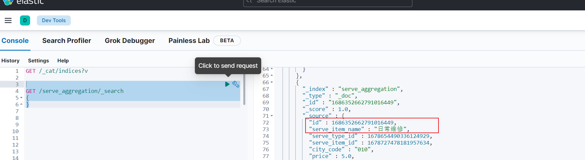
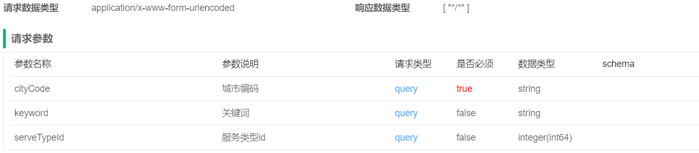
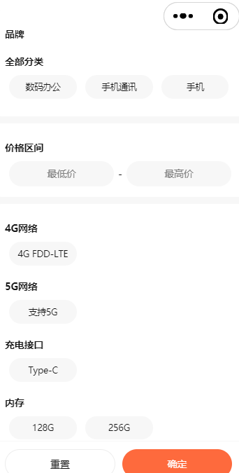

# 第五章 搜索模块

## 学习目标：

1. 能够说出项目为什么要用Elasticsearch
2. 能够说出服务搜索模块的功能列表
3. 能够说出项目中进行索引同步的流程
4. 能够配置Canal加MQ同步环境
5. 能够完成服务变更实时同步开发
6. 能够开发家政服务搜索接口
7. 能够说出家政项目搜索模块的设计方案
8. 能够开发电商项目搜索接口
9. 能够说出电商项目搜索模块的设计方案


家政项目实战：

服务变更实时同步开发

家政服务搜索接口


电商项目实战：

电商项目搜索接口

电商项目搜索聚合接口


## 代码环境：

jzo2o-foundations：dev_02

mall-plus: dev_01


## 1 家政项目服务搜索

### 1.1 服务搜索技术方案

目标：理解本项目的搜索技术方案

#### 1）需求分析

服务搜索的入口有两处：

1. 在门户最上端的搜索入口对服务信息进行搜索。

如下图：


在**第2部分**触发搜索框进入搜索页面，输入关键字进行搜索，如下图：


1. 在门户最下方点击“全部服务”进入全部服务界面。

如下图：

点击服务分类查询分类下的服务。


#### 2）技术方案

##### **使用ES进行全文检索**

要实现服务搜索使用什么技术呢？

根据需求分析，对服务进行搜索除了根据服务类型查询其下的服务以外还需要根据关键字去搜索与关键字匹配的服务。

通过关键字去匹配服务的哪些信息呢？比如：输入关键字“家庭保洁”，它会去匹配服务相关的信息，比如：服务类型的名称、服务项的名称，甚至根据需要也可能去匹配服务介绍的信息，只要与“家庭保洁”相关的服务都会展示出来。如下效果：


这里最关键的是根据关键字去匹配，上图的搜索效果是一种全文检索方式，在搜索“家庭保洁”关键字时会对关键字先分词，分为“家庭”和“保洁”，再根据分好的词去匹配索引库中的服务类型的名称、服务项的名称、服务项的描述等字段。

如果要实现全文检索且对接口性能有一定的要求，最常用的是Elasticsearch，Elasticsearch是基于倒排索引的原理，正排索引是从文章中找词，倒排索引是根据词去找文章，本项目使用ES完成服务搜索功能的开发。

##### **索引同步方案**

如果要使用ES去搜索服务信息需要提前对服务信息在ES中创建索引，运营端在管理服务时是将服务信息保存在数据库，如何对数据库中的服务信息去创建索引，保证数据库中的信息与ES的索引信息同步呢，本节对索引同步的方案进行分析与确定。

<whiteboard token="Rc1zwhv1yhURtHbmRuUcsNFRntf"></whiteboard>

**方案1： 添加服务信息维护索引**

在服务项的增删改查Service方法中添加维护ES索引的代码。

在区域服务的增删改查Service方法中添加维护ES索引的代码。

例如下边的代码：

```Java
public Serve onSale(Long id){
    //操作serve表
    //添加向ES创建索引的代码
}
```

首先上边的代码是在原有业务方式的基础上添加索引同步的代码，增加代码的复杂度不方便维护，扩展性差。

其次上边的代码存在分布式事务，操作serve表会访问数据库，添加索引会访问ES，使用数据库本地事务是无法控制整个方法的一致性的，比如：向ES写成功了由于网络问题抛出网络超时异常，最终数据库操作回滚了ES操作没有回滚，数据库的数据和ES中的索引不一致。

方案1通常在生产中不会使用。

**方案2：使用Canal+MQ**

Canal是什么？

**canal [kə'næl]**，译意为水道/管道/沟渠，主要用途是基于 MySQL 数据库增量日志解析，对数据进行同步。

Canal可与很多数据源进行对接，将数据由MySQL同步到ES、MQ、DB等各个数据源。

**对Canal+MQ方案不熟悉的同学尽快复习前边课程。**

本方案需要借助Canal和消息队列，具体实现方案如下：

通过上边的技术分析下边对本项目服务搜索方案进行总结。

本项目使用Elasticsearch实现服务的搜索功能，使用Canal+MQ完成服务信息与ES索引同步。

如下图：

<whiteboard token="Y0USwp2r0hvA07bpWv3cqxSinqd"></whiteboard>

流程如下：

运营人员对服务信息进行增删改操作，MySQL记录binlog日志。

Canal定时读取binlog 解析出增加、修改、删除数据的记录。

Canal将修改记录发送到MQ。

同步程序监听MQ，收到增加、修改、删除数据的记录，请求ES创建、修改、删除索引。

C端用户请求服务搜索接口从ES中搜索服务信息。


#### 3）小结

项目为什么要用Elasticsearch？数据很多吗？

项目中如何进行索引同步的？

能说出如何保证MQ消息的可靠性？

能说出如何保证MQ幂等性？或 如何防止重复消费？


### 1.2 配置数据同步环境

目标：

理解Canal+MQ的同步流程

参考文档配置Canal+MQ的同步环境

 

#### 1) Canal+MQ同步流程

下边回顾Canal的工作原理，如下图：

1、Canal模拟 MySQL slave 的交互协议，伪装自己为 MySQL slave ，向 MySQL master 发送dump 协议

MySQL的`dump`协议是MySQL复制协议中的一部分。

2、MySQL master 收到 dump 请求，开始推送 binary log 给 slave (即 canal )

。一旦连接建立成功，Canal会一直等待并监听来自MySQL主服务器的binlog事件流，当有新的数据库变更发生时MySQL master主服务器发送binlog事件流给Canal。

3、Canal会及时接收并解析这些变更事件并解析 binary log 

通过以上流程可知Canal和MySQL master主服务器之间建立了长连接。



基于Canal+MQ数据同步流程：

<whiteboard token="ZvmcwacbJhnkClbkNUxcBRQpnac"></whiteboard>

1. 服务管理不仅向serve、serve_item、serve_type表写数据，同时也向serve_sync表写数据，serve_sync用于Canal同步数据使用。
2. 向serve_sync写数据产生binlog
3. Canal请求读取binlog，并解析出serve_sync表的数据更新日志，并发送至MQ的数据同步队列。
4. 异步同步程序监听MQ的数据同步队列，收到消息后解析出serve_sync表的更新日志。
5. 异步同步程序根据serve_sync表的更新日志请求Elasticsearch添加、更新、删除索引文档。

最终实现了将MySQL中的serve_sync表的数据同步至Elasticsearch


**本节实现将MySQL的变更数据通过Canal写入MQ。**

#### 2）配置Canal+MQ数据同步环境

根据Canal+MQ同步流程，下边进行如下配置：

1. 配置Mysql主从同步，开启MySQL主服务器的binlog
2. 安装Canal并配置，保证Canal连接MySQL主服务器成功
3. 安装RabbitMQ，并配置同步队列。
4. 在Canal中配置RabbitMQ的连接信息，保证Canal收到binlog消息写入MQ

对于异步程序监听MQ通过Java程序中实现。

以上四步配置详细参考“配置ES索引同步环境v1.0”。


#### 3）小结

Canal是怎么伪装成 MySQL slave？

Canal数据同步异常了怎么处理？


### 1.3 索引同步

#### 1.3.1 测试索引同步程序

刚才通过配置Canal+MQ的数据同步环境实现了Canal从数据库读取binlog并且将数据写入MQ。

下边编写同步程序监听MQ，收到消息后向ES创建索引。

##### 1) 创建索引结构

启动ES和kibana:

如果没有安装参考“第三方软件安装说明”安装elasticsearch7.17.7 和 kibana7.17.7。

安装完成后进行启动：

```JSON
docker start elasticsearch7.17.7 
docker start kibana7.17.7
```

下边创建索引serve_aggregation，serve_aggregation索引的结构与jzo2o-foundations数据库的serve_sync表结构对应。


首先通过下边的命令查询索引

```JSON
GET /_cat/indices?v 
```



如果需要修改索引结构需要删除重新创建：

```JSON
DELETE 索引名

```

查询索引结构

```JSON
GET /索引名/_mapping
```

创建serve_aggregation索引  **（已经存在无需重复创建）**

```Java
PUT /serve_aggregation
{
   "mappings" : {
      "properties" : {
        "city_code" : {
          "type" : "keyword"
        },
        "detail_img" : {
          "type" : "text",
          "index" : false
        },
        "hot_time_stamp" : {
          "type" : "long"
        },
        "id" : {
          "type" : "keyword"
        },
        "is_hot" : {
          "type" : "short"
        },
        "price" : {
          "type" : "double"
        },
        "serve_item_icon" : {
          "type" : "text",
          "index" : false
        },
        "serve_item_id" : {
          "type" : "keyword"
        },
        "serve_item_img" : {
          "type" : "text",
          "index" : false
        },
        "serve_item_name" : {
          "type" : "text",
          "analyzer": "ik_max_word",
          "search_analyzer":"ik_smart"
          
        },
        "serve_item_sort_num" : {
          "type" : "short"
        },
        "serve_type_icon" : {
          "type" : "text",
          "index" : false
        },
        "serve_type_id" : {
          "type" : "keyword"
        },
        "serve_type_img" : {
          "type" : "text",
          "index" : false
        },
        "serve_type_name" : {
          "type" : "text",
          "analyzer": "ik_max_word",
          "search_analyzer":"ik_smart"
        },
        "serve_type_sort_num" : {
          "type" : "short"
        },
         "unit" : {
          "type" : "long"
        }
      }
    }
}
```


##### 2）阅读同步程序

**1.添加依赖**

首先在foundations工程添加下边的依赖

```Java
<dependency>
    <groupId>com.jzo2o</groupId>
    <artifactId>jzo2o-canal-sync</artifactId>
</dependency>
<dependency>
    <groupId>com.jzo2o</groupId>
    <artifactId>jzo2o-es</artifactId>
</dependency>
```

**2.配置连接 ES**

修改foundations的配置文件：


修改nacos中es的配置文件shared-es.yaml



修改nacos中rabbitmq的配置文件




**3.阅读同步程序**

同步程序继承AbstractCanalRabbitMqMsgListener类，泛型中指定同步表对应的类型。

根据数据同步环境去配置监听MQ：

```Java
package com.jzo2o.foundations.handler;

import com.jzo2o.canal.listeners.AbstractCanalRabbitMqMsgListener;
import com.jzo2o.es.core.ElasticSearchTemplate;
import com.jzo2o.foundations.constants.IndexConstants;
import com.jzo2o.foundations.model.domain.ServeSync;
import org.springframework.amqp.core.ExchangeTypes;
import org.springframework.amqp.core.Message;
import org.springframework.amqp.rabbit.annotation.Exchange;
import org.springframework.amqp.rabbit.annotation.Queue;
import org.springframework.amqp.rabbit.annotation.QueueBinding;
import org.springframework.amqp.rabbit.annotation.RabbitListener;
import org.springframework.stereotype.Component;

import javax.annotation.Resource;
import java.util.List;

/**
 * 服务信息同步程序
 *
 * @author itcast
 * @create 2023/8/15 18:14
 **/
@Component
public class ServeCanalDataSyncHandler extends AbstractCanalRabbitMqMsgListener<ServeSync> {

    @Resource
    private ElasticSearchTemplate elasticSearchTemplate;

    //@RabbitListener(queues = "canal-mq-jzo2o-foundations", concurrency = "1")
    @RabbitListener(bindings = @QueueBinding(
            value = @Queue(name = "canal-mq-jzo2o-foundations"),
            exchange = @Exchange(name = "exchange.canal-jzo2o", type = ExchangeTypes.TOPIC),
            key = "canal-mq-jzo2o-foundations"),
            concurrency = "1"
    )
    public void onMessage(Message message) throws Exception {
    }
```

concurrency = "1"：表示消费线程数为1。

在同步程序中需要根据业务需求编写同步方法，当服务下架时会删除索引需要重写抽象类中的batchDelete(List<Long> ids)方法，此方法是当删除Serve_sync表的记录时 对索引执行删除操作。

当服务上架后需要添加索引，当服务信息修改时需要修改索引，需要重写抽象类中的batchSave(List<ServeSync> data)方法，此方法是当向Serve_sync表新增或修改记录时对索引执行添加及修改操作。


完整代码如下：

```Java
package com.jzo2o.foundations.handler;

import com.jzo2o.canal.listeners.AbstractCanalRabbitMqMsgListener;
import com.jzo2o.es.core.ElasticSearchTemplate;
import com.jzo2o.foundations.constants.IndexConstants;
import com.jzo2o.foundations.model.domain.ServeSync;
import org.springframework.amqp.core.ExchangeTypes;
import org.springframework.amqp.core.Message;
import org.springframework.amqp.rabbit.annotation.Exchange;
import org.springframework.amqp.rabbit.annotation.Queue;
import org.springframework.amqp.rabbit.annotation.QueueBinding;
import org.springframework.amqp.rabbit.annotation.RabbitListener;
import org.springframework.stereotype.Component;

import javax.annotation.Resource;
import java.util.List;

/**
 * 服务信息同步程序
 *
 * @author itcast
 * @create 2023/8/15 18:14
 **/
@Component
public class ServeCanalDataSyncHandler extends AbstractCanalRabbitMqMsgListener<ServeSync> {

    @Resource
    private ElasticSearchTemplate elasticSearchTemplate;

    @RabbitListener(bindings = @QueueBinding(
            value = @Queue(name = "canal-mq-jzo2o-foundations"),
            exchange = @Exchange(name = "exchange.canal-jzo2o", type = ExchangeTypes.TOPIC),
            key = "canal-mq-jzo2o-foundations"),
            concurrency = "1"
    )
    public void onMessage(Message message) throws Exception {
        parseMsg(message);
    }

    @Override
    public void batchSave(List<ServeSync> data) {
        Boolean aBoolean = elasticSearchTemplate.opsForDoc().batchInsert(IndexConstants.SERVE, data);
        if(!aBoolean){
            try {
                Thread.sleep(1000);
            } catch (InterruptedException e) {
                throw new RuntimeException(e);
            }
            throw new RuntimeException("同步失败");
        }
    }

    @Override
    public void batchDelete(List<Long> ids) {
        Boolean aBoolean = elasticSearchTemplate.opsForDoc().batchDelete(IndexConstants.SERVE, ids);
        if(!aBoolean){
            try {
                Thread.sleep(1000);
            } catch (InterruptedException e) {
                throw new RuntimeException(e);
            }
            throw new RuntimeException("同步失败");
        }
    }
}
```


##### 3）测试

启动jzo2o-foundations服务。

启动成功,jzo2o-foundations服务作为MQ的消费者和MQ建立通道，进入canal-mq-jzo2o-foundations队列的管理界面，查看是否建立 了监听通道。


监听通道建立 成功，下边在同步程序打断点：




手动修改jzo2o-foundations数据库的serve_sync表的记录，这里修改了服务项的名称


正常执行同步程序：


放行继续执行到batchSave方法：


保证ES服务正常，同步方法执行成功后进入Kibana查看

执行命令：

```Java

GET /serve_aggregation/_search
{
}
```


查询服务信息与数据库serve_sync表中1686352662791016449记录的信息一致。

下边再将服务项名称恢复。


再进入Kibana查看索引的内容与数据库一致




##### 3）小结

同步程序的实现步骤：

1. 根据数据库同步表的结构 创建索引结构。
2. 同步程序监听MQ的同步队列
3. 同步程序收到数据同步消息写入Elasticsearch，写的失败抛出异常，消息回到MQ。


如何保证Canal+MQ同步消息的顺序性？

多个jvm进程监听同一个队列保证只有消费者活跃，即只有一个消费者接收消息。

消费队列中的数据使用单线程。


如何保证只有一个消费者接收消息？

队列需要增加x-single-active-consumer参数，表示否启用单一活动消费者模式。使用x-single-active-consumer参数需要修改为如下代码：

在Queue中添加：arguments={@Argument(name="x-single-active-consumer", value = "true", type = "java.lang.Boolean") }

如下所示：

```JSON
    @RabbitListener(bindings = @QueueBinding(
            value = @Queue(name = "canal-mq-jzo2o-foundations",arguments={@Argument(name="x-single-active-consumer", value = "true", type = "java.lang.Boolean") }),
            exchange = @Exchange(name="exchange.canal-jzo2o",type = ExchangeTypes.TOPIC),
            key="canal-mq-jzo2o-foundations"),
            concurrency="1"
    )
    public void onMessage(Message message) throws Exception{
        parseMsg(message);
    }
```

concurrency=”1“表示 指定消费线程为1。


#### 1.3.2 服务变更实时同步（实战）

通过测试Canal+MQ同步流程，只有当serve_sync表变化时才会触发同步，serve_sync表什么时候变化 ？

当服务信息变更时需要同时修改serve_sync表，下边先分析serve_sync的变化需求，再进行代码实现。

##### 1）管理同步表需求

现在如何去维护serve_sync这张表呢？

根据serve_sync表的结构分析：

添加：区域服务上架向serve_sync表添加记录，同步程序新增索引记录。

删除：区域服务下架从serve_sync表删除记录，同步程序删除索引记录。

修改：

修改服务项修改serve_sync的记录。

修改服务分类修改serve_sync的记录。

修改服务价格修改serve_sync的记录。

设置热门/取消热门修改serve_sync的记录。


##### 2）代码实现

根据需求编写代码并测试。

测试内容如下：

测试服务上架添加索引。

测试服务下架删除索引。

测试修改服务价格修改索引。

测试修改服务项名称修改索引。

测试修改修改服务分类名称修改索引。


### 1.4 搜索接口（实战）

目标：开发搜索接口。

 

#### 1）接口如下

参数内容：区域编码，服务类型id、关键字

区域编码：用户定位成功前端记录区域编码（city_code），搜索时根据city_code搜索该区域的服务。

服务类型id：在全部服务界面选择一个服务类型查询其它下的服务列表。

关键字：输入关键字搜索服务项名称、服务类型名称。


接口名称：服务搜索接口

接口路径：**GET**/foundations/customer/serve/search




controller方法：

```Java
@RestController("consumerServeController")
@RequestMapping("/customer/serve")
@Api(tags = "用户端 - 首页服务查询接口")
public class FirstPageServeController {
...
    @GetMapping("/search")
    @ApiOperation("首页服务搜索")
    @ApiImplicitParams({
            @ApiImplicitParam(name = "cityCode", value = "城市编码", required = true, dataTypeClass = String.class),
            @ApiImplicitParam(name = "serveTypeId", value = "服务类型id", dataTypeClass = Long.class),
            @ApiImplicitParam(name = "keyword", value = "关键词", dataTypeClass = String.class)
    })
    public List<ServeSimpleResDTO> findServeList(@RequestParam("cityCode") String cityCode,
                                                 @RequestParam(value = "serveTypeId", required = false) Long serveTypeId,
                                                 @RequestParam(value = "keyword", required = false) String keyword) {

        return null;
    }
```

#### 2）搜索方法

查询条件包括：

城市代码

关键字：模糊匹配服务项名称、服务分类名称

服务分类：点击服务分类查询分类下的服务。

排序字段：服务项排序字段


## 5 电商项目商品搜索（实战）

### 5.1 需求分析

#### 首页输入关键字

首页搜索栏输入关键字进行搜索：


#### 通过分类进行搜索


#### 条件筛选





### 5.2 索引结构

根据需求梳理索引结构如下：

```TypeScript
PUT /mall_goods
{
  "mappings" : {
    "properties" : {
      "id" : {
        "type" : "keyword"
      },
      "goods_id" : {
        "type" : "keyword"
      },
      "goods_name" : {
        "type" : "text",
        "analyzer": "ik_max_word",
        "search_analyzer":"ik_smart"
      },
      "goods_type" : {
        "type" : "keyword"
      },
      "goods_video" : {
        "type" : "text",
        "index" : false
      },
      "grade" : {
        "type" : "float"
      },
      "buy_count" : {
        "type" : "long"
      },
      "high_praise_num" : {
        "type" : "long"
      },
      "intro" : {
        "type" : "text",
        "index" : false
      },
      "mobile_intro" : {
        "type" : "text",
        "index" : false
      },
      "market_enable" : {
        "type" : "keyword"
      },
      "point" : {
        "type" : "long"
      },
      "price" : {
        "type" : "float"
      },
      "recommend" : {
        "type" : "boolean"
      },
      "release_time" : {
        "type" : "date",
        "format" : "yyyy-MM-dd HH:mm:ss||yyyy-MM-dd||epoch_millis"
      },
      "sales_model" : {
        "type" : "keyword"
      },
      "self_operated" : {
        "type" : "boolean"
      },
      "seller_id" : {
        "type" : "keyword"
      },
      "seller_name" : {
        "type" : "text",
        "analyzer": "ik_max_word",
        "search_analyzer":"ik_smart"
      },
      "selling_point" : {
        "type" : "text",
        "index" : false
      },
      "sku_source" : {
        "type" : "long"
      },
      "small" : {
        "type" : "text",
        "index" : false
      },
      "sn" : {
        "type" : "keyword"
      },
      "store_category_name_path" : {
        "type" : "text",
        "analyzer": "ik_max_word",
        "search_analyzer":"ik_smart",
        "fields" : {
          "keyword" : {
            "type" : "keyword",
            "ignore_above" : 256
          }
        },
        "fielddata" : true
      },
      "store_category_path" : {
        "type" : "keyword"
      },
      "category_path" : {
        "type" : "keyword"
      },
      "category_name_path" : {
        "type" : "text",
        "analyzer": "ik_max_word",
        "search_analyzer":"ik_smart",
         "fields" : {
          "keyword" : {
            "type" : "keyword",
            "ignore_above" : 256
          }
        },
        "fielddata" : true
      },
      "thumbnail" : {
        "type" : "text",
        "index" : false
      },
      "brand_url" : {
        "type" : "keyword"
      },
      "brand_id" : {
        "type" : "keyword"
      },
      "brand_name" : {
        "type" : "text",
        "analyzer": "ik_max_word",
        "search_analyzer":"ik_smart",
        "fields" : {
          "keyword" : {
            "type" : "keyword",
            "ignore_above" : 256
          }
        },
        "fielddata" : true
      },
      "auth_flag" : {
        "type" : "keyword"
      },
      "attr_list" : {
        "type" : "nested",
        "properties" : {
          "name" : {
            "type" : "keyword"
          },
          "sort" : {
            "type" : "long"
          },
          "type" : {
            "type" : "integer"
          },
          "value" : {
            "type" : "keyword"
          }
        }
      },
      "store_id" : {
        "type" : "keyword"
      },
      "store_name" : {
        "type" : "text",
        "analyzer": "ik_max_word",
        "search_analyzer":"ik_smart"
      }
    }
  }
}
```


### 5.3 索引同步

电商项目索引同步是使用MQ实现，如下图：

<whiteboard token="EDUEwymcHhgwphb0Il3ckEqFngO"></whiteboard>

自行阅读相关代码，并进行测试。

测试方法：

发布一个商品，审核通过将商品信息发送到MQ，Java程序监听MQ，得到商品信息后写入ES索引。


### 5.4 搜索接口定义

阅读以下接口定义：

搜索接口：

http://localhost:8084/buyer/doc.html#/default/%E4%B9%B0%E5%AE%B6%E7%AB%AF,%E5%95%86%E5%93%81%E6%8E%A5%E5%8F%A3/getGoodsByPageFromEsUsingGET

聚合接口（从ES中获取相关商品品牌名称，分类名称及属性）：

http://localhost:8084/buyer/doc.html#/default/%E4%B9%B0%E5%AE%B6%E7%AB%AF,%E5%95%86%E5%93%81%E6%8E%A5%E5%8F%A3/getGoodsRelatedByPageFromEsUsingGET

controller方法如下：


### 5.5 实战

根据接口定义进行开发，实现service方法。

完成开发后对照需求分析进行测试。

---
> 来源：飞书技术知识库（脱敏版） · 07 业务组件方案集 / 云岚到家项目 / 第五章 搜索模块 · [原文](https://ccn8v2zngwsm.feishu.cn/wiki/Nt2RwaUXXibe1NkXxONcS8M5nRg)
