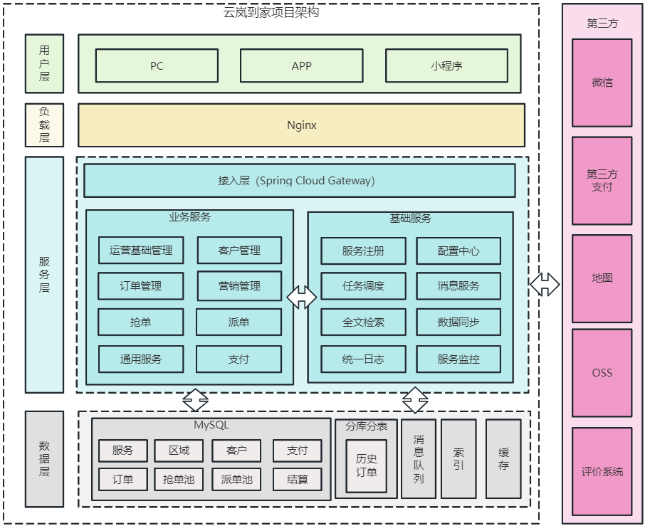
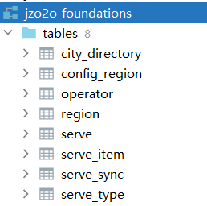
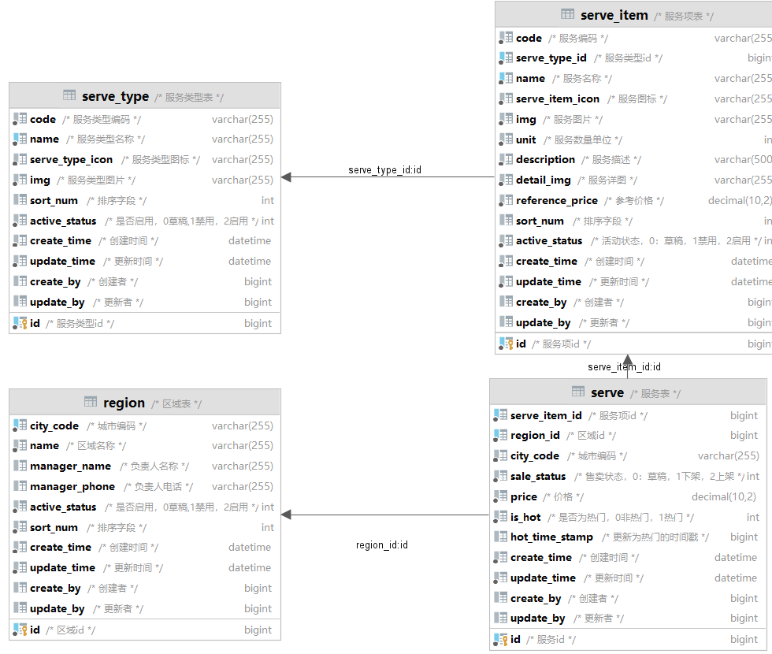
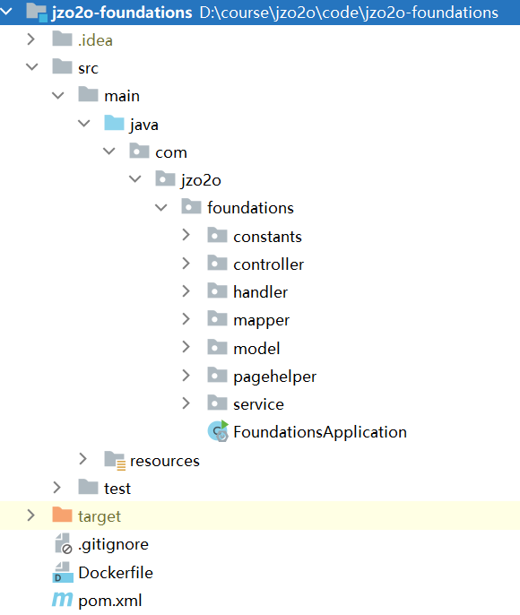
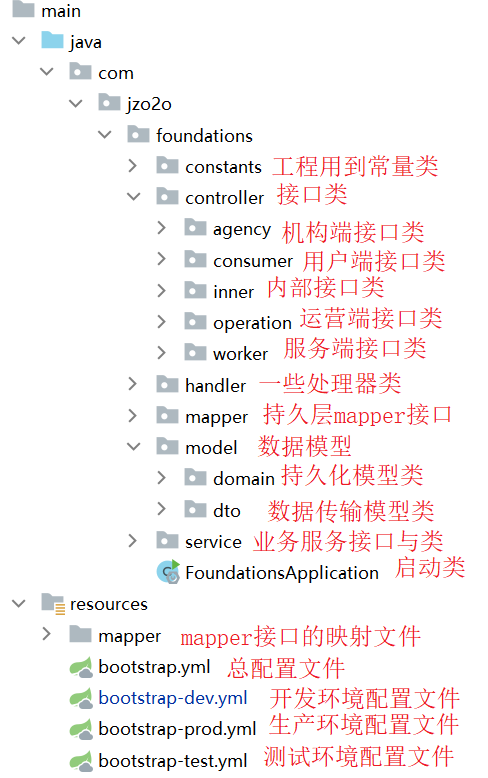
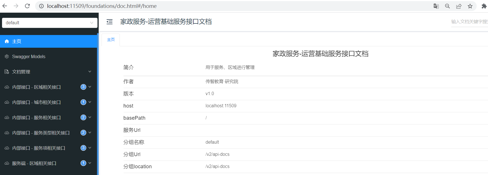
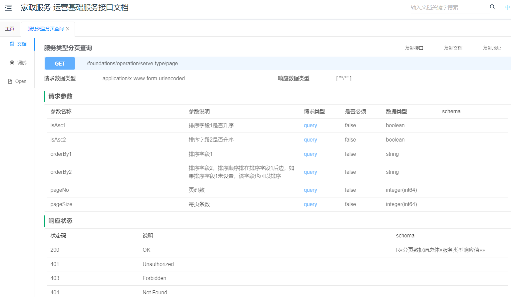
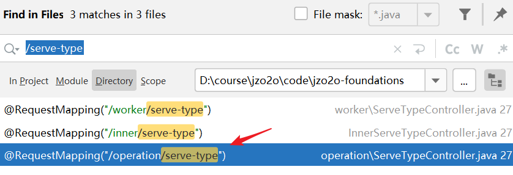
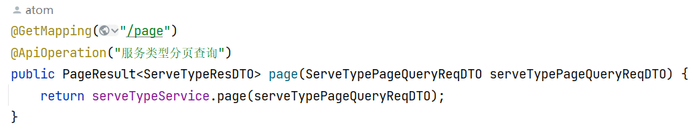

# 第一章 如何熟悉新项目

## 学习目标

入职公司进入项目团队的第一件事就是熟悉项目，本章以家政服务O2O项目为线索一起教大家如何去熟悉一个新项目，通过本章节的学习完成以下学习目标：

1. 能够说出项目的业务模块
2. 能够说出项目的业务流程
3. 能够说出项目的技术架构
4. 能够搭建项目的开发环境
5. 能够根据需求熟悉项目的表结构和代码


## 1 如何熟悉一个新项目

进入一家新公司初次接触一个新项目应该从哪里入手呢？怎么做才能快速的去熟悉项目并顺利进入开发工作？

首先去熟悉项目大概情况，包括：项目的背景、项目模块、业务流程、项目架构等。

项目情况大概了解后就可以搭建开发环境。

然后去理解自己所分配的模块的需求及设计，熟悉项目现有的代码并进入开发。


### 1.1 项目的业务模块

了解项目的业务从项目背景开始。

目标：

能够说出项目整体业务流程

#### **1）项目背景**

2015年国家就提出了"互联网+"的行动计划，什么是"互联网+"?


“互联网+”简单的说就是“互联网+传统行业”，互联网为传统行业赋能,利用互联网具备的优势特点对传统行业进行优化升级转型，最终推动社会不断地向前发展。

互联网+的成功案例有很多，像滴滴出行、美团外卖和共享单车等平台将传统出行、餐饮和交通等行业与互联网连接，提供更便捷、经济高效的服务。

云岚到家项目是一个家政服务o2o平台，互联网+家政是继打车、外卖后的又一个风口，创业者众多，比如：58到家，天鹅到家等，o2o（Online To Offline）是将**线下商务的机会与互联网的技术结合**在一起，让互联网成为线下交易的前台，同时起到推广和成交的作用。

家政服务o2o市场前景非常好，中国社会的家庭小型化、人口老龄化进程加快，加之二胎政策、三孩政策的推行，创造了大量对于家政服务的潜在需求。艾媒咨询发布《2022-2023年中国家政服务行业发展剖析及行业投资机遇分析报告》显示，从2015年的2776亿元已提升至2021年的10149亿元，进入万亿级市场行列。

**中国家政服务业从业人员数量规模逐年稳步增长**


#### **2）运营模式**

我们调研了家政服务O2O平台的运营模式，如下：


C2B2C:

在家政 O2O（Online to Offline，线上到线下）领域中，"Consumer to Business to Consumer"（C2B2C）描述了一个商业模式，消费者不仅可以通过平台获取家政服务，还有机会成为服务提供者，平台做为中介提供家政服务的机会给服务提供者，并从中抽成实现盈利。在这个背景下，C2B2C 模式通常指的是：

1. **消费者（Consumer）：**

   - 最终的家庭用户，他们需要家政服务，例如清洁、保姆、维修等。
2. **企业（Business）：**

   - 在家政 O2O 中，企业通常是在线平台，提供家政服务的中介。平台通过在线渠道为消费者提供了查找、预订、支付等服务，同时也为家政服务提供者提供了工作机会。
3. **消费者（家政服务提供者）：**

   - 在 C2B2C 模式中，一些消费者也可以成为服务的提供者。这些个体可能是独立的家政服务专业人员，他们可以在家政 O2O 平台上注册，提供自己的服务，并被其他需要服务的消费者雇佣。


B2B2C:

代表着"Business to Business to Consumer"，即企业到企业到消费者的模式。家政服务平台作为中间商，通过与各种家政服务提供商（家政服务公司）合作，为消费者提供多样化的家政服务选择。

B2B2C与C2B2C的区别是：B2B2C中服务提供者是家政服务中介公司，在C2B2C中是服务提供者是拥有服务技能的服务人员（散户）。


**本项目结合了C2B2C和B2B2C模式，个人和家政服务中介都可以通过平台提供家政服务**，如下图：

项目包括四个端：**用户端(小程序)、服务端（app）、机构端(PC)、运营管理端(PC)**，四个端对应四类用户角色：

家政需求方：通过用户端小程序完成在线预约下单、支付、评价、投诉、退款等操作。

家政服务人员：通过服务端APP完成在线接单、结算等操作。

家政服务公司：通过机构端完成在线接单、派单、投诉处理、结算等操作。

平台方：通过管理端完成服务人员管理、机构管理、订单管理、财务管理等操作，一笔完成的订单，结算时按照分成比例平台进行抽成。


#### 3) 项目模块

项目模块列表：


根据每个端去细化模块，项目业务模块图如下：


核心模块说明：

服务管理：对家政服务项目进行管理，最后在指定区域上架服务后用户可在当前区域购买。

下单支付：用户通过小程序完成下单支付，进入小程序首页查询服务，用户选择服务，下单并支付

抢单：服务人员和机构进行抢单。首先服务人员和机构设置接单范围、服务技能、开启抢单开关，然后进入抢单界面进行抢单。

派单调度：平台根据撮合匹配算法通过任务调度将订单和服务人员进行撮合匹配，促进成交。

订单管理：对订单的生命周期进行管理，包括创建订单、取消订单、删除订单、历史订单等。

服务人员管理：对服务人员的信息、认证等进行管理。

企业管理：对机构的信息、认证进行管理。

客户管理：对c端用户的信息、用户的状态等信息进行管理。

营销管理：对优惠券活动进行管理。

#### 4) 项目业务流程

**项目核心业务流程如下：**

<whiteboard token="LplNwUbIoh1XHLblNufcQ4r0nrc"></whiteboard>

核心流程：

1. 运营端在运营区域上架家政服务

比如：在北京上架 日常保洁、空调维修。

1. 用户端通过定位区域获取当前区域的服务项目，选择家政服务，下单、支付
2. 家政服务人员及家政服务公司（机构）通过平台抢单
3. 家政服务人员现场服务，平台跟踪管理整个服务过程。
4. 服务完成，用户评价、售后服务等。

#### 5）界面原型展示

下边展示部分界面原型，按如下流程展示

1. 运营端服务管理，服务上架
2. 用户下单、支付（支付可以略过）
3. 服务人员抢单
4. 现场服务，开始服务、完成服务
5. 用户评价


##### **运营端统一管理服务项**

运营人员通过运营端管理平台的服务项，设置运营城市开通的服务项。


设置城市开通的服务：


##### **用户端购买服务**

用户端通过小程序预约家政服务。


##### **服务人员上门服务**

服务人员进入app开启接单


选择接单范围


立即抢单：


抢单成功在规定时间上门服务


开始服务前上传照片


服务完成上传服务后的照片


##### 服务完成，用户进行评价


#### 6）小结

能够说出项目的业务领域：

你的项目是做什么业务的？


能够说出项目涉及几类用户角色

项目涉及哪些角色？


能够说出项目包括哪些业务模块

你的项目包括哪些模块？


能够说出项目整体业务流程：

说下你的项目的业务流程？


### 1.2 项目的架构

目标：能够用自己的话介绍自己的项目


#### 1）项目架构

项目是基于Spring Cloud Alibaba框架构建的微服务项目，采用前后端分离模式进行开发，系统架构图如下：



用户层：

包括四个端：运营端(PC)、服务端（APP）、机构端（PC）、用户端（小程序）

负载层：

反向代理、负载均衡。

服务层：包括网关、业务微服务、基础服务。

业务微服务：包括**运营基础服务**、**客户管理服务**、**订单管理服务**、**抢单服务**、**派单服务、支付服务、搜索服务**等。

基础服务：Nacos（服务注册、配置中心）、XXL-JOB（任务调度）、RabbitMQ（消息队列）、Elasticsearch（全文检索）、Canal（数据同步）、Sentinel（熔断降级、限流）等。

数据层：

MySQL数据库存储：服务信息、区域信息、客户信息、订单信息、支付信息、抢单池、派单池、结算信息等。

分库分表：使用ShardingShphere-JDBC 进行分库分表。

消息队列：存储数据同步消息、各类异步消息等。

索引：服务信息、服务提供者信息、订单信息等。

缓存：服务信息、订单信息、服务单信息等。


#### 2) 核心交互流程

下图是项目的核心交互流程，从下图找到核心交互流程是什么，以及参与的微服务有哪些，并用自己的话描述出来。

<readonly-block type="diagram"></readonly-block>


#### 3) 小结


能够说出项目用的什么技术架构

你的项目用的什么架构？


能够用自己的话介绍自己的项目

说说你的项目吧？


在面试中被问的第一个问题就是项目介绍。怎么介绍自己的项目呢？

从以下几个方面进行项目介绍：

1、项目的背景，包括：是自研还是外包、什么业务、服务的客户群是谁、谁去运营等问题。

2、项目的业务模块、核心业务流程，可从项目每个端开始介绍。

3、项目的技术架构是什么

4、个人的工作职责，详细说明自己负责的模块，包括模块的设计，所用到的技术方案，以及所遇到的问题和解决方案。

一个例子：

我最近参与的项目是我们公司自研的家政服务o2o项目，项目包括四个端：用户端(小程序)、服务端（app）、机构端(PC)、运营管理端(PC)，用户通过平台在线下单、支付，家政服务人员通过平台抢单，平台也会自动派单给服务人员，服务人员接到订单根据预约时间去现场服务，服务完成后用户进行在线评价，以及售后、退款等业务。  项目是基于Spring Cloud Alibaba框架构建的微服务项目，包括了运营基础服务、客户管理服务、订单管理服务、抢单服务、派单服务、优惠券服务、统计服务、评价服务等服务，系统还使用Redis、MQ、XXL-JOB、Elasticsearch、Canal、MongoDB等中间件。

我在这个项目中负责了xxx模块的设计与开发...

下边我说下xxx模块的具体设计吧....


## 2 开发环境搭建

目标：理解搭建环境的步骤，参考文档搭建开发环境。

参考“家政o2o项目开发环境配置v1.0”搭建开发环境。


## 3 熟悉需求与设计

通常刚到企业中会分配一个独立的模块给你，这个模块一般会有一些业务逻辑但不会太复杂，下边以运营基础管理模块为例进行讲解。

### 3.1 熟悉需求

目标：阅读需求文档，理解基本概念和业务流程。

#### 1）熟悉需求文档

参考“运营基础管理模块用户需求文档v1.0”熟悉需求。

如何去熟悉项目的需求？

根据产品原型、用户需求文档去熟悉项目的功能需求、业务流程，如果有测试账号可以登录系统通过体验系统的功能去熟悉项目的需求。


#### 2）口述

下边的问题口述答案。

什么是服务？

什么是服务类型？

向区域添加服务流程是什么？

区域服务上架的流程是什么？

区域服务下架的流程是什么? 

服务删除的流程是什么？

服务状态转化关系是什么？


### 3.2 熟悉设计

目标：

理解运营基本管理模块的表结构。

熟悉工程结构。

能够对接口进行断点调试。


#### 1) 熟悉表结构

使用客户端连接数据库，根据需求去理解本模块的每一张表，



然后尝试梳理表之间的关系。

如下图：



**serve_type**：服务类型表

**serve_item**:  服务项表，存储了本平台的家政服务项目

每个服务项都有一个服务类型，一个服务类型下有多个服务项，服务类型与服务项是一对多关系。

**region**：区域表，存储运营地区信息，一般情况区域表行政级别是市。

**serve**:  服务表，存储了各个区域运营的服务及相关信息。

**注意：这里不要把serve表简单理解为只是区域表和服务项表的中间关系表，因为如果是简单的关联关系表只需记录区域表和服务项表各自的主键Id即可，serve记录的是平台运营服务的信息，凡是与运营相关的信息都要记录在serve表，比如：运营价格。后期也可能会增加其它运营相关的字段。**

region与serve_item是什么关系？

一个区域下可以设置多个服务项，一个服务项可以被多个区域设置，region与serve_item是多对多关系。


#### 2) 熟悉工程结构

项目的工程列表如下：


首先熟悉jzo2o-foundations运营基础服务工程的结构，jzo2o-foundations工程结构如下图： 



工程目录结构如下：



项目依赖：

```XML
 <dependencies>
        <!--服务发现-->
        <dependency>
            <groupId>com.alibaba.cloud</groupId>
            <artifactId>spring-cloud-starter-alibaba-nacos-discovery</artifactId>
        </dependency>
        <!--配置管理-->
        <dependency>
            <groupId>com.alibaba.cloud</groupId>
            <artifactId>spring-cloud-starter-alibaba-nacos-config</artifactId>
        </dependency>
        <!--开启Bootstrap配置文件的支持-->
        <dependency>
            <groupId>org.springframework.cloud</groupId>
            <artifactId>spring-cloud-starter-bootstrap</artifactId>
        </dependency>
        <!--jzo2o-mvc在jzo2o-framework下，针对web开发的依赖-->
        <dependency>
            <groupId>com.jzo2o</groupId>
            <artifactId>jzo2o-mvc</artifactId>
        </dependency>
        <!--knife4j用于生成swagger文档-->
        <dependency>
            <groupId>com.jzo2o</groupId>
            <artifactId>jzo2o-knife4j-web</artifactId>
        </dependency>

<!--        <dependency>-->
<!--            <groupId>com.jzo2o</groupId>-->
<!--            <artifactId>jzo2o-es</artifactId>-->
<!--        </dependency>-->

        <!--单元测试-->
        <dependency>
            <groupId>org.springframework.boot</groupId>
            <artifactId>spring-boot-starter-test</artifactId>
            <scope>test</scope>
        </dependency>
        <!--api接口,定义了服务之间的远程调用接口-->
        <dependency>
            <groupId>com.jzo2o</groupId>
            <artifactId>jzo2o-api</artifactId>
        </dependency>
        <!--序列化工具库-->
        <dependency>
            <groupId>com.fasterxml.jackson.core</groupId>
            <artifactId>jackson-databind</artifactId>
        </dependency>

        <dependency>
            <groupId>com.jzo2o</groupId>
            <artifactId>jzo2o-redis</artifactId>
        </dependency>
<!--        <dependency>-->
<!--            <groupId>com.jzo2o</groupId>-->
<!--            <artifactId>jzo2o-canal-sync</artifactId>-->
<!--        </dependency>-->
        <!--jzo2o-mysql定义在jzo2o-framework工程，定义了持久层相关的依赖-->
        <dependency>
            <groupId>com.jzo2o</groupId>
            <artifactId>jzo2o-mysql</artifactId>
        </dependency>
<!--        <dependency>-->
<!--            <groupId>com.jzo2o</groupId>-->
<!--            <artifactId>jzo2o-xxl-job</artifactId>-->
<!--        </dependency>-->
    </dependencies>
```


持久层：MySQL数据库，mybatis-plus框架，com.github.pagehelper分页组件

中间件：Redis、Elasticsearch、xxl-job

服务层：通过Spring进行事务控制，redisson分布式锁、Spring Cache缓存框架

web层:  SpringMVC框架（基于SpringBoot开发）

web容器：undertow（Undertow 是一个采用 Java 开发的灵活的高性能 Web 服务器，红帽公司的开源产品）

高并发场景下undertow的性能更好。


#### 3) 接口测试

搞清楚了项目的工程结构再通过一个具体的接口去读项目的代码。

具体可以把工程启动起来通过接口测试深入源码搞清楚执行流程。

启动jzo2o-foundations工程。

通过swagger接口文档去熟悉模块的接口，通过测试接口去理解接口的整个交互流程。

打开接口文档：http://localhost:11509/foundations/doc.html



通过左侧菜单找到“运营端-服务类型相关接口”，如下图：


点击“服务类型分页查询”打开接口文档，如下图：



找到接口地址：/foundations/operation/serve-type/page

/foundations：微服务的content-path路径

/operation：表示给运营端使用的接口

/serve-type/page：具体的接口地址

在jzo2o-foundations工程搜索“/serve-type”关键字


输入关键字如下图，找到了具体的接口类：



继续在ServeTypeController.java类中找/page接口，如下图：



下边debug运行工程，跟踪接口执行的流程：

首先打上断点，如下图：


debug运行jzo2o-foundations工程。

下边通过swagger接口文档测试该接口

进入“调试”窗口，点击“发送”


此时代码执行到断点处


进入service方法继续打断点跟踪：


跟踪请求参数：


放行继续执行，测试结束，观察响应结果


观察idea控制台输出的SQL执行语句


#### 4) 小结

如何去熟悉系统的设计？

根据需求去熟悉本模块的核心表的结构，核心表搞清楚了再去熟悉其它表。

熟悉项目工程结构，搞清楚用的基础框架是开源的还是自研的，通过断点测试接口的执行流程阅读读项目的代码。

具体可以把工程启动起来通过接口测试深入源码搞清楚执行流程。


如何对现有接口进行断点调试?


运营基础工程用到哪些技术？

---
> 来源：飞书技术知识库（脱敏版） · 07 业务组件方案集 / 云岚到家项目 / 第一章 如何熟悉新项目 · [原文](https://ccn8v2zngwsm.feishu.cn/wiki/VQ6xw3B3Fixprnk4s8scalqGnmd)
