# 运营服务管理模块需求文档v1.0

## 1 模块概述

运营服务管理模块为运营人员提供基础数据管理功能，包括：服务类型管理、服务项管理、区域管理、区域服务管理等子模块。

## 2 服务类型管理

### 2.1 界面原型

**什么是服务？**

服务即服务项目，本平台提供的家政服务项目，如：空调维修、电视维修、空调清洗、洗衣机清洗，这里都是服务项目，服务相当于电商系统中的商品。

**什么是服务类型？**

服务类型就是对服务项目的分类，如：空调维修和电视维修都属于家电维修分类，空调清洗和洗衣机清洗属于家电清洗分类，服务类型相当于电商系统中的商品分类。

服务类型管理模块是对服务类型的信息进行管理，对服务类型的管理流程如下：

**1、进入服务类型列表**

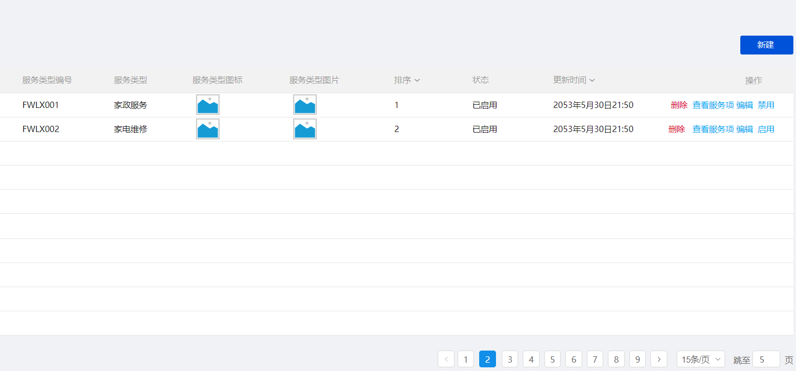

**2、新建一个服务类型**

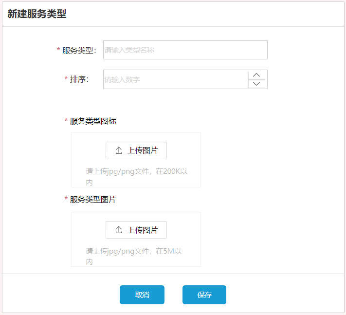

内容如下：

1）服务类型名称。

2）排序字段，控制在页面上的显示顺序。

3）服务类型图标，在首页显示图标。

4）服务类型图片，在首页显示服务类型图片。

**3、新建的服务类型启用后才可以在其下边添加服务项。**

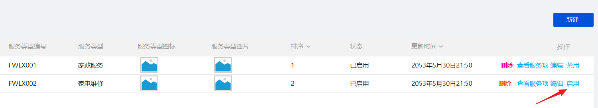

**4、只有新建的服务类型方可删除，服务类型一旦启用将不可删除。**

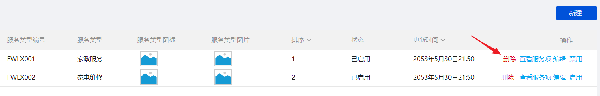

**5、启用后的服务类型可以禁用。**

注意：只有当服务类型下的服务项全部禁用才可以禁用服务类型。（禁用服务项的内容请参考服务项管理章节）

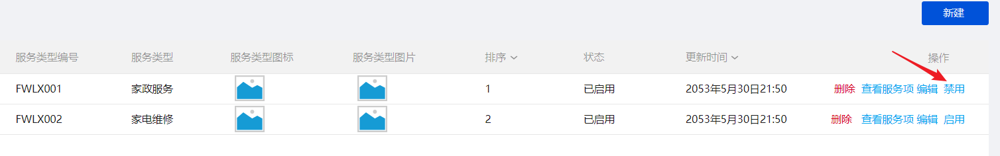

**6、查看服务项将查看该服务类型下的所有服务项，此时进入服务项列表。**

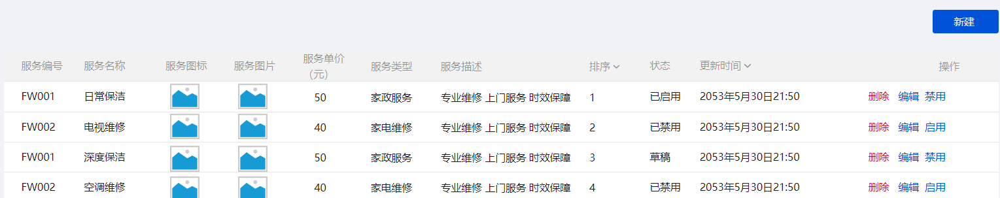

### 2.2 业务流程

**1、添加服务类型**

<readonly-block type="diagram"></readonly-block>

**2、服务类型启用**

服务类型当前状态为草稿或禁用状态方可启动。

<readonly-block type="diagram"></readonly-block>

**3、服务类型禁用**

服务类型当前状态为启用状态方可禁用。

<readonly-block type="diagram"></readonly-block>

**4、服务类型删除**

服务类型当前状态为草稿状态方可删除。

<readonly-block type="diagram"></readonly-block>

**5、服务类型状态转化关系**

<readonly-block type="diagram"></readonly-block>

新增一个服务类型初始状态为：草稿

启动服务类型：草稿--》启动   或   禁用--》启动

禁用服务类型：启动--》禁用

## 3 服务项管理

### 3.1 界面原型

服务项即服务项目，简称为服务，它是平台提供的家政服务项目，相当于电商项目中的商品。

对服务项管理的流程如下：

**1、进入服务项管理列表**

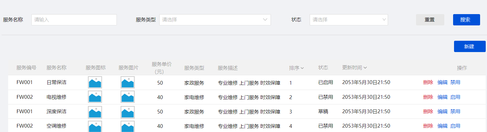

**2、新建服务项**

**填写服务项的基本信息**

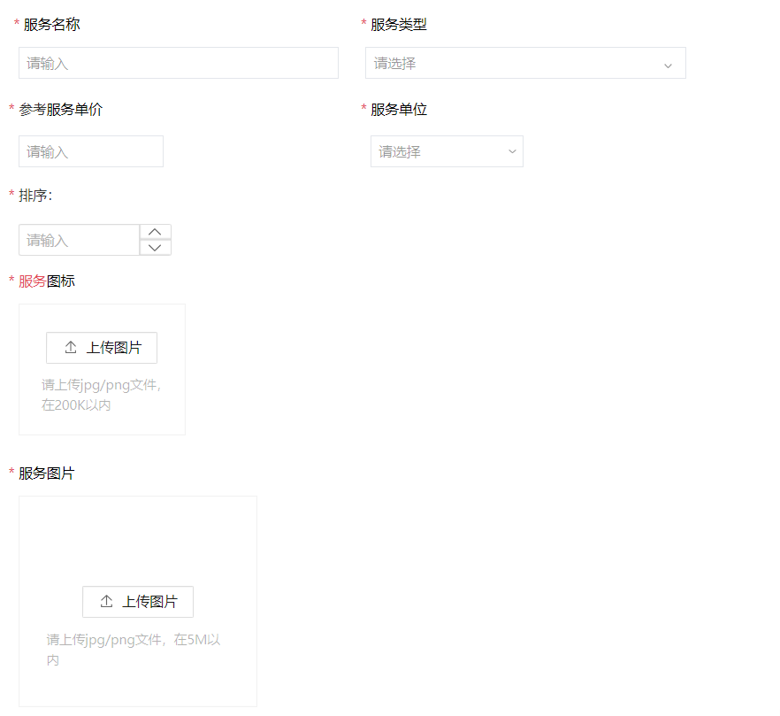

内容如下：

1)服务名称

2)服务类型，服务项所属分类。

3)参考服务单价

此价格是参考价格，比如：室内清洁，每小时20元，20元是参考价格，每个地区可能不一样。

4)服务单位

价格的单位，比如：室内清洁，每小时20元，单位是每小时。

5)排序

排序字段，在页面上显示 的顺序。

6）服务图标

在首页显示的服务图标。

7）服务图片

在首页显示的服务图片。

**填写服务项的描述、上传服务详情长图**

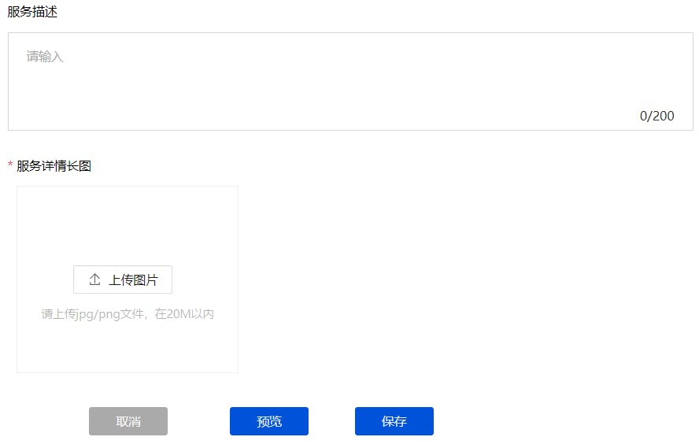

内容如下：

**1）服务描述**

对服务项的详细描述信息。

**2）服务详情长图**

类似如下样式的图片

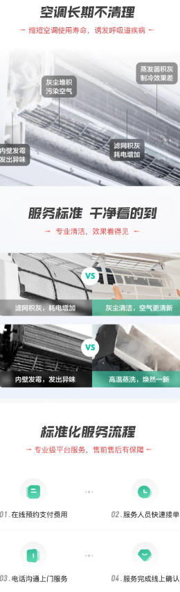

**3）预览**

**点击预览对服务项的详情内容进行预览**

预览的效果和手机上看到的一样。

4）**填写完毕，点击保存。**

服务项新建成功。

**3、删除服务项**

新建的服务项目可以删除，服务项启用后无法删除。

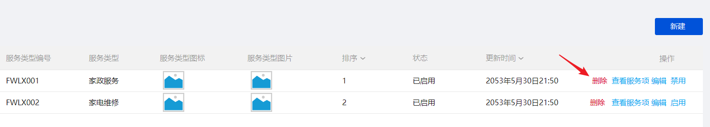

**4、启用服务项**

新创建的服务项启用后方可正式使用。

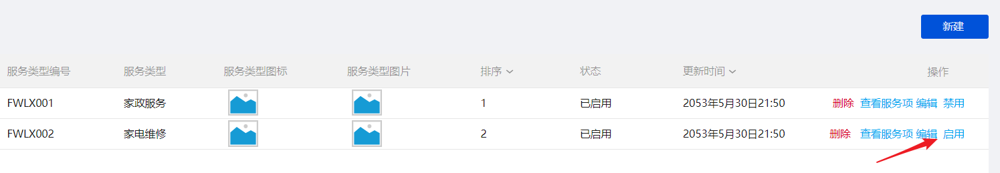

**5、禁用服务项**

服务项禁用后将不可在平台使用。

注意：当服务项没有在任何地区上架才可以禁用（在地区上架服务项的内容请参考区域服务管理章节）。

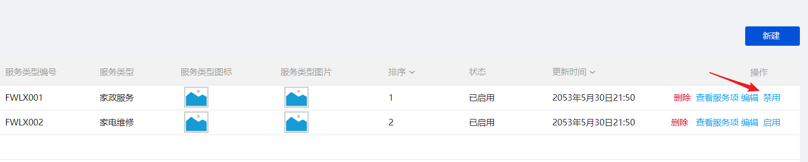

### 3.2 业务流程

**1、添加服务项**

<readonly-block type="diagram"></readonly-block>

**2、服务项启用**

<readonly-block type="diagram"></readonly-block>

**3、服务项禁用**

如果该服务项在某些区域正在运营将无法禁用，需要先将该服务项在所有区域下架方可禁用。

关于服务项在区域上架和下架的操作参见：区域服务管理模块。

<readonly-block type="diagram"></readonly-block>

**4、服务项删除**

<readonly-block type="diagram"></readonly-block>

**5、服务项状态转化关系**

<readonly-block type="diagram"></readonly-block>

## 4 区域管理

### 4.1 界面原型

本模块是对本项目所运营的地区信息进行管理。

**1、进入区域管理列表**

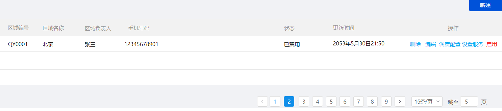

**2、新建区域**

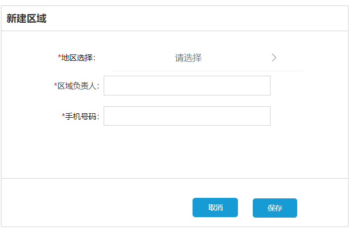

内容如下：

地区选择：从城市列表中选择城市。平台是以城市为单位设置运营的地区。

区域负责人：填写负责人姓名

手机号码：填写负责人的电话

**3、新创建的区域可以删除，区域启用后不允许删除**

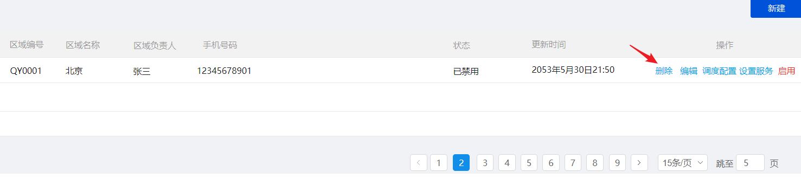

**4、区域启用后表示该区域正式开始运营**

区域存在上架的服务方可启用区域。

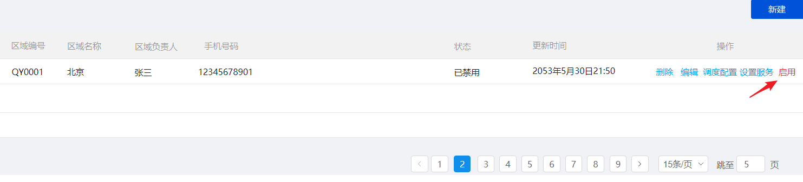

**5、设置服务**

在当前区域设置运营的服务（具体参考区域服务管理章节）

**6、调度配置**

设置本区域的调度规则，调度规则将在抢单和派单模块使用届时再讲解。

### 4.2 业务流程

**1、添加区域**

<readonly-block type="diagram"></readonly-block>

**2、区域启用**

<readonly-block type="diagram"></readonly-block>

**3、区域禁用**

<readonly-block type="diagram"></readonly-block>

**4、区域删除**

<readonly-block type="diagram"></readonly-block>

**5、区域状态转化关系**

<readonly-block type="diagram"></readonly-block>

## 5 区域服务管理

### 5.1 界面原型

区域服务管理是为运营地区设置要运营的服务项，不同地区所运营的服务项可能不同，比如：本平台在北京运营了老人陪护服务，而在郑州没有运营老人陪护服务。

1、进入区域列表，点击“设置服务”

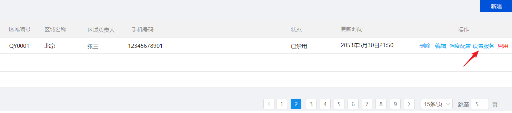

2、进入设置服务页面

本页面展示了该区域当前正在运营及停止未运营的服务信息。

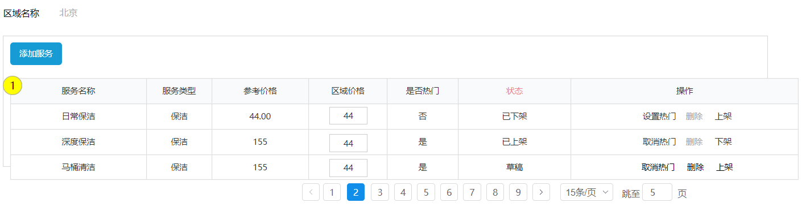

3、添加服务

进入添加服务界面，选择要添加的服务，点击“添加”

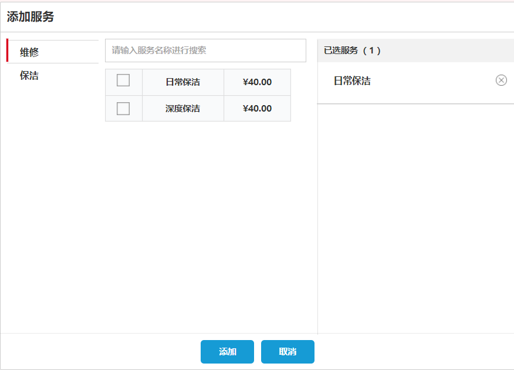

**4、设置区域价格**

区域价格即该服务在该区域的运营价格，输入修改后的价格。

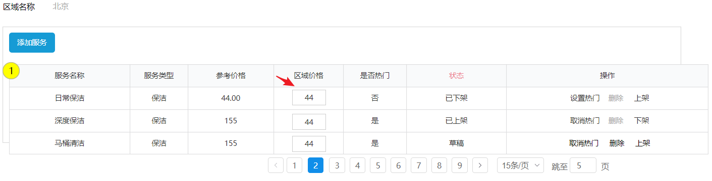

区别服务的参考价格和运营价格：

服务的参考价格：在服务项管理模块进行设置，如下图：

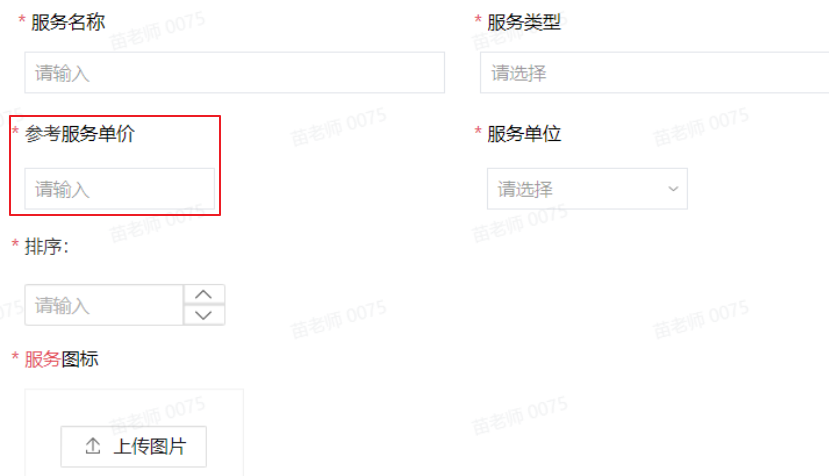

本模块设置的价格是服务在某区域实际运营的价格。

问题：用户在某区域购买家政服务使用哪个价格计算？

**5、上架**

服务上架后用户可以在首页的服务列表点击该服务进行下单购买。

当区域服务的状态为草稿状态或下架状态时方可上架。

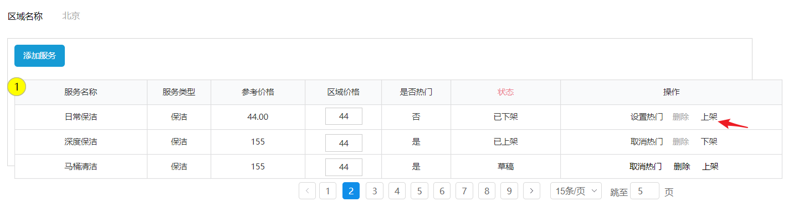

**6、下架**

服务下架后用户将不能对该服务下单。

当区域服务的状态为上架状态方可下架。

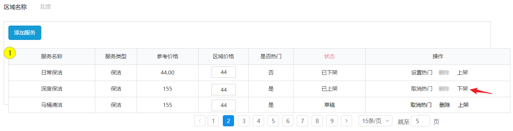

**7、删除**

当状态为草稿状态方可删除。

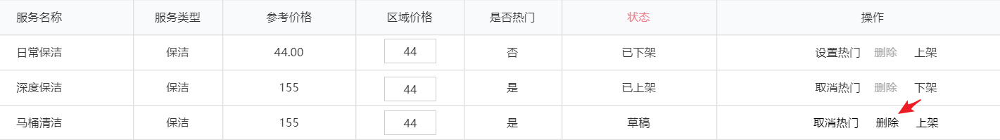

**8、设置热门/取消热门**

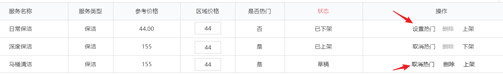

服务设置为热门将在首页显示，下图红框内显示的就是热门服务：

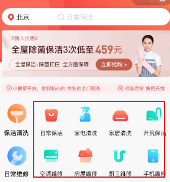

### 5.2 业务流程

**1、向区域添加服务流程**

<readonly-block type="diagram"></readonly-block>

**2、区域服务上架**

<readonly-block type="diagram"></readonly-block>

**3、区域服务下架**

<readonly-block type="diagram"></readonly-block>

**4、服务删除**

<readonly-block type="diagram"></readonly-block>

**5、服务状态转化关系** 

<readonly-block type="diagram"></readonly-block>

---
> 来源：飞书技术知识库（脱敏版） · 07 业务组件方案集 / 云岚到家项目 / 第一章 如何熟悉新项目 / 运营服务管理模块需求文档v1.0 · [原文](https://ccn8v2zngwsm.feishu.cn/wiki/EoPrwGywciLPYSkxkmscvr1vnwb)
