# 开发环境配置

## 配置要求

工欲善其事必先利其器。

个人电脑内存至少24G以上（为了更好的学习最好升级到32G）不符合条件的同学趁休息日升级电脑。

有条件的购买便携显示器进行分屏开发，开发效率杠杠滴，这是专业程序员的标配。

从下边的地址下载全部资料，按照本文档要求安装配置虚拟机及软件环境。

开发环境文件下载地址：

虚拟机：链接：https://pan.baidu.com/s/1VOWFqY7LucKgDu1yA_xM_Q?pwd=1234 

本地maven仓库：链接：https://pan.baidu.com/s/1wqrnwApF_c99huvWcoZhCA 提取码：1234


## **1 开发工具版本**

开发工具列表：

<sheet sheet-id="1UGAsP" token="IHuKsnVTihAJuhtDEwmch1RgnCe"></sheet>


## 2 **IDEA环境配置**

安装IDEA，根据下边的步骤进行配置。

### **2.1 编码配置**

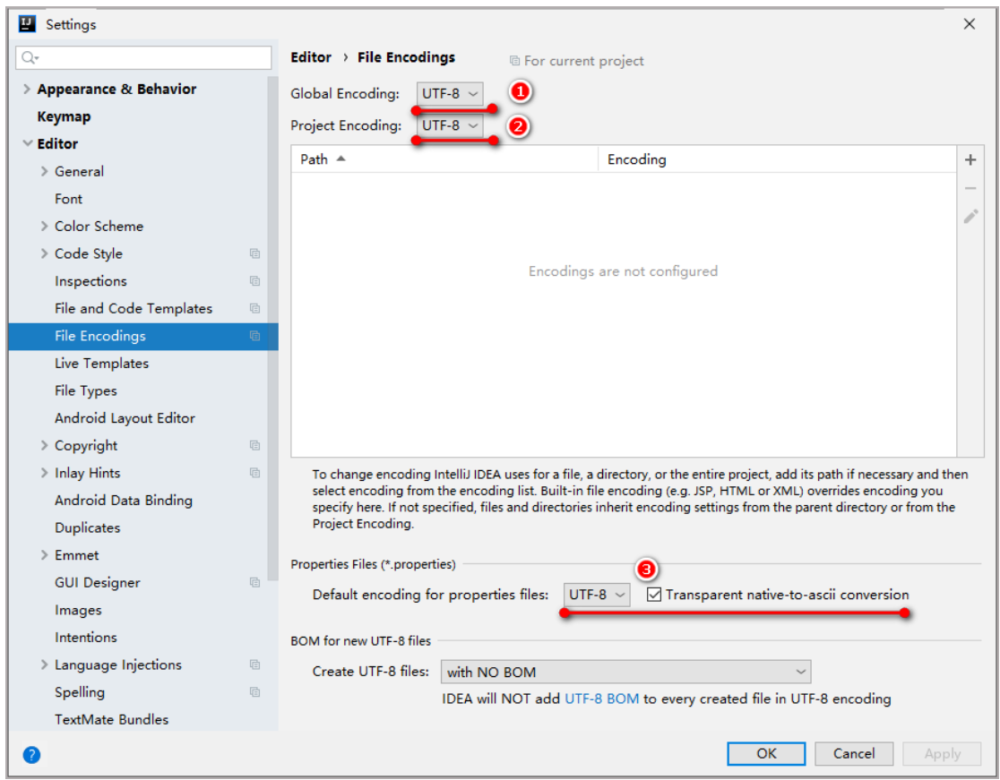

### 2.2 **自动导包设置**

IDEA可以自动优化导入包，**但是有多个同名的类调用不同的包，必须自己手动Alt+Enter设置**，  
下面可以通过设置来进行导包优化。

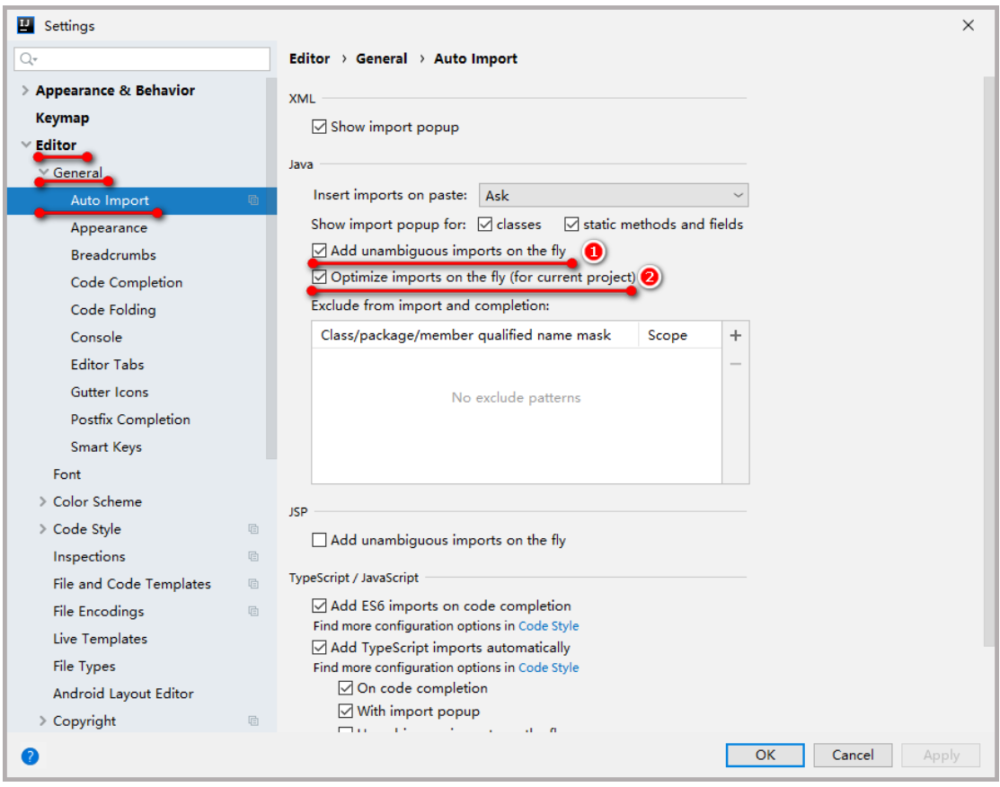

### 2.3 **提示忽略大小写**

IDEA代码提示默认是区分大小写的，设置为提示忽略大小写，编译我们后期的开发

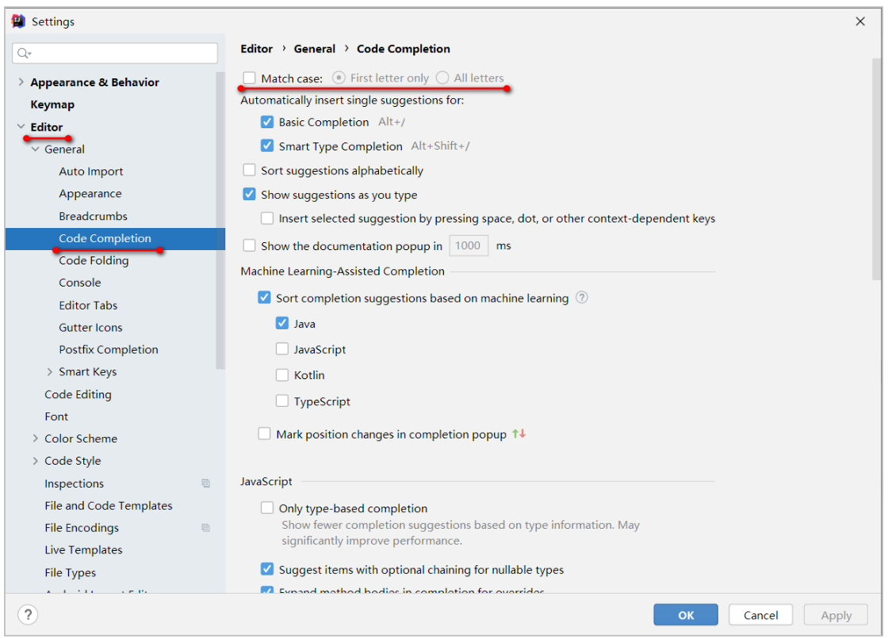

### 2.4 **设置 Java 编译级别**

工程创建成功，点击Project Structure:

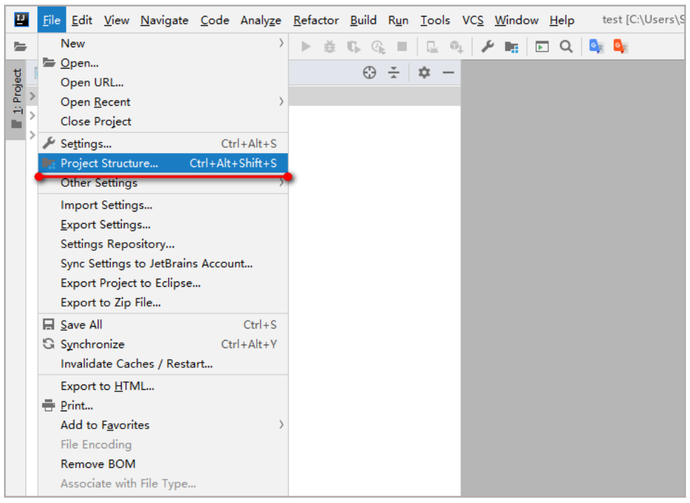

点击Project，设置SDK为11及Project language level，如下图：

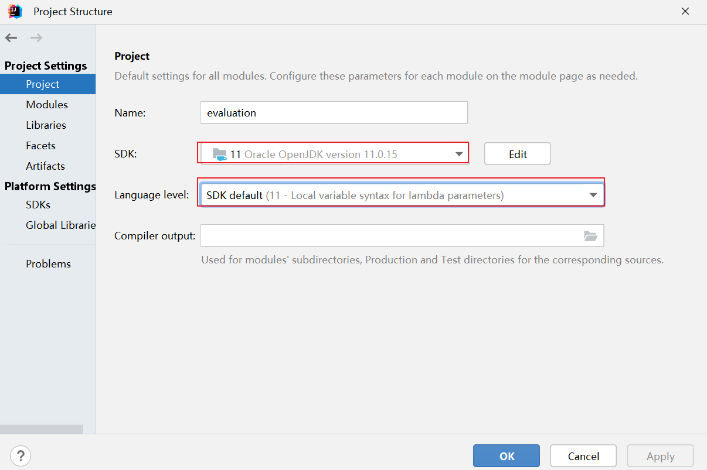

## 3 Maven环境

### 3.1 安装Maven

下载maven3.8.6版本，下载链接如下：

https://dlcdn.apache.org/maven/maven-3/3.8.6/binaries/apache-maven-3.8.6-bin.zip

解压apache-maven-3.8.6-bin.zip到没有中文的目录下。

### 3.2 **配置仓库**

1、解压课程资料中的maven仓库下的repository.zip到本地硬盘

2、在Maven的conf目录中setting.xml文件中配置本地仓库的地址。

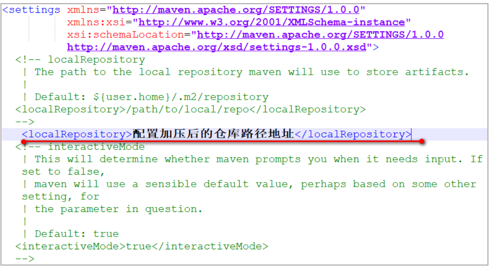

配置中央仓库位置：

在setting.xml文件中配置阿里云中央仓库地址。

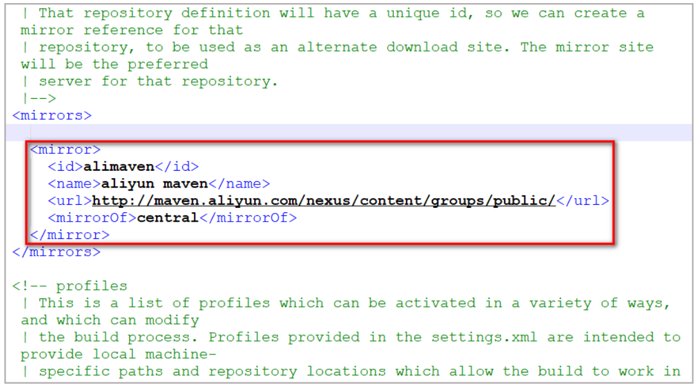

### **3.3 IDEA中配置maven**

在IDEA中配置maven：进入 File --> Settings --> Build --> Build Tools --> Maven

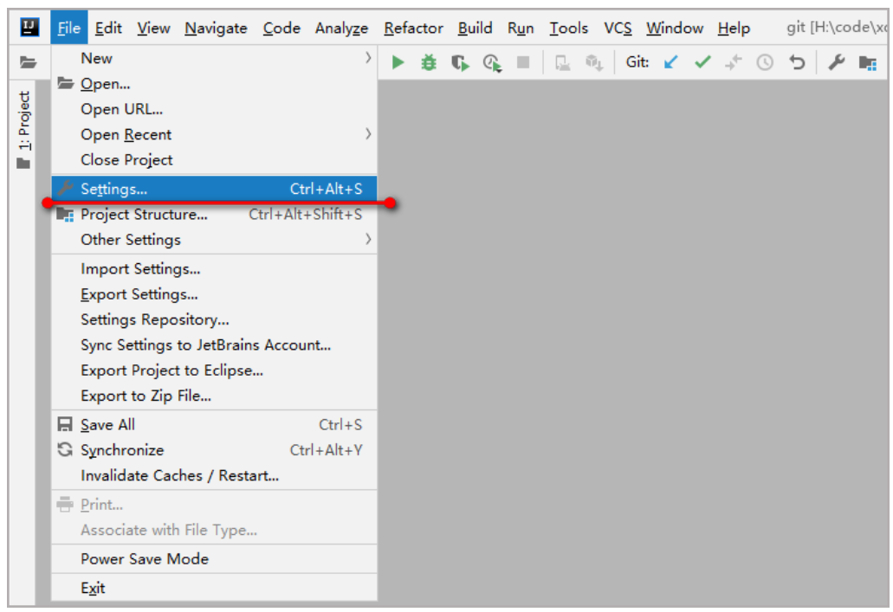

配置maven安装目录、setting.xml及本地仓库的位置。

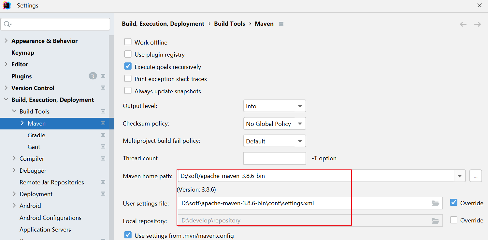


## 4 配置虚拟机

### 4.1 导入虚拟机

项目中用到的一些服务端软件如：Nacos配置中心、Redis、RabbitMQ消息队列等通常会安装在企业局域网的服务器中，开发人员去远程连接它们。在教学中我们在自己的电脑上安装虚拟机，虚拟机代表了企业局域网中的服务器。

服务器操作系统使用Centos7，导入下发的虚拟机文件，也可以自行安装Centos7虚拟机。

**1、导入虚拟机：**

首先安装VMware-workstation 16.x 或 VMware-workstation 17.x 虚拟机软件（**已安装vmware软件的同学不需要重新安装**），可从课程资料“软件工具”目录获取安装程序（VMwareworkstation16.rar）。

**1）设置网络**

点击 “编辑--》虚拟网络编辑器”配置网络地址，地址须与下图一致。

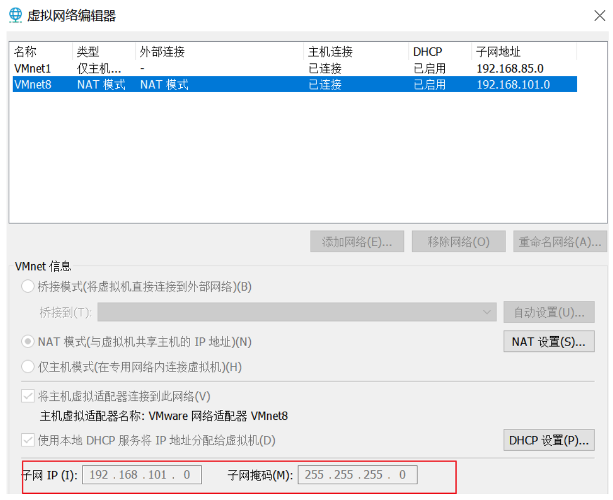

设置子网IP：192.168.101.0，子网掩码：255.255.255.0。

**2）导入虚拟机**

解压老师提供的虚拟机文件，进入解压后的文件架，双击"CentOS 7 64 位.vmx" 文件，选择复制虚拟机。

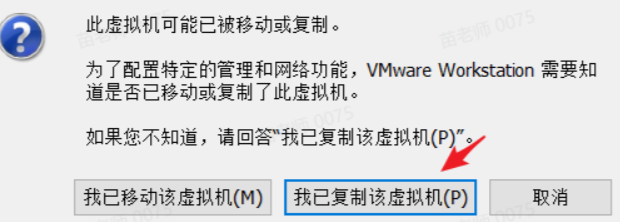

对此虚拟机的设置建议至少8G内存、8核CPU，硬盘存储至少40G。

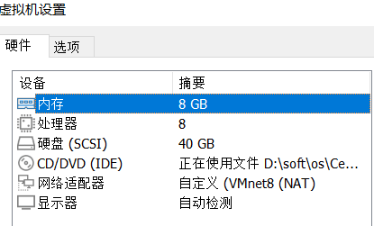

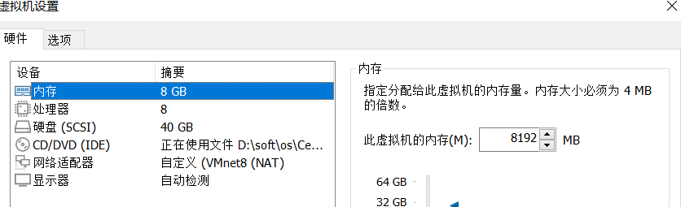

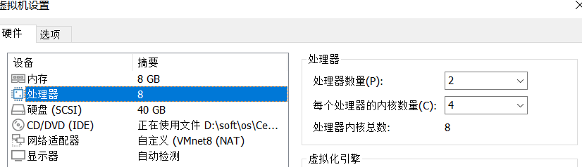

设置完成，启动虚拟机。

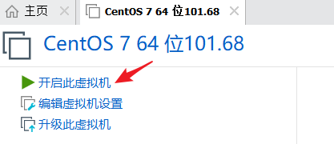

注意：虚拟机的IP地址为192.168.101.68，不用修改IP地址。

虚拟机启动成功如下界面：

**注意：不用点击进行登录。**

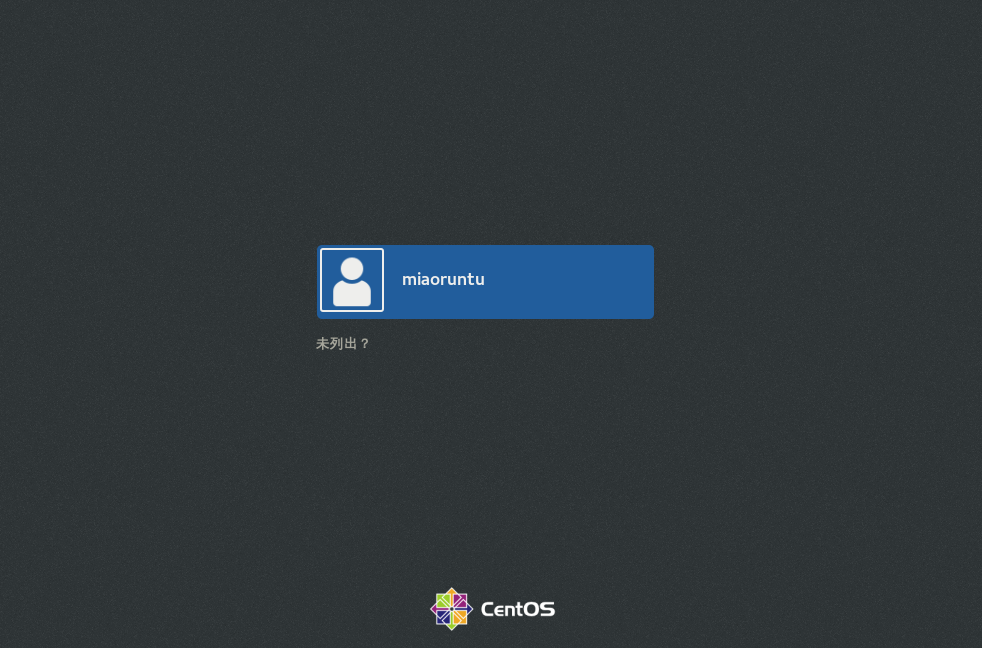

**3）远程连接虚拟机**

虚拟机启动成功，下边使用ssh客户端工具（FinalShell）远程 连接 虚拟机。

打开FinalShell软件，没有安装的可以从课程资料“软件工具”目录获取安装程序（finalshell_install.exe）。

通过下图所示建立新连接：

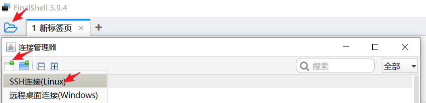

填写连接信息：

IP地址：192.168.101.68

账号与密码为：root/centos

如下图：

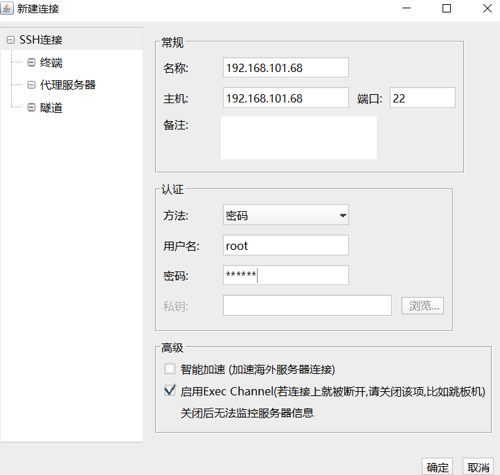

点击“确定”，创建连接成功，如下图：

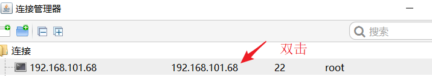

双击连接信息，连接成功如下图：


执行 systemctl start docker 启动docker。


启动mysql：docker start mysql

启动redis：docker start redis

启动nacos：docker start nacos2.4.0.1

以上软件如果已经启动不用重复启动**。**

查询docker容器：docker ps

如下图：

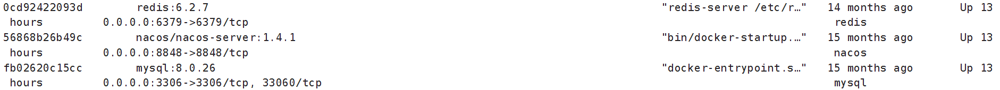

虚拟机已经安装了项目使用的软件，可通过docker ps -a查询全部安装的容器，具体在使用时再进行启动。


### 4.2 问题

win11打开.vmx文件报错：“未能启动虚拟机”

尝试解决方法：

1. 打开虚拟机的存放路径
2. 找到.vmx的配置文件
3. 修改 virtualHW.version改为virtualHW.version = "18"


## 5 配置数据库环境

### 5.1 **启动mysql容器**

首先确保Docker容器中的MySQL8已经启动。

运行docker ps命令进行查看：

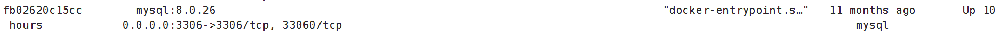

### 5.2 **使用MySQL客户端连接数据库。**

下边使用DataGrip 客户端连接数据库。

客户端工具不作限制，讲义中使用的是DataGrip ，安装程序从课程资料获取（datagrip-2022.2.2.win.zip）。

首先创建数据源

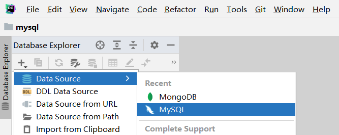

填写数据源信息

账号：root   密码：mysql

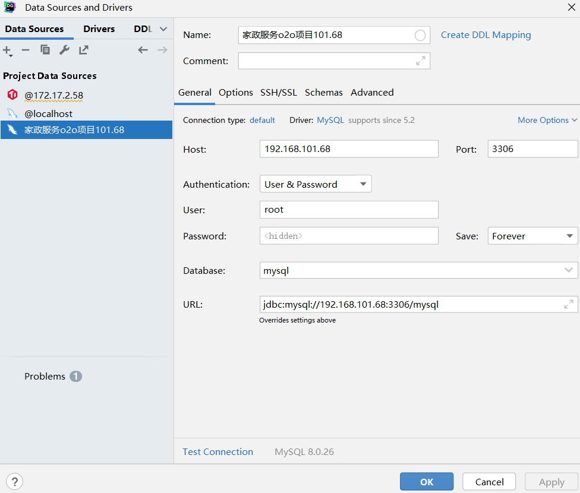


点击"Test Connection" 测试成功

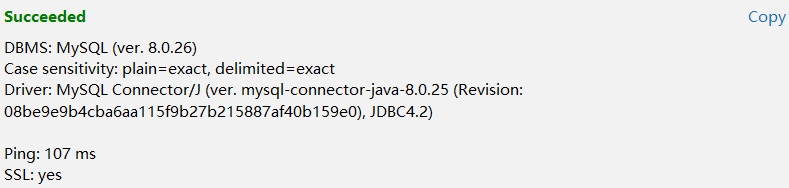

在下发的虚拟机中MySQL数据库已经包括了项目使用的数据库。

下边通过客户端工具查询 jzo2o-foundations数据库的信息。

显示jzo2o-foundations数据库，如下图：

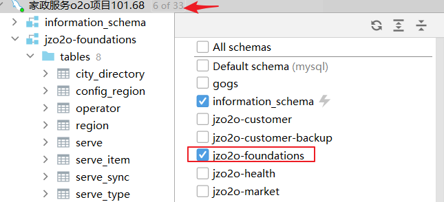

通过上图可知jzo2o-foundations数据库总共8张表。


### 5.3 **创建 jzo2o-foundations数据库**

如果没有使用下发的虚拟机则需要自行创建 jzo2o-foundations数据库。

首先创建 jzo2o-foundations数据库：

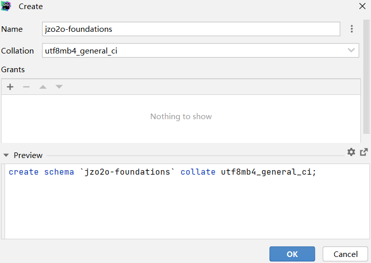

接下来导入数据：

从课程资料下的“sql脚本”目录拿到 jzo2o-foundations-init.sql，下边导入数据：


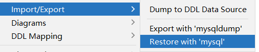

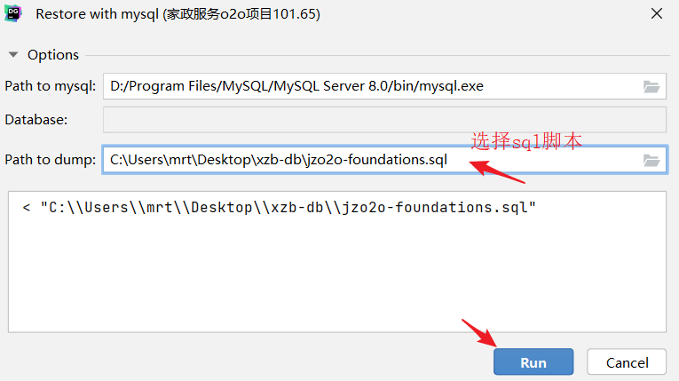

执行完成， 通过客户端工具查看jzo2o-foundations数据库信息，如下图：

jzo2o-foundations数据库共8张表。

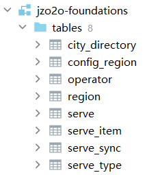


## 6 配置Redis环境

### 6.1 **启动redis容器**

首先确保Docker容器中的redis已经启动，没有启动运行docker start redis启动redis。

运行docker ps命令进行查看：

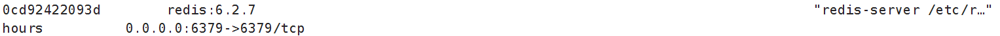

### 6.2 **使用客户端连接Redis**

使用redis客户端程序 resp-2022.4.2.0.0.exe 连接redis。

客户端工具不作限制，讲义中使用的是resp-2022.4.2.0.0.exe，可从软件工具目录获取安装程序（resp-2022.4.2.0.0.exe）。

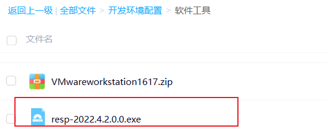

安装成功，新建一个连接:

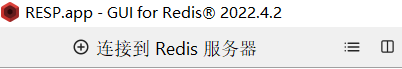

配置连接参数：

注意：redis密码为：redis

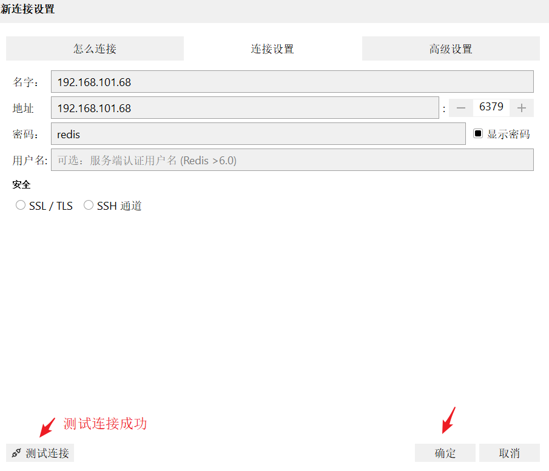

测试连接成功如下图：

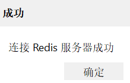

点击“确定”创建连接成功。


## 7 配置Nacos

### 7.1 检查配置

导入下发的虚拟机且成功启动nacos容器，如下图：

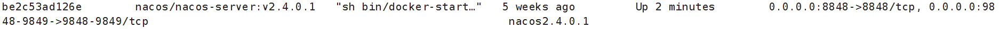

访问Nacos:http://192.168.101.68:8848/nacos进入nacos首页

在配置列表中找到"家政o2o"的命令空间可以正常查询到数据说明安装成功。

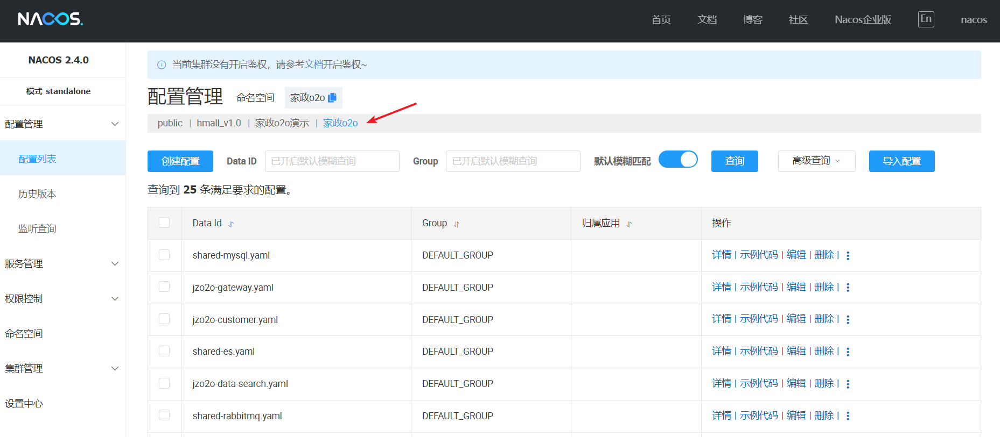

到此说明nacos服务可以正常使用。

如果不能正常显示可重启nacos，运行下边的命令：

docker restart nacos


### 7.2 自行安装

如果无法正常导入下发的虚拟机下边说明安装并配置nacos的步骤。

参考“第三方软件安装说明”文档安装Nacos。

安装nacos后需要创建命名空间并导入nacos的配置文件。

命名空间的id指定为：75a593f5-33e6-4c65-b2a0-18c403d20f63

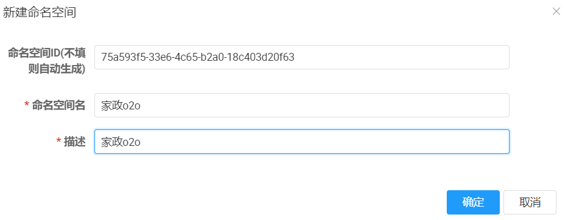

然后在配置管理菜单选中“家政o2o”命名空间，导入“课程资料/nacos”下的“nacos_config_export_jzo2o.zip”

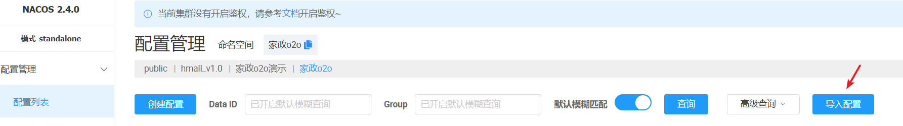

**导入配置文件后注意修改数据库的IP地址、Redis的IP地址、RabbitMQ的IP地址等配置信息。**

以下是部分配置文件：

数据库配置文件：shared-mysql.yaml

Redis配置文件：shared-redis-cluster.yaml

XXL-Job配置文件：shared-xxl-job.yaml

MQ配置文件：shared-rabbitmq.yaml

ES配置文件：shared-es.yaml

当前阶段需要修改shared-mysql.yaml、shared-redis-cluster.yaml中的IP地址为虚拟机的IP地址。


## 8 配置Git环境

### 8.1 安装Git

在个人电脑安装Git，使用常用软件工具目录中的Git-2.37.3-64-bit.exe。

也可以自行下载，地址：https://git-scm.com/  （windows版本：https://git-scm.com/download/win）

安装成功，在右键菜单出现Git菜单，如下图

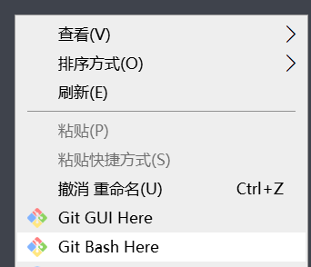

配置git邮箱：

```Java
git config --global user.name "你的名字"
git config --global user.email "你的邮箱"
```


安装成功在IDEA中配置git的安装目录

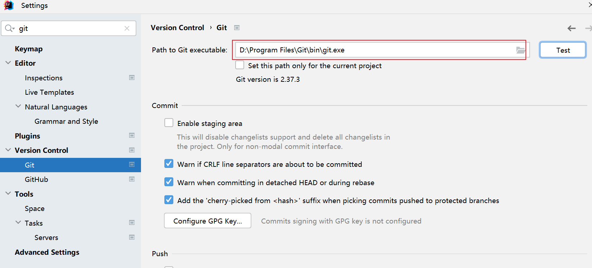


### 8.2 注册Git平台账号

git仓库我们使用的是https://gitee.com/ 平台，首先需要注册gitee账号


注册成功登录gitee。


## 9 创建后端工程

### 9.1 创建**jzo2o-framework**

#### 9.1.1 **拉取jzo2o-framework工程**

首先从git拉取项目的基础工程jzo2o-framework工程，本工程封装了项目所需要的一些基础组件，如：通用的工具类库、持久层MyBatis-Plus的通用功能抽取等。

课程提供的jzo2o-framework工程的仓库地址为：https://gitee.com/jzo2o-v2/jzo2o-framework.git ，大家需要登录自己gitee账号，**Fork该仓库到自己的空间**，Fork是将其它仓库的内容复制到自己仓库。

登录gitee，然后在浏览器输入https://gitee.com/jzo2o-v2/jzo2o-framework.git  仓库地址，点击"Fork"，如下图：

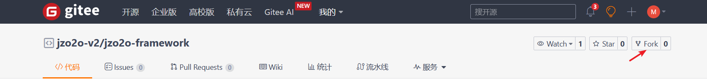

然后选择目标空间进行复制，Fork即拷贝远程仓库https://gitee.com/jzo2o-v2/jzo2o-framework.git  的项目到自己的仓库。

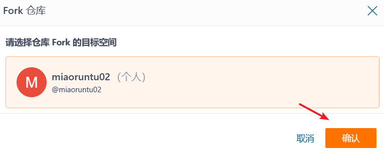

点击“确定”复制成功，从下图可以看出源仓库的信息。

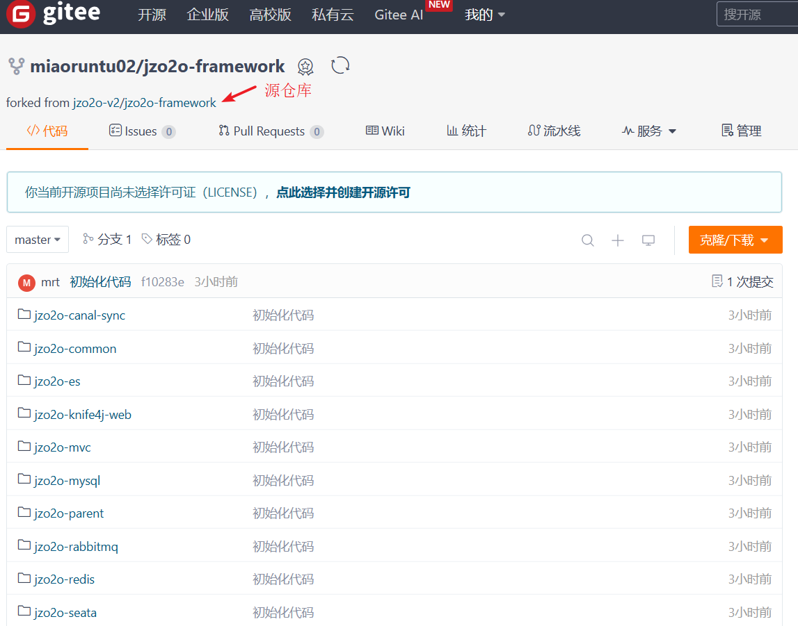

此时jzo2o-framework工程已复制到自己的仓库中，点击“克隆/下载”，复制仓库地址

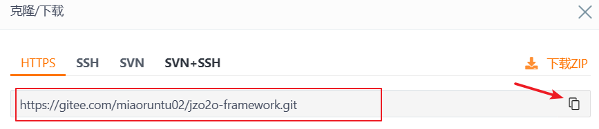

然后从此Git仓库克隆jzo2o-framework到代码目录。

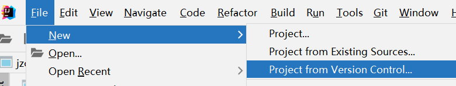

输入远程仓库地址，并选择本地代码目录：

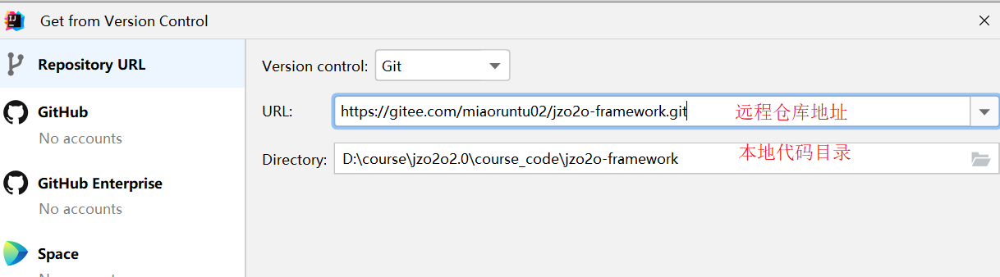

在弹出窗口选择信任该项目。

接下来打开克隆成功的工程

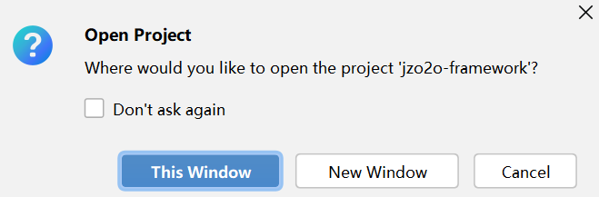

有些idea无法识别maven工程需要手动操作，找到父工程的pom.xml

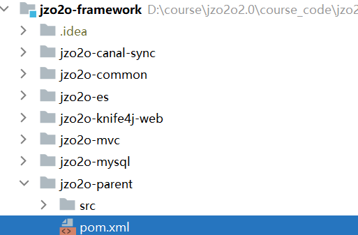

右键点击“Add as Maven Project”

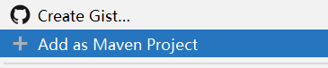

操作成功后pom.xml文件前的图标已更改为“m”，表示已识别为maven工程。

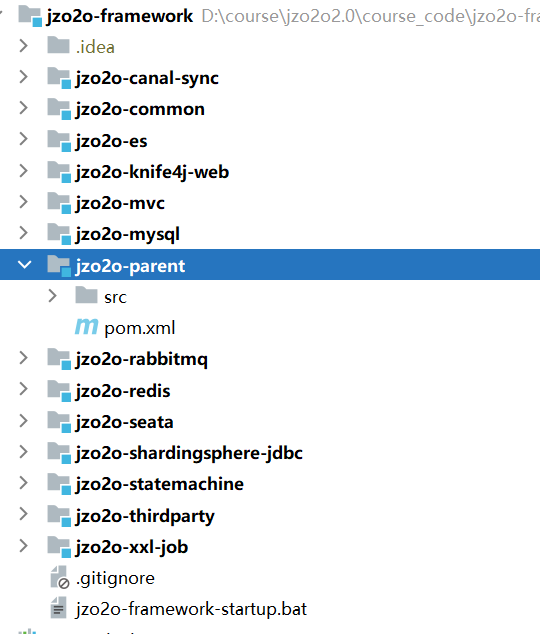


注意配置工程使用的jdk


#### 9.1.2 **打包上传到maven仓库**

在开发中一些公共组件会打包jar上传到公司的maven私服上，其它团队从私服下载jar包。

jzo2o-framework工程中包括了项目中用到一些封装组件，最后会发布为jar供其它项目使用，如果要发布到私服则执行mvn deploy命令，如果仅是在本地开发执行mvn install命令发布到本地仓库即可。

下边将jzo2o-framework打包后发布到本地仓库。

打开maven面板如下图，选择跳过测试，执行install命令。


打包成功观察日志如下：


### 9.2 创建jzo2o-gateway

#### 9.2.1 拉取网关工程

jzo2o-gateway工程是项目的网关工程，使用Spring Cloud gateway实现，负责请求拦截、请求路由与负载均衡。

下边拉取网关工程，课程提供的git仓库地址：https://gitee.com/jzo2o-v2/jzo2o-gateway.git 。

操作步骤同jzo2o-framework工程，登录自己的gitee账号，Fork该仓库到自己的空间。

jzo2o-gateway创建完成需要注意nacos的ip地址：


#### 9.2.2 运行网关工程

下边使用IDEA启动网关工程。


也可以进入nacos目录，双击运行：jzo2o-gateway-startup.bat启动网关，启动成功如下图：


### 9.3 创建jzo2o-foundations

运营基础服务工程jzo2o-foundations提供了运营端的接口支持，由于运营基础服务工程在课堂上我们需要开发维护，使用Git管理代码。

拉取jzo2o-foundations工程，本课程提供的git地址：https://gitee.com/jzo2o-v2/jzo2o-foundations.git，操作步骤同jzo2o-framework工程，登录自己的gitee账号，Fork该仓库到自己的空间。

工程创建成功如下图所示：


#### 9.3.1 切换分支

接下来切换分支到“dev_01”，右键“dev_01”分支，点击Checkout


 切换成功如下：


### 9.4 创建jzo2o-api

jzo2o-api工程提供了微服务内部接口的维护，用于微服务之间的远程调用。

拉取jzo2o-api工程，本课程提供的git地址：https://gitee.com/jzo2o-v2/jzo2o-api.git，操作步骤同jzo2o-framework工程，登录自己的gitee账号，Fork该仓库到自己的空间，从自己的空间拉取jzo2o-api工程，并切换到dev_01分支。

创建完成如下图：


和framework一样需要将api打包jar包上传到maven仓库被其它工程依赖。

接下来将API工程打包jar上传到maven仓库，如下图：


操作成功：


### 9.5 运行jzo2o-foundations

#### 9.5.1 配置jzo2o-foundations

运行前配置nacos地址：


目前只使用了mysql和redis，需要保证mysql和redis启动成功，如下图：


进入nacos修改shared-redis-cluster.yaml中redis的地址：


修改shared-mysql.yaml中mysql数据库的地址。


#### 9.5.2 运行jzo2o-foundations

开发中我们需要以debug方式启动：


启动成功：


### 9.6 创建jzo2o-publics

#### 9.6.1 拉取jzo2o-publics

公共服务工程jzo2o-publics提供了地图定位、上传图片、验证码等公用服务，本课程提供的git仓库地址为：https://gitee.com/jzo2o-v2/jzo2o-publics.git  ，操作步骤同jzo2o-framework工程，登录自己的gitee账号，Fork该仓库到自己的空间。

创建成功，如下图: 


#### 9.6.2 配置OSS

jzo2o-publics提供通用的上传图片接口，图片服务器使用阿里的OSS存储。

**参考 “OSS配置文档” 开通阿里云OSS服务，并在nacos中配置OSS参数。**


#### 9.6.3 配置高德地图

jzo2o-publics提供通用的地图定位接口，地图定位服务使用高德地图。

**参考 “高德地图web服务配置文档” 获取调用地理定位接口的key，并在nacos中配置高德地图key。**


#### 9.6.4 启动jzo2o-publics

启动前配置nacos地址：


通过IDEA启动


或通过双击启动脚本


## 10 配置前端环境

### 10.1 编译前端工程

#### 10.1.1 安装nvm

我们面对的前端项目很多，比如A，B两个并行开发项目，nodejs依赖版本不一致。A项目需要v14.19.1老版本，B项目需要v16.15.0新版本，需要随时切换。

我们可以使用nvm工具灵活切换node.js版本

举例如下：


nvm全英文也叫node.js version management，是一个nodejs的版本管理工具。nvm和n都是node.js版本管理工具，为了解决[node.js](https://zhida.zhihu.com/search?q=node.js&zhida_source=entity&is_preview=1)各种版本存在不兼容现象可以通过它可以安装和切换不同版本的node.js。


请大家自行上网查找nvm安装方法并自行安装。

#### 10.1.2 编译前端工程

node版本切换到14.19.1，如下图：


如果没有14.19.1版本则需要通过nvm安装14.19.1版本的node，运行下的命令：

`nvm install 14.19.1`

`nvm use 14.19.1`


从课程资料下的源码目录找到project-xzb-pc-admin-vue3-java.zip，并解压到project-xzb-pc-admin-vue3-java目录

通过cmd进入project-xzb-pc-admin-vue3-java目录运行下边的命令下载依赖包：

```Java
# 使用资料中提供的前端无需执行下面命令
npm install || yarn 
##或
cnpm install || yarn 
```

运行效果如下图：


### 10.2 运行前端工程

#### 10.2.1 运行前端工程

编译完成现在运行前端工程，运行前端工程之前需要启动以下后端服务：

jzo2o-gateway

jzo2o-foundations

接来来配置前端工程连接的网关地址：

通过cmd进入project-xzb-pc-admin-vue3-java目录，找到vite.config.ts文件，打开文件配置网关地址（默认连接本地网关，不需要修改）：

如下图：


运行命令：npm run dev  启动前端工程

启动成功如下图：


运行成功自动进入http://localhost:3000


账号：xiaoyan

密码：888itcast.CN764%...


点击“登录”，进入运营管理端


#### 10.2.2 服务管理功能验证

通过下边的功能验证判断开发环境是否搭建成功。

1. **服务类型查询**

进入服务类型管理，可以正常查询到数据说明配置成功。


如果不能正常查询到数据需要打开浏览器进入调试窗口，右键点击“检查”（讲义中使用的是**chrome浏览器**）


进入“网络”，找到请求查询服务类型接口的记录，如下图：


请求服务类型接口可以正常返回数据说明请求后端接口正常，如下图：


如果不能正常返回数据需要排查jzo2o-foundations工程是否正常启动成功，需要仔细阅读本文档配置jzo2o-foundations工程。


1. **添加服务类型**


1. **启用服务类型**


1. **服务项查询**


1. **添加服务项**


#### 10.2.3 上传图片功能验证

通过下边的功能验证判断jzo2o-publics服务及OSS配置是否正确。

进入服务类型管理界面，点击“新建”测试上传图片，如下图：


选择一个图片进行上传，上传成功示例如下：


## 11 注意点

1、maven本地仓库地址一定要配置正确

2、运行安装文件时要以管理员模式运行。

3、关闭自己电脑的防火墙。

4、如果没有使用下发的虚拟机需要修改数据库的地址、nacos的地址。

修改数据库地址，进入nacos找到shared-mysql.yaml文件，修改数据库的ip、账号、密码，如下图所示。


5、如下警告可以忽略

环境部署好后在进行接口测试时发现控制台报下边的警告：

```Java
WARNING: An illegal reflective access operation has occurred
WARNING: Illegal reflective access by com.baomidou.mybatisplus.core.toolkit.SetAccessibleAction (file:/D:/develop/repository/com/baomidou/mybatis-plus-core/3.4.3/mybatis-plus-core-3.4.3.jar) to field java.lang.invoke.SerializedLambda.capturingClass
WARNING: Please consider reporting this to the maintainers of com.baomidou.mybatisplus.core.toolkit.SetAccessibleAction
WARNING: Use --illegal-access=warn to enable warnings of further illegal reflective access operations
WARNING: All illegal access operations will be denied in a future release
```


以上警告表示在运行时发生了非法反射操作，这是因为Java9以上版本限制了反射操作的范围，无法通过过反射访问或修改类的私有成员，而Mybatis-plus存在违反该规则的代码。

此警告不影响正常使用mybatis-plus，如果不想看到该警告信息可在启动程序时加入--illegal-access=warn

如下图：


---
> 来源：飞书技术知识库（脱敏版） · 07 业务组件方案集 / 云岚到家项目 / 开发环境配置 · [原文](https://ccn8v2zngwsm.feishu.cn/wiki/PfeuwMAUWiMr8rkodUjcmmK8nXe)
