# 第四章 小程序首页

## 学习目标

1. 能说出实现门户的常用技术方案
2. 能说出小程序首页哪些信息要缓存
3. 会使用Spring Cache的常用注解
4. 能说出缓存穿透的解决方案
5. 能说出缓存击穿的解决方案
6. 能说出缓存雪崩的解决方案
7. 能说出保证缓存一致性的方案
8. 能够实现开通区域列表缓存
9. 能够实现定时任务更新缓存
10. 能够说出xxl-job工作原理
11. 能够实现首页服务列表缓存
12. 能够实现服务类型列表缓存
13. 能够实现热门服务列表缓存
14. 能够实现服务详情缓存


家政项目实战：

服务类型列表查询

热门服务列表查询

服务详情查询


## 代码环境

jzo2o-foundations：dev_02


## 1 门户技术方案

### 1）什么是门户

本节分析小程序首页的技术方案。

小程序首页界面原型如下图：


> 图注：图片展示了小帮家小程序首页界面。上方有“北京”定位和搜索框，搜索框内显示“日常保洁”。中部有新人优惠信息，提供全屋除菌保洁服务。下方是服务分类，包括保洁清洗、日常保洁、家电清洗等，每个分类配有图标。再往下是精选推荐，以“空调上门检修”为例，展示维修人员形象及服务内容。该图片直观呈现小程序首页布局，与文档中对小程序首页界面原型及包含部分的描述相契合。

包括如下部分：

1. 搜索栏
2. 服务分类
3. 热门服务项目

首页是用户进入这个小程序的入口，聚合很多的信息，包括内容导航、热点信息等。

类似的界面还有：

百度新闻：

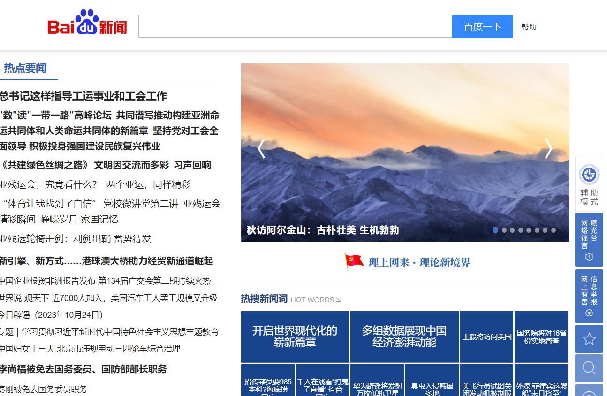
> 图注：图片展示的是百度新闻首页界面。上方有“百度新闻”标识及搜索框，右侧有“百度一下”按钮。中部有“热点要闻”板块，呈现多篇新闻标题。下方是“访秋阿尔金山：古朴壮美 生机勃勃”等内容。右侧有“辅助模式”“语音播报”“网上国网”等功能按钮。该图片与文档中介绍小程序首页界面原型的内容相关，用以展示类似门户界面的样式。

新浪首页：


> 图注：图片展示的是新浪首页界面。上方有导航栏，包括新闻、军事、国内、国际等分类，以及搜索栏。中部有“秋寒浓 留置”等图片，下方是“专栏”“热点”“视频”“综艺”等内容板块，如“千军万马图”“冷空气来袭，第一波秋冬季穿搭街拍请收好！”等。右侧是“新闻”板块，有“第一观察”“热点”“视频”等分类，显示了多篇新闻标题及发布日期。该图片与文档中介绍小程序首页界面原型及门户技术方案的内容相关，直观呈现了类似门户界面的样式。


这种系统首页入口称为门户，是指一个网站或应用程序的主页，它是用户进入这个网站或系统的入口，主页上通常聚合很多的信息，包括内容导航、热点信息等，比如：门户网站的首页、新闻网站的首页、小程序的首页等。

常见的软件门户类型：

1. 企业门户：这种类型的门户通常用于组织内部，为员工提供一个集中访问企业内部各种应用、数据和服务的地方。它可以包括人力资源信息、财务系统、项目管理工具等。
2. 客户门户：面向外部客户的门户，允许客户登录并访问特定的服务，如账户管理、订单跟踪、技术支持等。
3. 知识门户：这类门户主要用于知识管理和分享，可以包含文档库、论坛、博客等功能，帮助用户获取所需的信息和专业知识。
4. Web门户：这是最广为人知的一种门户形式，它通常提供新闻、电子邮件、搜索引擎等综合性服务，用户可以通过这个平台方便地访问网络上的多种资源。


### 2）常用的技术方案

实现门户功能用到哪些技术呢？

#### **基于两个需求去分析**

**1.门户上的信息是动态的**

门户上的信息会按照一定的时间周期去更新，比如一个新闻网站不可能一直显示一样的新闻。

**2.门户作为入口其访问频率非常高**

对于访问频率高的界面其加载速度是至关重要的，因为它直接影响用户的体验和留存率。一般来说门户网站的首页应该在2至3秒内加载完成，这被认为是一个合理的加载时间目标。

**常见的两类门户是：web门户和移动应用门户。**

我们针对这两类门户分析技术方案。

#### **Web门户技术方案**

web门户是最常见的门户类型，比如：新浪、百度新闻等，它们通过PC浏览器访问，用户可以通过桌面电脑、笔记本电脑、平板电脑和智能手机等设备访问。Web门户通常运行在Web浏览器上，用户可以通过输入网址或通过搜索引擎访问。

web门户是通过浏览器访问html网页，虽然html网页上的内容是动态的但是考虑门户作为入口其访问频率非常高所以就需要提高它的加载速度，如果网页上的数据是通过实时查询数据库得到是无法满足要求的，所以针对web门户提高性能的关键是如何提高html文件的访问性能，如何提高查询数据的性能。

**1、将门户页面生成静态网页发布到CDN服务器。**

纯静态网页通过Nginx加载要比去Tomcat加载快很多。

我们可以使用模板引擎技术将动态数据静态化生成html文件，并通过CDN分发到边缘服务器，可以提高访问效率。

Java模板引擎技术有很多，比如：freemarker、velocity等。

在课下参考入门视频自学: https://www.bilibili.com/video/BV1j8411N7Bm?p=93&vd_source=81d4489ba9312103debc8ee843169f23


什么是CDN？

CDN 是构建在数据网络上的一种分布式的内容分发网，旨在提高用户访问网站或应用时的性能。

下图中，通过CDN将内容分发到各个城市的CDN节点上，北京的网民请求北京的服务即可拿到资源，提高访问速度。

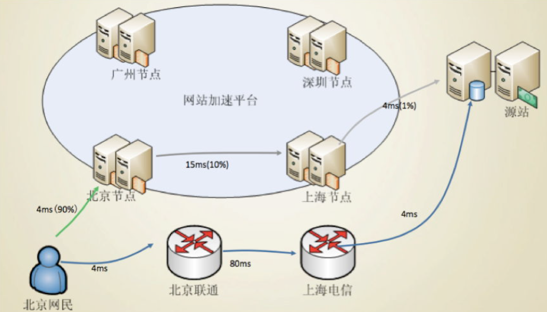


**2、html文件上的静态资源比如：图片、视频、CSS、Js等也全部放到CDN服务。**

**3、html上的动态数据通过异步请求后端缓存服务器加载，不要直接查询数据库，通过Redis缓存提高查询速度。**

<whiteboard token="Sy6Bwm9AsheZeqbFtzQchQUpn2g"></whiteboard>

**4、使用负载均衡，通过部署多个Nginx服务器共同提供服务，不仅保证系统的可用性，还可以提高系统的访问性能。**

<whiteboard token="IabIwwGk6h5AxQbjkwVcHFK2nib"></whiteboard>

**5、在前端也做一部分缓存。**

不仅服务端可以做缓存，前端也可以做缓存，前端可以把缓存信息存储到

**LocalStorage：** 提供了持久化存储，可以存储大量数据

**SessionStorage：** 与 `LocalStorage` 类似，但数据只在当前会话中有效，当用户关闭标签页或浏览器时清空。

**Cookie**: 存储在用户计算机上的小型文本文件，可以在客户端和服务器之间传递数据

**浏览器缓存**：通过 HTTP 头部控制，比如：`Cache-Control`头部提供了更灵活的缓存控制选项，可以定义缓存的最大有效时间。


#### **移动应用门户技术方案**

移动应用门户是专为移动设备（如智能手机和平板电脑）设计的应用程序，比如：小程序、APP等，用户可以通过应用商店下载并安装。这些应用程序提供了更好的用户体验，通常具有更高的性能和交互性，可以直接从设备主屏幕启动。

对于移动应用提高访问效率方法通常有：

静态资源要走CDN服务器

对所有请求进行负载均衡

在前端及服务端缓存门户上显示的动态数据。


### 3）小结

根据上边的分析，对于Java程序员需要关注的是缓存服务的开发，主流的缓存服务器是Redis，所以我们接下来的工作重点是使用Redis为门户开发缓存服务接口。

实现一个门户用到的技术方案有哪些? 

## 2 缓存技术方案

### 2.1 需求分析

目标：明确本项目门户有哪些信息需要缓存

#### 1）界面原型

了解了门户的技术方案，下边通过门户界面原型分析本项目门户包括哪些部分。

本项目小程序门户首页如下图：

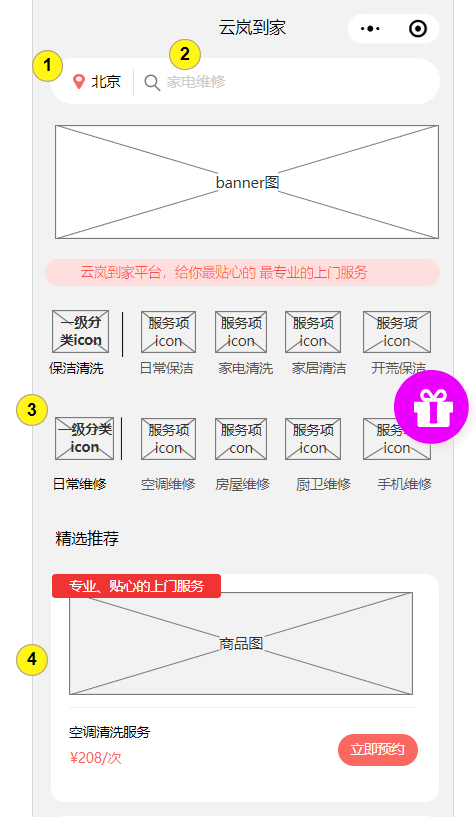
> 图注：图片展示了小程序门户首页界面。1为城市选择区域，显示“北京”；2为搜索框，输入“家电维修”；3为一级分类区域，有保洁清洗、日常保洁等分类；4为商品图区域，展示“空调清洗服务”及预约按钮。该图片与文档中介绍小程序门户首页的内容相关，直观呈现了首页包含的城市选择、搜索、一级分类及商品图等关键部分。

##### **第1部分**：城市选择

用户允许微信授权后，自动获取当前定位，点击地址进入城市选择页面，如下图：

已开通城市是指在区域管理中所有启用的区域信息。

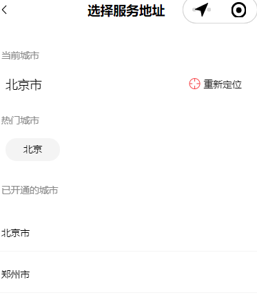
> 图注：图片展示的是小程序首页“选择服务地址”页面。页面顶部显示“选择服务地址”，右上角有定位图标和刷新图标。下方有“当前城市”输入框，显示“北京市”，右侧有“重新定位”按钮。热门城市区域显示“北京”选项。已开通城市区域有“北京市”和“郑州市”选项。该图片与文档中“首页服务列表”部分上下文相关，用于说明在首页服务列表中点击一级分类进入【全部服务】页时，可选择服务地址的操作界面。


##### **第2部分**：搜索

触发搜索框进入搜索主页面，如下图：

输入关键字搜索服务信息。


> 图注：这是一张小程序界面的搜索功能示意图，界面顶部左侧为返回箭头，中间显示“搜索”字样，右侧有更多选项按钮与圆形的相机类功能图标。界面下方有一个搜索输入框，框内左侧带有放大镜图标及“搜索”提示文字，输入框右侧是红色的“取消”按钮，该界面应是供用户在小程序内进行内容检索的交互入口。

##### **第3部分**：**首页服务列表**

默认展示前两个服务分类，每个服务分类下取前4个服务项（根据后台排序规则显示，如排序相同则按照更新时间倒序排列）

点击一级分类进入【全部服务】页；点击服务项进入【服务项目详情页】


##### **第4部分**：**热门服务列表**

这里显示在区域服务界面设置热门服务的服务项。

##### **第5部分**：**全部服务**

点击首页服务列表的服务分类或直接点击“全部服务”进入全部服务界面，

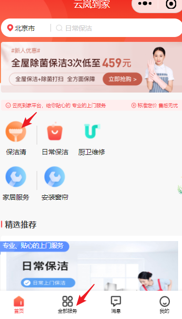
> 图注：图片展示了云凤到家小程序首页的全部服务界面。界面上方显示“北京市”和“日常保洁”搜索框。中部有新人优惠活动，宣传全屋除菌保洁3次低至459元。下方是服务分类图标，分别为保洁清、日常保洁、厨卫维修、家居服务、安装窗帘，其中“保洁清”和“全部服务”有红色箭头指向。精选推荐部分展示了日常保洁服务。

全部服务界面，如下图：

在全部服务界面需要展示当前区域下的服务分类，点击服务分类查询分类下的服务。


> 图注：这是小程序全部服务界面的示意图，该界面会展示当前区域下的服务分类与对应服务项。左侧列出了服务分类，包含“保洁清”“家居服务”等类别；右侧展示具体服务项，其中“日常保洁”被红色框标注，下方有对应说明“服务分类下的服务项”；上方标注有“全部服务”字样，该界面的作用是供用户点击服务分类，查询对应分类下的服务内容，进入该界面可通过点击首页服务列表的服务分类或直接点击“全部服务”实现。

##### 第6部分 服务详情

点击服务名称进入服务详情页面：


> 图注：图片展示的是“日常保洁”服务详情页面。上方有“日常上门保洁服务承诺”“全方位清洁”“随心约上门”等服务说明。中间以红色背景突出显示“¥48/小时”及“厨房 - 卧室 - 客厅 全方位清洁”。下方介绍“日常保洁”服务，价格为“¥1.00/小时”，并有“到家保障”标识，包含时效保障、明码标价、清洁保障等内容。该页面与文档中介绍的点击服务名称进入服务详情页面的内容对应。


#### 2）缓存需求

根据门户的技术方案，为了提供效率门户显示的信息从缓存查询，根据上边的界面原型分析有哪些信息需要缓存？

**1.定位界面上的已开通区域列表**

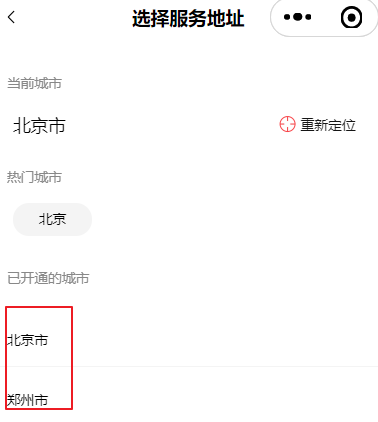
> 图注：图片展示的是小程序首页中“服务信息”部分的“选择服务地址”界面。界面上方显示“选择服务地址”，右上角有三个点和一个圆圈。下方有“当前城市”显示为北京市，右侧有“重新定位”按钮。热门城市中“北京”被灰色圆角矩形框突出显示。已开通的城市列表中，北京市和郑州市被红色边框框起，表明这两个城市是已开通的服务区域。该图片与文档中“服务信息”部分上下文对应，直观呈现了服务地址选择界面及已开通城市信息。

**2.服务搜索**

通过Elasticsearch查询，稍后单独分析

**3.首页服务列表**

**4.热门服务列表**

**5.服务信息**

点击某一个服务打开服务详情页面，如下图：


> 图注：图片展示的是日常保洁服务详情页面。上方有“日常保洁”标题，下方列出服务内容，包括日常上门保洁、全方位清洁、随心约上门，还配有“¥48/小时”价格标识及“厨房 - 卧室 - 客厅 全方位清洁”说明。右侧有清洁工人的图片。下方再次显示“日常保洁 ¥1.00/小时”，并有“-”“1”“+”数量调节按钮。最下方是“到家保障”及“立即预约”按钮。

服务的详细信息一部分是服务介绍的图片和内容等，一部分是区域服务信息（比如价格）。

**6.服务分类**

在全部服务界面左侧显示服务分类


> 图注：图片展示了小程序首页服务分类界面。左侧有“服务分类”标识，下分“保洁清”和“家居服务”两个选项。右侧显示“全部服务”标题，下方有“日常保洁”服务项，配有女性清洁桌面的图片。该图片与文档中“服务分类”部分内容对应，直观呈现了服务分类下的服务项展示情况，帮助理解首页服务分类的布局及样式。

服务分类下的服务项通过Elasticsearch去查询，稍后单独分析。


#### 3）小结

经过分析要明确有哪些信息需要缓存。

1、首页服务列表，包括两个服务分类及每个分类下的四个服务项。

2、热门服务列表

3、服务类型列表

4、开通城市列表

5、服务详细信息，内容包括服务项信息、服务信息。


### 2.2 Spring Cache入门

#### 2.2.1 入门程序

目标：学会使用SpringCache查询缓存注解并理解它的原理

##### 1）Redis访问工具

本项目使用Redis存储缓存数据，如何通过Java去访问Redis？

常用的有Jedis和Lettuce两个访问redis的客户端库，其中Lettuce的性能和并发性要好一些，Spring Boot 默认使用的是 Lettuce 作为 Redis 的客户端。

本项目集成了Spring data redis框架，在项目中可以通过RedisTemplate访问Redis，RedisTemplate提供了方便访问redis的模板方法。

RedisTemplate和Lettuce 是什么关系？

`RedisTemplate` 进行 Redis 操作时，实际上是通过 `Lettuce` 客户端与 Redis 服务器进行通信。

本项目也集成了Spring Cache，Spring Cache是spring的缓存框架，可以集成各种缓存中间件，比如：EhCache、Caffeine、redis。

Spring Cache最终也是通过Lettuce 去访问redis 。

使用Spring Cache的方法很简单，只需要在方法上添加注解即可实现将方法返回数据存入缓存，以及清理缓存等注解的使用。

RedisTemplate适用于灵活操作redis的场景，通过RedisTemplate的API灵活访问Redis。

这两种访问 redis的方法在本项目都有使用。


##### 2）Spring Cache基本介绍

Spring Cache是Spring提供的一个缓存框架，基于AOP原理，实现了基于注解的缓存功能，只需要简单地加一个注解就能实现缓存功能，对业务代码的侵入性很小。

基于SpringBoot使用Spring Cache非常简单，首先加入依赖：

```Java
<dependency>
    <groupId>org.springframework.boot</groupId>
    <artifactId>spring-boot-starter-cache</artifactId>
    <version>2.7.10</version>
</dependency>
```

本项目已在jzo2o-framework下的jzo2o-redis工程引入此依赖，其它服务只需要引入jzo2o-redis的依赖即可。

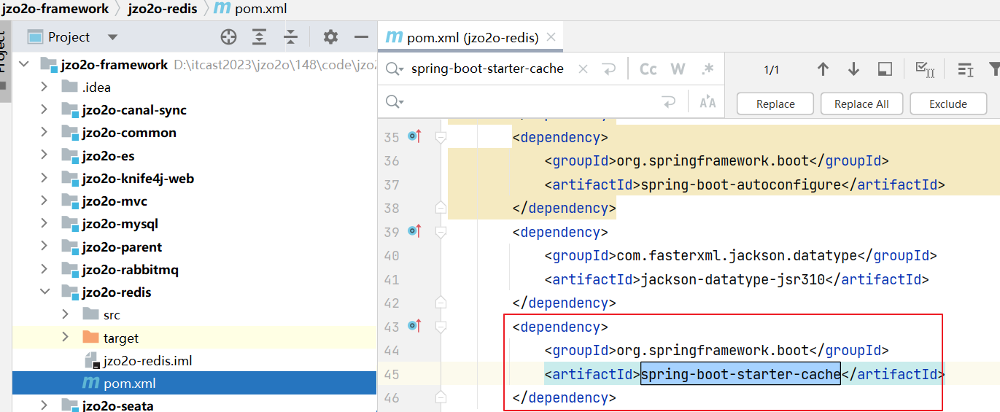
> 图注：图片展示了jzo2o-redis工程的pom.xml文件内容。文件中以红色框突出显示了引入的Spring Boot缓存依赖，其groupId为org.springframework.boot，artifactId为spring-boot-starter-cache。该图片与文档中“基于SpringBoot使用Spring Cache非常简单，首先加入依赖”的内容相关，直观呈现了引入Spring Boot缓存依赖的操作，辅助说明了在jzo2o-redis工程中使用Spring Cache的步骤。

简单认识它的常用注解：

@EnableCaching：开启缓存注解功能

@Cacheable：查询数据时缓存，将方法的返回值进行缓存。  
@CacheEvict：用于删除缓存，将一条或多条数据从缓存中删除。  
@CachePut：用于更新缓存，将方法的返回值放到缓存中  
@Caching：组合多个缓存注解；  
@CacheConfig：统一配置@Cacheable中的value值

##### 3）切换分支

本节使用jzo2o-foundations工程的dev_02分支，课程会下发dev_02分支的代码

jzo2o-foundations_dev02.zip，大家在开发前先在本地创建了一个新分支dev_02并切换到dev_02，然后将下发的代码覆盖dev_02下的代码。

在jzo2o-foundations工程引入jzo2o-redis依赖

```JSON
<dependency>
    <groupId>com.jzo2o</groupId>
    <artifactId>jzo2o-redis</artifactId>
</dependency>
```

在jzo2o-foundations工程的bootstrap.yml中引入redis的配置文件，如下图：

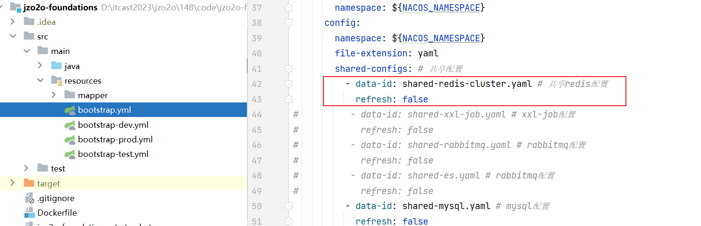
> 图注：图片展示了jzo2o-foundations工程中bootstrap.yml文件的部分内容。其中，以红色框突出显示了“data-id: shared-redis-cluster.yaml # 共享redis配置”这一行，表明在jzo2o-foundations工程的bootstrap.yml中引入了redis的配置文件，且该配置文件为共享redis配置，刷新设置为false。这与上下文提到在jzo2o-foundations工程的bootstrap.yml中引入redis配置文件，以及在nacos配置shared-redis-cluster.yaml，开发环境使用redis单机等内容相呼应。

在nacos配置shared-redis-cluster.yaml，开发环境使用redis单机，配置文件如下：

注意配置redis的IP地址、端口和密码。

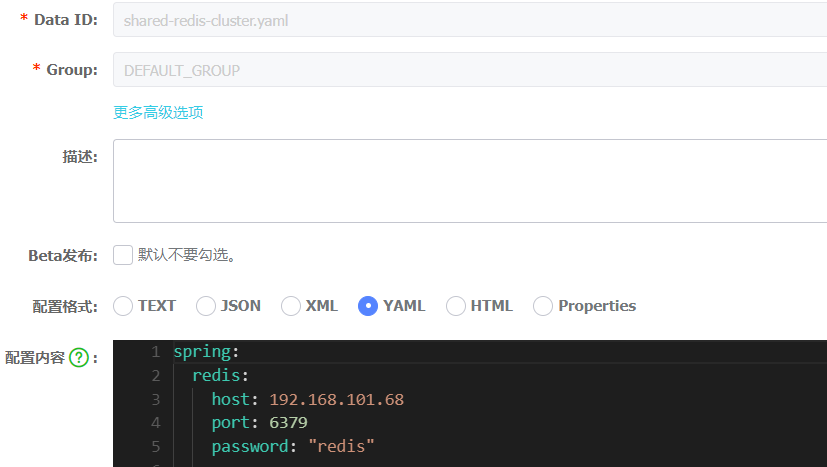
> 图注：图片展示的是nacos配置文件shared-redis-cluster.yaml的内容。其配置格式为YAML，配置内容中包含spring和redis两个部分，其中redis部分设置了host为192.168.101.68、port为6379、password为“redis”。该图片与文档中“在nacos配置shared-redis-cluster.yaml，开发环境使用redis单机，配置文件如下”的内容对应，直观呈现了配置文件的具体内容，帮助读者了解redis配置的格式和参数设置。


##### 4）查询数据时缓存

下边使用Cacheable注解实现查询服务信息时对服务信息进行缓存，它的执行流程是：第一次查询服务信息缓存中没有该服务的信息此时去查询数据库，查询数据库拿到服务信息并进行缓存，第二次再去查询该服务信息发现缓存中有该服务的信息则直接查询缓存不再去数据库查询。

流程如下：

<whiteboard token="BaT9wo81bhnZFSbmw23ceRkZnne"></whiteboard>

首先在工程启动类中添加@EnableCaching注解，它表示开启Spring cache缓存组件。

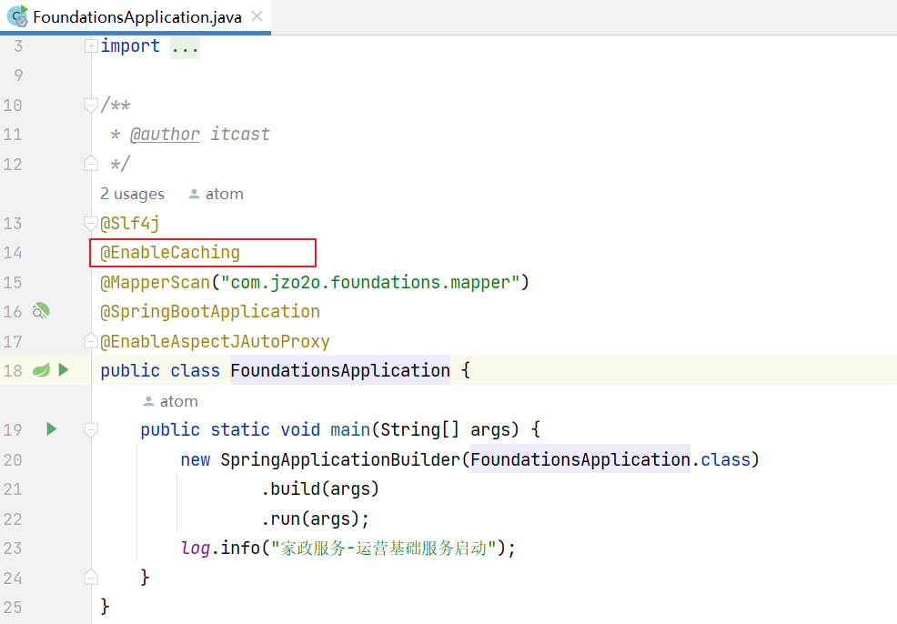
> 图注：这张图片展示了Spring Boot项目的启动类代码，该类名为FoundationsApplication。代码中第14行标注了关键注解@EnableCaching，它被红色框突出显示，作用是开启Spring Cache的缓存功能，是实现查询数据缓存的配置之一。除此之外，该启动类还包含Spring Boot应用启动的主方法，以及Mapper扫描、AOP自动代理等相关配置注解，同时输出了应用启动的日志信息。

下边实现对区域服务信息查询时进行缓存。

首先找到区域服务信息的service，为了不和原来的getById(Serializable id)查询方法混淆，单独定义查询区域服务信息缓存的方法，如下：

在IServeService接口中定义如下接口：

```Java
/**
 * 查询区域服务信息并进行缓存
 * @param id 对应serve表的主键
 * @return 区域服务信息
 */
Serve queryServeByIdCache(Long id);
```

在接口实现类中定义如下方法：

```Java
@Override
public Serve queryServeByIdCache(Long id) {
    return getById(id);
}
```

此时该方法还是查询数据库。

下边在方法中添加Cacheable注解：

```Java
//    @Cacheable(value = "JZ_CACHE:SERVE_RECORD",key = "#id")
    @Cacheable(value = RedisConstants.CacheName.SERVE,key = "#id")
    public Serve queryServeByIdCache(Long id) {
        return getById(id);
    }
```

Cacheable注解配置的两项参数说明：

**value**：缓存的名称，缓存名称作为缓存key的前缀。

**key**: 缓存key，支持SpEL表达式，上述代码表示取参数id的值作为key

最终缓存key为：缓存名称+“::”+key，例如：上述代码id为123,最终的key为：JZ_CACHE:SERVE_RECORD::123

SpEL（Spring Expression Language）是一种在 Spring 框架中用于处理字符串表达式的强大工具，它可以实现获取对象的属性，调用对象的方法操作。

**keyGenerator**：指定一个自定义的键生成器（实现 org.springframework.cache.interceptor.KeyGenerator 接口的类），用于生成缓存的键。与 key 属性互斥，二者只能选其一。


##### 5）测试

对queryServeByIdCache方法进行测试，编写单元测试方法，如下：

```Java
package com.jzo2o.foundations.service;

import com.jzo2o.common.model.PageResult;
import com.jzo2o.foundations.model.domain.Serve;
import com.jzo2o.foundations.model.dto.request.ServePageQueryReqDTO;
import com.jzo2o.foundations.model.dto.response.*;
import lombok.extern.slf4j.Slf4j;
import org.junit.jupiter.api.Test;
import org.springframework.boot.test.context.SpringBootTest;
import org.springframework.util.Assert;

import javax.annotation.Resource;
import java.math.BigDecimal;
import java.util.List;

@SpringBootTest
@Slf4j
class IServeServiceTest {

//区域服务查询
@Test
public void test_queryServeByIdCache(){
    Serve serve = serveService.queryServeByIdCache(1693815623867506689L);
    Assert.notNull(serve,"服务为空");
}
...
```

运行测试方法，观察redis，数据缓存成功，如下图：

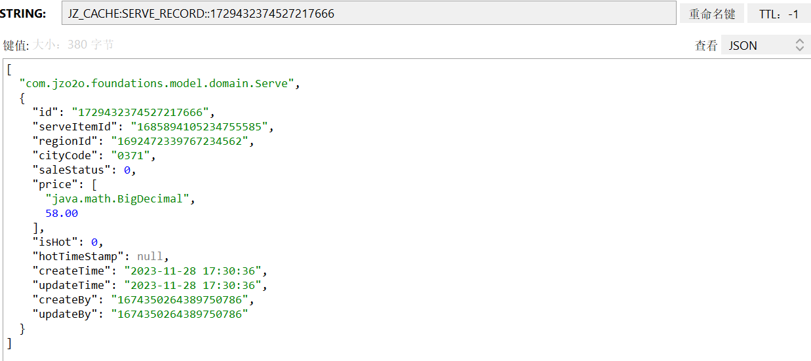
> 图注：这张图片展示的是Spring Cache测试后Redis中的缓存数据界面，其中包含了明确标注的缓存key，内容为JZ_CACHE:SERVE_RECORD::1729432374527217666。界面内的缓存value为Java对象序列化后的JSON数据，对应com.jzo2o.foundations.model.domain.Serve类，包含id、serveItemId、regionId等字段信息，同时该缓存的过期时间TTL显示为-1，和上下文提到的“缓存过期时间为-1，表示永不过期”的结果相符，用于验证测试后的缓存数据符合预期。

缓存key：JZ_CACHE:SERVE_RECORD::1693815623867506689

缓存value：serve表的记录

缓存过期时间：-1，表示永不过期

仔细核实内容是否符合我们的预期结果。


虽然数据被成功缓存，如果想调整缓存过期时间怎么做呢？

在@Cacheable注解中有一个属性为cacheManager，表示缓存管理器，通过缓存管理器可以设置缓存过期时间。

所有缓存相关的基础类都在jzo2o-redis工程，在jzo2o-redis工程定义spring cache需要的缓存管理器，如下：

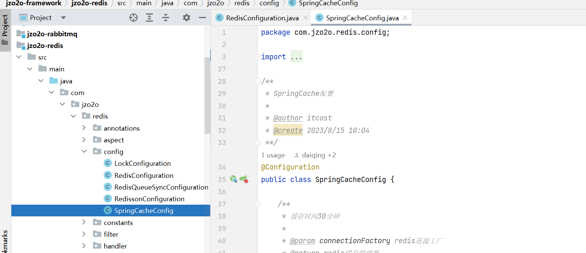
> 图注：图片展示了jzo2o-redis工程中config目录下的SpringCacheConfig.java文件代码。文件中定义了SpringCacheConfig类，包含RedisConfiguration、RedisQueueSyncConfiguration、RedissonConfiguration三个属性，分别对应RedisConfiguration、RedisQueueSyncConfiguration、RedissonConfiguration三个配置类。该图片与上文介绍jzo2o-redis工程定义spring cache需要的缓存管理器的内容相关，直观呈现了相关配置代码。

上图中共包括三个缓存管理器：

缓存时间为30分钟、一天、永久，分别对应的bean的名称为：cacheManager30Minutes、cacheManagerOneDay、cacheManagerForever。

下边我们在@Cacheable注解中指定缓存管理器为cacheManagerOneDay，即缓存时间为一天。

```Java
@Cacheable(value = RedisConstants.CacheName.SERVE,key="#id",cacheManager = RedisConstants.CacheManager.ONE_DAY)
public Serve queryServeByIdCache(Long id) {
    return getById(id);
}
```

重新运行单元测试方法，我们发现缓存的过期时间没有改变，这是为什么？

原因是根据前边的缓存流程：

先查询缓存，如果缓存存在则直接查询缓存返回数据，不再向缓存存储 数据。

<whiteboard token="NDUwwXY8VhjzhIbktXLcxYj1nWc"></whiteboard>

所以我们需要删除缓存，重新运行测试方法：

测试通过，观察redis中的缓存，过期时间已经改变，这说明我们设置的缓存管理器生效。

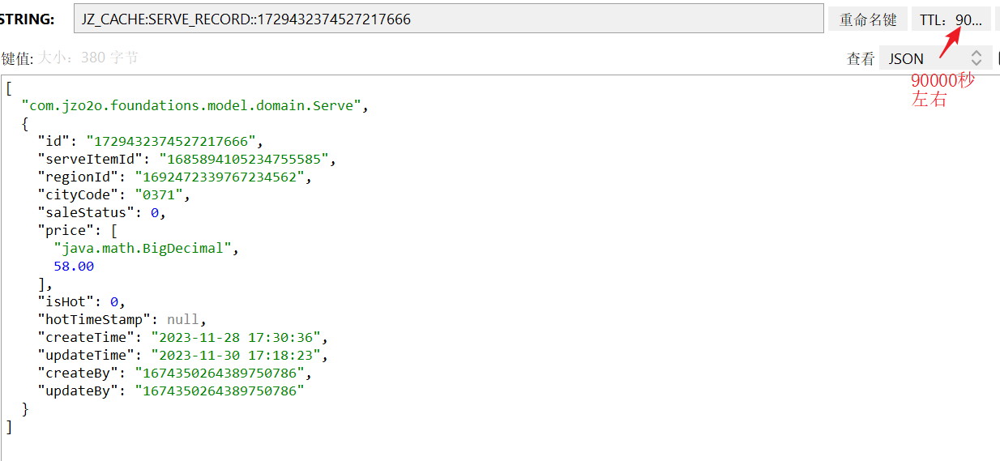
> 图注：这张图片展示了Redis缓存的相关数据，缓存键值为JZ_CACHE_RECORD:1729432374527217666，大小为380字节，键值内容是符合JSON格式的Java对象序列化数据，包含id、serveItemId等字段，其中price字段值为50.00。图片中明显标注了缓存的存活时间（TTL）为90000秒左右，结合上下文可知，这对应缓存技术方案中设置的缓存时间，验证了配置的缓存管理器生效，且因加入随机数使缓存有效期约为一天。

由于缓存时间加了随机数，缓存一天的时间为90000秒左右。

关于缓存时间加随机数的原因稍后讲解。


##### 6）工作原理

Spring Cache是基于AOP原理，对添加注解@Cacheable的类生成代理对象，在方法执行前查看是否有缓存对应的数据，如果有直接返回数据，如果没有调用源方法获取数据返回，并缓存起来，下边跟踪Spring Cache的切面类CacheAspectSupport.java中的private Object execute(final CacheOperationInvoker invoker, Method method, CacheOperationContexts contexts)方法。

如下图：

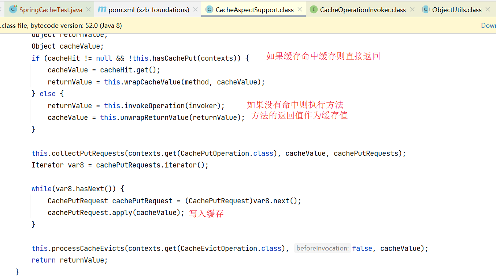
> 图注：这张图片展示了Spring Cache切面类`CacheAspectSupport.java`中`execute`方法的代码片段，是对应Spring Cache入门程序工作原理的代码示例。代码里通过条件判断实现缓存逻辑：当`cacheHit`不为空且存在缓存put操作时，会直接返回缓存值，也就是命中缓存的情况；若未命中缓存，则会调用执行方法，以方法的返回值作为缓存值。后续代码还涉及缓存请求的遍历写入操作，以及处理缓存失效相关操作并最终返回处理结果。

下边打断点调试：

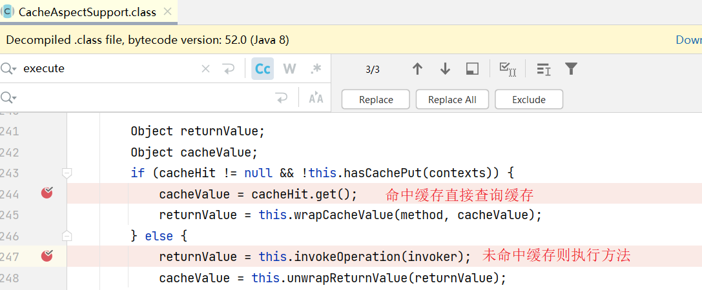
> 图注：这张图片展示的是 decompiled 后的 CacheAspectSupport.class 文件的代码界面，对应的是 Spring Cache 切面类的相关代码。代码中清晰标注了分支逻辑，当缓存命中（cacheHit 不为空且存在缓存放置的情况）时，会直接查询缓存获取对应数据；当未命中缓存时，则会执行目标方法。该图片用于辅助说明 Spring Cache 的工作原理，即基于 AOP 实现的缓存逻辑，对应了文档中对 execute 方法的跟踪说明，同时配合后续断点调试的内容，直观呈现了缓存命中与未命中时的不同处理流程。

分别测试命中缓存和未命中缓存的情况。

第一次查询（redis中没有缓存）时执行方法查询数据库，第二次命中缓存直接查询redis不再执行方法。

##### 7）小结

Spring Cache 用在项目哪里了？怎么用的？


Spring Cache @Cacheable 注解的工作原理？


#### 2.2.2 测试Spring Cache

目标：学会使用@CacheEvict和@CachePut注解

在Spring Cache入门中使用了@Cacheable 注解，它实现的是查询时进行缓存。

下边测试另外两个常用 的注解，如下：

@CacheEvict：用于删除缓存，将一条或多条数据从缓存中删除。  
@CachePut：用于更新缓存，将方法的返回值放到缓存中

其它注解在项目开发中用到时再进行讲解，也可以自行查阅资料测试。

##### 1）测试@CachePut

CachePut注解实现的是将方法的返回值放到缓存中。

在服务上架后会将区域服务的信息写入缓存，服务下架会从缓存删除，下边我们实现服务上架将服务写入缓存。

找到服务上架的方法，在方法上添加@CachePut注解：

```Java
@Override
@Transactional
@CachePut(value = RedisConstants.CacheName.SERVE, key = "#id",  cacheManager = RedisConstants.CacheManager.ONE_DAY)
public Serve onSale(Long id){
....
```

上边代码同样指定了缓存名称、缓存key及缓存管理器（缓存过期时间为一天）。

重启foundation服务通过界面操作上架：

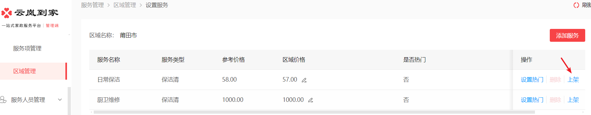
> 图注：这张图片展示的是云岚到家一站式家政服务平台管理端的设置服务界面，处于服务管理下的区域管理页面，当前区域名称为莆田市。界面内列有已登记的服务信息，包括服务名称、服务类型、参考价格、区域价格、是否热门等内容，操作栏对“日常保洁”“厨卫维修”两项服务都设置了“设置热门”“删除”“上架”的操作选项，其中红色箭头指向的是厨卫维修服务对应的“上架”选项，该界面对应文档中重启foundation服务后通过界面操作完成服务上架的环节。

测试成功查看redis是否写入缓存：

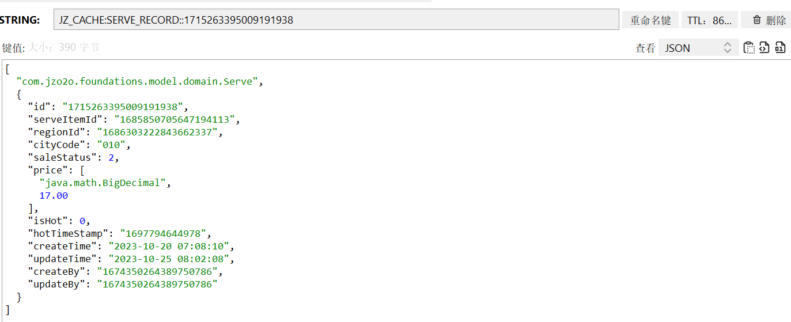
> 图注：这张图片展示了Redis缓存中存储的一条键名为JZ_CACHE:SERVE_RECORD:17152633950091938的缓存数据，该缓存为上架服务后写入的服务记录。缓存值为JSON格式，包含服务的id、服务类型ID、区域ID、城市编码、销售状态、价格、是否热门、创建时间、更新时间等字段。这条缓存正是文档中测试Spring Cache的@CachePut注解功能后，写入Redis的服务上架记录，其缓存过期时间设置为一天，和上下文所提及的测试内容完全对应。


##### 2）测试@CacheEvict

下边测试服务下架删除缓存。

找到服务下架的方法，添加@CacheEvict注解

```Java
@Override
@Transactional
@CacheEvict(value = RedisConstants.CacheName.SERVE, key = "#id")
public Serve offSale(Long id){
....
```

这里是删除缓存所以不用再指定缓存管理器。

重启foundation服务通过界面操作下架：

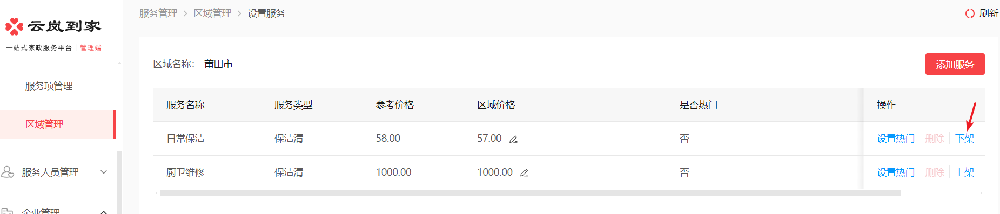
> 图注：这张图片展示了“云岚到家”家政服务平台的服务管理页面，具体为区域管理下莆田市的服务设置界面，页面中列出了日常保洁、厨卫维修两项服务的相关信息。在操作列中，日常保洁服务对应的“下架”按钮被红色箭头明确标注出来，该按钮的功能与上下文提到的通过界面操作下架服务的内容相呼应，用于完成前文所述的服务下架操作，页面右上角还有刷新与添加服务的相关选项。


##### 3）小结

Spring Cache有哪些常用的注解，都有什么用？

@EnableCaching：开启缓存注解功能

@Cacheable：查询数据时缓存，将方法的返回值进行缓存。  
@CacheEvict：用于删除缓存，将一条或多条数据从缓存中删除。  
@CachePut：用于更新缓存，将方法的返回值放到缓存中  
@Caching：组合多个缓存注解；  


### 2.3 高并发项目缓存常见问题复习

#### 1）缓存穿透问题

什么是缓存穿透？如何解决缓存穿透？

什么是布隆过滤器？如何使用布隆过滤器？

本项目使用缓存空值或特殊值的方法去解决缓存穿透。


#### 2）缓存击穿问题

什么是缓存击穿？如何解决缓存击穿？

本项目对热点数据定时预热，使用定时任务刷新缓存保证缓存永不过期，解决缓存穿透问题。

#### 3) 缓存雪崩问题

什么是缓存雪崩？如何解决缓存雪崩？

本项目对key设置不同的过期时间解决缓存雪崩问题。


#### 4）缓存不一致问题

如何保证缓存一致性？


## 3 小程序首页缓存实现

### 3.1 开通区域列表缓存实现

目标：

能说出项目中的缓存方案。

实现开通区域列表缓存（完成查询缓存、删除缓存）。

#### 1）缓存方案分析

根据本项目门户的需求可知共有以下几块信息需要缓存，如下：

<sheet sheet-id="FE3CuB" token="ZqC7sSupJhiXN1t6KRjcp1JxndT"></sheet>

下边分析第一个开通区域列表的缓存方案：

查询缓存：查询已开通区域列表，如果没有缓存则查询数据库并将查询结果进行缓存，如果存在缓存则直接返回

启用区域：删除开通区域信息缓存（再次查询将缓存新的开通区域列表）。

禁用区域：删除开通区域信息缓存，删除该区域下的其它缓存信息，包括：首页服务列表，服务类型列表，热门服务列表。

定时任务：每天凌晨缓存已开通区域列表。


#### 2）查询缓存实现

下边我们先实现开通区域列表查询缓存。

首先把测试环境准备好：

启动jzo2o-gateway

启动jzo2o-publics

启动jzo2o-customer（如果前端已经通过小程序认证可以不用启动）

启动jzo2o-foundations

打开小程序开发工具

打开小程序，点击首页左上角的地址进入服务地址城市选择页面，如下图：


> 图注：这是云岚到家小程序的服务地址选择界面，背景为红色，顶部显示小程序名称。界面上方设有地址选择栏，当前选中的地址为“北京市”，且有一个红色箭头明确指向该地址选项；选择栏右侧还显示有“石湾保洁”字样。界面下方展示了新人优惠活动，内容为全屋除菌保洁3次低至459元，配有相关服务说明与“立即抢购”按钮，右侧还有一名戴清洁手套的女性形象，整体为小程序首页的地址选择与促销展示页面。

在定位界面显示已开通城市列表，已开通城市是指在区域管理中所有启用的区域信息，如下图：


> 图注：图片展示的是小程序首页“选择服务地址”页面。页面左上角有返回按钮，右上角有定位和刷新图标。当前城市显示为北京市，下方有“热门城市”区域，北京被选中。已开通的城市区域中，北京市和郑州市被列出。该图片与文档中“查询缓存实现”部分上下文相关，用于说明在小程序开发工具中打开小程序，点击首页左上角地址进入服务地址城市选择页面后，定位界面显示已开通城市列表的情况。


跟踪Network找到开通区域列表的URL:/foundations/consumer/region/activeRegionList

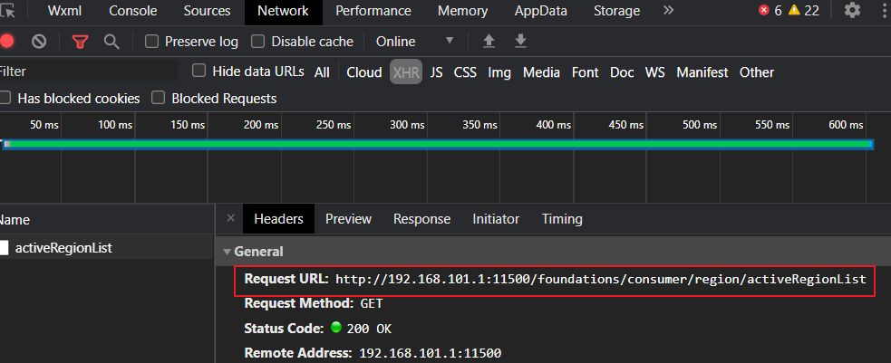
> 图注：这张图片展示了浏览器开发者工具的Network界面，其中的请求列表里显示了名称为activeRegionList的请求，该请求的URL被红色框突出标注，具体为http://192.168.101.1:11500/foundations/consumer/region/activeRegionList，属于GET请求，对应的响应状态码为200 OK，与文档中提到的开通区域列表接口URL完全匹配，用于跟踪小程序开通区域列表的对应请求信息。

打开jzo2o-foundations工程，根据接口地址找到具体的代码:

找到接口：

```JSON
package com.jzo2o.foundations.controller.consumer;


import com.jzo2o.api.foundations.dto.response.RegionSimpleResDTO;
import com.jzo2o.foundations.service.IRegionService;
import io.swagger.annotations.Api;
import io.swagger.annotations.ApiOperation;
import org.springframework.web.bind.annotation.GetMapping;
import org.springframework.web.bind.annotation.RequestMapping;
import org.springframework.web.bind.annotation.RestController;

import javax.annotation.Resource;
import java.util.List;

/**
 * <p>
 * 区域表 前端控制器
 * </p>
 *
 * @author itcast
 * @since 2023-07-03
 */
@RestController("consumerRegionController")
@RequestMapping("/consumer/region")
@Api(tags = "用户端 - 区域相关接口")
public class RegionController {
    @Resource
    private IRegionService regionService;

    @GetMapping("/activeRegionList")
    @ApiOperation("已开通服务区域列表")
    public List<RegionSimpleResDTO> activeRegionList() {
        return regionService.queryActiveRegionListCache();
    }

}
```


找到service方法如下：

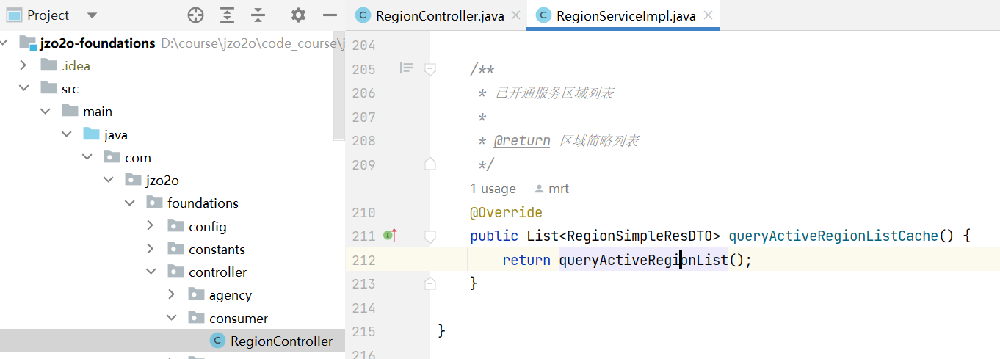
> 图注：这张图片展示了项目开发的代码界面，左侧是jzo2o-foundations工程的目录结构，其中定位到com.jzo2o.foundations.consumer路径下的RegionController类文件。右侧是RegionServiceImpl类的代码编辑区域，显示了重写的queryActiveRegionListCache方法，该方法的功能是返回已开通服务区域的区域简略列表。该代码上下文对应文档中查询缓存实现的开发步骤，是查找并确认与开通区域列表接口相关的service方法的具体代码内容，和文档中查找对应接口service方法的操作要求相匹配。

在service方法上添加Spring cache注解：

```Java
@Override
@Cacheable(value = RedisConstants.CacheName.JZ_CACHE, key = "'ACTIVE_REGIONS'", cacheManager = RedisConstants.CacheManager.FOREVER)
public List<RegionSimpleResDTO> queryActiveRegionListCache() {
    return queryActiveRegionList();
}
```

说明： 

key: 当key用一个固定字符串时需要在双引号中用单引号括起来，如下所示：

```Java
key = "'ACTIVE_REGIONS'"
```

cacheManager ：RedisConstants.CacheManager.FOREVER设置了缓存永不过期。

重启jzo2o-foundations工程进行测试。

通过小程序访问定位界面，观察Network：

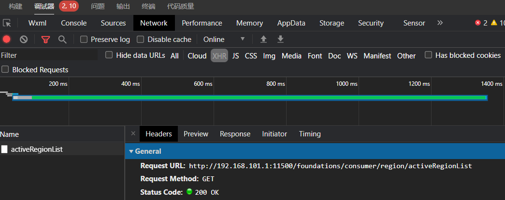
> 图注：图片展示的是小程序开发工具调试器的Network界面。界面中显示了请求的URL为http://192.168.101.1:11500/foundations/consumer/region/activeRegionList，请求方法为GET，状态码为200 OK。该图片与文档中“通过小程序访问定位界面，观察Network”内容对应，用于直观呈现通过小程序访问定位界面后，Network界面中接口请求成功及状态码正常的情况，辅助说明开通区域列表缓存实现的相关测试结果。

/foundations/consumer/region/activeRegionList接口请求成功。

观察redis成功缓存开通区域列表：

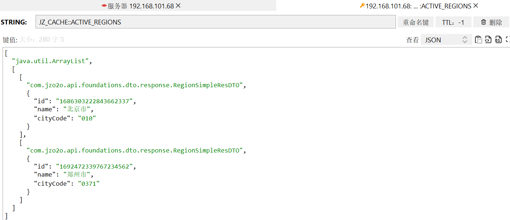
> 图注：图片展示的是Redis成功缓存的开通区域列表数据。界面显示服务器为192.168.101.68，键值为“IZ_CACHE:ACTIVE_REGIONS”，大小为280字节，TTL为-1。数据内容为两个RegionSimpleResDTO对象，分别对应北京和郑州，包含id、name和cityCode属性。该图片与上文介绍的在小程序首页开通区域列表缓存实现中，通过小程序访问定位界面观察redis成功缓存开通区域列表的内容相呼应，直观呈现了缓存数据。

#### 3）启用区域

启用一个新区域已经开通区域列表需要变更，该如何实现呢？

启用区域后删除已开通区域列表缓存，当去查询开通区域列表时重新缓存最新的开通区域列表。

可通过接口文档（http://localhost:11509/foundations/doc.html）找到启用区域的接口，如下：


接口的代码如下：

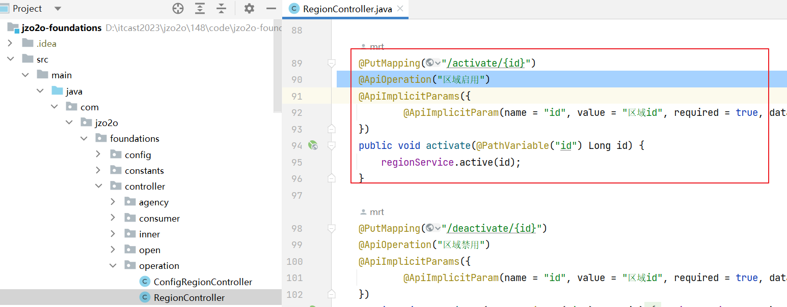
> 图注：这张图片展示了Java项目的代码界面，具体是名为RegionController的控制器类代码。其中核心部分为用红色框标注的启用区域相关接口代码，该代码的接口路径为"/activate/{id}"，对应ApiOperation注解标注的功能为"区域启用"，还定义了名为"id"的路径参数，方法名为activate，方法内部调用了regionService.active方法，该代码是文档中提到的启用区域接口的实现代码，实现了启用区域后删除开通区域列表缓存的相关功能。

找到service代码，修改如下：

```Java
/**
 * 区域管理
 *
 * @author itcast
 * @create 2023/7/17 16:50
 **/
@Service
public class RegionServiceImpl extends ServiceImpl<RegionMapper, Region> implements IRegionService {

/**
 * 区域启用
 *
 * @param id 区域id
 */
@Override
@CacheEvict(value = RedisConstants.CacheName.JZ_CACHE, key = "'ACTIVE_REGIONS'")
public void active(Long id) {
......
```

稍后测试。


#### 4）禁用区域

如果是禁用一个区域则需要删除开通区域列表缓存。

找到禁用区域的代码，修改如下：

```Java
   /**
 * 区域管理
 *
 * @author itcast
 * @create 2023/7/17 16:50
 **/
@Service
public class RegionServiceImpl extends ServiceImpl<RegionMapper, Region> implements IRegionService {

    @Override
    @Caching(evict = {
            @CacheEvict(value = RedisConstants.CacheName.JZ_CACHE, key = "'ACTIVE_REGIONS'")
//            todo:删除首页服务列表缓存
    })
    public void deactivate(Long id) {
    ......
```

禁用区域除了删除开通区域列表还需要删除首页服务列表、热门服务列表等，所以这里使用@Caching注解。

#### 5）测试

下边进行测试：

首先重启foundations服务。

启动运营管理（前端）进行测试。

测试禁用区域，找一个区域将区域下边服务全部下架，然后禁用该区域

最初有两个开通区域：

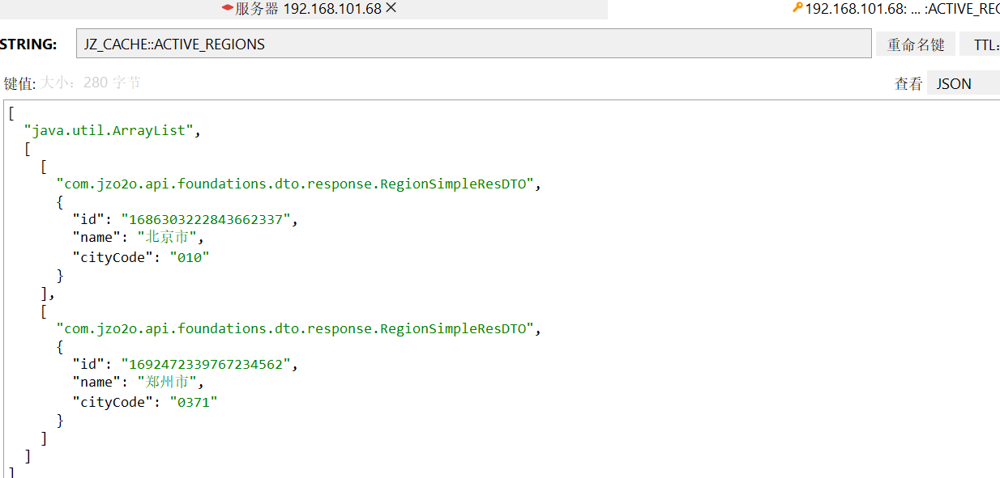
> 图注：这是一个显示缓存信息的界面截图，对应文档中3.1节开通区域列表缓存实现的初始状态内容。截图显示当前查询的是键为JZ_CACHE:ACTIVE_REGIONS的字符串类型缓存，缓存大小为280字节，缓存内容为一个包含两个对象的ArrayList，对象为区域信息，分别是id为168630222843662337、名称为北京市、cityCode为010的区域，以及id为1692472339767234562、名称为郑州市、cityCode为0371的区域，对应文档提及的最初有两个开通区域的内容。

将郑州区域禁用，进入redis查询JZ_CACHE::ACTIVE_REGIONS缓存已经删除。

使用小程序进入定位界面查询开通区域列表，观察redis，缓存了最新的开通区域列表

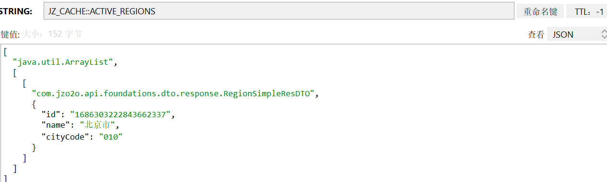
> 图注：图片展示的是Redis中JZ_CACHE::ACTIVE_REGIONS缓存的键值内容。键值大小为152字节，类型为java.util.ArrayList，包含一个元素，元素类型为com.jzo2o.api.foundations.dto.response.RegionSimpleResDTO，包含id、name、cityCode三个属性，id为1686303222843662337，name为北京市，cityCode为010。该图片与上文测试启用区域后，使用小程序进入定位界面查询开通区域列表，观察redis缓存最新开通区域列表的内容相关，直观呈现了redis缓存的结构与数据。


测试启用区域，找一个区域添加服务并上架然后启用这个区域。

下边启用区域“郑州”，启动用区域后再次查询开通区域列表，redis缓存了最新的开通区域列表：


> 图注：图片展示的是Redis中JZ_CACHE::ACTIVE_REGIONS缓存的内容。键值为“java.util.ArrayList”，包含两个“com.jz20.api.foundations.dto.response.RegionSimpleResDTO”对象，分别对应北京和郑州的区域信息，包括id、name和cityCode。该图片与上文测试启用区域后查询开通区域列表的内容相关，直观呈现了redis缓存了最新的开通区域列表，验证了缓存方案的正确性。


#### 6）小结

项目哪里进行了缓存，缓存方案是什么？

项目中如何保证缓存的一致性？


### 3.2 定时任务更新缓存

#### 3.2.1 配置XXL-JOB环境

对于开通区域列表的缓存数据需要由定时任务每天凌晨更新缓存，我们使用xxl-job实现。


##### 1) **启动xxl-job**

执行docker start xxl-job-admin 启动xxl-job

访问：http://192.168.101.68:8088/xxl-job-admin/

账号和密码：admin/123456


##### 2) 执行器

**1.添加执行器依赖**

本项目在framework中定义了jzo2o-xxl-job工程，它对执行器bean执行了定义：

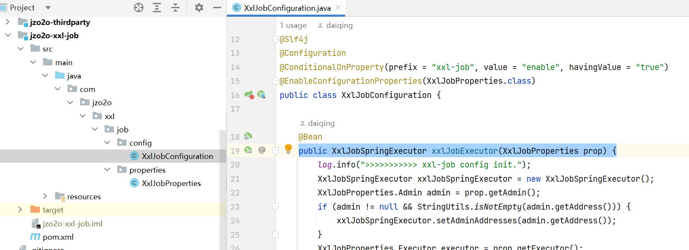
> 图注：图片展示了jzo2o-xxl-job项目中XxJobConfiguration.java文件的部分代码。代码中定义了XxJobSpringExecutor类，其构造函数接收XxlJobProperties参数。代码还包含对Admin和Executor属性的初始化逻辑。该图片与文档中“2)执行器”部分内容相关，是对jzo2o-xxl-job工程中对执行器bean执行定义的代码示例，帮助理解执行器bean的实现情况。

所以在需要使用xxl-job的微服务中需要引入下边的依赖，在jzo2o-foundations服务中引入下边的依赖：

```Java
<dependency>
    <groupId>com.jzo2o</groupId>
    <artifactId>jzo2o-xxl-job</artifactId>
</dependency>
```

**2.配置xxl-job**

接下来进入nacos，配置shared-xxl-job.yaml：

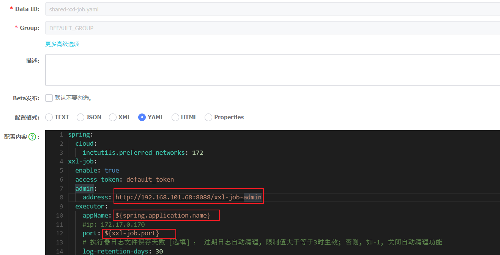
> 图注：图片展示的是nacos中执行器管理界面下的配置界面。界面中显示了配置内容，包含spring、cloud、xxl - job等配置项，其中xxl - job配置项下有address、executor、appname、port等参数。address参数值为http://192.168.101.68:8088/xxl - job - admin，executor参数值为${spring.application.name}，port参数值为172.17.0.170。该图片与上文配置xxl - job的内容相关，用于说明在nacos中配置执行器时的参数设置情况。

说明：

address：调度中心的地址

appName：执行器名称，为spring.application.name表示微服务的名称（在bootstrap.yml中配置）

port：执行器端口号,通过xxl-job.port配置


在jzo2o-foundations.yaml中配置执行器的端口：

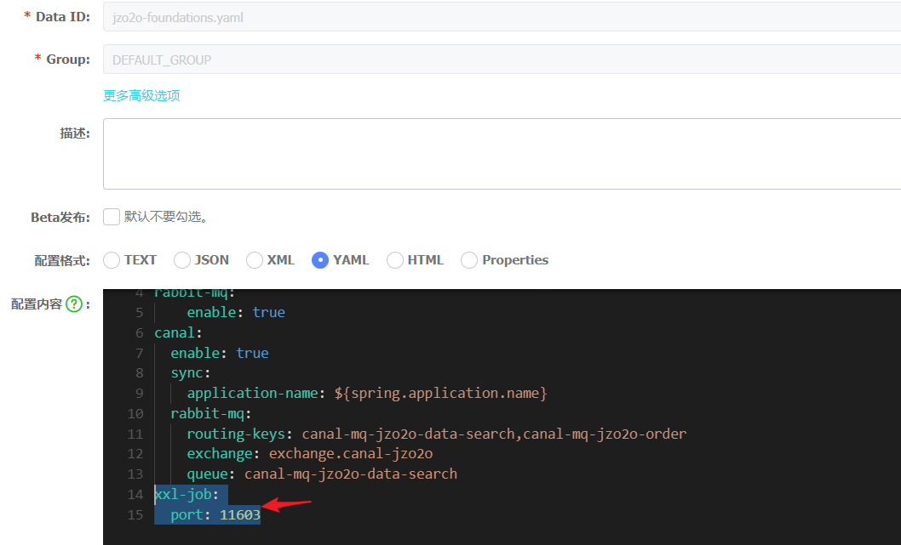
> 图注：该图片展示了jzo2o-foundations.yaml文件的配置页面，Data ID为jzo2o-foundations.yaml，所属Group为DEFAULT_GROUP，配置格式选择YAML。配置内容中，在canal与rabbit-mq相关配置项的下方，明确标注了xxl-job的端口为11603，端口数值由红色箭头和蓝色背景突出标识，该配置项对应执行器端口号的设定要求，是在jzo2o-foundations服务中配置xxl-job执行器的关键内容，用于完成xxl-job环境配置中执行器端口的设置。


在jzo2o-foundations中加载shared-xxl-job.yaml：

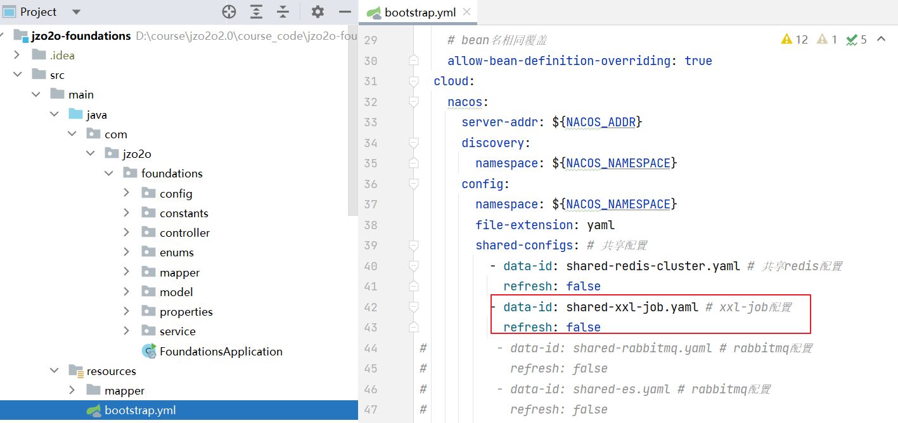
> 图注：这张图片展示了jzo2o-foundations服务下的bootstrap.yml配置文件内容，其中明确标注了共享配置的相关设置，在多个data-id配置项中，被红框重点标注出了“shared-xxl-job.yaml”这一配置项，其对应的refresh属性值为false。该配置是定时任务更新缓存环节中，对XXL-JOB的关键配置内容，它在nacos的相关配置里，用于引入XXL-JOB的配置文件，同时该配置项的refresh设置为false，可避免不必要的配置刷新，是实现XXL-JOB执行器配置加载的重要环节。


**3. 下边进入调度中心添加执行器**

进入调度中心，进入执行器管理界面，如下图：

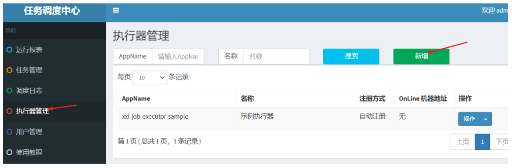
> 图注：这张图片展示的是XXL-JOB任务调度中心的执行器管理界面，左侧导航栏里“执行器管理”选项被红色箭头标注，处于选中状态；界面右上方有一个被红色箭头指向的绿色“新增”按钮，用于添加执行器。界面内还显示了已有的一条执行器信息，其AppName为xxl-job-executor-sample，名称为示例执行器，注册方式为自动注册，在线机器地址为无，页面底部提供了分页操作控件，当前处于第1页。

点击新增，填写执行器信息

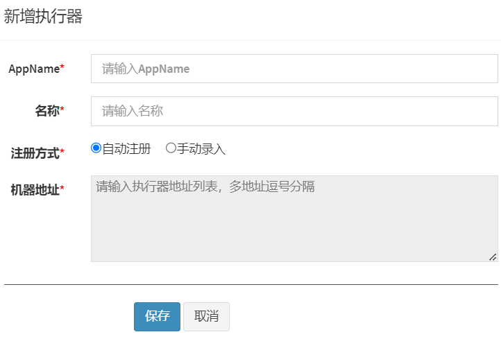
> 图注：图片展示的是XXL-JOB调度中心新增执行器界面。界面上方标题为“新增执行器”。下方有必填项，包括“AppName”需输入执行器名称，对应shared-xxl-job.yaml中执行器名称；“名称”需输入执行器名称；“注册方式”有自动注册和手动录入两个选项，当前选中自动注册；“机器地址”需输入执行器地址列表，多地址用逗号分隔。界面底部有“保存”和“取消”按钮。该图片与文档中配置XXL-JOB环境、进入调度中心添加执行器的上下文相关，用于指导用户在调度中心新增执行器时填写相关信息。

**AppName**：执行名称，在shared-xxl-job.yaml中指定执行器名称就是微服务的应用名。

**名称**：取一个中文名称。

**注册方式**：自动注册，只要执行器和调度中心连通执行器会自动注册到调度中心

**机器地址**：自动注册时不用填写。


找到应用名：jzo2o-foundations，如下图：

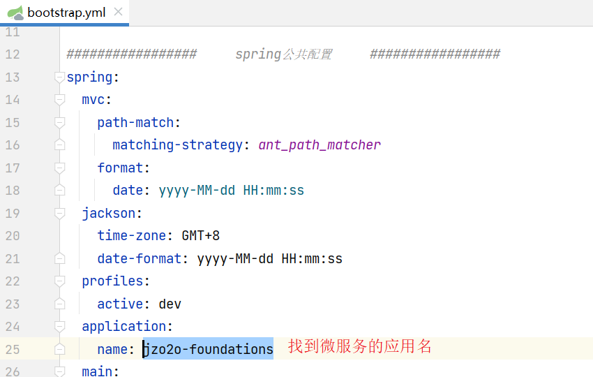
> 图注：图片展示了jzo2o-foundations微服务的bootstrap.yml配置文件内容。其中，第25行“name: jzo2o - foundations”被高亮显示，对应上文“找到微服务的应用名”的操作，表明在该配置文件中找到了微服务的应用名“jzo2o - foundations”。此图片与上文配置XXL - JOB环境，执行器启动成功后查看控制台，找到应用名“jzo2o - foundations”的内容紧密相关，用于辅助理解应用名的查找位置。


添加成功：

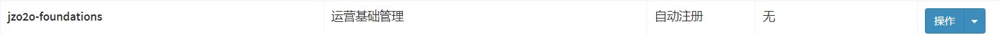
> 图注：该图片展示的是XXL-JOB环境配置中添加执行器成功后的界面内容，画面包含四项信息，从左到右依次为应用名“jzo2o-foundations”、所属模块“运营基础管理”、注册方式“自动注册”以及状态标识“无”，最右侧带有标注“操作”的下拉按钮。这一界面内容对应文档中“配置XXL-JOB环境”环节里执行器添加成功的结果，后续将启动jzo2o-foundations应用，通过查看控制台日志确认执行器启动成功，其中日志会包含“xxl-job remoting server start success”及端口号11603的提示信息。

启动jzo2o-foundations，查看jzo2o-foundations的控制台：

\>>>>>>>>>>> xxl-job remoting server start success, nettype = class com.xxl.job.core.server.EmbedServer, port = 11603 说明执行器启动成功。

稍等片刻进入 xxl-job调度中心，进入执行器管理界面，执行器注册成功：


> 图注：图片展示的是xxl-job调度中心执行器管理界面。界面中列出了执行器名称“jzo2o-foundations”、所属应用“运营基础管理”、注册状态为“自动注册”，并有“查看（1）”按钮，该按钮被红色箭头指向。点击“查看（1）”可查看执行器地址，若无法调通，可手动修改执行器地址http://192.168.101.1:11603/。此图与上文配置XXL-JOB环境、启动jzo2o-foundations及查看执行器地址的操作步骤相关，用于指导查看执行器地址的操作。

点击“查看（1）”，查看执行器的地址，如下图：

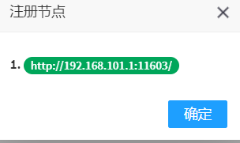
> 图注：图片展示的是xxl-job调度中心执行器管理界面中“查看”操作后的结果。画面中显示“注册节点”字样，下方有1条记录，地址为http://192.168.101.1:11603/，该地址被绿色框突出显示。画面右下角有一个蓝色的“确定”按钮。此图与上文提到的启动jzo2o-foundations后，进入xxl-job调度中心查看执行器地址的操作相关，用于展示执行器地址的具体内容。

如果无法调通，可手动修改执行器地址 http://192.168.101.1:11603/

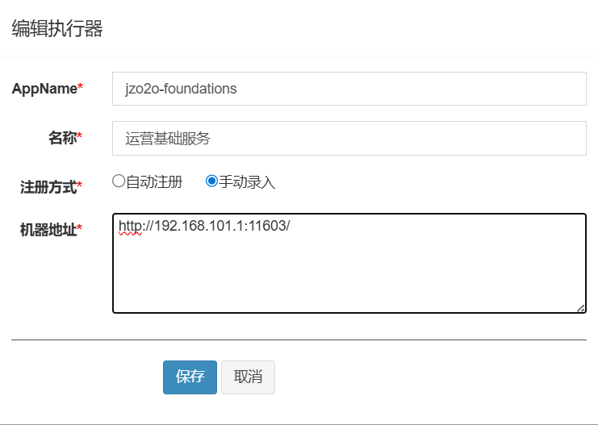
> 图注：这张图片是xxl-job调度中心的“编辑执行器”界面，对应文档中配置XXL-JOB环境时的相关操作场景。界面中已填写的信息包括：AppName为“jzo2o-foundations”，名称为“运营基础服务”，注册方式选择了“手动录入”，机器地址栏填写的是“http://192.168.101.1:11603/”，底部设有“保存”和“取消”按钮。该界面用于配置执行器的相关参数，与文档中提到的执行器注册、地址配置的内容直接对应，可手动完成执行器的地址修改与信息配置。


#### 3.2.2 定义缓存更新任务

根据本节的目标，使用xxl-job定时更新开通区域列表的缓存。

##### 1）编写任务方法

下边编写更新开通区域列表缓存的任务方法：

先删除开通区域的缓存，再查询开通区域列表进行缓存。

```Java
package com.jzo2o.foundations.handler;

import com.jzo2o.foundations.constants.RedisConstants;
import com.jzo2o.foundations.service.IRegionService;
import com.jzo2o.foundations.service.IServeService;
import com.xxl.job.core.handler.annotation.XxlJob;
import lombok.extern.slf4j.Slf4j;
import org.springframework.data.redis.core.RedisTemplate;
import org.springframework.stereotype.Component;

import javax.annotation.Resource;

/**
 * springCache缓存同步任务
 *
 * @author itcast
 * @create 2023/8/15 18:14
 **/
@Slf4j
@Component
public class SpringCacheSyncHandler {

    @Resource
    private IRegionService regionService;
    @Resource
    private RedisTemplate redisTemplate;

    /**
     * 已启用区域缓存更新
     * 每日凌晨1点执行
     */
    @XxlJob(value = "activeRegionCacheSync")
    public void activeRegionCacheSync() {
        log.info(">>>>>>>>开始进行缓存同步，更新已启用区域");
        //1.清理缓存
        String key = RedisConstants.CacheName.JZ_CACHE + "::ACTIVE_REGIONS";
        redisTemplate.delete(key);

        //2.刷新缓存
        regionService.queryActiveRegionListCache();
        log.info(">>>>>>>>更新已启用区域完成");
    }

}
```


##### 2）配置任务

下边在调度中心配置任务。

进入任务管理，新增任务：

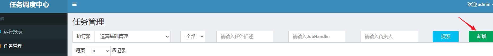
> 图注：图片展示的是任务调度中心的任务管理界面。界面上方有“任务调度中心”标题，左侧导航栏有“任务管理”选项。任务管理区域有“执行器”“运营基础管理”等下拉选项，下方有“每页”“条记录”设置，右侧有“搜索”“新增”按钮，其中“新增”按钮被红色箭头指向。该图片与文档中“进入任务管理，新增任务”的内容对应，是新增任务操作的界面展示。

填写任务信息：

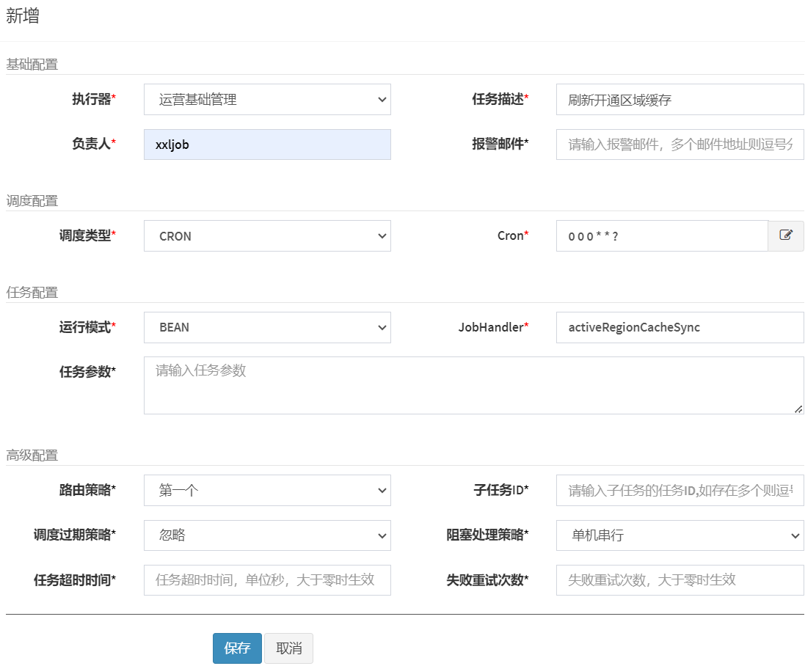
> 图注：图片展示的是任务管理中新增任务的界面。执行者为运营基础管理，负责人是xxjob，任务描述为刷新开通区域缓存，Cron为0 0 * * *，调度类型为CRON，通行模式为BEAN，JobHandler为activeRegionCacheSync，任务参数为空。高级配置中路由策略为第一个，调度过期策略为忽略，任务超时时间为0，子任务ID、阻塞处理策略、失败重试次数等均为默认值。该图片与文档中定义缓存更新任务的内容相关，是新增任务时填写的配置信息示例。


##### 3）启动任务并测试

任务配置完成，下边启动任务

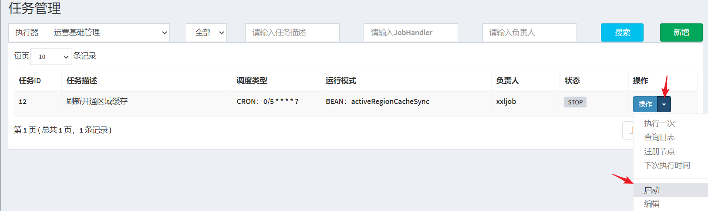
> 图注：图片展示的是任务管理界面。界面中有任务ID、任务描述、调度类型、运行模式、负责人、状态、操作等列。任务ID为12，任务描述为“刷新开通区域缓存”，调度类型为CRON，运行模式为BEAN，负责人是xxljob，状态为STOP。操作列有“操作”下拉菜单，显示“执行一次”“查询日志”“注册节点”“下次执行时间”等选项，其中“启动”选项被红色箭头指向。

启动成功：

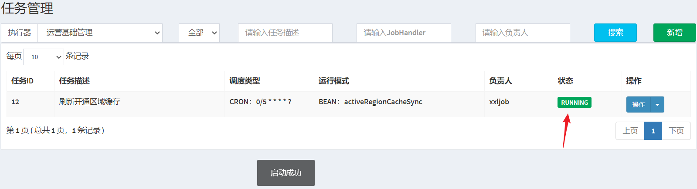
> 图注：图片展示的是任务管理界面，任务ID为12，任务描述为“刷新开通区域缓存”，调度类型为CRON，运行模式为BEAN，负责人是xxijob，状态为RUNNING。界面右下角显示“启动成功”。图片与上文“启动任务并测试”内容相关，直观呈现了任务配置完成并启动成功后，任务状态为RUNNING的情况，辅助说明了任务执行状态。

我们在任务方法上打断点跟踪，任务方法被执行，如下图：

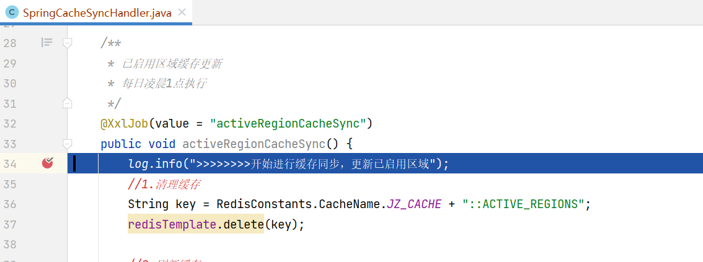
> 图注：这张图片展示的是Java代码文件SpringCacheSyncHandler.java的内容，对应小程序定时更新缓存的任务方法相关代码。代码中定义了名为activeRegionCacheSync的方法，用于已启用区域缓存的更新，被@XxlJob注解标注，该任务每日凌晨1点执行。方法内有一条带箭头的高亮注释，对应34行代码，显示打印日志的语句；还包含清理缓存的相关逻辑，通过RedisConstants.CacheName定义键，调用RedisTemplate的delete方法删除对应缓存键，符合任务启动后执行缓存同步更新的测试场景。

尝试启用或禁用一个区域，观察redis中开通区域列表缓存是否更新。

##### 4) 小结

项目中哪里用了xxl-job？怎么用的？


### 3.2 首页服务列表实现

我们先实现从数据库查询"首页服务列表"，将整体功能调试通过，再实现查询缓存。

下边我们先实现从数据库查询服务类型列表。

#### 3.2.1 首页服务列表实现

##### 1) 需求分析

**1.界面原型**

首页服务列表在门户的中心位置，下图红框中为首页服务列表区域：

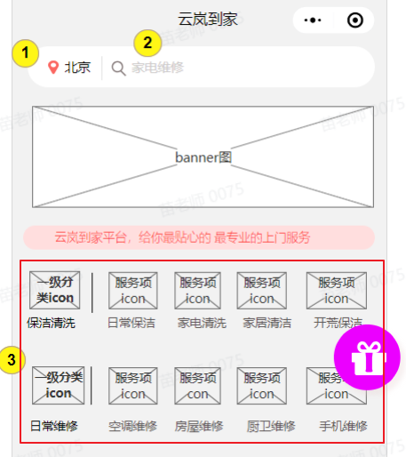
> 图注：图片展示了小程序首页服务列表区域。红框内为首页服务列表，包含一级分类“保洁清洗”“日常维修”等，每个分类下有对应的服务项图标及名称，如“日常保洁”“空调维修”等。图片与上下文紧密相关，直观呈现了首页服务列表的展示样式，与文档中对首页服务列表需求分析中界面原型的描述相契合，帮助理解默认展示内容及样式。

默认展示前两个服务分类（按后台设置的排序字段进行升序排序），每个服务分类下取前4个服务项（按后台设置的排序字段进行升序排序）如下图：

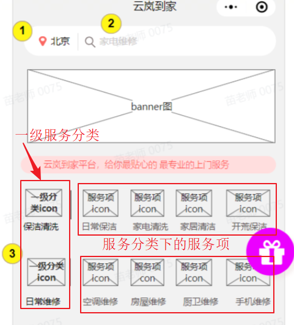
> 图注：该图为“云岚到家”小程序首页的服务列表界面，页面上方设有定位显示、搜索栏与banner图，其中心区域为首页服务列表部分，分为两类展示内容：左侧红框标注的是一级服务分类，显示有“保洁清洗”“日常维修”的服务分类名称与对应图标，每个一级分类旁带有编号标注；右侧红框标注的是对应服务分类下的服务项，每个分类下展示4个服务项及对应图标，如保洁清洗类对应日常保洁、家电清洗等服务项，日常维修类对应空调维修、房屋维修等服务项，整体符合文档所述“一级服务分类显示图标与名称，每个分类下取前4个服务项”的设定。

一级服务分类显示的内容：服务分类的图标，服务分类的名称。

服务分类下的服务项内容：服务项图标，服务项名称。

##### 2）**接口定义**

定义首页服务列表接口，查询2个一级服务分类，每个服务分类下查询4个服务项。

接口名称：首页服务列表

接口路径：**GET**/foundations/customer/serve/firstPageServeList


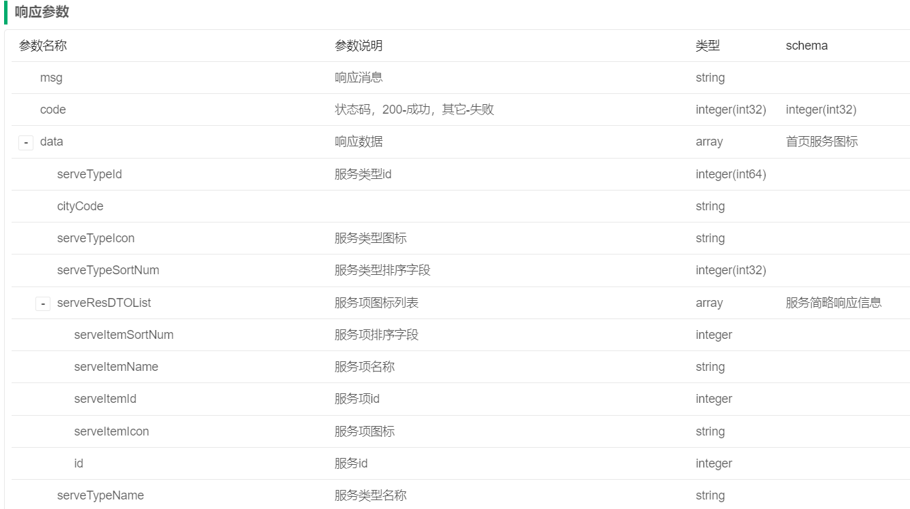
> 图注：该图片展示的是小程序首页服务列表接口的响应参数定义内容，响应参数分为不同层级，顶层包含msg、code、data参数，其中msg为响应消息的字符串类型参数，code为表示请求状态（200为成功、其余为失败）的整数类型参数，data为承载具体服务数据的数组类型参数；data下的serveResDTOList数组为服务项数据列表，其包含服务类型id、城市代码、服务类型图标等基础参数，以及服务项排序字段、服务项名称、服务项id、服务项图标、服务id、服务类型名称等服务项相关参数，清晰呈现了该接口返回的具体数据结构。

响应示例：

```Java
{
        "msg": "OK",
        "code": 200,
        "data": [
                {
                        "serveTypeId": 0,
                        "cityCode": "",
                        "serveTypeIcon": "",
                        "serveTypeSortNum": 0,
                        "serveResDTOList": [
                                {
                                        "serveItemSortNum": 0,
                                        "serveItemName": "",
                                        "serveItemId": 0,
                                        "serveItemIcon": "",
                                        "id": 0
                                }
                        ],
                        "serveTypeName": ""
                }
        ]
}
```

定义controller方法：

门户信息查询类接口统一在FirstPageServeController类中定义，service统一写在HomeService下。

定义FirstPageServeController 类提供门户界面查询类接口。

```Java
package com.jzo2o.foundations.controller.consumer;

...

/**
 * <p>
 * 前端控制器
 * </p>
 *
 * @author itcast
 * @since 2023-07-03
 */
@RestController("consumerServeController")
@RequestMapping("/customer/serve")
@Api(tags = "用户端 - 首页服务查询接口")
public class FirstPageServeController {

@GetMapping("/firstPageServeList")
@ApiOperation("首页服务列表")
@ApiImplicitParams({
        @ApiImplicitParam(name = "regionId", value = "区域id", required = true, dataTypeClass = Long.class)
})
public List<ServeCategoryResDTO> serveCategory(@RequestParam("regionId") Long regionId) {
    return null;
}
...
```

##### 3）mapper

数据来源于三张表：serve_type、serve_item、serve，区域id是非常重要的限制条件，因为要查询该区域显示在首页的服务列表。

如何查询数据？

可以先查询出服务类型，再根据服务类型id查询下边的服务项，伪代码如下：

```JSON
//查询服务类型
List<ServeType> serveTypeList =...
for(ServeType serveType: serveTypeList){
      Long serveTypeId = serveType.getId();
     //再根据服务类型id查询下属的服务项信息

}
```

上边的代码会导致1+n次查询数据库，这种代码要避免。

我们可以一次将符合条件的数据查询出来，再通过java程序对数据进行处理，再封装为接口要求的数据格式，最后返回给前端。

在ServeMapper.java中添加如下方法：

```Java
/**
 * 根据区域id查询服务图标
 *
 * @param regionId 区域id
 * @return 服务图标
 */
List<ServeCategoryResDTO> findServeIconCategoryByRegionId(@Param("regionId")Long regionId);
```

下边在ServeMapper.xml中添加如下内容：

```JSON
<select id="findServeIconCategoryByRegionId" resultMap="ServeCategoryMap">
    SELECT
        type.id as serve_type_id,
        type.name as serve_type_name,
        type.serve_type_icon,
        serve.city_code,
        serve.id as serve_id,
        item.id as serve_item_id,
        item.name as serve_item_name,
        item.serve_item_icon,
        item.sort_num as serve_item_sort_num
    FROM
        serve
            inner JOIN serve_item AS item ON item.id = serve.serve_item_id
            inner JOIN serve_type AS type ON type.id = item.serve_type_id
    WHERE
        serve.region_id = #{regionId}
      AND serve.sale_status = 2
    ORDER BY
        type.sort_num,
        item.sort_num
</select>

<!--手动的映射-->
<resultMap id="ServeCategoryMap" type="com.jzo2o.foundations.model.dto.response.ServeCategoryResDTO">
    <!--id映射主键字段-->
    <id column="serve_type_id" property="serveTypeId"></id>
    <!--result映射普通字段-->
    <result column="serve_type_name" property="serveTypeName"></result>
    <result column="serve_type_icon" property="serveTypeIcon"></result>
    <result column="city_code" property="cityCode"></result>

    <!--column 数据库中的字段名-->
    <!--property 实体类中对应的属性 该关键字可以省略... -->
    <!--ofType 是javaType中的单个对象类型-->
    <collection property="serveResDTOList" ofType="com.jzo2o.foundations.model.dto.response.ServeSimpleResDTO">
        <id column="serve_id" property="id"></id>
        <result column="serve_item_id" property="serveItemId"></result>
        <result column="serve_item_name" property="serveItemName"></result>
        <result column="serve_item_icon" property="serveItemIcon"></result>
        <result column="serve_item_sort_num" property="serveItemSortNum"></result>
    </collection>
</resultMap>
```

##### 4）service

定义专门用于门户首页查询的service接口,用于实现查询缓存：

```Java
package com.jzo2o.foundations.service;

...

import java.util.List;

/**
 * 首页查询相关功能
 *
 * @author itcast
 * @create 2023/8/21 10:55
 **/
public interface HomeService {
/**
 * 根据区域id获取服务图标信息
 *
 * @param regionId 区域id
 * @return 服务图标列表
 */
List<ServeCategoryResDTO> queryServeIconCategoryByRegionIdCache(Long regionId);
...
```

定义实现类


```Java
package com.jzo2o.foundations.service.impl;

...

/**
 * 首页查询相关功能
 *
 * @author itcast
 * @create 2023/8/21 10:57
 **/
@Slf4j
@Service
public class HomeServiceImpl implements HomeService {
/**
 * 根据区域id查询已开通的服务类型
 *
 * @param regionId 区域id
 * @return 已开通的服务类型
 */
@Override
public List<ServeCategoryResDTO> queryServeIconCategoryByRegionIdCache(Long regionId) {
    //1.校验当前城市是否为启用状态
    Region region = regionService.getById(regionId);
    if (ObjectUtil.isEmpty(region) || ObjectUtil.equal(FoundationStatusEnum.DISABLE.getStatus(), region.getActiveStatus())) {
        return Collections.emptyList();
    }

    //2.根据城市编码查询所有的服务图标
    List<ServeCategoryResDTO> list = serveMapper.findServeIconCategoryByRegionId(regionId);
    if (ObjectUtil.isEmpty(list)) {
        return Collections.emptyList();
    }

    //3.服务类型取前两个，每个类型下服务项取前4个
    //list的截止下标
    int endIndex = list.size() >= 2 ? 2 : list.size();
    List<ServeCategoryResDTO> serveCategoryResDTOS = new ArrayList<>(list.subList(0, endIndex));
    serveCategoryResDTOS.forEach(v -> {
        List<ServeSimpleResDTO> serveResDTOList = v.getServeResDTOList();
        //serveResDTOList的截止下标
        int endIndex2 = serveResDTOList.size() >= 4 ? 4 : serveResDTOList.size();
        List<ServeSimpleResDTO> serveSimpleResDTOS = new ArrayList<>(serveResDTOList.subList(0, endIndex2));
        v.setServeResDTOList(serveSimpleResDTOS);
    });

    return serveCategoryResDTOS;
}

```

##### 5) controller

在controller中调用service查询首页服务列表。

```Java
package com.jzo2o.foundations.controller.consumer;

...

/**
 * <p>
 * 前端控制器
 * </p>
 *
 * @author itcast
 * @since 2023-07-03
 */
@Validated
@RestController("consumerServeController")
@RequestMapping("/customer/serve")
@Api(tags = "用户端 - 首页服务查询接口")
public class FirstPageServeController {
    @Resource
    private HomeService homeService;

    @GetMapping("/firstPageServeList")
    @ApiOperation("首页服务列表")
    @ApiImplicitParams({
            @ApiImplicitParam(name = "regionId", value = "区域id", required = true, dataTypeClass = Long.class)
    })
    public List<ServeCategoryResDTO> serveCategory(@RequestParam("regionId") Long regionId) {
        List<ServeCategoryResDTO> serveCategoryResDTOS = homeService.queryServeIconCategoryByRegionIdCache(regionId);
        return serveCategoryResDTOS;
    }
...
```

##### 6） 测试

重启jzo2o-foundations服务、网关服务，打开小程序。

观察小程序的访问记录

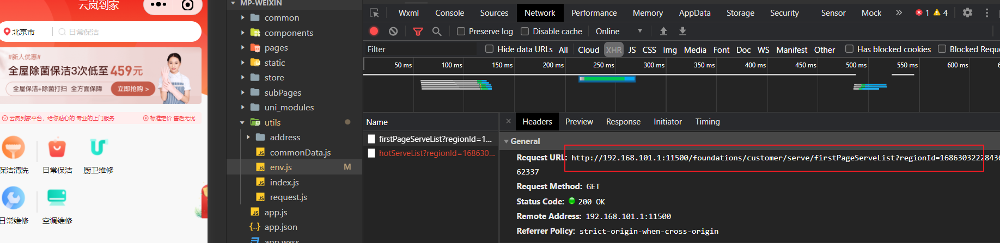
> 图注：图片展示了小程序首页服务列表的请求信息。左侧是小程序首页界面，显示了服务列表等内容。右侧是开发者工具的开发者工具界面，网络请求中“firstPageServeList”请求的Request URL为“http://192.168.101.1:11500/foundations/customer/serve/firstPageServeList?regionId=16863022284362337”，Request Method为GET，Status Code为200 OK。该图片与上文测试预期结果相关，用于说明在小程序首页正常显示服务列表时，可观察到的网络请求情况。


注意：

如果访问记录中regionId为undefine，如下所示：

http://192.168.101.1:11500/foundations/customer/serve/firstPageServeList?regionId=undefine

这时需要重新定位，切换区域


> 图注：图片展示的是云岚到家小程序首页界面。界面上方有“云岚到家”标识及三个点状图标。中间位置有一个红色箭头指向“北京市”区域，箭头旁有文字“点击重新定位”。下方是服务广告，显示“全屋除菌保洁3次低至459元”，并有“立即抢购”按钮。该图片与文档中“观察小程序的访问记录”上下文相关，用于说明在访问记录中regionId为undefined时，需重新定位并切换区域的操作提示。

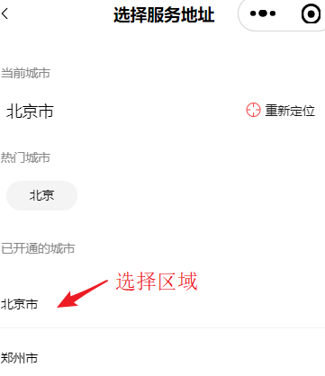
> 图注：图片展示的是小程序首页服务列表中选择服务地址界面。界面上方显示“选择服务地址”，右上角有三个点和一个圆圈。下方有“当前城市”“热门城市”“已开通的城市”等区域，其中“已开通的城市”区域中“北京市”被红色箭头指向突出显示。该图片与文档中“观察小程序的访问记录”内容相关，用于说明如果访问记录中regionId为undefined时，需重新定位，切换区域，此图即为切换区域后的选择区域界面示例。

测试预期结果：

在小程序首页正常显示服务列表。

示例：

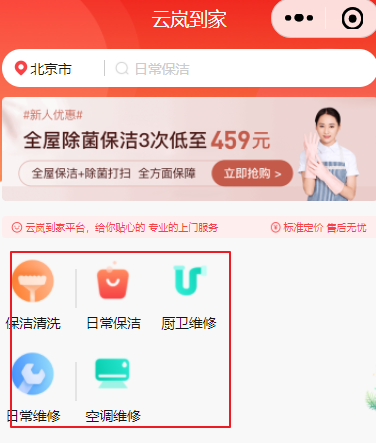
> 图注：这是“云岚到家”小程序的首页界面，顶部红色栏标注了平台名称，当前定位为北京市，设有“日常保洁”的搜索框。界面中部展示了新人优惠活动，宣传全屋除菌保洁3次低至459元，附带服务保障说明与立即抢购按钮。界面下方的红色框选区域为首页服务列表，包含保洁清洗、日常保洁、厨卫维修、日常维修、空调维修五项核心服务选项，该页面用于展示平台上门服务的相关内容，符合上下文提及的小程序首页服务列表实现的测试示例场景。


#### 3.2.2 首页服务列表缓存

##### 1） **缓存方案分析**

下边是门户的缓存设计：

<sheet sheet-id="5w6XkM" token="ZqC7sSupJhiXN1t6KRjcp1JxndT"></sheet>

下边分析首页服务列表的缓存方案：

查询缓存：查询首页服务列表，如果没有缓存则查询数据库并缓存，如果有缓存则直接返回

注意：缓存时需要考虑缓存穿透问题。

禁用区域：删除首页服务列表缓存

定时任务：每天凌晨缓存首页服务列表。

##### 2）查询缓存

下边在首页服务列表查询方法上添加Spring Cache注解实现查询缓存。

为了避免缓存穿透，如果服务列表为空则向redis缓存空值，缓存时间为30分钟；不为空则进行永久缓存。

在Cacheable注解中有两个属性可以指定条件进行缓存：

**condition**：指定一个 SpEL 表达式，用于决定是否要进行缓存。只有当条件表达式的结果为 true 时，方法的返回值才会被缓存。例如：

```Java
@Cacheable(value = "myCache", condition = "#id != null")
```

**unless**：与 condition 相反，只有当 SpEL 表达式的结果为 false 时，方法的返回值才会被缓存。

例如：

```Java
@Cacheable(value = "myCache", unless = "#result.length() > 100")
```

#result 表示方法的返回值，如果返回值结果集的长度大于100不进行缓存。

根据需求，我们需要根据方法的返回值去判断，如果结果集的长度大于0说明服务列表不空，此时缓存时间为永久缓存，否则缓存时间为30分钟。

condition不支持获取方法返回的值，不能识别#result。

我们使用unless实现。

**unless 的特点是符合条件的不缓存。设置技巧：确定要缓存的条件，取反即不缓存的条件。**

当方法返回的List的size为0时缓存30分钟，避免缓存穿透，设置为：#result.size() != 0 

当方法返回的List的size大于0永不过期，设置为：#result.size() == 0

代码如下：

```Java
package com.jzo2o.foundations.service.impl;

...

/**
 * 首页查询相关功能
 *
 * @author itcast
 * @create 2023/8/21 10:57
 **/
@Slf4j
@Service
public class HomeServiceImpl implements HomeService {
@Caching(
        cacheable = {
                //result为null时,属于缓存穿透情况，缓存时间30分钟
                @Cacheable(value = RedisConstants.CacheName.SERVE_ICON, key = "#regionId", unless = "#result.size() != 0", cacheManager = RedisConstants.CacheManager.THIRTY_MINUTES),
                //result不为null时,永久缓存
                @Cacheable(value = RedisConstants.CacheName.SERVE_ICON, key = "#regionId", unless = "#result.size() == 0", cacheManager = RedisConstants.CacheManager.FOREVER)
        }
)
   public List<ServeCategoryResDTO> queryServeIconCategoryByRegionIdCache(Long regionId) {
       //1.校验当前城市是否为启用状态
       Region region = regionService.getById(regionId);
       if (ObjectUtil.isEmpty(region) || ObjectUtil.equal(FoundationStatusEnum.DISABLE.getStatus(), region.getActiveStatus())) {
           return Collections.emptyList();
       }

       //2.根据城市编码查询所有的服务图标
       List<ServeCategoryResDTO> list = serveMapper.findServeIconCategoryByRegionId(regionId);
       if (ObjectUtil.isEmpty(list)) {
           return Collections.emptyList();
       }

       //3.服务类型取前两个，每个类型下服务项取前4个
       //list的截止下标
       int endIndex = list.size() >= 2 ? 2 : list.size();
       List<ServeCategoryResDTO> serveCategoryResDTOS = new ArrayList<>(list.subList(0, endIndex));
       serveCategoryResDTOS.forEach(v -> {
           List<ServeSimpleResDTO> serveResDTOList = v.getServeResDTOList();
           //serveResDTOList的截止下标
           int endIndex2 = serveResDTOList.size() >= 4 ? 4 : serveResDTOList.size();
           List<ServeSimpleResDTO> serveSimpleResDTOS = new ArrayList<>(serveResDTOList.subList(0, endIndex2));
           v.setServeResDTOList(serveSimpleResDTOS);
       });

       return serveCategoryResDTOS;
   }
...
```

##### 3）查询缓存测试

下边进行测试:

启动：jzo2o-foundations服务、网关服务，打开小程序，等待首页服务列表正常显示，进入redis查看首页服务列表是否缓存。

预期结果：首页服务列表正常缓存。

示例：

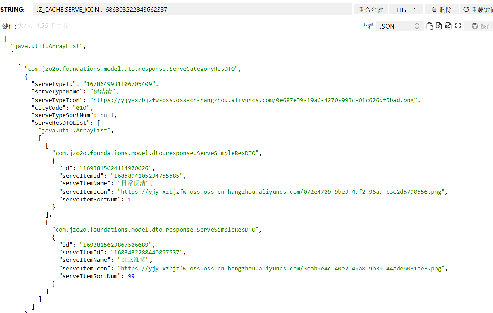
> 图注：这张图片展示了小程序首页服务列表相关的缓存数据内容，为JSON格式数据，数据中包含首页服务分类响应对象ServerCategoryResDTO，以及两个服务简单响应对象ServerSimpleResDTO。其中能看到服务类型ID、服务项图片地址，还有服务的ID、名称、图标地址、排序编号等核心信息，这些内容对应文档中首页服务列表缓存的相关内容，是查询或更新缓存测试过程中产生的缓存数据，用于验证首页服务列表缓存方案的实际情况。


##### 4） 定时任务更新缓存

根据缓存方案的分析，对首页服务列表进行缓存。

编写定时任务代码：

```Java
/**
 * 已启用区域缓存更新
 * 每日凌晨1点执行
 */
@XxlJob("activeRegionCacheSync")
public void activeRegionCacheSync() throws Exception {
    log.info(">>>>>>>>开始进行缓存同步，更新已启用区域");

    //删除缓存
    Boolean delete = redisTemplate.delete(RedisConstants.CacheName.JZ_CACHE + "::ACTIVE_REGIONS");

    //通过查询开通区域列表进行缓存
    List<RegionSimpleResDTO> regionSimpleResDTOS = regionService.queryActiveRegionList();

    //遍历区域对该区域下的服务类型进行缓存
    regionSimpleResDTOS.forEach(item->{
        //区域id
        Long regionId = item.getId();

        //删除该区域下的首页服务列表
        String serve_type_key = RedisConstants.CacheName.SERVE_ICON + "::" + regionId;
        redisTemplate.delete(serve_type_key);
        homeService.queryServeIconCategoryByRegionIdCache(regionId);
        //todo 删除该区域下的服务类型列表缓存
    });
}
```

##### 5）定时任务更新缓存测试

下边测试定时任务更新缓存：

先将首页服务列表的缓存手动删除。

重启foundations服务，在上边代码中打断点，保证定时任务成功执行。

预期结果：对每个运营区域的首页服务列表进行缓存。


示例：

跟踪断点执行。

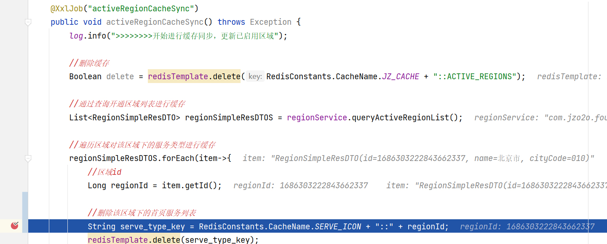
> 图注：图片展示的是FirstPageServeController类中的activeRegionCacheSync方法代码。该方法在Redis中删除缓存，先通过redisTemplate.delete删除key为RedisConstants.CacheName.JZ_CACHE + "::ACTIVE_REGIONS"的缓存，再通过regionService.queryActiveRegionList查询开通区域列表，最后遍历区域对该区域下的服务类型进行缓存，还删除了该区域的首页服务列表缓存。此代码与文档中“禁用区域时删除缓存”内容相关，用于实现禁用区域时删除首页服务列表缓存的功能测试。


**4 编码规范**

门户信息查询类接口统一在FirstPageServeController类中定义，service统一写在HomeService下。

首先实现业务接口的功能，测试通过后再去实现缓存。

##### 6） 禁用区域时删除缓存

找到禁用区域代码 ,添加删除首页服务列表缓存的代码，如下： 

```Java

@Service
public class RegionServiceImpl extends ServiceImpl<RegionMapper, Region> implements IRegionService {
...
    @Override
    @Caching(evict = {
            @CacheEvict(value = RedisConstants.CacheName.JZ_CACHE, key = "'ACTIVE_REGIONS'"),
            @CacheEvict(value = RedisConstants.CacheName.SERVE_ICON, key = "#id")
    })
    public void deactivate(Long id) {
```

测试：禁用一个区域观察redis是否删除该区域的首页服务列表缓存。


##### 7）小结

项目中有做缓存吗？考虑缓存穿透问题了吗？怎么实现的？


### 3.3 服务类型列表缓存（实战）

#### 3.3.1 分析设计

**1.界面原型**

点击首页服务列表的服务分类或直接点击“全部服务”进入全部服务界面，


> 图注：图片展示了云凤到家小程序首页界面。上方显示“北京市”和“日常保洁”搜索框。中部有新人优惠活动，宣传全屋除菌保洁3次低至459元。下方是服务分类图标，包括保洁清、日常保洁、厨卫维修、家居服务、安装窗帘等，其中“保洁清”和“全部服务”有红色箭头指向。底部导航栏有首页、全部服务、消息、我的选项。该图对应文档中介绍点击首页服务列表的服务分类或“全部服务”进入全部服务界面的内容。

“全部服务” 界面如下图：

在全部服务界面需要展示当前区域下的服务分类，点击服务分类查询分类下的服务。


> 图注：图片展示了小程序首页服务分类及服务项的界面。左侧有“服务分类”标题，下分“保洁清”和“家居服务”两个分类。右侧是“全部服务”标题，下方有“日常保洁”等服务项。图片与文档中服务类型列表缓存实现的上下文相关，直观呈现了文档中提到的“只实现上图左侧显示的服务分类列表”这一内容，帮助理解服务类型列表的数据展示形式。

服务类型列表数据包括：服务类型的名称、服务类型id。

注意：只实现上图左侧显示的服务分类列表


1. **接口定义**

服务类型列表查询接口传入参数为：区域id，输出数据为服务类型列表，列表中元素包括：服务类型的名称、服务类型id，为了可扩展，列表元素包括服务类型的图标、排序字段方便进行展示。

接口名称：服务分类列表

接口路径：**GET**/foundations/customer/serve/serveTypeList


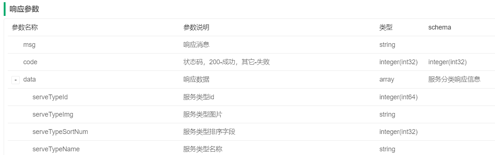
> 图注：这是服务分类列表接口的响应参数表，表格清晰列出了接口的响应参数名称、参数说明、类型与对应schema信息。响应参数包含msg（响应消息，string类型）、code（状态码，200代表成功，其它代表失败，类型为integer(int32)）、data（响应数据，为服务分类响应信息的数组），以及data下的具体子参数：serveTypeId（服务类型id，integer(int64)）、serveTypeImg（服务类型图片，string类型）、serveTypeSortNum（服务类型排序字段，integer(int32)）、serveTypeName（服务类型名称，string类型），该表为小程序首页服务类型列表缓存实现的相关接口提供了明确的响应参数规范。


1. **缓存方案分析**

下边分析服务类型列表的缓存方案：

查询缓存：查询服务类型列表，如果缓存没有则查询数据库并缓存，如果缓存有则直接返回

禁用区域：删除该区域下服务类型列表缓存

定时任务：每天凌晨缓存服务类型列表。

缓存时注意解决缓存穿透问题。


#### 3.3.2 设计提示

根据接口定义分析，需要根据区域id查询该区域下运营的服务项所属的分类，所以要分析数据来源于哪几张表？如果是一张表直接用MybatisPlus拼装SQL即可，如果是多张表则需要编写SQL语句。


在测试时需要切换区域进行测试。


### 3.4 热门服务列表（实战）

#### 3.4.1 分析设计

**1.界面原型**

在门户有一块区域叫精选推荐，此信息为热门服务列表，如下图：

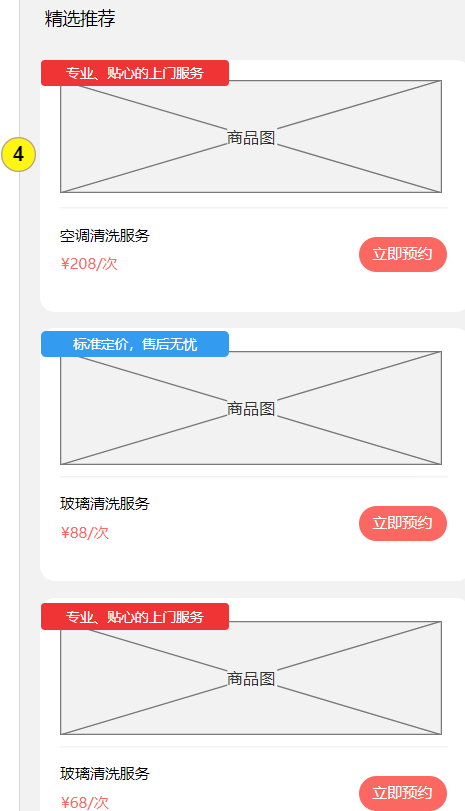
> 图注：图片展示的是门户精选推荐区域的界面原型，标题为“精选推荐”。下方有三组服务项，每组包含服务名称、价格及“立即预约”按钮。第一组为“空调清洗服务”，价格208元/次；第二组为“玻璃清洗服务”，价格88元/次；第三组也是“玻璃清洗服务”，价格68元/次。每组服务项下方均有商品图。该图片与上下文介绍的热门服务列表相关，是对热门服务列表界面原型的具体呈现。

热门服务列表是在区域服务管理界面进行设置，如下图：


> 图注：该图片是小程序首页热门服务列表的后台设置界面，展示了郑州市区域下的服务列表，包含服务名称、服务类型、参考价格、区域价格、是否热门等信息，每项服务对应操作列有设置热门、取消热门、删除、上架等选项。其中，“日常维修”服务项的操作栏中，红色箭头指向的“设置热门”选项，代表将该服务项设为精选推荐，其他未标记的服务项（如空调维修、安装窗帘）当前未被设为热门服务，设置热门列表的操作可通过该界面完成。

“设置热门”表示该服务项在本区域为精选推荐。

“取消热门”表示取消该服务项的精选推荐。

热门服务列表数据素包括：区域服务价格、价格单位、服务项id、服务项名称、服务项图标、服务详图。

信息来源于两张表：serve_item、serve

查询条件：区域id、是否热门（是）、是否上架（是）

按服务修改时间降序排序


**2、接口设计**

接口名称：首页热门服务列表

接口路径：**GET**/foundations/customer/serve/hotServeList


响应参数：


> 图注：图片展示了首页热门服务列表接口的响应参数。参数包括msg（响应消息）、code（状态码）、data（数据）等。data部分包含serveItemName（服务项名称）、serveItemId（服务项id）、unit（服务单位）、detailImg（服务详图）、price（价格）、serveItemImg（服务项图片）、id（主键）等字段，其中serveItemId和id字段以蓝色高亮显示。该图片与上文介绍的接口设计中响应参数内容对应，直观呈现了响应参数的具体结构和字段信息。

示例数据：

```Java
{
        "msg": "OK",
        "code": 200,
        "data": {
                "cityCode": "",
                "serveItemName": "",
                "serveItemId": 0,
                "unit": 0,
                "detailImg": "",
                "price": 0,
                "serveItemImg": "",
                "id": 0
        }
}
```


**3. 缓存方案**

查询缓存：查询热门服务列表，如果缓存没有则查询数据库并缓存，如果缓存有则直接返回

注意：缓存时需要考虑缓存穿透问题。

禁用区域：删除热门服务列表缓存

定时任务：每天凌晨缓存热门服务列表。

#### 3.4.2 设计提示

根据接口定义分析，需要根据区域id查询该区域下运营的服务项所属的分类，所以要分析数据来源于哪几张表？如果是一张表直接用MybatisPlus拼装SQL即可，如果是多张表则需要编写SQL语句。

在测试时需要切换区域进行测试。


### 3.5 服务详情（实战）

#### 3.5.1 分析设计

**1.界面原型**

在首页服务列表区域、热门服务列表区域以及全部服务界面，点击服务项名称进入服务详情页面，如下图：


> 图注：这是小程序服务详情页面的界面原型图，展示了“日常保洁”服务的相关信息。页面上方标注了该服务的核心特点，包括日常上门保洁、全方位清洁、随心约上门，同时显示服务原价为48元/小时，当前活动价为1元/小时，提供了数量调整的增减按钮与输入框。页面还设置了用户评价入口，底部呈现到家保障相关内容，涵盖时效保障、明码标价、清洁保障三项标识，并附带服务前需提前沟通的温馨提示。该图对应了文档中关于服务详情页面设计的内容，呈现了服务项展示与操作的界面样式。

服务详情页面显示服务相关的信息包括：服务项的名称、服务的运营价格、服务项的图片、服务项名称、价格单位。信息来源于serve_item表和serve表。

**2.接口设计**

接口名称：根据id查询服务

接口路径：**GET**/foundations/customer/serve/{id}

请求参数：服务id，即serve表的主键


> 图注：图片展示了接口响应参数表，包含参数名称、参数说明、类型、schema四列。其中，data下的ServeAggregationSimpleResDTO包含cityCode、servetItemName、servetItemId、unit、detailImg、price、servetItemImg、id等字段，类型均为string或number等。该图片与文档中接口设计部分相关，是对接口响应参数的说明，为后续根据id查询服务接口的实现提供参数信息参考。


**3. 缓存方案**

服务详情信息来源于两部分信息：服务项信息、服务信息。

分别对服务项信息、服务信息进行缓存，方案如下：

<sheet></sheet>

分别编写方法：根据id查询服务项（已实现），根据id查询服务信息的方法（已实现）

然后实现查询缓存：

在服务详情接口中调用根据id查询服务项的service方法和 根据id查询服务信息的service方法，根据接口要求对两部分数据进行拼装返回。

针对热门服务的服务项信息和服务信息通过定时任务更新缓存，思路如下：

查询出所有热门服务，遍历热门服务列表先删除缓存，再执行查询方法对热门服务信息进行缓存。


#### 3.5.2 设计提示


根据分析可知接口要的数据来源于serve表和serve_item表，根据上边的缓存方案需要针对服务项信息和服务信息分别实现缓存方法。

---
> 来源：飞书技术知识库（脱敏版） · 07 业务组件方案集 / 云岚到家项目 / 第四章 小程序首页 · [原文](https://ccn8v2zngwsm.feishu.cn/wiki/G0DgwFSRqiaiajk0WxjcXLUSn0g)
