# 配置ES索引同步环境v1.0

## 1 配置Canal+MQ数据同步环境


### 1.1 配置Mysql主从同步

根据Canal的工作原理，首先需要开启MySQL主从同步。


1.在MySQL中需要创建一个用户，并授权

进入mysql容器：

docker exec -it mysql /bin/bash

-- 使用命令登录：

mysql -u root -p

-- 创建用户 用户名：canal 密码：canal

```Java
create user 'canal'@'%' identified WITH mysql_native_password by 'canal';
```

-- 授权 \*.\*表示所有库

```Java
GRANT SELECT,REPLICATION SLAVE,REPLICATION CLIENT ON *.* TO 'canal'@'%';
FLUSH PRIVILEGES;
```

- **SELECT：** 允许用户查询（读取）数据库中的数据。
- **REPLICATION SLAVE：** 允许用户作为 MySQL 复制从库，用于同步主库的数据。
- **REPLICATION CLIENT：** 允许用户连接到主库并获取关于主库状态的信息。


在MySQL配置文件my.cnf设置如下信息，开启 Binlog 写入功能，配置 binlog-format 为 ROW 模式

`ROW` 模式表示以行为单位记录每个被修改的行的变更

修改如下：

vi /usr/mysql/conf/my.cnf

```Java
[mysqld]
#打开binlog
log-bin=mysql-bin
#选择ROW(行)模式
binlog-format=ROW
#配置MySQL replaction需要定义，不要和canal的slaveId重复
server_id=1

expire_logs_days=3
max_binlog_size = 100m
max_binlog_cache_size = 512m

```

**说明：在学习阶段为了保证足够的服务器存储空间，binlog日志最大保存100m，mysql会定时清理binlog**


2、重启MySQL，查看配置信息

- 使用命令查看是否打开binlog模式：

`SHOW VARIABLES LIKE 'log_bin';`

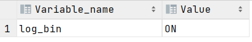
> 图注：图片展示的是MySQL配置文件my.cnf中binlog相关配置信息。其中Variable_name为log_bin，Value为ON，表明binlog日志已开启。该图片与文档中“配置Mysql主从同步”部分上下文相关，用于说明在MySQL配置文件my.cnf设置binlog-format为ROW模式后，重启MySQL查看配置信息时，可通过执行`SHOW VARIABLES LIKE 'log_bin';`命令，查看log_bin值为ON，以确认binlog模式已开启。

ON表示开启binlog模式。


`show variables like 'binlog_format';`

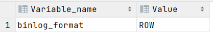
> 图注：这是配置MySQL数据同步环境相关的配置验证截图，内容显示数据库变量`binlog_format`的值为`ROW`，该设置代表MySQL采用行级别的二进制日志记录，能精准记录数据行的变更，是适配数据同步安全要求的配置，该参数的匹配状态可验证前期对MySQL配置文件的修改是否生效，确保后续基于Canal+MQ的数据同步能获取准确的行级变更数据。

当 `binlog_format` 的值为 `row` 时，表示 MySQL 服务器当前配置为使用行级别的二进制日志记录，这对于数据库复制和数据同步来说更为安全，因为它记录了对数据行的确切更改。


- 查看binlog日志文件列表：

`SHOW BINARY LOGS;`

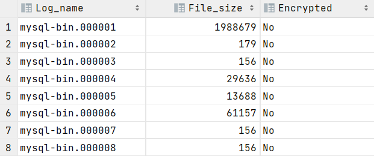
> 图注：这张图片是MySQL查看binlog日志文件列表的执行结果，包含Log_name、File_size和Encrypted三个字段，显示共有8个未加密的二进制日志文件，名称从mysql-bin.000001到mysql-bin.000008，每个文件的大小有所不同，且Encrypted列均为“No”，表明所有日志文件未经过加密，该结果对应文档中“查看binlog日志文件列表”操作的输出。

- 查看当前正在写入的binlog文件：

`SHOW MASTER STATUS;`


> 图注：图片展示了MySQL中查看当前正在写入的binlog文件的执行结果。表格中显示了binlog文件的名称为“mysql-bin.000008”，位置为156。该图片与上文“查看当前正在写入的binlog文件”相关，通过执行`SHOW MASTER STATUS;`命令后，此结果可帮助确认MySQL当前正在写入的binlog文件，为后续配置Canal+MQ数据同步环境中的Mysql主从同步等操作提供关键信息。

### 1.2 安装Canal（**使用下发虚拟机无需安装**）

获取canal镜像

`docker pull canal/canal-server:latest`


创建/data/soft/canal目录:

mkdir -p /data/soft/canal

在/data/soft/canal下创建 canal.properties，内容如下，注意修改mq的配置信息：

```Java
#################################################
#########               common argument         #############
#################################################
# tcp bind ip
canal.ip =
# register ip to zookeeper
canal.register.ip =
canal.port = 11111
canal.metrics.pull.port = 11112
# canal instance user/passwd
# canal.user = canal
# canal.passwd = E3619321C1A937C46A0D8BD1DAC39F93B27D4458

# canal admin config
#canal.admin.manager = 127.0.0.1:8089
canal.admin.port = 11110
canal.admin.user = admin
canal.admin.passwd = 4ACFE3202A5FF5CF467898FC58AAB1D615029441
# admin auto register
#canal.admin.register.auto = true
#canal.admin.register.cluster =
#canal.admin.register.name =

canal.zkServers =
# flush data to zk
canal.zookeeper.flush.period = 1000
canal.withoutNetty = false
# tcp, kafka, rocketMQ, rabbitMQ
canal.serverMode = rabbitMQ
# flush meta cursor/parse position to file
canal.file.data.dir = ${canal.conf.dir}
canal.file.flush.period = 1000
## memory store RingBuffer size, should be Math.pow(2,n)
canal.instance.memory.buffer.size = 16384
## memory store RingBuffer used memory unit size , default 1kb
canal.instance.memory.buffer.memunit = 1024 
## meory store gets mode used MEMSIZE or ITEMSIZE
canal.instance.memory.batch.mode = MEMSIZE
canal.instance.memory.rawEntry = true

## detecing config
canal.instance.detecting.enable = false
#canal.instance.detecting.sql = insert into retl.xdual values(1,now()) on duplicate key update x=now()
canal.instance.detecting.sql = select 1
canal.instance.detecting.interval.time = 3
canal.instance.detecting.retry.threshold = 3
canal.instance.detecting.heartbeatHaEnable = false

# support maximum transaction size, more than the size of the transaction will be cut into multiple transactions delivery
canal.instance.transaction.size =  1024
# mysql fallback connected to new master should fallback times
canal.instance.fallbackIntervalInSeconds = 60

# network config
canal.instance.network.receiveBufferSize = 16384
canal.instance.network.sendBufferSize = 16384
canal.instance.network.soTimeout = 30

# binlog filter config
canal.instance.filter.druid.ddl = true
canal.instance.filter.query.dcl = false
# 这个配置一定要修改
canal.instance.filter.query.dml = true
canal.instance.filter.query.ddl = false
canal.instance.filter.table.error = false
canal.instance.filter.rows = false
canal.instance.filter.transaction.entry = false
canal.instance.filter.dml.insert = false
canal.instance.filter.dml.update = false
canal.instance.filter.dml.delete = false

# binlog format/image check
canal.instance.binlog.format = ROW,STATEMENT,MIXED 
canal.instance.binlog.image = FULL,MINIMAL,NOBLOB

# binlog ddl isolation
canal.instance.get.ddl.isolation = false

# parallel parser config
canal.instance.parser.parallel = true
## concurrent thread number, default 60% available processors, suggest not to exceed Runtime.getRuntime().availableProcessors()
#canal.instance.parser.parallelThreadSize = 16
## disruptor ringbuffer size, must be power of 2
canal.instance.parser.parallelBufferSize = 256

# table meta tsdb info
canal.instance.tsdb.enable = true
canal.instance.tsdb.dir = ${canal.file.data.dir:../conf}/${canal.instance.destination:}
canal.instance.tsdb.url = jdbc:h2:${canal.instance.tsdb.dir}/h2;CACHE_SIZE=1000;MODE=MYSQL;
canal.instance.tsdb.dbUsername = canal
canal.instance.tsdb.dbPassword = canal
# dump snapshot interval, default 24 hour
canal.instance.tsdb.snapshot.interval = 24
# purge snapshot expire , default 360 hour(15 days)
canal.instance.tsdb.snapshot.expire = 360

#################################################
#########               destinations            #############
#################################################
canal.destinations = xzb-canal
# conf root dir
canal.conf.dir = ../conf
# auto scan instance dir add/remove and start/stop instance
canal.auto.scan = true
canal.auto.scan.interval = 5
# set this value to 'true' means that when binlog pos not found, skip to latest.
# WARN: pls keep 'false' in production env, or if you know what you want.
canal.auto.reset.latest.pos.mode = false

canal.instance.tsdb.spring.xml = classpath:spring/tsdb/h2-tsdb.xml
#canal.instance.tsdb.spring.xml = classpath:spring/tsdb/mysql-tsdb.xml

canal.instance.global.mode = spring
canal.instance.global.lazy = false
canal.instance.global.manager.address = ${canal.admin.manager}
#canal.instance.global.spring.xml = classpath:spring/memory-instance.xml
canal.instance.global.spring.xml = classpath:spring/file-instance.xml
#canal.instance.global.spring.xml = classpath:spring/default-instance.xml

##################################################
#########             MQ Properties      #############
##################################################
# aliyun ak/sk , support rds/mq
canal.aliyun.accessKey =
canal.aliyun.secretKey =
canal.aliyun.uid=

canal.mq.flatMessage = true
canal.mq.canalBatchSize = 50
canal.mq.canalGetTimeout = 100
# Set this value to "cloud", if you want open message trace feature in aliyun.
canal.mq.accessChannel = local

canal.mq.database.hash = true
canal.mq.send.thread.size = 30
canal.mq.build.thread.size = 8

##################################################
#########                    Kafka                   #############
##################################################
kafka.bootstrap.servers = 127.0.0.1:9092
kafka.acks = all
kafka.compression.type = none
kafka.batch.size = 16384
kafka.linger.ms = 1
kafka.max.request.size = 1048576
kafka.buffer.memory = 33554432
kafka.max.in.flight.requests.per.connection = 1
kafka.retries = 0

kafka.kerberos.enable = false
kafka.kerberos.krb5.file = "../conf/kerberos/krb5.conf"
kafka.kerberos.jaas.file = "../conf/kerberos/jaas.conf"

##################################################
#########                   RocketMQ         #############
##################################################
rocketmq.producer.group = test
rocketmq.enable.message.trace = false
rocketmq.customized.trace.topic =
rocketmq.namespace =
rocketmq.namesrv.addr = 127.0.0.1:9876
rocketmq.retry.times.when.send.failed = 0
rocketmq.vip.channel.enabled = false
rocketmq.tag = 

##################################################
#########                   RabbitMQ         #############
##################################################
rabbitmq.host = 192.168.101.68
rabbitmq.virtual.host = /xzb
rabbitmq.exchange = exchange.canal-jzo2o
rabbitmq.username = xzb
rabbitmq.password = xzb
rabbitmq.deliveryMode = 2

```

创建instance.properties，内容如下：

`canal.instance.master.journal.name` 用于指定主库正在写入的 binlog 文件的名称。

如果不配置 `canal.instance.master.journal.name`，Canal 会尝试自动检测 MySQL 主库的 binlog 文件，并从最新位置开始进行复制。

```Java
#################################################
## mysql serverId , v1.0.26+ will autoGen
canal.instance.mysql.slaveId=1000

# enable gtid use true/false
canal.instance.gtidon=false

# position info
canal.instance.master.address=192.168.101.68:3306
canal.instance.master.journal.name=mysql-bin.000001
canal.instance.master.position=0
canal.instance.master.timestamp=
canal.instance.master.gtid=

# rds oss binlog
canal.instance.rds.accesskey=
canal.instance.rds.secretkey=
canal.instance.rds.instanceId=

# table meta tsdb info
canal.instance.tsdb.enable=true
#canal.instance.tsdb.url=jdbc:mysql://127.0.0.1:3306/canal_tsdb
#canal.instance.tsdb.dbUsername=canal
#canal.instance.tsdb.dbPassword=canal

#canal.instance.standby.address =
#canal.instance.standby.journal.name =
#canal.instance.standby.position =
#canal.instance.standby.timestamp =
#canal.instance.standby.gtid=

# username/password
canal.instance.dbUsername=canal
canal.instance.dbPassword=canal
canal.instance.connectionCharset = UTF-8
# enable druid Decrypt database password
canal.instance.enableDruid=false
#canal.instance.pwdPublicKey=MFwwDQYJKoZIhvcNAQEBBQADSwAwSAJBALK4BUxdDltRRE5/zXpVEVPUgunvscYFtEip3pmLlhrWpacX7y7GCMo2/JM6LeHmiiNdH1FWgGCpUfircSwlWKUCAwEAAQ==

# table regex
# canal.instance.filter.regex=test01\\..*,test02\\..*
#canal.instance.filter.regex=test01\\..*,test02\\.t1
#canal.instance.filter.regex=jzo2o-foundations\\.serve_sync,jzo2o-orders-0\\.orders_seize,jzo2o-orders-0\\.orders_dispatch,jzo2o-orders-0\\.serve_provider_sync,jzo2o-customer\\.serve_provider_sync
canal.instance.filter.regex=jzo2o-orders-1\\.orders_dispatch,jzo2o-orders-1\\.orders_seize,jzo2o-foundations\\.serve_sync,jzo2o-customer\\.serve_provider_sync,jzo2o-orders-1\\.serve_provider_sync,jzo2o-orders-1\\.history_orders_sync,jzo2o-orders-1\\.history_orders_serve_sync,jzo2o-market\\.activity
# table black regex
canal.instance.filter.black.regex=mysql\\.slave_.*
# table field filter(format: schema1.tableName1:field1/field2,schema2.tableName2:field1/field2)
#canal.instance.filter.field=test1.t_product:id/subject/keywords,test2.t_company:id/name/contact/ch
# table field black filter(format: schema1.tableName1:field1/field2,schema2.tableName2:field1/field2)
#canal.instance.filter.black.field=test1.t_product:subject/product_image,test2.t_company:id/name/contact/ch

# mq config
#canal.mq.topic=topic_test01
# dynamic topic route by schema or table regex
#canal.mq.dynamicTopic=mytest1.user,mytest2\\..*,.*\\..*
#canal.mq.dynamicTopic=topic_test01:test01\\..*,topic_test02:test02\\..*
#canal.mq.dynamicTopic=canal-mq-jzo2o-orders-dispatch:jzo2o-orders-0\\.orders_dispatch,canal-mq-jzo2o-orders-seize:jzo2o-orders-0\\.orders_seize,canal-mq-jzo2o-foundations:jzo2o-foundations\\.serve_sync,canal-mq-jzo2o-customer-provider:jzo2o-customer\\.serve_provider_sync,canal-mq-jzo2o-orders-provider:jzo2o-orders-0\\.serve_provider_sync
canal.mq.dynamicTopic=canal-mq-jzo2o-orders-dispatch:jzo2o-orders-1\\.orders_dispatch,canal-mq-jzo2o-orders-seize:jzo2o-orders-1\\.orders_seize,canal-mq-jzo2o-foundations:jzo2o-foundations\\.serve_sync,canal-mq-jzo2o-customer-provider:jzo2o-customer\\.serve_provider_sync,canal-mq-jzo2o-orders-provider:jzo2o-orders-1\\.serve_provider_sync,canal-mq-jzo2o-orders-serve-history:jzo2o-orders-1\\.history_orders_serve_sync,canal-mq-jzo2o-orders-history:jzo2o-orders-1\\.history_orders_sync,canal-mq-jzo2o-market-resource:jzo2o-market\\.activity
canal.mq.partition=0
# hash partition config
#canal.mq.partitionsNum=3
#canal.mq.partitionHash=test.table:id^name,.*\\..*
#canal.mq.dynamicTopicPartitionNum=test.*:4,mycanal:6
#################################################

```

canal.instance.filter.regex和canal.mq.dynamicTopic的配置稍后解释。


创建日志目录：

mkdir -p /data/soft/canal/logs   /data/soft/canal/conf

启动容器：

```Java
docker run --name canal -p 11111:11111 -d -v /data/soft/canal/instance.properties:/home/admin/canal-server/conf/xzb-canal/instance.properties  -v /data/soft/canal/canal.properties:/home/admin/canal-server/conf/canal.properties -v /data/soft/canal/logs:/home/admin/canal-server/logs/xzb-canal -v /data/soft/canal/conf:/home/admin/canal-server/conf/xzb-canal canal/canal-server:latest
```


### 1.3 安装RabbitMQ（**使用下发虚拟机无需安装**）


1. 拉取镜像（如果未拉取过镜像）

docker pull registry.cn-hangzhou.aliyuncs.com/itheima/rabbitmq:3.9.17-management-delayed

1. 创建文件夹和文件

mkdir -p /data/soft/rabbitmq/config /data/soft/rabbitmq/data /data/soft/rabbitmq/plugins

1. 启动容器

```PowerShell
docker run \
--privileged \
 -e RABBITMQ_DEFAULT_USER=czri \
 -e RABBITMQ_DEFAULT_PASS=czri1234 \
 --restart=always \
 --name rabbitmq \
 --hostname rabbitmq \
 -v /data/soft/rabbitmq/config:/etc/rabbitmq \
 -v /data/soft/rabbitmq/data:/var/lib/rabbitmq \
 -p 15672:15672 \
 -p 5672:5672 \
 -d \
 registry.cn-hangzhou.aliyuncs.com/itheima/rabbitmq:3.9.17-management-delayed
```

1. 启动rabbitmq管理端

进入rabbitmq容器:docker exec -it rabbitmq /bin/bash

运行下边的命令：

```Shell
# 启动rabbitmq管理端
rabbitmq-plugins enable rabbitmq_management
# 启动延迟队列插件
rabbitmq-plugins enable rabbitmq_delayed_message_exchange
```

5、进入rabbitmq管理界面 

http://192.168.101.68:15672/

账号：czri

密码：czri1234

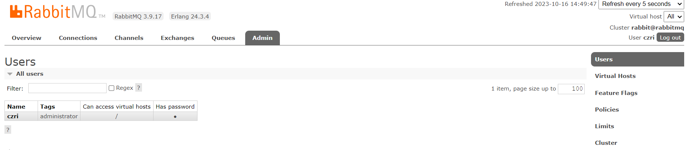
> 图注：图片展示的是RabbitMQ管理界面的Users页面。页面显示了所有用户信息，包括Name（名称）、Tags（标签）、Can access virtual hosts（可访问虚拟主机）和Has password（有密码）等字段。其中，名称为czri，标签为administrator，可访问虚拟主机，有密码。页面右上角有“Users”“Virtual Hosts”“Feature Flags”“Policies”“Limits”“Cluster”等导航选项。该图片与文档中配置RabbitMQ环境步骤相关，用于展示进入rabbitmq管理界面后，账号和密码设置成功后的用户管理页面情况。

6、创建虚拟主机 /xzb

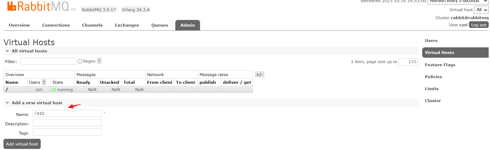
> 图注：这是RabbitMQ的管理端界面，对应配置ES索引同步环境文档的RabbitMQ设置步骤，界面顶部显示RabbitMQ版本为3.9.17、Erlang版本为24.3，当前处于“Admin”标签页的“Virtual Hosts”配置区域。界面展示了已有虚拟主机的列表信息，而下方带有红色箭头指向的“Add a new virtual host”区域是设置虚拟主机的操作位置，该区域的“Name”输入框内已填写“/xzb”，与文档中“创建虚拟主机/xzb”的要求一致，用于完成该RabbitMQ虚拟主机的创建操作。

7、创建账号和密码

xzb/xzb

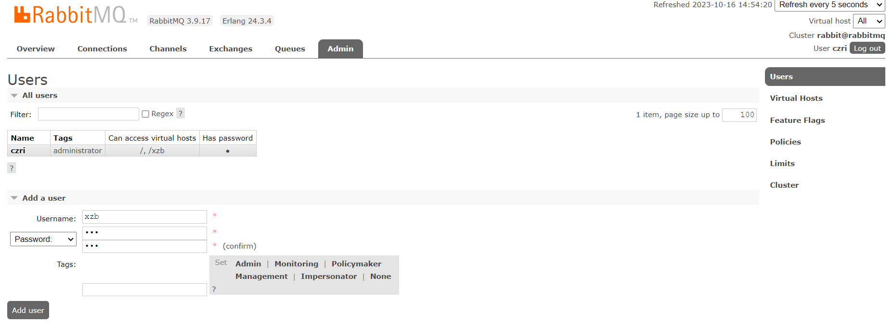
> 图注：图片展示的是RabbitMQ管理界面中“Users”页面。页面显示了名为“czri”的用户，其标签为“administrator”，可访问虚拟主机“/”和“/xzb”，且有密码。下方有“Add a user”区域，可输入用户名“xzb”、密码及确认密码，还设有权限设置选项，如“Admin”“Monitoring”等。该图片与文档中安装RabbitMQ并创建账号和密码的操作步骤相关，直观呈现了创建账号后的管理界面情况。

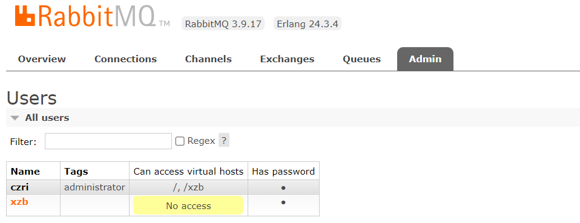
> 图注：这张图片是RabbitMQ管理界面的Admin页签下的Users页面，用于展示用户相关配置情况，当前界面的RabbitMQ版本为3.9.17，配套Erlang版本为24.3.4。页面列出了两个用户信息：用户czri的标签为administrator，可访问的虚拟主机为/、/xzb，且设置了密码；用户xzb的标签无对应显示，其可访问的虚拟主机被标注为“No access”，同时也设置了密码。该界面的用户信息和配置，对应了前文配置RabbitMQ步骤中创建账号、设置访问权限的相关操作内容。

设置权限可以访问/   /xzb

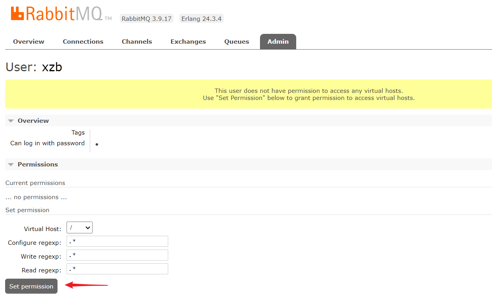
> 图注：这是RabbitMQ的Admin管理界面，当前登录用户为xzb。界面中显示该用户当前没有访问任何虚拟主机的权限，界面中用红色箭头突出标注了“Set permission”按钮，对应上下文里设置该用户访问虚拟主机/xzb权限的操作步骤，可通过该按钮完成权限配置，下方还提供了虚拟主机、配置正则表达式、写入正则表达式、读取正则表达式的设置项，用于给该用户授予对应虚拟主机的访问权限。

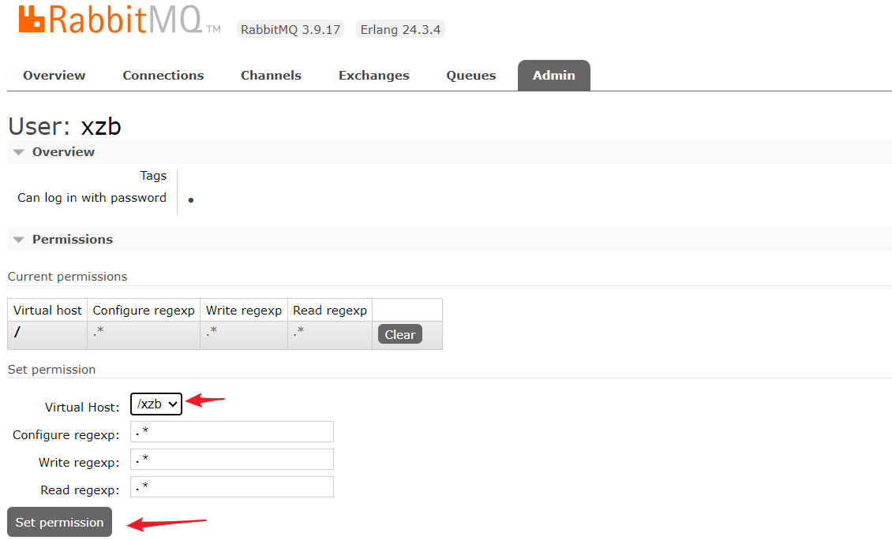
> 图注：图片展示的是RabbitMQ管理界面中用户权限设置页面。页面显示用户为“xzb”，可使用密码登录。在“Permissions”区域，当前权限设置中，虚拟主机为“/”，Configure regexp、Write regexp、Read regexp均为“*”。下方有“Set permission”按钮，以及“Virtual Host”下拉框，当前选中“/xzb”。页面右下角有红色箭头指向“Set permission”按钮和“Virtual Host”下拉框，提示设置权限和选择虚拟主机的操作位置，与上下文介绍的设置权限访问虚拟主机/xzb的操作步骤对应。

设置成功：

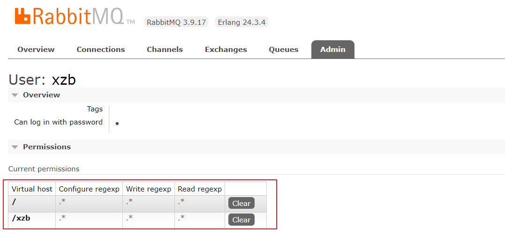
> 图注：图片展示的是RabbitMQ管理界面中账号设置成功后的权限配置情况。界面上方显示RabbitMQ版本为3.9.17，Erlang版本为24.3.4。在“Admin”标签页下，用户“xzb”的权限设置中，有“Overview”和“Permissions”两个部分。权限部分显示了当前权限，包括虚拟主机“/”和“/xzb”，以及对应的Configure regexp、Write regexp、Read regexp权限均为“*”，且有“Clear”清除按钮。该图与上文设置权限可访问“/xzb”账号成功的内容相呼应。


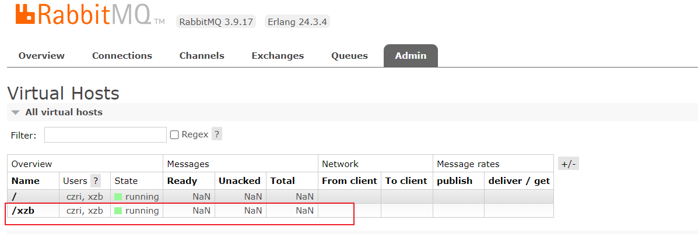
> 图注：图片展示的是RabbitMQ管理界面中“Virtual Hosts”页面。页面显示了所有虚拟主机信息，其中“/”和“/xzb”两个虚拟主机状态均为“running”，且都有用户“czri, xzb”可访问。页面上方有“Overview”“Connections”“Channels”“Exchanges”“Queues”“Admin”等导航选项，当前选中“Admin”。该图片与文档中配置RabbitMQ环境的上下文相关，用于展示在完成创建虚拟主机和账号密码设置后，进入管理界面查看设置是否成功的界面情况。


### 1.4 配置Canal+RabbitMQ

下边通过配置Canal与RabbitMQ，保证Canal收到binlog消息将数据发送至MQ。

最终我们要实现的是：

**修改jzo2o-foundations数据库下的serve_sync表的数据后通过canal将修改信息发送到MQ。**


**1、在Canal中配置RabbitMQ的连接信息**

**修改/data/soft/canal/canal.properties**

```Java
# tcp, kafka, rocketMQ, rabbitMQ
canal.serverMode = rabbitMQ

##################################################
#########                     RabbitMQ             #############
##################################################
rabbitmq.host = 192.168.101.68
rabbitmq.virtual.host = /xzb
rabbitmq.exchange = exchange.canal-jzo2o
rabbitmq.username = xzb
rabbitmq.password = xzb
rabbitmq.deliveryMode = 2
```

本项目用于数据同步的MQ交换机：exchange.canal-jzo2o

虚拟主机地址：/xzb

账号和密码：xzb/xzb

rabbitmq.deliveryMode = 2   设置消息持久化


**2、设置需要监听的mysql库和表**

**修改/data/soft/canal/instance.properties**

- `canal.instance.filter.regex` 需要监听的mysql库和表

  - 全库： `.*\\..*`
  - 指定库下的所有表： `canal\\..*`
  - 指定库下的指定表： `canal\\.canal,test\\.test`
  
    - `库名\\.表名`：转义需要用\\\，使用逗号分隔多个库

这里配置监听 jzo2o-foundations数据库下serve_sync表，如下：

```Java
canal.instance.filter.regex=jzo2o-foundations\\.serve_sync
```

**3、在Canal配置MQ的topic**

这里使用动态topic，格式为：topic:[schema](https://so.csdn.net/so/search?q=schema&spm=1001.2101.3001.7020).table,topic:schema.table,topic:schema.table

配置如下：

```Java
canal.mq.dynamicTopic=canal-mq-jzo2o-foundations:jzo2o-foundations\\.serve_sync
```

上边的配置表示：对jzo2o-foundations数据库的serve_sync表的修改消息发到topic为canal-mq-jzo2o-foundations关联的队列

**4、进入rabbitMQ配置交换机和队列**

创建exchange.canal-jzo2o交换机：

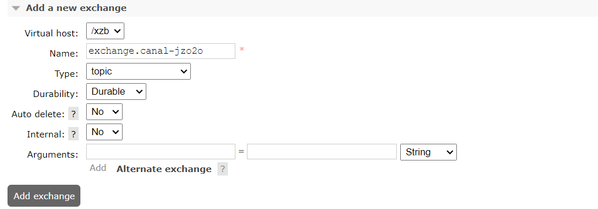
> 图注：这张图片是RabbitMQ中新建交换机的配置界面，用于创建在配置Canal+RabbitMQ时所需的交换机。界面显示已配置的关键参数：Virtual host选择为/xzb，交换机名称为必填项exchange.canal-jzo2o，类型选择为topic，Durability设置为Durable，Auto delete和Internal均设置为No，最后还有Arguments配置栏以及“Add exchange”的提交按钮，该交换机是与后续队列绑定的核心配置项。

创建队列：canal-mq-jzo2o-foundations

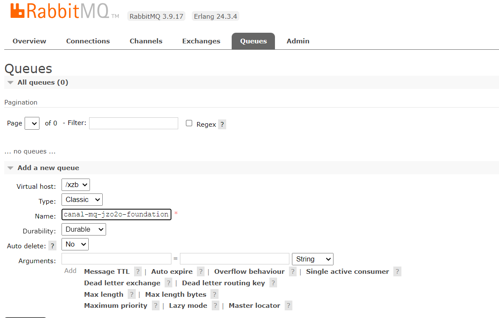
> 图注：该图片展示了RabbitMQ管理界面的Queues页面，处于配置Canal+RabbitMQ的步骤中，用于创建指定名称的队列。页面顶部为RabbitMQ相关信息，当前所有队列数量为0，下方“Add a new queue”模块中，Virtual host选择为Classic，队列名称已被标识，为canal-mq-jzo2o-foundations，Durability选项为Durable，其他配置项包含Auto delete为No，Arguments区域有Message TTL、Auto expire等可配置选项，该页面是完成Canal+RabbitMQ配置中创建队列步骤的界面呈现。

绑定交换机：

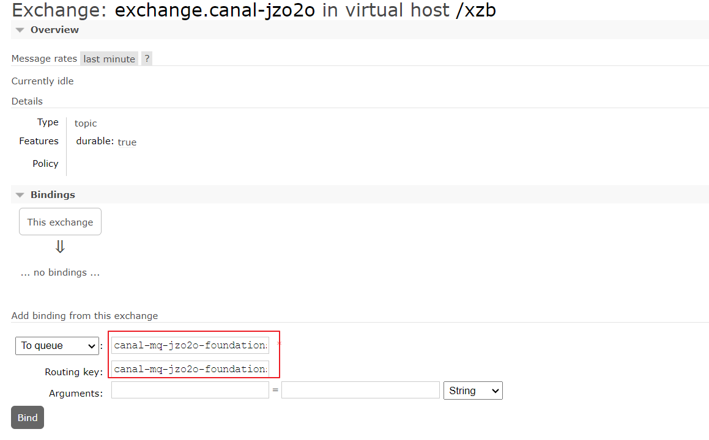
> 图注：图片展示的是rabbitMQ中exchange.canal-jzo2o的配置界面。在“Bindings”区域，下拉框“To queue”被选中，其右侧显示“canal-mq-jzo2o-foundations”和“canal-mq-jzo2o-...”等队列名称。该图片与上文“配置Canal+RabbitMQ”中“进入rabbitMQ配置交换机和队列”部分相关，是对创建交换机后，进行队列绑定操作的展示，直观呈现了队列名称等关键信息。

绑定成功：

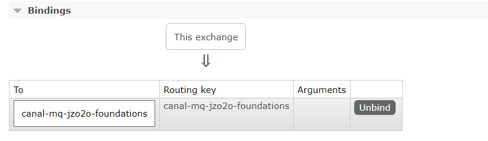
> 图注：图片展示了rabbitMQ配置中交换机和队列的绑定成功界面。上方“Bindings”标题下，有“This exchange”按钮，下方“To”栏显示队列名称“canal-mq-jzo2o-foundations”，“Routing key”栏为“canal-mq-jzo2o-foundations”，“Arguments”栏为空，右侧有“Unbind”按钮。该图片与上文配置Canal+RabbitMQ中创建交换机、队列及绑定的内容相关，直观呈现了绑定成功后的状态。


### 1.5 测试数据同步

重启canal

修改jzo2o-foundations数据库的serve_sync表的数据，稍等片刻查看canal-mq-jzo2o-foundations队列，如果队列中有的消息说明同步成功，如下 图：

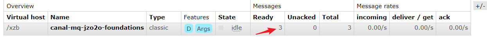
> 图注：这张图片展示了RabbitMQ队列的相关信息界面，具体显示了Virtual host为/xzb、名称为canal-mq-jzo2o-foundations的队列详情。该队列类型为classic，状态为idle，在Messages区域的Ready一栏有数值3，且箭头指向该数值，其余数值中Unacked为0、Total为3，Message rates区域的incoming、deliver / get、ack项数值均为0.00/s。该图片用于配合文档中测试数据同步的内容，是验证Canal与MQ数据同步是否成功的直观参考，当该队列Ready存在有效消息时，即表明同步操作生效。

如果没有同步到 MQ参考常见问题中“数据不同步”进行解决。


我们可以查询队列中的消息内容发现它一条type为"UPDATE"的消息，如下所示：

```JSON
{
   "data" : [
      {
         "city_code" : "010",
         "detail_img" : "https://yjy-xzbjzfw-oss.oss-cn-hangzhou.aliyuncs.com/be1449d6-1c2d-4cca-9f8a-4b562b79998d.jpg",
         "hot_time_stamp" : "1692256062300",
         "id" : "1686352662791016449",
         "is_hot" : "1",
         "price" : "5.0",
         "serve_item_icon" : "https://yjy-xzbjzfw-oss.oss-cn-hangzhou.aliyuncs.com/8179d29c-6b85-4c08-aa13-08429a91d86a.png",
         "serve_item_id" : "1678727478181957634",
         "serve_item_img" : "https://yjy-xzbjzfw-oss.oss-cn-hangzhou.aliyuncs.com/9b87ab7c-9592-4090-9299-5bcf97409fb9.png",
         "serve_item_name" : "日常维修ab",
         "serve_item_sort_num" : "6",
         "serve_type_icon" : "https://yjy-xzbjzfw-oss.oss-cn-hangzhou.aliyuncs.com/c8725882-1fa7-49a6-94ab-cac2530b3b7b.png",
         "serve_type_id" : "1678654490336124929",
         "serve_type_img" : "https://yjy-xzbjzfw-oss.oss-cn-hangzhou.aliyuncs.com/00ba6d8a-fd7e-4691-8415-8ada95004b33.png",
         "serve_type_name" : "日常维修12",
         "serve_type_sort_num" : "2",
         "unit" : "1"
      }
   ],
   "database" : "jzo2o-foundations",
   "es" : 1697443035000.0,
   "id" : 1,
   "isDdl" : false,
   "mysqlType" : {
      "city_code" : "varchar(20)",
      "detail_img" : "varchar(255)",
      "hot_time_stamp" : "bigint",
      "id" : "bigint",
      "is_hot" : "int",
      "price" : "decimal(10,2)",
      "serve_item_icon" : "varchar(255)",
      "serve_item_id" : "bigint",
      "serve_item_img" : "varchar(255)",
      "serve_item_name" : "varchar(100)",
      "serve_item_sort_num" : "int",
      "serve_type_icon" : "varchar(255)",
      "serve_type_id" : "bigint",
      "serve_type_img" : "varchar(255)",
      "serve_type_name" : "varchar(255)",
      "serve_type_sort_num" : "int",
      "unit" : "int"
   },
   "old" : [
      {
         "serve_item_name" : "日常维修a"
      }
   ],
   "pkNames" : [ "id" ],
   "sql" : "",
   "sqlType" : {
      "city_code" : 12,
      "detail_img" : 12,
      "hot_time_stamp" : -5,
      "id" : -5,
      "is_hot" : 4,
      "price" : 3,
      "serve_item_icon" : 12,
      "serve_item_id" : -5,
      "serve_item_img" : 12,
      "serve_item_name" : 12,
      "serve_item_sort_num" : 4,
      "serve_type_icon" : 12,
      "serve_type_id" : -5,
      "serve_type_img" : 12,
      "serve_type_name" : 12,
      "serve_type_sort_num" : 4,
      "unit" : 4
   },
   "table" : "serve_sync",
   "ts" : 1697443782457.0,
   "type" : "UPDATE"
}

```


### 1.5 配置其它同步队列

按上边的方法配置以下同步队列并与交换机绑定：

canal-mq-jzo2o-customer-provider

canal-mq-jzo2o-foundations

canal-mq-jzo2o-market-resource

canal-mq-jzo2o-orders-dispatch

canal-mq-jzo2o-orders-history

canal-mq-jzo2o-orders-provider

canal-mq-jzo2o-orders-seize

canal-mq-jzo2o-orders-serve-history


先创建队列，再将队列绑定到交换机。


配置完成如下：


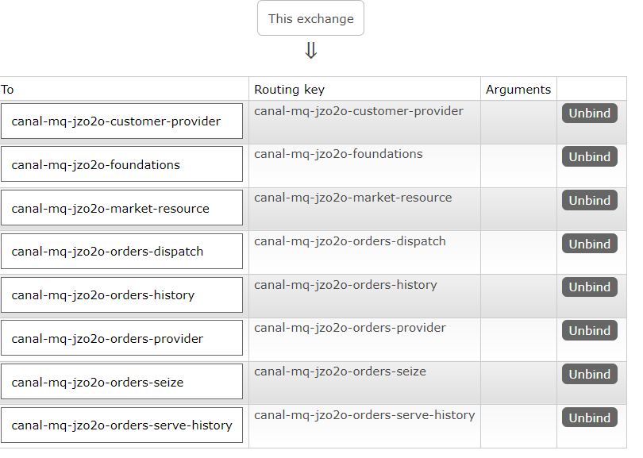
> 图注：这张图片展示了配置完成后的消息队列与交换机绑定的相关配置信息，对应文档中配置ES索引同步环境时，按要求完成同步队列创建及绑定的配置结果。图片呈现了表格内容，表格包含三列，分别为“To”“Routing key”“Arguments”，其中“To”列和“Routing key”列的内容完全一致，罗列了多个同步队列的名称，如canal-mq-jzo2o-customer-provider、canal-mq-jzo2o-foundations等，每个队列对应的“Arguments”列均显示为“Unbind”，表明这些队列均已完成与指定交换机的绑定配置，该结果呼应了文档中配置完成相关同步队列绑定的内容要求。

查询队列如下：

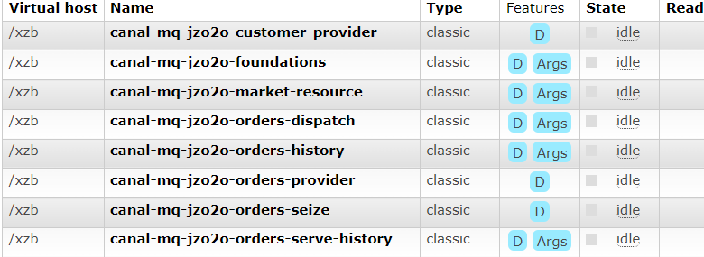
> 图注：图片展示的是消息队列RabbitMQ管理控制台中队列列表。表格包含Virtual host、Name、Type、Features、State、Read等列。其中，Name列有多个队列名称，如canal-mq-jzo2o-customer-provider等，Type均为classic，Features列有部分显示“Args”，State均为idle，Read列显示为灰色。


## 常见问题

### 数据不同步

当发现修改了数据库后修改的数据并没有发送到MQ，通过查看Canal的日志发现下边的错误。

进入Canal目录，查看日志：

```Java
cd /data/soft/canal/logs
tail -f logs/xzb-canal.log 
```

Canal报错如下：

```Java
2023-09-22 08:34:40.802 [destination = xzb-canal , address = /192.168.101.68:3306 , EventParser] WARN  c.a.o.c.p.inbound.mysql.rds.RdsBinlogEventParserProxy - ---> find start position successfully, EntryPosition[included=false,journalName=mysql-bin.000055,position=486221,serverId=1,gtid=,timestamp=1695341830000] cost : 13ms , the next step is binlog dump
2023-09-22 08:34:40.811 [destination = xzb-canal , address = /192.168.101.68:3306 , EventParser] ERROR c.a.o.canal.parse.inbound.mysql.dbsync.DirectLogFetcher - I/O error while reading from client socket
java.io.IOException: Received error packet: errno = 1236, sqlstate = HY000 errmsg = Could not find first log file name in binary log index file
        at com.alibaba.otter.canal.parse.inbound.mysql.dbsync.DirectLogFetcher.fetch(DirectLogFetcher.java:102) ~[canal.parse-1.1.5.jar:na]
        at com.alibaba.otter.canal.parse.inbound.mysql.MysqlConnection.dump(MysqlConnection.java:238) [canal.parse-1.1.5.jar:na]
        at com.alibaba.otter.canal.parse.inbound.AbstractEventParser$1.run(AbstractEventParser.java:262) [canal.parse-1.1.5.jar:na]
        at java.lang.Thread.run(Thread.java:748) [na:1.8.0_181]
```

找到关键的位置：**Could not find first log file name in binary log index file**

根据日志分析是Canal找不到mysql-bin.000055 的486221位置，原因是mysql-bin.000055文件不存在，这是由于为了节省磁盘空间将binlog日志清理了。


解决方法：

把canal复位从最开始开始同步的位置。

1）首先重置mysql的bin log：

连接mysql执行：reset master

执行后所有的binlog删除，从000001号开始

通过show master status;查看 ，结果显示 mysql-bin.000001

2）先停止canal

docker stop canal

3）删除meta.dat

 rm -rf /data/soft/canal/conf/meta.dat 

4) 再启动canal

docker start canal


### MQ同步消息无法消费

这里以Es和MySQL之间的同步举例：

当出现ES和MySQL数据不同步时可能会出现MQ的同步消息无法被消费，比如：从MySQL删除一条记录通过同步程序将ES中对应的记录进行删除，此时由于ES中没有该记录导致删除ES中的记录失败。出现此问题的原因是因为测试数据混乱导致，可以手动将MQ中的消息删除。

进入MQ的管理控制台，进入要清理消息的队列，通过purge功能清理消息：


> 图注：图片展示的是MQ管理控制台中“Purge”功能下的“Purge Messages”按钮。该图片与文档中“MQ同步消息无法消费”问题的解决方法相关，当出现ES和MySQL数据不同步导致MQ同步消息无法被消费时，可通过进入MQ管理控制台，进入要清理消息的队列，点击此按钮，执行purge功能来清理消息，从而解决此问题。

---
> 来源：飞书技术知识库（脱敏版） · 07 业务组件方案集 / 云岚到家项目 / 第五章 搜索模块 / 配置ES索引同步环境v1.0 · [原文](https://ccn8v2zngwsm.feishu.cn/wiki/Jr3mwWQKmi7IJdkw6OAc0wD2n0c)
