# 开发环境配置

## 配置要求

工欲善其事必先利其器。

个人电脑内存至少24G以上（为了更好的学习最好升级到32G）不符合条件的同学趁休息日升级电脑。

有条件的购买便携显示器进行分屏开发，开发效率杠杠滴，这是专业程序员的标配。

从下边的地址下载全部资料，按照本文档要求安装配置虚拟机及软件环境。

开发环境文件下载地址：

虚拟机：链接：https://pan.baidu.com/s/1VOWFqY7LucKgDu1yA_xM_Q?pwd=1234 

本地maven仓库：链接：https://pan.baidu.com/s/1wqrnwApF_c99huvWcoZhCA 提取码：1234


## **1 开发工具版本**

开发工具列表：

<sheet sheet-id="1UGAsP" token="IHuKsnVTihAJuhtDEwmch1RgnCe"></sheet>


## 2 **IDEA环境配置**

安装IDEA，根据下边的步骤进行配置。

### **2.1 编码配置**

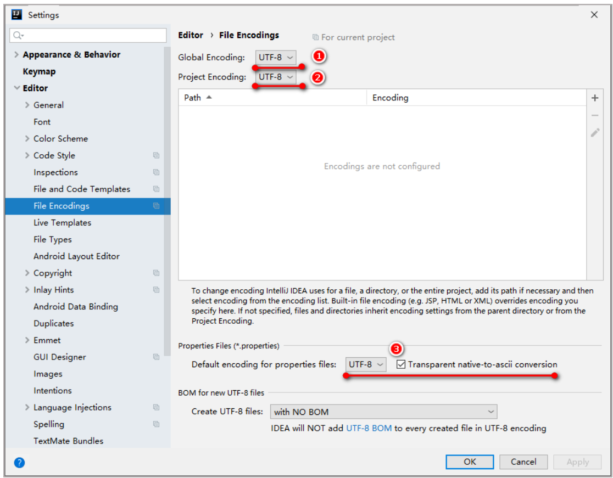
> 图注：这是IDEA开发环境的编码配置设置界面截图，左侧选中“File Encodings”选项，右侧为当前项目的编码设置区域。界面中重点突出两处设置：一是“Global Encoding”和“Project Encoding”均设置为UTF-8，配有红色箭头标注；二是“Default encoding for properties files”设置为UTF-8，同时勾选了“Transparent native-to-ascii conversion”选项，下方显示“Encodings are not configured”的提示文字，可用于修改IDEA中项目全局、项目本身及属性文件的编码格式。

### 2.2 **自动导包设置**

IDEA可以自动优化导入包，**但是有多个同名的类调用不同的包，必须自己手动Alt+Enter设置**，  
下面可以通过设置来进行导包优化。

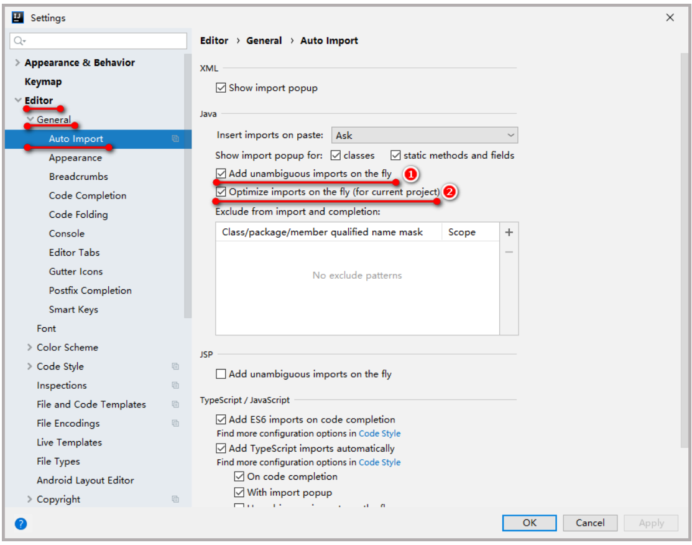
> 图注：图片展示的是IntelliJ IDEA中“Settings”窗口下的“Editor”设置界面，具体在“Auto Import”选项卡下。界面中有多个设置项，其中“Add unambiguous imports on the fly”（①）和“Optimize imports on the fly (for current project)”（②）两个选项被红色框突出显示。该图片与文档中“IDEA环境配置”部分内容相关，用于说明在IDEA中设置代码提示忽略大小写及优化导入代码的操作步骤，是配置IDEA环境时的参考设置界面。

### 2.3 **提示忽略大小写**

IDEA代码提示默认是区分大小写的，设置为提示忽略大小写，编译我们后期的开发

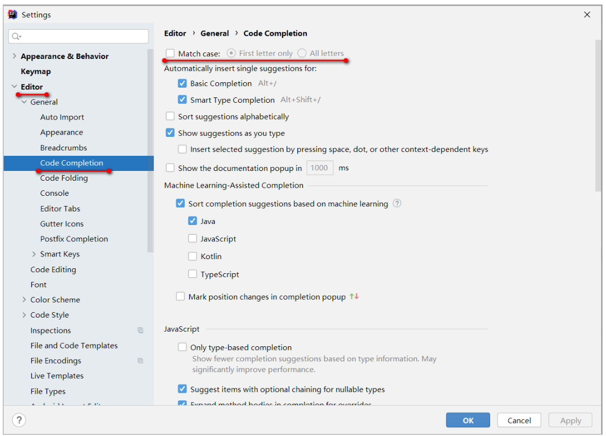
> 图注：这张图片展示的是IDEA设置里的“Editor > General > Code Completion”界面，用于设置代码提示的忽略大小写相关配置。左侧菜单栏选中了“Code Completion”选项，右侧设置区域里，“Automaticaly insert single suggestions for”下方，“Match case”选项已取消勾选，同时“First letter only”和“All letters”选项被选中，实现了代码提示忽略大小写的功能，这与文档中2.3节“设置提示忽略大小写”的内容对应，可帮助开发者更便捷地进行代码输入。

### 2.4 **设置 Java 编译级别**

工程创建成功，点击Project Structure:

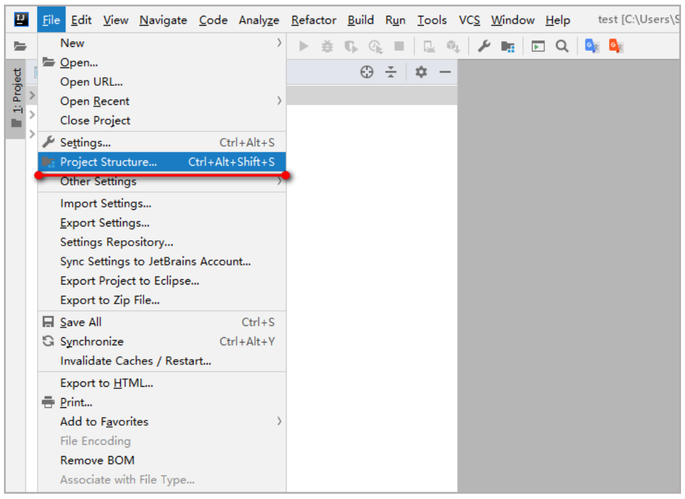
> 图注：图片展示了IDEA软件的File菜单界面。在File菜单下，用红色框和箭头突出显示了“Project Structure...”选项，其快捷键为Ctrl+Alt+Shift+S。该图片与文档中“设置Java编译级别”部分内容相关，用于指导用户在IDEA中点击Project Structure...以设置SDK为11及Project language level，是后续操作的指引图示。

点击Project，设置SDK为11及Project language level，如下图：

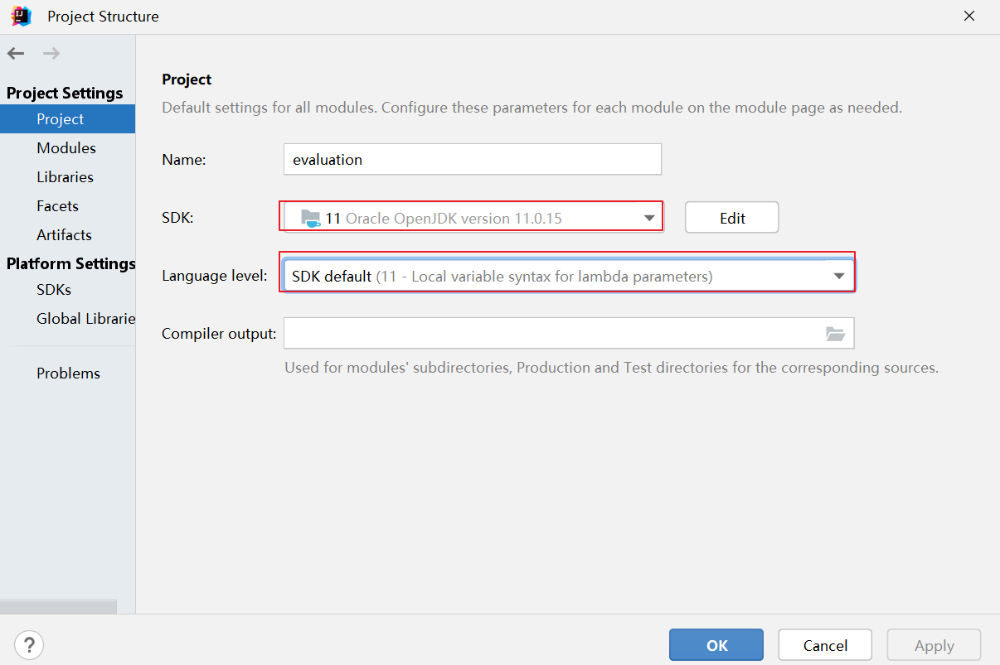
> 图注：图片展示的是IDEA中Project Structure的设置界面。在“Project Settings”下，选中“Project”，界面中“SDK”处显示为“11 Oracle OpenJDK version 11.0.15”，右侧有“Edit”按钮；“Language level”下拉菜单被红色框突出显示，当前选中“SDK default (11 - Local variable syntax for lambda parameters)”。该图片与文档中“设置Java编译级别”部分内容相关，用于指导用户在IDEA中设置项目SDK和语言级别。

## 3 Maven环境

### 3.1 安装Maven

下载maven3.8.6版本，下载链接如下：

https://dlcdn.apache.org/maven/maven-3/3.8.6/binaries/apache-maven-3.8.6-bin.zip

解压apache-maven-3.8.6-bin.zip到没有中文的目录下。

### 3.2 **配置仓库**

1、解压课程资料中的maven仓库下的repository.zip到本地硬盘

2、在Maven的conf目录中setting.xml文件中配置本地仓库的地址。

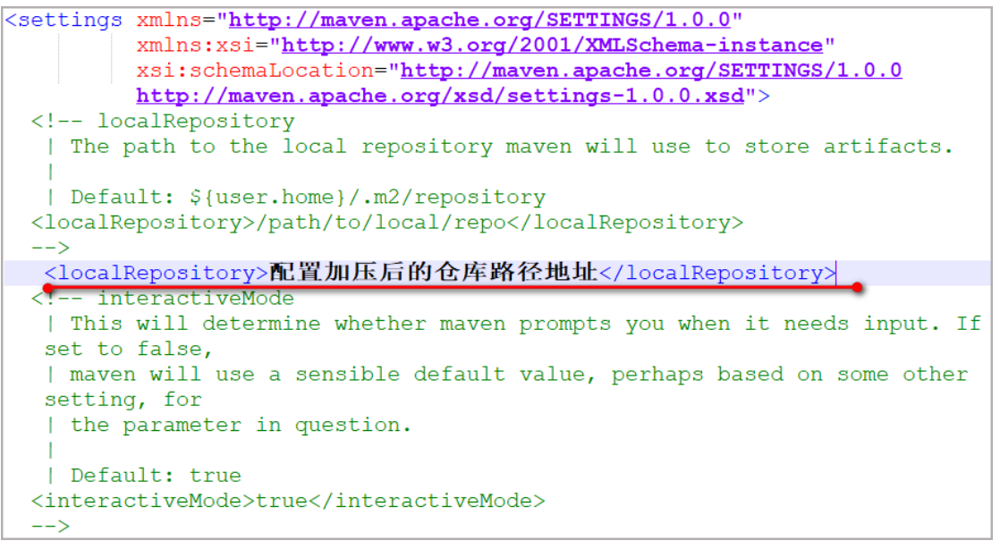
> 图注：这张图片展示的是Maven的settings.xml配置文件代码内容，其中核心突出的部分是<localRepository>标签，该标签中被标注出的内容为“配置加压后的仓库路径地址”，对应文档中“解压课程资料中的maven仓库下的repository.zip到本地硬盘，再在Maven的conf目录的setting.xml文件中配置本地仓库地址”的配置步骤，这处配置是为Maven指定本地仓库的存储路径，图片也直观呈现了配置本地仓库地址时对应的代码位置。

配置中央仓库位置：

在setting.xml文件中配置阿里云中央仓库地址。

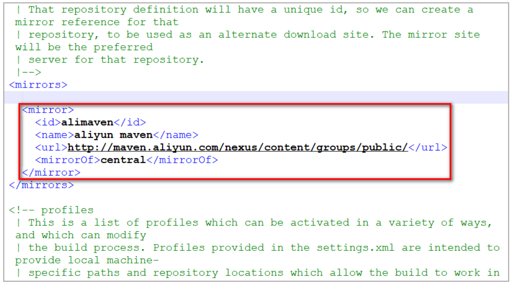
> 图注：这张图片展示了Maven的setting.xml配置文件中的mirrors节点代码片段，核心内容为配置阿里云中央仓库的相关信息。其中红色方框标注的部分，id设为alimaven，名称为aliyun maven，URL指向阿里云的镜像仓库地址，同时设置mirrorOf属性为central，以此将Maven的中央仓库镜像配置为阿里云的镜像，这一配置是为了提升Maven依赖下载的速度，符合文档中关于配置中央仓库位置的操作要求。

### **3.3 IDEA中配置maven**

在IDEA中配置maven：进入 File --> Settings --> Build --> Build Tools --> Maven

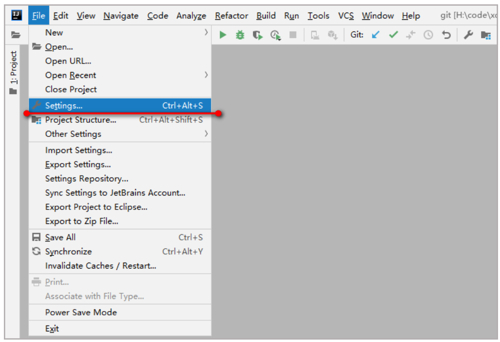
> 图注：图片展示了IDEA软件的File菜单界面。在File菜单下，用红色框和箭头突出显示了“Settings...”选项，其快捷键为“Ctrl+Alt+S”。该图片与文档中“3.3 IDEA中配置maven”部分内容相关，对应配置IDEA中maven时，需进入File-->Settings-->Build-->Build Tools-->Maven的操作步骤，直观呈现了在IDEA中打开设置的路径。

配置maven安装目录、setting.xml及本地仓库的位置。

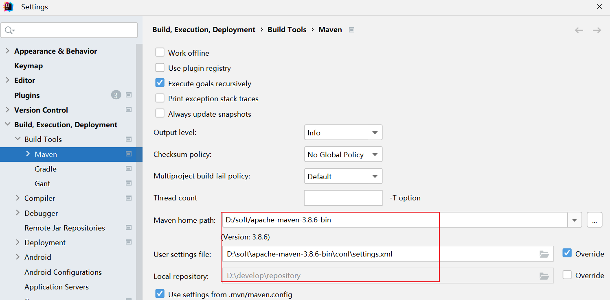
> 图注：图片展示了IDEA中配置Maven的设置界面。左侧为设置菜单，选中“Build Tools”下的“Maven”。右侧是Maven相关设置，包括是否离线工作、是否使用插件仓库等选项，以及Maven home path、User settings file和Local repository的路径设置，其中Maven home path为D:/soft/apache-maven-3.8.6-bin，User settings file为D:/soft/apache-maven-3.8.6-bin/conf/settings.xml，Local repository为D:/develop/repository。该图片与文档中“3.3 IDEA中配置maven”内容对应，直观呈现了配置步骤中设置界面的样式和关键路径信息。


## 4 配置虚拟机

### 4.1 导入虚拟机

项目中用到的一些服务端软件如：Nacos配置中心、Redis、RabbitMQ消息队列等通常会安装在企业局域网的服务器中，开发人员去远程连接它们。在教学中我们在自己的电脑上安装虚拟机，虚拟机代表了企业局域网中的服务器。

服务器操作系统使用Centos7，导入下发的虚拟机文件，也可以自行安装Centos7虚拟机。

**1、导入虚拟机：**

首先安装VMware-workstation 16.x 或 VMware-workstation 17.x 虚拟机软件（**已安装vmware软件的同学不需要重新安装**），可从课程资料“软件工具”目录获取安装程序（VMwareworkstation16.rar）。

**1）设置网络**

点击 “编辑--》虚拟网络编辑器”配置网络地址，地址须与下图一致。

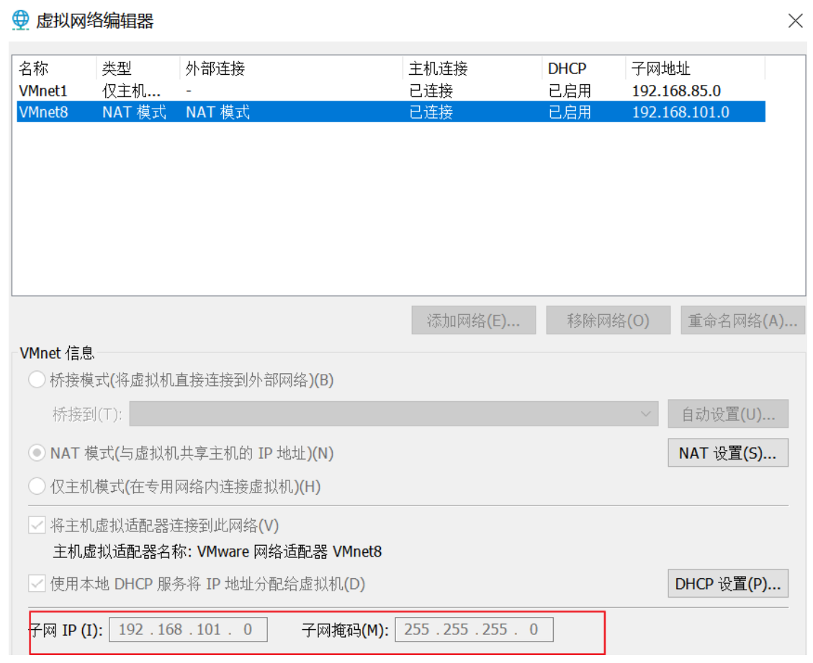
> 图注：这是虚拟网络编辑器的配置界面，界面中已选中VMnet8条目，其类型为NAT模式，外部连接状态为已连接，DHCP处于已启用状态，子网地址为192.168.101.0。界面下方的VMnet信息区域中，“NAT模式(与虚拟机共享主机的IP地址)”选项被选中，设置子网IP为192.168.101.0，子网掩码为255.255.255.0，对应文档配置网络步骤中要求的参数，红色框突出显示了这两个核心配置项。

设置子网IP：192.168.101.0，子网掩码：255.255.255.0。

**2）导入虚拟机**

解压老师提供的虚拟机文件，进入解压后的文件架，双击"CentOS 7 64 位.vmx" 文件，选择复制虚拟机。

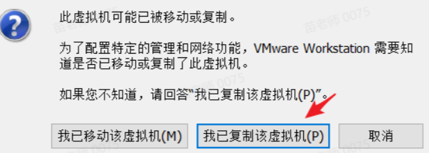
> 图注：图片显示的是在VMware Workstation中导入虚拟机时出现的提示窗口。窗口提示“此虚拟机可能已被移动或复制”，并询问是否已移动或复制该虚拟机，有“我已移动该虚拟机”和“我已复制该虚拟机”两个选项，以及“取消”按钮。该图片与文档中“导入虚拟机”步骤相关，用于指导用户在导入虚拟机时确认是否已复制该虚拟机，以完成导入操作。

对此虚拟机的设置建议至少8G内存、8核CPU，硬盘存储至少40G。

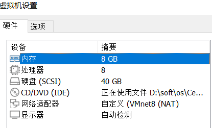
> 图注：图片展示了虚拟机设置界面中硬件配置情况。内存设置为8GB，处理器为8核，硬盘（SCSI）存储为40GB，CD/DVD（IDE）正在使用文件D:\\soft\\os\\CentOS 7.6.1810\\CentOS 7.6.1810-64bit.vmdk，网络适配器为自定义（VMnet8 (NAT)），显示器为自动检测。该图片与文档中“导入虚拟机”步骤相关，是对对此虚拟机设置建议至少8G内存、8核CPU，硬盘存储至少40G的具体配置展示。

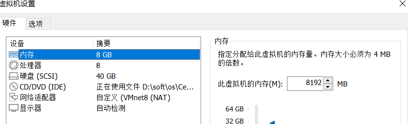
> 图注：图片展示的是虚拟机设置界面。左侧为硬件设置，包括内存8GB、处理器8核、硬盘40GB、CD/DVD（IDE）正在使用文件、网络适配器自定义（VMnet8 (NAT)）、显示器自动检测等。右侧是内存设置，显示此虚拟机的内存为8192MB，可选择64GB、32GB等不同内存大小。该图片与文档中“导入虚拟机”步骤相关，是对设置完成后的虚拟机配置情况展示，建议至少8G内存、8核CPU、40G硬盘存储。

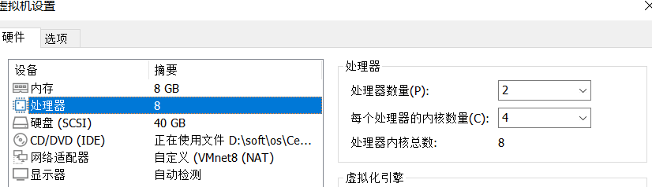
> 图注：图片展示了虚拟机设置界面中“处理器”相关配置。内存为8GB，硬盘40GB，CD/DVD（IDE）使用D盘文件，网络适配器为自定义（VMnet8），显示器自动检测。处理器部分，处理器数量为2，每个处理器的内核数量为4，处理器内核总数为8。该图片与文档中“导入虚拟机”步骤相关，是对对此虚拟机设置建议中至少8G内存、8核CPU等配置的直观呈现。

设置完成，启动虚拟机。

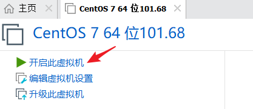
> 图注：这张图片展示的是CentOS 7 64位虚拟机的相关操作界面，界面清晰呈现了“开启此虚拟机”“编辑虚拟机设置”“升级此虚拟机”三个操作选项，其中“开启此虚拟机”选项带有绿色箭头标识，且有红色箭头指向该选项，对应上下文里“设置完成，启动虚拟机”的内容，是虚拟机启动操作的关键步骤指引界面，契合开发环境配置中虚拟机启动环节的操作指引需求。

注意：虚拟机的IP地址为192.168.101.68，不用修改IP地址。

虚拟机启动成功如下界面：

**注意：不用点击进行登录。**

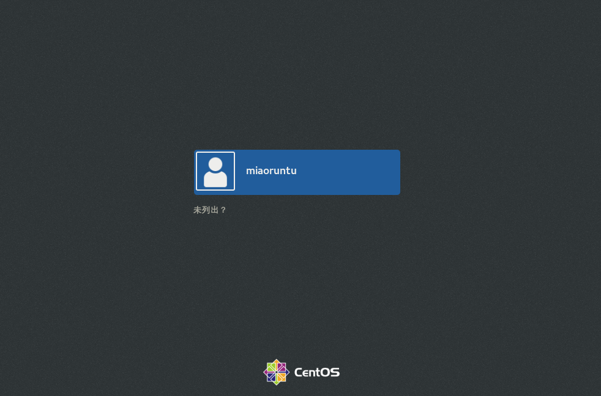
> 图注：这张图是配置虚拟机流程里的CentOS虚拟机启动成功后的登录界面，界面中显示了名为“miaoruntu”的用户选项，下方有“未列出？”的选项，底部带有CentOS的标识。该界面所在的上下文提醒，此时不用点击进行登录，后续要使用FinalShell远程连接该虚拟机，且该虚拟机的IP地址为192.168.101.68，无需修改。

**3）远程连接虚拟机**

虚拟机启动成功，下边使用ssh客户端工具（FinalShell）远程 连接 虚拟机。

打开FinalShell软件，没有安装的可以从课程资料“软件工具”目录获取安装程序（finalshell_install.exe）。

通过下图所示建立新连接：

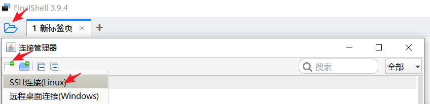
> 图注：图片展示了FinalShell 3.9.4软件界面。界面上方有“1新标签页”和“+”按钮，左侧有“连接管理器”选项，下方有“SSH连接(Linux)”和“远程桌面连接(Windows)”选项。该图片对应文档中“4.1导入虚拟机”部分，用于说明通过下图所示建立新连接的操作，即点击“连接管理器”下的“SSH连接(Linux)”选项，以导入虚拟机。

填写连接信息：

IP地址：192.168.101.68

账号与密码为：root/centos

如下图：

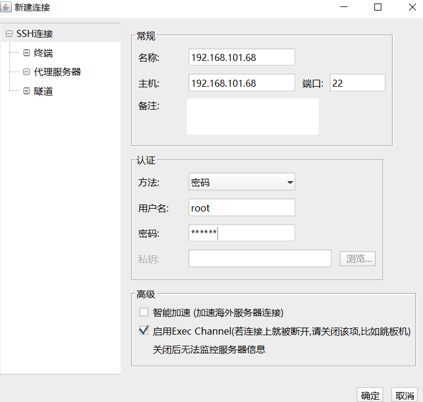
> 图注：图片展示的是新建连接界面，用于配置SSH连接信息。界面左侧有“SSH连接”分类，包含终端、代理服务器、隧道等选项。右侧常规部分显示名称为192.168.101.68，主机同为192.168.101.68，端口22，备注为空。认证部分方法为密码，用户名为root，密码为“* * * * * * * * * * * *”，私钥为空。高级部分有智能加速选项，启用Exec Channel选项被勾选。

点击“确定”，创建连接成功，如下图：


> 图注：这是配置虚拟机过程中的界面，属于连接管理器窗口内容。窗口内展示了一条已有的连接项，该连接的IP地址为192.168.101.68，端口为22，账号为root，画面配有指向该连接项的红色箭头，同时标注了“双击”的操作提示，对应文档中“双击连接信息，连接成功”的相关操作步骤。

双击连接信息，连接成功如下图：


执行 systemctl start docker 启动docker。


启动mysql：docker start mysql

启动redis：docker start redis

启动nacos：docker start nacos2.4.0.1

以上软件如果已经启动不用重复启动**。**

查询docker容器：docker ps

如下图：

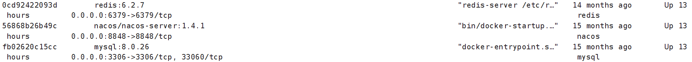
> 图注：图片展示了通过docker ps -a查询到的全部安装容器信息。左侧列出了容器ID，右侧依次显示容器名称、命令、创建时间、状态等。其中，redis容器ID为0cd92422093d，状态为Up 13天；nacos容器ID为56868b26b49c，状态为Up 13天；mysql容器ID为fb02620c15cc，状态为Up 13天。该图片与上文配置虚拟机后查询docker容器的内容相关，直观呈现了查询结果。

虚拟机已经安装了项目使用的软件，可通过docker ps -a查询全部安装的容器，具体在使用时再进行启动。


### 4.2 问题

win11打开.vmx文件报错：“未能启动虚拟机”

尝试解决方法：

1. 打开虚拟机的存放路径
2. 找到.vmx的配置文件
3. 修改 virtualHW.version改为virtualHW.version = "18"


## 5 配置数据库环境

### 5.1 **启动mysql容器**

首先确保Docker容器中的MySQL8已经启动。

运行docker ps命令进行查看：

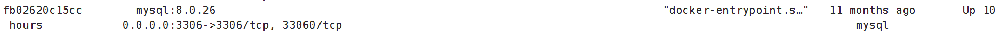
> 图注：这是执行`docker ps`命令后得到的容器运行状态信息，显示当前处于运行状态的容器为MySQL，其镜像版本为mysql:8.0.26，容器ID为fb02620c15cc。该容器的端口映射为0.0.0.0:3306->3306/tcp，同时还开放了33060/tcp端口，此容器已运行10小时。该内容用于在配置数据库环境时，验证MySQL容器是否成功启动，是启动mysql容器步骤后的关键查看结果，为后续使用MySQL客户端连接数据库提供了运行状态的依据。

### 5.2 **使用MySQL客户端连接数据库。**

下边使用DataGrip 客户端连接数据库。

客户端工具不作限制，讲义中使用的是DataGrip ，安装程序从课程资料获取（datagrip-2022.2.2.win.zip）。

首先创建数据源

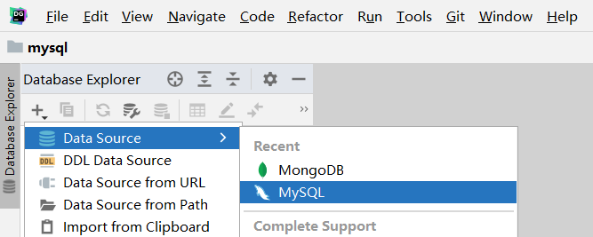
> 图注：图片展示的是DataGrip软件中Database Explorer的下拉菜单界面。在“Database Explorer”选项右侧，有一个下拉箭头，点击后弹出下拉菜单，其中“Data Source”选项被突出显示，其下有“MySQL”选项被选中。该图片与文档中“5.1配置数据库环境”章节下“启动mysql容器”部分内容相关，用于说明在DataGrip中创建数据源时，选择MySQL数据源的操作步骤。

填写数据源信息

账号：root   密码：mysql

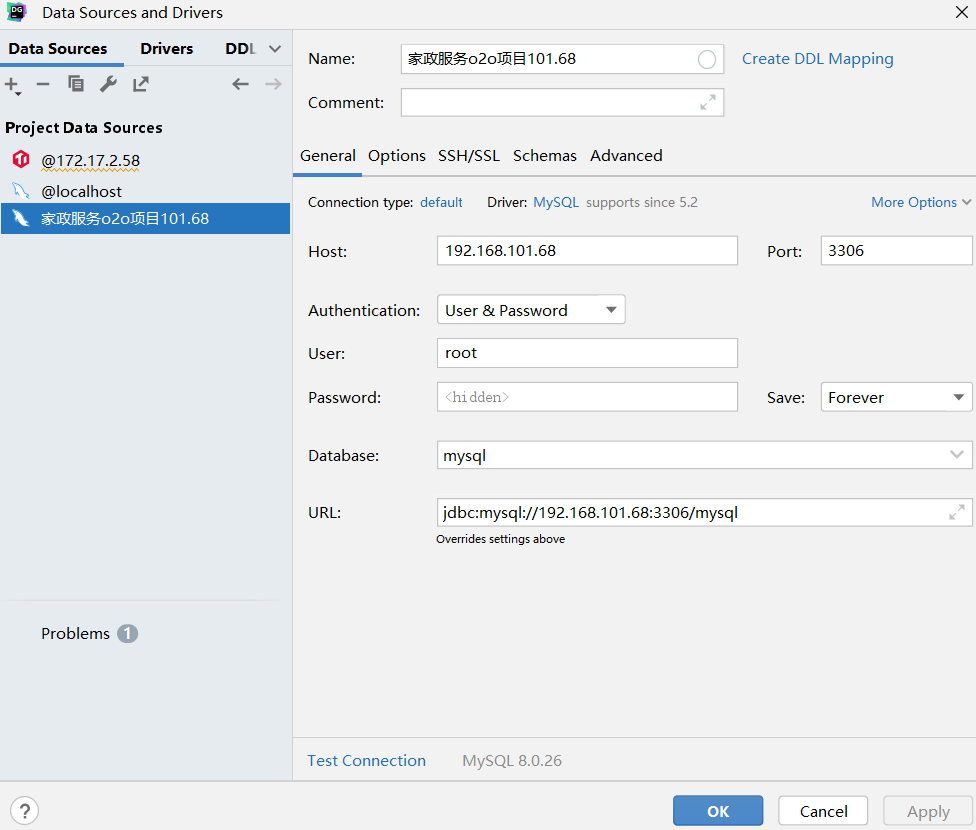
> 图注：图片展示的是DataGrip中创建数据源的界面。在“Data Sources and Drivers”窗口中，选中“Data Sources”选项卡，左侧列表显示“@172.17.2.58”和“家政服务o2o项目101.68”两个数据源。右侧“General”标签页下，Name处显示“家政服务o2o项目101.68”，Host为192.168.101.68，Port为3306，Authentication为User & Password，User为root，Password为“hidden”，Database为mysql，URL为jdbc:mysql://192.168.101.68:3306/mysql。该图片与文档中配置数据库环境，创建数据源并填写相关信息的内容相关。


点击"Test Connection" 测试成功

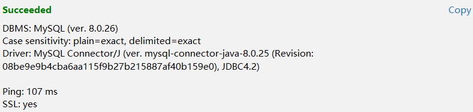
> 图注：图片展示的是MySQL数据库连接测试结果。上方显示“Succeeded”，表明测试成功。下方详细信息包括DBMS版本为MySQL 8.0.26，区分大小写情况为plain=exact、delimited=exact，驱动为MySQL Connector/J 8.0.25，Ping时间为107ms，SSL状态为yes。该图片与上文“点击‘Test Connection’测试成功”内容对应，直观呈现了测试结果。

在下发的虚拟机中MySQL数据库已经包括了项目使用的数据库。

下边通过客户端工具查询 jzo2o-foundations数据库的信息。

显示jzo2o-foundations数据库，如下图：

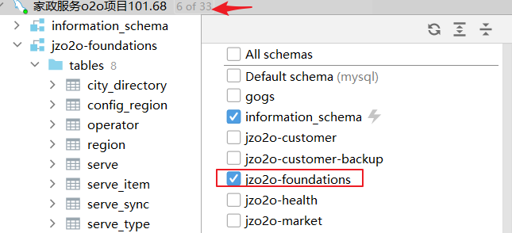
> 图注：这张图片展示的是数据库管理工具的界面，左侧显示了数据库服务目录，已展开名为jzo2o-foundations的数据库，标注出其包含的8张表，分别为city_directory、config_region、operator、region、serve、serve_item、serve_sync、serve_type。右侧的数据库选择面板中，information_schema和jzo2o-foundations选项被勾选，其中jzo2o-foundations选项以红色框突出显示，界面顶部显示当前打开的是家政服务o2o项目的101.68数据库。该图片对应开发环境配置文档中查看jzo2o-foundations数据库的环节，直观呈现了该数据库的表数量及选中状态，佐证了该数据库总计8张表的描述。

通过上图可知jzo2o-foundations数据库总共8张表。


### 5.3 **创建 jzo2o-foundations数据库**

如果没有使用下发的虚拟机则需要自行创建 jzo2o-foundations数据库。

首先创建 jzo2o-foundations数据库：

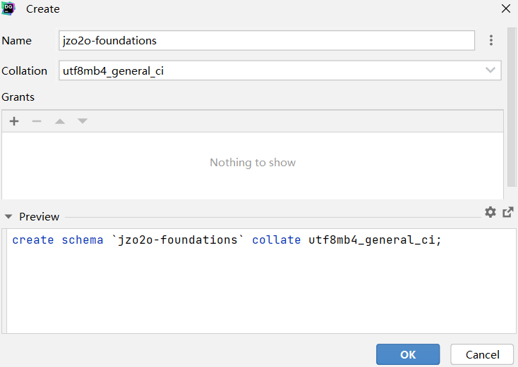
> 图注：这张图片是数据库管理工具中创建数据库的操作界面，对应创建jzo2o-foundations数据库的步骤。界面中，Name栏已输入目标数据库名“jzo2o-foundations”，Collation栏选中的排序规则为“utf8mb4_general_ci”，Grants区域暂无内容，下方Preview栏显示了对应的SQL语句“create schema `jzo2o-foundations` collate utf8mb4_general_ci;”，界面右下角设有OK和Cancel按钮，用于确认或取消本次创建操作，该界面用于完成文档中要求的jzo2o-foundations数据库的创建工作。

接下来导入数据：

从课程资料下的“sql脚本”目录拿到 jzo2o-foundations-init.sql，下边导入数据：


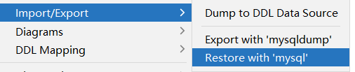
> 图注：图片展示了Navicat for MySQL软件中“Import/Export”菜单下的选项。其中，“Restore with 'mysql'”选项被红色框线突出显示。该图片与文档中“创建jzo2o-foundations数据库”部分内容相关，用于说明在导入jzo2o-foundations-init.sql数据后，通过客户端工具查看jzo2o-foundations数据库信息时，执行完成后的操作步骤，即通过“Restore with 'mysql'”选项进行数据库恢复操作。

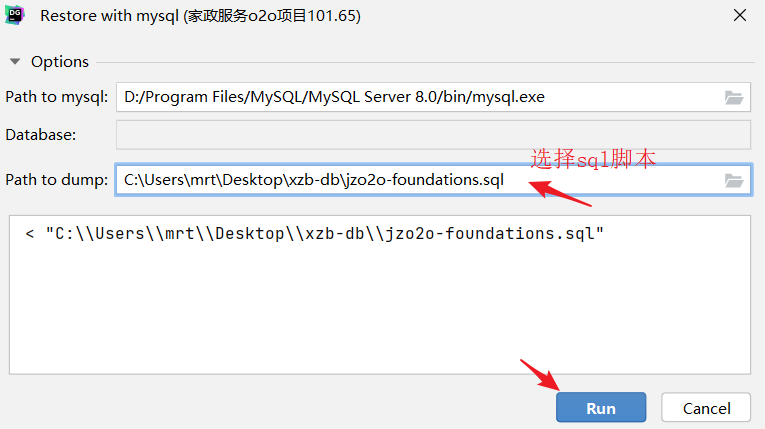
> 图注：这张图是“Restore with mysql”工具的操作界面，用于导入数据库数据，对应文档中导入jzo2o-foundations数据库数据的环节。界面里“Path to dump”栏已选定课程资料中的jzo2o-foundations.sql脚本文件，界面有红色箭头标注该sql脚本路径栏，并提示“选择sql脚本”，还有一个红色箭头指向“Run”按钮，用于启动数据导入操作，上方还显示了本地MySQL的可执行文件路径，当前Database栏为空。

执行完成， 通过客户端工具查看jzo2o-foundations数据库信息，如下图：

jzo2o-foundations数据库共8张表。

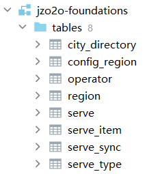
> 图注：该图片展示了jzo2o-foundations数据库的表结构，对应文档中创建该数据库并导入数据的步骤内容，直观呈现了该数据库包含的8张表，分别为city_directory、config_region、operator、region、serve、serve_item、serve_sync、serve_type，清晰体现出该数据库的表组成情况，与文档中“jzo2o-foundations数据库共8张表”的描述内容相对应。


## 6 配置Redis环境

### 6.1 **启动redis容器**

首先确保Docker容器中的redis已经启动，没有启动运行docker start redis启动redis。

运行docker ps命令进行查看：

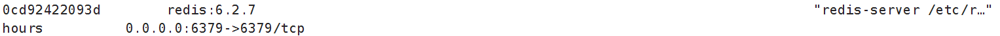
> 图注：该图片是运行docker ps命令后查看的结果内容，呈现的是Redis容器的相关信息，包含容器ID为0cd92422093d，对应的Redis版本为6.2.7，端口映射关系为0.0.0.0:6379->6379/tcp，容器启动命令为redis-server /etc/r...，该内容对应文档中“运行docker ps命令进行查看”的操作结果，用于确认Redis容器的启动运行状态。

### 6.2 **使用客户端连接Redis**

使用redis客户端程序 resp-2022.4.2.0.0.exe 连接redis。

客户端工具不作限制，讲义中使用的是resp-2022.4.2.0.0.exe，可从软件工具目录获取安装程序（resp-2022.4.2.0.0.exe）。

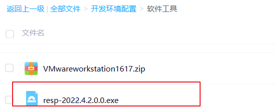
> 图注：这张图片展示的是软件工具目录下的文件列表界面，顶部显示路径为“返回上一级 | 全部文件 > 开发环境配置 > 软件工具”。列表中有两个文件，分别是“VMwareworkstation1617.zip”和被红色方框突出标注的“resp-2022.4.2.0.0.exe”，该文件正是文档中提到的用于连接Redis的客户端安装程序，用户可从该目录获取此工具完成后续的Redis连接配置操作。

安装成功，新建一个连接:

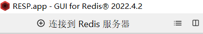
> 图注：图片展示了RESP.app - GUI for Redis 2022.4.2的界面。界面上方有软件图标，下方有“连接到Redis服务器”按钮，以及三个水平排列的点状图标。该图片对应文档中“使用客户端连接Redis”部分，说明在安装成功后新建连接时，点击“确定”创建连接成功后，会弹出此界面，用于连接Redis服务器，是连接Redis客户端后的操作界面展示。

配置连接参数：

注意：redis密码为：redis

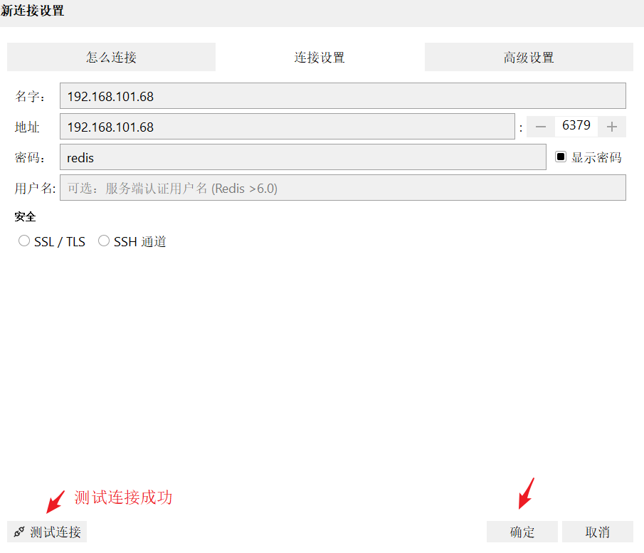
> 图注：这张图片是Redis客户端连接配置的操作界面，对应文档中连接Redis的步骤。界面的“连接设置”标签页下，名字和地址栏均填写为192.168.101.68，端口为6379，密码栏填入了文档提及的redis密码，并勾选了“显示密码”选项，下方安全区域未选择SSL/TLS或SSH通道。界面左下角有标注为“测试连接”的按钮，且该按钮旁有红色箭头与文字“测试连接成功”，右下角有“确定”“取消”按钮，还有标注为“确定”的红色箭头，该界面用于完成Redis客户端的连接配置与创建。

测试连接成功如下图：


> 图注：这张图片展示了Redis客户端连接测试的成功提示界面，画面中顶部标注“成功”字样，下方显示核心信息“连接Redis服务器成功”，最下方设有“确定”按钮。该图片对应的是文档中配置Redis环境的步骤成果，是完成客户端参数配置、密码设置（密码为redis）后，成功测试Redis连接的结果展示，对应文档中“测试连接成功如下图”的说明，用于直观体现Redis客户端与服务器的连接操作已顺利完成。

点击“确定”创建连接成功。


## 7 配置Nacos

### 7.1 检查配置

导入下发的虚拟机且成功启动nacos容器，如下图：

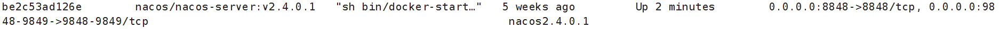
> 图注：图片展示了Docker容器信息，容器ID为be2c53ad126e，名称为nacos/nacos - server:v2.4.0.1，状态为运行，运行时间5周前，最近2分钟内更新，端口映射为0.0.0.0:8848 -> 8848/tcp和0.0.0.0:9849 -> 9849/tcp，标签为nacos2.4.0.1。该图片与文档中“7.1检查配置”部分相关，用于说明导入下发的虚拟机且成功启动nacos容器后的Docker容器状态情况。

访问Nacos:http://192.168.101.68:8848/nacos进入nacos首页

在配置列表中找到"家政o2o"的命令空间可以正常查询到数据说明安装成功。

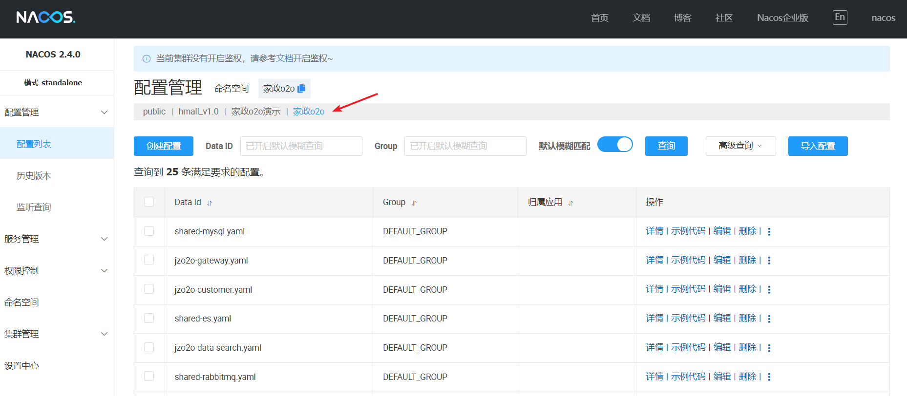
> 图注：该图片是Nacos 2.4.0版本的配置管理页面，页面左侧为功能导航栏，包含配置列表、历史版本、服务管理等选项，当前选中“配置列表”。页面核心展示命名空间切换区域，红色箭头指向“家政o2o”命名空间选项，明确该命名空间处于选中状态；页面中部呈现配置列表，显示25条符合要求的配置项，每条配置对应Data ID、Group等信息，且均处于DEFAULT_GROUP分组下，操作栏提供详情、示例代码等功能入口，用于验证“家政o2o”命名空间下的配置数据是否正常。

到此说明nacos服务可以正常使用。

如果不能正常显示可重启nacos，运行下边的命令：

docker restart nacos


### 7.2 自行安装

如果无法正常导入下发的虚拟机下边说明安装并配置nacos的步骤。

参考“第三方软件安装说明”文档安装Nacos。

安装nacos后需要创建命名空间并导入nacos的配置文件。

命名空间的id指定为：75a593f5-33e6-4c65-b2a0-18c403d20f63

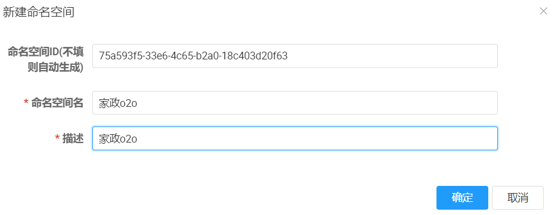
> 图注：图片展示的是在配置管理中新建命名空间的界面。界面上方显示“新建命名空间”，下方有“命名空间ID（不填则自动生成）”输入框，已填入“75a593f5-33e6-4c65-b2a0-18c403d20f63”；“命名空间名”输入框，已填入“家政o2o”；“描述”输入框，也已填入“家政o2o”。界面右下角有“确定”和“取消”按钮。该图片与文档中配置Nacos时新建命名空间的操作步骤相关，用于说明新建命名空间时的界面及输入内容。

然后在配置管理菜单选中“家政o2o”命名空间，导入“课程资料/nacos”下的“nacos_config_export_jzo2o.zip”

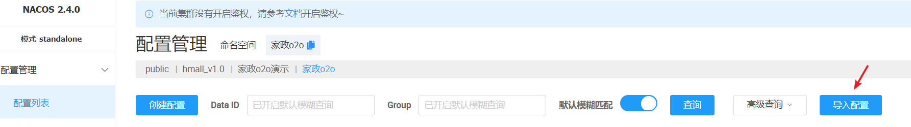
> 图注：图片展示了Nacos配置管理界面。左侧有“配置管理”“配置列表”等选项，右侧显示当前集群未开启鉴权，需参考文档开启。配置管理中选中“家政o2o”命名空间，下方有“创建配置”“Data ID”“Group”等输入框，以及“默认模糊匹配”开关、查询、高级查询等按钮，最右侧有“导入配置”蓝色按钮，箭头指向该按钮。

**导入配置文件后注意修改数据库的IP地址、Redis的IP地址、RabbitMQ的IP地址等配置信息。**

以下是部分配置文件：

数据库配置文件：shared-mysql.yaml

Redis配置文件：shared-redis-cluster.yaml

XXL-Job配置文件：shared-xxl-job.yaml

MQ配置文件：shared-rabbitmq.yaml

ES配置文件：shared-es.yaml

当前阶段需要修改shared-mysql.yaml、shared-redis-cluster.yaml中的IP地址为虚拟机的IP地址。


## 8 配置Git环境

### 8.1 安装Git

在个人电脑安装Git，使用常用软件工具目录中的Git-2.37.3-64-bit.exe。

也可以自行下载，地址：https://git-scm.com/  （windows版本：https://git-scm.com/download/win）

安装成功，在右键菜单出现Git菜单，如下图

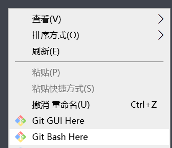
> 图注：图片展示了Windows系统右键菜单中与Git相关的选项。菜单中“Git GUI Here”和“Git Bash Here”两项被红色框线突出显示，前者用于启动Git GUI，后者用于启动Git Bash。该图片与文档中“8.1安装Git”部分内容相关，用于说明安装成功后在右键菜单中出现的Git菜单内容，直观呈现了Git安装成功后的界面情况。

配置git邮箱：

```Java
git config --global user.name "你的名字"
git config --global user.email "你的邮箱"
```


安装成功在IDEA中配置git的安装目录

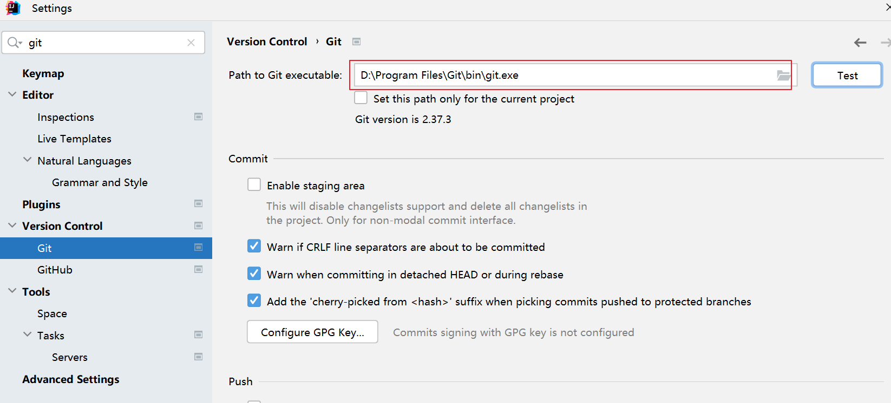
> 图注：这张图片展示的是IDEA软件的设置界面，对应开发环境配置中安装Git后，在IDEA里配置Git安装目录的环节。界面左侧选中了“Version Control”下的“Git”选项，右侧的“Path to Git executable”输入框内，填写了Git可执行文件的路径“D:\\Program Files\\Git\\bin\\git.exe”，该路径被红色框标注，输入框旁还有“Test”测试按钮，下方显示Git版本为2.37.3，界面还呈现了Commit相关的配置选项。


### 8.2 注册Git平台账号

git仓库我们使用的是https://gitee.com/ 平台，首先需要注册gitee账号


> 图注：图片展示了国内领先的企业级研发效能和开源代码托管平台Gitee的首页。画面中有一个巨大的齿轮图案，背景为深色，中间有蓝色的光点和线条。上方有“开源”“产品”“客户案例”“价格”“服务与支持”等导航栏，右上角有“登录”和“注册”按钮，其中“注册”按钮被红色箭头指向。该图片与文档中“8.2注册Git平台账号”部分相关，用于说明注册Gitee账号的操作入口。

注册成功登录gitee。


## 9 创建后端工程

### 9.1 创建**jzo2o-framework**

#### 9.1.1 **拉取jzo2o-framework工程**

首先从git拉取项目的基础工程jzo2o-framework工程，本工程封装了项目所需要的一些基础组件，如：通用的工具类库、持久层MyBatis-Plus的通用功能抽取等。

课程提供的jzo2o-framework工程的仓库地址为：https://gitee.com/jzo2o-v2/jzo2o-framework.git ，大家需要登录自己gitee账号，**Fork该仓库到自己的空间**，Fork是将其它仓库的内容复制到自己仓库。

登录gitee，然后在浏览器输入https://gitee.com/jzo2o-v2/jzo2o-framework.git  仓库地址，点击"Fork"，如下图：

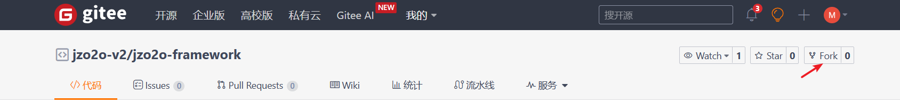
> 图注：这张图片展示了Gitee平台上jzo2o-v2/jzo2o-framework仓库的页面，页面右上方的“Fork”按钮被红色箭头标注突出，该按钮对应Fork操作，将远程仓库内容复制到自己的个人空间。此页面是开发环境配置中创建jzo2o-framework工程流程里的关键操作界面，对应文档中指导Fork仓库步骤的配图，帮助使用者明确Fork操作的具体位置，便于完成将目标仓库复制到自身空间的操作。

然后选择目标空间进行复制，Fork即拷贝远程仓库https://gitee.com/jzo2o-v2/jzo2o-framework.git  的项目到自己的仓库。


> 图注：这张图片是创建后端工程过程中Fork仓库环节的操作界面，界面标题为“Fork 仓库”，提示“请选择仓库 Fork 的目标空间”，已自动加载出个人账号“miaoruntu02”作为目标空间。界面右下方有“取消”和“确认”两个操作按钮，其中橙色的“确认”按钮被红色箭头指向，该箭头用于引导用户点击此按钮完成远程仓库的复制操作，对应文档中复制jzo2o-framework远程仓库到自身仓库的操作步骤。

点击“确定”复制成功，从下图可以看出源仓库的信息。

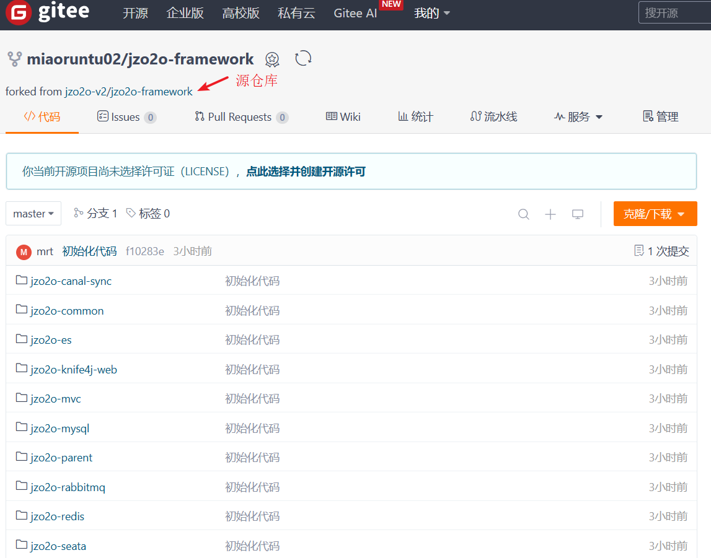
> 图注：图片展示的是Gitee平台中jzo2o - framework项目的仓库页面。页面上方显示仓库名称“miaoruntu02/jzo2o - framework”，并有“forked from jzo2o - v2/jzo2o - framework”字样。页面中部有“代码”“Issues”“Pull Requests”“Wiki”“统计”“流水线”“服务”“管理”等导航栏。下方列出多个分支，其中“初始化代码”分支被红色箭头指向，显示提交者为f10283e，提交时间为3小时前。该图片与上文“拉取jzo2o - framework工程”内容相关，展示了仓库页面及分支情况。

此时jzo2o-framework工程已复制到自己的仓库中，点击“克隆/下载”，复制仓库地址

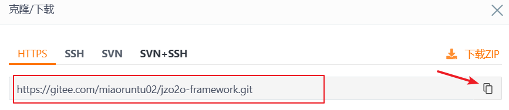
> 图注：这张图片是“克隆/下载”操作界面，属于创建jzo2o-framework工程时的步骤内容，界面提供了HTTPS、SSH、SVN等克隆方式选项，默认选中HTTPS，对应地址框内显示的是用于克隆的仓库地址https://gitee.com/miaoruntu02/jzo2o-framework.git，该地址被红色方框标注，同时还有红色箭头指向地址框右侧的复制按钮，用户可点击该按钮复制仓库地址，用于后续将jzo2o-framework工程克隆到本地代码目录。

然后从此Git仓库克隆jzo2o-framework到代码目录。

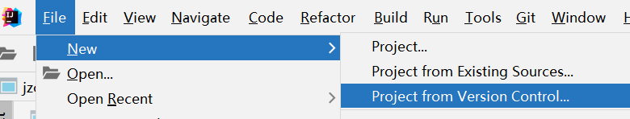
> 图注：图片展示了IntelliJ IDEA软件的菜单栏部分。在“File”菜单下，有“New”选项，其下级菜单中“Project from Version Control...”被蓝色高亮显示。该图片与文档中“拉取jzo2o - framework工程”步骤相关，用于指导用户在IntelliJ IDEA中打开远程仓库地址并选择本地代码目录后，打开克隆成功的工程，找到父工程的pom.xml，右键点击“Add as Maven Project”，操作成功后pom.xml文件前图标更改为“m”，表示已识别为maven工程。

输入远程仓库地址，并选择本地代码目录：

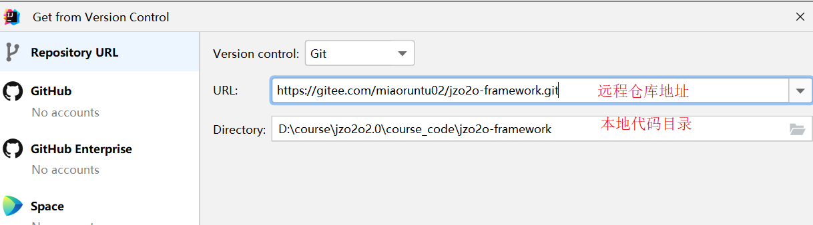
> 图注：图片展示了在IntelliJ IDEA中从版本控制系统获取代码的界面。左侧为版本控制选项，选中Git。右侧“Repository URL”处显示远程仓库地址为“https://gitee.com/miaoruntu02/jzo2o - framework.git”，“Directory”处显示本地代码目录为“D:\\course\\jzo2o2.0\\course_code\\jzo2o - framework”。该图片与上文创建jzo2o - framework工程时输入远程仓库地址并选择本地代码目录的操作步骤相关，直观呈现了操作后的界面情况。

在弹出窗口选择信任该项目。

接下来打开克隆成功的工程

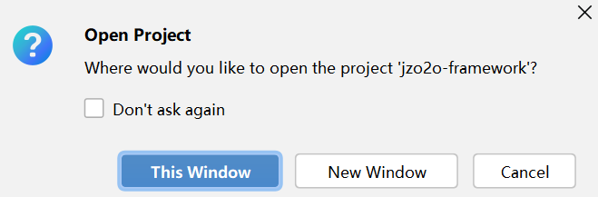
> 图注：这张图片是IDEA的“Open Project”弹窗，用于询问用户要如何打开“jzo2o-framework”工程的位置，弹窗左侧带有问号标识的图标，还设有“Don't ask again”的勾选选项，下方有三个操作按钮，分别为默认选中的“This Window”、“New Window”以及“Cancel”。该弹窗出现在创建jzo2o-framework工程的拉取步骤中，对应打开克隆成功工程的操作环节，是开发环境配置里创建后端工程流程中的一个操作界面。

有些idea无法识别maven工程需要手动操作，找到父工程的pom.xml

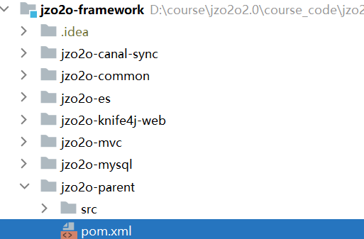
> 图注：图片展示了jzo2o - framework工程的文件结构。其中“jzo2o - parent”文件夹下有“src”子文件夹，且“pom.xml”文件被蓝色高亮显示。该图片与文档中“9.1.1拉取jzo2o - framework工程”部分内容相关，用于说明在打开克隆成功的工程后，找到父工程的pom.xml文件，为后续手动操作添加为Maven项目做准备。

右键点击“Add as Maven Project”

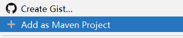
> 图注：图片展示了在Idea中右键点击“Add as Maven Project”的操作界面。在“Create Gist...”选项下方，有一个蓝色高亮的“Add as Maven Project”选项，其右侧有一个蓝色的加号图标。该图片与文档中“9.1.1拉取jzo2o - framework工程”部分内容相关，对应文档中“右键点击‘Add as Maven Project’”的操作步骤，直观呈现了操作时的界面情况。

操作成功后pom.xml文件前的图标已更改为“m”，表示已识别为maven工程。

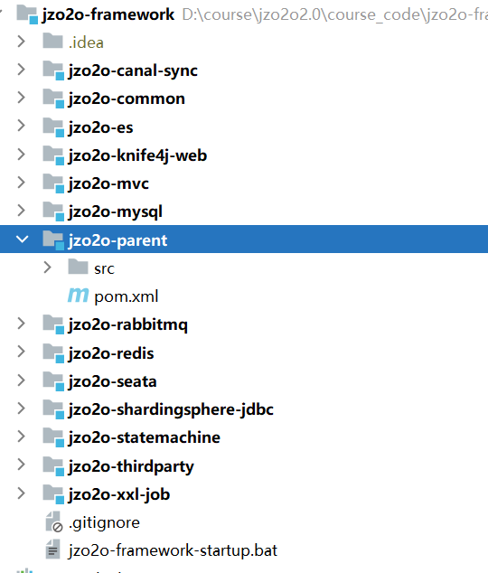
> 图注：这张图展示了开发工具的工程目录结构，其中包含名为“jzo2o-framework”的工程相关内容，目录下有多个子工程，包括jzo2o-canal-sync、jzo2o-common、jzo2o-es等，还存在.idea文件夹与.gitignore文件。当前选中的是名为“jzo2o-parent”的项目，该项目下包含src文件夹与pom.xml文件，且pom.xml文件前带有代表Maven工程的“m”标记。这一内容对应文档中针对jzo2o-framework工程的配置步骤，体现了手动添加为Maven工程后的成功识别状态。


注意配置工程使用的jdk

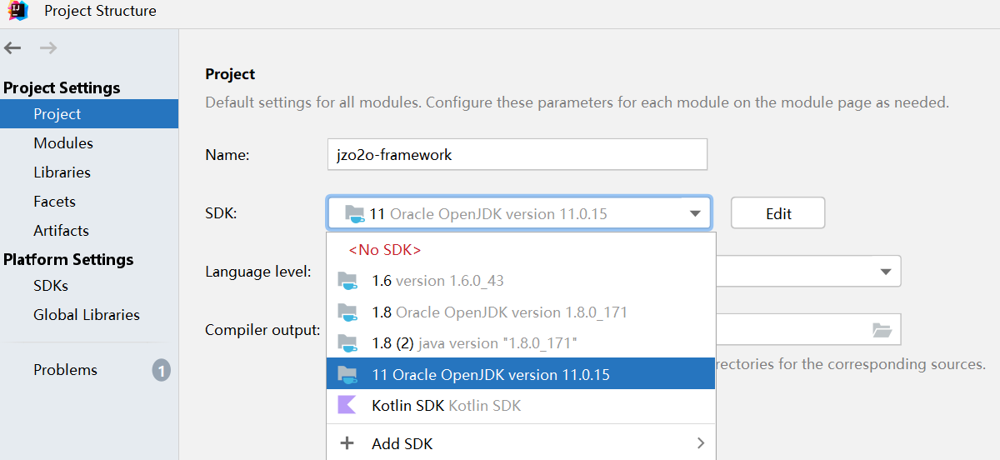
> 图注：图片展示的是IntelliJ IDEA中jzo2o - framework项目的“Project Settings”界面。在“Project”设置下，显示了项目名称为“jzo2o - framework”，SDK为“11 Oracle OpenJDK version 11.0.15”，语言级别为“1.8 Oracle OpenJDK version 1.8.0_171”，编译输出为“1.8 (2) java version * 1.8.0_171”。该图片与文档中“注意配置工程使用的jdk”内容相关，直观呈现了项目配置中SDK等关键信息。


#### 9.1.2 **打包上传到maven仓库**

在开发中一些公共组件会打包jar上传到公司的maven私服上，其它团队从私服下载jar包。

jzo2o-framework工程中包括了项目中用到一些封装组件，最后会发布为jar供其它项目使用，如果要发布到私服则执行mvn deploy命令，如果仅是在本地开发执行mvn install命令发布到本地仓库即可。

下边将jzo2o-framework打包后发布到本地仓库。

打开maven面板如下图，选择跳过测试，执行install命令。

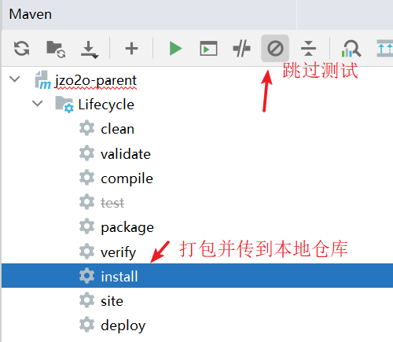
> 图注：图片展示了IntelliJ IDEA中Maven面板的操作界面。左侧显示了jzo2o-parent工程下的Lifecycle选项，其中“install”命令被选中。右侧有“跳过测试”按钮被红色箭头突出显示。该图片与文档中“9.1.1拉取jzo2o-framework工程”部分内容相关，用于说明在执行maven命令打包jzo2o-framework工程并传到本地仓库时，需选择跳过测试，执行install命令的操作步骤。

打包成功观察日志如下：


### 9.2 创建jzo2o-gateway

#### 9.2.1 拉取网关工程

jzo2o-gateway工程是项目的网关工程，使用Spring Cloud gateway实现，负责请求拦截、请求路由与负载均衡。

下边拉取网关工程，课程提供的git仓库地址：https://gitee.com/jzo2o-v2/jzo2o-gateway.git 。

操作步骤同jzo2o-framework工程，登录自己的gitee账号，Fork该仓库到自己的空间。

jzo2o-gateway创建完成需要注意nacos的ip地址：

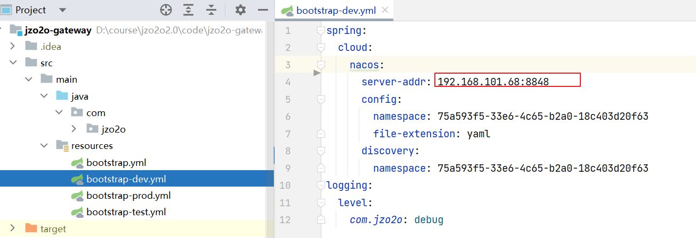
> 图注：这张图片是IDEA开发工具的界面，左侧展示了名为jzo2o-gateway的工程目录结构，包含src、resources等文件夹，resources目录下的bootstrap-dev.yml文件处于选中状态；右侧是该配置文件的内容，其中spring.cloud.nacos.server-addr一行被红色方框高亮标注，显示地址为192.168.101.68:8848，这一内容与文档中提到的“jzo2o-gateway创建完成需要注意nacos的ip地址”的要求相呼应，是网关工程配置中关键的Nacos地址信息。


#### 9.2.2 运行网关工程

下边使用IDEA启动网关工程。


> 图注：图片展示的是IntelliJ IDEA中jzo2o-gateway工程的运行状态界面。界面上方显示“Services”，下方有多个图标和选项，其中“Spring Boot”图标被选中，其下有“Running”选项，右侧显示“GatewayApplication :11500/”。这表明jzo2o-gateway工程已成功运行，且运行端口为11500，与文档中创建jzo2o-gateway后启动网关并显示成功运行的内容相呼应。

也可以进入nacos目录，双击运行：jzo2o-gateway-startup.bat启动网关，启动成功如下图：


> 图注：图片展示的是jzo2o-gateway网关服务启动后的控制台日志。日志中记录了2023年11月28日10:17:59 - 2023年11月28日10:17:70期间的网关启动信息，包括GatewayApplication启动成功、NacosContextRefresher监听配置等。其中，“家政o2o网关服务启动”以红色框突出显示，表明网关服务已成功启动。该图片与文档中创建jzo2o-gateway后拉取网关工程并启动的内容相关，直观呈现了网关服务启动状态。


### 9.3 创建jzo2o-foundations

运营基础服务工程jzo2o-foundations提供了运营端的接口支持，由于运营基础服务工程在课堂上我们需要开发维护，使用Git管理代码。

拉取jzo2o-foundations工程，本课程提供的git地址：https://gitee.com/jzo2o-v2/jzo2o-foundations.git，操作步骤同jzo2o-framework工程，登录自己的gitee账号，Fork该仓库到自己的空间。

工程创建成功如下图所示：


> 图注：该图片展示了拉取完成后的jzo2o-foundations工程的目录结构，从根目录“jzo2o-foundations”往下，包含.idea、src、.gitignore、Dockerfile、jzo2o-foundations-startup.bat、pom.xml等文件与目录；其中src目录下又分为main和test子目录，main目录下包含java目录与resources目录，java目录下以层级结构展开了com.jzo2o.foundations包，该包内包含config、constants、controller等多个子包，还有启动类FoundationsApplication。该图片用于展示按照步骤完成Fork操作后创建成功的网关工程（jzo2o-foundations工程）的目录情况。

#### 9.3.1 切换分支

接下来切换分支到“dev_01”，右键“dev_01”分支，点击Checkout


> 图注：这张图片展示了开发工具的分支操作界面，其中高亮标注了当前Local（本地）分支列表里的“dev_01”分支，且在该分支上右键点击弹出的菜单中，“Checkout”选项被红框突出显示，这个操作对应上下文里切换分支到“dev_01”的步骤，即右键“dev_01”分支后点击“Checkout”完成分支切换。

 切换成功如下：


> 图注：图片展示了jzo2o-foundations工程的文件结构。左侧是文件夹和文件的目录，如.idea、src、main、java、com、jzo2o、foundations、resources、test等。右侧Git标签栏中，Local分支下显示dev_01分支被选中。该图片与上文“9.3.1切换分支”内容相关，用于直观呈现切换分支成功后工程文件结构及当前分支状态，辅助理解操作结果。


### 9.4 创建jzo2o-api

jzo2o-api工程提供了微服务内部接口的维护，用于微服务之间的远程调用。

拉取jzo2o-api工程，本课程提供的git地址：https://gitee.com/jzo2o-v2/jzo2o-api.git，操作步骤同jzo2o-framework工程，登录自己的gitee账号，Fork该仓库到自己的空间，从自己的空间拉取jzo2o-api工程，并切换到dev_01分支。

创建完成如下图：


> 图注：这张图片展示的是开发工具的操作界面，用于创建完成后的jzo2o-api后端工程。界面左侧是项目结构面板，显示了名为jzo2o-api的项目，其下包含src、External Libraries、Scratches and Consoles等分类，其中src目录展开后可见main分支，包含java、resources、pom.xml等内容，该界面是9.4章节创建jzo2o-api完成后的对应展示画面。


和framework一样需要将api打包jar包上传到maven仓库被其它工程依赖。

接下来将API工程打包jar上传到maven仓库，如下图：


> 图注：图片展示了IntelliJ IDEA中jzo2o-api工程的Maven生命周期界面。画面中，上方有“Maven”字样，下方显示了“jzo2o-api”工程及“Lifecycle”下的生命周期步骤，包括clean、validate、compile、test、package、verify和install等。画面中用红色箭头分别指向“package”步骤和“install”步骤。该图片与文档中“9.4创建jzo2o-api”部分内容相关，用于说明在开发环境配置中，将API工程打包jar上传到maven仓库的操作步骤。

操作成功：


### 9.5 运行jzo2o-foundations

#### 9.5.1 配置jzo2o-foundations

运行前配置nacos地址：


> 图注：这是后端工程jzo2o-foundations运行前的配置界面，展示了bootstrap-dev.yml文件的内容，核心突出标注出nacos地址为192.168.101.68:8848。界面左侧是工程的目录结构，包含.idea、src等文件夹，src的main/resources目录下显示了bootstrap-dev.yml等配置文件，对应文档中提到的运行前需配置nacos地址的操作要求。

目前只使用了mysql和redis，需要保证mysql和redis启动成功，如下图：


> 图注：这张图片展示了开发环境配置中jzo2o-foundations模块的bootstrap.yml文件内容。左侧是项目文件目录结构，可看到jzo2o-foundations工程的resources目录下包含bootstrap.yaml、不同环境的bootstrap配置文件；右侧是bootstrap.yml的代码配置区域，其中的nacos配置部分被重点标注，分别用红框突出了共享Redis配置文件shared-redis-cluster.yaml和MySQL配置文件shared-mysql.yaml，结合上下文可知，这是在运行jzo2o-foundations前，需要进入nacos修改这两个配置文件中对应服务的地址，且需先保证MySQL和Redis处于启动状态。


进入nacos修改shared-redis-cluster.yaml中redis的地址：


> 图注：这张图片是NACOS 2.4.0的配置管理页面，用于修改shared-redis-cluster.yaml的Redis地址，对应开发环境配置中运行jzo2o-foundations的前置操作。页面顶部显示当前采用单机模式，命名空间选为“家政o2o”；配置列表中只有一条配置，Data ID为shared-redis-cluster.yaml，所属分组为DEFAULT_GROUP，在该行的“操作”栏中提供了编辑等功能选项，页面还提供创建配置、查询、导入配置等工具按钮，底部可对该配置进行删除、克隆、导出等操作。


> 图注：这张图展示了在配置jzo2o-foundations时，进入Nacos修改shared-redis-cluster.yaml的相关内容。图中显示了该配置的Data ID为shared-redis-cluster.yaml，Group为DEFAULT_GROUP，配置格式选定为YAML，核心的配置内容用红框标出，内容是spring.redis的相关参数，包括redis的地址为192.168.101.68，端口为6379，以及密码设为"redis"，这一修改是确保后端运行时redis连接配置正确的关键步骤。


修改shared-mysql.yaml中mysql数据库的地址。


> 图注：图片展示的是Nacos 2.4.0配置管理界面。界面中显示当前集群未开启鉴权，命名空间为家政o2o，有多个命名空间选项。配置列表中，Data ID为“shared-mysql.yaml”，Group为DEFAULT_GROUP，归属应用为“家政o2o”。右侧有“详情”“示例代码”“编辑”“删除”等操作按钮。该图片与文档中“进入nacos修改shared-mysql.yaml中mysql数据库的地址”内容相关，用于说明在Nacos中找到并编辑相关配置文件的操作界面。


> 图注：图片展示的是在nacos中修改shared-mysql.yaml中mysql数据库地址的操作界面。界面中显示了yaml配置内容，其中红色框突出显示了“password: mysql”这一行配置。该图片与文档中“9.5.1配置jzo2o-foundations”部分内容相关，对应修改shared-mysql.yaml中mysql数据库地址的操作步骤，直观呈现了配置内容中mysql密码的填写位置。


#### 9.5.2 运行jzo2o-foundations

开发中我们需要以debug方式启动：


> 图注：这张图片展示了开发工具的运行界面，左侧有一个红色箭头指向绿色的爬虫样式图标，鼠标悬停在该图标上显示“Debug”字样，界面中间区域列出Spring Boot相关选项，当前“FoundationsApplication”处于未启动状态，背景为蓝色高亮，该图对应在开发jzo2o-foundations时以debug方式启动相关工程的操作步骤。

启动成功：


> 图注：这是运行jzo2o-foundations工程的开发工具界面截图，左侧Services面板中，名称为FoundationsApplication的Spring Boot程序正处于Running状态，进程号为11509；右侧控制台显示了程序的启动日志，包含nacos配置加载等信息，日志末尾明确标注启动成功，提示的“家政服务-运营基础服务”对应此应用的功能服务。


### 9.6 创建jzo2o-publics

#### 9.6.1 拉取jzo2o-publics

公共服务工程jzo2o-publics提供了地图定位、上传图片、验证码等公用服务，本课程提供的git仓库地址为：https://gitee.com/jzo2o-v2/jzo2o-publics.git  ，操作步骤同jzo2o-framework工程，登录自己的gitee账号，Fork该仓库到自己的空间。

创建成功，如下图: 


> 图注：图片展示了jzo2o-publics工程的文件结构。在src目录下，有main文件夹，其中包含java和resources子文件夹，resources文件夹内有bootstrap.yml等配置文件。此外，还有target文件夹，其中包含.gitignore、Dockerfile等文件。该图片与上文“9.6.1拉取jzo2o-publics”内容相关，直观呈现了拉取成功后的工程文件布局，帮助开发者了解工程结构。

#### 9.6.2 配置OSS

jzo2o-publics提供通用的上传图片接口，图片服务器使用阿里的OSS存储。

**参考 “OSS配置文档” 开通阿里云OSS服务，并在nacos中配置OSS参数。**


#### 9.6.3 配置高德地图

jzo2o-publics提供通用的地图定位接口，地图定位服务使用高德地图。

**参考 “高德地图web服务配置文档” 获取调用地理定位接口的key，并在nacos中配置高德地图key。**


#### 9.6.4 启动jzo2o-publics

启动前配置nacos地址：


> 图注：图片展示了jzo2o - publics项目的IDEA界面。左侧是项目结构，显示了src、resources等目录及其中的文件。右侧是bootstrap - dev.yml配置文件，其中nacos配置项下的server - addr被红色框突出显示，其值为192.168.101.68:8848。该图片与文档中“9.6.4启动jzo2o - publics”部分内容相关，用于说明启动前配置nacos地址的操作，即在IDEA中查看并确认nacos配置项下的server - addr值。

通过IDEA启动


> 图注：图片展示了在IDEA中启动jzo2o-publics后，其运行状态及日志信息。左侧导航栏显示“PublicsApplication:11503/”已运行。右侧Console窗口中，有“add-listener”等日志信息，以及2023 - 11 - 28 12:15:24.205的“INFO”日志，显示“c.a.c.n.refresh.NacosContextRefresher”和“com.jzo2o.publics.PublicsApplication”相关日志内容，表明服务已启动。该图片与文档中“9.6.4启动jzo2o-publics”部分内容对应，直观呈现了启动后的运行状态。

或通过双击启动脚本


> 图注：图片展示的是jzo2o-publics项目启动后的控制台输出信息。其中，关键信息是“家政服务 - 通用服务启动”，表明家政服务 - 通用服务已成功启动。该图片与文档中“9.6.4启动jzo2o-publics”部分内容相关，是对通过IDEA启动或双击启动脚本后，jzo2o-publics项目启动情况的直观呈现，帮助开发者确认服务是否正常运行。


## 10 配置前端环境

### 10.1 编译前端工程

#### 10.1.1 安装nvm

我们面对的前端项目很多，比如A，B两个并行开发项目，nodejs依赖版本不一致。A项目需要v14.19.1老版本，B项目需要v16.15.0新版本，需要随时切换。

我们可以使用nvm工具灵活切换node.js版本

举例如下：


> 图注：图片展示了在Windows系统下使用nvm工具切换Node.js版本的操作示例。首先执行`node -v`命令，显示当前使用的是v14.19.1版本。接着使用`nvm list`查看已安装的Node.js版本，其中v16.15.0被星号标注。最后执行`nvm use 16.15.0`命令切换到v16.15.0版本，再次执行`node -v`命令确认已成功切换。此图直观呈现了nvm工具的安装和切换版本操作流程，与文档中介绍nvm工具的上下文紧密相关。

nvm全英文也叫node.js version management，是一个nodejs的版本管理工具。nvm和n都是node.js版本管理工具，为了解决[node.js](https://zhida.zhihu.com/search?q=node.js&zhida_source=entity&is_preview=1)各种版本存在不兼容现象可以通过它可以安装和切换不同版本的node.js。


> 图注：图片展示的是NVM（Node Version Manager）的标志。标志由一个绿色的六边形和其右侧的绿色大写字母“NVM”组成。该图片位于文档中“10.1.2编译前端工程”部分内容之前，是对上文提到的nvm（Node Version Manager）的直观呈现，用于帮助读者识别nvm，为后续安装nvm及切换node版本14.19.1做铺垫。

请大家自行上网查找nvm安装方法并自行安装。

#### 10.1.2 编译前端工程

node版本切换到14.19.1，如下图：


> 图注：图片展示了在cmd命令行中使用nvm（Node Version Manager）操作的界面。首先执行`nvm use 14.19.1`命令，显示已使用node v14.19.1（64-bit）。接着执行`nvm list`命令，列出当前已安装的node版本，其中14.19.1版本被星号突出显示，表明当前正在使用该版本，且为64位可执行文件。该图片与文档中配置前端环境、编译前端工程时切换node版本的操作步骤相关，直观呈现了操作结果。

如果没有14.19.1版本则需要通过nvm安装14.19.1版本的node，运行下的命令：

`nvm install 14.19.1`

`nvm use 14.19.1`


从课程资料下的源码目录找到project-xzb-pc-admin-vue3-java.zip，并解压到project-xzb-pc-admin-vue3-java目录

通过cmd进入project-xzb-pc-admin-vue3-java目录运行下边的命令下载依赖包：

```Java
# 使用资料中提供的前端无需执行下面命令
npm install || yarn 
##或
cnpm install || yarn 
```

运行效果如下图：


> 图注：这张图片是编译前端工程时，在命令提示符（cmd）中执行依赖包下载命令后的运行结果截图。界面的命令行路径为"D:\\course\\jzo2o\\code\\project-xzb-pc-admin-vue3-java"，执行的是安装依赖的命令（可使用cnpm install或yarn），最终显示所有 packages 已成功安装，该过程耗时290ms，其中网络耗时36ms，各类文件缓存命中率为0，还标注了相关依赖安装的完成状态，是前端工程配置中下载依赖包步骤的执行反馈界面。

### 10.2 运行前端工程

#### 10.2.1 运行前端工程

编译完成现在运行前端工程，运行前端工程之前需要启动以下后端服务：

jzo2o-gateway

jzo2o-foundations

接来来配置前端工程连接的网关地址：

通过cmd进入project-xzb-pc-admin-vue3-java目录，找到vite.config.ts文件，打开文件配置网关地址（默认连接本地网关，不需要修改）：

如下图：


> 图注：这张图片展示的是前端工程配置文件vite.config.ts的内容，呈现的是开发环境配置环节里设置网关地址的界面，该文件用于配置前端连接的网关地址，其中代理配置部分的“target”项被高亮标注，具体值为“http://localhost:11500”，这是配置前端工程网关地址的关键内容，和文档中“找到vite.config.ts文件，打开文件配置网关地址（默认连接本地网关，不需要修改）”的说明内容对应，直观呈现了本地运行前端工程时的网关配置参数。

运行命令：npm run dev  启动前端工程

启动成功如下图：


> 图注：这张图片展示了前端工程启动成功后的运行状态页面，是配置前端环境并启动项目后的结果呈现。页面显示了Vite工具的版本为v2.9.15，dev开发服务器已启动，列出了该服务可访问的多个网络地址，包括本地localhost地址，以及局域网内的不同IP对应的访问地址，最后还标注了服务启动完成耗时1165毫秒，用于确认前端工程成功运行。

运行成功自动进入http://localhost:3000


> 图注：图片展示的是运营管理端登录界面。左侧为登录表单，输入框内分别显示账号“xiaoyan”和密码“888itcast.CN764%...”，下方有红色的“登录”按钮。右侧背景为一位穿着围裙、手持清洁用品的女性微笑。该界面是文档中介绍前端工程运行成功后自动进入的http://localhost:3000页面，用于后续服务管理功能验证，以判断开发环境搭建是否成功。

账号：xiaoyan

密码：888itcast.CN764%...


点击“登录”，进入运营管理端


> 图注：图片展示的是运营管理端的界面。左侧有工作台、订单管理、评价管理等导航栏。右侧上方显示“工作台 - 概览仪表盘”，并有“刷新”按钮。中间部分有“经营分析”区域，可选择时间范围，下方有订单分析和营业分析数据展示。下方是“订单数趋势”图表。该界面是文档中配置前端环境后，运行前端工程并成功进入运营管理端后的展示，用于验证服务管理功能是否搭建成功。

#### 10.2.2 服务管理功能验证

通过下边的功能验证判断开发环境是否搭建成功。

1. **服务类型查询**

进入服务类型管理，可以正常查询到数据说明配置成功。


> 图注：图片展示的是云岚到家平台的“服务管理 > 服务类型管理”页面。页面显示了服务类型编号、服务类型、服务类型图标、服务类型图片、排序、状态、更新时间及操作等信息。其中，服务类型有保洁清、日常维修、家庭服务等，状态均为启用，更新时间分别为2023年8月23日、3日、18日。页面右上角有“刷新”按钮，右下角有“新建”按钮。该图片与文档中运行前端工程后，若不能正常查询到数据需进入浏览器调试窗口，找到请求查询服务类型接口记录的内容相关，用于辅助说明操作步骤。

如果不能正常查询到数据需要打开浏览器进入调试窗口，右键点击“检查”（讲义中使用的是**chrome浏览器**）


> 图注：这张图片是Chrome浏览器的右键菜单界面，清晰标注出了“检查”选项，该选项被红色箭头指向突出显示，同时菜单中还展示了“返回”“前进”“重新加载”等其他功能选项及对应的快捷键，这与文档中提到的“不能正常查询到数据时，需要打开Chrome浏览器并右键点击‘检查’进入调试窗口”的操作指引相匹配，是该步骤中右键菜单操作的直观展示。

进入“网络”，找到请求查询服务类型接口的记录，如下图：


> 图注：图片展示了浏览器开发者工具中“网络”标签下的请求记录界面。在“请求”栏中，有一个请求记录，其URL为“http://localhost:3000/api/foundations/serviceType/page?isAct=true&isAsc2=false&orderBy1=updateTime&orderBy2=updateTime&pageNo=1&pageSize=100&...”，下方显示状态码为200 OK。该图片与上文“运行前端工程”中“请求服务类型接口可以正常返回数据说明请求后端接口正常”的内容相关，用于直观呈现请求服务类型接口成功返回200的状态码情况。

请求服务类型接口可以正常返回数据说明请求后端接口正常，如下图：


> 图注：图片展示的是浏览器开发者工具中“网络”标签下的请求记录界面。画面中突出显示了“请求”列，其中有一个请求记录被红色箭头指向，其响应体内容为JSON格式，显示了code、msg、data等信息，data部分包含多个服务类型记录，如“保洁清”“家政服务”等。该图片与文档中“运行前端工程”部分内容相关，用于说明在浏览器调试窗口进入“网络”后，找到请求查询服务类型接口记录的情况，以辅助排查前端请求后端接口是否正常。

如果不能正常返回数据需要排查jzo2o-foundations工程是否正常启动成功，需要仔细阅读本文档配置jzo2o-foundations工程。


1. **添加服务类型**


> 图注：这是新建服务类型的表单界面，界面包含多个必填项目，需填写“服务类型名称”与数字“排序”，还需分别上传服务类型图标和服务类型图片：服务类型图标要求为126*126px、400k以内的PNG格式，服务类型图片要求为532*200px、800k以内的PNG格式，两类上传区域均设有带“+”的灰色点击上传按钮。界面右下角设有“取消”与“保存”两个操作按钮，该界面对应文档中“添加服务类型”的配置步骤，是前端开发环境配置流程里验证相关功能的环节。

1. **启用服务类型**


> 图注：这张图片展示了服务类型管理的列表页面，包含服务类型编号、名称、图标、图片、排序、状态、更新时间及操作等信息。列表中共有4项服务类型记录，状态分别为启用、禁用、草稿、禁用，排序数值存在重复。页面右上角设有“新建”按钮，方便新增服务类型；在列表第四项“家居服务”对应的操作栏中，红色箭头明确指向“启用”按钮，结合上下文可知此步骤为启用该服务类型，用于排查或确认前端工程中服务类型启用的相关配置。


> 图注：图片展示的是jzo2o系统中服务类型启用确认弹窗。弹窗标题为“确认启用”，内容为“确定启用该分类吗？”，下方有“取消”和“确定”两个按钮，其中“确定”按钮为红色。该图片与文档中“启用服务类型”步骤相关，用于提示用户在启用服务类型时，确认是否启用该分类，用户可选择取消或确定操作。

1. **服务项查询**


> 图注：图片展示的是云岚到家平台服务管理 - 服务项管理页面。页面上方有“服务管理 - 服务项管理”标题，左侧有工作台、订单管理等导航栏。中部是服务项列表，包含服务编号、服务名称、服务图标、服务图片、服务单价、服务类型、服务描述、排序、操作等列，如空调维修、日常保洁等服务项及其相关信息。页面右上角有“新建”按钮。

1. **添加服务项**


> 图注：图片展示的是jzoo平台中服务管理的新增服务界面。界面上方显示“服务管理 - 服务管理 - 新增服务”。左侧有服务名称、服务类型、服务费时、服务费等输入框，以及服务图片上传区域，当前显示两张图片。右侧有服务描述区域，可输入文字。底部有“取消”和“新增”按钮。该图片与文档中“上传图片功能验证”部分相关，用于说明通过此界面上传图片来判断jzoo - publics服务及OSS配置是否正确。


#### 10.2.3 上传图片功能验证

通过下边的功能验证判断jzo2o-publics服务及OSS配置是否正确。

进入服务类型管理界面，点击“新建”测试上传图片，如下图：


> 图注：图片展示的是jzo2o平台服务类型管理界面中“新建”服务类型弹窗。弹窗内有“服务类型”“排序”“服务类型图标”等输入框，其中“服务类型”框被红色箭头指向。下方有“点击上传图片”按钮，其右侧也有一红色箭头指向。该图片与文档中“10.2.3上传图片功能验证”部分内容相关，用于说明在服务类型管理界面点击“新建”测试上传图片的操作，以及上传图片测试的界面情况。

选择一个图片进行上传，上传成功示例如下：


> 图注：图片展示的是“新建服务类型”界面。界面上方有“新建服务类型”标题，下方有三个必填项，分别是“服务类型”（需输入类型名称）、“排序”（需输入数字）和“服务类型图标”（需上传png格式图片，尺寸126*126px，400k以内）。界面右上角有“×”关闭按钮。该图片与文档中“10.2.3上传图片功能验证”部分相关，用于说明在服务类型管理界面点击“新建”测试上传图片的操作及示例。


## 11 注意点

1、maven本地仓库地址一定要配置正确

2、运行安装文件时要以管理员模式运行。

3、关闭自己电脑的防火墙。

4、如果没有使用下发的虚拟机需要修改数据库的地址、nacos的地址。

修改数据库地址，进入nacos找到shared-mysql.yaml文件，修改数据库的ip、账号、密码，如下图所示。


> 图注：图片展示的是nacos中shared - mysql. yaml文件的配置界面。界面中显示了Data ID为“shared - mysql. yaml”，Group为“DEFAULT_GROUP”，并有配置内容区域，其中数据库连接信息以代码形式呈现，包括数据库驱动类名、url、username和password等参数，其中username为“root”，password为“mysql”。图片下方有红色提示“注意修改数据库的ip、账号和密码”。该图片与上文修改数据库地址、配置数据库信息的内容相关，直观呈现了配置示例。


5、如下警告可以忽略

环境部署好后在进行接口测试时发现控制台报下边的警告：

```Java
WARNING: An illegal reflective access operation has occurred
WARNING: Illegal reflective access by com.baomidou.mybatisplus.core.toolkit.SetAccessibleAction (file:/D:/develop/repository/com/baomidou/mybatis-plus-core/3.4.3/mybatis-plus-core-3.4.3.jar) to field java.lang.invoke.SerializedLambda.capturingClass
WARNING: Please consider reporting this to the maintainers of com.baomidou.mybatisplus.core.toolkit.SetAccessibleAction
WARNING: Use --illegal-access=warn to enable warnings of further illegal reflective access operations
WARNING: All illegal access operations will be denied in a future release
```


以上警告表示在运行时发生了非法反射操作，这是因为Java9以上版本限制了反射操作的范围，无法通过过反射访问或修改类的私有成员，而Mybatis-plus存在违反该规则的代码。

此警告不影响正常使用mybatis-plus，如果不想看到该警告信息可在启动程序时加入--illegal-access=warn

如下图：


> 图注：图片展示了IntelliJ IDEA中Spring Boot项目运行配置界面。在“Build and run”区域，Java SDK选择了“java 11 SDK of 'jzo2o'”，右侧输入框内有红色箭头指向的“--illegal-access=warn”字样。该图片与文档中关于接口测试时控制台报警告的内容相关，用于说明在启动程序时加入“--illegal-access=warn”参数，可忽略此警告，不影响Mybatis-plus正常使用。

---
> 来源：飞书技术知识库（脱敏版） · 07 业务组件方案集 / 云岚到家项目 / 开发环境配置 · [原文](https://ccn8v2zngwsm.feishu.cn/wiki/PfeuwMAUWiMr8rkodUjcmmK8nXe)
