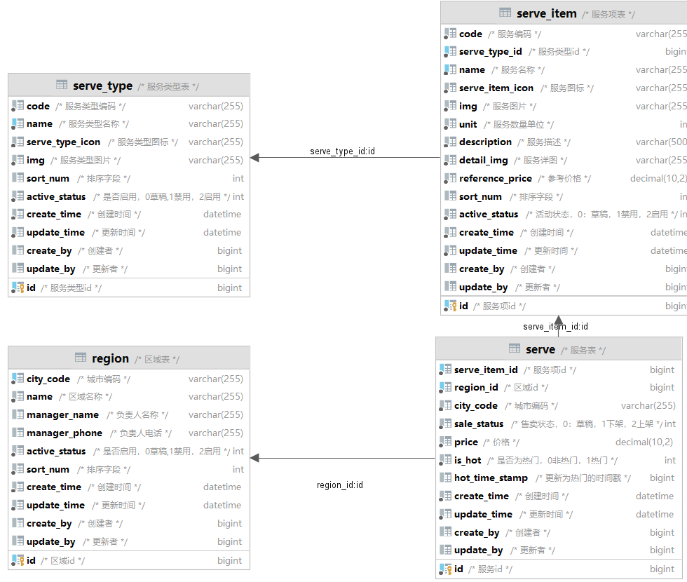
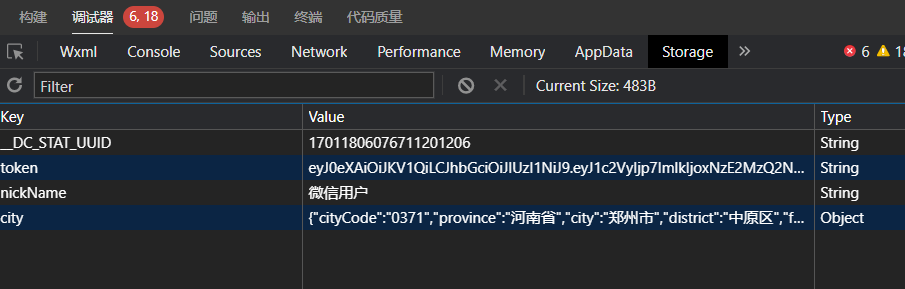

# 云岚到家-功能模块表述和解决方案

## **第一章 运营服务管理模块**

### **1.1 业务介绍**

运营服务管理模块是平台的基础模块，相当于电商项目中的商品管理。其核心职责是对家政服务项目进行全生命周期管理，包括服务类型、服务项的创建、维护，并为特定区域配置服务价格、可服务时间等信息，最终完成服务上架，供用户端购买。该模块是连接运营策略与用户需求的桥梁，确保平台服务供给的标准化与多样化。

### **1.2 表设计**

运营服务管理模块的核心表结构如下：

| 表名 | 描述 | 核心字段 | 关系说明 |
|-|-|-|-|
| **serve_type** | 服务类型表 | id, name, icon, sort, status | 与 `serve_item` 是一对多关系 |
| **serve_item** | 服务项表 | id, name, type_id, price, duration, description | 存储具体的家政服务项目 |
| **region** | 区域表 | id, name, city_code, status | 存储运营地区信息，通常为市级行政单位 |
| **serve** | 服务表 | id, region_id, item_id, price, on_sale_time, off_sale_time, status | **核心业务表** ，记录各区域实际运营的服务及价格等运营信息，是 `region` 与 `serve_item` 的多对多关系映射表，承载所有运营相关字段。 |

表关系图清晰展示了服务类型、服务项、区域与服务之间的关联，如（图 1）所示 。

**1.3 接口设计**  
该模块提供了一系列RESTful接口，支持服务的CRUD及运营操作：

| 接口名称 | 请求地址 | 请求方法 | 核心功能 |
|-|-|-|-|
| 创建服务类型 | `/api/v1/serve-type` | POST | 创建新的服务大类（如日常保洁、家电维修） |
| 查询服务项列表 | `/api/v1/serve-items` | GET | 获取特定类型下的服务项列表 |
| 添加区域服务 | `/api/v1/region-serves` | POST | 为指定区域配置可售服务项及价格 |
| 修改服务价格 | `/api/v1/region-serves/{id}/price` | PUT | 更新特定区域服务的价格 |
| 服务上架/下架 | `/api/v1/region-serves/{id}/status` | PUT | 控制服务在区域内的上下架状态 |

### **1.4 技术实现**

1. **服务创建与维护** ：运营人员通过管理后台表单提交，数据经校验后保存至对应表中。
2. **区域服务配置** ：在 `serve` 表中记录区域、服务项及价格的关联，确保每个区域的服务供给与定价独立。
3. **状态管理** ：通过 `status` 字段（如0-下架，1-上架）统一控制服务在前端的展示与可购状态。
4. **数据查询优化** ：为高频查询字段（如 `region_id`, `item_id`, `status`）创建索引，提升查询性能。

### **1.5 遇到的问题及解决方案**

- **问题** ：服务项在不同区域价格差异大，运营人员配置时易混淆，且历史价格无记录。
- **解决方案** ：

  1. **引入版本控制** ：在 `serve` 表中添加 `version` 字段，每次价格变动自动生成新记录，保留历史版本。
  2. **批量操作支持** ：开发批量导入/导出模板，支持按区域批量配置服务及价格，减少手动操作错误。
  3. **审计日志** ：记录所有服务项及价格变更操作，包括操作人、时间、变更前后值，便于追溯。

## **第二章 用户认证模块**

### **2.1 业务介绍**

用户认证模块负责全平台四类角色（用户、服务人员、机构、运营人员）的身份验证与授权。核心目标是确保用户身份合法、操作安全，并在微服务间传递用户上下文。项目采用多种认证方式，以适应不同端的使用场景。

### **2.2 表设计**

核心表用于存储用户身份信息及认证状态：

| 表名 | 描述 | 核心字段 |
|-|-|-|
| **common_user** | 通用用户表 | id, openid, phone, user_type, status, create_time |
| **service_provider** | 服务人员表 | id, user_id, name, skill_tags, max_distance, rating, status |
| **organization** | 机构表 | id, name, license, contact, status |

### **2.3 接口设计**

认证相关接口主要集中在公共服务中：

| 接口名称 | 请求地址 | 请求方法 | 核心功能 |
|-|-|-|-|
| 小程序登录 | `/api/v1/auth/wx-mini/login` | POST | 通过微信小程序 `code` 获取 `openid` 并完成认证 |
| 手机验证码登录 | `/api/v1/auth/phone/login` | POST | 通过手机号+验证码完成登录 |
| 账号密码登录 | `/api/v1/auth/login` | POST | 传统账号密码认证 |
| 获取用户信息 | `/api/v1/auth/user-info` | GET | 获取当前登录用户的基本信息 |

### **2.4 技术实现**

1. **小程序认证流程** ：

   - 用户在小程序调用微信API获取 `code`。
   - 前端携带 `code` 请求后端，后端调用微信接口获取 `openid`。
   - 首次认证将 `openid` 存入 `common_user` 表。
   - 后端生成JWT令牌返回前端，前端存储在 `storage` 中，如（图 2）所示 。
   - 后续请求携带令牌，网关校验后解析用户信息存入 `ThreadLocal`，供微服务使用。
   
     
2. **手机验证码服务** ：

   - 抽取为公共服务，提供发送与校验接口。
   - 验证码存储在Redis中，键格式为 `PHONE:CODE:VERIFY_CODE_手机号_业务类型`，过期时间300秒。
   - 对发送接口进行限流，防止频繁发送。

### **2.5 遇到的问题及解决方案**

- **问题** ：JWT令牌过期后，用户需要重新登录，体验不佳。
- **解决方案** ：

  1. **实现令牌刷新机制** ：设置短期访问令牌（Access Token）和长期刷新令牌（Refresh Token）。访问令牌过期后，前端可使用刷新令牌静默获取新的访问令牌，无需用户重新输入凭证。
  2. **统一认证中心** ：将认证逻辑集中，各微服务通过调用认证中心接口获取用户信息，避免重复校验逻辑。

## **第三章 订单管理模块**

### **3.1 业务介绍**

订单管理模块是平台的核心交易模块，负责订单的创建、支付、状态流转、取消、查询等全生命周期管理。它串联起用户下单、服务提供、支付结算等关键环节，是连接C端消费与B端服务的枢纽。

### **3.2 表设计**

订单模块涉及多表关联，核心表结构如下：

| 表名 | 描述 | 核心字段 |
|-|-|-|
| **orders** | 订单主表 | id, user_id, order_no, total_amount, status, create_time |
| **order_item** | 订单详情表 | id, order_id, serve_id, price, quantity |
| **order_payment** | 支付记录表 | id, order_id, payment_no, amount, status, pay_time |
| **order_snapshot** | 订单快照表 | id, order_id, snapshot_data, create_time |

**3.3 接口设计**  
订单模块提供丰富的接口以支持完整的交易流程：

| 接口名称 | 请求地址 | 请求方法 | 核心功能 |
|-|-|-|-|
| 创建订单 | `/api/v1/orders` | POST | 用户下单，生成待支付订单 |
| 支付回调 | `/api/v1/orders/{id}/pay-callback` | POST | 接收支付平台的支付结果回调 |
| 查询订单详情 | `/api/v1/orders/{id}` | GET | 获取订单的完整信息 |
| 取消订单 | `/api/v1/orders/{id}/cancel` | POST | 用户取消未服务的订单 |
| 查询用户订单列表 | `/api/v1/orders/my` | GET | 获取当前用户的订单列表 |

### **3.4 技术实现**

1. **订单创建** ：用户下单时，系统创建订单主表记录，并关联服务项生成订单详情。
2. **支付集成** ：调用支付服务生成支付链接，用户完成支付后，支付服务通过回调通知订单服务更新状态。
3. **状态机管理** ：使用状态机模式统一管理订单状态（待支付、待接单、服务中、已完成、已取消等），避免状态硬编码，提高可扩展性。
4. **订单快照** ：在订单状态变更时，记录订单快照信息，用于快速查询订单历史状态。快照信息缓存至Redis，提高查询效率。

### **3.5 遇到的问题及解决方案**

- **问题** ：订单量增长导致查询性能下降，尤其是按用户ID查询历史订单列表时响应慢。
- **解决方案** ：

  1. **分库分表** ：对订单表进行水平分表，按订单号范围（如每1500万为一个区间）拆分，降低单表数据量。
  2. **缓存优化** ：将用户近期订单列表缓存至Redis，使用滚动查询替代传统分页，避免Count查询。查询时先查缓存，未命中再查数据库并更新缓存。
  3. **索引优化** ：为订单表的 `user_id` 和 `create_time` 创建联合索引，优化用户订单列表查询。

## **第四章 抢单服务模块**

### **4.1 业务介绍**

抢单服务是连接用户订单与服务人员的核心枢纽。服务人员和机构可以在APP/PC端设置接单范围、服务技能，并开启抢单开关。系统将符合条件的新订单实时推送至其抢单界面，服务方点击“抢单”即可参与竞争，系统根据规则（如距离、评分、抢单速度）撮合匹配，最终确定服务提供方。

### **4.2 表设计**

抢单服务核心表包括：

| 表名 | 描述 | 核心字段 |
|-|-|-|
| **tb_grab_order** | 抢单表 | id, order_id, service_provider_id, grab_time, status |
| **tb_service_provider** | 服务提供方表 | id, name, skill_tags, max_distance, rating, status |
| **tb_order_pool** | 订单池表 | id, order_id, service_type, location, create_time |

### **4.3 接口设计**

- **获取抢单列表接口** ： `GET /api/v1/grab/list?providerId=xxx&skill=xxx`
- **抢单接口** ： `POST /api/v1/grab/do?orderId=xxx&providerId=xxx`
- **查询抢单结果接口** ： `GET /api/v1/grab/result?orderId=xxx`

### **4.4 技术实现**

1. **实时推送机制** ：订单创建后， **订单管理服务** 通过RabbitMQ向 **抢单服务** 发送消息。
2. **抢单池构建** ： **抢单服务** 消费消息，将订单信息存入Redis的Sorted Set结构（按时间排序），并同时更新MySQL的订单池表。
3. **抢单匹配算法** ：服务方发起抢单请求时，系统首先校验其接单范围和技能是否匹配。匹配后，通过Redis的分布式锁确保同一订单只有一个抢单成功者。
4. **结果通知** ：抢单成功后， **抢单服务** 通过WebSocket或推送通知实时告知服务方和用户。

### **4.5 遇到的问题及解决方案**

- **问题** ：高并发下，多个服务方同时抢单，导致超抢或抢单结果不一致。
- **解决方案** ：采用 **Redis分布式锁** 和 **消息队列异步处理** 相结合的方案。抢单接口首先尝试获取以订单ID为key的分布式锁，获取成功则进行后续业务处理，处理完毕后释放锁。同时，利用RabbitMQ的消息确认机制，确保订单消息可靠投递，避免丢单。

## **第五章 派单调度服务模块**

### **5.1 业务介绍**

当用户订单长时间无人抢单，或特定服务需要优先派给优质服务方时，系统会启动自动派单流程。派单调度服务基于预设的撮合匹配算法（如距离优先、评分优先、历史服务质量优先），从服务提供方池中筛选出最合适的候选人，并通过任务调度将订单自动派发给对方。

### **5.2 表设计**

派单调度服务核心表包括：

| 表名 | 描述 | 核心字段 |
|-|-|-|
| **tb_dispatch_order** | 派单表 | id, order_id, provider_id, dispatch_time, status |
| **tb_dispatch_rule** | 派单规则表 | id, service_type, priority_factor (距离权重、评分权重) |
| **tb_provider_pool** | 服务提供方池表 | id, provider_id, online_status, skill_tags, location |

### **5.3 接口设计**

- **触发派单接口** ： `POST /api/v1/dispatch/trigger?orderId=xxx`
- **查询派单任务接口** ： `GET /api/v1/dispatch/task?providerId=xxx`
- **确认接单接口** ： `PUT /api/v1/dispatch/confirm?taskId=xxx`

### **5.4 技术实现**

1. **任务触发** ：通过XXL-JOB定时任务扫描“待接单”状态且超过预设时间的订单，或由运营人员手动触发派单。
2. **候选人筛选** ：根据订单的服务类型、位置，查询符合条件的服务提供方池（在线、技能匹配、距离在范围内）。
3. **撮合匹配** ：基于派单规则表中的优先级因子，对候选人进行加权排序，选取最优者。
4. **任务分发** ：生成派单任务，存入数据库，并通过消息队列通知服务提供方APP。
5. **状态同步** ：服务方确认接单后，状态同步至订单管理服务，更新订单状态。

### **5.5 遇到的问题及解决方案**

- **问题** ：派单算法复杂，且服务提供方状态（在线/离线）实时变化，导致派单效率低或匹配不准确。
- **解决方案** ：

  1. **算法优化** ：将复杂的加权计算逻辑在Elasticsearch中通过脚本实现，利用其分布式计算能力提高筛选效率。
  2. **状态缓存** ：服务提供方的在线状态实时写入Redis，派单时直接从Redis读取，避免频繁查询数据库。
  3. **异步处理** ：将候选人筛选和撮合匹配过程异步化，通过消息队列解耦，提高系统响应速度。

## **第六章 支付服务模块**

### **6.1 业务介绍**

支付服务模块负责处理用户订单的支付、退款、结算等金融交易环节。它对接第三方支付平台（如微信支付、支付宝），确保交易资金安全、流程顺畅，并为平台提供财务对账依据。

### **6.2 表设计**

支付模块核心表用于记录交易流水和结算信息：

| 表名 | 描述 | 核心字段 |
|-|-|-|
| **payment** | 支付记录表 | id, order_id, payment_no, amount, status, pay_time, refund_amount |
| **settlement** | 结算表 | id, order_id, platform_fee, service_provider_fee, status, settle_time |
| **refund** | 退款记录表 | id, payment_id, refund_no, amount, reason, status, refund_time |

### **6.3 接口设计**

- **创建支付** ： `POST /api/v1/payments` - 为订单生成支付链接。
- **支付回调处理** ： `POST /api/v1/payments/callback` - 接收第三方支付平台的异步通知。
- **申请退款** ： `POST /api/v1/payments/{id}/refunds` - 发起退款申请。
- **查询支付状态** ： `GET /api/v1/payments/{id}` - 查询订单支付状态。

### **6.4 技术实现**

1. **支付流程** ：订单创建后，调用支付服务生成支付链接，用户跳转至第三方支付页面完成支付。
2. **异步通知** ：支付完成后，第三方平台通过回调接口通知支付服务，支付服务更新订单支付状态，并通知订单服务。
3. **结算处理** ：订单完成后，系统根据预设比例（平台抽成、服务方分成）自动计算并生成结算单。
4. **退款处理** ：支持全额或部分退款，退款流程与支付流程类似，需与第三方平台交互。

### **6.5 遇到的问题及解决方案**

- **问题** ：支付回调通知可能存在延迟或重复，导致订单状态更新异常。
- **解决方案** ：

  1. **幂等性设计** ：在回调接口中，使用支付单号作为唯一键，确保同一笔支付通知仅被处理一次。
  2. **重试机制** ：对支付状态查询接口实现定时重试，确保在回调通知丢失的情况下，系统能主动获取支付结果。
  3. **分布式事务** ：使用Seata等分布式事务框架，确保支付状态更新与订单状态更新在同一事务中，保证数据一致性。

## **第七章 搜索服务模块**

### **7.1 业务介绍**

搜索服务模块为用户提供高效的服务查找能力，包括基于地理位置的“附近服务”搜索和基于关键词的“精准搜索”。它利用Elasticsearch的全文检索和地理空间搜索能力，帮助用户快速找到所需的家政服务。

### **7.2 表设计**

搜索服务主要依赖Elasticsearch索引，其数据结构与MySQL中的服务表相对应，核心字段包括：服务名称、类型、价格、地理位置（经纬度）、评分等。

### **7.3 接口设计**

- **附近服务搜索** ： `GET /api/v1/search/nearby?latitude=xxx&longitude=xxx&distance=xxx`
- **服务精准搜索** ： `GET /api/v1/search/services?keyword=xxx&type=xxx&minPrice=xxx&maxPrice=xxx`
- **热门搜索词** ： `GET /api/v1/search/hot-words`

### **7.4 技术实现**

1. **数据同步** ：通过Canal监听MySQL中服务表的变更，并将变更数据同步至Elasticsearch索引，保证搜索数据的实时性。
2. **地理搜索** ：利用Elasticsearch的 `geo_point` 类型字段和 `geo_distance` 查询，实现基于用户当前位置的附近服务搜索。
3. **多条件筛选** ：支持按服务类型、价格区间、评分等多条件组合筛选，满足用户多样化需求。
4. **搜索优化** ：对热门搜索词进行缓存，使用搜索建议功能提升用户体验。

### **7.5 遇到的问题及解决方案**

- **问题** ：服务数据更新频繁，Elasticsearch同步延迟导致搜索结果与实际数据不一致。
- **解决方案** ：

  1. **双写一致性** ：在更新MySQL服务数据时，同步向Elasticsearch发送更新请求，采用异步双写保证最终一致性。
  2. **定时校准** ：通过XXL-JOB定时任务，将MySQL中的全量服务数据与Elasticsearch索引进行比对和校准，确保数据最终一致。

## **第八章 优惠券服务模块**

### **8.1 业务介绍**

优惠券服务模块负责平台营销活动的管理，包括优惠券的创建、发放、领取、核销和退回。它是提升用户活跃度、促进订单转化的重要工具。

### **8.2 表设计**

优惠券模块核心表结构如下：

| 表名 | 描述 | 核心字段 |
|-|-|-|
| **coupon** | 优惠券表 | id, name, type, discount_amount, min_spend, start_time, end_time, status |
| **coupon_activity** | 优惠券活动表 | id, name, coupon_id, total_quantity, remain_quantity, start_time, end_time |
| **user_coupon** | 用户优惠券表 | id, user_id, coupon_id, status, obtain_time, use_time |
| **coupon_usage** | 优惠券核销表 | id, user_coupon_id, order_id, usage_time |

### **8.3 接口设计**

- **创建优惠券** ： `POST /api/v1/coupons`
- **创建优惠券活动** ： `POST /api/v1/coupon-activities`
- **用户领取优惠券** ： `POST /api/v1/coupon-activities/{id}/receive`
- **查询用户优惠券列表** ： `GET /api/v1/user-coupons`
- **优惠券核销** ： `POST /api/v1/orders/{id}/coupon-usage`
- **优惠券退回** ： `POST /api/v1/orders/{id}/coupon-refund`

### **8.4 技术实现**

1. **活动管理** ：运营人员创建优惠券活动，设置活动时间、发放总量等规则。
2. **用户领取** ：用户在活动期间领取优惠券，系统检查活动规则（如每人限领数量）并发放至用户账户。
3. **订单抵扣** ：用户下单时，系统自动匹配可用优惠券并计算抵扣后金额。
4. **核销与退回** ：订单支付成功后核销优惠券；订单取消时，如优惠券未过期则退回。

### **8.5 遇到的问题及解决方案**

- **问题** ：优惠券活动期间，高并发领取导致库存超发。
- **解决方案** ：

  1. **Redis预扣库存** ：活动开始前，将优惠券库存预热至Redis。用户领取时，先扣减Redis库存，再异步写入数据库，利用Redis的原子操作防止超发。
  2. **限流熔断** ：使用Sentinel对领取接口进行限流，防止活动峰值压垮系统。

## **第九章 售后与评价服务模块**

### **9.1 业务介绍**

售后与评价服务模块处理服务完成后的用户反馈，包括服务评价、投诉与退款申请。它是保障服务质量、维护用户权益、促进平台健康发展的关键环节。

### **9.2 表设计**

核心表用于记录用户评价和售后请求：

| 表名 | 描述 | 核心字段 |
|-|-|-|
| **service_evaluation** | 服务评价表 | id, order_id, user_id, service_provider_id, score, comment, images, create_time |
| **complaint** | 投诉表 | id, order_id, user_id, reason, description, status, handle_time |
| **refund_application** | 退款申请表 | id, order_id, user_id, amount, reason, status, audit_time |

### **9.3 接口设计**

- **提交服务评价** ： `POST /api/v1/orders/{id}/evaluations`
- **提交投诉** ： `POST /api/v1/orders/{id}/complaints`
- **申请退款** ： `POST /api/v1/orders/{id}/refunds`
- **查询售后进度** ： `GET /api/v1/after-sales/{id}`

### **9.4 技术实现**

1. **评价提交** ：服务完成后，用户可对服务人员的态度、效率、效果等进行评分和文字评价，并可上传图片。
2. **投诉处理** ：用户提交投诉后，系统通知运营人员或服务提供方，处理过程可在平台内跟踪。
3. **退款流程** ：用户申请退款，运营人员审核通过后，系统调用支付服务发起退款，退款结果同步至订单状态。

### **9.5 遇到的问题及解决方案**

- **问题** ：恶意评价或虚假投诉影响服务人员信誉。
- **解决方案** ：

  1. **评价审核机制** ：对包含敏感词或异常评分的评价进行人工审核，审核通过后才公开展示。
  2. **投诉举证要求** ：要求用户提交投诉时提供相关证据（如照片、聊天记录），运营人员根据证据进行裁决。
  3. **服务人员申诉** ：为服务人员提供申诉渠道，对不实评价或投诉可申请复核。

## **第十章 系统优化与监控模块**

### **10.1 业务介绍**

系统优化与监控模块涵盖了项目在性能、可靠性、可维护性方面的一系列保障措施。它不是一个具体的业务功能，而是贯穿于所有模块的技术基础设施，确保系统在高并发、大数据量场景下稳定运行。

### **10.2 核心优化方案**

本项目采用了多种系统优化方案，具体如下表所示：

表格1：云岚到家项目核心系统优化方案

| 优化类别 | 具体方案 | 应用场景 | 技术选型 |
|-|-|-|-|
| **缓存优化** | 热点数据缓存、缓存一致性方案 | 服务列表、订单详情、用户信息 | Redis |
| **数据库优化** | 分库分表、索引优化、读写分离 | 订单表、用户表等大数据量表 | ShardingSphere, MySQL |
| **消息队列** | 异步通信、流量削峰、解耦 | 订单状态变更、服务通知 | RabbitMQ |
| **搜索引擎** | 全文检索、地理搜索 | 服务搜索、附近服务推荐 | Elasticsearch |
| **分布式任务** | 定时任务调度、数据同步 | 订单超时取消、缓存预热 | XXL-JOB |
| **分布式锁** | 控制并发资源访问 | 抢单、秒杀、库存扣减 | Redisson (Redis) |
| **限流熔断** | 保护核心服务，防止雪崩 | 抢单接口、支付接口 | Sentinel |
| **状态机** | 统一管理状态流转 | 订单状态、服务状态 | 自定义状态机组件 |

### **10.3 监控与运维**

1. **应用监控** ：使用Spring Boot Actuator暴露健康检查和指标接口，结合Prometheus、Grafana进行可视化监控。
2. **日志管理** ：采用ELK栈（Elasticsearch, Logstash, Kibana）进行日志收集、分析和可视化。
3. **链路追踪** ：集成SkyWalking或Zipkin，追踪分布式系统中的请求调用链路，快速定位问题。
4. **告警机制** ：设置关键指标告警阈值（如接口响应时间、错误率），通过短信、邮件等方式及时通知运维人员。

### **10.4 遇到的问题及解决方案**

- **问题** ：系统在促销活动期间流量突增，导致部分服务响应缓慢甚至超时。
- **解决方案** ：

  1. **全链路压测** ：在活动前进行全链路压测，模拟高并发场景，发现性能瓶颈并优化。
  2. **弹性伸缩** ：基于Kubernetes的HPA（Horizontal Pod Autoscaler），根据CPU、内存使用率自动扩缩容服务实例，应对流量波动。
  3. **降级策略** ：在网关层对非核心接口实施降级，优先保障核心交易链路的可用性。

---
> 来源：飞书技术知识库（脱敏版） · 07 业务组件方案集 / 云岚到家项目 / 功能模块表述和解决方案 / 云岚到家-功能模块表述和解决方案 · [原文](https://ccn8v2zngwsm.feishu.cn/wiki/LEkswryZNidtArk8BFjcfQH4nlc)
