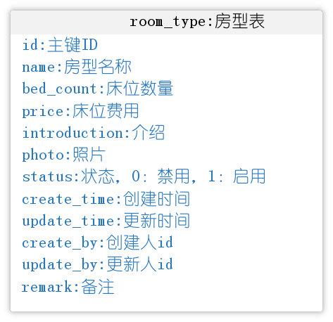

# 初始代码-环境准备

## **概述**

到目前为止呢，我们已经基本具备了使用若依框架来进行业务开发的能力。接下来呢，我们会继续深化在若依框架的基础上进行开发。我们第三章的核心目标是开发**入退管理**这个模块，里面包含了一些核心业务，比如**入住办理、智能评估、退住办理**等模块。

在开发这些模块之前呢，我们需要先导入一些基础的代码，这些代码已经完成了房型设置和楼层、房间、床位相关的模块的开发，同时在这些代码中也完成了其他前端页面代码，我们需要在此基础上开发新的业务模块。

## 环境搭建步骤

1. 找到对应仓库和分支

   1. 后端地址：https://gitee.com/lee_a/zzyl-init.git
   2. 前端地址：https://gitee.com/lee_a/zzyl-vue3-init.git
2. 将代码fork到自己的Gitee远程仓库中

<callout emoji="🐳">
注意：如果自己原来在Gitee上的远程仓库名称也叫zzyl和zzyl-vue3，需要先改一个名字或者直接删掉原来的仓库，再来fork代码到自己的仓库中。
</callout>

fork完成后，所有的代码、分支和提交记录都会同步到自己的仓库中。接下来，只需要通过` git clone` 命令将代码克隆到自己电脑上

1. 使用idea打开后端项目后，先检查编码、Maven、JDK版本设置是否都正确，如果有问题，先调整好。
2. 接下来，先切换到今天的开发分支上进行开发，比如:dev_0526
3. 导入对应的SQL脚本，覆盖之前的表结构即可，如下图：

1. 启动后端项目

   1. 修改MySql数据库和Redis对应的用户名和密码为自己的
   2. **修改阿里云OSS的bucketName为自己的**
2. 启动前端项目

   1. **需要安装依赖，将原来前端项目的node_modules拷贝至当前目录下**
   2. 执行`npm install` 命令重新下载一下必要依赖
   3. 启动项目：`npm run dev`

## 业务介绍

- **房型设置**

  - 效果图：

  

  - 房型设置功能用来管理不同的房间类型，比如有：四人间、三人间、普通单人间、特护房等等
  - 表结构：room_type
  
    
- 床位预览

  - 效果图：

  

  - 床位预览主要是对养老院的床位进行日常的管理及查看当前的入住情况，日常管理包含对楼层、房间、床位的增删改查，查看入住情况包含房间的入住率，床位所对应的老人信息等，通过床位图可以让管理员一目了然的了解养老院当前的床位分布和设备分布情况；
  - 相关表结构

  

---
> 来源：飞书技术知识库（脱敏版） · 07 业务组件方案集 / 中州养老项目（若依+AI） / 第二章-入住办理+AI大模型提升业务能力 / 01-入住办理-后端接口开发 / 初始代码-环境准备 · [原文](https://ccn8v2zngwsm.feishu.cn/wiki/DhvpwxI2viwZsMkQg53ccs8gnvd)
