# 01-入住办理-后端接口开发

## 目标

在前几天的课程中，我们熟悉了若依框架，并对其做了一些改造，今天我们继续完成养老项目中的入住办理功能。

- 能够说清楚入住功能在养老项目的业务描述
- 能够掌握根据需求独立设计入住办理相关的表结构
- 能够掌握根据需求独立分析入住办理的接口
- 能够使用若依框架快速生成入住功能后端基础代码
- 能够按照需求快速改造入住功能的接口


在开发之前呢，我们首先要重新搞定一套新的环境，详细请参考：<cite doc-id="EUXKwZci8iyMAFkMkYWcYPf9nEf" file-type="wiki" title="初始代码-环境准备" type="doc"></cite>

## 需求分析

在开发之前，我们必须要先来捋清楚需求，然后才能进行开发

### 入住办理列表页

原型文件如下：

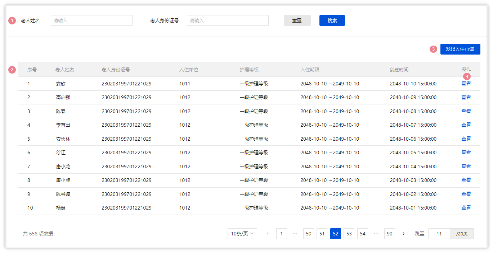

1. 搜索：老人姓名为模糊搜索，老人身份证号为精准搜索；
2. 列表数据：列表中所展示的数据是入住成功且未退住的老人信息
3. 发起入住办理：点击【发起入住申请】进入到【入住申请详情页】；
4. 查看：点击【查看】进入到【入住详情页】，数据回显，不可编辑，不显示文本框，只显示已填写/已选择的内容；

### 入住办理详情页

我们可以通过原型打开入住办理详情页，详细如下：

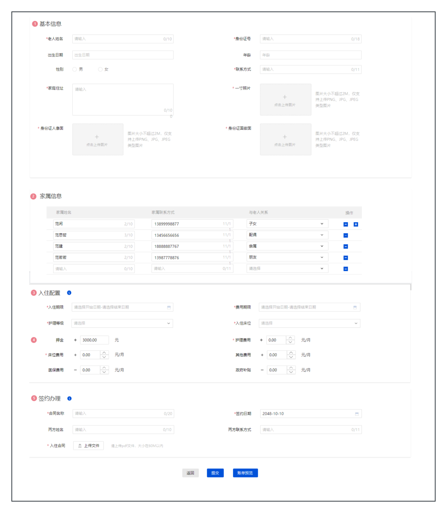

上述需求中，共包含了四部分：

- 基本信息：入住老人的基本信息，包含了姓名、年龄、身份证号、性别，住址、照片等信息
- 家属信息：入住老人的家属列表，可以有多个
- 入住配置：入住老人在养老院选择的费用信息，包含了护理等级，入住床位、入住期限等信息
- 签约办理：入住老人签订的合同信息

## 表结构设计

我们现在已经有能力去熟悉模块业务了，现在我们的新任务是开发入住办理模块的后端接口，在正式动手写代码之前，我们需要先搞清楚几个问题

- 在前后端分离的项目开发中，后端的开发的流程是什么
- 如何设计一个表，有哪些规则或规范

那接下来呢，我们依次搞定这些问题。

### 后端开发流程

在开发接口之前呢，我们需要先熟悉一下，后端开发的流程，如下：

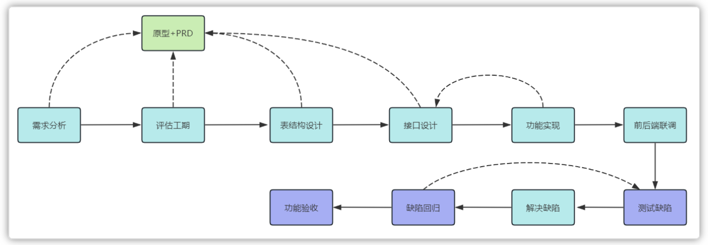

- 需求分析(基于原型和PRD)
- 开发计划(工期评估)
- **表结构设计(基于原型和PRD)**
- 接口设计(基于原型和PRD)
- 功能实现(基于接口设计+原型+PRD)
- 前后端联调
- 测试提bug
- 前后端优化，再联调
- 测试回归bug
- 功能验收

### 如何设计表？

<whiteboard token="B7gPwMMHzhi8bgbdbDXc2XMPnzh"></whiteboard>

#### E-R图

E-R图也称实体-联系图(Entity Relationship Diagram)，提供了表示**实体**类型、**属性**和**联系**的方法，用来描述现实世界的概念模型。

一个栗子：

<callout emoji="🍊">
假设我们要设计一个简单的图书馆数据库系统。我们可以使用E-R图来描述这个系统的数据模型
我们可能会有以下**实体**（Entities）：
- 书籍（Book）
- 作者（Author）
- 图书馆会员（Library Member）
然后，我们可以描述它们之间的**关系**（Relationships）：
- 一本书可以由一个或多个作者编写，这是一个"一对多"的关系。
- 图书馆成员可以借阅多本书，而每本书也可以被多个图书馆成员借阅，这是一个"多对多"的关系。
最后，我们可以添加一些**属性**（Attributes）：
- 书籍实体可能包括书名、ISBN号、出版日期等属性。
- 作者实体可能包括姓名、国籍、出生日期等属性。
- 图书馆成员实体可能包括会员号、姓名、联系信息等属性。
通过E-R图，我们可以清晰地展示这些实体之间的关系和它们的属性，从而更好地理解图书馆数据库系统的数据模型。
</callout>

上述栗子的E-R图

<whiteboard token="WMpcwgbKEhuPT2b3v2AcTw3ZnOe"></whiteboard>

可以使用飞书云文档设计E-R图。比如护理项目、护理计划、护理等级的E-R图

<whiteboard token="DMPOwIV2Xhpo5abwNEhcqRNnnkc"></whiteboard>


#### 详细设计

- 命名规则参考阿里开发手册（见名知意）  
- 数据类型

  - 基本准则
  
    - 可靠性：考虑字段存储的内容长度，尽可能的合适
    
      - name  30-50
    - 存储空间：在考虑可靠性的前提下，再考虑存储空间
  - 常见数据类型
- 主键（必须存在）

  - 自增
  - UUID
  - 雪花算法
- 冗余字段

  - 创建时间
  - 修改时间
  - 创建人
  - 修改人
  - 备注
  - 要结合业务的情况，再去设计冗余字段（为了提升性能，减少多表查询）

#### 建表工具

- 方式一：传统的数据库连接工具

创建表的工具，我们选择使DataGrip或者IDEA中集成的DataGrip工具，协助我们来设计表结构

- 方式二：AI协助帮忙创建表结构

我们可以借助AI大模型问答，写对应的提示词来创建表结构：

<callout emoji="🤖">
**Prompt**
你是一个软件工程师，帮我生成MySQL的表结构，需求如下：  
1，入住表（check_in），包含的字段有：主键(ID)，老人id(elder_id)、身份证号、入住开始时间、入住结束时间、护理等级、入住床位、状态（0:已入住、1:已退住）  
2，表中其他必要字段：排序编号、创建时间(create_time)、修改时间(update_time)、创建人(create_by)、修改人(update_by)、备注(remark)这些字段  
3，表的主键都是自增的  
4，请为每个字段都添加上comment  
5，帮我给生成的表中插入一些示例数据 
</callout>

### 入住相关表结构设计

#### 表结构的E-R图

通过需求分析，我们可以得到以下信息

1. 老人的**基本信息**里面的所有字段，都可以存储到老人表中，目前在已提供（elder表）
2. 老人关联的**家属**是一个列表
3. 老人选择的**入住配置**字段有很多，可以创建入住表来进行存储
4. **签约办理**相关的内容可以存储到合同表中

整体的E-R图结构如下：

<whiteboard token="WK25wtz75hE21fbf6kxcNi46npb"></whiteboard>

如果这么设计的话，其中的check_in表的字段就非常的多，将会带来以下问题

- 性能下降，字段越多，数据库在执行查询时需要处理的数据量就越大，插入和更新尤为明显
- 维护困难：字段过多会使得表结构复杂，导致难以理解和维护，同时修改表结构也会变得更加复杂和耗时。
- 存储空间增加：每个额外的字段，即使大多数情况下为空或数据很少，也会占用额外存储空间，并可能导致数据库备份和恢复操作耗时增加。
- 可扩展性差：当表结构变得过于复杂时，添加新功能或进行其他类型的扩展可能会变得更加困难。


为了缓解这些问题，可以考虑以下策略：

- 归档旧数据：将不经常访问的旧数据归档到单独的表中或数据库中。
- 优化数据类型：确保使用适当的数据类型来存储数据，以减少存储空间的浪费并提高性能。
- **垂直分割**：将表垂直分割成多个较小的表，每个表包含相关的字段集。


<whiteboard token="IjpKwKeKkhH6p0b3BFLcWOjrnYe"></whiteboard>

#### 什么是垂直分割

垂直分割表是数据库管理中常用的一种优化技术，它通过将一个大表中的列分割成多个小表，每个小表包含原始表的一部分列，以达到优化数据存储和访问效率的目的。以下是垂直分割表的优缺点总结：

**优点**

1. 提高查询性能：通过减少表的宽度，可以加快查询速度，特别是在涉及大量列的表中。当查询只需要访问部分列时，数据库系统只需扫描包含这些列的小表，减少了不必要的数据扫描量。
2. 减少I/O操作：在读取数据时，数据库系统可以只读取需要的列，而无需扫描整个表，从而减少了I/O操作的次数和数据传输量。

**缺点**

1. 增加复杂性：垂直分割表会增加数据库结构的复杂性，需要更多的管理和维护工作。例如，需要修改应用程序中的查询和更新操作，以适应新的表结构。
2. 事务处理复杂：垂直分割表后，事务的处理可能会变得更加复杂。因为事务可能需要跨越多个子表，这增加了事务管理的难度和开销。
3. 表连接操作增加：由于数据被分散到多个子表中，因此在查询时可能需要更多的表连接操作，这可能会增加CPU的开销和查询的响应时间。


经过垂直分割之后，其中的入住表可以分割为两个表

<whiteboard token="NbMhw64cXhNzvrbr6S1cNYqwnbf"></whiteboard>

其中列表查询所展示的字段可以认为是经常访问的字段，详情中查看的字段认为是访问较少的字段，由此可以得出：

<grid>
<column width-ratio="0.500000">
**经常访问的字段**
- ID主键
- 老人姓名
- 老人id(elder_id)
- 身份证号
- 入住开始时间
- 入住结束时间
- 护理等级名称
- 入住床位
- 状态（0:已入住、1:已退住）
</column>
<column width-ratio="0.500000">
**访问较少的字段**
- ID主键
- 入住ID
- 护理等级ID
- 护理等级名称
- 入住床位
- 费用开始时间
- 费用结束时间
- 押金（元）
- 护理费用（元/月）
- 床位费用（元/月）
- 医保支付（元/月）
- 政府补贴（元/月）
- 其他费用（元/月）
</column>
</grid>

其中在经常访问的字段中，有一些**冗余**字段：

- 老人姓名
- 身份证号
- 护理等级名称
- 入住床位

<callout emoji="🐵">
在设计数据库表时，引入**冗余字段**是一种常见的优化手段，主要目的：
1. 冗余字段减少查询时的表连接操作，降低查询复杂性和执行时间。
2. 冗余字段简化查询逻辑，使查询语句更简洁易懂，易于维护和减少出错概率。
</callout>


#### 最终表结构


<whiteboard token="N4gJweywFh3RfsbvuQKcaii8nSb"></whiteboard>

- 上图中的四张表的关系都是一对一的关系
- 废弃了老人家属表，由于老人家属信息主要用于回显展示，可以以json格式存储到入住表中的remark字段中


根据之前的分析结合需求文档，我们可以使用AI协助创建表结构，共为三张表

<callout emoji="🤖">
**Prompt**
你是一个软件工程师，帮我生成MySQL的表结构，需求如下：  
1，入住表（check_in），包含的字段有：主键(ID)，老人姓名(elder_name)、老人id(elder_id)、身份证号(id_card_no)、入住开始时间、入住结束时间、护理等级名称(nursing_level_name)、入住床位、状态（0:已入住、1:已退住）
2，入住配置表(check_in_config)，包含的字段有：主键(ID)，入住表ID、护理等级ID(nursing_level_id)、护理等级名称(nursing_level_name)、费用开始时间、费用结束时间、押金（元）、护理费用（元/月）、床位费用（元/月）、医保支付（元/月）、政府补贴（元/月）、其他费用（元/月）
其他要求：  
1，表中其他必要字段：排序编号、创建时间(create_time)、修改时间(update_time)、创建人(create_by)、修改人(update_by)、备注(remark)这些字段
2，入住表和入住配置表是一对一的关系，**不需要设置外键约束**  
3，表的主键都是自增的，类型为bigint  
4，请为每个字段都添加上comment  
5，帮我给生成的表中插入一些示例数据
</callout>

为什么不需要设计外键约束？

<callout emoji="🐵">
将外键约束关联改为**逻辑关联**，主要出于以下考虑：
1. 性能优化：外键约束可能影响增删改效率，甚至引发死锁问题。逻辑关联则能避免这些性能瓶颈。
2. 设计灵活性：外键约束限制了数据库结构调整的自由度。逻辑关联则更加灵活，易于适应数据库结构的变化和多种关系模型。
</callout>


生成后的效果：

https://lxblog.com/qianwen/share?shareId=64c1f380-1ec6-475d-b284-d00dc801913f

最终的建表语句：

```SQL
CREATE TABLE `check_in` (
  `id` BIGINT NOT NULL AUTO_INCREMENT COMMENT '主键ID',
  `elder_name` VARCHAR(50) NOT NULL COMMENT '老人姓名',
  `elder_id` BIGINT NOT NULL COMMENT '老人ID',
  `id_card_no` CHAR(18) NOT NULL COMMENT '身份证号',
  `start_date` DATE NOT NULL COMMENT '入住开始时间',
  `end_date` DATE COMMENT '入住结束时间',
  `nursing_level_name` VARCHAR(50) NOT NULL COMMENT '护理等级名称',
  `bed_number` VARCHAR(50) NOT NULL COMMENT '入住床位',
  `status` TINYINT NOT NULL DEFAULT '0' COMMENT '状态 (0: 已入住, 1: 已退住)',
  `sort_order` INT NOT NULL DEFAULT '0' COMMENT '排序编号',
  `create_time` TIMESTAMP DEFAULT CURRENT_TIMESTAMP COMMENT '创建时间',
  `update_time` TIMESTAMP DEFAULT CURRENT_TIMESTAMP ON UPDATE CURRENT_TIMESTAMP COMMENT '修改时间',
  `create_by` VARCHAR(50) COMMENT '创建人',
  `update_by` VARCHAR(50) COMMENT '修改人',
  `remark` VARCHAR(255) COMMENT '备注',
  PRIMARY KEY (`id`)
) ENGINE=InnoDB DEFAULT CHARSET=utf8mb4 COLLATE=utf8mb4_unicode_ci;

CREATE TABLE `check_in_config` (
  `id` BIGINT NOT NULL AUTO_INCREMENT COMMENT '主键ID',
  `check_in_id` BIGINT NOT NULL COMMENT '入住表ID',
  `nursing_level_id` BIGINT NOT NULL COMMENT '护理等级ID',
  `nursing_level_name` VARCHAR(50) NOT NULL COMMENT '护理等级名称',
  `fee_start_date` DATE NOT NULL COMMENT '费用开始时间',
  `fee_end_date` DATE COMMENT '费用结束时间',
  `deposit` DECIMAL(10, 2) NOT NULL COMMENT '押金（元）',
  `nursing_fee` DECIMAL(10, 2) NOT NULL COMMENT '护理费用（元/月）',
  `bed_fee` DECIMAL(10, 2) NOT NULL COMMENT '床位费用（元/月）',
  `insurance_payment` DECIMAL(10, 2) NOT NULL COMMENT '医保支付（元/月）',
  `government_subsidy` DECIMAL(10, 2) NOT NULL COMMENT '政府补贴（元/月）',
  `other_fees` DECIMAL(10, 2) NOT NULL COMMENT '其他费用（元/月）',
  `sort_order` INT NOT NULL DEFAULT '0' COMMENT '排序编号',
  `create_time` TIMESTAMP DEFAULT CURRENT_TIMESTAMP COMMENT '创建时间',
  `update_time` TIMESTAMP DEFAULT CURRENT_TIMESTAMP ON UPDATE CURRENT_TIMESTAMP COMMENT '修改时间',
  `create_by` VARCHAR(50) COMMENT '创建人',
  `update_by` VARCHAR(50) COMMENT '修改人',
  `remark` VARCHAR(255) COMMENT '备注',
  PRIMARY KEY (`id`)
) ENGINE=InnoDB DEFAULT CHARSET=utf8mb4 COLLATE=utf8mb4_unicode_ci;
```


老人表已经存在了，接下来使用AI生成合同表，提示词如下：

<callout emoji="🤖">
**Prompt**
你是一个软件工程师，帮我生成MySQL的表结构，需求如下：  
1，合同表（contract），包含的字段有：主键(ID)，老人id(elder_id)、合同名称、合同编号、协议地址、丙方手机号、丙方姓名、老人姓名、开始时间、结束时间、状态(status   0：未生效，1：已生效，2：已过期, 3：已失效)、签约日期、解除提交人、解除日期、解除协议地址  
2，表中其他必要字段：排序编号、创建时间(create_time)、修改时间(update_time)、创建人(create_by)、修改人(update_by)、备注(remark)这些字段，这些字段默认为null  
3，表的主键都是自增的，类型为bigint  
4，请为每个字段都添加上comment  
5，帮我给生成的表中插入一些示例数据
</callout>

https://lxblog.com/qianwen/share?shareId=b4cafb2c-f970-49fe-b77b-fa603a7f56d4

生成后的效果：

```SQL
CREATE TABLE `contract` (
  `id` BIGINT NOT NULL AUTO_INCREMENT COMMENT '主键ID',
  `elder_id` INT NOT NULL COMMENT '老人ID',
  `contract_name` VARCHAR(100) NOT NULL COMMENT '合同名称',
  `contract_number` VARCHAR(50) NOT NULL COMMENT '合同编号',
  `agreement_path` VARCHAR(255) NOT NULL COMMENT '协议地址（文件路径或URL）',
  `third_party_phone` VARCHAR(20) NOT NULL COMMENT '丙方手机号',
  `third_party_name` VARCHAR(50) NOT NULL COMMENT '丙方姓名',
  `elder_name` VARCHAR(50) NOT NULL COMMENT '老人姓名',
  `start_date` DATE NOT NULL COMMENT '开始时间',
  `end_date` DATE NOT NULL COMMENT '结束时间',
  `status` TINYINT NOT NULL DEFAULT '0' COMMENT '状态 (0: 未生效, 1: 已生效, 2: 已过期, 3: 已失效)',
  `sign_date` DATE NOT NULL COMMENT '签约日期',
  `termination_submitter` VARCHAR(50) COMMENT '解除提交人',
  `termination_date` DATE COMMENT '解除日期',
  `termination_agreement_path` VARCHAR(255) COMMENT '解除协议地址（文件路径或URL）',
  `sort_order` INT NOT NULL DEFAULT '0' COMMENT '排序编号',
  `create_time` TIMESTAMP DEFAULT CURRENT_TIMESTAMP COMMENT '创建时间',
  `update_time` TIMESTAMP DEFAULT CURRENT_TIMESTAMP ON UPDATE CURRENT_TIMESTAMP COMMENT '修改时间',
  `create_by` VARCHAR(50) COMMENT '创建人',
  `update_by` VARCHAR(50) COMMENT '修改人',
  `remark` VARCHAR(255) COMMENT '备注',
  PRIMARY KEY (`id`)
) ENGINE=InnoDB DEFAULT CHARSET=utf8mb4 COLLATE=utf8mb4_unicode_ci;
```

其他修改：由于AI生成的字段都要求是必填的，这样在后期操作数据的时候有很多的限制，我们可以通过数据库连接工具调整一下，重点调整的字段：sort_order、create_time、update_time、create_by、update_by、remark

以elder表为例：

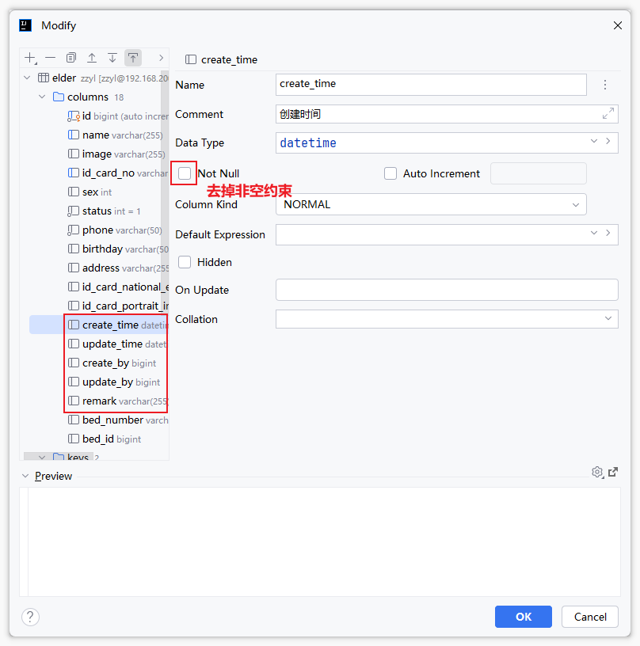

## 接口设计

目前我们已经准备好了表结构，在我们分析**需求**后，还要确定我们需要开发的接口。设计接口也是我们后期开发中一个常规的工作。

### 接口四要素

搞明白需求之后，我们下面就可以来设计接口了，一个接口包含了四个基本要素，分别是：请求路径、请求方式、接口入参、接口出参

- **请求路径** 命名：以模块名称进行区分（英文）
- **请求方式（需要符合restful风格）**

  - 查询  GET
  - 新增 POST
  - 修改 PUT
  - 删除 DELETE
- 接口入参

  - 路径参数
  
    - 问号传参---->后端形参接收
    - path传参---->后端PathVariable注解接收
  - 请求体参数
  
    - 前端：json对象
    - 后端：对象接收，DTO
- 接口出参

  - 统一格式 `{code:200,msg:"成功",data:{}}`
  - 数据封装，一般为VO
  
    - 敏感数据过滤
    - 整合数据

### 接口测试

测试工具有很多，以下几个是比较常见的接口测试工具

- Postman
- ApiPost
- Apifox
- Swagger   在线接口文档
- Knife4j     对swagger的增强，可生成离线接口文档

> 使用postman或者apifox工具测试接口，需要知道明确的接口信息


### 入住相关的接口

接口文档：<cite doc-id="Zz2Bw2OgHiB1dMkaxVucVvMqnvg" file-type="wiki" title="入退管理-接口文档" type="doc"></cite>

入住办理这个模块中共6个接口，分别是：

1. 分页查询入住列表

   - 请求方式：GET
   - 参数：分页条件查询（elderName、idNumber、pageNum、pageSize）
   - 响应结果：参考若依框架定义的分页对象：`{total:120,rows:[],code:200,msg:成功或失败}`

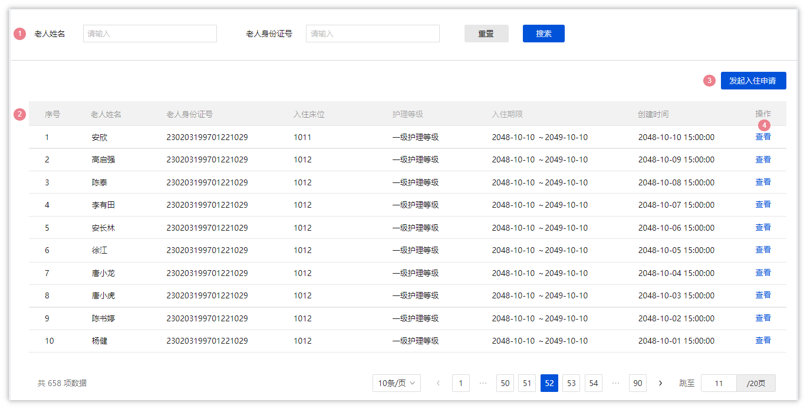

1. 查询所有护理等级信息

- 请求方式：GET
- 参数：无
- 响应结果：参考若依框架定义的普通返回对象：`{msg:成功或失败,code:200,data:[]}`

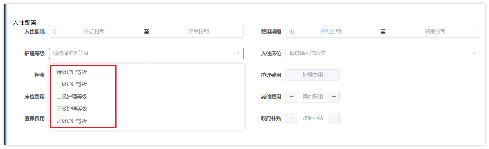

选择护理等级之后，可以自动填充**护理费用**这个这个

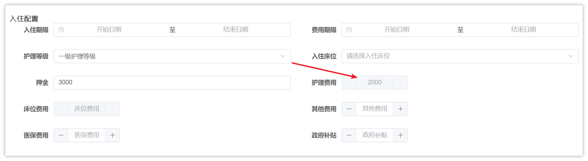


1. 根据床位状态查询所有楼层数据

- 请求方式：GET
- 参数：status(比较通用，只查询未入住的床位)
- 响应结果：参考若依框架定义的普通返回对象：`{msg:成功或失败,code:200,data:[]}`

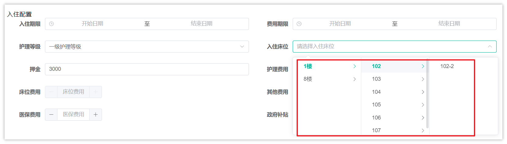


1. 查询房间数据（楼层、房间、价格）

- 请求方式：GET
- 参数：选择之后的房间ID(房间可以决定床位价格)
- 响应结果：参考若依框架定义的普通返回对象：`{msg:成功或失败,code:200,data:{}}`

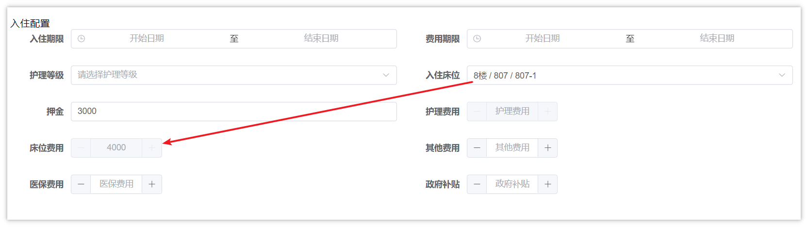

1. 申请入住

填写入住信息之后，提交表单数据，进行保存，需要涉及到多张表(老人表、入住表、入住配置表、合同表)

- 请求方式：POST
- 参数：请求体数据，表单中的所有数据
- 响应结果：参考若依框架定义的普通返回对象：`{msg:成功或失败,code:200}`


1. 查询入住详情

- 请求方式：GET
- 参数：入口在入住列表查询，可以传入入住ID
- 响应结果：参考若依框架定义的普通返回对象：`{msg:成功或失败,code:200,data:{}}`

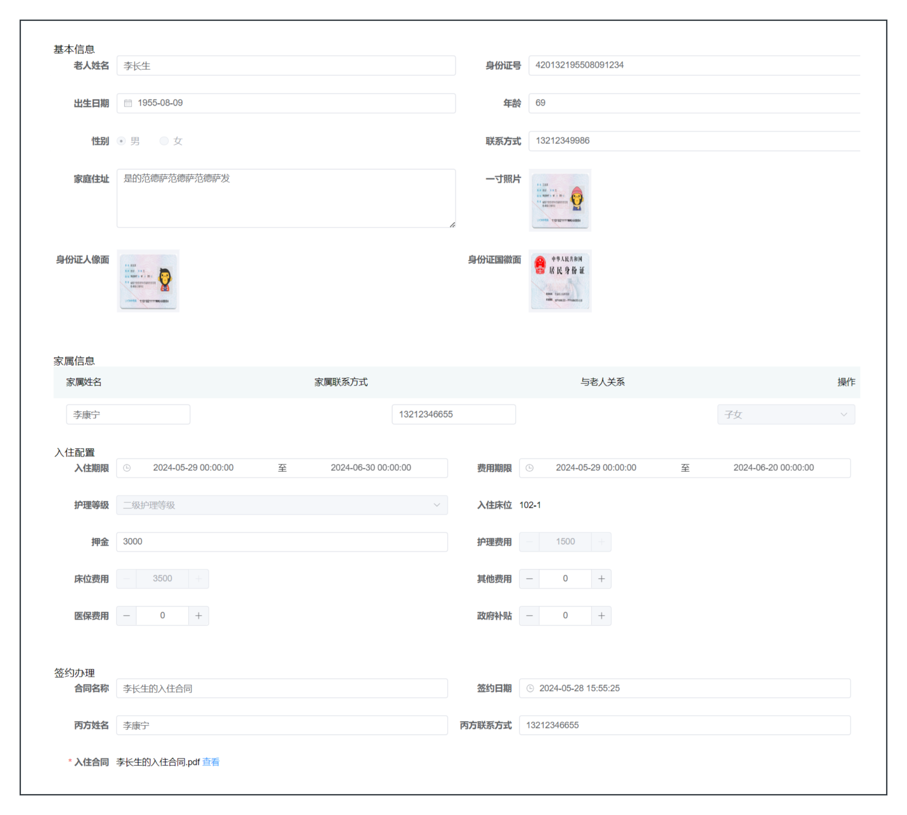

### 接口文档

详细定义请参考：<cite doc-id="Zz2Bw2OgHiB1dMkaxVucVvMqnvg" file-type="wiki" title="入退管理-接口文档" type="doc"></cite>

## 接口开发

### 基础代码生成

#### 基础配置

把我们生成的四张表导入到代码生成页面中（入住表、入住配置表、合同表、老人表），如下图

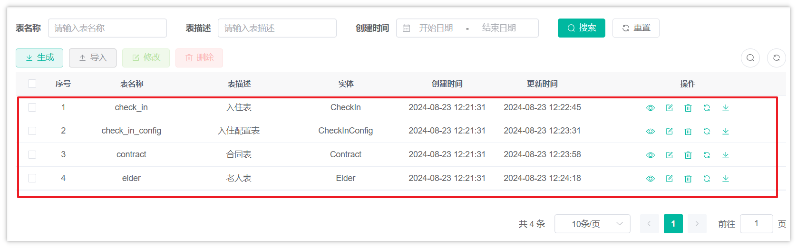


**入住表(check_in)代码生成配置**

- 包路径：`com.zzyl.nursing`
- 模块名：`nursing`

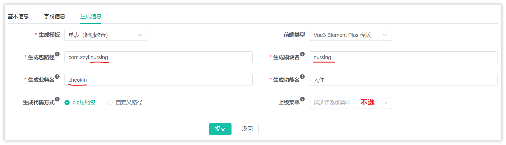

**合同表(contract)代码生成配置**

- 包路径：`com.zzyl.nursing`
- 模块名：`nursing`

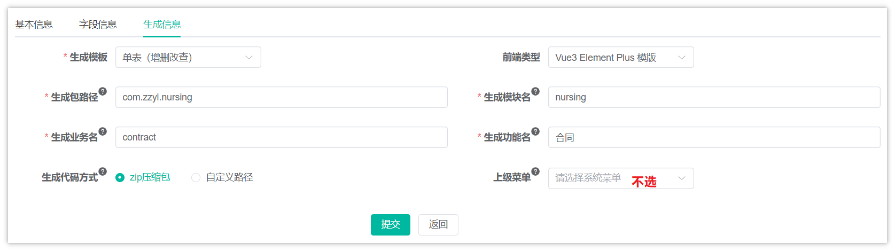

**其他所有表的配置**

- 包路径：`com.zzyl.nursing`
- 模块名：`nursing`
- 修改所有表中的日期类型为：**LocalDateTime**，状态和和排序等改为**Integer**类型
- 所有的主键或关联的主键都是Long类型

> ps：创建时间和修改时间无需改动，还是Date类型

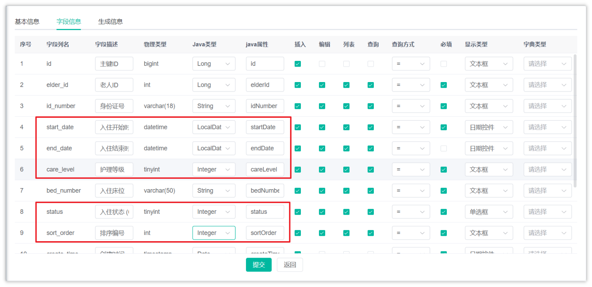

#### 批量生成导入

全选之后，点击代码生成，如下操作

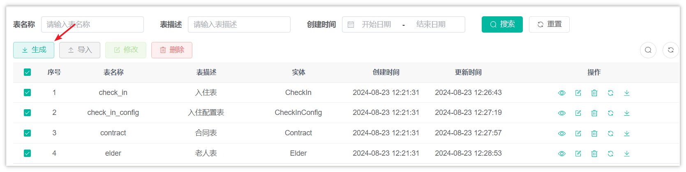


**后端代码拷贝说明**

注意：只拷贝后端代码，前端代码和sql已经包含了，不需要拷贝

把下载好的后端代码，统一拷贝到**zzyl-nursing-platform**模块中，如下效果

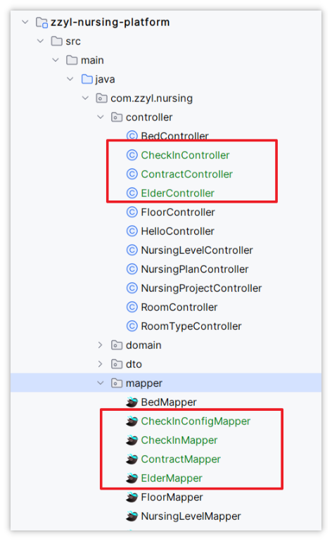

> 注意：
> 
> 1. 上图只展示了部分拷贝后的代码，其中也包括了domain、service、xml映射文件等所有代码
> 2. 删除掉CheckInConfigController这个类，后期用不到，留下其他的(domain、service、mapper)


### 分页查询入住列表

重新启动前后端项目，其中的入住列表效果如下图

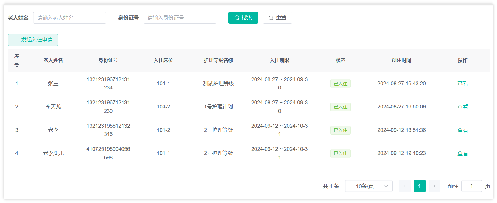

> 自动生成的代码已包含该接口，无需开发

测试数据

```SQL
INSERT INTO `check_in`(`end_date`,`id_card_no`,`nursing_level_name`,`create_time`,`remark`,`elder_id`,`create_by`,`update_time`,`elder_name`,`id`,`bed_number`,`sort_order`,`start_date`,`status`) VALUES ('2024-09-30','132123196712131234','测试护理等级','2024-08-27 16:43:20.0','[{"kinship":"1","name":"13211223322","phone":"13211223322"}]',325,'1','2024-08-27 08:43:19.0','张三',1,'104-1',0,'2024-08-27',0);
INSERT INTO `check_in`(`end_date`,`id_card_no`,`nursing_level_name`,`create_time`,`remark`,`elder_id`,`create_by`,`update_time`,`elder_name`,`id`,`bed_number`,`sort_order`,`start_date`,`status`) VALUES ('2024-09-30','132123196712131239','1号护理计划','2024-08-27 16:50:09.0','[{"kinship":"0","name":"李天","phone":"13222334439"}]',326,'1','2024-08-27 08:50:08.0','李天龙',2,'104-2',0,'2024-08-27',0);
INSERT INTO `check_in`(`end_date`,`id_card_no`,`nursing_level_name`,`create_time`,`remark`,`elder_id`,`create_by`,`update_time`,`elder_name`,`id`,`bed_number`,`sort_order`,`start_date`,`status`) VALUES ('2024-10-31','132123195612132345','2号护理等级','2024-09-12 18:51:36.0','[{"kinship":"1","name":"小李","phone":"13212349900"}]',327,'1','2024-09-12 18:51:36.0','老李',3,'101-2',0,'2024-09-12',0);
INSERT INTO `check_in`(`end_date`,`id_card_no`,`nursing_level_name`,`create_time`,`remark`,`elder_id`,`create_by`,`update_time`,`elder_name`,`id`,`bed_number`,`sort_order`,`start_date`,`status`) VALUES ('2024-10-31','410725196904056698','2号护理等级','2024-09-12 19:10:23.0','[{"kinship":"0","name":"老王","phone":"15100000002"}]',328,'1','2024-09-12 19:10:23.0','老李头儿',4,'101-1',0,'2024-09-12',0);
```


### 查询所有护理等级列表

#### 控制层

基于接口文档的定义，在NursingLevelController定义新的方法，如下：

```Java
@ApiOperation(value = "获取所有护理等级")
@GetMapping("/all")
public R<List<NursingLevel>> listAll() {
    List<NursingLevel> list = nursingLevelService.listAll();
    return R.ok(list);
}
```

#### Service层

```JavaScript
/**
 * 查询所有护理等级
 * @return  护理等级列表
 */
List<NursingLevel> listAll();
```

#### Service层实现类

```JavaScript
/**
 * 查询所有护理等级 
 *
 * @return 护理等级列表
 */
@Override
public List<NursingLevel> listAll() {
    LambdaQueryWrapper<NursingLevel> queryWrapper = new LambdaQueryWrapper<>();
    queryWrapper.eq(NursingLevel::getStatus, 1);
    List<NursingLevel> list = list(queryWrapper);
    return list;
}
```

#### 测试

打开前端页面来测试，如下效果：

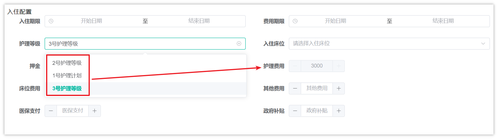


### 根据床位状态查询所有楼层数据

#### 思路说明

最终的效果图如下：

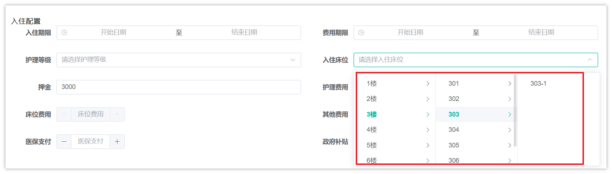

我们结合**接口文档的数据结构**，这个接口需要查询三张表的数据，分别是**楼层表、房间表、床位表**，它们的关系如下：

<whiteboard token="BXSqwCvHjhaKtPbjSdZckicTnBb"></whiteboard>

sql语句

```SQL
select f.id fid, f.name, r.id rid, r.code, b.id bid, b.bed_number
from floor f
         left join room r on f.id = r.floor_id
         left join bed b on r.id = b.room_id
where b.bed_status = 0
order by f.id, r.id, b.id
```

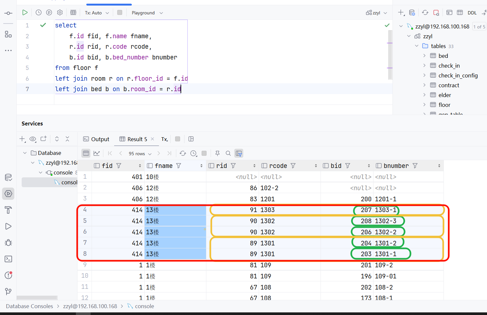

#### 控制层

在FloorController中定义新的方法，如下：

```Java
@GetMapping("/getRoomAndBedByBedStatus/{status}")
@ApiOperation("按照状态查询楼层房间床位-树形结构")
public R<List<TreeVo>> getRoomAndBedByBedStatus(@ApiParam(value = "床位状态(未入住0, 已入住1)", required = true) @PathVariable("status") Integer status){
    List<TreeVo> list = floorService.getRoomAndBedByBedStatus(status);
    return R.ok(list);
}
```

TreeVo(需要结合着接口文档的数据结构来编写vo类)

```Java
package com.zzyl.nursing.vo;


import io.swagger.annotations.ApiModel;
import io.swagger.annotations.ApiModelProperty;
import lombok.Data;

import java.util.List;

@Data
@ApiModel("树形结构VO")
public class TreeVo {
    /**
     * 菜单ID
     */
    @ApiModelProperty(value = "菜单ID")
    private String value;
    
    /**
     * 菜单名称
     */
    @ApiModelProperty(value = "菜单名称")
    private String label;


    /**
     * 子菜单
     */
    @ApiModelProperty(value = "子菜单")
    private List<TreeVo> children;
}
```


#### 业务层

在IFloorService中定义新的方法：

```Java
/**
 * 根据状态获取房间和床位信息
 * @param status    状态
 * @return          结果
 */
List<TreeVo> getRoomAndBedByBedStatus(Integer status);
```

实现方法：

```Java
/**
 * 根据状态获取房间和床位信息
 *
 * @param status 状态
 * @return 结果
 */
@Override
public List<TreeVo> getRoomAndBedByBedStatus(Integer status) {
    return floorMapper.getRoomAndBedByBedStatus(status);
}
```

#### 持久层

在FloorMapper中定义查询的方法

```Java
List<TreeVo> getRoomAndBedByBedStatus(Integer status);
```

xml映射文件

```XML
<resultMap id="TreeVoResultMap" type="com.zzyl.nursing.vo.TreeVo">
    <id column="fid" property="value"></id>
    <result column="name" property="label"></result>
    <collection property="children" ofType="com.zzyl.nursing.vo.TreeVo">
        <id column="rid" property="value"></id>
        <result column="code" property="label"></result>
        <collection property="children" ofType="com.zzyl.nursing.vo.TreeVo">
            <id column="bid" property="value"></id>
            <result column="bed_number" property="label"></result>
        </collection>
    </collection>
</resultMap>

<select id="getRoomAndBedByBedStatus" resultMap="TreeVoResultMap">
    select f.id fid, f.name, r.id rid, r.code, b.id bid, b.bed_number
    from floor f
             left join room r on f.id = r.floor_id
             left join bed b on r.id = b.room_id
    where b.bed_status = #{status}
    order by f.id, r.id, b.id
</select>
```

#### 测试

可以前端项目来查看效果

### 根据房间id查询房间数据（楼层、房间、价格）

#### 思路说明

效果图：

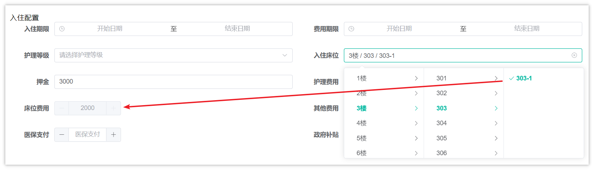

当选择了某一个床位之后，需要根据床位所在的房间，查询所匹配的价格，我们结合接口文档的返回结果来分析，这里面涉及到了3张表：

<whiteboard token="IulQwABt0h5PbLblhsEclYGenJg"></whiteboard>


#### 控制层

在RoomController中定义新的方法，如下：

```Java
@GetMapping("/one/{id}")
@ApiOperation("按照房间id查询楼层、房间、价格")
public R<RoomVo> getRoomById(@ApiParam(value = "房间ID", required = true) @PathVariable("id") Long id){
    RoomVo roomVo = roomService.getRoomById(id);
    return R.ok(roomVo);
}
```

RoomVo在代码中已提供，符合接口返回的要求

#### 业务层

在IRoomService中定义新的方法：

```Java
/**
 * 按照房间id查询楼层、房间、价格
 * @param id
 * @return
 */
RoomVo getRoomById(Long id);
```

实现方法：

```Java
/**
 * 按照房间id查询楼层、房间、价格
 *
 * @param id
 * @return
 */
@Override
public RoomVo getRoomById(Long id) {
    return roomMapper.getRoomById(id);
}
```

#### 持久层

在RoomMapper中定义新的方法，如下：

```Java
RoomVo getRoomById(Long id);
```

xml映射文件：

```XML
<select id="getRoomById" resultType="com.zzyl.nursing.vo.RoomVo">
    select f.name floorName,f.id floorId,r.id roomId,r.code ,rt.price
    from floor f left join room r on f.id = r.floor_id
                 left join room_type rt on rt.name = r.type_name
    where r.id = #{id}
</select>
```

#### 测试

打开前端页面，查看效果，要选择一个床位关联了床位类型的数据进行测试


### 申请入住

#### 思路说明

申请入住的流程较长，涉及到多张表的操作，流程如下：

<whiteboard token="IK7uwbqOBhGpJ6b5utkcNAN4n7g"></whiteboard>

#### 控制层

在CheckInController中定义申请入住的方法

```Java
@PostMapping("/apply")
public AjaxResult apply(@RequestBody CheckInApplyDto dto){
    checkInService.apply(dto);
    return AjaxResult.success();
}
```

基于接口的入参分析，我们需要定义多个dto来接收参数，大家主要可以按照dto中定义的接口来定义类

也可以使用AI大模型，基于json格式的请求数据帮我们生成java类来接收数据

<callout emoji="🤖">
**Prompt**
{  
  "checkInElderDto": {  
    "address": "北京市昌平区",  
    "age": "60",  
    "birthday": "1946-12-19",  
    "idCardNationalEmblemImg": "https://itheim.oss-cn-beijing.aliyuncs.com/481be4c8-5a04-4475-8712-bd3f53f6e4ff.jpg",  
    "idCardNo": "132123194612191234",  
    "idCardPortraitImg": "https://itheim.oss-cn-beijing.aliyuncs.com/2038127d-bd2e-46eb-8b9a-867205a048c6.jpg",  
    "image": "https://itheim.oss-cn-beijing.aliyuncs.com/9fc6b8ac-3ed5-432c-8835-8ca91abc2569.png",  
    "name": "刘天龙",  
    "phone": "15543234565",  
    "sex": 1  
  },  
  "elderFamilyDtoList": [  
    {  
      "kinship": "1",  
      "name": "刘天",  
      "phone": "15543234568"  
    }  
  ],  
  "checkInConfigDto": {  
    "bedFee": "4000.00",  
    "bedId": "10",  
    "code": "107",  
    "deposit": 3000,  
    "endDate": "2024-09-30 00:00:00",  
    "feeEndDate": "2024-08-31 00:00:00",  
    "feeStartDate": "2024-08-26 00:00:00",  
    "floorId": "1",  
    "floorName": "1楼",  
    "governmentSubsidy": 1,  
    "insurancePayment": 1,  
    "nursingFee": 2000,  
    "nursingLevelId": 77,  
    "nursingLevelName": "1号护理计划",  
    "otherFees": 1,  
    "roomId": "7",  
    "startDate": "2024-08-26 00:00:00"  
  },  
  "checkInContractDto": {  
    "agreementPath": "https://itheim.oss-cn-beijing.aliyuncs.com/72731f06-d7d3-41ca-9343-b9422993ebda.png",  
    "contractName": "刘天龙",  
    "signDate": "2024-08-26 15:47:39",  
    "thirdPartyName": "刘天",  
    "thirdPartyPhone": "15543234568"  
  }  
}  
**基于这个json数据结构，帮我定义几个java类来接收这些参数，类中使用lombok注解**
</callout>

回答的效果：https://lxblog.com/qianwen/share?shareId=c174b93a-8729-4c75-8bd1-7172a5fb21ed


大家也可以使用资料中提供的代码

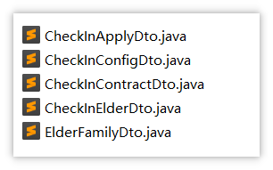

基本的结构如下：

```Java
public class CheckInApplyDto {

    // 老人信息
    private CheckInElderDto checkInElderDto;
    
    // 家属信息
    private List<ElderFamilyDto> elderFamilyDtoList;
   
    // 入住配置
    private CheckInConfigDto checkInConfigDto;
   
    // 签约办理
    private CheckInContractDto checkInContractDto;
}
```

**注意：属性名称要与json结构中保持一致**


#### 业务层

基于刚才分析的思路，我们知道入住发起请求之后，需要涉及到多表张，共有5张表需要操作，分别是：老人表、床位表、入住表、入住配置表、合同表。

我们在ICheckInService中定义新的方法，如下：

```Java
/**
 * 申请入住
 * @param checkInApplyDto
 */
void apply(CheckInApplyDto checkInApplyDto);
```

实现方法，需要添加事务的支持

```Java
@Autowired
private CheckInMapper checkInMapper;

@Autowired
private ElderMapper elderMapper;

@Autowired
private BedMapper bedMapper;

@Autowired
private CheckInConfigMapper checkInConfigMapper;

@Autowired
private ContractMapper contractMapper;

/**
 * 申请入住
 *
 * @param checkInApplyDto
 */
@Override
public void apply(CheckInApplyDto checkInApplyDto) {
    // 判断老人是否已经入住
    // 通过身份证号查询老人
    LambdaQueryWrapper<Elder> elderQueryWrapper = new LambdaQueryWrapper<Elder>();
    elderQueryWrapper.eq(Elder::getIdCardNo, checkInApplyDto.getCheckInElderDto().getIdCardNo());
    elderQueryWrapper.eq(Elder::getStatus, 1);
    Elder elder =  elderMapper.selectOne(elderQueryWrapper);
    if(ObjectUtils.isNotEmpty(elder)) {
        throw new BaseException("老人已入住");
    }

    // 更新床位的状态  已入住
    Bed bed = bedMapper.selectById(checkInApplyDto.getCheckInConfigDto().getBedId());
    bed.setBedStatus(1);
    bedMapper.updateById(bed);

    // 保存或更新老人数据
    elder = insertOrUpdate(bed, checkInApplyDto.getCheckInElderDto());

    // 生成合同编号
    String contractNo = "HT" + CodeGenerator.generateContractNumber();

    // 新增签约办理
    insertContract(contractNo, elder, checkInApplyDto);

    // 新增入住信息
    CheckIn checkIn = insertCheckIn(elder, checkInApplyDto);

    // 新增入住配置信息
    insertCheckInConfig(checkIn.getId(), checkInApplyDto);
}

/**
 * 新增入住配置
 * @param checkInApplyDto
 */
private void insertCheckInConfig(Long checkInId, CheckInApplyDto checkInApplyDto) {
    CheckInConfig checkInConfig = new CheckInConfig();
    BeanUtils.copyProperties(checkInApplyDto.getCheckInConfigDto(), checkInConfig);
    checkInConfig.setCheckInId(checkInId);
    checkInConfigMapper.insert(checkInConfig);
}

/**
 * 新增入住信息
 * @param elder
 * @param checkInApplyDto
 */
private CheckIn insertCheckIn(Elder elder, CheckInApplyDto checkInApplyDto) {
    CheckIn checkIn = new CheckIn();
    checkIn.setElderId(elder.getId());
    checkIn.setElderName(elder.getName());
    checkIn.setIdCardNo(elder.getIdCardNo());
    checkIn.setNursingLevelName(checkInApplyDto.getCheckInConfigDto().getNursingLevelName());
    checkIn.setStartDate(checkInApplyDto.getCheckInConfigDto().getStartDate());
    checkIn.setEndDate(checkInApplyDto.getCheckInConfigDto().getEndDate());
    checkIn.setBedNumber(elder.getBedNumber());
    checkIn.setRemark(JSON.toJSONString(checkInApplyDto.getElderFamilyDtoList()));
    checkIn.setStatus(0);
    checkInMapper.insert(checkIn);
    return checkIn;
}

/**
 * 新增合同
 * @param contractNo
 * @param elder
 * @param checkInApplyDto
 */
private void insertContract(String contractNo, Elder elder, CheckInApplyDto checkInApplyDto) {

    Contract contract = new Contract();
    // 属性拷贝
    BeanUtils.copyProperties(checkInApplyDto.getCheckInContractDto(), contract);
    contract.setContractNumber(contractNo);
    contract.setElderId(elder.getId());
    contract.setElderName(elder.getName());
    // 状态、开始时间、结束时间
    // 签约时间小于等于当前时间，合同生效中
    LocalDateTime checkInStartTime = checkInApplyDto.getCheckInConfigDto().getStartDate();
    LocalDateTime checkInEndTime = checkInApplyDto.getCheckInConfigDto().getEndDate();
    Integer status = checkInStartTime.isBefore(LocalDateTime.now()) ? 0 : 1;
    contract.setStatus(status);
    contract.setStartDate(checkInStartTime);
    contract.setEndDate(checkInEndTime);
    contractMapper.insert(contract);
}

/**
 * 新增或更新老人
 * @param bed
 * @param checkInElderDto
 * @return
 */
private Elder insertOrUpdate(Bed bed, CheckInElderDto checkInElderDto) {

    // 准备老人数据
    Elder elder = new Elder();
    // 属性拷贝
    BeanUtils.copyProperties(checkInElderDto, elder);
    elder.setBedNumber(bed.getBedNumber());
    elder.setBedId(bed.getId());
    elder.setStatus(1);
    // 查询老人信息，（身份证号、状态不为1）
    LambdaQueryWrapper<Elder> lambdaQueryWrapper = new LambdaQueryWrapper<>();
    lambdaQueryWrapper.eq(Elder::getIdCardNo, checkInElderDto.getIdCardNo()).ne(Elder::getStatus, 1);
    Elder elderDb =  elderMapper.selectOne(lambdaQueryWrapper);
    if(ObjectUtils.isNotEmpty(elderDb)) {
        // 修改
        elderMapper.updateById(elder);
    }else {
        // 新增
        elderMapper.insert(elder);
    }
    return elder;
}
```

在创建合同的时候，需要生成一个合同的编号，编号的规则如下：

- 共有16位的数值
- 前12位的组成规则是：yyyyMMddHHmmss 案例：20250101101259
- 后4位是在当前时间内生成一个递增的数值，从1开始，范围：[0001, 9999]（最大值）
- 我们可以通过AI大模型，帮助我们生成工具类：https://lxblog.com/qianwen/share?shareId=c7714610-5c69-4663-8c43-bfd17d6e4c4e

  <callout emoji="🤖">
  **Prompt**
  帮我生成一个java工具类，可以生成一个编号，编号长度为16位，其中前12位是当前时间（年月日时分秒），后四位是从1开始累加的值，第小值为：0001  最大的值为：9999
  </callout>
- 大家也可以直接使用我生成好的类，在当天资料中可以找到

  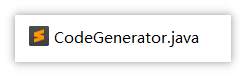


#### 测试

姓名身份证通过这个网站获取

https://id.dcode.top/

### 申请入住详情（思路分析）

#### 思路说明

如下图：

<whiteboard token="DF4TwaPJlhACODbOV5scG5konoe"></whiteboard>

#### 控制层

基于接口文档定义内容，在CheckInController中定义新的方法：

```Java
@GetMapping("/detail/{id}")
@ApiOperation("查询入住详情")
public AjaxResult detail(@PathVariable("id") Long id){
    CheckInDetailVo checkInDetailVo = checkInService.detail(id);
    return success(checkInDetailVo);
}
```

上述接口定义中，CheckInDetailVo 是接口的返回对象，思路与之前的入参差不多，也要严格按照接口文档中定义的json结构来定义类，或者使用AI生成对应的vo类，方便给前端传输数据。

在当天的资料中，已经提供了对应的vo类，大家可以直接拷贝：

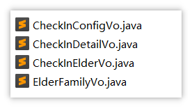

入住详情的其他代码，需要自行实现

提示：其中的合同信息使用实体类Contract


## 作业

完成 **5.7 申请入住详情** 接口的开发

---
> 来源：飞书技术知识库（脱敏版） · 07 业务组件方案集 / 中州养老项目（若依+AI） / 第二章-入住办理+AI大模型提升业务能力 / 01-入住办理-后端接口开发 · [原文](https://ccn8v2zngwsm.feishu.cn/wiki/BFljwTcDvitiUCkM8fxcR15Knkd)
