# 02-智能评估-集成AI大模型

## 目标

今天目标为：

- 能够说清楚健康评估模块在项目中的作用
- 能够掌握千帆大模型的开通和对接
- 能够掌握健康评估模块中的prompt提示词编写
- 能够自主完成健康评估模块的接口开发

## 分析设计

### 需求说明

**健康评估**是指老人办理入住前需上传体检报告，由AI自动进行分析，并对报告进行总结，同时给出合理的建议；

下图是健康评估列表页，展示了经过健康评估的老人列表。

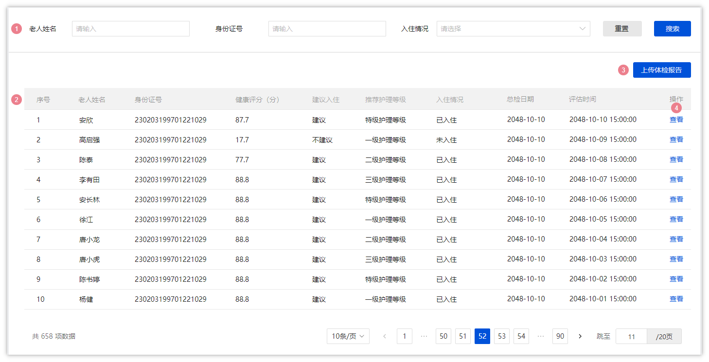

当点击了**上传体检报告**按钮之后会弹窗，效果如下，需要输入信息，需要提前准备好老人的体检报告(**PDF格式**)

点击**确定**按钮之后，会使用AI对老人的健康报告进行评估

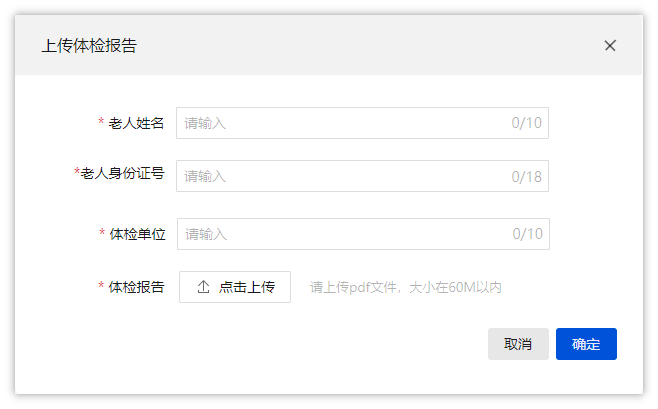

下图是健康评估的详情页面，是使用AI分析后的结果页，给了很多的数据，可以让护理员或销售来查看老人的健康状况，进一步更好的服务老人或者给老人推荐一些护理服务。

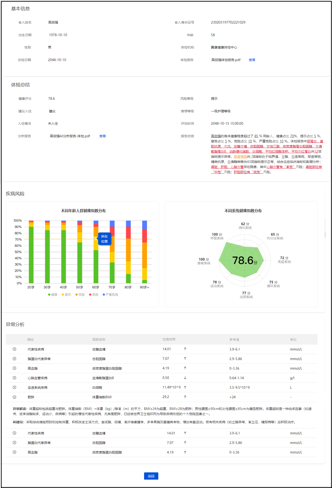


### 表结构说明

基于需求原型，我们可以确定健康评估表（health_assessment）如下：

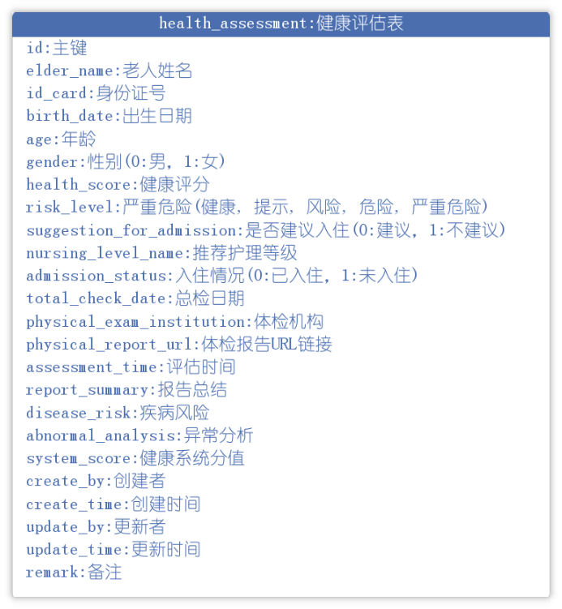

> 特别字段说明：
> 
> - abnormal_analysis(异常分析) 这个字段是字符串类型，会把异常数据转换为json进行存储
> - disease_risk(疾病风险):
> - system_score(健康系统分值):

建表语句：

```SQL
CREATE TABLE "health_assessment" (
  "id" bigint NOT NULL AUTO_INCREMENT COMMENT '主键',
  "elder_name" varchar(255) DEFAULT NULL COMMENT '老人姓名',
  "id_card" varchar(255) DEFAULT NULL COMMENT '身份证号',
  "birth_date" datetime DEFAULT NULL COMMENT '出生日期',
  "age" int DEFAULT NULL COMMENT '年龄',
  "gender" int DEFAULT NULL COMMENT '性别(0:男，1:女)',
  "health_score" varchar(255) DEFAULT NULL COMMENT '健康评分',
  "risk_level" varchar(255) DEFAULT NULL COMMENT '危险等级(健康, 提示, 风险, 危险, 严重危险)',
  "suggestion_for_admission" int DEFAULT NULL COMMENT '是否建议入住(0:建议，1:不建议)',
  "nursing_level_name" varchar(255) DEFAULT NULL COMMENT '推荐护理等级',
  "admission_status" int DEFAULT NULL COMMENT '入住情况(0:已入住，1:未入住)',
  "total_check_date" varchar(64) DEFAULT NULL COMMENT '总检日期',
  "physical_exam_institution" varchar(255) DEFAULT NULL COMMENT '体检机构',
  "physical_report_url" varchar(255) DEFAULT NULL COMMENT '体检报告URL链接',
  "assessment_time" datetime DEFAULT NULL COMMENT '评估时间',
  "report_summary" text COMMENT '报告总结',
  "disease_risk" text COMMENT '疾病风险',
  "abnormal_analysis" text COMMENT '异常分析',
  "system_score" varchar(255) DEFAULT NULL COMMENT '健康系统分值',
  "create_by" varchar(255) DEFAULT NULL COMMENT '创建者',
  "create_time" datetime DEFAULT NULL COMMENT '创建时间',
  "update_by" varchar(255) DEFAULT NULL COMMENT '更新者',
  "update_time" datetime DEFAULT NULL COMMENT '更新时间',
  "remark" text COMMENT '备注',
  PRIMARY KEY ("id")
) ENGINE=InnoDB AUTO_INCREMENT=7 DEFAULT CHARSET=utf8mb4 COLLATE=utf8mb4_0900_ai_ci COMMENT='健康评估表';

```

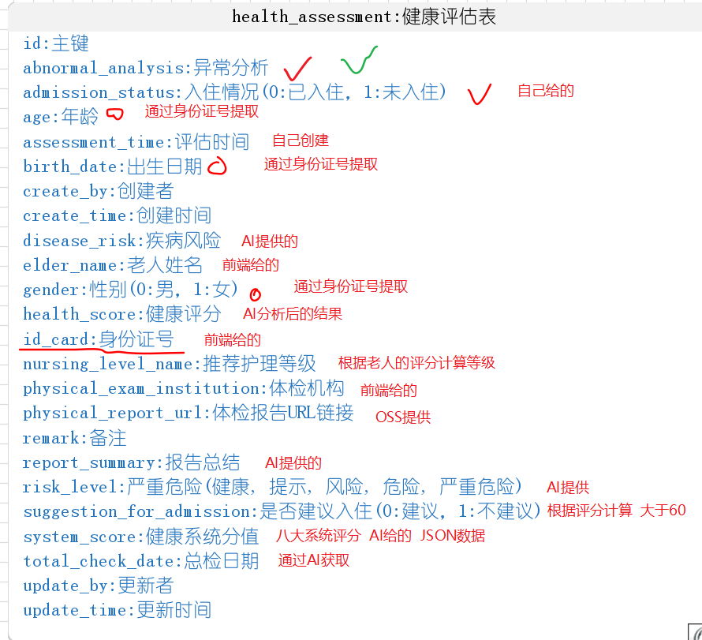


### 接口说明

基于需求说明，在健康评估这个模块中，共有4个接口需要开发，分别是

- 列表查询
- 上传体检报告
- 智能评测
- 查看详情


前端代码已经全部提供，所以大家必须要结合接口文档开发后端代码

关于健康评估的接口文档，参考链接：<cite doc-id="Zz2Bw2OgHiB1dMkaxVucVvMqnvg" file-type="wiki" title="入退管理-接口文档" type="doc"></cite>


### 实现方案

整体实现流程如下：

<whiteboard token="FDEyw6ma8hjUP2bM6x7cQ5rZnOe"></whiteboard>

### 读取PDF文件内容

市面有很多工具类，我们可以直接使用，目前选择的是Apache PDFBox

Apache PDFBox库是一个用于处理PDF文档的开源Java工具。该项目允许创建新的PDF文档，编辑现有的文档，以及从文档中提取内容。


导入对应的依赖，在zzyl-common模块中导入以下依赖：

```XML
<dependency>
    <groupId>org.apache.pdfbox</groupId>
    <artifactId>pdfbox</artifactId>
    <version>2.0.24</version>
</dependency>
```


创建工具类，通过pdf文件来读取内容，工具类路径：zzyl-common模块下的com.zzyl.common.utils.PDFUtil

```Java
package com.zzyl.common.utils;

import org.apache.pdfbox.pdmodel.PDDocument;
import org.apache.pdfbox.text.PDFTextStripper;

import java.io.File;
import java.io.IOException;
import java.io.InputStream;

public class PDFUtil {

    public static String pdfToString(InputStream inputStream) {

        PDDocument document = null;


        try {
            // 加载PDF文档
            document = PDDocument.load(inputStream);

            // 创建一个PDFTextStripper实例来提取文本
            PDFTextStripper pdfStripper = new PDFTextStripper();

            // 从PDF文档中提取文本
            String text = pdfStripper.getText(document);
            return text;
        } catch (IOException e) {
            e.printStackTrace();
        } finally {
            // 关闭PDF文档
            if (document != null) {
                try {
                    document.close();
                    inputStream.close();
                } catch (IOException e) {
                    e.printStackTrace();
                }
            }
        }
        return null;
    }
}
```

测试：找一个pdf文档来读取里面的内容为字符串

```Java
package com.nursing.test;

import com.zzyl.common.utils.PDFUtil;

import java.io.FileInputStream;
import java.io.FileNotFoundException;

public class PDFUtilTest {

    public static void main(String[] args) throws FileNotFoundException {

        FileInputStream fileInputStream = new FileInputStream("C:\\tmp\\体检报告-刘爱国-男-69岁.pdf");

        String result = PDFUtil.pdfToString(fileInputStream);
        System.out.println(result);
    }
}
```


## 百度智能云

### 注册和**实名认证**

- 注册地址：https://qianfan.cloud.baidu.com/

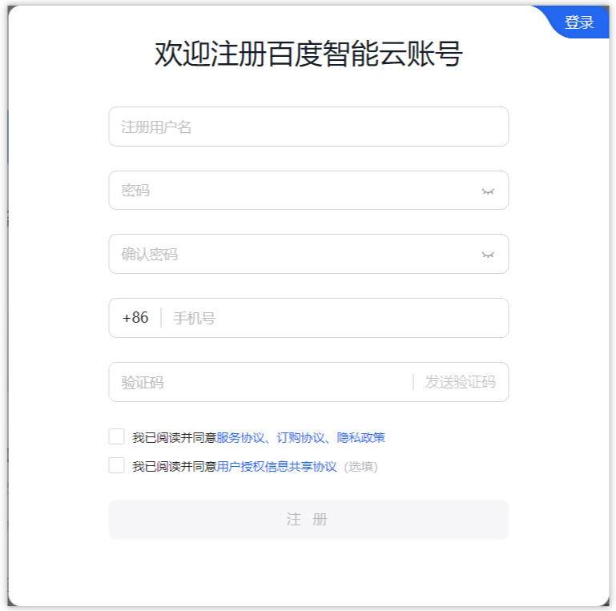

**实名认证**

有了账号之后，我们需要**个人实名认证，**不然调用不了大模型，其中实名认证大家需要在手机端进行操作

1. 在手机上下载一个百度智能云app

   
2. 使用刚刚注册的账号进行登录，找到**我的**，**个人中心**，可以进行实名认证操作

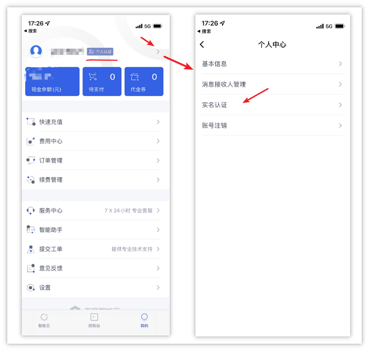

进入实名认证页面后，选择个人认证 --> 开始认证 --> 个人刷脸认证即可

### 创建Access Key

实名认证成功之后，我们继续在PC端来访问千帆大模型，地址：https://qianfan.cloud.baidu.com/

点击[大模型服务与开发平台ModelBuilder](https://console.bce.baidu.com/qianfan/overview)**，**可以进入到管理平台

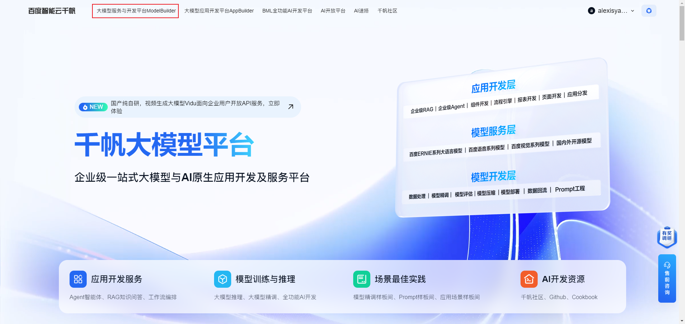

进入管理平台后，点击头像，选择**安全认证**，进入权限管理控制平台

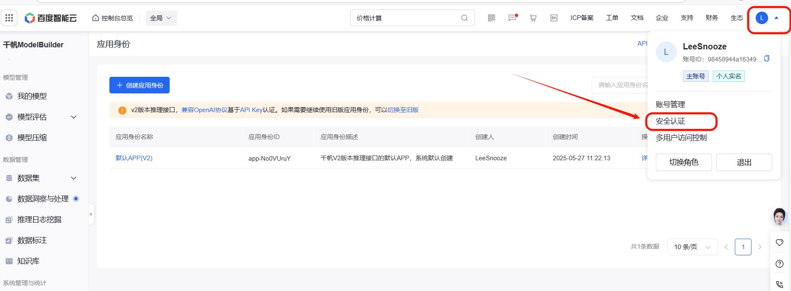

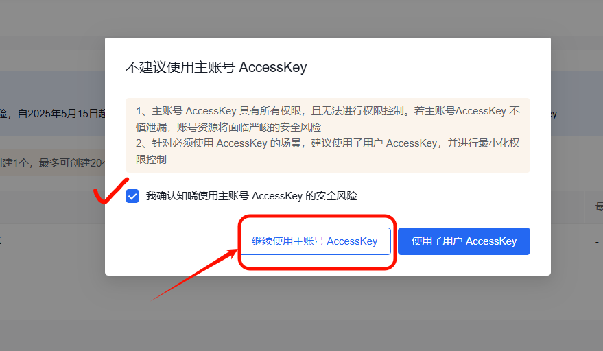

进入页面后，点击创建Access Key，输入验证码创建

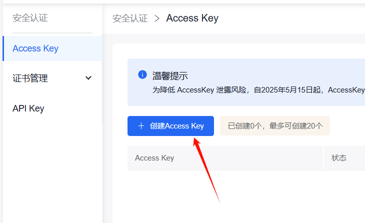

保存Access Key

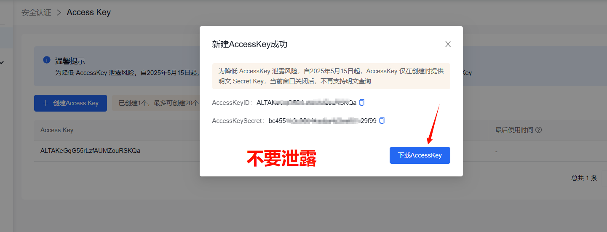


### 费用说明

当前版本的百度智能云，在创建应用时选择的服务全部都默认开通了按量后付费服务，可以直接使用，可以从在线推理页面 https://console.bce.baidu.com/qianfan/ais/console/onlineService 中看到当前已经开通付费的服务：

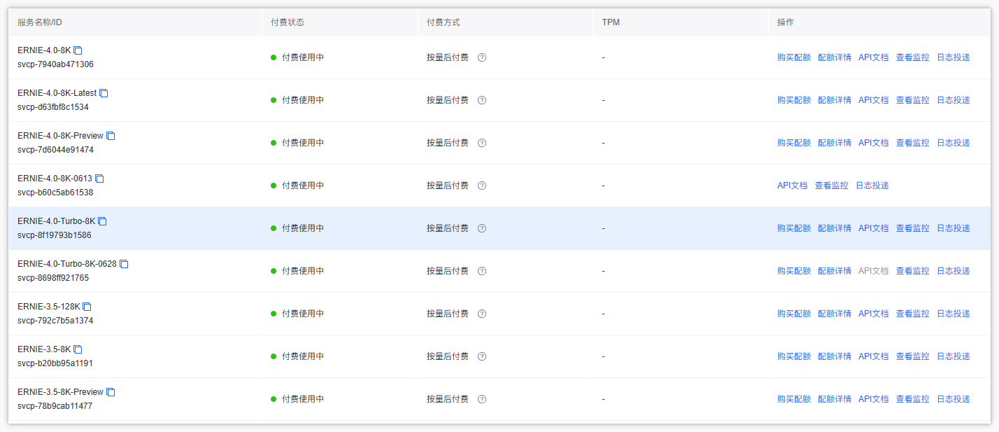

在自助工具页面 https://console.bce.baidu.com/support/?u=bce-head#/priceCounter 中可以看到不同模型的费用说明：

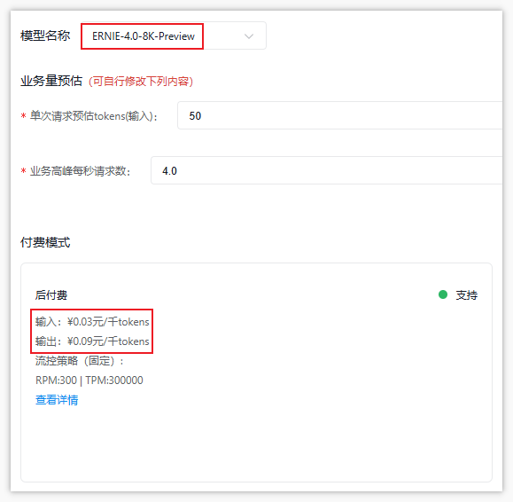

我们要使用的大模型**ERNIE-4.0-8K-Preview**，价格如下：

- 输入：¥0.03元/千tokens
- 输出：¥0.09元/千tokens

> 在千帆大模型中，一token约等于1个汉字，1token约等于3-4字母
> 
> 注：不同的大模型计算方式不一样


如果是新注册的账号，**首次开通，会送一个代金券，额度为20元，开通之日起1个月内使用有效**

查看代金券，如下图

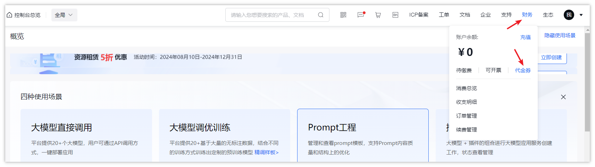

可以看到代金券的额度，以及使用的开始时间和结束时间

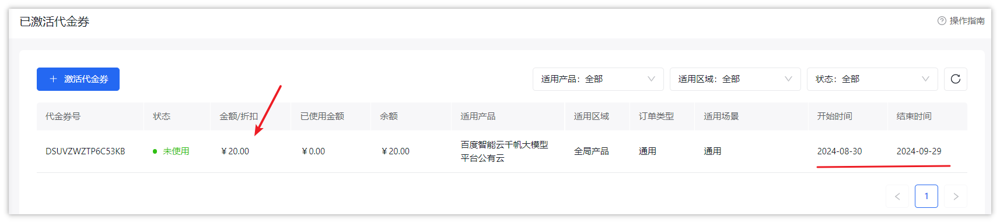

这个代金券可以兑换任何大模型使用费用。


### 大模型API说明

我们的需求中，prompt是比较多的，也就说需要更多的token，在目前百度智能云提供的大模型中，低版本模型的都不具备使用大量token的能力，所以，我们本次采用的**ERNIE-4.0-8K-Preview**

官方地址：https://cloud.baidu.com/doc/WENXINWORKSHOP/s/nluv1jxlp

**ERNIE 4.0**是百度自研的旗舰级超大规模⼤语⾔模型，相较ERNIE 3.5实现了模型能力全面升级，广泛适用于各领域复杂任务场景；支持自动对接百度搜索插件，保障问答信息时效，支持5K tokens输入+2K tokens输出。

- 对话模型，一次请求就是一次对话
- 提供了java的sdk调用，地址：https://github.com/baidubce/bce-qianfan-sdk/tree/main/java
- 支持单轮对话、多轮对话、流式
- 部分关键的参数：

| **名称** | **类型** | **必填** | **描述** |
|-|-|-|-|
| messages | List[dict] | 是 | 对话信息，`messages": [ {"role": "user","content": "你好"}]`  <br/>message中的content总长度和system字段总内容不能超过20000个字符，且不能超过5120 tokens |
| model | string | 是 | 模型名称，用于指定平台支持预置服务的模型，说明：该字段为固定值ERNIE-4.0-8K-Preview（必须开通付费） |
| temperature | float | 否 | 大模型的采样参数，  <br/>（1）较高的数值会使输出更加随机，而较低的数值会使其更加集中和确定  <br/>（2）默认0.8，范围 (0, 1.0]，不能为0 |
| max_output_tokens | int | 否 | 指定模型最大输出token数，说明：  <br/>（1）如果设置此参数，范围[2, 2048]  <br/>（2）如果不设置此参数，最大输出token数为1024 |
| response_format | string | 否 | 指定响应内容的格式，说明：  <br/>（1）可选值：  <br/>· json_object：以json格式返回，可能出现不满足效果情况  <br/>· text：以文本格式返回  <br/>（2）如果不填写参数response_format值，默认为text |

- 返回参数：**result**可以获取对话返回的结果


### 集成大模型

1. 在zzyl-common模块下新增以下依赖（参考官网文档）

```XML
<dependency>
    <groupId>com.baidubce</groupId>
    <artifactId>qianfan</artifactId>
    <version>0.1.1</version>
</dependency>
```

1. 参考官方示例（https://cloud.baidu.com/doc/WENXINWORKSHOP/s/xlmokikxe）编写一个main方法来测试即可，代码如下：

```Java
package com.zzyl.redis;

import com.baidubce.qianfan.Qianfan;
import com.baidubce.qianfan.core.auth.Auth;
import com.baidubce.qianfan.model.chat.ChatResponse;

public class AIModelTest {

    private static final String prompt = "你能帮我分析一份完整的体检报告吗？";

    public static void main(String[] args) {
        /**
         * 第一个参数：认证类型，固定选择 Auth.TYPE_OAUTH
         * 第二个参数：accessKeyId，从百度云控制台创建的应用里可以找到
         * 第三个参数：accessKeySecret，从百度云控制台创建的应用里可以找到
         */
        Qianfan qianfan = new Qianfan("换成自己的key", "换成自己的密钥");
        ChatResponse response = qianfan.chatCompletion()
                .model("ERNIE-4.0-8K-Preview") // 模型名称，要选择自己开通付费的模型
                .addMessage("user", prompt) // 聊天内容，可以设置多个，每个消息包含role（角色，user表示用户，assistant表示模型），content（消息内容）
//                .temperature(0.7) // 采样参数，取值范围(0,1]
//                .maxOutputTokens(2000) // 模型输出最大长度，取值范围[2, 2048]
//                .responseFormat("json_object")  // 模型输出格式，取值范围：text（文本）、json_object（JSON对象）
                .execute();
        String result = response.getResult();
        System.out.println(result);
    }
}
```

**注意**：上述代码的***accessKeyId****和****accessKeySecret****要换成自己的*


调用成功，控制台的结果打印：

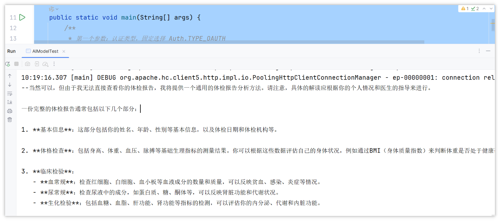

## 接口开发

### 基础代码准备

打开后台管理系统，我们继续使用代码生成功能，来完成基础代码的准备，导入最新的表结构（健康评估表）

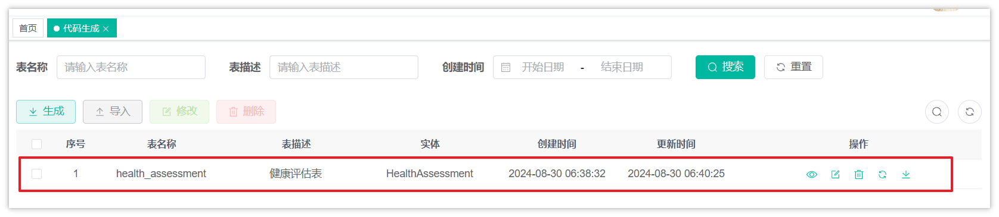

修改代码生成

- 把字段中的一些Long类型改为Integer（id主键依然是Long类型）
- 把字段中的日期相关修改为LocalDateTime类型（创建时间和修改时间不用改）

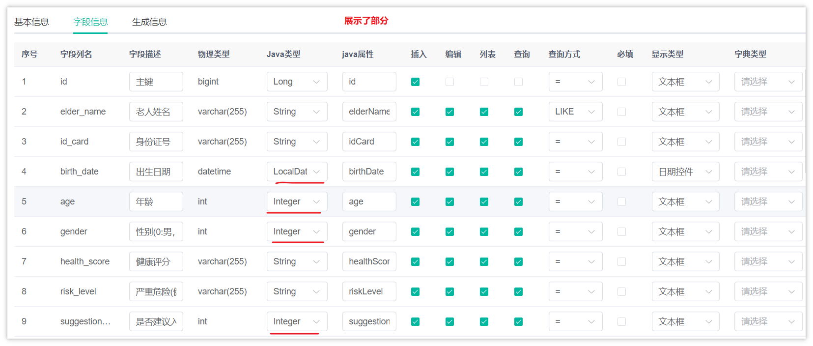

- 生成包路径：`com.zzyl.nursing`
- 生成的模块名：`nursing`
- 生成的业务名：`healthAssessment`
- 上级菜单：不选择（由于目前已经提供了所有的前端和菜单的表结构，无需自己创建选择菜单）

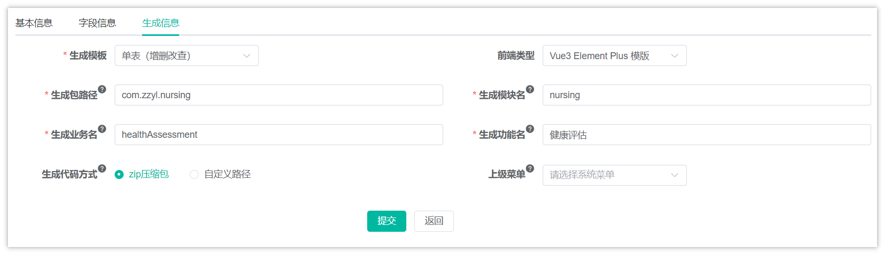

配置完成后，下载代码到本地

**特别注意**：只需要拷贝后端代码到idea中即可，**不需要执行SQL**，**不需要拷贝前端代码**

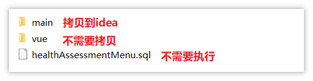


当代码拷贝之后，目前就已经完成了两个接口的开发，分别是**列表分页查询**和**查看详情**。不过关于上传体检报告和智能评测还需要我们自行实现。

将后端代码都拷贝到项目中后，可以执行下面这条SQL语句插入一条数据：

```SQL
INSERT INTO `health_assessment`(`system_score`,`nursing_level_name`,`gender`,`total_check_date`,`create_time`,`disease_risk`,`birth_date`,`health_score`,`id_card`,`abnormal_analysis`,`physical_exam_institution`,`create_by`,`risk_level`,`assessment_time`,`suggestion_for_admission`,`admission_status`,`physical_report_url`,`elder_name`,`id`,`age`,`report_summary`) VALUES ('{"breathingSystem":100,"digestiveSystem":85,"endocrineSystem":90,"immuneSystem":95,"circulatorySystem":80,"urinarySystem":90,"motionSystem":100,"senseSystem":90}','一级护理等级',0,'2023-10-10','2024-10-10T01:07:42','{"healthy":60,"caution":30,"risk":10,"danger":0,"severeDanger":0}','1960-01-26T00:00','80.5','210102196001267626','[{"conclusion":"心率略快","examinationItem":"心率","result":"92 次/分","referenceValue":"< 140","unit":"次/分","interpret":"心率稍高于理想范围，可能与情绪、活动或轻度心脏负担有关。","advice":"建议心电图检查及定期监测心率，保持情绪稳定，适量运动。"},{"conclusion":"轻度脂肪肝可能","examinationItem":"肝","result":"形态大小正常，实质回声略粗糙","referenceValue":"-","unit":"-","interpret":"肝脏实质回声略粗糙，提示可能有轻度脂肪肝，与饮食习惯、生活方式或遗传因素有关。","advice":"建议调整饮食结构，减少高脂食物摄入，增加运动，定期检查肝脏情况。"},{"conclusion":"慢性胆囊炎可能","examinationItem":"胆","result":"胆囊壁毛糙","referenceValue":"-","unit":"-","interpret":"胆囊壁毛糙，可能表示有慢性胆囊炎，可能与胆囊结石、感染或长期饮食不规律有关。","advice":"建议进一步检查胆囊情况，保持规律饮食，避免高脂食物。"},{"conclusion":"脾轻度增大","examinationItem":"脾","result":"轻度增大","referenceValue":"-","unit":"-","interpret":"脾脏轻度增大，可能与感染、血液系统疾病或自身免疫性疾病有关。","advice":"建议进一步检查脾脏，以确定增大的原因，并采取相应的治疗措施。"},{"conclusion":"右肾小囊肿可能","examinationItem":"肾","result":"右肾下极见一大小约 5mm 的无回声区","referenceValue":"-","unit":"mm","interpret":"右肾小囊肿，一般为良性病变，可能与肾小管憩室增多有关。","advice":"建议定期监测囊肿大小，若无症状且囊肿不增大，可暂不处理。"},{"conclusion":"前列腺形态略增大","examinationItem":"前列腺","result":"形态略增大","referenceValue":"-","unit":"-","interpret":"前列腺形态略增大，可能与前列腺增生有关，是老年男性常见病变。","advice":"建议进行PSA检查以排除前列腺肿瘤，并定期检查前列腺情况。"}]','中州体检','1','caution','2024-10-10T01:07:42',0,1,'https://java110-ai.oss-cn-beijing.aliyuncs.com/2024/10/af59dc76-0c01-4043-9706-b9ed1ec08984.pdf','刘爱国',9,64,'体检报告中心率、肝脏、胆囊、脾脏、肾脏、前列腺共6项指标提示异常，综合这些临床指标和数据分析：循环系统、消化系统存在隐患，其中循环系统有“中危”风险；消化系统部位有“低危”风险。');
```

这样就能看到**列表分页查询**和**查看详情**的内容了。

### 设计Prompt

我们还是回顾一下Prompt的构成部分：

- **角色**：给 AI 定义一个最匹配任务的角色，比如：「你是一位软件工程师」「你是一位小学老师」
- **指示**：对任务进行描述
- **上下文**：给出与任务相关的其它背景信息（尤其在多轮交互中）
- **例子**：必要时给出举例，[实践证明例子对输出正确性有帮助]
- **输入**：任务的输入信息；在提示词中明确的标识出输入
- **输出**：输出的格式描述，以便后继模块自动解析模型的输出结果，比如（JSON、Java）


清楚了Prompt的构成部分之后，我们再来分析一下之前的需求，重点来看一下哪些字段需要AI来提供，如下图：

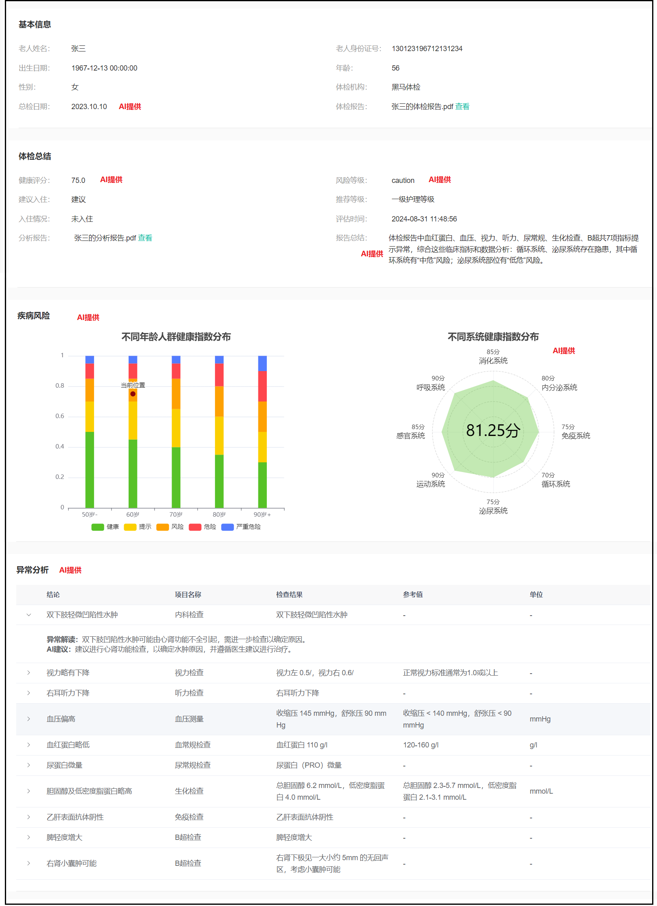

设计之后的Prompt提示词，这里涉及了大量的专业名词和健康指标，**实际开发中需要找产品经理协助**

<callout emoji="🐵">
请以一个专业医生的视角来分析这份体检报告，报告中包含了一些异常数据，我需要您对这些数据进行解读，并给出相应的健康建议。  
体检内容如下：  
    **内容略....**  
  
要求：  
1. 提取体检报告中的“**总检日期**”；  
2. 通过临床医学、疾病风险评估模型和数据智能分析，给该用户的风险等级和健康指数给出结果。风险等级分为：健康、提示、风险、危险、严重危险。**健康指数**范围为0至100分；  
3. 根据用户身体各项指标数据，详细说明该用户各项**风险等级**的占比是多少，最多保留两位小数。结论格式：该用户健康占比20.00%，提示占比20.00%，风险占比20%，危险占比20%，严重危险占比20%；  
4. 对于体检报告中的**异常数据**，请列出（异常数据的结论、体检项目名称、检查结果、参考值、单位、异常解读、建议）这7字段。解读异常数据，解决这些数据可能代表的健康问题或风险。分析可能的原因，包括但不限于生活习惯、饮食习惯、遗传因素等。基于这些异常数据和可能的原因，请给出具体的健康建议，包括饮食调整、运动建议、生活方式改变以及是否需要进一步检查或治疗等。  
结论格式：异常数据的结论：肥胖，体检项目名称：体重指数BMI，检查结果：29.2，参考值>24，单位：-。**异常解读**：体重超标包括超重与肥胖。体重指数（BMI）=体重（kg）/身⾼（m）的平⽅，BMI≥24为超重，BMI≥28为肥胖；男性腰围≥90cm和⼥性腰围≥85cm为腹型肥胖。体重超标是⼀种由多因素（如遗传、进⻝油脂较多、运动少、疾病等）引起的慢性代谢性疾病，尤其是肥胖，已经被世界卫⽣组织列为导致疾病负担的⼗⼤危险因素之⼀。**AI建议**：采取综合措施预防和控制体重，积极改变⽣活⽅式，宜低脂、低糖、⾼纤维素膳⻝，多⻝果蔬及菌藻类⻝物，增加有氧运动。若有相关疾病（如⾎脂异常、⾼⾎压、糖尿病等）应积极治疗。  
5. 根据这个体检报告的内容，分别给**人体的8大系统打分**，每项满分为100分，8大系统分别为：呼吸系统、消化系统、内分泌系统、免疫系统、循环系统、泌尿系统、运动系统、感官系统  
6. 给体检报告做一个**总结**，总结格式：体检报告中尿蛋⽩、癌胚抗原、⾎沉、空腹⾎糖、总胆固醇、⽢油三酯、低密度脂蛋⽩胆固醇、⾎清载脂蛋⽩B、动脉硬化指数、⽩细胞、平均红细胞体积、平均⾎红蛋⽩共12项指标提示异常，尿液常规共1项指标处于临界值，⾎脂、⾎液常规、尿液常规、糖类抗原、⾎清酶类等共43项指标提示正常，综合这些临床指标和数据分析：肾脏、肝胆、⼼脑⾎管存在隐患，其中⼼脑⾎管有“⾼危”⻛险；肾脏部位有“中危”⻛险；肝胆部位有“低危”⻛险。  
  
输出要求：  
最后，将以上结果输出为JSON格式，不要包含其他的文字说明，所有的返回结果都是json，详细格式如下：  
  
{  
  "totalCheckDate": "YYYY-MM-DD",  
  "healthAssessment": {  
    "riskLevel": "healthy/caution/risk/danger/severeDanger",  
    "healthIndex": XX.XX  
  },  
  "riskDistribution": {  
    "healthy": XX.XX,  
    "caution": XX.XX,  
    "risk": XX.XX,  
    "danger": XX.XX,  
    "severeDanger": XX.XX  
  },  
  "abnormalData": [  
    {  
      "conclusion": "异常数据的结论",  
      "examinationItem": "体检项目名称",  
      "result": "检查结果",  
      "referenceValue": "参考值",  
      "unit": "单位",  
      "interpret":"对于异常的结论进一步详细的说明",  
      "advice":"针对于这一项的异常，给出一些健康的建议"  
    }  
  ],  
  "systemScore": {  
    "breathingSystem": XX,  
    "digestiveSystem": XX,  
    "endocrineSystem": XX,  
    "immuneSystem": XX,  
    "circulatorySystem": XX,  
    "urinarySystem": XX,  
    "motionSystem": XX,  
    "senseSystem": XX  
  },  
  "summarize": "体检报告的总结"  
}
</callout>

### 上传体检报告

#### 需求回顾

如下图，当点击了上传体检报告之后，弹窗需要输入信息，当选择了文件之后，会自动触发接口调用

参数有两个：身份证号和体检报告**文件**

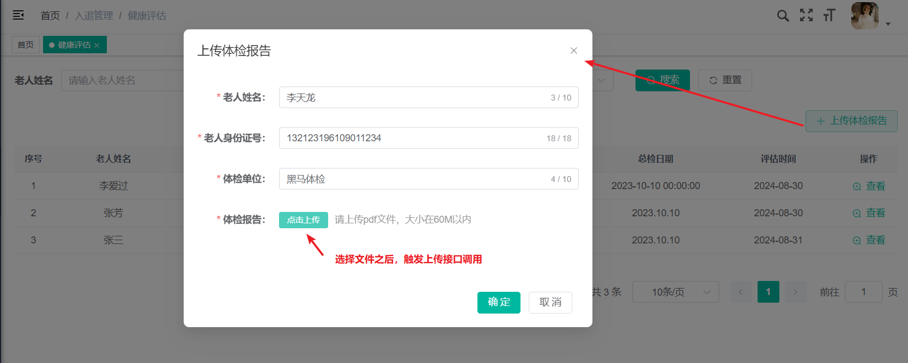

#### 思路回顾

如下图：

<whiteboard token="M9pZwS7I8hQ1YxbLaCEcaOFbn5c"></whiteboard>


#### 功能实现

文件需要上传到OSS中，所以需要在zzyl-nursing-platform模块中新增zzyl-oss的依赖

```XML
<dependency>
    <groupId>com.zzyl</groupId>
    <artifactId>zzyl-oss</artifactId>
</dependency>
```

在HealthAssessmentController中定义新的方法，如下：

```Java
@Autowired
private AliyunOSSOperator aliyunOSSOperator;

@Autowired
private RedisTemplate<String,String> redisTemplate;

/**
 * 通用上传请求（单个）
 */
@ApiOperation("健康文档上传")
@PostMapping("/upload")
public AjaxResult uploadFile(MultipartFile file, String idCardNo) throws Exception
{
    try {
        // 上传到OSS
        String url = aliyunOSSOperator.upload(file.getBytes(), file.getOriginalFilename());

        AjaxResult ajax = AjaxResult.success();
        ajax.put("url", url);
        ajax.put("fileName", url);
        // ajax.put("newFileName", url.substring(url.lastIndexOf("/")));
        ajax.put("originalFilename", file.getOriginalFilename());
        // PDF文件内容读取为字符串
        String content = PDFUtil.pdfToString(file.getInputStream());
        // 临时存储到redis中
        redisTemplate.opsForHash().put("healthReport", idCardNo, content);

        return ajax;
    }catch (Exception e) {
        e.printStackTrace();
        return AjaxResult.error(e.getMessage());
    }
}
```


### 智能评测

#### 思路回顾

如下图，当用户上传体检报告之后，点击确定，就会触发智能评测的调用

<whiteboard token="JuMBwluedhBO6hbCqUycgPGMnve"></whiteboard>

#### 抽取大模型调用工具

由于上述逻辑中，我们需要使用千帆大模型来分析体检报告，所以，我们提前来准备一下代码的封装

1. 一些可变的参数，在application.yml文件中定义，在application.yml文件中定义内容，如下：

```YAML
# 百度千帆大模型配置
baidu:
  accessKey: xEO9h4csw9zWlUiYpkNt（换成你自己的哦）
  secretKey: T67Xuyx9JoCQcFCVkd2HnZuKH（换成你自己的哦）
  qianfanModel: ERNIE-4.0-8K-Preview
```

**注意：要使用自己的accessKey和secretKey**


1. 定义properties类来方便读取配置，在zzyl-common模块下新增一个类com.zzyl.common.ai.BaiduAIProperties 

```Java
package com.zzyl.common.ai;

import lombok.Data;
import org.springframework.boot.context.properties.ConfigurationProperties;
import org.springframework.context.annotation.Configuration;

@Data
@Configuration
@ConfigurationProperties(prefix = "baidu")
public class BaiduAIProperties {

    private String accessKey;
    private String secretKey;
    private String qianfanModel;

}
```


1. 参考之前集成千帆大模型的方式，在zzyl-common模块下新增一个类com.zzyl.common.ai.AIModelInvoker 

```Java
package com.zzyl.common.ai;

import com.baidubce.qianfan.Qianfan;
import com.baidubce.qianfan.core.auth.Auth;
import com.baidubce.qianfan.model.chat.ChatResponse;
import lombok.extern.slf4j.Slf4j;
import org.springframework.beans.factory.annotation.Autowired;
import org.springframework.stereotype.Component;

@Component
@Slf4j
public class AIModelInvoker {

    @Autowired
    private BaiduAIProperties baiduAIProperties;

    public String qianfanInvoker(String prompt) {
        System.out.println(prompt);
        Qianfan qianfan = new Qianfan(baiduAIProperties.getAccessKey(), baiduAIProperties.getSecretKey());
        ChatResponse response = qianfan.chatCompletion()
                .model(baiduAIProperties.getQianfanModel())
                .addMessage("user", prompt)
                .temperature(0.7)
                .maxOutputTokens(2000)
                .responseFormat("json_object")
                .execute();
        String result = response.getResult();

        return result;
    }

}
```

#### 修改控制层

找到HealthAssessmentController中的add方法，修改其接收的参数

```Java
/**
 * 新增健康评估
 */
@ApiOperation("新增健康评估")
@PreAuthorize("@ss.hasPermi('nursing:healthAssessment:add')")
@Log(title = "健康评估", businessType = BusinessType.INSERT)
@PostMapping
public AjaxResult add(@ApiParam(value = "健康评估实体")
        @RequestBody HealthAssessmentDto healthAssessmentDto)
{
    Long id = healthAssessmentService.insertHealthAssessment(healthAssessmentDto);
    return success(id);
}
```

#### 基于接口文档，定义HealthAssessmentDto 

```JSON
package com.zzyl.nursing.dto;

import io.swagger.annotations.ApiModel;
import io.swagger.annotations.ApiModelProperty;
import lombok.Data;

@Data
@ApiModel("健康评估")
public class HealthAssessmentDto {

    /**
     * 老人姓名
     */
    @ApiModelProperty(value = "老人姓名",required = true)
    private String elderName;

    /**
     * 身份证号
     */
    @ApiModelProperty(value = "身份证号",required = true)
    private String idCard;

    /**
     * 体检机构
     */
    @ApiModelProperty(value = "体检机构",required = true)
    private String physicalExamInstitution;

    /**
     * 体检报告URL链接
     */
    @ApiModelProperty(value = "体检报告URL链接",required = true)
    private String physicalReportUrl;

}
```

#### 修改业务层

1. 修改IHealthAssessmentService中的insertHealthAssessment方法，把参数替换为HealthAssessmentDto 

```Java
/**
 * 新增健康评估
 *
 * @param healthAssessmentDto 健康评估
 * @return 结果
 */
public Long insertHealthAssessment(HealthAssessmentDto healthAssessmentDto);
```

1. 实现类，也要替换参数，并且按照思路来编写业务代码

```Java
@Autowired
private AIModelInvoker aIModelInvoker;

@Autowired
private RedisTemplate<String, String> redisTemplate;

/**
 * 新增健康评估
 *
 * @param healthAssessmentDto 健康评估
 * @return 结果
 */
@Override
public Long insertHealthAssessment(HealthAssessmentDto healthAssessmentDto) {
    try {
        // 组装prompt
        String prompt = getPrompt(healthAssessmentDto);
        
        // 调用千帆大模型来分析数据
        String result = aIModelInvoker.qianfanInvoker(prompt);
        if (StringUtils.isEmpty(result)) {
            throw new BaseException("AI分析失败");
        }

        // 解析数据
        HealthReportVo healthReportVo = JSONUtil.toBean(result, HealthReportVo.class);

        // 保存数据
        Long id = insertHealthReport(healthReportVo, healthAssessmentDto);
        
        // 返回id
        return id;
    } catch (BaseException e) {
        throw new BaseException("AI分析失败");
    }
}

/**
 * 插入健康报告
 *
 * @param healthReportVo
 * @return
 */
private Long insertHealthReport(HealthReportVo healthReportVo, HealthAssessmentDto healthAssessmentDto) {

    HealthAssessment healthAssessment = new HealthAssessment();
    // 总检日期
    healthAssessment.setTotalCheckDate(healthReportVo.getTotalCheckDate());
    healthAssessment.setElderName(healthAssessmentDto.getElderName());
    String idCard = healthAssessmentDto.getIdCard();
    healthAssessment.setIdCard(idCard);
    healthAssessment.setBirthDate(IDCardUtils.getBirthDateByIdCard(idCard));
    healthAssessment.setAge(IDCardUtils.getAgeByIdCard(idCard));
    healthAssessment.setGender(IDCardUtils.getGenderFromIdCard(idCard));
    double healthScore = healthReportVo.getHealthAssessment().getHealthIndex();
    healthAssessment.setHealthScore(String.valueOf(healthScore));
    healthAssessment.setRiskLevel(healthReportVo.getHealthAssessment().getRiskLevel());
    // 是否建议入住
    healthAssessment.setSuggestionForAdmission(getSuggestionForAdmission(healthScore));
    healthAssessment.setNursingLevelName(getNursingLevelName(healthScore));
    healthAssessment.setAdmissionStatus(1);
    healthAssessment.setTotalCheckDate(healthReportVo.getTotalCheckDate());
    healthAssessment.setPhysicalExamInstitution(healthAssessmentDto.getPhysicalExamInstitution());
    healthAssessment.setPhysicalReportUrl(healthAssessmentDto.getPhysicalReportUrl());
    healthAssessment.setAssessmentTime(LocalDateTime.now());
    healthAssessment.setReportSummary(healthReportVo.getSummarize());
    healthAssessment.setDiseaseRisk(JSONUtil.toJsonStr(healthReportVo.getRiskDistribution()));
    healthAssessment.setAbnormalAnalysis(JSONUtil.toJsonStr(healthReportVo.getAbnormalData()));
    healthAssessment.setSystemScore(JSONUtil.toJsonStr(healthReportVo.getSystemScore()));
    save(healthAssessment);
    return healthAssessment.getId();
}

/**
 * 计算护理等级
 *
 * @param healthScore
 * @return
 */
private String getNursingLevelName(double healthScore) {
    // 处理边界
    if (healthScore < 0 || healthScore > 100) {
        throw new IllegalArgumentException("健康评分必须在0到100之间");
    }

    if(healthScore >= 60 && healthScore < 70) {
        return "三级护理等级";
    }else if (healthScore >= 70 && healthScore < 80) {
        return "二级护理等级";
    }else if (healthScore >= 80 && healthScore < 90) {
        return "一级护理等级";
    }else if (healthScore >= 90) {
        return "特级护理等级";
    }
    return "无";

}

/**
 * 是否建议入住
 *
 * @param healthScore
 * @return
 */
private Integer getSuggestionForAdmission(double healthScore) {
    if (healthScore >= 60) {
        return 0;
    }
    return 1;

}

/**
 * 获取prompt
 *
 * @param healthAssessmentDto
 * @return
 */
private String getPrompt(HealthAssessmentDto healthAssessmentDto) {
    // 获取文件中的内容
    String content = (String) redisTemplate.opsForHash().get("healthReport", healthAssessmentDto.getIdCard());
    // 判断是否为空
    if (StringUtils.isEmpty(content)) {
        throw new BaseException("文件提取内容失败，请重新上传提交报告");
    }

    String prompt = "请以一个专业医生的视角来分析这份体检报告，报告中包含了一些异常数据，我需要您对这些数据进行解读，并给出相应的健康建议。\n" +
            "体检内容如下：\n" +
            content + "\n" +
            "\n" +
            "要求：\n" +
            "1. 提取体检报告中的“总检日期”；\n" +
            "2. 通过临床医学、疾病风险评估模型和数据智能分析，给该用户的风险等级和健康指数给出结果。风险等级分为：健康、提示、风险、危险、严重危险。健康指数范围为0至100分；\n" +
            "3. 根据用户身体各项指标数据，详细说明该用户各项风险等级的占比是多少，最多保留两位小数。结论格式：该用户健康占比20.00%，提示占比20.00%，风险占比20%，危险占比20%，严重危险占比20%；\n" +
            "4. 对于体检报告有异常数据，请列出（异常数据的结论、体检项目名称、检查结果、参考值、单位、异常解读、建议）这8字段。解读异常数据，解决这些数据可能代表的健康问题或风险。分析可能的原因，包括但不限于生活习惯、饮食习惯、遗传因素等。基于这些异常数据和可能的原因，请给出具体的健康建议，包括饮食调整、运动建议、生活方式改变以及是否需要进一步检查或治疗等。\n" +
            "结论格式：异常数据的结论：肥胖，体检项目名称：体重指数BMI，检查结果：29.2，参考值>24，单位：-。异常解读：体重超标包括超重与肥胖。体重指数（BMI）=体重（kg）/身⾼（m）的平⽅，BMI≥24为超重，BMI≥28为肥胖；男性腰围≥90cm和⼥性腰围≥85cm为腹型肥胖。体重超标是⼀种由多因素（如遗传、进⻝油脂较多、运动少、疾病等）引起的慢性代谢性疾病，尤其是肥胖，已经被世界卫⽣组织列为导致疾病负担的⼗⼤危险因素之⼀。AI建议：采取综合措施预防和控制体重，积极改变⽣活⽅式，宜低脂、低糖、⾼纤维素膳⻝，多⻝果蔬及菌藻类⻝物，增加有氧运动。若有相关疾病（如⾎脂异常、⾼⾎压、糖尿病等）应积极治疗。\n" +
            "5. 根据这个体检报告的内容，分别是给人体的8大系统打分，每项满分为100分，8大系统分别为：呼吸系统、消化系统、内分泌系统、免疫系统、循环系统、泌尿系统、运动系统、感官系统\n" +
            "6. 给体检报告做一个总结，总结格式：体检报告中尿蛋⽩、癌胚抗原、⾎沉、空腹⾎糖、总胆固醇、⽢油三酯、低密度脂蛋⽩胆固醇、⾎清载脂蛋⽩B、动脉硬化指数、⽩细胞、平均红细胞体积、平均⾎红蛋⽩共12项指标提示异常，尿液常规共1项指标处于临界值，⾎脂、⾎液常规、尿液常规、糖类抗原、⾎清酶类等共43项指标提示正常，综合这些临床指标和数据分析：肾脏、肝胆、⼼脑⾎管存在隐患，其中⼼脑⾎管有“⾼危”⻛险；肾脏部位有“中危”⻛险；肝胆部位有“低危”⻛险。\n" +
            "\n" +
            "输出要求：\n" +
            "最后，将以上结果输出为JSON格式，不要包含其他的文字说明，所有的返回结果都是json，详细格式如下：\n" +
            "\n" +
            "{\n" +
            "  \"totalCheckDate\": \"YYYY-MM-DD\",\n" +
            "  \"healthAssessment\": {\n" +
            "    \"riskLevel\": \"healthy/caution/risk/danger/severeDanger\",\n" +
            "    \"healthIndex\": XX.XX\n" +
            "  },\n" +
            "  \"riskDistribution\": {\n" +
            "    \"healthy\": XX.XX,\n" +
            "    \"caution\": XX.XX,\n" +
            "    \"risk\": XX.XX,\n" +
            "    \"danger\": XX.XX,\n" +
            "    \"severeDanger\": XX.XX\n" +
            "  },\n" +
            "  \"abnormalData\": [\n" +
            "    {\n" +
            "      \"conclusion\": \"异常数据的结论\",\n" +
            "      \"examinationItem\": \"体检项目名称\",\n" +
            "      \"result\": \"检查结果\",\n" +
            "      \"referenceValue\": \"参考值\",\n" +
            "      \"unit\": \"单位\",\n" +
            "      \"interpret\":\"对于异常的结论进一步详细的说明\",\n" +
            "      \"advice\":\"针对于这一项的异常，给出一些健康的建议\"\n" +
            "    }\n" +
            "  ],\n" +
            "  \"systemScore\": {\n" +
            "    \"breathingSystem\": XX,\n" +
            "    \"digestiveSystem\": XX,\n" +
            "    \"endocrineSystem\": XX,\n" +
            "    \"immuneSystem\": XX,\n" +
            "    \"circulatorySystem\": XX,\n" +
            "    \"urinarySystem\": XX,\n" +
            "    \"motionSystem\": XX,\n" +
            "    \"senseSystem\": XX\n" +
            "  },\n" +
            "  \"summarize\": \"体检报告的总结\"\n" +
            "}";
    return prompt;
}
```

为了更方便的解析AI的json结果，我们可以从当天资料中获取对应的vo类

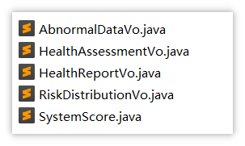

## 作业

1. 完成智能评估中的智能评测接口
2. 完成<cite doc-id="DGqzwVB6aiBjXvk7QD3clov9nXC" file-type="wiki" title="定时更新合同状态" type="doc"></cite>

---
> 来源：飞书技术知识库（脱敏版） · 07 业务组件方案集 / 中州养老项目（若依+AI） / 第二章-入住办理+AI大模型提升业务能力 / 02-智能评估-集成AI大模型 · [原文](https://ccn8v2zngwsm.feishu.cn/wiki/FXw0wm7x2iUdKmksga6cKRsYnNg)
