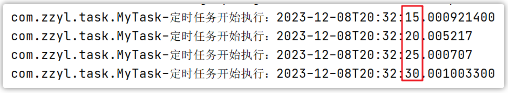
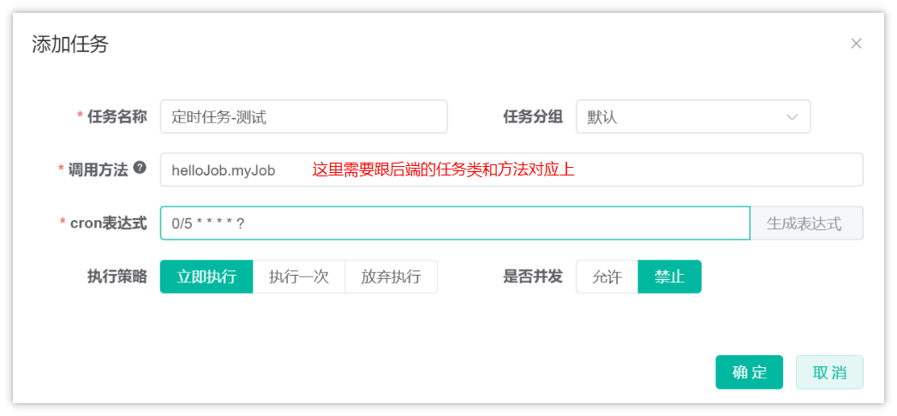
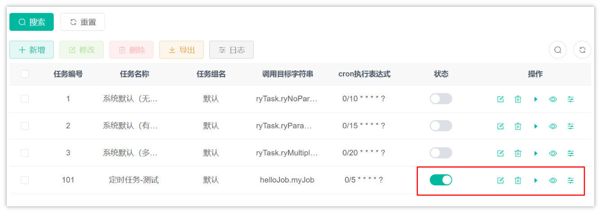
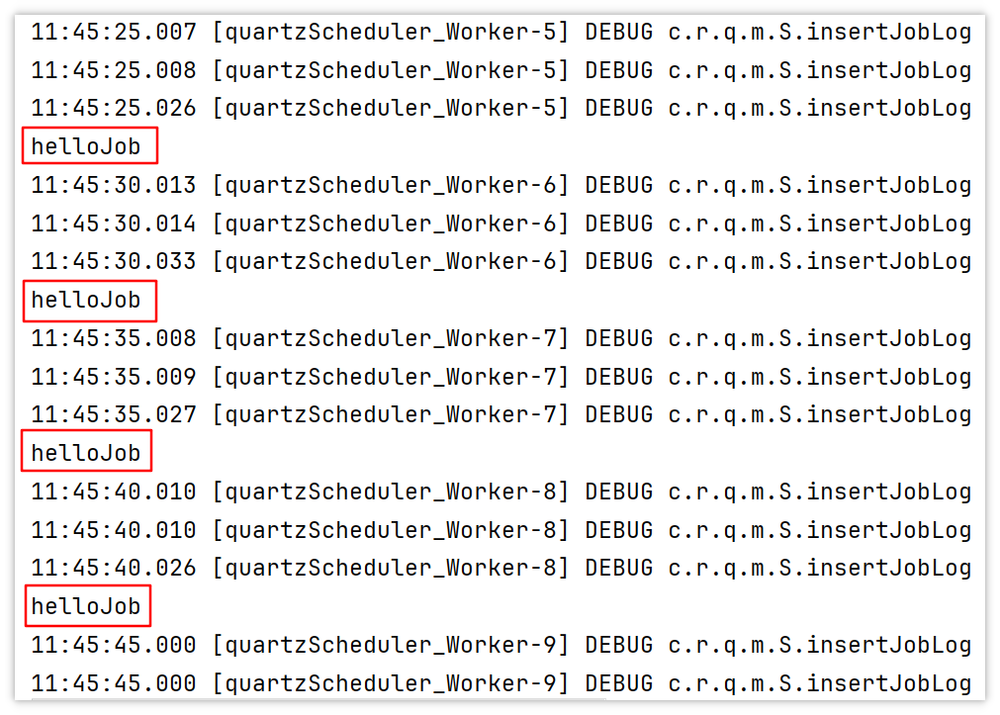
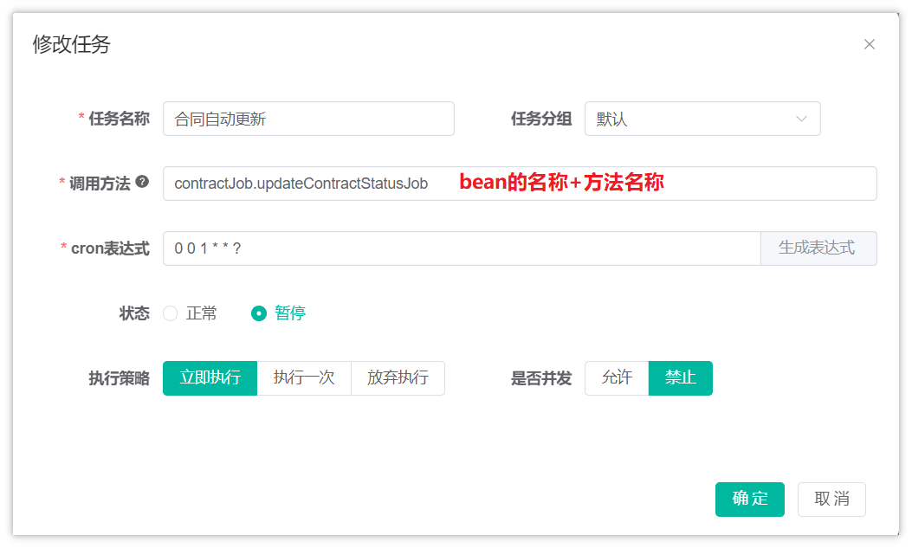

# 定时更新合同状态

在入住办理模块中，在页面上发起入住申请并提交表单到后台，后台需要保存合同信息，而目前合同信息统一都保存为了默认值0：

```JavaScript
-- auto-generated definition
create table contract
(
    id                         bigint auto_increment comment '主键ID'
        primary key,
    elder_id                   int                                 not null comment '老人ID',
    contract_name              varchar(100)                        not null comment '合同名称',
    contract_number            varchar(50)                         not null comment '合同编号',
    agreement_path             varchar(255)                        not null comment '协议地址（文件路径或URL）',
    third_party_phone          varchar(20)                         not null comment '丙方手机号',
    third_party_name           varchar(50)                         not null comment '丙方姓名',
    elder_name                 varchar(50)                         not null comment '老人姓名',
    start_date                 date                                not null comment '开始时间',
    end_date                   date                                not null comment '结束时间',
    status                     tinyint   default 0                 not null comment '状态 (0: 未生效, 1: 已生效, 2: 已过期, 3: 已失效)',
    sign_date                  date                                not null comment '签约日期',
    termination_submitter      varchar(50)                         null comment '解除提交人',
    termination_date           date                                null comment '解除日期',
    termination_agreement_path varchar(255)                        null comment '解除协议地址（文件路径或URL）',
    sort_order                 int       default 0                 not null comment '排序编号',
    create_time                timestamp default CURRENT_TIMESTAMP null comment '创建时间',
    update_time                timestamp default CURRENT_TIMESTAMP null on update CURRENT_TIMESTAMP comment '修改时间',
    create_by                  varchar(50)                         null comment '创建人',
    update_by                  varchar(50)                         null comment '修改人',
    remark                     varchar(255)                        null comment '备注'
)
    collate = utf8mb4_unicode_ci;
```

而实际的业务场景是：随着时间的推移，当当前时间超过了入住开始时间，就要将合同状态更新为已生效，这个需求可以借助定时任务来实现。

## **定时任务概述**

**任务调度**是指系统为了自动完成特定任务，在约定的特定时刻去执行任务的过程。有了任务调度即可解放更多的人力，而是由系统自动去执行任务。

常用业务场景案例：

- 某电商系统需要在每天上午10点，下午3点，晚上8点发放一批优惠券。
- 某银行系统需要在信用卡到期还款日的前三天进行短信提醒。
- 某财务系统需要在每天凌晨0:10结算前一天的财务数据，统计汇总。
- 12306会根据车次的不同，设置某几个时间点进行分批放票。

如何实现任务调度？

- 多线程方式，结合sleep
- JDK提供的API，例如：Timer、ScheduledExecutor
- 框架，例如Quartz，它是一个功能强大的任务调度框架，可以满足更多更复杂的调度需求，还有一些其他的，比如：XXL-JOB，DolphinScheduler
- SpringTask

## **cron表达式**

在我们使用调度任务技术的时候，特别是调度框架，里面都支持使用日历的方式来设置任务制定的时间、频率等，通常情况下都会使用cron表达式来表达

cron表达式是一个字符串, 用来设置定时规则, 由七部分组成, 每部分中间用空格隔开, 每部分的含义如下表所示:

<sheet sheet-id="z3IRCo" token="PWWas6Fl1h6hcit3Q5zcQdtxnqh"></sheet>

另外, cron表达式还可以包含一些特殊符号来设置更加灵活的定时规则, 如下表所示:

<sheet sheet-id="DMQLya" token="PWWas6Fl1h6hcit3Q5zcQdtxnqh"></sheet>

为了让大家更熟悉cron表达式的用法, 接下来我们给大家列举了一些例子, 如下表所示:

<sheet sheet-id="YCnkCw" token="PWWas6Fl1h6hcit3Q5zcQdtxnqh"></sheet>

## SpringTask入门案例

1). 导入maven依赖 spring-context

目前项目中只要导入了springboot相关依赖会自动导入，这一步无需操作

2).自定义定时任务类

```Java
package com.zzyl.task;

import lombok.extern.slf4j.Slf4j;
import org.springframework.scheduling.annotation.Scheduled;
import org.springframework.stereotype.Component;

import java.time.LocalDateTime;

/**
 * @author sjqn
 */
@Component
@Slf4j
public class MyTask {

    /**
     * 定时任务 每隔5秒触发一次
     */
    @Scheduled(cron = "0/5 * * * * ?")
    public void executeTask() {
        log.info("定时任务开始执行：{}", LocalDateTime.now());
    }
}
```

启动类添加注解 @EnableScheduling

```Java
package com.zzyl;

import org.springframework.boot.SpringApplication;
import org.springframework.boot.autoconfigure.SpringBootApplication;
import org.springframework.scheduling.annotation.EnableScheduling;

@SpringBootApplication
@EnableScheduling
public class ZzylApplication {

   public static void main(String[] args) {
      SpringApplication.run(ZzylApplication.class, args);
   }
}
```

启动项目即可执行，测试效果，每个5秒执行了一次方法，如下图：



## 若依中定时任务的使用

在若依框架中，也提供了定时任务相关的功能，并且做到了可视化管理，方便来管理和维护项目中的定时任务。

在使用若依提供的定时任务的时候，需要后端代码和后台系统协作才能更好的管理定时任务

### 后端代码

**自定义任务类**

在`zzyl-nursing-platform`模块下的`com.zzyl.nursing.job`包下新增HelloJob类，代码如下：

```Java
package com.zzyl.nursing.job;

import org.springframework.stereotype.Component;

@Component("helloJob")
public class HelloJob {

    public void myJob() {
        System.out.println("helloJob");
    }
}
```

### 后台系统创建任务

找到**系统监控**-->**定时任务，**可以新增任务，如下：



- 任务名称：自定义，如：定时查询任务状态
- 任务分组：根据字典`sys_job_group`配置，可自行进行配置
- 调用目标字符串：设置后台任务方法名称参数
- 执行表达式：可查询官方`cron`表达式介绍
- 执行策略：定时任务自定义执行策略
- 并发执行：是否需要多个任务间同时执行

<callout emoji="📌">
注意：
默认情况下，任务类只能定义在`zzyl-quartz`模块下的`com.zzyl.quartz.task`包下，因为做了白名单的设置，不然任务会创建失败，也可以修改白名单的设置：
在zzyl-common模块中，找到com.zzyl.common.constant.Constants常量类

修改常量JOB_WHITELIST_STR ，这是一个数组，可以添加任意的任务类包名  
public static final String[] *JOB_WHITELIST_STR* = { "com.zzyl.quartz.task", "com.zzyl.nursing.job" };
</callout>

创建完成后，在定时任务列表页可以对任务进行操作



> 可以对任务进行：状态开启、修改、删除、查看详情、任务调度日志

开启任务后，可以在idea的控制台查看任务的执行情况



> 任务是每隔5秒执行一次


## 定时更新合同状态

1. 合同状态批量更新执行逻辑

在IContractService中新增方法，没有参数，来批量更新合同状态

```Java
/**
 * 更新合同状态
 */
void updateContractStatus();
```

实现方法：

```Java
/**
 * 更新合同状态
 */
@Override
public void updateContractStatus() {
    // 1.查询状态为0的合同  && 合同开始时间小于等于当前时间
    List<Contract> list = list(Wrappers.<Contract>lambdaQuery()
            .eq(Contract::getStatus, 0)
            .le(Contract::getStartDate, LocalDateTime.now()));

    // 2.修改状态为1
    list.forEach(item -> {
        item.setStatus(1);
    });

    // 3.批量更新
    updateBatchById(list);
}
```


1. 创建定时任务

在`com.zzyl.nursing.job`包创建定时任务类，包名有要求，要在若依定时任务支持的范围内

```Java
package com.zzyl.nursing.job;

import com.zzyl.nursing.service.IContractService;
import lombok.extern.log4j.Log4j;
import lombok.extern.slf4j.Slf4j;
import org.springframework.beans.factory.annotation.Autowired;
import org.springframework.stereotype.Component;

@Component("contractJob")
@Slf4j
public class ContractJob {

    @Autowired
    private IContractService contractService;

    public void updateContractStatusJob() {
        contractService.updateContractStatus();
        log.info("定时更新合同状态成功！");
    }
}
```


1. 在后台系统中创建定时任务



1. 解决批量更新报错的问题

由于目前集成了MP的自动填充：MyMetaObjectHandler，在填充当前登录人的时候，需要获取当前线程中的登录人信息，目前是定时任务，并不能从线程中获取登录人，所以报错

修改MyMetaObjectHandler中的获取登录人的逻辑，使用异常强制处理，即使报错，依然返回一个默认值

```Java
private static Long loadUserId() {

    //获取当前登录人的id
    try {
        LoginUser loginUser = SecurityUtils.getLoginUser();
        if (ObjectUtils.isNotEmpty(loginUser)) {
            return loginUser.getUserId();
        }
        return 1L;
    } catch (Exception e) {
        return 1L;
    }
}
```

---
> 来源：飞书技术知识库（脱敏版） · 07 业务组件方案集 / 中州养老项目（若依+AI） / 第二章-入住办理+AI大模型提升业务能力 / 定时更新合同状态 · [原文](https://ccn8v2zngwsm.feishu.cn/wiki/SqkOwCBEliQ6JakKPr7cvPlenHb)
