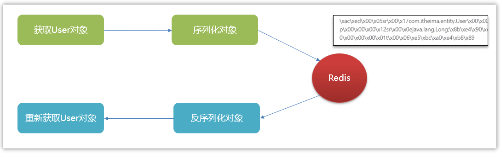
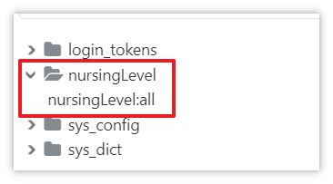

# 若依中的缓存使用

## 若依中的缓存使用

在目前的若依框架中，就是使用Redis来作为缓存的，核心配置类如下：

- 在zzyl-framework模块中的com.zzyl.framework.config.RedisConfig类

  - 作用：配置类，开启了缓存注解、对象序列化和反序列化

  > 对象序列化是将对象转换为可存储或传输的字节序列的过程，方便在需要时可以重新创建对象。这种序列化后的字节序列可以保存在文件，数据库或通过网络进行传输。
  > 
  > 
  > 
  > 想要实现序列化的类，必须实现**Serializable**接口
- 在com.zzyl.common.core.redis.RedisCache

  - 封装了常见的操作Redis的方法，在业务开发中，可以直接使用这个类的方法来操作Redis


## 功能接口添加缓存

### 哪些数据需要添加放到缓存中

- **高频访问且变更较少的数据**：用户信息（基本资料、权限）、配置信息（系统配置、业务规则等）
- **数据库查询结果**：复杂的数据库查询（多表或量大且需要经常访问）
- **热门内容**：热门文章、热门视频、热门评论等，访问量高的数据
- **临时数据**：临时存储一些数据以便后续使用（如验证码、临时文件路径等），在内存中以便快速访问。
- **需要快速访问的小数据集**：某些情况下，即使数据不大，但如果需要频繁访问，可以考虑将其缓存起来以提高性能。

### 缓存使用策略

#### 添加缓存的思路

基本的流程如下图：

<whiteboard token="PwExwub3ahT4FDbLfGJcxYclniT"></whiteboard>

#### 数据同步思路

- **先更新数据库，再删除缓存**：  
这是**最**常用的策略之一。当数据更新时，首先更新数据库，然后删除缓存中的旧数据。这样，下次请求时缓存会重新从数据库中加载最新数据。这种方法避免了缓存和数据库之间的数据竞争，但需要注意删除缓存操作的成功性。

<whiteboard token="L729wY3uwhhgRDbNNdWc6R5anPe"></whiteboard>

- **设置缓存过期时间**：  
为缓存设置合理的过期时间，到期后缓存数据自动失效，从而触发从数据库中重新加载数据。这种方法适用于对数据一致性要求不是非常严格，但希望减少数据库访问压力的场景。


### 入住办理相关接口添加缓存

#### 分析入住办理中哪些可以使用缓存

下图分析了各个接口的情况，重点标明了哪些接口推荐使用缓存

| **接口名称** | **是否需要使用缓存** | **理由** |
|-|-|-|
| 分页查询入住列表 | 否 | 不涉及多表，量也不大 |
| **查询所有护理等级** | **是** | **组件加载需要查询，有效率要求，并且是检索表中所有数据** |
| 根据床位状态查询树形数据 | 否 | 经常性的有**写操作**（比如：老人入住后需要更新床位状态） |
| **查询房间价格等数据** | **是** | **可以添加，涉及到多表查询** |
| 申请入住 | 否 | 新增，不是查询 |
| 查询入住详情 | 否 | 并非高频访问 |

#### 护理等级添加缓存

我们要在护理等级中添加缓存基本思路如下：

- 查询所有护理等级的时候，先到缓存查，缓存有则返回，缓存没有则查数据库，同时放到缓存中
- 增删改操作之后，需要删除缓存
- 需要修改NursingLevelServiceImpl类中的方法，详细代码如下：

```Java
package com.zzyl.nursing.service.impl;

import java.util.List;
import com.zzyl.common.utils.DateUtils;
import com.zzyl.nursing.vo.NursingLevelVo;
import org.springframework.beans.factory.annotation.Autowired;
import org.springframework.data.redis.core.RedisTemplate;
import org.springframework.stereotype.Service;
import com.zzyl.nursing.mapper.NursingLevelMapper;
import com.zzyl.nursing.domain.NursingLevel;
import com.zzyl.nursing.service.INursingLevelService;

/**
 * 护理等级Service业务层处理
 * 
 * @author ruoyi
 * @date 2024-09-07
 */
@Service
public class NursingLevelServiceImpl implements INursingLevelService 
{
    @Autowired
    private NursingLevelMapper nursingLevelMapper;

    @Autowired
    private RedisTemplate<Object, Object> redisTemplate;

    private static final String CACHE_KEY_PREFIX = "nursingLevel:all";

    /**
     * 查询护理等级
     * 
     * @param id 护理等级主键
     * @return 护理等级
     */
    @Override
    public NursingLevel selectNursingLevelById(Long id)
    {
        return nursingLevelMapper.selectNursingLevelById(id);
    }

    /**
     * 查询护理等级列表
     * 
     * @param nursingLevel 护理等级
     * @return 护理等级
     */
    @Override
    public List<NursingLevelVo> selectNursingLevelList(NursingLevel nursingLevel)
    {
        return nursingLevelMapper.selectNursingLevelList(nursingLevel);
    }

    /**
     * 新增护理等级
     * 
     * @param nursingLevel 护理等级
     * @return 结果
     */
    @Override
    public int insertNursingLevel(NursingLevel nursingLevel)
    {
        nursingLevel.setCreateTime(DateUtils.getNowDate());
        int flag = nursingLevelMapper.insertNursingLevel(nursingLevel);
        // 删除缓存
        deleteCache();
        return flag;
    }

    private void deleteCache() {
        // 删除缓存
        redisTemplate.delete(CACHE_KEY_PREFIX);
    }

    /**
     * 修改护理等级
     * 
     * @param nursingLevel 护理等级
     * @return 结果
     */
    @Override
    public int updateNursingLevel(NursingLevel nursingLevel)
    {
        nursingLevel.setUpdateTime(DateUtils.getNowDate());
        int flag =  nursingLevelMapper.updateNursingLevel(nursingLevel);
        deleteCache();
        return flag;
    }

    /**
     * 批量删除护理等级
     * 
     * @param ids 需要删除的护理等级主键
     * @return 结果
     */
    @Override
    public int deleteNursingLevelByIds(Long[] ids)
    {
        int flag = nursingLevelMapper.deleteNursingLevelByIds(ids);
        deleteCache();
        return flag;
    }

    /**
     * 删除护理等级信息
     * 
     * @param id 护理等级主键
     * @return 结果
     */
    @Override
    public int deleteNursingLevelById(Long id)
    {
        int flag = nursingLevelMapper.deleteNursingLevelById(id);
        deleteCache();
        return flag;
    }

    /**
     * 查询所有护理等级
     * @return
     */
    @Override
    public List<NursingLevel> listAll() {

        // 从缓存中获取
        List<NursingLevel> list = (List<NursingLevel>) redisTemplate.opsForValue().get(CACHE_KEY_PREFIX);
        // 缓存中有数据，直接返回
        if(list != null && list.size() > 0){
            return list;
        }
        // 缓存中没有数据，从数据库中查询
        list = nursingLevelMapper.listAll();
        // 将数据写入缓存
        redisTemplate.opsForValue().set(CACHE_KEY_PREFIX, list);

        return list;
    }
}
```

在Redis中，**冒号**通常用作键的命名约定，可以创建层次结构，类似于文件系统中的路径结构，提升查找效率

- 比如key=nursingLevel:all  对应的存储目录如下：

  


## 作业

1. 在添加护理等级的时候需要查询所有的护理计划，请给护理计划添加缓存
2. 在添加护理计划的时候需要查询所有的护理项目，请给护理项目添加缓存
3. 阅读**验证码生成**、**登录**接口中Redis的使用
4. 参考明天的讲义 <cite doc-id="LOnMw4GqEi3nTRkG8sfc0kNZnNh" file-type="wiki" title="03-智能评估-集成AI大模型" type="doc"></cite> 注册百度智能云并完成实名认证

---
> 来源：飞书技术知识库（脱敏版） · 07 业务组件方案集 / 中州养老项目（若依+AI） / 第二章-入住办理+AI大模型提升业务能力 / 若依中的缓存使用 · [原文](https://ccn8v2zngwsm.feishu.cn/wiki/CHE1wYxfEiPafkkb4cZcayD0ntg)
